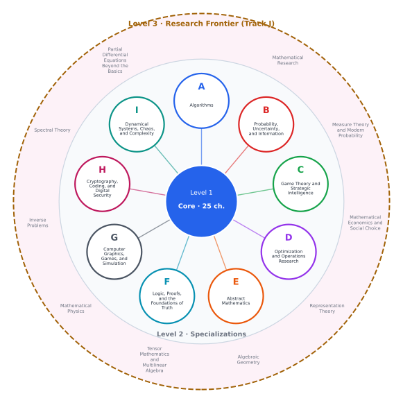

# The Mathematics Universe

[](LICENSE-CONTENT.md)
[](LICENSE)
[](https://github.com/The-Studio-of-Sadiq/engineering-mathematics/actions/workflows/check.yml)
[](The-Mathematics-Universe.pdf)

> **Engineering Mathematics Core and Beyond.** A foundation for modelling, analysing and simulating engineered systems, then nine specialization tracks and a research frontier for whoever wants to keep going.



**[Download the PDF](The-Mathematics-Universe.pdf)** · [Table of Contents](00-front/table-of-contents.md) · [Learning Paths](00-front/learning-paths.md) · [Notation](00-front/notation-and-conventions.md)

---

## Three levels

| Level | What it is | Where |
|---|---|---|
| **1 — Core** | 25 chapters of engineering mathematics: calculus, linear algebra, differential equations, transforms, probability and statistics, numerical methods, optimization, modelling. Deep and thorough. | `part-1-…` to `part-7-…` |
| **2 — Specializations** | Nine tracks (A–I), about 70 chapters. Each is shorter and more provocative than the core: a hook, the big idea, the mathematics, an algorithm, an experiment to run, a challenge, and *loose threads*, the questions deliberately left open. | [`tracks/`](tracks/) |
| **3 — Research Frontier** | Track J: weak solutions, spectral theory, inverse problems, mathematical physics, tensors, algebraic geometry, representation theory, mathematical economics, measure theory, and how research gets done. | [`tracks/j-frontier`](tracks/j-frontier/README.md) |
| **Appendix** | Complete proofs of the core's central results (61 theorems). | [`appendix/`](appendix/) |

You don't need to read it front to back. Do the core chapters a track lists as prerequisites, then follow the track, or a [learning path](00-front/learning-paths.md) such as *game development* (G → A → I) or *strategic systems* (C → B → D).

## The tracks

| Track | Title | Chapters |
|---|---|---|
| [A](tracks/a-algorithms/README.md) | The Mathematics Behind Algorithms | 26–30 |
| [B](tracks/b-probability-information/README.md) | Probability, Uncertainty, and Information | 31–38 |
| [C](tracks/c-game-theory/README.md) | Game Theory and Strategic Intelligence | 39–46 |
| [D](tracks/d-optimization/README.md) | Optimization and Operations Research | 47–55 |
| [E](tracks/e-abstract-math/README.md) | The Abstract Mathematics Behind Everything | 56–62, 99 |
| [F](tracks/f-logic-foundations/README.md) | Logic, Proofs, and the Foundations of Truth | 63–68 |
| [G](tracks/g-graphics-simulation/README.md) | Mathematics for Computer Graphics, Games, and Simulation | 69–76 |
| [H](tracks/h-cryptography-coding/README.md) | Cryptography, Coding, and Digital Security | 77–82 |
| [I](tracks/i-dynamical-systems/README.md) | Dynamical Systems, Chaos, and Complexity | 83–88 |
| [J](tracks/j-frontier/README.md) | Mathematics at the Frontier | 89–98 |

Track chapters plant **missing clues**: `[!mystery]` callouts that raise a question and point to the chapter, or the open problem, where the answer lives. The challenges have no answer key on purpose.

## Reading it

- **Obsidian (recommended).** Open this folder as a vault and enable the **Desmos** community plugin (Settings → Community plugins → Browse → "Desmos"). Every `desmos-graph` block becomes a live graph.
- **GitHub / VS Code.** Math renders; Desmos blocks show as their equations, which you can paste into [desmos.com/calculator](https://www.desmos.com/calculator).
- **PDF.** [`The-Mathematics-Universe.pdf`](The-Mathematics-Universe.pdf) holds the whole book with bookmarks, clickable cross-references, KaTeX math, and every Desmos graph rendered by Desmos itself.

## Repository layout

| Path | Contents |
|---|---|
| `part-*/`, `tracks/*/`, `appendix/` | the chapters (Markdown + LaTeX) |
| `00-front/` | table of contents, notation, syllabi, learning paths, [authoring guide](00-front/authoring-guide.md) |
| `images/` | every crafted figure (SVG) |
| `figures/` | the Matplotlib scripts that draw them: `python figures/build_all.py` regenerates all |
| `tools/book.json` | the single source of truth for tracks, chapters and paths; `python tools/gen_nav.py` regenerates the table of contents and track pages |
| `tools/fix_desmos.py` | finds and fixes Desmos syntax the Obsidian plugin can't parse |
| `pdf/` | the PDF build (Node + headless Chrome) |
| `mcp-server/` | an MCP server so Claude and other clients can search and read the book ([README](mcp-server/README.md)); Claude Code picks it up from [`.mcp.json`](.mcp.json) |

## Rebuilding the PDF

Needs Node 18+ and Google Chrome or Microsoft Edge; Desmos graphs need network access.

```bash
cd pdf && npm install && node build.mjs
```

The build renders each Desmos block once (cached in `pdf/cache/`), prints the book with Chrome, and writes `The-Mathematics-Universe.pdf` at the repository root. It reports any math or Desmos errors in `pdf/cache/`. Set `DESMOS_API_KEY` to use your own key; otherwise it uses the public demo key from the Desmos API documentation. `node build.mjs --only core` (or `tracks`, `appendix`) builds a partial PDF for quick checks.

## Contributing

Corrections, clearer explanations, figures and new chapters are welcome. Read [CONTRIBUTING.md](CONTRIBUTING.md); report mathematical errors with the **Erratum** issue template. Everyone taking part follows the [Code of Conduct](CODE_OF_CONDUCT.md). Security issues in the tooling: see [SECURITY.md](SECURITY.md). Release history: [CHANGELOG.md](CHANGELOG.md).

## License

- **Book content** (chapters, appendix, front matter, figures, the PDF): [CC BY 4.0](LICENSE-CONTENT.md). Reuse and adapt it freely, commercially or not, with attribution.
- **Code** (`pdf/`, `figures/`, `tools/`, `mcp-server/`, and code snippets in chapters): [MIT](LICENSE).

To cite the book, use [CITATION.cff](CITATION.cff) (GitHub's "Cite this repository" button reads it).
