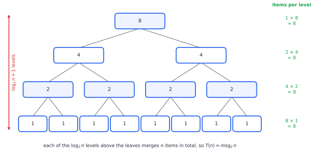

# Chapter 26 — The Mathematics of Algorithms

[← Previous](README.md) · [Track A](README.md) · [Table of Contents](../../00-front/table-of-contents.md) · [Next →](27-graph-theory.md)

> **Level 2 · Track A — The Mathematics Behind Algorithms**
> **Builds on:** [Ch. 1](../../part-1-foundations/01-mathematical-language-and-algebra.md), [Ch. 17](../../part-5-transforms/17-z-transforms.md), [Ch. 24](../../part-7-numerical-computational/24-computational-mathematics.md) · **Leads to:** [Ch. 27](27-graph-theory.md), [Ch. 28](28-combinatorics.md), [Ch. 30](30-limits-of-computation.md) · **Related:** [Ch. 52](../d-optimization/52-dynamic-programming.md), [Ch. 32](../b-probability-information/32-counting-random-worlds.md)
> **Reading time:** ~25 min

## 26.1 The hook

Two engineers are asked to write the same routine. It takes a list of $n$ items (sensors to switch on, jobs to schedule, wires to route) and picks the best combination.

Engineer X writes the obvious thing: try every subset of the $n$ items, score each one, keep the best. There are $2^n$ subsets, and each one is scored in about one elementary step. Engineer Y writes something cleverer, full of tables and bookkeeping, that needs about $50\,n^2$ elementary steps.

They race the two programs on the test suite, where $n$ runs from 5 to 12. X wins every single test. At $n=10$, X takes $2^{10}=1024$ steps and Y takes $50\times100=5000$: the "naive" code is almost five times faster. Y's code is longer, harder to read, and slower. The team ships X.

Six months later a customer runs it with $n=40$. On a machine doing $10^9$ steps per second, X needs $2^{40}\approx1.1\times10^{12}$ steps, about **18 minutes**. Y would have needed $50\times1600=80{,}000$ steps: 80 microseconds. A second customer tries $n=60$. X now needs $2^{60}\approx1.15\times10^{18}$ steps, about **36 years**. Y: $180{,}000$ steps, under a fifth of a millisecond.

Nothing was wrong with the test suite. Every measurement was correct. The machine did not get slower. And yet a program that was five times *faster* became trillions of times *slower*, just because the input grew from 10 to 60.

> **The challenge of this chapter:** Why can an algorithm that is faster on small inputs become terrible on large ones? And can you tell, *before* the customer does, which one it will be?

The answer is not "computers are mysterious". It is a theorem, and a short one. By the end of this chapter you will be able to prove it, predict exactly where the crossover happens, and show that no amount of hardware or clever coding can rescue the exponential.

## 26.2 The big idea

Forget seconds. An algorithm's running time is a **function of the input size**, $T(n)$, and what matters for large inputs is the *shape* of that function, not its value at any particular $n$.

Here is the most useful single experiment in algorithm analysis: **double the input and see what happens to the cost.**

| Cost $T(n)$ | $T(2n)$ | Doubling the input… |
|---|---|---|
| $n$ | $2n$ | doubles the cost |
| $n\log_2 n$ | $2n\log_2 n+2n$ | slightly more than doubles it |
| $n^2$ | $4n^2$ | quadruples it |
| $n^3$ | $8n^3$ | multiplies it by 8 |
| $2^n$ | $2^{2n}=(2^n)^2$ | **squares** it |

That last row is the whole story of the hook. For a polynomial cost, doubling $n$ multiplies the cost by a *fixed* factor ($2^k$ for $n^k$). For an exponential cost, doubling $n$ *squares* the cost. A thousand steps becomes a million; a million becomes a trillion. No fixed factor can keep up with squaring.

An analogy: a polynomial algorithm is a salary with a raise; an exponential algorithm is compound interest. Over the first few years the big salary looks better. Over a lifetime compound interest wins, and the only question is *when*.


*Costs with very different constants. On small inputs (left) the exponential is the cheapest of all four; on a logarithmic scale (right) it is a straight line climbing away from every polynomial. The polynomials reorder too: crossovers A, B, C are where a slower-growing cost finally pays off its larger constant.*

Look at the right panel carefully, because it hides a second lesson. The polynomial curves cross each other too. $5000\,n$ has a large constant and is the *worst* of the three polynomials until $n=100$, after which it beats $50\,n^2$ forever. Every pair of growth rates has a crossover point. Below it the constants decide; above it the **order of growth** decides, and it decides permanently.

So the answer to the challenge question is already visible: small inputs measure constants, large inputs measure growth rates, and the two can disagree. The mathematics will tell us *how far* the crossover can be pushed, and the answer is shockingly small.

## 26.3 The mathematics

### Asymptotic notation, in one paragraph

The definitions of $O$, $\Omega$ and $\Theta$ are in [Ch. 24, §24.1](../../part-7-numerical-computational/24-computational-mathematics.md#241-algorithmic-thinking): $f=O(g)$ means $f(n)\le c\,g(n)$ for all large $n$; $\Omega$ is the reverse inequality; $\Theta$ is both. We add one tool and one symbol.

> [!definition] Little-o and the limit test
> $f=o(g)$ ("$f$ grows strictly slower than $g$") means $f(n)/g(n)\to0$ as $n\to\infty$.
> If $\lim_{n\to\infty} f(n)/g(n)=L$ exists, then
> - $L=0$ gives $f=o(g)$, hence $f=O(g)$ but not $\Theta(g)$;
> - $0<L<\infty$ gives $f=\Theta(g)$;
> - $L=\infty$ gives $g=o(f)$.

The limit test turns "which algorithm scales better?" into a calculus question, and L'Hôpital's rule ([Ch. 4](../../part-2-calculus/04-differential-calculus.md)) often answers it in one line. For example, $\ln n/n^{0.01}\to0$: even the feeblest power of $n$ eventually beats a logarithm.

### Result 1: every exponential beats every polynomial

> [!theorem] Polynomials lose to exponentials
> For every fixed $k\ge0$ and every base $b>1$,
> $$
> \lim_{n\to\infty}\frac{n^k}{b^n}=0 .
> $$
> Consequently, for any constants $c_1,c_2>0$ there is an $N$ such that $c_1\,n^k<c_2\,b^n$ for all $n>N$.

*Proof.* Let $a_n=n^k/b^n$. The ratio of consecutive terms is

$$
\frac{a_{n+1}}{a_n}=\left(1+\frac1n\right)^k\frac1b\;\longrightarrow\;\frac1b<1 .
$$

Pick any $q$ with $1/b<q<1$. Because the ratio converges to $1/b$, there is an $M$ with $a_{n+1}\le q\,a_n$ for all $n\ge M$. Then $a_n\le a_M\,q^{\,n-M}$ for $n\ge M$, and $q^{\,n-M}\to0$ because $0<q<1$. So $a_n\to0$.

For the second claim, $c_1n^k/(c_2b^n)=(c_1/c_2)\,a_n\to0$, so it is eventually below 1. ∎

That proves the hook's disaster was inevitable. But it does not yet say *when*, and that is where the real surprise is.

### How far can a constant push the crossover?

Suppose the exponential algorithm is made $c$ times cheaper than a quadratic one: compare $2^n$ against $c\,n^2$. Take $\log_2$ of both sides. The exponential is still the cheaper one exactly when

$$
n\;<\;\log_2 c+2\log_2 n .
$$

The constant enters only through $\log_2 c$. Every factor of two you squeeze out of the exponential algorithm (a faster chip, better code, a parallel cluster of two machines) buys you **one** more input item before the crossover. A factor of a million buys about $\log_2 10^6\approx 20$.

With the hook's numbers, $c=50$ gives a crossover at $n\approx13.1$. Make the exponential code a million times faster ($c=5\times10^7$) and the crossover moves to $n\approx35.9$. Twenty-three more items, bought with a millionfold speed-up. Go to $c=5\times10^9$ and you reach $n\approx43$. The customer with $n=60$ is out of reach of every computer that will ever be built.

> [!tip] The engineering rule
> Hardware improvements multiply your speed, which **adds** to the feasible $n$ of an exponential algorithm and **multiplies** the feasible $n$ of a polynomial one. Moore's law makes an $O(n^2)$ code handle $\sqrt2$ times larger inputs every doubling; it makes an $O(2^n)$ code handle exactly one more item.

### Result 2: solving a recurrence with a recursion tree

Divide-and-conquer algorithms are analysed by **recurrences**. Merge sort splits a list in half, sorts each half recursively, and merges the two sorted halves in at most $n$ comparisons:

$$
T(n)=2\,T(n/2)+n,\qquad T(1)=0 .
$$

A recurrence is a difference equation in disguise. [Ch. 17](../../part-5-transforms/17-z-transforms.md#175-difference-equations) solves linear difference equations with the Z-transform; here the index *halves* instead of decreasing by one, so we draw the recursion instead.



*The recursion tree of merge sort for $n=8$. Each level splits the work into more, smaller pieces, but the total per level stays $n$. The height is the number of halvings, $\log_2 n$.*

> [!theorem] Merge-sort recurrence
> For $n=2^m$, the recurrence $T(n)=2T(n/2)+n$, $T(1)=0$, has the exact solution $T(n)=n\log_2 n$.

*Proof by induction on $m$.* For $m=0$: $T(1)=0=1\cdot\log_2 1$. Assume $T(2^{m})=2^m m$. Then

$$
T(2^{m+1})=2\,T(2^m)+2^{m+1}=2\cdot 2^m m+2^{m+1}=2^{m+1}(m+1),
$$

which is $n\log_2 n$ for $n=2^{m+1}$. ∎

The tree shows *why*: at depth $i$ there are $2^i$ subproblems of size $n/2^i$, so each level costs $2^i\cdot n/2^i=n$, and there are $\log_2 n$ levels that do merging. The general version, $T(n)=a\,T(n/b)+\Theta(n^d)$, is the master theorem stated in [Ch. 24, §24.1](../../part-7-numerical-computational/24-computational-mathematics.md#241-algorithmic-thinking). The recursion tree explains its three cases in one sentence: the work per level forms a geometric series with ratio $a/b^d$. If the ratio is below 1 the root dominates, $\Theta(n^d)$; if it equals 1 every level counts equally and you pay a $\log n$ factor; if it is above 1 the leaves dominate, $\Theta(n^{\log_b a})$.

> [!example] Why the exponent of matrix multiplication is not 3
> Multiplying two $n\times n$ matrices by splitting into $2\times2$ blocks needs 8 block products: $T(n)=8T(n/2)+\Theta(n^2)$, so $\Theta(n^{\log_2 8})=\Theta(n^3)$. Strassen found a way with **7** block products. The ratio $7/2^2>1$ puts us in the leaf-dominated case: $\Theta(n^{\log_2 7})=\Theta(n^{2.807})$. Saving one multiplication out of eight at the top changes the exponent, because the saving compounds at every level.

> [!mystery] The exponent nobody knows
> Strassen's trick was improved again and again, and as of 2024 the best known exponent for matrix multiplication is about $2.371$. The obvious lower bound is $2$ (you have to read $n^2$ entries). Is the true exponent $\omega$ equal to 2? Nobody knows. It is one of the great open problems of algorithm theory, and how mathematicians attack problems like it is the subject of [Ch. 98](../j-frontier/98-mathematical-research.md).

### Result 3: amortized analysis — the cheap average of an expensive worst case

A dynamic array (Python's `list`, C++'s `vector`) stores items in a fixed block of memory. When the block is full, the next append allocates a block **twice as large** and copies everything over. A single append can therefore cost $n$ copies. Is appending $O(n)$?

> [!theorem] Doubling makes appends $O(1)$ amortized
> Starting from capacity 1 and doubling when full, any sequence of $n$ appends performs fewer than $3n$ elementary writes in total. The **amortized** cost per append is therefore $O(1)$, even though a single append can cost $\Theta(n)$.

*Proof.* Each append writes its own item once: $n$ writes. Copies happen when the size reaches $1,2,4,\dots,2^k$ where $2^k<n$, costing $1+2+4+\dots+2^k=2^{k+1}-1<2n$ copies. Total: fewer than $n+2n=3n$. ∎

Amortization is a statement about *sequences* of operations, not single ones. Here is the trap in the other direction: grow the block by a fixed $+100$ slots instead of doubling, and the copies cost $100+200+\dots\approx n^2/200$, which is $\Theta(n^2)$ in total. Both versions are instant in a unit test with 1000 items. Only one survives ten million.

The proof above simply added the costs (the **aggregate method**). The more powerful **potential method** stores "prepaid credit" $\Phi$ in the data structure: each cheap append pays 3 units, uses 1, and banks 2 against the next expensive copy. It is the same accounting idea an engineer uses for energy in a capacitor: cheap steps charge it, the expensive step discharges it, and the books balance over any window.

### Result 4: a lower bound — no sorting algorithm can beat $n\log n$

Big-O answers "how fast is *this* algorithm?". A **lower bound** answers a far bolder question: "how fast can *any* algorithm possibly be?". Lower bounds are rare and precious, because they speak about programs nobody has written yet.

> [!theorem] The comparison-sorting lower bound
> Any algorithm that sorts $n$ distinct items using only pairwise comparisons ("is $x_i<x_j$?") needs at least $\lceil\log_2 n!\rceil$ comparisons in the worst case, and $\log_2 n!=\Theta(n\log n)$.

*Proof.* Model any such algorithm as a **decision tree**: each internal node is a comparison, each branch is its outcome, and each leaf is a final answer ("the sorted order is $x_3<x_1<x_2$"). Different input orderings must reach different leaves, otherwise the algorithm gives the same answer to two inputs that need different answers. There are $n!$ orderings, so the tree has at least $n!$ leaves. A binary tree of height $h$ has at most $2^h$ leaves, so $2^h\ge n!$, that is $h\ge\log_2 n!$. The height is the worst-case number of comparisons.

For the growth rate: the largest $n/2$ factors of $n!$ are each at least $n/2$, so $n!\ge(n/2)^{n/2}$ and $\log_2 n!\ge\tfrac n2\log_2\tfrac n2=\Omega(n\log n)$. Also $n!\le n^n$ gives $\log_2 n!\le n\log_2 n$. ∎

For $n=10$ the bound is $\lceil\log_2 3{,}628{,}800\rceil=\lceil21.79\rceil=22$ comparisons. For $n=10^6$ it is about $1.85\times10^7$, while merge sort uses at most $n\log_2 n\approx1.99\times10^7$. Merge sort is within 8% of the best that is *logically possible*. That is the power of a lower bound: it tells you when to stop optimizing.

> [!warning] Lower bounds have fine print
> The theorem is about the *comparison model*. Sort $n$ integers that fit in a machine word and radix sort runs in $O(n)$, because it looks at digits instead of comparing. A lower bound is only as strong as the model it is proved in, and many famous "impossibility" results are really statements about one model of computation.

### Trade-offs: what big-O does not tell you

Big-O picks the winner as $n\to\infty$. Engineers live at finite $n$, and three trade-offs decide real choices:

- **Time against memory.** A lookup table turns a computation into $O(1)$ time at the cost of memory; memoization ([Ch. 52](../d-optimization/52-dynamic-programming.md)) turns some exponential recursions into polynomial ones by storing every sub-answer.
- **Worst case against typical case.** Quicksort is $\Theta(n^2)$ in the worst case and roughly $1.39\,n\log_2 n$ comparisons on average; it is usually faster than merge sort anyway.
- **Constants against growth.** Library sorts switch to insertion sort ($\Theta(n^2)$) for sub-lists below about 16–32 items, exactly because of the left panel of the first figure.

> [!mystery] Where does the 1.39 come from?
> Quicksort with a random pivot makes about $2n\ln n\approx1.39\,n\log_2 n$ comparisons on average. The worst case is quadratic, so the average needs a probability argument over all $n!$ orderings, and the constant $2\ln2\approx1.39$ comes out of a harmonic sum. That argument, counting random arrangements, is developed in [Ch. 32](../b-probability-information/32-counting-random-worlds.md).

## 26.4 The algorithm

Analysis becomes real when you can *count*. Here is merge sort instrumented to return the number of comparisons it makes, the quantity the lower bound talks about:

```python
def merge_sort(a):
    """Return (sorted copy of a, number of comparisons)."""
    if len(a) <= 1:
        return list(a), 0
    mid = len(a) // 2
    left, cl = merge_sort(a[:mid])
    right, cr = merge_sort(a[mid:])
    out, i, j, comps = [], 0, 0, cl + cr
    while i < len(left) and j < len(right):
        comps += 1
        if left[i] <= right[j]:
            out.append(left[i]); i += 1
        else:
            out.append(right[j]); j += 1
    out += left[i:] + right[j:]          # one side is exhausted: no comparisons needed
    return out, comps
```

On a random permutation of 1000 items this makes about 8700 comparisons, below the worst-case $n\log_2 n\approx9966$ and above the information-theoretic floor $\log_2 1000!\approx8530$.

**Complexity.** Time $\Theta(n\log n)$ in every case (best, average, worst), by the recursion tree. Extra memory $\Theta(n)$ for the merged lists. Recursion depth $\lceil\log_2 n\rceil$, so about 20 for a million items: no risk of stack overflow.

**How to analyse any algorithm in four moves.**

1. *Choose the cost unit.* Comparisons, arithmetic operations, memory reads, disk seeks, messages over a network. The right unit is the one that dominates the wall-clock time.
2. *Write the cost as a function of $n$.* Loops become sums ($\sum_{i=1}^{n} i=n(n+1)/2$ for a triangular double loop); recursion becomes a recurrence.
3. *Solve or bound it.* Sums by closed forms or integrals ([Ch. 5](../../part-2-calculus/05-integral-calculus.md)); recurrences by recursion trees, the master theorem, or generating functions ([Ch. 28](28-combinatorics.md)).
4. *Check the constant at realistic sizes.* Measure. Big-O says who wins eventually, not who wins at *your* $n$.

**Failure cases worth knowing.**

- *Quicksort on sorted input.* With "first element as pivot", an already-sorted list splits into sizes $0$ and $n-1$ every time: $T(n)=T(n-1)+n=\Theta(n^2)$, and recursion depth $n$. Random pivots fix the expected cost, not the worst case.
- *Hash tables under attack.* A hash table is $O(1)$ per lookup *on average*. An adversary who knows the hash function can make every key collide, turning a web server's $O(n)$ request parsing into $O(n^2)$. This is a real denial-of-service attack, and the reason many languages randomize their hash seeds.
- *The hidden factor in "linear".* String concatenation in a loop (`s = s + piece`) copies the whole string every time: $\Theta(n^2)$ characters copied, the same trap as growing an array by $+100$.

> [!warning] Measuring is not analysing
> Timing a program at $n=10, 20, 40$ and fitting a curve can tell you the exponent of a polynomial (log–log slope), but it cannot distinguish $n^{10}$ from $2^n$ over a short range, and it cannot see a worst case that your test data never triggers. Measurement estimates constants; analysis guarantees growth.

## 26.5 The experiment

### Where is the crossover? (drag the constant)

Plotting $\log_2$ of the cost turns the exponential $2^n$ into the straight line $y=n$ and turns $c\,n^2$ into $\log_2 c+2\log_2 n$, a curve that bends over and flattens:

```desmos-graph
left=0; right=60; bottom=0; top=60
---
y=x|red
y=\frac{\ln(50)}{\ln(2)}+2\frac{\ln(x)}{\ln(2)}|purple
y=\frac{\ln(400)}{\ln(2)}+\frac{\ln(x)}{\ln(2)}+\frac{\ln(\frac{\ln(x)}{\ln(2)})}{\ln(2)}|blue
(13.06,13.06)|label:crossover with 50n²
```

*Vertical axis: $\log_2(\text{cost})$. Red is $2^n$, purple is $50\,n^2$, blue is $400\,n\log_2 n$. The red line crosses each curve once and never comes back.*

Change the **50** in the purple curve to **50000000** (a millionfold handicap for the exponential algorithm). The purple curve rises by about 20 units, and the crossover slides only from $n\approx13$ to $n\approx36$. Then change the **2** in front of the second term to **3** (a cubic algorithm) and see how little that changes the picture: the logarithm of any polynomial is a gently bending curve, and the logarithm of an exponential is a straight line that always gets out from under it.

### Insertion sort against merge sort (run it)

Insertion sort is $\Theta(n^2)$ but each step is tiny; merge sort is $\Theta(n\log n)$ but each comparison carries the overhead of recursion and list copying. The script counts comparisons for both and charges merge sort a configurable overhead per comparison.

```python
import numpy as np
import matplotlib.pyplot as plt

def insertion_cost(a):              # comparisons made by insertion sort
    a, c = list(a), 0
    for i in range(1, len(a)):
        j = i
        while j > 0:
            c += 1
            if a[j - 1] <= a[j]:
                break
            a[j - 1], a[j] = a[j], a[j - 1]
            j -= 1
    return c

def merge_cost(a):                  # comparisons made by merge sort
    if len(a) <= 1:
        return list(a), 0
    m = len(a) // 2
    (L, cl), (R, cr) = merge_cost(a[:m]), merge_cost(a[m:])
    out, i, j, c = [], 0, 0, cl + cr
    while i < len(L) and j < len(R):
        c += 1
        if L[i] <= R[j]: out.append(L[i]); i += 1
        else:            out.append(R[j]); j += 1
    return out + L[i:] + R[j:], c

OVERHEAD = 4.0                      # KNOB: extra cost per merge-sort comparison
rng = np.random.default_rng(0)
ns = np.arange(2, 201, 2)           # KNOB: range of input sizes
ins = [np.mean([insertion_cost(rng.permutation(n)) for _ in range(20)]) for n in ns]
mer = [OVERHEAD * np.mean([merge_cost(list(rng.permutation(n)))[1] for _ in range(20)]) for n in ns]
cross = ns[np.argmax(np.array(ins) > np.array(mer))]
print("insertion sort stops winning at n =", cross)
plt.plot(ns, ins, label="insertion sort"); plt.plot(ns, mer, label=f"merge sort x {OVERHEAD}")
plt.axvline(cross, ls=":"); plt.xlabel("n"); plt.ylabel("cost"); plt.legend(); plt.show()
```

With `OVERHEAD = 4.0` the crossover lands at about $n=78$; with `1.0` it is about 4, with `2.0` about 28. Try `8.0` and widen `ns` to 600: the crossover keeps moving right, but it always exists. Then replace `rng.permutation(n)` with `np.arange(n)` (already sorted input) and watch insertion sort become *linear*: the "worst" algorithm is the best one on nearly-sorted data, which is why it survives inside every production sort.

## 26.6 The challenge

1. **Intuition.** Algorithm P costs $n^{100}$ steps and algorithm E costs $1.01^n$ steps. Theorem 1 says E eventually loses. Without computing anything exactly, explain why "eventually" here means an astronomically large $n$, and argue which one you would actually deploy for $n\le10^6$.
2. **Derivation.** Solve the recurrence $T(n)=3\,T(n/2)+n$, $T(1)=1$, for $n=2^m$ exactly, by summing the recursion tree level by level. Show that the answer is $\Theta(n^{\log_2 3})$ and identify which level of the tree carries most of the work. (This recurrence is Karatsuba's fast multiplication of $n$-digit numbers.)
3. **Implementation.** Write a dynamic array class with a `growth` parameter: capacity is multiplied by `growth` when full. Count total element copies for $10^6$ appends with growth factors $1.1$, $1.5$, $2$ and $4$, and also record the peak wasted memory (capacity minus size). Plot copies against waste. Which factor would you choose, and why do real libraries use something between 1.5 and 2?
4. **Open investigation.** The comparison lower bound $\lceil\log_2 n!\rceil$ is not always achievable. For $n=12$ it equals 29, yet the minimum worst-case number of comparisons needed to sort 12 items is known to be 30. Write a program that searches for optimal comparison strategies for small $n$ ($n\le6$ is feasible) and compare with $\lceil\log_2 n!\rceil$. The exact optimum is still unknown for many $n$ above 15: what patterns can you find?

## 26.7 Loose threads

This chapter answered its challenge: an algorithm that is fast on small inputs becomes terrible on large ones when its *order of growth* is worse, because constants only shift the crossover by a logarithmic amount, while growth rates compound. We proved that every exponential beats every polynomial, solved a recurrence exactly, showed that amortization tames occasional expensive steps, and proved that no comparison sort can beat $n\log n$.

But we only ever counted *steps*. Several questions were raised and left on the table.

> [!mystery] Is the exponential ever necessary?
> Engineer X used $2^n$ steps because they tried every subset. For many subset problems (the knapsack problem, scheduling, circuit satisfiability) nobody knows any algorithm that is polynomial in the worst case, and nobody can prove one does not exist. Our sorting lower bound worked because the comparison model is simple; for general programs, proving that a problem *needs* exponential time is the P versus NP question, the subject of [Ch. 30](30-limits-of-computation.md).

The other threads run through the rest of this track and beyond:

- **Recurrences that don't halve.** Fibonacci-style recurrences $T(n)=T(n-1)+T(n-2)$ grow like $\varphi^n$ with $\varphi\approx1.618$. Where that golden ratio comes from, and how generating functions solve such recurrences mechanically, is in [Ch. 28](28-combinatorics.md).
- **From exponential to polynomial by remembering.** Many exponential recursions collapse to polynomial time when you store sub-answers: [Ch. 52](../d-optimization/52-dynamic-programming.md).
- **Algorithms on networks.** The most-used algorithms on Earth (route planning, matching, page ranking) run on graphs, and their analysis needs the language of [Ch. 27](27-graph-theory.md).
- **Proving the code is right, not just fast.** A fast wrong answer is worthless. Loop invariants and induction, the tools that turn "it passed the tests" into "it works for every input", are in [Ch. 29](29-discrete-mathematics-and-logic.md).

## Further reading

- T. H. Cormen, C. E. Leiserson, R. L. Rivest, C. Stein, *Introduction to Algorithms*, 4th ed., MIT Press, 2022. The standard reference for asymptotics, recurrences, amortized analysis and lower bounds.
- J. Kleinberg, É. Tardos, *Algorithm Design*, Pearson, 2005. Strong on intuition and on why problems are hard.
- R. Sedgewick, P. Flajolet, *An Introduction to the Analysis of Algorithms*, 2nd ed., Addison-Wesley, 2013. Exact counting, recurrences and generating functions.
- D. E. Knuth, *The Art of Computer Programming*, Vol. 3: *Sorting and Searching*, 2nd ed., Addison-Wesley, 1998. The definitive treatment of comparison counts, including minimum-comparison sorting.
