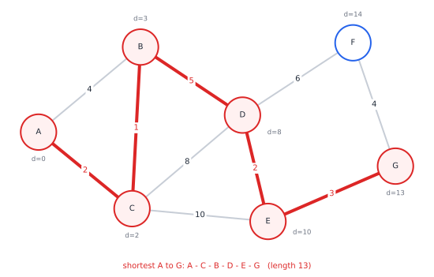

# Chapter 27 — Graph Theory: The Mathematics of Connections

[← Previous](26-the-mathematics-of-algorithms.md) · [Track A](README.md) · [Table of Contents](../../00-front/table-of-contents.md) · [Next →](28-combinatorics.md)

> **Level 2 · Track A — The Mathematics Behind Algorithms**
> **Builds on:** [Ch. 8](../../part-3-linear-algebra/08-matrices-and-linear-systems.md), [Ch. 10](../../part-3-linear-algebra/10-eigenvalues-and-eigenvectors.md), [Ch. 26](26-the-mathematics-of-algorithms.md) · **Leads to:** [Ch. 28](28-combinatorics.md), [Ch. 87](../i-dynamical-systems/87-network-science.md), [Ch. 90](../j-frontier/90-spectral-theory.md) · **Related:** [Ch. 34](../b-probability-information/34-random-walks-and-markov-chains.md), [Ch. 48](../d-optimization/48-duality.md), [Ch. 52](../d-optimization/52-dynamic-programming.md)
> **Reading time:** ~25 min

## 27.1 The hook

It is 6 p.m. on a Friday at a ride-hailing company. Three engineers have three problems.

**The router** must send a car from the depot to a pickup across a city of 200,000 intersections. The number of distinct routes is astronomically large: on a modest $20\times20$ grid of streets there are already $\binom{40}{20}\approx1.4\times10^{11}$ shortest-looking staircase routes alone, and the real city is not a grid. Yet the app must answer in milliseconds, for millions of requests an hour.

**The matcher** has 1000 free drivers and 1000 waiting riders. Each driver can reach only some riders in time. She wants as many riders served as possible. The number of ways to pair 1000 drivers with 1000 riders is $1000!\approx10^{2567}$, a number with 2568 digits. Trying them all is not slow; it is meaningless.

**The analyst** has a year of trip data: who rides from where to where. Management suspects the city has "hidden neighbourhoods", clusters of places that trade riders mostly among themselves, which do not match any map. Nobody has told her how many clusters there are, or where.

> **The challenge of this chapter:** How would you find the best route, match thousands of people, or detect hidden communities?

All three problems have the same shape: things, and connections between things. Strip away the cars, the people and the streets, and what is left is a drawing of dots and lines. That drawing is a **graph**, and the surprise of this chapter is that one drawing supports three completely different kinds of mathematics. The router will be saved by a greedy argument, the matcher by an alternating path, and the analyst by an eigenvector.

## 27.2 The big idea

A graph forgets everything except **who is connected to whom** (and sometimes, how strongly). A street map becomes intersections (vertices) and road segments (edges) with travel times as weights. A dating app becomes two columns of people with lines for "would accept". A friendship network becomes dots with lines for "talks to".

Once the problem is a graph, three big ideas do most of the work.

**Grow outward, never look back.** To find shortest routes from the depot, don't enumerate routes. Instead, spread out from the depot like a ripple in a pond, settling each intersection at the moment the ripple reaches it. A place reached first by the ripple can never be reached sooner by a longer detour. That is Dijkstra's algorithm, and it touches each road only once.

**Improve by flipping.** To enlarge a matching, look for a path that zig-zags between unmatched and matched edges, starting and ending at people nobody has served yet. Flip every edge along it, matched to unmatched and back, and the matching grows by one. When no such path exists, the matching is provably the largest possible.

**Let the network vibrate.** Encode the graph as a matrix and compute its eigenvectors. A graph with two loosely tied communities "vibrates" like two masses joined by a weak spring: the slowest non-trivial mode moves one community up while the other moves down. The sign of that eigenvector reveals the communities, with no labels and no guesswork about where they are.

The analogy that ties these together: a graph is a mechanical structure. Shortest paths are the strings that go taut when you pull two knots apart; matchings are how you pair up the bolts; communities are the parts that wobble together.

## 27.3 The mathematics

### Vocabulary in five lines

> [!definition] Graphs
> A **graph** $G=(V,E)$ is a set $V$ of vertices and a set $E$ of edges, each edge joining two vertices. The **degree** $\deg v$ is the number of edges at $v$. A **path** is a sequence of distinct vertices with consecutive ones adjacent; a **cycle** is a path that returns to its start. $G$ is **connected** if every pair of vertices is joined by a path. A **tree** is a connected graph with no cycles. In a **weighted** graph each edge $e$ carries a length $w(e)\ge0$, and the length of a path is the sum of its edge lengths.

Two facts come up constantly. First, the **handshake lemma**: $\sum_{v}\deg v=2|E|$, because every edge has two ends and is counted once at each. (So the number of odd-degree vertices is always even.) Second, every tree on $n$ vertices has exactly $n-1$ edges: remove a leaf and its edge, and induct.

Graphs are also matrices. The **adjacency matrix** $\mathbf{A}$ has $A_{ij}=1$ if $i$ and $j$ are adjacent, else 0; the **degree matrix** $\mathbf{D}$ is diagonal with $D_{ii}=\deg i$. Both are symmetric, which will matter at the end.

### Result 1: shortest paths — why the greedy ripple is correct



*A small road network. The direct road A–B (length 4) loses to the detour A–C–B (length 3), and the shortest route to G (length 13) passes through four intermediate intersections. Each label $d$ is the distance Dijkstra's algorithm assigns.*

Dijkstra's algorithm keeps a tentative distance $d(v)$ for every vertex, starting at $d(s)=0$ for the source and $\infty$ elsewhere, and a set $S$ of **settled** vertices, initially empty. Repeatedly:

1. pick the unsettled vertex $u$ with the smallest $d(u)$ and settle it;
2. for every edge $(u,v)$, **relax** it: $d(v)\leftarrow\min\{d(v),\,d(u)+w(u,v)\}$.

On the network above the vertices settle in the order A (0), C (2), B (3), D (8), E (10), G (13), F (14). Notice that B is first given tentative distance 4 by the direct road, then lowered to 3 when C is settled. Once settled, a distance never changes again. That is the claim we must prove.

> [!theorem] Correctness of Dijkstra's algorithm
> If all edge weights are non-negative, then when a vertex $u$ is settled, $d(u)$ equals the true shortest-path distance $\delta(s,u)$.

*Proof.* Every tentative value $d(v)$ is the length of some actual path (relaxation only ever writes path lengths), so $d(v)\ge\delta(s,v)$ always. Suppose, for contradiction, that $u$ is the **first** vertex settled with $d(u)>\delta(s,u)$. Take a true shortest path $P$ from $s$ to $u$. It starts inside $S$ (at $s$) and ends outside, so it has a first edge $(x,y)$ with $x\in S$ and $y\notin S$.

- $x$ was settled before $u$, so (by the choice of $u$) $d(x)=\delta(s,x)$, and when $x$ was settled the edge $(x,y)$ was relaxed. Hence $d(y)\le\delta(s,x)+w(x,y)=\delta(s,y)$, the last step because $P$'s prefix up to $y$ is a shortest path. So $d(y)=\delta(s,y)$.
- Weights are non-negative, so the rest of $P$ from $y$ to $u$ has length $\ge0$: $\delta(s,y)\le\delta(s,u)$.

Putting it together, $d(y)=\delta(s,y)\le\delta(s,u)<d(u)$. But the algorithm chose $u$ because it had the *smallest* tentative distance among unsettled vertices, and $y$ is unsettled with a smaller one. Contradiction. ∎

Look at where the proof used "non-negative": the remainder of the path cannot be negative, so a detour can never come back cheaper. That single word is load-bearing.

> [!mystery] The clue we're holding back
> Put a single negative weight on one road (a toll refund, a downhill battery recharge for an electric car) and Dijkstra can return a wrong answer with full confidence. The fix, the Bellman–Ford algorithm, relaxes every edge $|V|-1$ times and costs $O(|V|\,|E|)$ instead of roughly $O(|E|\log|V|)$. Why $|V|-1$ rounds are exactly enough is a dynamic-programming argument about the number of edges in a path: [Ch. 52](../d-optimization/52-dynamic-programming.md).

### Flows and matchings

A **flow network** has a source $s$, a sink $t$, and a capacity $c(e)\ge0$ on each directed edge. A flow assigns $f(e)$ with $0\le f(e)\le c(e)$, conserved at every vertex except $s$ and $t$ (in equals out, Kirchhoff's current law from circuit theory). A **cut** splits the vertices into a side containing $s$ and a side containing $t$; its capacity is the total capacity of edges crossing from the $s$-side to the $t$-side.

Any flow must cross every cut, so the value of any flow is at most the capacity of any cut. The astonishing theorem is that the bound is tight.

> [!theorem] Max-flow min-cut (stated)
> In any flow network, the maximum value of an $s$–$t$ flow equals the minimum capacity of an $s$–$t$ cut.

The algorithmic idea is the same "improve by flipping" from §27.2: while some path from $s$ to $t$ has spare capacity (counting the option of *cancelling* existing flow on reverse edges), push more flow along it. When no such path exists, the vertices still reachable from $s$ form a cut whose capacity equals the current flow, and both are optimal at once. Max-flow min-cut is a linear program and its dual, two problems with the same optimum; why that always happens is the theme of [Ch. 48](../d-optimization/48-duality.md).

Matching is flow in disguise. Put drivers on the left and riders on the right, an edge for every feasible pairing, a source joined to every driver and every rider joined to a sink, all with capacity 1. A maximum flow is a maximum matching.


*Greedy matching gets stuck at four pairs: D2's only rider R1 is taken. The orange **augmenting path** alternates unmatched and matched edges between two free vertices; flipping it swaps three matched edges for four and serves everyone.*

When can *every* driver be matched? An obvious obstacle: if some group of $k$ drivers can, between them, reach fewer than $k$ riders, someone is left out. Write $N(W)$ for the set of riders adjacent to at least one driver in $W$.

> [!theorem] Hall's marriage theorem
> A bipartite graph with left side $L$ has a matching that covers every vertex of $L$ if and only if $\lvert N(W)\rvert\ge\lvert W\rvert$ for every subset $W\subseteq L$.

*Proof of necessity.* If a matching covers $L$, then the drivers in $W$ are matched to $\lvert W\rvert$ *distinct* riders, all of them in $N(W)$. So $\lvert N(W)\rvert\ge\lvert W\rvert$. ∎

Sufficiency, the deep direction, says the obvious obstacle is the *only* obstacle: if no small group is starved, the augmenting-path algorithm never gets stuck. It follows from max-flow min-cut (a minimum cut that is smaller than $\lvert L\rvert$ can be read off as a starved group $W$). The matcher's problem with 1000 drivers is solved not by trying $10^{2567}$ pairings but by at most 1000 augmenting-path searches, each $O(\lvert E\rvert)$.

### Colouring and planarity

Assign each vertex a colour so that adjacent vertices differ. The minimum number of colours is the **chromatic number** $\chi(G)$. Colouring is scheduling in disguise: exams are vertices, an edge joins two exams sharing a student, colours are time slots. Radio transmitters that interfere need different frequencies; registers in a compiler that are live at the same time need different physical registers.

A graph is **planar** if it can be drawn in the plane with no crossing edges, like a circuit on a single-layer board. A drawing divides the plane into $F$ regions (faces, counting the outside).

> [!theorem] Euler's formula and its consequence
> For a connected planar drawing, $V-E+F=2$. If moreover $V\ge3$, then $E\le3V-6$.

*Proof sketch of Euler's formula.* A tree has $E=V-1$ and one face: $V-(V-1)+1=2$. Every other connected planar graph is a tree plus extra edges, and each extra edge closes a cycle, splitting one face into two: $E$ and $F$ both rise by 1 and $V-E+F$ is unchanged.

*Proof of the inequality.* Every face is bounded by at least 3 edges (no loops or double edges, and $V\ge3$), and every edge borders at most 2 faces. Counting edge–face incidences two ways gives $3F\le2E$. Substitute $F=2-V+E$ from Euler's formula: $3(2-V+E)\le2E$, that is $E\le3V-6$. ∎

The inequality instantly proves an impossibility. The complete graph $K_5$ (five vertices, all joined) has $V=5$ and $E=10$, but $3V-6=9$. So $K_5$ **cannot be drawn without a crossing**, however clever you are. No search, no trial and error: one line of counting rules out infinitely many drawings at once. (The same argument with faces of length at least 4 shows the "three houses, three utilities" graph $K_{3,3}$ is not planar either.)

> [!mystery] Four colours, and a proof no human has checked
> Every planar map can be coloured with at most **four** colours so that neighbouring regions differ. The inequality $E\le3V-6$ quickly shows that five colours always suffice. The step from five to four resisted mathematicians for 124 years, and when it was finally proved in 1976 the proof required a computer to check nearly two thousand configurations. What it means to trust such a proof, and how modern proof assistants have since verified it, is part of [Ch. 98](../j-frontier/98-mathematical-research.md) and [Ch. 67](../f-logic-foundations/67-formal-verification.md).

Planar graphs are the gentle case. For a general graph, deciding whether three colours suffice is NP-complete: no known algorithm beats exponential time in the worst case. Why that classification is so damning is [Ch. 30](30-limits-of-computation.md)'s story.

### Centrality: who matters in a network?

There is no single answer, which is why there are several centrality measures.

- **Degree centrality**: how many connections. Simple, local, easy to fool.
- **Betweenness centrality**: the fraction of shortest paths between other pairs that pass through $v$. A bridge between two communities has low degree but huge betweenness, and it is the vertex whose failure splits the network.
- **Eigenvector centrality and PageRank**: you are important if important vertices point to you. That circular definition is an eigenvector equation, $\mathbf{A}^\mathsf{T}\mathbf{x}=\lambda\mathbf{x}$, and PageRank adds a small chance of jumping to a random page so the eigenvector is unique.

> [!tip] Engineering note
> In a power grid, betweenness identifies transmission lines whose loss reroutes the most power flow; in a chip's interconnect, it flags wires that are on many critical paths. Degree alone would miss both.

### Result 2: the Laplacian sees connectivity

Define the **graph Laplacian** $\mathbf{L}=\mathbf{D}-\mathbf{A}$. It is the discrete cousin of $\nabla^2$ ([Ch. 13](../../part-4-differential-equations/13-partial-differential-equations.md)) and the nodal admittance matrix of a resistor network in which every edge is a 1 S conductance ([Ch. 8](../../part-3-linear-algebra/08-matrices-and-linear-systems.md)). Its key property is a quadratic form.

> [!theorem] The Laplacian quadratic form
> For every vector $\mathbf{x}\in\mathbb{R}^{V}$,
> $$
> \mathbf{x}^\mathsf{T}\mathbf{L}\,\mathbf{x}=\sum_{\{i,j\}\in E}(x_i-x_j)^2 .
> $$
> Hence $\mathbf{L}$ is positive semidefinite, and **the number of zero eigenvalues of $\mathbf{L}$ equals the number of connected components of $G$.**

*Proof.* $\mathbf{x}^\mathsf{T}\mathbf{D}\mathbf{x}=\sum_i\deg(i)\,x_i^2$, and by the handshake idea this equals $\sum_{\{i,j\}\in E}(x_i^2+x_j^2)$: each edge contributes the squares of its two ends. Also $\mathbf{x}^\mathsf{T}\mathbf{A}\mathbf{x}=\sum_{i,j}A_{ij}x_ix_j=\sum_{\{i,j\}\in E}2x_ix_j$. Subtracting, each edge gives $x_i^2-2x_ix_j+x_j^2=(x_i-x_j)^2$.

A sum of squares is $\ge0$, so $\mathbf{L}$ is positive semidefinite and its eigenvalues are real and non-negative ([Ch. 10, §10.5](../../part-3-linear-algebra/10-eigenvalues-and-eigenvectors.md#105-symmetric-matrices)). Now $\mathbf{L}\mathbf{x}=\mathbf{0}$ implies $\mathbf{x}^\mathsf{T}\mathbf{L}\mathbf{x}=0$, so $x_i=x_j$ across every edge, so $\mathbf{x}$ is constant on each connected component. Conversely, any vector constant on each component satisfies $\mathbf{L}\mathbf{x}=\mathbf{0}$ (each row of $\mathbf{L}$ sums to zero). The null space is therefore spanned by the indicator vectors of the $k$ components, which are linearly independent: its dimension is $k$. Since $\mathbf{L}$ is symmetric, the multiplicity of eigenvalue 0 equals the dimension of the null space. ∎

So a matrix computation can *count the pieces* of a network. Now push the idea one step. If the graph is connected, the smallest eigenvalue $\lambda_1=0$ belongs to the constant vector, and the second-smallest, $\lambda_2>0$, is small exactly when the graph is *almost* disconnected. Its eigenvector, the **Fiedler vector**, minimizes $\sum_{E}(x_i-x_j)^2$ among unit vectors orthogonal to the constants: it tries to give neighbours equal values while being forced to take both signs. The cheapest way to do that is to be positive on one tightly-knit community, negative on the other, and pay the penalty only on the few edges between them.


*The analyst's trick on a small example. Colouring each vertex by the sign of the second eigenvector of $\mathbf{L}$ recovers the two planted communities exactly; only the 7 red edges run between them. The algorithm was never told that there were communities.*

> [!mystery] Why does one eigenvalue measure a bottleneck?
> We showed that $\lambda_2=0$ exactly when the graph falls apart. The quantitative version, **Cheeger's inequality**, says $\lambda_2$ is small *if and only if* the graph has a cut that removes few edges relative to the sizes of the pieces, and it gives explicit bounds in both directions. The proof needs the variational theory of eigenvalues and the analogy with vibrating membranes, which is developed in [Ch. 90](../j-frontier/90-spectral-theory.md).

## 27.4 The algorithm

### Dijkstra with a priority queue

```python
import heapq

def dijkstra(adj, source):
    """adj[u] = list of (v, weight) with weight >= 0. Returns (dist, prev)."""
    dist, prev = {source: 0}, {}
    heap = [(0, source)]                  # (tentative distance, vertex)
    while heap:
        d, u = heapq.heappop(heap)
        if d > dist[u]:                   # stale entry: u was already settled cheaper
            continue
        for v, w in adj[u]:
            nd = d + w
            if nd < dist.get(v, float("inf")):
                dist[v], prev[v] = nd, u   # relax edge (u, v)
                heapq.heappush(heap, (nd, v))
    return dist, prev
```

Follow `prev` backwards from the target to read off the route. Each edge is relaxed at most once per settled endpoint and each heap operation costs $O(\log\lvert V\rvert)$, so the running time is $O((\lvert V\rvert+\lvert E\rvert)\log\lvert V\rvert)$. Road networks have $\lvert E\rvert\approx2.5\lvert V\rvert$, so 200,000 intersections cost a few million elementary steps: milliseconds.

**Failure cases.** A negative edge weight breaks the proof (and the answer). Floating-point weights that are "almost equal" can make two routes tie and flip between runs, so production routers break ties deterministically. And for a whole continent, even milliseconds per query is too slow: real map services *preprocess* the graph (contraction hierarchies, landmark heuristics such as A\*) so that each query explores only a thin corridor instead of a disc around the source.

### Maximum bipartite matching by augmenting paths

```python
def max_matching(adj, left):
    """adj[d] = riders driver d can reach. Returns dict rider -> driver."""
    match = {}                            # rider -> driver

    def try_augment(d, seen):
        for r in adj[d]:
            if r in seen:
                continue
            seen.add(r)
            # r is free, or r's current driver can be re-routed elsewhere
            if r not in match or try_augment(match[r], seen):
                match[r] = d              # flip the edges along the path
                return True
        return False

    for d in left:
        try_augment(d, set())
    return match
```

Each call to `try_augment` searches for one augmenting path by depth-first search, in $O(\lvert E\rvert)$; there are $\lvert L\rvert$ calls, so the total is $O(\lvert L\rvert\,\lvert E\rvert)$. The Hopcroft–Karp algorithm finds many shortest augmenting paths at once and improves this to $O(\sqrt{\lvert V\rvert}\,\lvert E\rvert)$. On 1000 drivers each reaching 50 riders that is about $50{,}000$ edges, solved in well under a second, compared with the $10^{2567}$ pairings of brute force.

**Failure cases.** The recursion depth can reach $\lvert L\rvert$; for very large graphs, write the search iteratively. And this finds *a* largest matching, not the *cheapest* one. If each pairing has a cost (pickup time), you need the weighted version, the assignment problem, solved by the Hungarian algorithm in $O(n^3)$ or as a linear program ([Ch. 23, §23.3](../../part-7-numerical-computational/23-optimization.md#233-linear-programming)).

### Spectral community detection

1. Build $\mathbf{L}=\mathbf{D}-\mathbf{A}$ (sparse, if the graph is large).
2. Compute the eigenvector $\mathbf{v}_2$ of the second-smallest eigenvalue.
3. Split the vertices by the sign of $\mathbf{v}_2$ (or, better, try every threshold along the sorted entries and keep the cut with the best ratio of cut edges to community sizes).

A dense eigen-solve costs $O(\lvert V\rvert^3)$, fine for a few thousand vertices. For a million, use a sparse iterative method such as Lanczos ([Ch. 24, §24.4](../../part-7-numerical-computational/24-computational-mathematics.md#244-iterative-solvers)), which needs only matrix–vector products. For $k$ communities, take the $k$ smallest eigenvectors as coordinates and cluster the points.

**Failure cases.** One isolated vertex creates an extra zero eigenvalue and the Fiedler vector happily "discovers" a community of size 1. Very unequal degrees distort the split, which is why practitioners often use the *normalized* Laplacian $\mathbf{I}-\mathbf{D}^{-1/2}\mathbf{A}\mathbf{D}^{-1/2}$ instead.

## 27.5 The experiment

The script plants two communities of 100 people, links people in the same community with probability `P_IN` and across communities with probability `P_OUT`, shuffles the vertices to hide the structure, and asks the Fiedler vector to find it.

```python
import numpy as np
import matplotlib.pyplot as plt

N_PER = 100          # KNOB: people per community
P_IN = 0.10          # KNOB: chance two people in the SAME community are linked
P_OUT = 0.02         # KNOB: chance two people in DIFFERENT communities are linked
SEED = 1

rng = np.random.default_rng(SEED)
truth = np.repeat([0, 1], N_PER)
N = truth.size
P = np.where(truth[:, None] == truth[None, :], P_IN, P_OUT)
A = np.triu(rng.random((N, N)) < P, 1).astype(float)
A = A + A.T                                   # undirected adjacency matrix
L = np.diag(A.sum(axis=1)) - A                # graph Laplacian L = D - A
vals, vecs = np.linalg.eigh(L)                # symmetric: real eigenvalues, ascending
fiedler = vecs[:, 1]
guess = (fiedler > 0).astype(int)
acc = max(np.mean(guess == truth), np.mean(guess != truth))
print(f"lambda_2 = {vals[1]:.3f}, communities recovered: {100 * acc:.1f}%")

perm = rng.permutation(N)                     # hide the structure, then reveal it
fig, ax = plt.subplots(1, 3, figsize=(12, 4))
ax[0].imshow(A[np.ix_(perm, perm)], cmap="Greys"); ax[0].set_title("adjacency, shuffled")
order = np.argsort(fiedler[perm])
ax[1].imshow(A[np.ix_(perm[order], perm[order])], cmap="Greys"); ax[1].set_title("sorted by Fiedler vector")
ax[2].plot(vals[:10], "o-"); ax[2].set_title("smallest eigenvalues of L")
plt.tight_layout(); plt.show()
```

With the default knobs the Fiedler vector recovers about 95% of the labels, and the middle panel turns a shapeless grey square into two dark blocks. Now turn the knobs:

- Lower `P_IN` to 0.08, 0.07, 0.06 and run several seeds. Recovery becomes erratic, sometimes above 90%, sometimes near 55%, even though each person still has more than twice as many friends inside their community as outside.
- Lower `P_IN` to 0.03. Now some people have no links at all, $\lambda_2$ drops to 0, and the method collapses to a coin toss (about 50%): it has found an isolated vertex, not a community. Count the zero eigenvalues in the right panel and compare with the theorem of §27.3.
- Set `P_OUT = 0` to make the communities disconnected. Two eigenvalues are exactly 0, and the split is perfect.

Somewhere between "easy" and "impossible" there is a boundary, and it is sharper than you might expect.

## 27.6 The challenge

1. **Intuition.** In the road network figure, which single road could you remove to increase the distance from A to G the most, and by how much? Answer by inspection first, then explain why the roads *not* on the shortest path can be removed for free. What does that say about the union of all shortest paths from A (it is a famous kind of graph)?
2. **Derivation.** A **star** on $n$ vertices has one centre joined to $n-1$ leaves. Write down its Laplacian and find all its eigenvalues by hand (hint: try vectors that are zero at the centre and sum to zero on the leaves). Show that $\lambda_2=1$ for every $n$, and explain why a star, despite being connected, is "fragile".
3. **Implementation.** Extend the matching code to the **stable marriage** problem: each driver ranks riders and each rider ranks drivers. Implement the Gale–Shapley proposal algorithm, prove (on paper) that it always terminates after at most $n^2$ proposals, and test on random preferences how often the driver-proposing and rider-proposing versions give different answers as $n$ grows.
4. **Open investigation.** In the experiment, fix `N_PER = 500` and `P_OUT = 0.01` and scan `P_IN` finely. Plot recovery (averaged over 10 seeds) against `P_IN`. Is there a threshold where recovery jumps from near 50% to well above it? How does the threshold move with `N_PER`? Try replacing $\mathbf{L}$ by the normalized Laplacian, or by $\mathbf{A}$ itself, and see whether the threshold moves.

## 27.7 Loose threads

The three engineers have their answers. The router uses a greedy ripple, proved correct by a first-failure argument that leans entirely on non-negative weights. The matcher uses augmenting paths, and Hall's theorem tells her exactly when a perfect match is impossible. The analyst uses the Laplacian, whose zero eigenvalues count the pieces of the network and whose second eigenvector cuts it along its weakest seam.

What we did not tell you:

- **Negative weights** need a different algorithm and a different cost, and the reason lives in dynamic programming ([Ch. 52](../d-optimization/52-dynamic-programming.md)).
- **The four-colour theorem** is true, but its proof is a story about computers and trust ([Ch. 98](../j-frontier/98-mathematical-research.md)).
- **Cheeger's inequality**, the exact link between $\lambda_2$ and bottlenecks, needs spectral theory ([Ch. 90](../j-frontier/90-spectral-theory.md)).
- **Detectability.** The threshold you met in the experiment is real. For large random networks with planted communities, there is a sharp limit below which *no* algorithm can beat random guessing, and it was located only in the 2010s, with ideas borrowed from statistical physics. Real networks, with hubs, small worlds and power-law degrees, are the subject of [Ch. 87](../i-dynamical-systems/87-network-science.md).
- **PageRank** is the stationary distribution of a random walk on the web graph; why that walk settles down at all is [Ch. 34](../b-probability-information/34-random-walks-and-markov-chains.md).
- **Hard graph problems.** Shortest paths and matchings are easy; colouring with three colours, the travelling-salesman tour and the longest path are not known to be. Where that line falls is [Ch. 30](30-limits-of-computation.md), and how to attack the hard side anyway is [Ch. 49](../d-optimization/49-integer-programming.md). And counting the graphs themselves (how many trees, how many colourings) is [Ch. 28](28-combinatorics.md).

## Further reading

- D. B. West, *Introduction to Graph Theory*, 2nd ed., Prentice Hall, 2001. Rigorous and complete: matchings, connectivity, colouring, planarity.
- R. Diestel, *Graph Theory*, 5th ed., Springer, 2017. The standard graduate text, freely available online in a preview edition.
- J. Kleinberg, É. Tardos, *Algorithm Design*, Pearson, 2005. Chapters on shortest paths, network flow and matching, with real applications.
- D. A. Spielman, *Spectral and Algebraic Graph Theory*, lecture notes, Yale University. The Laplacian, Cheeger's inequality and graph partitioning, from first principles.
