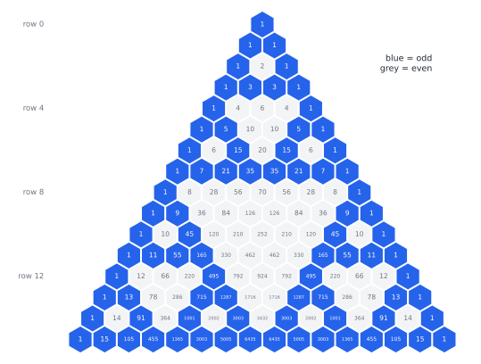

# Chapter 28 — Combinatorics: Counting the Impossible

[← Previous](27-graph-theory.md) · [Track A](README.md) · [Table of Contents](../../00-front/table-of-contents.md) · [Next →](29-discrete-mathematics-and-logic.md)

> **Level 2 · Track A — The Mathematics Behind Algorithms**
> **Builds on:** [Ch. 1](../../part-1-foundations/01-mathematical-language-and-algebra.md), [Ch. 17](../../part-5-transforms/17-z-transforms.md), [Ch. 19](../../part-6-probability-statistics/19-probability.md), [Ch. 26](26-the-mathematics-of-algorithms.md) · **Leads to:** [Ch. 29](29-discrete-mathematics-and-logic.md), [Ch. 32](../b-probability-information/32-counting-random-worlds.md), [Ch. 57](../e-abstract-math/57-number-theory.md) · **Related:** [Ch. 27](27-graph-theory.md), [Ch. 33](../b-probability-information/33-information-theory.md), [Ch. 18](../../part-5-transforms/18-complex-analysis.md)
> **Reading time:** ~25 min

## 28.1 The hook

Pick up an ordinary deck of 52 cards and shuffle it well. The order you are holding has, almost certainly, **never existed before in the history of the universe**, and will never exist again.

That sounds like mysticism. It is arithmetic. The number of orderings of 52 cards is

$$
52!=52\times51\times50\times\cdots\times2\times1\approx8.07\times10^{67}.
$$

If every one of the roughly eight billion people alive had shuffled a deck once per second since the Big Bang, about $4\times10^{17}$ seconds ago, they would have produced around $3\times10^{27}$ orderings: a fraction $4\times10^{-41}$ of the possibilities.

The deck is small change. The number of atoms in the observable universe is usually estimated at about $10^{80}$. A Go board has 361 points, each empty, black or white, so at most $3^{361}\approx1.7\times10^{172}$ configurations; the number of *legal* positions was computed exactly in 2016 and is about $2.08\times10^{170}$. That is more than $10^{90}$ positions **for every atom in the universe**. And the simplest example of all: a memory of just 266 bits (34 bytes, shorter than this sentence) has $2^{266}\approx1.2\times10^{80}$ possible contents, already more than there are atoms.

> **The challenge of this chapter:** How can a problem have more possible configurations than atoms in the observable universe?

And if the space is that large, how can we say *anything* about it, how many configurations have a property, whether some pattern must appear, without ever looking at them? That is what combinatorics is: the mathematics of counting things you could never list.

## 28.2 The big idea

The answer to the challenge is one rule, applied over and over:

> **If a choice is made in stages, the counts multiply.**

A configuration of a big system is a sequence of small choices. 266 bits are 266 two-way choices: $2\times2\times\cdots\times2=2^{266}$. A deck is 52 choices of "which card next" with one fewer option each time. Physical systems add their parts, $1+1+\dots$; configuration spaces multiply them, $2\times2\times\dots$. Adding builds sizes like the number of atoms. Multiplying builds sizes like the number of states of those atoms. That is why a modest number of parts outruns the universe: [Ch. 26](26-the-mathematics-of-algorithms.md) showed that every exponential eventually beats every polynomial, and here the exponential is not a running time but a count.

So listing is hopeless. Combinatorics replaces listing with four tricks of reasoning:

1. **Multiply** stages (the product rule), and **divide** out orderings you don't care about.
2. **Biject:** count a set by matching it one-to-one with a set that is easier to count.
3. **Correct overcounts** systematically: inclusion–exclusion.
4. **Guarantee without searching:** the pigeonhole principle and Ramsey theory prove that a pattern *must* exist in every configuration, even in spaces too large to search.

The analogy: you cannot count the grains of sand on a beach one by one, but you can measure the beach's volume and one grain's volume and divide. Combinatorics is the art of finding the right "volume" to measure.

## 28.3 The mathematics

### Permutations and combinations

> [!definition] Counting arrangements and selections
> The number of **permutations** (orderings) of $n$ distinct objects is $n!=n(n-1)\cdots1$, with $0!=1$.
> The number of ordered selections of $k$ out of $n$ is $n(n-1)\cdots(n-k+1)=\dfrac{n!}{(n-k)!}$.
> The number of **combinations**, unordered selections of $k$ out of $n$, is the binomial coefficient
> $$
> \binom nk=\frac{n!}{k!\,(n-k)!}.
> $$

The combination count comes from the "divide out" trick: each unordered $k$-set appears $k!$ times among the ordered selections. A lottery that draws 6 numbers from 49 has $\binom{49}{6}=13{,}983{,}816$ outcomes; a $20\times20$ street grid has $\binom{40}{20}\approx1.38\times10^{11}$ shortest staircase routes from one corner to the other (choose which 20 of the 40 steps go east).

How big is $n!$? **Stirling's approximation** answers it:

$$
n!\approx\sqrt{2\pi n}\left(\frac ne\right)^n ,
$$

with relative error about $1/(12n)$. For $n=52$ it gives $8.05\times10^{67}$, within 0.2% of the truth. So $\log n!\approx n\log n$: factorials grow faster than any exponential $b^n$, because the "base" $n/e$ keeps increasing.

### Result 1: Pascal's rule, by a story rather than algebra

> [!theorem] Pascal's rule
> For $1\le k\le n-1$,
> $$
> \binom nk=\binom{n-1}{k-1}+\binom{n-1}{k}.
> $$

*Proof (by double counting).* Count the $k$-member committees chosen from $n$ people, one of whom is Ada. Every committee either includes Ada or not. Those that include her are completed by choosing $k-1$ of the other $n-1$ people: $\binom{n-1}{k-1}$ ways. Those that exclude her choose all $k$ from the other $n-1$: $\binom{n-1}{k}$ ways. The two cases do not overlap and cover everything, so the counts add. ∎

No factorials were harmed. This is the combinatorial style of proof: find two honest ways to count the same set, and equate them. Applied to $(1+x)^n=(1+x)(1+x)\cdots(1+x)$, where the coefficient of $x^k$ counts ways to pick the $x$ from $k$ of the $n$ factors, the same idea gives the **binomial theorem** $(1+x)^n=\sum_k\binom nk x^k$.

Pascal's rule builds the famous triangle: each entry is the sum of the two above it. Now do something strange with it: colour each entry by whether it is odd or even.



*Pascal's triangle with odd entries in blue. A fractal appears: three copies of the top half of the triangle, with a grey hole in the middle, each copy made of three smaller copies, and so on. Rows 1, 3, 7 and 15 are entirely odd.*

Why should a rule about adding numbers produce a fractal? Taking parity turns Pascal's rule into $a\oplus b$ (addition mod 2, the XOR gate), and the triangle becomes a cellular automaton: each cell is the XOR of its two parents. That much explains *that* there is a self-similar pattern. It does not explain *which* entries are odd.

> [!mystery] The odd ones
> $\binom nk$ is odd exactly when every binary digit of $k$ is at most the corresponding binary digit of $n$, so row $n$ contains exactly $2^{s}$ odd entries, where $s$ is the number of 1s in $n$ written in binary. (Row 12 = $1100_2$ has 4 odd entries; check the picture.) The reason is Lucas's theorem on binomial coefficients modulo a prime, and it lives in [Ch. 57](../e-abstract-math/57-number-theory.md).

### Result 2: inclusion–exclusion and the hat-check problem

Adding the sizes of overlapping sets overcounts the overlaps. For two sets, $\lvert A\cup B\rvert=\lvert A\rvert+\lvert B\rvert-\lvert A\cap B\rvert$, which is the same formula as $P(A\cup B)$ in [Ch. 19, §19.1](../../part-6-probability-statistics/19-probability.md#191-sample-spaces-and-events). For many sets the corrections alternate.

> [!theorem] Inclusion–exclusion
> For finite sets $A_1,\dots,A_n$,
> $$
> \Bigl\lvert\bigcup_{i=1}^{n}A_i\Bigr\rvert=\sum_{i}\lvert A_i\rvert-\sum_{i<j}\lvert A_i\cap A_j\rvert+\sum_{i<j<k}\lvert A_i\cap A_j\cap A_k\rvert-\cdots+(-1)^{n+1}\lvert A_1\cap\cdots\cap A_n\rvert .
> $$

*Proof.* Take any element $x$ that lies in exactly $m\ge1$ of the sets. It is counted $\binom m1$ times in the first sum, $\binom m2$ times in the second, and so on, so its net count on the right is

$$
\binom m1-\binom m2+\binom m3-\cdots=1-\sum_{j=0}^{m}(-1)^j\binom mj=1-(1-1)^m=1,
$$

by the binomial theorem. An element in none of the sets is counted 0 times on both sides. So both sides count every element exactly once. ∎

**The hat-check problem.** $n$ people check their hats, and the hats are handed back in random order. What is the chance that *nobody* gets their own hat? A permutation with no fixed point is a **derangement**. Let $A_i$ be the permutations that fix person $i$. Any $k$ specified people can be fixed in $(n-k)!$ ways, and there are $\binom nk$ ways to specify them, so inclusion–exclusion gives the number of permutations fixing *somebody*, and subtracting from $n!$:

$$
D_n=\sum_{k=0}^{n}(-1)^k\binom nk(n-k)!=n!\sum_{k=0}^{n}\frac{(-1)^k}{k!}.
$$

The probability is $D_n/n!=\sum_{k=0}^{n}(-1)^k/k!$, the partial sum of the series for $e^{-1}$. So the answer converges to $1/e\approx0.3679$, and it does so astonishingly fast: for $n=10$ it is $0.367879\ldots$, already correct to six decimal places, and $D_{10}=1{,}334{,}961$. Remarkably, the answer barely depends on whether there are 10 guests or 10 million.

### Result 3: recurrences and generating functions

Many counts are easier to describe by a rule than by a formula. How many ways $t_n$ are there to tile a $1\times n$ strip with squares ($1\times1$) and dominoes ($1\times2$)? Look at the last tile: it is a square (leaving a strip of length $n-1$) or a domino (leaving $n-2$). So

$$
t_n=t_{n-1}+t_{n-2},\qquad t_0=1,\ t_1=1,
$$

the Fibonacci recurrence: $1,1,2,3,5,8,13,\dots$. Recurrences like this are exactly the difference equations of [Ch. 17, §17.5](../../part-5-transforms/17-z-transforms.md#175-difference-equations), and combinatorics has its own name for the Z-transform: the **generating function**, the power series whose coefficients are the counts.

> [!theorem] Closed form by generating function
> The tiling numbers have generating function $T(x)=\sum_{n\ge0}t_nx^n=\dfrac{1}{1-x-x^2}$, and
> $$
> t_n=\frac{\varphi^{\,n+1}-\psi^{\,n+1}}{\sqrt5},\qquad\varphi=\frac{1+\sqrt5}{2}\approx1.618,\quad\psi=\frac{1-\sqrt5}{2}\approx-0.618 .
> $$

*Proof.* Multiply the recurrence by $x^n$ and sum over $n\ge2$: $T(x)-1-x=x\,(T(x)-1)+x^2T(x)$. Solving, $T(x)(1-x-x^2)=1$. The denominator factors as $(1-\varphi x)(1-\psi x)$, because $\varphi+\psi=1$ and $\varphi\psi=-1$. Partial fractions give

$$
\frac{1}{(1-\varphi x)(1-\psi x)}=\frac{1}{\varphi-\psi}\left(\frac{\varphi}{1-\varphi x}-\frac{\psi}{1-\psi x}\right),
$$

and expanding each term as a geometric series, the coefficient of $x^n$ is $(\varphi^{n+1}-\psi^{n+1})/(\varphi-\psi)$, with $\varphi-\psi=\sqrt5$. ∎

Since $\lvert\psi\rvert<1$, the second term dies out and $t_n$ is the nearest integer to $\varphi^{n+1}/\sqrt5$: tilings grow like $1.618^n$, an exponential, which is the configuration explosion of the hook in miniature. The growth rate is set by the root of the denominator closest to the origin, $x=1/\varphi$, exactly like the dominant pole of a discrete-time system.

Generating functions do far more than solve recurrences. A product of generating functions counts combined choices; that is how one counts **partitions** of an integer (ways to write $n$ as a sum of positive integers, ignoring order). The generating function is $\prod_{k\ge1}\frac{1}{1-x^k}$, and $p(100)=190{,}569{,}292$.

> [!mystery] A formula with $\pi$ in it, for a problem with no circles
> The number of partitions grows like $p(n)\sim\dfrac{1}{4n\sqrt3}\exp\!\left(\pi\sqrt{2n/3}\right)$. A question about adding whole numbers has an answer involving $\pi$, $e$ and $\sqrt3$. Hardy and Ramanujan found it by treating the generating function as a function of a *complex* variable and studying how it blows up near the unit circle. That method of reading growth from singularities is built on the tools of [Ch. 18](../../part-5-transforms/18-complex-analysis.md), and it is the gateway to analytic combinatorics.

### Result 4: the pigeonhole principle and the party problem

> [!theorem] The pigeonhole principle
> If more than $k$ objects are placed into $k$ boxes, some box contains at least two objects. More generally, if $N$ objects go into $k$ boxes, some box contains at least $\lceil N/k\rceil$.

*Proof.* If every box had at most $\lceil N/k\rceil-1<N/k$ objects, the total would be less than $k\cdot N/k=N$. ∎

It is the most obvious statement in this book and one of the most powerful, because it proves existence without construction.

> [!example] Why no compressor can shrink every file
> There are $2^n$ files of exactly $n$ bits, but only $2^0+2^1+\dots+2^{n-1}=2^n-1$ files shorter than $n$ bits. A lossless compressor must map different files to different outputs, so by pigeonhole at least one $n$-bit file cannot get shorter. Every compressor that shrinks some files must enlarge others. How much compression is possible *on average* is the entropy bound of [Ch. 33](../b-probability-information/33-information-theory.md).

Now the party problem. At any party of six people, either some three all know each other, or some three are mutual strangers. Model people as vertices of the complete graph $K_6$, colour each edge red (acquainted) or blue (strangers). The claim is that every red/blue colouring of $K_6$ contains a **monochromatic triangle**.


*Pigeonhole (left) powers Ramsey's theorem. Five guests are not enough: the pentagon/pentagram colouring of $K_5$ (middle) has no single-colour triangle. With six, any vertex has five edges, so three share a colour; whatever colour the dotted edges get, a one-colour triangle appears (right).*

> [!theorem] The party theorem: $R(3,3)=6$
> Every 2-colouring of the edges of $K_6$ contains a monochromatic triangle, and $K_5$ has a 2-colouring with none.

*Proof.* Fix a vertex $v$ of $K_6$. It has 5 edges and there are 2 colours, so by pigeonhole at least $\lceil5/2\rceil=3$ of them share a colour, say red, going to $a,b,c$. If any of the edges $ab$, $bc$, $ca$ is red, it forms a red triangle with $v$. If none is red, then $a,b,c$ form a blue triangle. Either way a monochromatic triangle exists. For $K_5$, colour the five outer edges of a pentagon red and the five diagonals blue: the red edges form a 5-cycle and the blue edges form another 5-cycle (the pentagram), and a 5-cycle contains no triangle. ∎

The **Ramsey number** $R(s,t)$ is the smallest $N$ such that every red/blue colouring of $K_N$ contains a red $K_s$ or a blue $K_t$. Ramsey's theorem says it always exists: complete disorder is impossible, and any large enough structure contains an orderly piece. The slogan of the field: in a big enough system, patterns are not a coincidence but a certainty.

But the numbers are brutal. $R(3,3)=6$; $R(4,4)=18$. For $R(5,5)$, the best we know is $43\le R(5,5)\le46$ (the upper bound was lowered to 46 only in 2024). Why can't we just check? Settling whether 43 suffices means examining 2-colourings of $K_{43}$, and there are $2^{\binom{43}{2}}=2^{903}\approx10^{272}$ of them. The configuration explosion of the hook is the very thing that keeps a five-person party question unsolved.

> [!mystery] Five friends, and a problem that defeats every computer
> What is $R(5,5)$? Symmetry and clever pruning got the bounds to $43\le R(5,5)\le46$, but no known method closes the gap. For $R(6,6)$ the gap is far wider: at least 102, and an upper bound still in the 160s. It is a genuine open problem; how mathematicians chip away at problems like this (and why a famous quip says we would be wiser to fight an alien army than to compute $R(6,6)$) is in [Ch. 98](../j-frontier/98-mathematical-research.md).

### Extremal combinatorics: how much can you have without a pattern?

Ramsey asks when a pattern is forced. **Extremal combinatorics** asks the quantitative version: how large can a structure be while still avoiding the pattern? The first result of the subject is a gem.

> [!theorem] Mantel's theorem
> A graph on $n$ vertices with no triangle has at most $n^2/4$ edges, and the complete bipartite graph with two halves of size $n/2$ achieves this.

*Proof.* If $uv$ is an edge, $u$ and $v$ have no common neighbour (that would make a triangle), so $\deg u+\deg v\le n$. Summing over all edges, each vertex $w$ appears in $\deg w$ edges, so $\sum_{w}(\deg w)^2\le n\lvert E\rvert$. By the Cauchy–Schwarz inequality, $\sum_w(\deg w)^2\ge\frac1n\left(\sum_w\deg w\right)^2=\frac{4\lvert E\rvert^2}{n}$ (handshake lemma, [Ch. 27](27-graph-theory.md)). Combining, $4\lvert E\rvert^2/n\le n\lvert E\rvert$, so $\lvert E\rvert\le n^2/4$. ∎

So a network of 100 nodes with more than 2500 links *must* contain a triangle, whatever its wiring. The extremal example, two halves with every link between them, is exactly the "two communities that only talk across" picture: the extremal answer has structure.

## 28.4 The algorithm

Combinatorics changes how you compute in two opposite ways: it tells you how to compute huge counts *exactly* without listing anything, and it tells you when a search is hopeless.

### Counting without listing: dynamic programming over a recurrence

The partition numbers satisfy no simple formula, but the generating function $\prod_k 1/(1-x^k)$ translates directly into a loop: multiply in one factor $1/(1-x^k)=1+x^k+x^{2k}+\cdots$ at a time.

```python
def partitions(N):
    """p[n] = number of partitions of n, for n = 0..N."""
    p = [1] + [0] * N                # the series for the empty product: 1
    for k in range(1, N + 1):        # multiply by 1/(1 - x^k)
        for n in range(k, N + 1):
            p[n] += p[n - k]         # allow any number of parts equal to k
    return p

print(partitions(100)[100])         # 190569292
```

That is $O(N^2)$ additions to compute a number that counts 190 million objects, none of which is ever constructed. The same pattern (a recurrence evaluated bottom-up, from small cases to large) counts lattice paths, tilings, binary trees and coin-change combinations; it is the counting cousin of dynamic programming ([Ch. 52](../d-optimization/52-dynamic-programming.md)).

### Binomial coefficients without overflow

Computing $\binom nk$ as `factorial(n) // (factorial(k) * factorial(n - k))` builds enormous intermediate numbers. In fixed-width arithmetic it overflows long before the answer does: $\binom{67}{33}$ fits in 64 bits but $67!$ needs more than 300 bits. The fix multiplies and divides alternately,

$$
\binom nk=\prod_{i=1}^{k}\frac{n-k+i}{i},
$$

where after step $i$ the running product is itself the integer $\binom{n-k+i}{i}$, so every division is exact. Use $k\leftarrow\min(k,n-k)$ to halve the work. In floating point, work with logarithms instead: `math.lgamma(n + 1)` gives $\ln n!$ without ever forming $n!$, which is how probabilities like $\binom{1000}{500}2^{-1000}$ are computed safely.

### Exhaustive search, and how to survive it

Sometimes you must actually enumerate (to find a colouring of $K_5$ with no monochromatic triangle, or to test a conjecture on small cases). Three techniques push the frontier of what is feasible:

- **Backtracking**: build a configuration choice by choice and abandon a partial one the moment it is doomed. Colouring edges of $K_N$ one at a time and stopping at the first one-colour triangle prunes almost all of the $2^{\binom N2}$ colourings.
- **Symmetry breaking**: relabelling the vertices or swapping colours gives an equivalent colouring, so search only one representative per class, saving up to a factor $2\cdot N!$.
- **Reduction to SAT**: encode "no monochromatic $K_s$" as a Boolean formula and hand it to an industrial satisfiability solver. Several Ramsey-type results were settled this way, with machine-checkable certificates.

Even so, the counts in this chapter are a warning: every exponential search hits a wall, and the wall's position moves only logarithmically with your hardware ([Ch. 26](26-the-mathematics-of-algorithms.md)). Whether some cleverer method could always avoid the search is the question of [Ch. 30](30-limits-of-computation.md).

## 28.5 The experiment

### Where does a configuration space pass the universe?

Plot $\log_{10}$ of each count against the number of parts $n$. The horizontal line at 80 is the number of atoms in the observable universe.

```desmos-graph
left=0; right=300; bottom=0; top=120
---
y=80|grey|dashed
y=x\frac{\ln(2)}{\ln(10)}|blue
y=x\frac{\ln(3)}{\ln(10)}|green
y=\frac{x\ln(x)-x+0.5\ln(2\pi x)}{\ln(10)}|red
(266,80)|label:266 bits
(59,80)|label:59 cards
```

*Blue: $2^n$ (bits). Green: $3^n$ (Go points). Red: $n!$ via Stirling (orderings of a deck). The grey line is $10^{80}$.*

The blue line crosses the universe at $n\approx266$, the green at $n\approx168$, and the red at only $n\approx59$: a deck of 59 cards has more orderings than the universe has atoms. Change the **3** in the green curve to **10** (decimal digits) and then to **26** (letters): how long a password beats the universe? Then add the line `y=x^{2}\frac{\ln(2)}{\ln(10)}`: that is the number of black-and-white images of $n\times n$ pixels, and it leaves the screen almost immediately.

### The party and the hats (run it)

The script does two things. It checks the party theorem by brute force over every colouring of $K_N$, and it simulates the hat-check problem against the inclusion–exclusion formula.

```python
import itertools
import numpy as np
import matplotlib.pyplot as plt

# Part 1: party problem by brute force. Is there a 2-colouring of K_N with no one-colour triangle?
N = 5                                   # KNOB: try 5, then 6 (7 takes a few minutes)
edges = list(itertools.combinations(range(N), 2))
index = {e: i for i, e in enumerate(edges)}
tris = [(index[(a, b)], index[(a, c)], index[(b, c)]) for a, b, c in itertools.combinations(range(N), 3)]
good = 0
for colours in itertools.product((0, 1), repeat=len(edges)):
    if all(not (colours[x] == colours[y] == colours[z]) for x, y, z in tris):
        good += 1
print(f"K_{N}: {2 ** len(edges)} colourings, {good} with no one-colour triangle")

# Part 2: the hat-check problem. Return n hats at random; chance nobody gets their own?
rng = np.random.default_rng(0)
TRIALS = 20000                          # KNOB: more trials, less noise
ns = np.arange(1, 13)
sim = [np.mean([not np.any(rng.permutation(n) == np.arange(n)) for _ in range(TRIALS)]) for n in ns]
exact = [sum((-1) ** k / np.prod(np.arange(1, k + 1)) for k in range(n + 1)) for n in ns]
plt.plot(ns, sim, "o", label="simulation")
plt.plot(ns, exact, "-", label="inclusion-exclusion")
plt.axhline(np.exp(-1), ls=":", label="1/e")
plt.xlabel("number of hats n"); plt.ylabel("P(no one gets own hat)"); plt.legend(); plt.show()
```

With `N = 5` it reports 1024 colourings, of which exactly 12 avoid a one-colour triangle. Each of them is a pentagon/pentagram picture like the figure, with the vertices relabelled. With `N = 6` it reports 32,768 colourings and **zero** good ones: the party theorem, verified by exhaustion. Try `N = 7` and notice that the run time grows by a factor of more than 64 for one extra guest: you are watching the configuration explosion from the inside. Can you make it faster by stopping each colouring at its first bad triangle?

In the second part, the probability settles onto $1/e$ by about $n=5$. Change `TRIALS` to 200 and see how much of the wiggle in the dots is just sampling noise.

## 28.6 The challenge

1. **Intuition.** In a room of 23 people the chance that two share a birthday is just over one half, yet the chance that someone shares *your* birthday is only about 6%. Explain, by counting *pairs* rather than people, why these two numbers are so different, without computing either one exactly.
2. **Derivation.** Count the number of surjections (onto functions) from a set of $n$ elements to a set of $k$ elements using inclusion–exclusion, with $A_i$ the functions that miss element $i$. Check your formula for $n=4$, $k=2$ by listing, and use it to show that $\sum_{j=0}^{k}(-1)^j\binom kj(k-j)^n=0$ whenever $n<k$.
3. **Implementation.** Write a backtracking search that 2-colours the edges of $K_N$ one at a time and backtracks as soon as a red $K_3$ or a blue $K_4$ appears. Use it to find a colouring of $K_8$ with neither, and estimate how many partial colourings your search visits compared with the full $2^{28}$. (The fact $R(3,4)=9$ says $K_9$ has no such colouring; can your code confirm it in reasonable time?)
4. **Open investigation.** Colour each edge of $K_N$ red or blue **at random**. Estimate by simulation the probability that there is no monochromatic $K_4$, for $N$ from 6 to 17. How does it fall off as $N$ approaches $R(4,4)=18$? Then compute the *expected number* of monochromatic $K_4$s exactly by counting. What does the comparison suggest about how good random colourings are at avoiding patterns, and how far could the idea be pushed for larger $k$?

## 28.7 Loose threads

The challenge is answered. A problem has more configurations than the universe has atoms because configurations **multiply** while matter **adds**: 266 binary choices, 168 three-way choices or 59 cards in order are enough. And combinatorics lets us reason about such spaces without listing them: counting by multiplication and bijection, correcting overcounts by inclusion–exclusion, solving recurrences with generating functions, and forcing patterns to exist with the pigeonhole principle and Ramsey's theorem.

What we left on the table:

- **Lucas's theorem**, the arithmetic behind the fractal in Pascal's triangle, waits in [Ch. 57](../e-abstract-math/57-number-theory.md).
- **Analytic combinatorics**: the $\pi$ in the partition asymptotics comes from complex analysis ([Ch. 18](../../part-5-transforms/18-complex-analysis.md)), and the same method turns any generating function into its growth rate.
- **Ramsey numbers**: $R(5,5)$ is unknown, and the frontier of such problems is in [Ch. 98](../j-frontier/98-mathematical-research.md). The challenge's fourth problem hints at the most surprising tool for it.
- **The probabilistic method.** In 1947 Erdős proved that $R(k,k)>2^{k/2}$ without exhibiting a single good colouring: he showed that a *random* colouring works with positive probability. It is a proof of existence by counting random worlds, the subject of [Ch. 32](../b-probability-information/32-counting-random-worlds.md). Nobody knows how to *construct* colourings nearly as good.
- **Counting as logic.** Every proof in this chapter quietly used induction or double counting. What makes such arguments airtight, and how to prove a statement for *all* $n$ at once, is [Ch. 29](29-discrete-mathematics-and-logic.md).

## Further reading

- R. A. Brualdi, *Introductory Combinatorics*, 5th ed., Pearson, 2010. A gentle, complete first course: counting, inclusion–exclusion, recurrences, generating functions, pigeonhole and Ramsey.
- H. S. Wilf, *generatingfunctionology*, 3rd ed., A K Peters, 2006. The classic on generating functions, freely available from the author.
- P. Flajolet, R. Sedgewick, *Analytic Combinatorics*, Cambridge University Press, 2009. How singularities of generating functions determine growth rates.
- N. Alon, J. H. Spencer, *The Probabilistic Method*, 4th ed., Wiley, 2016. Erdős's random-colouring idea and everything it grew into.
