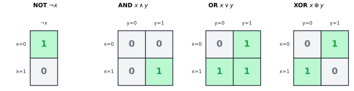
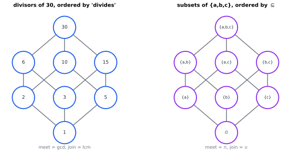
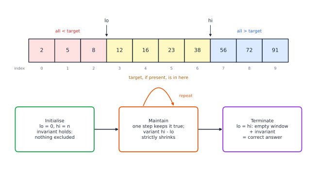

# Chapter 29 — Discrete Mathematics and Computational Logic

[← Previous](28-combinatorics.md) · [Track A](README.md) · [Table of Contents](../../00-front/table-of-contents.md) · [Next →](30-limits-of-computation.md)

> **Level 2 · Track A — The Mathematics Behind Algorithms**
> **Builds on:** [Ch. 1](../../part-1-foundations/01-mathematical-language-and-algebra.md), [Ch. 26](26-the-mathematics-of-algorithms.md) · **Leads to:** [Ch. 30](30-limits-of-computation.md), [Ch. 65](../f-logic-foundations/65-mathematical-logic.md), [Ch. 67](../f-logic-foundations/67-formal-verification.md) · **Related:** [Ch. 28](28-combinatorics.md), [Ch. 63](../f-logic-foundations/63-think-like-a-mathematician.md), [Ch. 79](../h-cryptography-coding/79-error-correcting-codes.md)
> **Reading time:** ~25 min

## 29.1 The hook

Binary search is the first "clever" algorithm most programmers meet. You have a sorted array, you look at the middle element, and you throw away the half that cannot contain your target. Ten lines of code. Everyone has written it.

Almost everyone has written it wrong. In his book *Programming Pearls*, Jon Bentley reports giving the problem to professional programmers in courses. Given a couple of hours, about ninety percent of them handed in code with a bug. Knuth notes that binary search was first published in 1946, but the first version that worked for every array size did not appear until 1962.

Then there is the bug nobody saw. In 2006 Joshua Bloch, who had written the binary search in Java's standard library, reported that it had been broken for about nine years. The bug was in this line, which also appears in Bentley's own carefully argued version:

```python
mid = (low + high) // 2
```

With 32-bit integers, `low + high` overflows once the array has more than about $2^{30}\approx 1.07\times 10^9$ elements. The sum wraps round to a negative number, `mid` becomes negative, and the program crashes or reads garbage. When the code was written, arrays that large were rare. By 2006 they were routine.

So the code had been read by experts, published in a classic book, shipped to millions of machines and tested, and it was still wrong. Testing could not have saved it. Two 32-bit indices give $2^{64}\approx 1.8\times10^{19}$ input pairs; at a billion tests per second, trying them all takes about 585 years. Edsger Dijkstra's remark is the one to keep in mind: testing can show that bugs are present, but never that they are absent.

That leaves the challenge of this chapter:

> **How do you prove that a program must work for every valid input?**

You cannot run infinitely many cases. But you can write a *finite* argument that covers them all. That idea, a finite proof standing in for an infinite set of tests, is the core of discrete mathematics, and it is what this chapter builds.

## 29.2 The big idea

An electrical engineer analysing a circuit never simulates every possible voltage waveform. She writes Kirchhoff's current law at each node: *the current in equals the current out, at every instant*. That one statement holds whatever the inputs do, and every later step of the analysis leans on it. It is a **conserved quantity**.

Programs have conserved quantities too. They are called **invariants**. Look at binary search again. At every moment the array splits into three zones (Figure 29.3, in §29.3):

- everything to the left of `lo` is known to be smaller than the target,
- everything from `hi` onwards is known to be larger,
- the target, if it is anywhere, is in the window between them.

Each step of the loop shrinks the window, *and the three statements stay true*. When the window is empty the invariant tells you the answer: the target is not there. You never had to try a single input. You proved one statement about one step, and an induction argument carried it through every step of every run.

To make that rigorous you need a small toolkit:

1. a language precise enough to state what "correct" means (**logic**),
2. objects to state it about (**sets, relations, functions**),
3. a way to push a claim from one step to the next, forever (**induction**),
4. a guarantee that the loop actually stops (**well-founded orders**).

Underneath all of it sits a very small algebra of two values, true and false, which turns out to be the same algebra your laptop's transistors compute. We start there.

## 29.3 The mathematics

### Propositional logic and Boolean algebra

A **proposition** is a statement that is either true or false. We combine propositions $p, q$ with connectives: $\neg p$ (not), $p\land q$ (and), $p\lor q$ (or), $p\oplus q$ (exclusive or), $p\Rightarrow q$ (implies). Ch. 1 introduces the symbols and the contrapositive in [§1.10](../../part-1-foundations/01-mathematical-language-and-algebra.md#110-mathematical-notation-and-dimensional-consistency); here we treat them as *functions*. Write $1$ for true and $0$ for false. Then each connective is a function from $\{0,1\}^k$ to $\{0,1\}$, and a truth table is just its table of values (Figure 29.1).



*Figure 29.1 — The four basic connectives as grids. Green cells are 1 (true). AND has a single green cell, OR a single grey one, and XOR is green exactly where the inputs differ.*

> [!definition] Boolean function, formula, equivalence
> A **Boolean function** of $n$ variables is any map $f:\{0,1\}^n\to\{0,1\}$. A **formula** is an expression built from variables with $\neg,\land,\lor$. Two formulas are **equivalent**, $\varphi\equiv\psi$, if they have the same truth table. A formula is a **tautology** if it is $1$ under every assignment, and **satisfiable** if it is $1$ under at least one.

There are $2^n$ rows in a truth table on $n$ variables, and each row can be $0$ or $1$, so there are $2^{2^n}$ Boolean functions: 16 for $n=2$, 256 for $n=3$, and $2^{64}$ for $n=6$. The algebra obeys a short list of laws, each checkable from the grids:

$$
\begin{aligned}
&p\land q\equiv q\land p, && p\land(q\lor r)\equiv(p\land q)\lor(p\land r),\\
&p\lor q\equiv q\lor p, && p\lor(q\land r)\equiv(p\lor q)\land(p\lor r),\\
&\neg(p\land q)\equiv\neg p\lor\neg q, && \neg(p\lor q)\equiv\neg p\land\neg q,\\
&p\lor\neg p\equiv 1, && p\land\neg p\equiv 0 .
\end{aligned}
$$

The third line is **De Morgan's laws**. Notice the second distributive law, $p\lor(q\land r)\equiv(p\lor q)\land(p\lor r)$: it fails for ordinary numbers ($2+3\cdot4\neq5\cdot6$) but holds here. Boolean algebra is not arithmetic in disguise. Its closest arithmetic relative is XOR, which is addition modulo 2: $p\oplus q = p+q \bmod 2$. Pair XOR with AND as multiplication and you have the two-element field $\mathbb{F}_2$, the arithmetic behind error-correcting codes in [Ch. 79](../h-cryptography-coding/79-error-correcting-codes.md).

How many connectives do we actually need? Here is the first result worth proving.

> [!theorem] Theorem 29.1 — Every Boolean function has a formula
> Every Boolean function $f:\{0,1\}^n\to\{0,1\}$ is equivalent to a formula using only $\neg,\land,\lor$. Consequently the single connective NAND, $p\uparrow q:=\neg(p\land q)$, can express every Boolean function.

*Proof.* If $f$ is never $1$, take the formula $x_1\land\neg x_1$. Otherwise, for each input $\mathbf{a}=(a_1,\dots,a_n)$ with $f(\mathbf{a})=1$ build the **minterm**

$$
m_{\mathbf{a}} = \ell_1\land\ell_2\land\cdots\land\ell_n,\qquad \ell_i=\begin{cases}x_i & a_i=1,\\ \neg x_i & a_i=0.\end{cases}
$$

By construction $m_{\mathbf{a}}$ is $1$ on input $\mathbf{a}$ and on no other input: on any $\mathbf{b}\neq\mathbf{a}$ some coordinate differs, and the matching literal is $0$. Now take the OR of all these minterms,

$$
\varphi = \bigvee_{\mathbf{a}:\,f(\mathbf{a})=1} m_{\mathbf{a}} .
$$

On an input where $f=1$, its own minterm is $1$, so $\varphi=1$. On an input where $f=0$, every minterm is $0$, so $\varphi=0$. Hence $\varphi\equiv f$. This is the **disjunctive normal form**.

For NAND it is enough to build $\neg$, $\land$ and $\lor$ from it:

$$
\neg p\equiv p\uparrow p,\qquad p\land q\equiv (p\uparrow q)\uparrow(p\uparrow q),\qquad p\lor q\equiv(p\uparrow p)\uparrow(q\uparrow q).
$$

The first holds because $p\land p=p$. The second negates a NAND. The third is De Morgan: $\neg(\neg p\land\neg q)\equiv p\lor q$. Substitute these into the DNF and only NAND remains. $\square$

This is why a chip factory can build an entire processor from one kind of gate. It also hides a trap. The DNF of $f$ can have up to $2^n$ minterms; the parity function $x_1\oplus\cdots\oplus x_n$ needs all $2^{n-1}$ of its minterms in DNF. "Expressible" and "expressible *cheaply*" are very different statements.

> [!warning] Satisfiable is not the same as easy to check
> Deciding whether a formula is a tautology is the same as deciding whether its negation is unsatisfiable. The obvious method fills in all $2^n$ rows of the truth table. For $n=300$ variables, a typical size for a small hardware-verification problem, that is more rows than there are atoms in the observable universe.

### Predicate logic: saying "for every input"

Propositional logic cannot say "for every input". For that we need variables that range over a domain, **predicates** about them, and the quantifiers $\forall$ and $\exists$ (their order and negation rules are in [§1.10](../../part-1-foundations/01-mathematical-language-and-algebra.md#110-mathematical-notation-and-dimensional-consistency)). With them, a specification becomes a precise sentence. "The array $a[0..n)$ is sorted" is

$$
\forall i\ \forall j\ \big(0\le i<j<n \Rightarrow a[i]\le a[j]\big),
$$

and "search returns $r$ correctly" is

$$
\big(r\ge 0 \land a[r]=t\big)\ \lor\ \big(r=-1 \land \forall i\,(0\le i<n\Rightarrow a[i]\neq t)\big).
$$

Many real bugs are wrong specifications, not wrong code. If $t$ appears three times, the predicate above accepts any of its indices; a caller who assumed "the first one" has a bug no proof will catch.

### Sets, relations and orders

A **relation** $R$ on a set $S$ is a subset of $S\times S$; we write $x\,R\,y$ for $(x,y)\in R$. Three families matter constantly in computing.

An **equivalence relation** is reflexive ($x\,R\,x$), symmetric ($x\,R\,y\Rightarrow y\,R\,x$) and transitive ($x\,R\,y\land y\,R\,z\Rightarrow x\,R\,z$). Every equivalence relation chops $S$ into disjoint **classes**, and every partition comes from one. "Same remainder mod 3" splits the integers into three classes; [Ch. 30](30-limits-of-computation.md) builds a machine whose states *are* those classes.

A **partial order** $\preceq$ is reflexive, transitive and antisymmetric ($x\preceq y\land y\preceq x\Rightarrow x=y$). Not every pair need be comparable: neither of 6 and 10 divides the other. We draw a partial order as a **Hasse diagram**, with an edge from $x$ up to $y$ when $y$ covers $x$ (Figure 29.2).



*Figure 29.2 — Two partial orders with the same shape: the divisors of 30 under "divides" and the subsets of $\{a,b,c\}$ under $\subseteq$. Both are cubes, because $30=2\cdot3\cdot5$ and each divisor picks a subset of the three primes.*

In both orders every pair has a greatest lower bound (gcd, or intersection) and a least upper bound (lcm, or union). Such an order is a **lattice**. In the cube on the right, the meet is $\land$, the join is $\lor$, and complement is $\neg$: the subsets of an $n$-element set form a Boolean algebra, the same algebra as the truth tables. Hardware, set theory and number theory meet in one picture.

A partial order is **well-founded** if it has no infinite descending chain $x_0\succ x_1\succ x_2\succ\cdots$. The natural numbers under $\le$ are the standard example, and they are the reason loops stop.

### Induction, three ways

The **principle of induction** says: if $P(0)$ holds and $P(k)\Rightarrow P(k+1)$ for every $k$, then $P(n)$ holds for every $n\in\mathbb{N}$. Ch. 1 gives the standard worked example in [§1.10](../../part-1-foundations/01-mathematical-language-and-algebra.md#110-mathematical-notation-and-dimensional-consistency). Three variants do most of the work in computer science.

- **Strong induction:** assume $P(0),\dots,P(k)$ all hold and deduce $P(k+1)$. This is the natural form for divide-and-conquer, where a problem of size $k+1$ calls itself on sizes like $\lfloor (k+1)/2\rfloor$.
- **Well-ordering:** every non-empty subset of $\mathbb{N}$ has a least element. To prove $P(n)$ for all $n$, suppose not, take the *smallest* counterexample, and derive a contradiction by finding a smaller one. This is equivalent to induction, and it is often the easier way to think.
- **Structural induction:** to prove something about every formula, tree or list, prove it for the atoms and show that each constructor preserves it. The proof of Theorem 29.1 is essentially a structural induction in disguise: we built the formula from literals up.

### Loop invariants: induction over time

Now the central tool. Consider a loop

```text
INIT
while GUARD:
    BODY
```

> [!theorem] Theorem 29.2 — The loop-invariant principle
> Let $I$ be a predicate on the program state and $V$ an integer-valued function of the state. Suppose
> 1. **Initialisation:** $I$ holds after INIT.
> 2. **Maintenance:** if $I$ and GUARD hold before BODY, then $I$ holds after it.
> 3. **Variant:** whenever $I$ and GUARD hold, $V\ge0$, and each execution of BODY strictly decreases $V$.
>
> Then the loop terminates, and on exit $I\land\neg\text{GUARD}$ holds.

*Proof.* Let $s_k$ be the state after $k$ executions of BODY (if the loop runs that long). We show by induction on $k$ that $I(s_k)$ holds. The base case $k=0$ is initialisation. If $I(s_k)$ holds and the loop runs again, GUARD held in $s_k$, so maintenance gives $I(s_{k+1})$. That proves the claim for every $k$ the loop reaches.

For termination, suppose the loop ran forever. Then GUARD and $I$ hold in every $s_k$, so the variant gives $V(s_0)>V(s_1)>V(s_2)>\cdots$, an infinite strictly decreasing sequence of non-negative integers. By well-ordering the set $\{V(s_k)\}$ has a least element $V(s_m)$, yet $V(s_{m+1})<V(s_m)$ is in the set: contradiction. So the loop stops after some $K$ iterations. It stopped because GUARD failed, and $I(s_K)$ holds by the induction. $\square$

The theorem converts one infinite question (does this work on all inputs?) into three finite ones, each about a *single* step. Let us cash it in.



*Figure 29.3 — Binary search mid-run, searching for 38 or anything else. Red cells are proved smaller than the target, blue cells proved larger; the yellow window is all that is left. The three boxes are the three hypotheses of Theorem 29.2.*

> [!theorem] Theorem 29.3 — Binary search is correct
> Let $a[0..n)$ be sorted. The loop
> `lo, hi = 0, n; while lo < hi: mid = lo + (hi-lo)//2; if a[mid] < t: lo = mid+1 elif a[mid] > t: hi = mid else: return mid`, followed by `return -1`, always terminates and meets the specification of the previous subsection. With exact integers, every index it touches lies in $[0,n)$.

*Proof.* Take the invariant

$$
I:\quad 0\le \mathit{lo}\le \mathit{hi}\le n\ \land\ \forall i<\mathit{lo}:\ a[i]<t\ \land\ \forall i\ge \mathit{hi}\ (i<n):\ a[i]>t,
$$

and the variant $V=\mathit{hi}-\mathit{lo}$.

*Initialisation.* With $\mathit{lo}=0$, $\mathit{hi}=n$ both quantified parts are about empty ranges, so they hold vacuously.

*Maintenance.* Suppose $I$ holds and $\mathit{lo}<\mathit{hi}$. Then $\mathit{mid}=\mathit{lo}+\lfloor(\mathit{hi}-\mathit{lo})/2\rfloor$ satisfies $\mathit{lo}\le\mathit{mid}<\mathit{hi}\le n$, so $a[\mathit{mid}]$ is a valid read. If $a[\mathit{mid}]<t$, sortedness gives $a[i]\le a[\mathit{mid}]<t$ for every $i\le\mathit{mid}$, so setting $\mathit{lo}=\mathit{mid}+1$ keeps the left clause, and $\mathit{lo}\le\mathit{hi}$ still holds since $\mathit{mid}<\mathit{hi}$. If $a[\mathit{mid}]>t$, then $a[i]\ge a[\mathit{mid}]>t$ for every $i\ge\mathit{mid}$, so $\mathit{hi}=\mathit{mid}$ keeps the right clause. If $a[\mathit{mid}]=t$ we return a correct index.

*Variant.* $V\ge1$ while the guard holds. The new window is $[\mathit{mid}+1,\mathit{hi})$ or $[\mathit{lo},\mathit{mid})$, both strictly shorter than $[\mathit{lo},\mathit{hi})$ because $\mathit{lo}\le\mathit{mid}<\mathit{hi}$.

*Exit.* By Theorem 29.2 the loop stops. If it stops without returning, $\mathit{lo}=\mathit{hi}$, and the invariant says every element is either $<t$ (index below $\mathit{lo}$) or $>t$ (index at or above $\mathit{hi}$). So $t$ is absent and $-1$ is correct. $\square$

Where was the 2006 bug? Look at the phrase "with exact integers". The proof uses $\mathit{lo}\le\mathit{mid}<\mathit{hi}$, which is true in $\mathbb{Z}$. In 32-bit arithmetic, $(\mathit{lo}+\mathit{hi})/2$ can be negative, so the step "$a[\mathit{mid}]$ is a valid read" is false. The proof was never wrong. The *model* was: it assumed integers that machines do not have. Writing $\mathit{lo}+(\mathit{hi}-\mathit{lo})/2$ keeps every intermediate value between $\mathit{lo}$ and $\mathit{hi}$, so the proof goes through for machine integers too. A careful proof would have demanded exactly that check; a test suite of arrays under a billion elements never could.

> [!mystery] The invariant nobody gave you
> Every proof in this section started with someone *handing* us the invariant. Finding it was the creative step. Could a program read any loop and produce its invariant, or decide whether a given program meets its specification at all? [Ch. 30](30-limits-of-computation.md) proves that no algorithm can do this in general, and [Ch. 67](../f-logic-foundations/67-formal-verification.md) shows what verification tools do instead.

### A toolbox of proof techniques

Ch. 1 lists direct proof, contrapositive, contradiction and induction ([§1.10](../../part-1-foundations/01-mathematical-language-and-algebra.md#110-mathematical-notation-and-dimensional-consistency)). Computing adds a few more habits:

| Technique | Pattern | Where it shows up |
|---|---|---|
| Invariant | a property preserved by every step | loops, protocols, puzzles (the 15-puzzle's parity) |
| Variant / potential | a quantity in a well-founded order that must drop | termination, amortised analysis ([Ch. 26](26-the-mathematics-of-algorithms.md)) |
| Construction | prove $\exists x$ by building $x$ | DNF in Theorem 29.1, Euclid's coefficients |
| Counterexample | refute $\forall x\,P(x)$ with one $x$ | the 2006 overflow input |
| Pigeonhole | $n+1$ objects in $n$ boxes | hashing collisions ([Ch. 28](28-combinatorics.md)) |
| Diagonalisation | build an object that differs from every item in a list | the halting problem ([Ch. 30](30-limits-of-computation.md)) |

Each of these is a finite argument about infinitely many cases. That is the whole trick.

> [!mystery] Is every true statement provable?
> Our proofs worked inside predicate logic. Is there a fixed set of rules that proves *every* true sentence of predicate logic? For pure logic, yes, and that is Gödel's completeness theorem. For arithmetic on $\mathbb{N}$, the very structure induction lives in, the answer flips to no. Why the same logician got opposite answers is the story of [Ch. 65](../f-logic-foundations/65-mathematical-logic.md) and [Ch. 68](../f-logic-foundations/68-paradoxes-and-limits.md).

## 29.4 The algorithm

### Writing the invariant into the code

A proof is most useful when it lives next to the code. Here is binary search with its invariant and variant written as runtime checks. The checks are expensive (the invariant check is $O(n)$ per step, which ruins the $O(\log n)$ running time), so you switch them off in production, but they turn the proof into something a test can falsify.

```python
def binary_search(a, t):
    lo, hi = 0, len(a)
    while lo < hi:
        assert all(x < t for x in a[:lo]) and all(x > t for x in a[hi:])  # invariant I
        v = hi - lo                                                         # variant V
        mid = lo + (hi - lo) // 2          # never leaves [lo, hi), even in 32-bit
        if a[mid] < t:
            lo = mid + 1
        elif a[mid] > t:
            hi = mid
        else:
            return mid
        assert hi - lo < v                                                  # V decreased
    return -1
```

The window halves (or better) each step, so after $k$ steps $V\le n/2^k$, and the loop runs at most $\lfloor\log_2 n\rfloor+1$ times: 30 iterations for a billion elements.

### A second example: Euclid's algorithm

The oldest non-trivial algorithm has the cleanest invariant.

```python
def gcd(a, b):            # a, b >= 0, not both zero
    while b != 0:
        a, b = b, a % b   # invariant: gcd(a, b) never changes; variant: b
    return a
```

*Invariant.* Any common divisor of $a$ and $b$ divides $a\bmod b=a-qb$, and any common divisor of $b$ and $a\bmod b$ divides $a=qb+(a\bmod b)$. So the pairs $(a,b)$ and $(b,a\bmod b)$ have exactly the same common divisors and the same gcd. *Variant.* $0\le a\bmod b<b$, so $b$ strictly decreases in $\mathbb{N}$. *Exit.* When $b=0$, $\gcd(a,0)=a$. By Theorem 29.2, the function returns $\gcd$ of the original inputs. For $\gcd(1071,462)$ the states are $(1071,462)\to(462,147)\to(147,21)\to(21,0)$, and the answer is $21$.

The variant gives termination but a weak bound ($b$ steps). A sharper look shows that $b$ at least halves every two steps, so the loop runs $O(\log b)$ times; the worst case is consecutive Fibonacci numbers, which ties this chapter back to recurrences in [Ch. 28](28-combinatorics.md).

### Brute-force logic, and why it does not scale

Theorem 29.1 suggests an algorithm for checking any propositional claim: enumerate the truth table, `all(f(*bits) for bits in itertools.product([False, True], repeat=n))`. This is correct and costs $2^n$ evaluations. Doubling the variable count squares the work. For the specifications of real programs, which talk about 32- or 64-bit integers, it is hopeless: a single 64-bit variable is already 64 Boolean variables. Industrial tools (SAT solvers) do something far cleverer and routinely handle millions of variables in practice, yet nobody knows an algorithm that is guaranteed to be fast on *every* formula.

> [!mystery] The price of a truth table
> Checking that one given assignment satisfies a formula takes time linear in the formula's length. *Finding* one seems to need exponential time. Is that gap real, or have we just not been clever enough? This is the P versus NP question, and the satisfiability problem sits at its very centre: see [Ch. 30](30-limits-of-computation.md).

### Failure cases

- **Wrong model.** The proof assumes mathematical integers, exact reals, or memory that never runs out; the machine has none of these. Overflow, rounding ([Ch. 22](../../part-7-numerical-computational/22-numerical-methods.md)) and aliasing break proofs that were valid on paper.
- **Wrong specification.** The proof shows the code meets the predicate you wrote, not the one you meant.
- **Too-weak invariant.** "$0\le lo\le hi\le n$" is preserved by binary search, but it says nothing about where $t$ is, so it proves nothing useful. A good invariant is strong enough to imply the goal at exit and weak enough to be true at the start.

## 29.5 The experiment

Proof and exhaustive testing are not enemies. On *small* inputs you can test everything, and a planted bug almost always shows up on a tiny case. The script below checks binary search, with its invariant asserted, on every sorted array of length up to `N_MAX` with entries from `0..VALUES-1`, for every target. Then it reproduces the 2006 overflow with 32-bit numbers.

```python
import itertools
import numpy as np

N_MAX = 6        # knob: longest array tested
VALUES = 4       # knob: entries drawn from 0..VALUES-1
BUGGY = False    # knob: True plants an off-by-one bug

def search(a, t):
    lo, hi = 0, len(a)
    while lo < hi:
        # invariant: a[:lo] < t  and  a[hi:] > t
        assert all(x < t for x in a[:lo]) and all(x > t for x in a[hi:])
        mid = lo + (hi - lo) // 2
        if a[mid] < t:
            lo = mid + 1
        elif a[mid] > t:
            hi = mid if not BUGGY else mid - 1
        else:
            return mid
    return -1

cases = 0
for n in range(N_MAX + 1):
    for a in itertools.combinations_with_replacement(range(VALUES), n):
        for t in range(-1, VALUES + 1):
            r = search(list(a), t)
            ok = (r == -1 and t not in a) or (r >= 0 and a[r] == t)
            assert ok, f"wrong answer on a={a}, t={t}"
            cases += 1
print("all", cases, "cases correct")

# the 2006 bug: (lo + hi) // 2 in 32-bit arithmetic
lo, hi = np.int32(1_500_000_000), np.int32(2_000_000_000)
with np.errstate(over="ignore"):
    print("(lo+hi)//2   =", (lo + hi) // np.int32(2))
print("lo+(hi-lo)//2 =", lo + (hi - lo) // np.int32(2))
```

With the default knobs it reports `all 1260 cases correct`, then prints a midpoint of $-397{,}483{,}648$ for the naive formula and $1{,}750{,}000{,}000$ for the safe one.

Things to try:

1. Set `BUGGY = True`. The very first failure is on the array `(0, 1)` with target `0`, an input of length two. Notice *which* assertion fires: not the invariant check but the final answer check, because the loop exits right after the bad step, before the invariant is checked again. Where should a second invariant check go so that it catches the bug itself?
2. Change `mid = lo + (hi - lo) // 2` to `mid = lo + (hi - lo + 1) // 2` (round up instead of down). Does it still pass? Now also change `lo = mid + 1` to `lo = mid`. What goes wrong, and which hypothesis of Theorem 29.2 failed?
The **small-scope hypothesis** behind this experiment says that most bugs have a small counterexample. It is a heuristic, not a theorem: the overflow bug has no small counterexample at all, because it needs over a billion elements. That is exactly the case where only a proof helps.

## 29.6 The challenge

No answers are given. Work them out, then compare with a friend.

1. **Intuition.** A loop starts with $x=0$, $y=1$ and repeats `x, y = y, x + y`. Without running it, find a quantity built from $x$ and $y$ that stays the same up to sign on every step (hint: try $y^2-xy-x^2$). What does your invariant tell you about consecutive Fibonacci numbers, and why does it imply that they are coprime?
2. **Derivation.** Prove that $\{\neg,\lor\}$ is functionally complete but $\{\land,\lor\}$ is not. For the second part, find a property that every $\{\land,\lor\}$ formula has (structural induction) and that $\neg x$ lacks.
3. **Implementation.** Write insertion sort with an explicit invariant ("the prefix `a[:i]` is sorted and is a permutation of the original prefix") and an explicit variant, both as `assert` statements. Test it exhaustively on every list of length at most 7 over three values, then plant three different bugs and see how small the smallest counterexample is for each.
4. **Open investigation.** The *Collatz loop* `while n != 1: n = n // 2 if n % 2 == 0 else 3 * n + 1` has been checked to terminate for every start below $2^{68}\approx 3\times10^{20}$, and nobody can prove it terminates for all $n$. Starting from 27 it takes 111 steps and climbs to 9232. Try to build a variant function: a quantity that decreases on every step, or on every *block* of steps. Experiment with candidates such as $\log n$ averaged over many steps. Where does each attempt break?

## 29.7 Loose threads

This chapter answered its challenge. You prove a program works for every valid input by writing a precise specification in predicate logic, finding an invariant, and using induction over the steps of the computation, with a variant in a well-founded order to show that the steps run out. Binary search, the program that fooled experts for decades, fell to a one-page argument, and the argument even pointed at the line where machine integers break the mathematics.

But we cheated in three places, and each one opens a door.

- **We were handed the invariants.** Is finding them a matter of skill, or is there a mechanical method? The first mystery above points to [Ch. 30](30-limits-of-computation.md), which proves a startling negative answer for the general question "does this program meet its specification?", and to [Ch. 67](../f-logic-foundations/67-formal-verification.md), where tools such as Hoare logic and proof assistants make the best of it.
- **We checked logic by brute force.** Truth tables grow like $2^n$. Whether satisfiability can be decided in polynomial time is a million-dollar open problem, and [Ch. 30](30-limits-of-computation.md) explains why so many other problems rise or fall with it.
- **We trusted our proof rules.** Induction, the quantifier rules and the Boolean laws were taken on faith. Are they consistent? Are they enough? [Ch. 65](../f-logic-foundations/65-mathematical-logic.md) formalises them, and [Ch. 68](../f-logic-foundations/68-paradoxes-and-limits.md) shows that for arithmetic they can never be enough.

There is one further crack. Theorem 29.2 needed a variant, and the Collatz loop has none that anyone can find. Some loops may stop for every input with no proof that they do. Whether that is a temporary embarrassment or a permanent feature of mathematics is the question the next chapter takes head-on.

## Further reading

- K. H. Rosen, *Discrete Mathematics and Its Applications*, 8th ed., McGraw-Hill, 2019. Broad coverage of logic, sets, relations and induction, with many exercises.
- E. Lehman, F. T. Leighton and A. R. Meyer, *Mathematics for Computer Science*, MIT OpenCourseWare. Free, lively, and strong on proofs, invariants and well-ordering.
- J. Bentley, *Programming Pearls*, 2nd ed., Addison-Wesley, 2000. The binary search chapter and the "writing correct programs" essays.
- D. Gries, *The Science of Programming*, Springer, 1981. The classic on developing programs and their invariants together.
