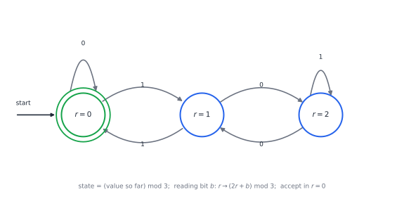
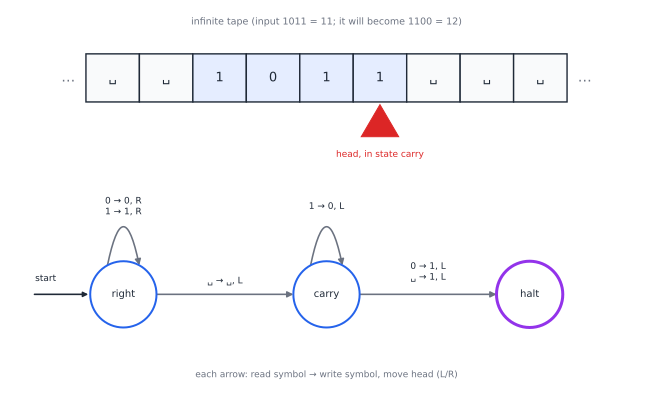
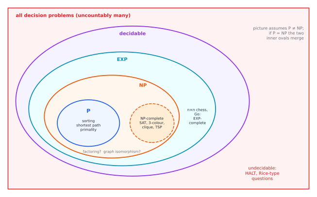

# Chapter 30 — The Limits of Computation

[← Previous](29-discrete-mathematics-and-logic.md) · [Track A](README.md) · [Table of Contents](../../00-front/table-of-contents.md) · [Next →](../b-probability-information/README.md)

> **Level 2 · Track A — The Mathematics Behind Algorithms**
> **Builds on:** [Ch. 26](26-the-mathematics-of-algorithms.md), [Ch. 28](28-combinatorics.md), [Ch. 29](29-discrete-mathematics-and-logic.md), [Ch. 24](../../part-7-numerical-computational/24-computational-mathematics.md) · **Leads to:** [Ch. 65](../f-logic-foundations/65-mathematical-logic.md), [Ch. 68](../f-logic-foundations/68-paradoxes-and-limits.md), [Ch. 77](../h-cryptography-coding/77-cryptography.md) · **Related:** [Ch. 49](../d-optimization/49-integer-programming.md), [Ch. 64](../f-logic-foundations/64-set-theory-and-infinity.md), [Ch. 86](../i-dynamical-systems/86-cellular-automata.md)
> **Reading time:** ~25 min

## 30.1 The hook

Here is a five-line program.

```python
def collatz(n):
    while n != 1:
        n = n // 2 if n % 2 == 0 else 3 * n + 1
    return "done"
```

Does it return for every positive integer $n$? Start at 27 and it wanders for 111 steps, climbing as high as 9232 before falling to 1. Computers have checked every starting value below $2^{68}\approx 3\times10^{20}$, and every one of them reaches 1. Yet nobody can prove that all of them do. The question has been open since 1937. The mathematician Paul Erdős said that mathematics was not yet ready for problems like it.

Now imagine you are the engineer in charge of a code-review tool. Your manager wants a feature: *flag every function that can loop forever*. You would not need to understand Collatz yourself. Your tool would just say "halts" or "loops", and Collatz would be settled. So would a frightening number of other open problems, because many famous conjectures can be written as "this search program never finds a counterexample". Goldbach's conjecture is one: write a loop that tests $4, 6, 8, \dots$ for being a sum of two primes and stops at the first failure.

In 1928 David Hilbert asked for something even bigger, the **Entscheidungsproblem**: a mechanical procedure that decides, for any mathematical statement, whether it is provable. If it existed, mathematics would become computation.

In 1936 Alan Turing, aged 23, answered: no such procedure exists. Not "we haven't found one yet". It *cannot* exist. To prove that, he first had to say exactly what a "mechanical procedure" is, and in doing so he invented the modern computer on paper.

> **Are there problems that no computer program can ever solve?**

By the end of this chapter you will have a proof that the answer is yes, a sense of how *many* such problems there are, and a map of a second, subtler frontier: problems that can be solved, but perhaps never quickly.

## 30.2 The big idea

There are two ideas, and both fit in a paragraph.

**Idea 1: programs are data.** Every program is a finite string of characters. Strings can be listed: first all strings of length 1, then length 2, and so on. So the programs can be numbered $P_1, P_2, P_3, \dots$. A *problem*, on the other hand, is any yes/no question about inputs, which amounts to any subset of the set of all strings. There are as many such subsets as there are real numbers, which is strictly more than there are whole numbers ([Ch. 64](../f-logic-foundations/64-set-theory-and-infinity.md) proves Cantor's theorem behind this). There are not enough programs to go round. Almost every problem has no program at all.

**Idea 2: a program that feeds on itself.** The counting argument says that unsolvable problems exist but does not name one. To name one, Turing used the oldest trick in logic, the liar's paradox ("this sentence is false"). Because programs are data, a program can be given *its own text* as input. Suppose some program claims to predict the behaviour of every program. Build a contrarian that asks the predictor about itself and then does the opposite. The predictor must be wrong about the contrarian. That is the halting problem, and §30.3 makes it rigorous.

The second half of the chapter asks a finer question. Among problems that *can* be solved, some seem to need exponential time. Ch. 29 left one hanging: checking a proposed satisfying assignment of a formula is fast, but finding one appears hard. Is "easy to check" really different from "easy to solve"? That is the P versus NP question, the most famous open problem in computer science.

A useful picture is a ladder of machines. Each rung adds memory and can recognise more:

| Machine | Memory | Recognises | Example it can't handle |
|---|---|---|---|
| finite automaton | a fixed number of states | regular languages | $\{0^n1^n\}$ |
| pushdown automaton | one stack | context-free languages | $\{a^nb^nc^n\}$ |
| Turing machine | unbounded tape | recursively enumerable languages | the complement of HALT |

The top rung is as high as the ladder goes. Every computer ever built, and every programming language, sits at exactly that rung or below.

## 30.3 The mathematics

### Strings, languages and finite automata

An **alphabet** $\Sigma$ is a finite set of symbols, such as $\{0,1\}$. A **string** is a finite sequence of symbols, $\Sigma^*$ is the set of all strings (including the empty string $\varepsilon$), and a **language** is any subset $L\subseteq\Sigma^*$. Every yes/no problem is a language: the language of binary numerals divisible by 3, of satisfiable formulas, of programs that halt.

> [!definition] Deterministic finite automaton (DFA)
> A DFA is $M=(Q,\Sigma,\delta,q_0,F)$: a finite set of states $Q$, an alphabet $\Sigma$, a transition function $\delta:Q\times\Sigma\to Q$, a start state $q_0$ and a set of accepting states $F\subseteq Q$. It reads a string one symbol at a time, moving $q\mapsto\delta(q,c)$, and **accepts** if it ends in $F$. The language it accepts is $L(M)$; languages accepted by some DFA are **regular**.

The state set is the machine's entire memory, so a DFA is the right model for anything with bounded memory: a vending machine, a protocol handshake, a lexer, a digital circuit with flip-flops. Figure 30.1 shows a three-state DFA that reads a binary numeral from the most significant bit and accepts exactly the multiples of 3. Its states are the three equivalence classes of "same remainder mod 3" from [Ch. 29](29-discrete-mathematics-and-logic.md). Reading bit $b$ turns a value $v$ into $2v+b$, so the remainder $r$ becomes $(2r+b)\bmod 3$.



*Figure 30.1 — A DFA for "divisible by 3". The double ring marks the accepting state. Trace `110` (six): $0\to1\to0\to0$, accept. Trace `111` (seven): $0\to1\to0\to1$, reject.*

How much can a finite memory do? Not much, and the proof is the pigeonhole principle from [Ch. 28](28-combinatorics.md).

> [!theorem] Theorem 30.1 — Counting needs unbounded memory
> The language $L=\{0^n1^n: n\ge0\}$ (some zeros followed by the *same number* of ones) is not regular.

*Proof.* Suppose a DFA $M$ with $k$ states accepts $L$. Feed it the $k+1$ strings $\varepsilon, 0, 00, \dots, 0^k$ and record the state after each. There are $k+1$ strings and only $k$ states, so two of them, say $0^i$ and $0^j$ with $i<j$, leave $M$ in the same state $q$. From $q$, the machine's future depends only on the rest of the input. Append $1^i$: the string $0^i1^i\in L$ must be accepted, so reading $1^i$ from $q$ ends in an accepting state. But $0^j1^i$ also reaches $q$ and then reads the same $1^i$, so it is accepted too, though $j\neq i$ means $0^j1^i\notin L$. Contradiction. $\square$

The same argument proves that no DFA checks balanced parentheses, which is why compilers need a stack (a pushdown automaton, the next rung) to parse code. Its general form, the **pumping lemma**, is a standard tool for proving languages non-regular.

### Turing machines

Turing's model gives a finite control unlimited scratch space.

> [!definition] Turing machine
> A Turing machine has a finite set of states, including a start state and a halting state, and a tape of cells extending without bound, each holding a symbol (blank, written ␣, by default). A head sits over one cell. At each step the machine reads the symbol under the head and, according to a finite table $\delta(q,s)=(q',s',D)$, switches to state $q'$, writes $s'$, and moves one cell left or right ($D\in\{L,R\}$). It **halts** if it reaches the halting state. On some inputs it may run forever.



*Figure 30.2 — A three-state Turing machine that adds 1 to a binary number. In state* right *it runs to the end of the input; in state* carry *it walks back, turning trailing 1s into 0s, until it can write a single 1. The head is shown mid-carry on input 1011.*

This looks absurdly primitive, but every algorithm anyone has written down can be compiled into such a table. Two facts make the model central:

- **Universality.** There is a single Turing machine $U$ that takes as input the description $\langle M\rangle$ of any machine $M$ plus an input $w$, and simulates $M$ on $w$. This is a stored-program computer, described nine years before the first one was built.
- **The Church–Turing thesis.** Every procedure that a human or a physical machine can carry out step by step can be done by a Turing machine. This is not a theorem (it relates a mathematical object to an informal idea), but every alternative model ever proposed, from lambda calculus to cellular automata to the programming language you use, has turned out to be equivalent.

### Decidable, recognisable and the halting problem

> [!definition] Decidable and recognisable
> A language $L$ is **decidable** if some Turing machine halts on every input, accepting exactly the strings in $L$. It is **recognisable** if some machine accepts exactly the strings in $L$, but may run forever on strings outside it.

The difference matters. To recognise "programs that halt", just run the program and say yes if it stops. If it never stops, you never answer. The question is whether something cleverer always answers.

> [!theorem] Theorem 30.2 — The halting problem is undecidable (Turing, 1936)
> The language $\mathrm{HALT}=\{\langle M, w\rangle: M \text{ halts on input } w\}$ is recognisable but not decidable.

*Proof.* It is recognisable: the universal machine simulates $M$ on $w$ and accepts if the simulation halts.

Suppose, for contradiction, that a machine $H$ decides it: $H(\langle M\rangle, w)$ always halts, answering *yes* if $M$ halts on $w$ and *no* otherwise. Build a new machine $D$ that, on input $\langle M\rangle$:

1. runs $H(\langle M\rangle,\langle M\rangle)$, asking whether $M$ halts when fed its own description;
2. if $H$ says *yes*, loops forever; if $H$ says *no*, halts.

$D$ is a legitimate machine because $H$ always halts. Now run $D$ on its own description $\langle D\rangle$.

- If $D$ halts on $\langle D\rangle$, then $H(\langle D\rangle,\langle D\rangle)$ said *yes*, so by step 2 $D$ loops forever. Contradiction.
- If $D$ loops forever on $\langle D\rangle$, then $H$ said *no*, so by step 2 $D$ halts. Contradiction.

Either way we reach a contradiction, so no such $H$ exists. $\square$

This is **diagonalisation**. List all machines down the side of a table and all inputs across the top, and write in each cell whether that machine halts on that input. $D$ is built to disagree with the diagonal: on input $\langle M_i\rangle$ it does the opposite of what $M_i$ does on $\langle M_i\rangle$. So $D$ differs from every row, yet $D$ is supposed to be a row. It is Cantor's proof that the reals are uncountable, turned into a statement about programs.

> [!warning] What the theorem does and does not say
> It does not say you can never tell whether a *particular* program halts: for `while True: pass` you obviously can. It says no single algorithm is right about *every* program. A practical tool can answer "halts", "loops" or "don't know" and be useful, as long as it is allowed to say "don't know".

### Reductions: undecidability spreads

Once you have one unsolvable problem, you can find many by **reduction**. Problem $A$ reduces to problem $B$, written $A\le B$, if a computable function $f$ turns every instance $x$ of $A$ into an instance $f(x)$ of $B$ with the same answer. Then a solver for $B$ would solve $A$, so if $A$ is undecidable, so is $B$.

For example, "does program $P$ ever print `hello`?" is undecidable. Given $\langle M,w\rangle$, build the program that silently simulates $M$ on $w$ (with all output suppressed) and then prints `hello`. It prints `hello` exactly when $M$ halts on $w$. A `hello`-detector would therefore decide HALT.

Pushing this idea to its limit gives a theorem that should worry anyone who writes analysis tools.

> [!theorem] Rice's theorem (1953)
> Let $S$ be any property of the *function a program computes* (its input-output behaviour, not its text), such that some programs have it and some do not. Then "does program $P$ have property $S$?" is undecidable.

"Does this program ever divide by zero?", "does it compute the same function as that one?", "does it meet its specification?" are all undecidable in general. This is why the first mystery of [Ch. 29](29-discrete-mathematics-and-logic.md) can have no complete mechanical solution.

> [!mystery] The machine that could not prove itself
> Turing's diagonal trick looks a lot like the sentence "this statement is not provable". Five years earlier, Kurt Gödel had used that sentence to show that any consistent formal system rich enough for arithmetic leaves some true statements unprovable. Are the two results the same theorem in different clothes, and can one be derived from the other? The story is in [Ch. 65](../f-logic-foundations/65-mathematical-logic.md) and [Ch. 68](../f-logic-foundations/68-paradoxes-and-limits.md).

### Efficient computation: P and NP

Decidable is not the same as practical. A problem whose best algorithm takes $2^n$ steps is decidable, but at $n=300$ it is as good as unsolvable. Complexity theory sorts decidable problems by how their cost grows (the growth-rate language is from [Ch. 26](26-the-mathematics-of-algorithms.md)).

> [!definition] P and NP
> A decision problem is in **P** if some algorithm solves it in time $O(n^k)$ for a fixed $k$, where $n$ is the input length. It is in **NP** if every *yes*-instance has a **certificate** of polynomial length that a polynomial-time **verifier** can check: the verifier accepts $(x,c)$ for some $c$ exactly when $x$ is a *yes*-instance.

Satisfiability (SAT: does this formula have an assignment making it true?) is in NP, because the certificate is the assignment and checking it takes one pass over the formula. Sorting, shortest paths ([Ch. 27](27-graph-theory.md)) and, since 2002, primality testing are in P. Every problem in P is in NP (the verifier can ignore the certificate and solve the problem), so $\mathrm{P}\subseteq\mathrm{NP}$. Whether the inclusion is strict is the open question.

Polynomial-time reductions, $A\le_p B$, are reductions computed in polynomial time. A problem $B$ is **NP-hard** if every problem in NP reduces to it, and **NP-complete** if it is also in NP. An NP-complete problem is a hardest problem in NP: a polynomial algorithm for *one* of them gives a polynomial algorithm for *all* of NP.

> [!theorem] Cook–Levin theorem (1971–73)
> SAT is NP-complete.

The idea of the proof is to write the entire run of a polynomial-time verifier, tape cell by tape cell and step by step, as a giant but polynomial-size Boolean formula that is satisfiable exactly when some certificate makes the verifier accept. We state it without proof. Once SAT was known to be hard, Richard Karp showed in 1972 that 21 classic problems were NP-complete too, by chains of reductions. Here is one link of such a chain, proved in full.

Let $G=(V,E)$ be a graph. A set $S\subseteq V$ is **independent** if no edge joins two vertices of $S$; it is a **vertex cover** if every edge has at least one endpoint in $S$; it is a **clique** if every two vertices of $S$ are joined by an edge.

> [!theorem] Theorem 30.3 — Three faces of one problem
> For any graph $G=(V,E)$ with $\lvert V\rvert=n$ and any $S\subseteq V$:
> 1. $S$ is independent in $G$ if and only if $V\setminus S$ is a vertex cover of $G$;
> 2. $S$ is independent in $G$ if and only if $S$ is a clique in the complement graph $\bar G$ (same vertices, an edge exactly where $G$ has none).
>
> Hence "does $G$ have an independent set of size $\ge k$?", "does $G$ have a vertex cover of size $\le n-k$?" and "does $\bar G$ have a clique of size $\ge k$?" have the same answer, and each problem reduces to the others in polynomial time.

*Proof.* (1) Suppose $S$ is independent and take any edge $uv$. Not both of $u,v$ lie in $S$, so at least one lies in $V\setminus S$: the complement covers every edge. Conversely, if $V\setminus S$ covers every edge, no edge can have both endpoints in $S$, so $S$ is independent.

(2) Two distinct vertices $u,v\in S$ are non-adjacent in $G$ exactly when they are adjacent in $\bar G$. So "no pair in $S$ is adjacent in $G$" and "every pair in $S$ is adjacent in $\bar G$" are the same statement.

The reductions are the maps $(G,k)\mapsto(G,n-k)$ and $(G,k)\mapsto(\bar G,k)$. The first is free; the second writes down $\binom{n}{2}$ adjacency bits, which takes $O(n^2)$ time. $\square$

A classic reduction sends 3-SAT to Independent Set (by a gadget that turns each clause into a triangle); combined with Theorem 30.3 this makes Clique and Vertex Cover NP-complete as well. Thousands of problems are now known to be NP-complete: scheduling, timetabling, circuit layout, protein folding models, Sudoku on $n^2\times n^2$ grids, and the integer programs of [Ch. 49](../d-optimization/49-integer-programming.md). They stand or fall together.



*Figure 30.3 — The landscape as most researchers believe it to be. We know $\mathrm{P}\subseteq\mathrm{NP}\subseteq\mathrm{EXP}$ and, by a diagonal argument, $\mathrm{P}\neq\mathrm{EXP}$. Every other boundary in the picture inside the decidable region is unproved.*

> [!mystery] The million-dollar inclusion
> Is $\mathrm{P}=\mathrm{NP}$? The Clay Mathematics Institute has offered US$1,000,000 for an answer since 2000. Strangely, much of modern life is built on betting that the answer is no: if every efficiently checkable problem were efficiently solvable, the one-way functions behind online banking could not exist. Why cryptography needs hardness, and which hardness it needs, is [Ch. 77](../h-cryptography-coding/77-cryptography.md).

## 30.4 The algorithm

### Simulating machines

A DFA is a loop over the input with one table lookup per symbol: linear time and constant memory, which is why regular expressions (compiled to automata) are fast. A Turing machine simulator is barely longer. The tape is a dictionary, so it grows in both directions on demand. Notice the `max_steps` argument: a simulator *must* have one, and Theorem 30.2 says that no clever replacement for it exists.

```python
def run_tm(rules, tape, state="right", head=0, halt="halt", max_steps=10_000):
    tape = dict(enumerate(tape))
    for step in range(max_steps):
        if state == halt:
            return "".join(tape[i] for i in sorted(tape)).strip("_"), step
        state, write, move = rules[state, tape.get(head, "_")]
        tape[head] = write
        head += 1 if move == "R" else -1
    return None, max_steps          # gave up: maybe it never halts

inc = {("right", "0"): ("right", "0", "R"), ("right", "1"): ("right", "1", "R"),
       ("right", "_"): ("carry", "_", "L"),
       ("carry", "1"): ("carry", "0", "L"), ("carry", "0"): ("halt", "1", "L"),
       ("carry", "_"): ("halt", "1", "L")}
print(run_tm(inc, "1011"), run_tm(inc, "111"))   # ('1100', 8) ('1000', 8)
```

### Verifying versus searching

Here is the asymmetry at the heart of NP, in code. A formula in conjunctive normal form is a list of clauses; literal `3` means $x_3$ and `-3` means $\neg x_3$.

```python
from itertools import product

def verify(clauses, bits):                     # O(total formula length)
    return all(any(bits[abs(l) - 1] == (l > 0) for l in c) for c in clauses)

def brute_sat(clauses, n):                     # O(2^n * formula length)
    for bits in product([False, True], repeat=n):
        if verify(clauses, bits):
            return bits
    return None

F = [(1, 2, 3), (-1, -2), (-1, -3), (-2, -3), (-1, 2), (1, -3)]
print(brute_sat(F, 3))                         # (False, True, False)
```

`verify` reads the formula once. `brute_sat` may call it $2^n$ times. Real SAT solvers (DPLL and its descendant, conflict-driven clause learning) prune the search brilliantly and solve industrial instances with millions of variables, but on carefully built hard families every known algorithm still takes exponential time.

### The program you cannot write

Theorem 30.2, written as Python, is short enough to memorise.

```python
def halts(program_source, input_data):
    ...                              # suppose someone hands you this, always correct

def contrarian(source):
    if halts(source, source):
        while True:
            pass                     # loop forever
    return "halted"

# contrarian(<source code of contrarian>) can neither halt nor loop.
```

Whatever body you write for `halts`, `contrarian` run on its own source code proves it wrong. In practice, analysis tools accept this and choose a side: **sound** tools (which never miss a real bug but raise false alarms) or **complete** ones (which never raise false alarms but miss bugs). Rice's theorem says you cannot have both and also always answer.

### Failure cases

- **Confusing worst case with typical case.** NP-completeness is a worst-case statement. Many instances of NP-complete problems are easy, and SAT solvers exploit that every day.
- **Forgetting the encoding.** "Polynomial" means polynomial in the *length of the input*. Trial division tests whether $N$ is prime in about $\sqrt N$ steps, which looks polynomial, but the input is $d\approx\log_{10}N$ digits long, so $\sqrt N\approx10^{d/2}$ is exponential in the input length.

## 30.5 The experiment

### Polynomial versus exponential

Every polynomial is eventually beaten by every exponential, but "eventually" can be far away. The graph compares $n^5$ with $2^n$.

```desmos-graph
left=0; right=30; bottom=0; top=20000000
---
y=x^{5}|blue
y=2^{x}|red
(22.44,5690000)|label:crossover
```

*An algorithm costing $2^n$ beats one costing $n^5$ until $n\approx22.4$; after that it loses, and the gap explodes.*

Change the exponent 5 to 10: the crossover moves out to $n\approx58.8$ (widen to `right=70` and `top=10^{18}` to see it, and move the label point). This is the honest caveat of complexity theory. An $n^{10}$ algorithm is "efficient" in theory and useless in practice, while a $1.001^n$ algorithm is "inefficient" and fine for any $n$ you will ever meet. The theory is about the shape of growth, not about this afternoon's run time.

### The cliff in random 3-SAT

Generate random 3-SAT formulas with $n$ variables and $m$ clauses, each clause three distinct variables with random signs. With few clauses, almost every formula is satisfiable. With many, almost none is. The surprise is how sharply one regime gives way to the other. The script below brute-forces every formula over all $2^n$ assignments at once, using numpy.

```python
import numpy as np
import matplotlib.pyplot as plt

N = 12            # knob: number of variables (each +1 doubles the work)
TRIALS = 200      # knob: random formulas per ratio
RATIOS = np.arange(1.0, 8.01, 0.25)   # clauses per variable, m/n
rng = np.random.default_rng(1)

# every assignment of N Boolean variables, as rows of a 2^N x N table
A = ((np.arange(2**N)[:, None] >> np.arange(N)) & 1).astype(bool)

def satisfiable(m):
    """Random 3-SAT with m clauses; brute force over all 2^N assignments."""
    var = np.array([rng.choice(N, 3, replace=False) for _ in range(m)])
    neg = rng.random((m, 3)) < 0.5
    alive = np.ones(2**N, dtype=bool)
    for v, s in zip(var, neg):
        alive &= (A[:, v] ^ s).any(axis=1)   # clause = OR of 3 literals
        if not alive.any():
            return False
    return True

frac = [np.mean([satisfiable(int(round(r * N))) for _ in range(TRIALS)]) for r in RATIOS]
for r, f in zip(RATIOS, frac):
    print(f"m/n = {r:4.2f}   P(satisfiable) = {f:.2f}")

plt.plot(RATIOS, frac, "o-")
plt.axvline(4.27, ls="--", color="grey")
plt.xlabel("clauses per variable  m/n")
plt.ylabel("fraction satisfiable")
plt.title(f"random 3-SAT, n = {N}")
plt.show()
```

With the default knobs it runs in a few seconds. Every formula is satisfiable up to $m/n=3$, the fraction is $0.74$ at $m/n=4.25$, it crosses one half near $m/n\approx4.8$, and it is down to about $0.04$ by $m/n=7$. The dashed line marks $4.27$, where the transition is believed to sit for very large $n$.

Things to try:

1. Run with `N = 8`, then `N = 14`. The drop gets steeper and slides toward the dashed line as $N$ grows. Estimate where it crosses one half for each $N$.
2. Time each call of `satisfiable` and plot the average time against $m/n$. The cost is not monotone: under-constrained formulas are satisfied at once, over-constrained ones die after a few clauses, and the hardest ones cluster near the cliff.
3. Switch to 2-SAT (two variables per clause). Where is the cliff now? Unlike 3-SAT, 2-SAT is in P, and its threshold can be computed exactly.

## 30.6 The challenge

No answers are given.

1. **Intuition.** A program has 1 KB of memory and no other storage. Explain why "does it halt on this input?" *is* decidable for it, and estimate how many steps a decider might need. Why does this not contradict Theorem 30.2?
2. **Derivation.** Use a pigeonhole argument in the style of Theorem 30.1 to prove that the language of palindromes over $\{0,1\}$ is not regular. Then design a DFA with 5 states that accepts binary numerals divisible by 5, and prove that no DFA with fewer states can do it.
3. **Implementation.** The **busy beaver** $\mathrm{BB}(n)$ is the largest number of steps any halting $n$-state, two-symbol Turing machine takes when started on a blank tape. Extend `run_tm` to enumerate every 2-state machine (each table entry is a choice of write symbol, move and next state or halt) and find $\mathrm{BB}(2)$ by experiment. Why can no program compute $\mathrm{BB}(n)$ for every $n$?
4. **Open investigation.** In 2024 a large online collaboration proved, with a computer-checked proof, that $\mathrm{BB}(5)=47{,}176{,}870$. Some 6-state machines are known to behave like Collatz-type iterations. Write a simulator for a 6-state machine of your own design that mimics the Collatz map on unary or binary numbers, and investigate: what would proving that your machine halts actually require?

## 30.7 Loose threads

The challenge question has an answer, and it is yes. Some problems no program can ever solve, whatever the hardware, the language or the century. The halting problem is the first, proved by making a program argue with itself, and Rice's theorem spreads the damage to every non-trivial question about what programs do. A simple count shows that these are not rare exceptions. Almost every problem is unsolvable, because there are only countably many programs.

Then the chapter drew a second frontier inside the solvable world, between P and NP, and left it exactly where mathematics leaves it: unresolved. That is not a gap in this book. It is a gap in human knowledge.

What we did not tell you:

- **Why logic breaks in the same place.** The diagonal trick that kills the halting problem also limits proof itself. The first mystery points to [Ch. 65](../f-logic-foundations/65-mathematical-logic.md) and [Ch. 68](../f-logic-foundations/68-paradoxes-and-limits.md).
- **What hardness is good for.** If P were equal to NP, modern cryptography would collapse; it is built on problems believed hard on average, which is a stronger demand than NP-hardness. The second mystery points to [Ch. 77](../h-cryptography-coding/77-cryptography.md).
- **Whether coins help.** Every algorithm in this chapter was deterministic.

> [!mystery] Does randomness buy speed?
> Some problems have fast randomised algorithms that flip coins and are wrong with probability below $2^{-100}$, while no equally fast deterministic algorithm is known. Primality testing was one of them for 25 years until a deterministic method appeared in 2002. Is randomness ever *really* necessary for efficiency, or can it always be faked? Many researchers believe the second, and the reason has to do with pseudorandom generators: see [Ch. 81](../h-cryptography-coding/81-pseudorandomness.md).

Simple rules running for a long time also turn up in nature and in games: Conway's Game of Life can simulate a universal Turing machine, so even "will this pattern ever die out?" is undecidable. That lead is followed in [Ch. 86](../i-dynamical-systems/86-cellular-automata.md).

## Further reading

- M. Sipser, *Introduction to the Theory of Computation*, 3rd ed., Cengage, 2012. The standard text: automata, computability and complexity, with very clear proofs.
- C. Moore and S. Mertens, *The Nature of Computation*, Oxford University Press, 2011. Wide-ranging and readable, including the physics of the 3-SAT phase transition.
- S. Aaronson, *Quantum Computing Since Democritus*, Cambridge University Press, 2013. Witty essays on computability, complexity and what they say about the world.
