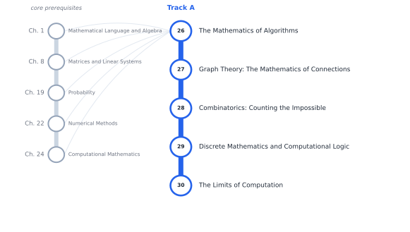

# Track A — The Mathematics Behind Algorithms

[← Table of Contents](../../00-front/table-of-contents.md) · [Start: Ch. 26 →](26-the-mathematics-of-algorithms.md)

> **Level 2 — Specializations.** How to make programs faster, prove they work, and understand the limits of computation.

*Suggested reading order for Track A. The grey stations on the left are the core chapters it leans on.*

## Before you start

This track assumes you are comfortable with these core chapters:

- Ch. 1 — [Mathematical Language and Algebra](../../part-1-foundations/01-mathematical-language-and-algebra.md)
- Ch. 8 — [Matrices and Linear Systems](../../part-3-linear-algebra/08-matrices-and-linear-systems.md)
- Ch. 19 — [Probability](../../part-6-probability-statistics/19-probability.md)
- Ch. 22 — [Numerical Methods](../../part-7-numerical-computational/22-numerical-methods.md)
- Ch. 24 — [Computational Mathematics](../../part-7-numerical-computational/24-computational-mathematics.md)

## Chapters

| Ch. | Chapter | What it explores |
|---|---|---|
| 26 | [The Mathematics of Algorithms](26-the-mathematics-of-algorithms.md) | Asymptotic analysis, Big-O/Theta/Omega, recurrences, amortized analysis, algorithmic lower bounds, and complexity trade-offs. |
| 27 | [Graph Theory: The Mathematics of Connections](27-graph-theory.md) | Paths, trees, flows, matchings, connectivity, graph coloring, planar graphs, network centrality, spectral graph theory. |
| 28 | [Combinatorics: Counting the Impossible](28-combinatorics.md) | Permutations, combinations, inclusion–exclusion, recurrence relations, generating functions, pigeonhole principle, Ramsey theory, extremal combinatorics. |
| 29 | [Discrete Mathematics and Computational Logic](29-discrete-mathematics-and-logic.md) | Propositional and predicate logic, induction, relations, sets, discrete structures, Boolean algebra, invariants, proof techniques. |
| 30 | [The Limits of Computation](30-limits-of-computation.md) | Automata, formal languages, Turing machines, decidability, computability, reductions, P versus NP, and undecidable problems. |

Every chapter follows the same arc: **the hook** (a puzzle or a failure), **the big idea**, **the mathematics**, **the algorithm**, **the experiment** you can run, **the challenge**, and **loose threads**: the questions the chapter deliberately leaves open.
