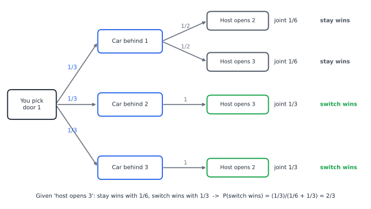
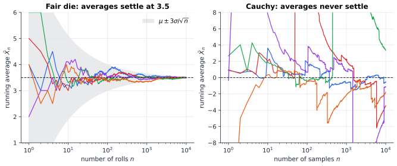

# Chapter 31 — Probability: The Science of Uncertainty

[← Track B overview](README.md) · [Track B](README.md) · [Table of Contents](../../00-front/table-of-contents.md) · [Next →](32-counting-random-worlds.md)

> **Level 2 · Track B — Probability, Uncertainty, and Information**
> **Builds on:** [Ch. 19](../../part-6-probability-statistics/19-probability.md), [Ch. 20](../../part-6-probability-statistics/20-statistical-analysis.md) · **Leads to:** [Ch. 32](32-counting-random-worlds.md), [Ch. 35](35-bayesian-inference.md), [Ch. 38](38-monte-carlo.md) · **Related:** [Ch. 33](33-information-theory.md), [Ch. 97](../j-frontier/97-measure-theory.md)
> **Reading time:** ~25 min

## 31.1 The hook

In September 1990 a reader sent a puzzle to Marilyn vos Savant's column in *Parade* magazine. You are on a game show facing three closed doors. Behind one is a car; behind the other two, goats. You pick door 1. The host, who knows where the car is, opens door 3 and shows you a goat. He then offers you the chance to switch to door 2. Should you?

Vos Savant said yes: switching wins two times in three. The magazine reportedly received around ten thousand letters in reply, many from people with doctorates, a large share of them telling her she was wrong. Two doors are left, they said, so it must be fifty-fifty. Paul Erdős, one of the most prolific mathematicians of the century, is said to have stayed unconvinced until he watched a computer simulation.

Now change one detail. The host does *not* know where the car is. He opens one of the two doors you did not pick at random, and it happens to show a goat. Everything you can see is identical: you chose door 1, door 3 is open, a goat is standing there, door 2 is closed. Yet now switching wins exactly half the time.

Same doors, same goat, same view, different answer. If that bothers you, good. It means you have found the central fact of this chapter: **a probability is not a property of the world you see. It depends on how you came to see it.** The answer to "should I switch?" depends on a question that seems to have nothing to do with doors: *what was the host's rule?*

The second half of the chapter asks a matching question about long runs. A casino does not know whether the next spin of its roulette wheel will win or lose, yet it can predict its takings for the year to within a fraction of a percent. Somewhere between one spin and a million, uncertainty turns into near-certainty. Where does that happen, how fast, and can it fail? It can, and you will watch it fail in Figure 31.2.

## 31.2 The big idea

Think of probability as **bookkeeping for ignorance**. Before the host acts you have a ledger: one third of your belief on each door. Every observation is a new entry. Conditioning on an event does not change the world. It deletes the parts of your ledger that the observation rules out and rescales what remains, so that it sums to one again.

The catch is that an observation is an event in the *full* story, host's behaviour included, and not just in the picture of the doors. "Door 3 shows a goat" is one event when the host chose door 3 on purpose because it hid a goat. It is a different event when he picked door 3 by chance and got lucky. Each version deletes a different part of the ledger:

- **Knowing host.** If the car is behind door 2, he is *forced* to open door 3. If the car is behind door 1, he opens door 3 only half the time. So seeing door 3 opened is twice as likely in the "car behind 2" world. That is evidence, and it pushes belief towards door 2.
- **Ignorant host.** He opens door 3 half the time whatever is behind door 1 or door 2, so the opening alone tells you nothing. Only the goat matters, and the goat rules out door 3 alone, leaving doors 1 and 2 equal.

The probability tree in Figure 31.1 makes this mechanical. Every path from the root to a leaf is one complete story, and its probability is the product of the branch probabilities. Conditioning means keeping the leaves that agree with what you saw and renormalising.


*Figure 31.1 — The knowing-host game as a tree. The leaves consistent with "host opens door 3" carry joint probability 1/6 (you were right first time) and 1/3 (the car is behind door 2). Renormalised, switching wins 2/3.*

**The analogy for the second half.** A single coin toss is like one voter in an election: unpredictable. A million tosses are like the national result, which polls predict well. The law of large numbers says the average of many independent random quantities settles down to its expectation. The central limit theorem says how the remaining wobble is shaped (a bell curve) and how big it is (it shrinks like $1/\sqrt n$). Both are covered in the core ([§20.5](../../part-6-probability-statistics/20-statistical-analysis.md#205-sampling), with proofs in [Appendix E.4–E.5](../../appendix/E-probability-statistics-numerics.md#e4-the-weak-law-of-large-numbers)). This chapter pushes on what the core left soft. In what sense does the average "settle"? What guarantees it? What breaks it?

## 31.3 The mathematics

Conditional probability, the law of total probability and Bayes' theorem are developed in [§19.2](../../part-6-probability-statistics/19-probability.md#192-conditional-probability) and [§19.3](../../part-6-probability-statistics/19-probability.md#193-bayes-theorem). Independence is in [§19.4](../../part-6-probability-statistics/19-probability.md#194-independence), and Markov's and Chebyshev's inequalities are in [§19.9](../../part-6-probability-statistics/19-probability.md#199-expectation-and-variance). We use all of them freely.

### Result 1: the host's rule decides the answer

Generalise the host. Let $C\in\{1,2,3\}$ be the car's door, uniform. You pick door 1. If the car is behind door 1, the host can open either goat door. Say he opens door 3 with probability $q$ and door 2 with probability $1-q$. If the car is behind door 2 or 3, he must open the other goat door. Let $O_3$ be the event "host opens door 3".

> [!theorem] Monty Hall with a biased host
> For the knowing host with preference $q\in[0,1]$,
> $$
> P(C=2\mid O_3)=\frac{1}{1+q},\qquad P(C=1\mid O_3)=\frac{q}{1+q}.
> $$
> For the ignorant host, who opens door 2 or 3 at random, $P(C=2\mid O_3,\ \text{goat})=\tfrac12$.

*Proof.* By the law of total probability,

$$
P(O_3)=P(O_3\mid C=1)P(C=1)+P(O_3\mid C=2)P(C=2)+P(O_3\mid C=3)P(C=3)=\frac q3+\frac13+0 .
$$

Bayes' theorem gives

$$
P(C=2\mid O_3)=\frac{P(O_3\mid C=2)P(C=2)}{P(O_3)}=\frac{1/3}{(q+1)/3}=\frac{1}{1+q}.
$$

For the ignorant host, $P(O_3\mid C=c)=\tfrac12$ for every $c$. The goat is seen exactly when $C\neq3$. So $P(O_3\cap\{\text{goat}\}\cap\{C=c\})=\tfrac16$ for $c=1,2$ and $0$ for $c=3$. Renormalising, doors 1 and 2 get $\tfrac12$ each. $\square$

With $q=\tfrac12$, the usual host, switching wins $\tfrac23$. Even in the worst case, $q=1$ (a host who always opens door 3 when he can), switching wins $\tfrac12$. It is never worse than staying. If he opens door 2 instead, the mirror-image formula is $1/(2-q)$, which is also at least $\tfrac12$. So "always switch" is a dominant strategy, whatever the host's taste in doors. And the ignorant-host answer is not a special value of $q$ at all: it is a different event in a different sample space.

> [!warning] Common Pitfall — conditioning on what you saw instead of what happened
> "Two doors remain, so it's 50–50" quietly assumes the ignorant-host model. The data ("door 3 is open with a goat") cannot settle which model is true. Only the *protocol* can. The same trap appears in the boy–girl paradox, in survivorship bias, and in every observational study where the way the data were collected depends on the outcome ([Ch. 37](37-causal-inference.md)).

### Independence is more fragile than it looks

Events $A,B,C$ can be independent in pairs without being independent together. Toss two fair bits $X,Y$ and let $Z=X\oplus Y$ (exclusive-or). Every pair is independent: for instance $P(X=1,Z=1)=P(X=1,Y=0)=\tfrac14=P(X=1)P(Z=1)$. But any two of them determine the third, so $P(X=1,Y=1,Z=1)=0\neq\tfrac18$. This is not a curiosity. It is the principle behind the one-time pad and RAID-5 parity: one parity bit tells you nothing on its own, yet together with the other bits it tells you everything. The definition of mutual independence in [§19.4](../../part-6-probability-statistics/19-probability.md#194-independence) needs the product rule for *every* subfamily for exactly this reason.

Independence can also appear or disappear when you condition. Two independent fair dice are no longer independent once you are told their sum is 7. Two strongly correlated alarm signals can become independent once you know whether there really is a fire. Conditioning is the single most powerful operation in probability, and the most dangerous.

### Result 2: Jensen's inequality

Markov and Chebyshev turn means and variances into tail bounds. The next inequality is the one that information theory ([Ch. 33](33-information-theory.md)) is built on.

> [!theorem] Jensen's inequality
> If $\varphi$ is convex and $X$ and $\varphi(X)$ have finite expectations, then
> $$
> \varphi\bigl(E[X]\bigr)\le E\bigl[\varphi(X)\bigr].
> $$
> For concave $\varphi$ the inequality reverses. If $\varphi$ is strictly convex, equality holds only when $X$ is almost surely constant.

*Proof.* Let $\mu=E[X]$. A convex function lies above each of its supporting lines. So there is a slope $m$ (the derivative at $\mu$ if it exists, otherwise any subgradient) such that

$$
\varphi(x)\ge\varphi(\mu)+m(x-\mu)\quad\text{for all }x .
$$

Put $x=X$ and take expectations. Linearity gives $E[\varphi(X)]\ge\varphi(\mu)+m(E[X]-\mu)=\varphi(\mu)$. If $\varphi$ is strictly convex, the inequality between the curve and the line is strict for $x\neq\mu$. Equality in expectation then forces $X=\mu$ with probability one. $\square$

Choosing $\varphi$ gives a family of classics:

| $\varphi(x)$ | Jensen says | Reading |
|---|---|---|
| $x^2$ | $E[X]^2\le E[X^2]$ | variance is non-negative |
| $e^{x}$ | $e^{E[X]}\le E[e^{X}]$ | the MGF is never below $e^{\mu}$ (the seed of Chernoff bounds, [Ch. 32](32-counting-random-worlds.md)) |
| $\log x$ (concave) | $E[\log X]\le\log E[X]$ | geometric mean $\le$ arithmetic mean; entropy $\le\log(\text{alphabet size})$ |
| $1/x$ on $x>0$ | $1/E[X]\le E[1/X]$ | average travel time at random speeds is worse than the time at the average speed |

A second workhorse is **Cauchy–Schwarz**, $\lvert E[XY]\rvert\le\sqrt{E[X^2]E[Y^2]}$. It follows because $E[(X-tY)^2]\ge0$ for every real $t$, so this quadratic in $t$ has a non-positive discriminant. Applied to the centred variables, it shows that the correlation coefficient of [§20.3](../../part-6-probability-statistics/20-statistical-analysis.md#203-covariance-and-correlation) always lies in $[-1,1]$.

### Result 3: averages settle, almost surely

The weak law of large numbers ([Appendix E.4](../../appendix/E-probability-statistics-numerics.md#e4-the-weak-law-of-large-numbers)) says that for each fixed $\varepsilon>0$,

$$
P\bigl(\lvert\bar X_n-\mu\rvert>\varepsilon\bigr)\to0,\qquad \bar X_n=\frac1n\sum_{i=1}^nX_i .
$$

Read it carefully. It is a statement about each *single* $n$: at a large time, a large deviation is unlikely. It does not say that any particular run of the experiment eventually stays close to $\mu$. A run could, in principle, wander away rarely but infinitely often. The **strong law** rules that out. It is a statement about whole sample paths:

$$
P\Bigl(\lim_{n\to\infty}\bar X_n=\mu\Bigr)=1 .
$$

The tool that turns "rarely" into "only finitely often" is short enough to prove in full.

> [!theorem] First Borel–Cantelli lemma
> If $A_1,A_2,\dots$ are events with $\sum_n P(A_n)<\infty$, then with probability one only finitely many of the $A_n$ occur.

*Proof.* "Infinitely many $A_n$ occur" is the event $\bigcap_{N}\bigcup_{n\ge N}A_n$. For every $N$ it is contained in $\bigcup_{n\ge N}A_n$, so by the union bound

$$
P(\text{infinitely many }A_n)\le\sum_{n\ge N}P(A_n)\xrightarrow[N\to\infty]{}0,
$$

because the tail of a convergent series tends to zero. $\square$

Now the strong law, under an extra assumption that keeps the proof to a few lines.

> [!theorem] Strong law of large numbers (finite fourth moment)
> Let $X_1,X_2,\dots$ be i.i.d. with mean $\mu$ and $E[(X_1-\mu)^4]=\kappa<\infty$. Then $\bar X_n\to\mu$ with probability one.

*Proof.* Put $Y_i=X_i-\mu$, so $E[Y_i]=0$ and $E[Y_i^2]=\sigma^2$. Expand $E[(Y_1+\dots+Y_n)^4]$ as a sum of terms $E[Y_iY_jY_kY_l]$. By independence and $E[Y_i]=0$, any term containing an index exactly once vanishes. What survives is the $n$ terms $E[Y_i^4]=\kappa$ and the terms $E[Y_i^2Y_j^2]=\sigma^4$ with $i\neq j$. There are $\binom42=6$ ways to choose which two of the four positions hold $i$, and $\binom n2$ unordered pairs $\{i,j\}$, giving $3n(n-1)$ such terms. Hence

$$
E\Bigl[\Bigl(\sum_{i=1}^nY_i\Bigr)^4\Bigr]=n\kappa+3n(n-1)\sigma^4\le Kn^2,\qquad K=\kappa+3\sigma^4 .
$$

Markov's inequality applied to the fourth power gives, for any $\varepsilon>0$,

$$
P\bigl(\lvert\bar X_n-\mu\rvert>\varepsilon\bigr)=P\Bigl(\Bigl(\sum Y_i\Bigr)^4>n^4\varepsilon^4\Bigr)\le\frac{Kn^2}{n^4\varepsilon^4}=\frac{K}{\varepsilon^4n^2}.
$$

The right side is summable in $n$. By Borel–Cantelli, with probability one $\lvert\bar X_n-\mu\rvert>\varepsilon$ happens only finitely often. Apply this with $\varepsilon=1/m$ for $m=1,2,\dots$. A countable union of probability-zero events has probability zero, so with probability one, for every $m$, $\lvert\bar X_n-\mu\rvert\le1/m$ for all large $n$. That is $\bar X_n\to\mu$. $\square$

Notice why Chebyshev alone was not enough. It gives a bound of order $1/n$, and $\sum1/n$ diverges, so Borel–Cantelli cannot use it. Raising the power from 2 to 4 buys a $1/n^2$ bound, and that is summable. Exponential bounds, which buy $e^{-cn}$, are the business of [Ch. 32](32-counting-random-worlds.md).

> [!mystery] The strong law with nothing but a mean
> Our proof needed a finite fourth moment. Kolmogorov's strong law needs only $E\lvert X\rvert<\infty$: no variance, no fourth moment, nothing else. The proof truncates the variables, controls what was cut off, and needs a rigorous account of what "with probability one" means for an infinite sequence of coin tosses. That rebuilding of probability on measure theory is the subject of [Ch. 97](../j-frontier/97-measure-theory.md).

### When averages refuse to settle

Every one of these laws needs $E\lvert X\rvert<\infty$. The standard **Cauchy** distribution, with density $f(x)=\dfrac{1}{\pi(1+x^2)}$, is symmetric about zero, yet $\int\lvert x\rvert f(x)\,dx$ diverges logarithmically. It has no mean. It is not exotic: it is the distribution of $\tan\Theta$ for a uniformly random angle $\Theta$, so it describes where a randomly aimed beam from a lighthouse hits the shore. Its characteristic function is $e^{-\lvert\omega\rvert}$, so the average of $n$ independent copies has characteristic function $\bigl(e^{-\lvert\omega\rvert/n}\bigr)^n=e^{-\lvert\omega\rvert}$. **The average of $n$ Cauchy samples is again standard Cauchy.** Averaging a million of them is no better than taking one.


*Figure 31.2 — Left: five runs of the running average of a fair die, closing in on 3.5 inside the $\pm3\sigma/\sqrt n$ envelope. Right: five runs of the running average of standard Cauchy samples. Each time a single huge sample arrives, the average jumps, and it never settles.*

The central limit theorem ([§20.5](../../part-6-probability-statistics/20-statistical-analysis.md#205-sampling)) completes the finite-variance story. The wobble $\bar X_n-\mu$ is approximately $\mathcal N(0,\sigma^2/n)$, which is the grey envelope in Figure 31.2. It is a statement about *shape*: it tells you the distribution of the error at typical scales, $\pm$ a few $\sigma/\sqrt n$. It does not reliably tell you about errors far out in the tails. That distinction will matter a great deal in the next chapter.

## 31.4 The algorithm

The law of large numbers is an algorithm in disguise. **To estimate a probability, simulate and count.** If $I_k$ is the indicator that trial $k$ produced the event, then $\hat p_n=\frac1n\sum I_k$ converges to $p$. The questions an engineer must answer are *how many trials*, and *how do I accumulate the answer without numerical trouble*.

```python
import numpy as np

def estimate(trial, n, rng):
    """Monte Carlo estimate of P(event) with a CLT confidence half-width."""
    mean, m2 = 0.0, 0.0                      # Welford's running mean and sum of squares
    for k in range(1, n + 1):
        x = float(trial(rng))                # 1.0 if the event happened, else 0.0
        d = x - mean
        mean += d / k
        m2 += d * (x - mean)
    var = m2 / (n - 1)
    return mean, 1.96 * np.sqrt(var / n)     # ~95 % interval: mean +- half-width
```

Welford's update avoids the cancellation of the naive formula $\frac1n\sum x^2-\bar x^2$, which can lose every significant digit when the variance is tiny compared with the mean squared. Each step costs $O(1)$ time and $O(1)$ memory, so the estimator can run on a stream that never ends.

**How many trials?** To get $\lvert\hat p-p\rvert\le\varepsilon$ with failure probability at most $\delta$:

- *Chebyshev* (a guarantee): $\operatorname{Var}(\hat p)\le\frac1{4n}$, so $n\ge\dfrac{1}{4\delta\varepsilon^2}$. For $\varepsilon=0.01$ and $\delta=0.05$ that is $50\,000$ trials.
- *CLT* (an approximation): $n\approx\dfrac{z^2}{4\varepsilon^2}$ with $z=1.96$, about $9\,604$ trials, five times fewer.

The gap between a rigorous bound and an approximate one is a recurring theme. In [Ch. 32](32-counting-random-worlds.md) the Chernoff–Hoeffding bound closes most of it, giving a guarantee with $\log(1/\delta)$ in place of $1/\delta$.

**Failure cases.**

1. *Rare events.* The relative error of $\hat p$ is about $1/\sqrt{np}$. To estimate $p=10^{-6}$ to $\pm10\,\%$ at 95 % confidence you need roughly $4\times10^{8}$ trials. Bit-error-rate testing at $10^{-12}$ is impossible by brute force. That is why importance sampling exists ([Ch. 38](38-monte-carlo.md)).
2. *Heavy tails.* If the quantity being averaged has infinite variance, the $1/\sqrt n$ rate is gone. If it has no mean, as in Figure 31.2, there is nothing to converge to.
3. *Hidden dependence.* A poor random-number generator, or trials that share state, quietly break the "independent" in i.i.d. The estimate then converges to the wrong answer with great confidence.

## 31.5 The experiment

First, see the host-bias formula $1/(1+q)$ from Result 1. The horizontal axis is $q$, the probability that the knowing host opens door 3 when he has a choice.

```desmos-graph
left=0; right=1; bottom=0; top=1
---
y=\frac{1}{1+x}|blue|0<x<1
y=\frac{x}{1+x}|red|0<x<1
y=0.5|grey|dashed
(0.5,0.6667)|label:usual host
```

*Probability that switching wins (blue) and that staying wins (red) as the host's door preference $q$ varies. The curves meet only at $q=1$. Add the line `y=\frac{1}{2-x}` (switching wins when the host opened door 2 instead) and check that it too never drops below the dashed line at $1/2$. Then change the fixed point to the $q$ you think a real host might have.*

Now simulate the game itself. The knobs are at the top.

```python
import numpy as np

DOORS = 3           # try 10 or 100: the host opens all but one other door
HOST_KNOWS = True   # False: host opens doors at random (games showing the car are discarded)
Q = 0.5             # knowing host, car behind your door: chance he leaves the lowest-numbered other door shut
TRIALS = 100_000
rng = np.random.default_rng(1)

stay = switch = kept = 0
for _ in range(TRIALS):
    car, pick = rng.integers(DOORS), 0
    others = [d for d in range(DOORS) if d != pick]
    if HOST_KNOWS:
        if car == pick:
            closed = others[0] if rng.random() < Q else rng.choice(others[1:])
        else:
            closed = car                     # he must keep the car hidden
    else:
        closed = rng.choice(others)          # the door left shut, chosen blindly
        if car not in (pick, closed):        # he revealed the car: game void
            continue
    kept += 1
    stay += (car == pick)
    switch += (car == closed)

print(f"games kept: {kept}")
print(f"P(win | stay)   = {stay / kept:.4f}")
print(f"P(win | switch) = {switch / kept:.4f}")
print(f"theory, usual knowing host: switch wins {(DOORS - 1) / DOORS:.4f}")
```

Things to try. Set `DOORS = 100` with `HOST_KNOWS = True`: switching wins about 99 % of the time, and the puzzle stops feeling paradoxical. Set `HOST_KNOWS = False` and watch both answers fall to $1/2$, while `games kept` drops to about $2/\text{DOORS}$ of the trials: most games are thrown away because the blind host exposed the car. Then plot the running estimate of `switch / kept` against the number of games on log axes. Does its wobble shrink like $1/\sqrt n$?

## 31.6 The challenge

1. **Intuition.** A test for a disease affecting 1 in 1000 people is 99 % sensitive and has a 5 % false-positive rate. Before computing anything, guess the probability that a person who tests positive is ill. Then explain, using only the idea of "deleting the impossible parts of the ledger", why the true answer is so much smaller than most people guess. What changes if the person was tested *because* they had symptoms?
2. **Derivation.** In the $n$-door knowing-host game, the host opens $k$ goat doors ($1\le k\le n-2$) chosen uniformly from those available, and you then switch to a uniformly random closed door other than yours. Derive the probability that switching wins, and show that it is always larger than $1/n$.
3. **Implementation.** Write a function that takes any finite probability tree (nested lists of `(probability, label, subtree)`) and an observed event, given as a predicate on root-to-leaf paths, and returns the posterior distribution over leaves. Use it to reproduce Result 1 for both hosts and the boy–girl paradox ("at least one is a boy" versus "the elder is a boy").
4. **Open investigation.** For the running average of a symmetric distribution with tails $P(\lvert X\rvert>x)\sim x^{-\alpha}$, explore by simulation for which $\alpha$ the average seems to converge, at what rate, and to what *shape* of fluctuation. What happens near $\alpha=1$ and near $\alpha=2$? Can you guess a scaling law $n^{\beta(\alpha)}$ that makes the fluctuations look the same at every $n$?

## 31.7 Loose threads

This chapter treated probability as a calculus of belief updates and long-run averages. In doing so it took several things on trust.

We assumed the host's rule was known. In real problems it never is. A doctor does not know the exact false-positive rate, and a radar does not know the clutter statistics. The honest response is to put a probability distribution on the unknown rule itself and let the data update *that*.

> [!mystery] What if you do not know the host's rule?
> Suppose you play the game many times against the same host and do not know his $q$. Each game you see which door he opens. Can you learn $q$, and how should your decision to switch change as you learn? Treating $q$ itself as random, with a prior that the data sharpen into a posterior, is Bayesian inference, the subject of [Ch. 35](35-bayesian-inference.md).

We proved the strong law with a fourth moment, and the general proof was left for later. We also saw that Chebyshev gives deviation probabilities falling only like $1/n$, while the true probabilities in a coin-tossing experiment fall far faster. For $1000$ fair tosses, Chebyshev bounds the chance that the fraction of heads is outside $[0.45,0.55]$ by $0.1$. The truth is about $0.0014$.

> [!mystery] Exponentially unlikely
> The probability that the average of $n$ coin tosses is off by more than $\varepsilon$ does not fall like $1/n$. It falls like $e^{-cn}$, and the constant $c$ has an exact value that depends on $\varepsilon$. Where does the exponential come from, and what is $c$? Chernoff's method in [Ch. 32](32-counting-random-worlds.md) gives the bound. The identity of $c$, a quantity that measures how *distinguishable* two coins are, waits in [Ch. 33](33-information-theory.md).

Finally, the Cauchy distribution showed that averaging can fail outright. Between "finite variance, Gaussian fluctuations" and "no mean, no convergence" lies a whole zoo of heavy-tailed limits, the stable laws. They govern network traffic bursts, financial returns and impulsive noise. Their story continues with processes that evolve in time in [Ch. 36](36-stochastic-processes.md), and the computational consequences of rare events in [Ch. 38](38-monte-carlo.md).

## Further reading

- J. K. Blitzstein and J. Hwang, *Introduction to Probability*, 2nd ed., CRC Press, 2019. Conditioning, Monty Hall variants and the inequalities, with excellent intuition.
- G. Grimmett and D. Stirzaker, *Probability and Random Processes*, 4th ed., Oxford University Press, 2020. The laws of large numbers, Borel–Cantelli and modes of convergence, with full proofs.
- W. Feller, *An Introduction to Probability Theory and Its Applications*, Vol. 1, 3rd ed., Wiley, 1968. The classic; its chapters on fluctuations in coin tossing are still startling.
- J. S. Rosenthal, *Struck by Lightning: The Curious World of Probabilities*, HarperCollins, 2006. A light, accurate tour of everyday probability paradoxes.
