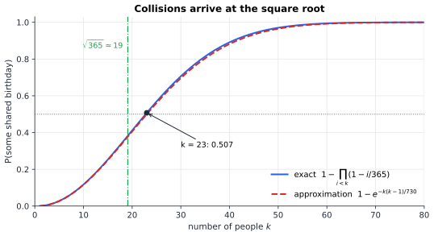
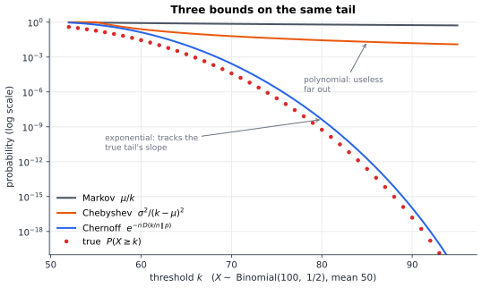

# Chapter 32 — The Art of Counting Random Worlds

[← Previous](31-probability-science-of-uncertainty.md) · [Track B](README.md) · [Table of Contents](../../00-front/table-of-contents.md) · [Next →](33-information-theory.md)

> **Level 2 · Track B — Probability, Uncertainty, and Information**
> **Builds on:** [Ch. 19](../../part-6-probability-statistics/19-probability.md), [Ch. 31](31-probability-science-of-uncertainty.md) · **Leads to:** [Ch. 33](33-information-theory.md), [Ch. 34](34-random-walks-and-markov-chains.md), [Ch. 38](38-monte-carlo.md) · **Related:** [Ch. 28](../a-algorithms/28-combinatorics.md), [Ch. 26](../a-algorithms/26-the-mathematics-of-algorithms.md)
> **Reading time:** ~25 min

## 32.1 The hook

A load balancer sends each of $1000$ incoming requests to one of $1000$ servers, chosen uniformly at random and independently. It is the simplest possible policy, with no coordination and no state. Three questions decide whether it is good enough.

1. **How many servers sit idle?** One might guess "hardly any, since there is one request per server". The answer is about $368$, more than a third of the fleet.
2. **How busy is the busiest server?** The average load is exactly $1$. The maximum is usually $5$ or $6$, and that maximum sets your latency tail.
3. **How many requests until every server has received at least one?** Not $1000$, and not $2000$. It takes about $7485$ on average.

Now make one small change. For each request, pick *two* random servers and send it to the less loaded of the pair. The busiest server's load drops from about $5$ or $6$ to $3$, almost every time. One extra random probe per request is enough to tame the maximum.

Each of these numbers is a property of an astronomically large set of equally likely "worlds": $1000^{1000}$ ways to assign the requests. Nobody can list them. Yet the answers come out in a few lines of algebra. This chapter is about how: counting random worlds *without enumerating them*, and bounding the rare worlds where things go badly wrong. It ends with a piece of magic. We will prove that certain objects exist by showing that a random one works, without ever constructing one.

## 32.2 The big idea

Two ideas do almost all the work.

**Idea 1: break a count into indicators and add expectations.** To find the expected number of idle servers, do not attempt the distribution of that number. It is horrible, because the servers' states are dependent. Instead, attach to each server a little switch $I_j$ that reads $1$ if server $j$ is idle. The count is $\sum_j I_j$, and expectation is linear *whether or not the switches are independent*. So you need only $P(I_j=1)$ for one server, multiplied by $1000$. Linearity of expectation ([§19.9](../../part-6-probability-statistics/19-probability.md#199-expectation-and-variance)) is the most underrated theorem in probability. It ignores dependence completely.

**Idea 2: the average is not enough; bound the tails.** "On average 7485 requests" does not tell an engineer how often it takes 10 000. The tail of the distribution is where systems fail: the server that overflows, the hash bucket that degrades to a linked list, the noise spike that flips a bit. Chapter 19 gave Markov's and Chebyshev's inequalities, which bound tails from the mean and variance alone. They are honest but weak. For sums of many independent pieces, a cleverer use of Markov's inequality gives bounds that decay *exponentially*. That is the **Chernoff bound**, and it is the reason randomized systems can be made reliable.

**The analogy.** Think of the random world as a city of $1000^{1000}$ houses and a property as a colour painted on some of them. Linearity of expectation lets you count the colour by asking one typical house at a time. Tail bounds tell you that the strange houses, the ones far from typical, are so rare that a random visitor essentially never finds one. The probabilistic method turns this round: if the strange houses are rare enough, then *most* houses are normal, and in particular a normal house *exists*.

## 32.3 The mathematics

Counting rules (permutations, combinations, inclusion–exclusion) are in [§19.1](../../part-6-probability-statistics/19-probability.md#191-sample-spaces-and-events) and treated in depth in [Ch. 28](../a-algorithms/28-combinatorics.md). The binomial, geometric and Poisson families are in [§19.6](../../part-6-probability-statistics/19-probability.md#196-probability-distributions). Here we use them as tools.

### Indicators at work

**Idle servers.** Throw $m$ balls into $n$ bins. Server $j$ is idle when every ball misses it, so $P(I_j=1)=(1-1/n)^m$ and

$$
E[\#\text{idle}]=n\Bigl(1-\frac1n\Bigr)^m\approx ne^{-m/n}.
$$

With $m=n=1000$ this is $367.7$, close to $n/e=367.9$. More generally, the load of one bin is $\operatorname{Binomial}(m,1/n)$, which for large $n$ is close to $\operatorname{Poisson}(m/n)$. With $m=n$, about $36.8\,\%$ of bins hold $0$ balls, $36.8\,\%$ hold $1$, $18.4\,\%$ hold $2$, $6.1\,\%$ hold $3$, and $1.5\,\%$ hold $4$. This is the **Poisson paradigm**: many rare, weakly dependent events produce Poisson counts.

**Fixed points.** Shuffle a deck of $n$ cards. How many cards end up where they started? Let $I_k$ indicate that card $k$ is fixed, so $P(I_k=1)=1/n$ and $E[\#\text{fixed}]=n\cdot\frac1n=1$. The answer is one, for every $n$, even though the events are dependent (if $n-1$ cards are fixed, so is the last). The chance of *no* fixed point, a derangement, tends to $\sum_k(-1)^k/k!=1/e\approx0.368$. Inclusion–exclusion gives that ([Ch. 28](../a-algorithms/28-combinatorics.md)); the Poisson paradigm predicts it at once.

### Result 1: the coupon collector

> [!theorem] Coupon collector
> Draw uniformly from $n$ coupon types until every type has appeared. The number of draws $T$ satisfies
> $$
> E[T]=nH_n=n\Bigl(1+\frac12+\dots+\frac1n\Bigr)=n\ln n+\gamma n+O(1),
> $$
> where $\gamma\approx0.5772$, and for every $c>0$
> $$
> P\bigl(T>n\ln n+cn\bigr)\le e^{-c}.
> $$

*Proof of the mean.* Split the collection into stages. Stage $i$ starts when you hold $i-1$ distinct types and ends when you get a new one. During stage $i$ each draw is new with probability $p_i=(n-i+1)/n$, independently of the past. So the length $T_i$ of stage $i$ is geometric with mean $1/p_i$ ([§19.9](../../part-6-probability-statistics/19-probability.md#199-expectation-and-variance)). By linearity,

$$
E[T]=\sum_{i=1}^n\frac{n}{n-i+1}=n\sum_{k=1}^n\frac1k=nH_n .
$$

*Proof of the tail.* $T>t$ means some type is still missing after $t$ draws. Type $j$ is missing with probability $(1-1/n)^t\le e^{-t/n}$, using $1-x\le e^{-x}$. By the union bound over the $n$ types,

$$
P(T>t)\le ne^{-t/n}.
$$

Put $t=n\ln n+cn$: the bound becomes $n\cdot e^{-\ln n-c}=e^{-c}$. $\square$

For $n=1000$: $E[T]=7485.5$, and $P(T>9908)\le e^{-3}\approx0.05$. The stages are independent, so their variances add: $\operatorname{Var}(T)=\sum(1-p_i)/p_i^2\le n^2\sum1/k^2<\pi^2n^2/6$. That gives a standard deviation below $1283$. The collector's time is concentrated in a window of width $O(n)$ around $n\ln n$. The last few coupons are the expensive ones: the final stage alone takes $n$ draws on average.

### The birthday bound, made general

The birthday calculation of [Example 19.5](../../part-6-probability-statistics/19-probability.md#191-sample-spaces-and-events) gives the exact chance that $k$ random labels from $M$ are all distinct, $\prod_{i<k}(1-i/M)$. Apply $1-x\le e^{-x}$ to each factor:

$$
P(\text{no collision})\le\exp\Bigl(-\sum_{i=0}^{k-1}\frac iM\Bigr)=\exp\Bigl(-\frac{k(k-1)}{2M}\Bigr).
$$

This bound is also an excellent approximation while $k\ll M$. It says collisions become likely once $k$ is of order $\sqrt{2M\ln2}\approx1.18\sqrt M$. For $M=365$ that is $22.5$; for 64-bit random identifiers, about $5\times10^9$. A hash with $b$ output bits gives only about $b/2$ bits of collision resistance. That is why SHA-256, and not a 128-bit hash, is used where collisions must be infeasible ([Ch. 77](../h-cryptography-coding/77-cryptography.md)).


*Figure 32.1 — Probability of a shared birthday among $k$ people, exact (blue) and the exponential approximation (red, dashed). The curve passes $1/2$ at $k=23$, just after $\sqrt{365}\approx19$: collisions arrive at the square root of the space size.*

### Result 2: the Chernoff bound

Markov's inequality, $P(Y\ge a)\le E[Y]/a$ for $Y\ge0$, is weak on its own. The trick is to apply it to $e^{sX}$ rather than to $X$. For any $s>0$, $X\ge a$ if and only if $e^{sX}\ge e^{sa}$, so

$$
P(X\ge a)\le e^{-sa}\,E\bigl[e^{sX}\bigr]=e^{-sa}M_X(s),
$$

with the moment-generating function of [§19.9](../../part-6-probability-statistics/19-probability.md#199-expectation-and-variance). The bound holds for every $s>0$, so we may choose the best one. When $X$ is a sum of independent pieces, the MGF *factors*, and that is where the exponential decay comes from.

> [!theorem] Chernoff bound for sums of independent Bernoulli variables
> Let $X=\sum_{i=1}^nX_i$ with independent $X_i\sim\operatorname{Bernoulli}(p_i)$ and $\mu=E[X]=\sum p_i$. For every $\delta>0$,
> $$
> P\bigl(X\ge(1+\delta)\mu\bigr)\le\left(\frac{e^{\delta}}{(1+\delta)^{1+\delta}}\right)^{\mu},
> $$
> and for $0<\delta\le1$ this implies $P\bigl(X\ge(1+\delta)\mu\bigr)\le e^{-\delta^2\mu/3}$.

*Proof.* Each factor of the MGF is $E[e^{sX_i}]=1-p_i+p_ie^{s}=1+p_i(e^s-1)\le\exp\bigl(p_i(e^s-1)\bigr)$, using $1+x\le e^x$. By independence,

$$
M_X(s)=\prod_{i=1}^nE\bigl[e^{sX_i}\bigr]\le\exp\bigl(\mu(e^s-1)\bigr).
$$

Hence, for every $s>0$,

$$
P\bigl(X\ge(1+\delta)\mu\bigr)\le\exp\bigl(\mu(e^s-1)-s(1+\delta)\mu\bigr).
$$

The exponent is minimised where its derivative $\mu e^s-(1+\delta)\mu$ vanishes, at $s=\ln(1+\delta)>0$. Substituting gives $\exp\bigl(\mu\delta-\mu(1+\delta)\ln(1+\delta)\bigr)$, which is the first bound. For the second, we need $(1+\delta)\ln(1+\delta)\ge\delta+\delta^2/3$ on $[0,1]$. Let $g(\delta)=(1+\delta)\ln(1+\delta)-\delta-\delta^2/3$. Then $g(0)=0$ and $g'(\delta)=\ln(1+\delta)-\tfrac23\delta$. This is concave, zero at $0$, and positive at $\delta=1$ ($\ln2-\tfrac23>0$), so $g'\ge0$ on $[0,1]$ and therefore $g\ge0$. $\square$

The lower tail has a matching bound, $P(X\le(1-\delta)\mu)\le e^{-\delta^2\mu/2}$. A close cousin, **Hoeffding's inequality**, handles any independent variables confined to intervals $[a_i,b_i]$:

$$
P\bigl(X-E[X]\ge t\bigr)\le\exp\Bigl(-\frac{2t^2}{\sum_i(b_i-a_i)^2}\Bigr).
$$

How much better is this than Chebyshev? Toss $100$ fair coins and ask for at least $75$ heads.

| Bound | Value for $P(X\ge75)$ |
|---|---|
| Markov, $\mu/a$ | $0.67$ |
| Chebyshev, $\sigma^2/(a-\mu)^2$ | $0.04$ |
| Chernoff, $\delta=\tfrac12$, $e^{-\delta^2\mu/3}$ | $0.016$ |
| Chernoff, $\left(e^{\delta}/(1+\delta)^{1+\delta}\right)^{\mu}$ | $0.0045$ |
| Hoeffding, $e^{-2t^2/n}$ with $t=25$ | $3.7\times10^{-6}$ |
| Chernoff with the exact Bernoulli MGF (no $1+x\le e^x$ step) | $2.1\times10^{-6}$ |
| **True value** | $2.8\times10^{-7}$ |

The crude Chernoff forms are built for small $p_i$, where $1+x\le e^x$ is nearly tight. For fair coins it is better to keep the exact factor $(\tfrac12+\tfrac12e^s)^n$ and optimise $s$ directly. That is the bottom bound row, and the blue curve in Figure 32.2. On a log scale, it runs parallel to the true tail: it has the right *exponential rate*, missing only a polynomial prefactor. Chebyshev and Markov fall hopelessly behind.


*Figure 32.2 — Upper bounds on $P(X\ge k)$ for $X\sim\operatorname{Binomial}(100,\tfrac12)$. Markov and Chebyshev decay polynomially. The optimised Chernoff bound decays at the same exponential rate as the truth (red dots).*

**Max load.** The Chernoff bound answers the hook's second question. A bin's load is a sum of $n$ Bernoulli$(1/n)$ variables with $\mu=1$. For large $1+\delta=k$ the bound is roughly $(e/k)^k$. A union bound over $n$ bins shows that the maximum load exceeds $k$ with small probability once $(e/k)^k\ll1/n$. Solving gives $k\approx\dfrac{\ln n}{\ln\ln n}$, so the maximum grows, but extraordinarily slowly. A matching lower bound shows that this is the true order.

### Result 3: the probabilistic method

Colour each edge of the complete graph $K_N$ red or blue. A **monochromatic $K_k$** is a set of $k$ vertices whose $\binom k2$ connecting edges all have the same colour. Ramsey's theorem ([Ch. 28](../a-algorithms/28-combinatorics.md)) says that for $N$ large enough, every colouring has one. The Ramsey number $R(k,k)$ is the least such $N$. How large must $N$ be?

> [!theorem] Erdős's lower bound (1947)
> If $\binom Nk2^{1-\binom k2}<1$, then some 2-colouring of $K_N$ has no monochromatic $K_k$, so $R(k,k)>N$. In particular $R(k,k)>2^{k/2}$ for all $k\ge3$.

*Proof.* Colour every edge independently red or blue with probability $\tfrac12$ each. A fixed set $S$ of $k$ vertices is monochromatic with probability $2\cdot2^{-\binom k2}$: all red or all blue. By the union bound over the $\binom Nk$ choices of $S$,

$$
P(\text{some monochromatic }K_k)\le\binom Nk2^{1-\binom k2}<1 .
$$

So with positive probability the random colouring has *no* monochromatic $K_k$. A positive-probability event cannot be empty, so such a colouring exists. For the explicit bound, take $N=\lfloor2^{k/2}\rfloor$ and use $\binom Nk\le N^k/k!$:

$$
\binom Nk2^{1-\binom k2}\le\frac{2^{k^2/2}}{k!}\,2^{1-k(k-1)/2}=\frac{2^{1+k/2}}{k!}<1\quad(k\ge3). \qquad\square
$$

Read that proof again. It proves that a colouring of $K_{32}$ with no monochromatic $K_{10}$ exists, and the sharper condition reaches $K_{100}$. Yet it gives no way to find one other than "try random colourings". Nobody knows an explicit construction that comes close. This is the **probabilistic method**: to show that an object with a property exists, show that a random object has the property with positive probability.

> [!mystery] The exponential gap in Ramsey theory
> The probabilistic method gives $R(k,k)>2^{k/2}=(\sqrt2)^k$. A simple counting argument (Erdős–Szekeres, 1935) gives $R(k,k)<4^k$. For almost ninety years neither base could be improved. In 2023 the upper base was finally pushed below $4$, by a tiny amount. Is the truth $(\sqrt2)^k$, $4^k$, or something in between? Even $R(5,5)$ is known only to lie between $43$ and $46$. This is a famous **open problem**. [Ch. 28](../a-algorithms/28-combinatorics.md) describes the battlefield, and [Ch. 98](../j-frontier/98-mathematical-research.md) discusses how such problems are attacked.

## 32.4 The algorithm

The probabilistic method has an algorithmic twin: if a random choice is good with probability $p$, then trying repeatedly finds a good one in $1/p$ attempts on average. Here is the idea on a classic optimisation problem, **MAX-CUT**: split the vertices of a graph into two sides so that as many edges as possible cross.

Put each vertex on a random side. Each edge crosses with probability $\tfrac12$, so by linearity the expected cut is $m/2$ for a graph with $m$ edges. Hence a cut of at least $m/2$ *exists*. No cut can exceed $m$, so this is a $\tfrac12$-approximation. **Derandomisation by conditional expectations** turns the coin flips into decisions. Place vertices one at a time, each on the side that keeps the conditional expected cut at least $m/2$:

```python
def greedy_cut(n, edges):
    """Deterministic cut with at least half the edges, via conditional expectations."""
    side = [None] * n
    nbrs = [[] for _ in range(n)]
    for u, v in edges:
        nbrs[u].append(v); nbrs[v].append(u)
    for v in range(n):
        # Edges to still-unplaced vertices cross with prob. 1/2 either way, so only
        # the already-placed neighbours matter: join the side that cuts more of them.
        on0 = sum(1 for w in nbrs[v] if side[w] == 0)
        on1 = sum(1 for w in nbrs[v] if side[w] == 1)
        side[v] = 1 if on0 >= on1 else 0
    cut = sum(1 for u, v in edges if side[u] != side[v])
    return side, cut
```

The running time is $O(n+m)$. The guarantee is $\text{cut}\ge m/2$ always, with no probability left. The invariant is that the conditional expectation, over the vertices not yet placed, never drops below $m/2$. At the end nothing is random any more, so the actual cut is at least $m/2$.

**Load balancing in practice.** Random assignment is $O(1)$ per request and needs no shared state, but the $\ln n/\ln\ln n$ maximum load grows with the fleet. The *two-choice* rule costs one extra probe and cuts the maximum to $\ln\ln n/\ln2+O(1)$. That is an exponential improvement, and real systems from Nginx to distributed caches use it.

**Failure cases.** Union bounds become useless when the events are many and not rare (the bound exceeds $1$). Chernoff bounds need *independence*, or at least something close to it: a fault that hits all servers at once is not a sum of independent indicators. Linearity of expectation never fails, but an expectation can be dominated by rare catastrophic worlds. The *expected* load of a bin is always $1$, yet that says nothing about the maximum.

## 32.5 The experiment

The birthday approximation, with the space size $M$ as a knob:

```desmos-graph
left=0; right=100; bottom=0; top=1.05
---
y=1-e^{-x(x-1)/(2\cdot365)}|blue|0<x<100
y=1-e^{-x(x-1)/(2\cdot1000)}|red|dashed|0<x<100
y=0.5|grey|dotted
x=\sqrt{2\cdot365\cdot\ln(2)}|blue|dotted
```

*Collision probability for $k$ random labels drawn from $M=365$ (blue) and $M=1000$ (red). The dotted vertical line marks the 50 % point $\sqrt{2M\ln2}$. Change $365$ to $10000$: how far does the curve move? Then check that the 50 % point moves like $\sqrt M$ and not like $M$.*

Now simulate balls into bins, with one and two choices, and the coupon collector:

```python
import numpy as np

N = 1000          # servers (bins) and requests (balls); try 100, 10_000, 100_000
TRIALS = 200
CHOICES = 2       # 1 = purely random, 2 = power of two choices, try 3
rng = np.random.default_rng(7)

def max_load(n, d):
    load = np.zeros(n, dtype=int)
    for _ in range(n):
        cand = rng.integers(0, n, d)              # d random candidate servers
        load[cand[np.argmin(load[cand])]] += 1    # send to the least loaded
    return load.max(), np.sum(load == 0)

res = np.array([max_load(N, CHOICES) for _ in range(TRIALS)])
print(f"{CHOICES} choice(s): max load histogram {np.bincount(res[:, 0])}")
print(f"mean idle servers {res[:, 1].mean():.1f}   (one-choice theory n/e = {N / np.e:.1f})")

def coupon(n):
    seen, t = np.zeros(n, bool), 0
    while not seen.all():
        seen[rng.integers(0, n, 4 * n)] = True    # draw in blocks for speed...
        t += 4 * n
    return t                                       # ...so t overshoots by < 4n

H = np.sum(1 / np.arange(1, N + 1))
print(f"coupon collector: coarse simulation {np.mean([coupon(N) for _ in range(20)]):.0f}, theory n*H_n = {N * H:.0f}")
print(f"one-choice max-load scale ln n/ln ln n = {np.log(N) / np.log(np.log(N)):.2f}")
```

With `CHOICES = 1` and `N = 1000` you should see maximum loads of $4$ to $8$, mostly $5$ or $6$. With `CHOICES = 2` nearly every trial gives $3$. Push `N` to $100\,000$ (be patient) and see how little the two-choice maximum moves. The `coupon` function is deliberately coarse. Rewrite it to count draws one at a time, compare its average with $nH_n$, and plot the histogram of $(T-n\ln n)/n$. Its shape does not depend on $n$. What is it?

## 32.6 The challenge

1. **Intuition.** Linearity of expectation says the expected number of fixed points of a random permutation is $1$ for every $n$. Without computing, explain why the *variance* of that number should also be close to $1$ for large $n$, and why that fits the Poisson paradigm.
2. **Derivation.** Using the Chernoff bound, show that if $m=n\ln n$ balls are thrown into $n$ bins, then with probability tending to $1$ every bin holds between $\tfrac12\ln n$ and $3\ln n$ balls. Explain why "many balls per bin" behaves so differently from "one ball per bin".
3. **Implementation.** Write a randomised algorithm that, given $N$ and $k$, searches for a 2-colouring of $K_N$ with no monochromatic $K_k$ by sampling random colourings and repairing violations. Find a colouring of $K_{17}$ with no monochromatic $K_4$. What happens when you try $K_{18}$, and why?
4. **Open investigation.** In the two-choice process, what if the second choice is not independent but correlated with the first, for instance a neighbour in a ring of servers? Measure the maximum load as a function of $n$. Does the $\ln\ln n$ behaviour survive? Which kinds of correlation destroy it?

## 32.7 Loose threads

We proved that the Chernoff bound has the right exponential *rate*, but we left one thing unnamed. When we kept the exact MGF of a fair coin and optimised, we got $P(X\ge an)\le e^{-nD}$ for a number $D$ that depends on $a$ and on the coin's bias. For $a=0.75$ and a fair coin, $D\approx0.131$ nats per toss. That number is not an accident of the algebra.

> [!mystery] What is the exponent?
> The optimised Chernoff exponent for $n$ tosses of a $p$-coin, asked to show a fraction $a$ of heads, is
> $$
> D=a\ln\frac ap+(1-a)\ln\frac{1-a}{1-p}.
> $$
> It is zero when $a=p$, it is never negative, and it is not symmetric in $a$ and $p$. It measures how hard it is to mistake a $p$-coin for an $a$-coin. It is a *distance between probability distributions*, and it is the central quantity of [Ch. 33](33-information-theory.md).

The coupon collector is a random walk on the complete graph: each draw "visits" a uniformly random type, and $T$ is the time to visit everything. On a ring, a grid or a social network, the walk can only move to neighbours, and the time to visit everything, the **cover time**, can be far larger.

> [!mystery] Covering a graph
> A random walk on a cycle of $n$ nodes takes about $n^2/2$ steps to visit every node, compared with $n\ln n$ for the complete graph. A walk on a two-dimensional grid (a torus) of $n$ nodes takes about $\frac{1}{\pi}n(\ln n)^2$. Why do these exponents and logarithms appear, and how is the cover time linked to the eigenvalues of the graph? The answers live in [Ch. 34](34-random-walks-and-markov-chains.md).

We also stated, without proof, that two random choices cut the maximum load from $\ln n/\ln\ln n$ to $\ln\ln n/\ln2$. The proof follows the fraction of bins with load at least $i$: that fraction roughly *squares* at each level, which gives a doubly exponential decay. For practical versions, such as the one in the open investigation above, only partial answers are known. Finally, the probabilistic method only ever gave us existence. Turning "a random object works" into "here is one" is sometimes easy (conditional expectations), sometimes very hard (explicit Ramsey graphs), and sometimes equivalent to deep questions about whether randomness helps computation at all ([Ch. 81](../h-cryptography-coding/81-pseudorandomness.md)).

## Further reading

- N. Alon and J. H. Spencer, *The Probabilistic Method*, 4th ed., Wiley, 2016. The bible of the subject, from Ramsey lower bounds to the Lovász local lemma.
- M. Mitzenmacher and E. Upfal, *Probability and Computing*, 2nd ed., Cambridge University Press, 2017. Balls into bins, Chernoff bounds and the power of two choices, written for computer scientists.
- R. Motwani and P. Raghavan, *Randomized Algorithms*, Cambridge University Press, 1995. Derandomisation, tail bounds and randomized data structures.
- P. Flajolet and R. Sedgewick, *Analytic Combinatorics*, Cambridge University Press, 2009. Where exact counting meets asymptotics, for readers who want precise constants.
