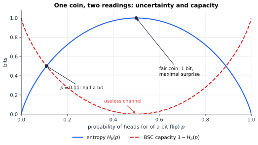
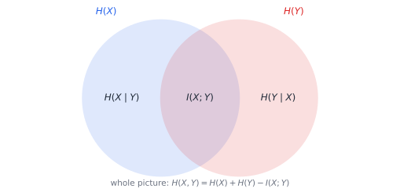
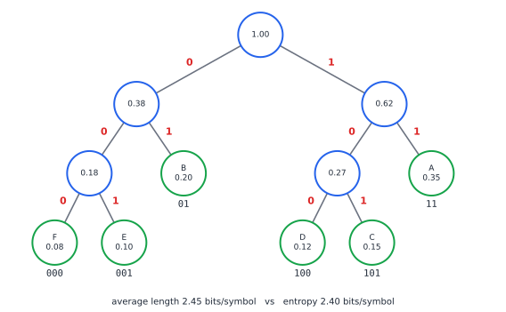

# Chapter 33 — Information Theory: Measuring the Unknown

[← Previous](32-counting-random-worlds.md) · [Track B](README.md) · [Table of Contents](../../00-front/table-of-contents.md) · [Next →](34-random-walks-and-markov-chains.md)

> **Level 2 · Track B — Probability, Uncertainty, and Information**
> **Builds on:** [Ch. 19](../../part-6-probability-statistics/19-probability.md), [Ch. 21](../../part-6-probability-statistics/21-random-processes.md), [Ch. 31](31-probability-science-of-uncertainty.md), [Ch. 32](32-counting-random-worlds.md) · **Leads to:** [Ch. 80](../h-cryptography-coding/80-coding-meets-information-theory.md), [Ch. 35](35-bayesian-inference.md), [Ch. 79](../h-cryptography-coding/79-error-correcting-codes.md) · **Related:** [Ch. 30](../a-algorithms/30-limits-of-computation.md), [Ch. 34](34-random-walks-and-markov-chains.md)
> **Reading time:** ~25 min

## 33.1 The hook

Think of a whole number between $1$ and $1\,000\,000$. I will find it with twenty yes/no questions. Each answer halves the remaining candidates, and $2^{20}=1\,048\,576$ is just over a million. Twenty questions is also the best possible: nineteen answers can only tell apart $2^{19}=524\,288$ cases, so some numbers would share the same answers. So "a number up to a million" contains about twenty *bits* of uncertainty.

Now change the game. I roll a loaded six-sided die whose faces come up with probabilities $0.35,0.20,0.15,0.12,0.10,0.08$. You must find the face by yes/no questions, and we play thousands of rounds. Six outcomes need three questions if you treat them equally. But you can do better *on average* by asking about the likely faces first. How much better? Is there a floor that no questioning strategy can beat?

There is, and it is the same floor that limits every compression program ever written. Zip a file of English text and it typically shrinks to about a third of its size. Zip the zipped file and almost nothing happens. Zip a file of truly random bytes and it gets slightly *bigger*. Something in the data is being used up, and once it is gone no clever algorithm can squeeze further. In 1948 Claude Shannon gave that something a name, a formula and a unit. He also proved two theorems that have governed every modem, disk drive and phone since: one for how far data can be compressed, and one for how fast it can be sent through noise.

This chapter measures the unknown. By the end you will know the exact floor for the loaded die ($2.396$ questions per roll), a simple algorithm that gets within $0.06$ of it, and why the rest of the gap cannot be closed one roll at a time.

## 33.2 The big idea

**Information is surprise.** Learning that an event of probability $p$ happened tells you $\log_2(1/p)$ bits. A fair coin landing heads is 1 bit. A one-in-a-million event is about 20 bits, exactly the twenty questions above. An event you were sure of tells you nothing. The logarithm is forced on us by one requirement: for *independent* events, surprises should add, $\log\frac1{pq}=\log\frac1p+\log\frac1q$.

**Entropy is average surprise.** The entropy of a random variable is the surprise you expect before you look. It has three readings that turn out to be the same number:

1. the average number of yes/no questions an optimal player needs to identify the outcome;
2. the average number of bits per symbol an optimal compressor needs;
3. how *spread out* the distribution is: zero for a certainty, maximal for a uniform distribution.

**Mutual information is shared surprise.** If $Y$ is a noisy measurement of $X$, then seeing $Y$ removes some of your uncertainty about $X$. The amount removed is the information $Y$ carries about $X$. It is symmetric: $X$ tells you exactly as much about $Y$ as $Y$ tells you about $X$. Figure 33.2 draws this as a Venn diagram.

**KL divergence is the price of being wrong.** If the world follows $p$ but you designed your code (or your bets, or your model) for $q$, you waste $D(p\Vert q)$ extra bits per symbol. That one quantity turns out to be the exponent in the Chernoff bound of [Ch. 32](32-counting-random-worlds.md), and it measures how quickly an experiment can tell $p$ from $q$.

**The analogy.** Entropy is to information what energy is to physics: a conserved currency that can be moved around, converted between forms and lost, but never created by processing. Shannon borrowed the word from thermodynamics, reportedly on von Neumann's advice. The resemblance is not only in the name.

## 33.3 The mathematics

Logarithms are base 2 (bits) unless written $\ln$ (nats; $1$ nat $=1/\ln2\approx1.443$ bits). By convention $0\log0=0$.

> [!definition] Entropy, joint and conditional entropy
> For a discrete random variable $X$ with PMF $p(x)$,
> $$
> H(X)=-\sum_xp(x)\log p(x)=E\Bigl[\log\frac1{p(X)}\Bigr].
> $$
> For a pair, $H(X,Y)=-\sum_{x,y}p(x,y)\log p(x,y)$. The conditional entropy is $H(Y\mid X)=\sum_xp(x)H(Y\mid X=x)$, the average remaining uncertainty about $Y$ once $X$ is known.

The **chain rule** follows by taking logarithms of $p(x,y)=p(x)p(y\mid x)$ and averaging:

$$
H(X,Y)=H(X)+H(Y\mid X).
$$

The uncertainty of a pair is the uncertainty of the first, plus what remains about the second once the first is known.

For a coin with $P(\text{heads})=p$, the entropy is the **binary entropy function**

$$
H_b(p)=-p\log p-(1-p)\log(1-p),
$$

plotted in Figure 33.1. It is $1$ bit at $p=\tfrac12$, $0$ at $p=0$ or $1$, and $H_b(0.11)\approx0.5$: a coin that lands heads 11 % of the time carries half a bit per toss.


*Figure 33.1 — The binary entropy $H_b(p)$ (blue) and, dashed, $1-H_b(p)$: the capacity of a channel that flips each bit with probability $p$. A channel that flips half its bits is useless; one that flips all of them is perfect (just invert).*

### Result 1: Gibbs' inequality and the maximum of entropy

> [!definition] Kullback–Leibler divergence
> For PMFs $p$ and $q$ on the same alphabet, with $q(x)>0$ wherever $p(x)>0$,
> $$
> D(p\Vert q)=\sum_xp(x)\log\frac{p(x)}{q(x)}.
> $$

> [!theorem] Gibbs' inequality
> $D(p\Vert q)\ge0$, with equality if and only if $p=q$.

*Proof.* Take expectations under $p$ over the support of $p$. The logarithm is strictly concave, so Jensen's inequality ([§31.3](31-probability-science-of-uncertainty.md#313-the-mathematics)) gives

$$
-D(p\Vert q)=E_p\Bigl[\log\frac{q(X)}{p(X)}\Bigr]\le\log E_p\Bigl[\frac{q(X)}{p(X)}\Bigr]=\log\sum_{x:\,p(x)>0}q(x)\le\log1=0 .
$$

Equality in Jensen requires $q(X)/p(X)$ to be constant on the support of $p$, and equality in the last step requires that support to carry all of $q$'s mass. Together these force $q=p$. $\square$

Two consequences follow at once.

- **Entropy is at most $\log(\text{alphabet size})$.** Take $q$ uniform on $n$ symbols. Then $0\le D(p\Vert q)=\log n-H(p)$, so $H(X)\le\log n$, with equality only for the uniform distribution. The fair die is the hardest die to guess.
- **Mutual information is non-negative.** Define

$$
I(X;Y)=D\bigl(p_{XY}\,\Vert\,p_Xp_Y\bigr)=\sum_{x,y}p(x,y)\log\frac{p(x,y)}{p(x)p(y)}\ \ge0 ,
$$

with equality exactly when $X$ and $Y$ are independent. Expanding the logarithm gives the Venn-diagram identities of Figure 33.2:

$$
I(X;Y)=H(X)-H(X\mid Y)=H(Y)-H(Y\mid X)=H(X)+H(Y)-H(X,Y).
$$

Since $I\ge0$, we get $H(X\mid Y)\le H(X)$: *on average, learning something never increases uncertainty*. A single surprising observation can leave you more confused. On average it cannot.


*Figure 33.2 — How the entropies of two variables fit together. The overlap is the mutual information. Each circle minus the overlap is a conditional entropy. The union is the joint entropy. (For three or more variables the picture breaks: the central region can be negative.)*

> [!example] Worked Example 33.1 — A noisy binary link
> A bit $X$, equally likely $0$ or $1$, is sent through a **binary symmetric channel** that flips it with probability $\varepsilon=0.11$. How much information does the received bit $Y$ carry about $X$?
>
> **Step 1.** $Y$ is also uniform, so $H(Y)=1$ bit.
>
> **Step 2.** Given $X$, the output is the input flipped with probability $0.11$, so $H(Y\mid X)=H_b(0.11)=0.500$ bit.
>
> **Step 3.** $I(X;Y)=H(Y)-H(Y\mid X)=1-0.500=0.500$ bit.
>
> Each channel use delivers half a bit, even though 89 % of the bits arrive intact. The other half bit is eaten by our not knowing *which* bits flipped. Shannon showed that $1-H_b(\varepsilon)$ is the channel's **capacity**: the largest rate at which bits can be sent with an error probability as small as you like. That claim is far from obvious, and we hold it back for later.

### Result 2: prefix codes, Kraft, and the source coding bound

A **prefix code** assigns each symbol a binary codeword so that no codeword is the beginning of another. A stream of codewords can then be decoded left to right with no separators: read bits until they match a codeword, output its symbol, and repeat. Every prefix code is a binary tree whose leaves are the symbols (Figure 33.3).

> [!theorem] Kraft inequality
> Codeword lengths $\ell_1,\dots,\ell_n$ are achievable by a binary prefix code if and only if
> $$
> \sum_{i=1}^n2^{-\ell_i}\le1 .
> $$

*Proof.* Read a codeword $c=c_1c_2\dots c_\ell$ as the binary fraction $0.c_1c_2\dots c_\ell$ and attach to it the interval $[0.c_1\dots c_\ell,\ 0.c_1\dots c_\ell+2^{-\ell})$. These are exactly the numbers in $[0,1)$ whose binary expansion begins with $c$. If no codeword is a prefix of another, the intervals are disjoint. They all lie in $[0,1)$, so their lengths $2^{-\ell_i}$ sum to at most $1$. Conversely, given lengths satisfying the inequality, sort them so that $\ell_1\le\ell_2\le\dots$ and lay intervals of length $2^{-\ell_i}$ end to end from $0$. Each starts at a multiple of its own length (all earlier lengths are larger powers of $\tfrac12$), so its left endpoint has an exact $\ell_i$-bit binary expansion. Take that expansion as the codeword. Disjoint intervals mean no prefixes. $\square$

> [!theorem] Source coding bound (Shannon, 1948)
> Every prefix code for $X$ has expected length $L=\sum p_i\ell_i\ge H(X)$. There is a prefix code with $L<H(X)+1$.

*Proof.* *Lower bound.* Let $Z=\sum_j2^{-\ell_j}\le1$ and define the PMF $r_i=2^{-\ell_i}/Z$. Then $\ell_i=\log\frac1{r_i}-\log Z$, and

$$
L-H(X)=\sum_ip_i\ell_i+\sum_ip_i\log p_i=\sum_ip_i\log\frac{p_i}{r_i}-\log Z=D(p\Vert r)+\log\frac1Z\ \ge0,
$$

because both terms are non-negative (Gibbs, and $Z\le1$).

*Upper bound.* Choose $\ell_i=\lceil\log(1/p_i)\rceil$. Then $2^{-\ell_i}\le p_i$, so $\sum2^{-\ell_i}\le1$, and Kraft supplies a prefix code with these lengths. Since $\ell_i<\log(1/p_i)+1$, we get $L<H(X)+1$. $\square$

The proof says more than the statement. Equality $L=H$ needs $p_i=2^{-\ell_i}$ exactly, so every probability must be a power of $\tfrac12$. And $L-H$ is a KL divergence: *the redundancy of a code is the divergence between the true distribution and the distribution the code implicitly assumes*.

For the loaded die of the hook, $H=2.396$ bits. A fixed 3-bit code wastes $0.60$ bits per roll. The Shannon code with lengths $\lceil\log(1/p_i)\rceil$ averages $2.95$. The Huffman code of the next section achieves $2.45$.

### The Chernoff exponent, named

[Ch. 32](32-counting-random-worlds.md) left a number unexplained. For $X\sim\operatorname{Binomial}(n,p)$ and $a>p$, keep the exact MGF in the Chernoff bound:

$$
P(X\ge an)\le\min_{s>0}e^{-san}\bigl(1-p+pe^s\bigr)^n .
$$

Setting the derivative of the exponent to zero gives $e^{s}=\dfrac{a(1-p)}{p(1-a)}$, which exceeds $1$ when $a>p$. Substituting, $1-p+pe^s=\dfrac{1-p}{1-a}$, and the bound becomes

$$
P(X\ge an)\le\exp\Bigl(-n\Bigl[a\ln\frac ap+(1-a)\ln\frac{1-a}{1-p}\Bigr]\Bigr)=e^{-n\,D(a\Vert p)} ,
$$

with $D$ in nats, where $D(a\Vert p)$ is the divergence between a Bernoulli$(a)$ and a Bernoulli$(p)$ coin. The chance that a $p$-coin *impersonates* an $a$-coin for $n$ tosses decays at a rate equal to the divergence of the impostor from the truth. For $a=0.75$ and $p=0.5$ the rate is $0.131$ nats per toss, the slope of the blue curve in [Figure 32.2](32-counting-random-worlds.md#323-the-mathematics). The bound is tight in the exponent: Cramér's theorem (and its generalisation, Sanov's theorem) says no better exponent is possible.

Divergence is not symmetric. $D(0.5\Vert0.9)=0.737$ bits but $D(0.9\Vert0.5)=0.531$ bits. If the coin is really fair, the balanced stretches it produces quickly rule out a $0.9$-coin. If it really is a $0.9$-coin, ruling out "fair" takes longer. So $D$ is not a distance in the geometric sense, and that asymmetry has consequences in statistics, machine learning and hypothesis testing ([Ch. 35](35-bayesian-inference.md)).

> [!mystery] The capacity claim
> Worked Example 33.1 said a channel flipping 11 % of bits can carry half a bit per use with an error rate *as small as you like*. Repetition codes do not come close: to drive errors to zero they send the rate to zero. Shannon's proof of the noisy-channel coding theorem picks a code *at random*, the probabilistic method of [Ch. 32](32-counting-random-worlds.md) again, and shows that its average error vanishes. Why does a random code work, and why did it take until the 1990s (turbo and LDPC codes) to build practical codes that come close to capacity? See [Ch. 80](../h-cryptography-coding/80-coding-meets-information-theory.md).

## 33.4 The algorithm

**Huffman's algorithm (1952).** Repeatedly merge the two least probable symbols into a single node whose probability is their sum, until one node remains. The merge history is the code tree. Label each left branch $0$ and each right branch $1$.

```python
import heapq, itertools

def huffman(probs):
    """probs: dict symbol -> probability. Returns dict symbol -> codeword string."""
    tie = itertools.count()                      # breaks ties so tuples always compare
    heap = [(p, next(tie), {s: ""}) for s, p in probs.items()]
    heapq.heapify(heap)
    if len(heap) == 1:
        return {s: "0" for s in probs}
    while len(heap) > 1:
        p0, _, c0 = heapq.heappop(heap)          # the two least likely subtrees
        p1, _, c1 = heapq.heappop(heap)
        merged = {s: "0" + w for s, w in c0.items()}
        merged.update({s: "1" + w for s, w in c1.items()})
        heapq.heappush(heap, (p0 + p1, next(tie), merged))
    return heap[0][2]

die = {"A": .35, "B": .20, "C": .15, "D": .12, "E": .10, "F": .08}
code = huffman(die)
print(code, sum(die[s] * len(w) for s, w in code.items()))   # average length 2.45
```

For the loaded die the merges are $F+E=0.18$, $D+C=0.27$, $0.18+B=0.38$, $0.27+A=0.62$, and finally $1.00$. The likely faces A and B get 2-bit codewords and the rest get 3 bits. The average is $2.45$ bits per roll, only $0.054$ above the entropy.


*Figure 33.3 — The Huffman tree for the loaded die. Read a codeword from the root down: F is 000, A is 11. Likely symbols sit near the root.*

**Complexity.** With a binary heap, each of the $n-1$ merges costs $O(\log n)$, for $O(n\log n)$ in total. Decoding walks the tree one bit at a time, or uses a lookup table indexed by the next few bits.

**Optimality.** Among all prefix codes for a given distribution, Huffman's has the smallest expected length. The proof is an exchange argument: in some optimal tree, the two least likely symbols are siblings at the deepest level, so merging them first loses nothing. You are asked to complete it in the challenge.

**Failure cases.**

1. *Skewed sources.* A binary source with $P(1)=0.01$ has entropy $H_b(0.01)=0.081$ bits. But Huffman on single symbols must spend at least 1 bit per symbol, over twelve times the floor. The cure is to code *blocks* of $k$ symbols, which brings the overhead down to below $1/k$ bits per symbol, or to use arithmetic coding, which effectively allows fractional codeword lengths.
2. *Wrong model.* Huffman is optimal for the probabilities you give it. Coding with $q$ when the truth is $p$ costs $H(p)+D(p\Vert q)$ bits per symbol on average, which is the KL divergence again as a price. For the loaded die, the ideal code for a fair die (an average of $\log_26=2.585$ bits) wastes $D(p\Vert\text{uniform})=0.189$ bits per roll.
3. *Ignoring memory.* Letter frequencies alone give English about $4.1$ bits per letter. But letters are not independent: after "q" comes "u". Shannon's 1951 experiments with human predictors estimated the true rate of English at around $1$ bit per letter. Huffman on single letters cannot see that. Context-modelling compressors can.

## 33.5 The experiment

The binary entropy and the divergence from a fair coin, with fixed numbers you can edit:

```desmos-graph
left=0; right=1; bottom=0; top=1.6
---
y=-x\frac{\ln(x)}{\ln(2)}-(1-x)\frac{\ln(1-x)}{\ln(2)}|blue|0<x<1
y=x\frac{\ln(x/0.5)}{\ln(2)}+(1-x)\frac{\ln((1-x)/0.5)}{\ln(2)}|red|0<x<1
y=0.5\frac{\ln(0.5/x)}{\ln(2)}+0.5\frac{\ln(0.5/(1-x))}{\ln(2)}|green|dashed|0<x<1
```

*Blue: $H_b(x)$. Red: $D(x\Vert0.5)$, the cost of believing a fair coin when the true bias is $x$. Green (dashed): $D(0.5\Vert x)$, the reverse. The red and green curves differ: KL divergence is not symmetric. Replace every $0.5$ by $0.9$ to see the divergences from a biased coin, and find where each one is zero.*

Now measure the entropy of real text and compare three compressors: the entropy floor for independent letters, a Huffman code, and zlib, which exploits repetition and context.

```python
import zlib, heapq, itertools
from collections import Counter
import numpy as np

TEXT = open(__file__).read() * 1     # try: a novel from a text file, or "ab" * 5000
ORDER = 1                            # 1 = letters; 2 = pairs of letters as symbols

symbols = [TEXT[i:i + ORDER] for i in range(0, len(TEXT) - ORDER + 1, ORDER)]
counts = Counter(symbols)
p = np.array(list(counts.values()), float) / len(symbols)
H = -np.sum(p * np.log2(p)) / ORDER                    # bits per character

tie = itertools.count()
heap = [(c, next(tie), 0) for c in counts.values()]    # (weight, tiebreak, cost so far)
heapq.heapify(heap); total = 0
while len(heap) > 1:                                   # total bits = sum of merged weights
    a, _, _ = heapq.heappop(heap); b, _, _ = heapq.heappop(heap)
    total += a + b; heapq.heappush(heap, (a + b, next(tie), 0))
huff = total / len(TEXT)

z = 8 * len(zlib.compress(TEXT.encode(), 9)) / len(TEXT)
print(f"characters {len(TEXT)}, distinct symbols {len(counts)}")
print(f"entropy (order {ORDER})  {H:.3f} bits/char")
print(f"Huffman              {huff:.3f} bits/char")
print(f"zlib                 {z:.3f} bits/char   (raw ASCII: 8)")
```

The script compresses its own source code by default. Then try `TEXT = "ab" * 5000`: the letter entropy is a full 1 bit per character, yet zlib needs almost nothing, because the string is perfectly predictable. Try `ORDER = 2` on a long English text and watch the per-character entropy fall. Then try random text, `"".join(np.random.choice(list("abcdefgh"), 10000))`, where zlib cannot beat $3$ bits per character. What does that tell you about the difference between "the entropy of the letters" and "the entropy of the text"?

## 33.6 The challenge

1. **Intuition.** A biased coin with $P(\text{heads})=0.9$ has entropy $0.469$ bits. Explain in words, without formulas, how a sequence of $1000$ such tosses could be stored in about $470$ bits, and why any scheme that stores *every* possible sequence in $470$ bits must fail on some sequences.
2. **Derivation.** Prove that among all distributions on $\{0,1,2,\dots\}$ with mean $\mu$, the geometric distribution has the largest entropy. Use Gibbs' inequality with a well-chosen $q$, and find the maximum entropy as a function of $\mu$.
3. **Implementation.** Complete the exchange-argument proof that Huffman codes are optimal. Then implement **canonical Huffman** coding, where only the codeword *lengths* are transmitted, together with an encoder and decoder that round-trip a file. Measure the header overhead as a fraction of the file size.
4. **Open investigation.** Estimate the entropy rate of English in bits per character as the context length $k$ grows ($k=0,1,2,\dots$), using frequency counts from a large text, and plot the estimate against $k$. Why does it eventually start to *fall too fast*, below any plausible true value? How would you design an estimator that does not fool itself? (Modern language models give the best-known estimates, and they still disagree.)

## 33.7 Loose threads

Entropy as defined here is an average over a probability distribution. It says nothing about a *single* string. The string $0101\dots01$ and a string of fair coin flips of the same length have the same letter frequencies and the same order-0 entropy. Yet one has a ten-character description ("01, 500 times") and the other has no description much shorter than itself.

> [!mystery] The information in one object
> The *Kolmogorov complexity* of a string is the length of the shortest program that prints it. It captures exactly the intuition above, and for typical outputs of a random source it matches entropy. But it is **uncomputable**: no algorithm can find the shortest program for every string. Why not, and what does that say about the limits of compression and of science itself? The answer is a diagonal argument from [Ch. 30](../a-algorithms/30-limits-of-computation.md).

We proved $H\le L<H+1$ one symbol at a time, and we noted that coding blocks drives the overhead to zero. Behind that remark is a much stronger fact. Long sequences from a source with entropy $H$ almost all lie in a "typical set" of about $2^{nH}$ sequences, each with probability close to $2^{-nH}$. This is the **asymptotic equipartition property**, a law of large numbers for surprise. The same idea makes random channel codes work, which is why the capacity mystery above lives in [Ch. 80](../h-cryptography-coding/80-coding-meets-information-theory.md).

Everything here was discrete. For continuous variables, $-\int f\log f$ (the *differential* entropy) behaves strangely. It can be negative, and it changes when you change units. Yet differences of it, such as mutual information, remain perfectly meaningful. The Gaussian maximises differential entropy for a given variance ([§20.4](../../part-6-probability-statistics/20-statistical-analysis.md#204-common-distributions)), and that one fact leads to $C=B\log_2(1+\mathrm{SNR})$, the most famous formula in communications.

> [!mystery] Choosing beliefs by maximising ignorance
> If all you know about a quantity is its mean, which distribution should you assume? Gibbs' inequality suggests an answer: the one with *maximum entropy*, the least committal belief consistent with the facts. Is that a principle of logic, a convenient habit, or a disguised prior? The debate, and when maximum entropy agrees with Bayes' rule, is taken up in [Ch. 35](35-bayesian-inference.md).

## Further reading

- T. M. Cover and J. A. Thomas, *Elements of Information Theory*, 2nd ed., Wiley, 2006. The standard text: entropy, AEP, source and channel coding, large deviations.
- D. J. C. MacKay, *Information Theory, Inference, and Learning Algorithms*, Cambridge University Press, 2003. Free online; connects compression, coding and Bayesian inference with exceptional clarity.
- C. E. Shannon, "A Mathematical Theory of Communication," *Bell System Technical Journal*, 27, 1948. Still readable, and still surprising.
- J. R. Pierce, *An Introduction to Information Theory: Symbols, Signals and Noise*, 2nd ed., Dover, 1980. A gentle, non-technical companion.
