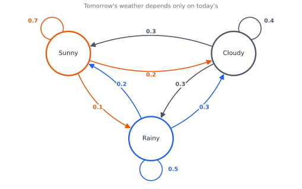
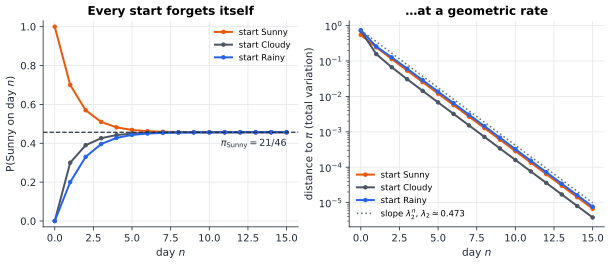
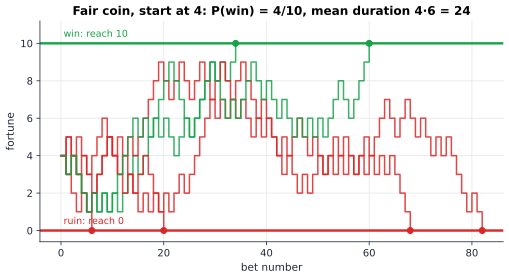

# Chapter 34 — Random Walks and Markov Worlds

[← Previous](33-information-theory.md) · [Track B](README.md) · [Table of Contents](../../00-front/table-of-contents.md) · [Next →](35-bayesian-inference.md)

> **Level 2 · Track B — Probability, Uncertainty, and Information**
> **Builds on:** [Ch. 10](../../part-3-linear-algebra/10-eigenvalues-and-eigenvectors.md), [Ch. 19](../../part-6-probability-statistics/19-probability.md), [Ch. 21](../../part-6-probability-statistics/21-random-processes.md) · **Leads to:** [Ch. 36](36-stochastic-processes.md), [Ch. 38](38-monte-carlo.md), [Ch. 53](../d-optimization/53-reinforcement-learning.md) · **Related:** [Ch. 27](../a-algorithms/27-graph-theory.md), [Ch. 87](../i-dynamical-systems/87-network-science.md)
> **Reading time:** ~30 min

## 34.1 The hook

A man leaves a bar and walks home along a long straight street. He is too drunk to remember where he is going, so at every corner he tosses a mental coin and steps one block left or one block right. Will he ever get back to the bar's door?

Yes, with probability one. He will return, and return again, infinitely often. But here is the first twist: the *expected* time until his first return is infinite. He is certain to come back, and on average he takes forever to do it.

Now let the drunk loose in a city grid, where at every corner he picks one of four directions. He still returns with probability one. Finally, give him wings. A drunk bird flapping randomly through a three-dimensional lattice of air returns to its starting point with probability only about $0.34$. Two-thirds of the time it is lost forever. The mathematician Shizuo Kakutani summarized it in one line: a drunk man will find his way home, but a drunk bird may get lost forever.

Why should the number of dimensions decide between "certainly comes back" and "probably never does"? Nothing in the rule changed: one random step at a time, no memory of the past.

Hold that question. Here are two more that look unrelated.

**The shuffle.** You riffle-shuffle a deck of 52 cards. How many shuffles until the deck is "random"? Three shuffles leave it almost perfectly ordered in a statistical sense. Four is no better. Then, between five and nine shuffles, the deck's distance from random collapses from nearly total to nearly nothing, and the folklore answer "seven" sits in the middle of the fall. Not a gradual improvement: a cliff.

**The search engine.** In 1998 two students ranked the web by imagining a bored surfer clicking links at random, forever, and asking what fraction of time the surfer spends on each page. That fraction, PageRank, is a number that the surfer's starting page has no influence on at all.

All three stories are about the same object: a system that jumps between states with probabilities that depend only on where it is now. This chapter builds that object, proves the theorem that makes PageRank work, computes when gamblers go broke, and leaves the drunk bird and the seven shuffles hanging, because their full answers need tools the next chapters supply.

## 34.2 The big idea

**Forget the past; keep the present.** A Markov chain is a random process with amnesia. To predict tomorrow you need today, and nothing earlier. That single restriction turns an impossibly rich object (a whole random history) into something you can write on a napkin: a table of probabilities "from state $i$, go to state $j$ with probability $P_{ij}$".

Here is the napkin for a toy weather model.


*The weather chain. Each arrow carries the probability of tomorrow's state given today's; the arrows leaving any state sum to 1.*

Run the chain for a long time and two things happen.

1. **The start is forgotten.** Whether today is Sunny or Rainy, the probability that it is Sunny 30 days from now is the same number. The chain "mixes".
2. **The long-run fractions settle.** Over a year, the fraction of Sunny days converges to a fixed value, the *stationary distribution*. That fraction is also the probability of Sunny on a single day far in the future.

The analogy that carries the whole chapter is **ink in water**. Put a drop of ink (all the probability) on one state. Each step, the ink in every state splits along the arrows in the proportions $P_{ij}$. Ink is never created or destroyed: probability is conserved. After enough steps the ink is spread in a fixed pattern that the flow no longer changes. That pattern is the stationary distribution, and how fast the ink spreads is the mixing time.

Three questions organise everything:

- **Where does the ink end up?** (stationary distributions)
- **How fast does it get there?** (mixing times)
- **When does a single particle first reach a target?** (hitting times)

The drunk on the street is the same story with infinitely many states, one per street corner. There the ink never settles: it spreads thinner and thinner forever. That is why the drunk always returns yet takes infinite expected time, and the escape of the bird is the same spreading, faster in more dimensions.

## 34.3 The mathematics

### Chains and their matrices

> [!definition] Markov chain
> A sequence of random variables $X_0, X_1, X_2,\dots$ taking values in a countable state space $S$ is a (time-homogeneous) **Markov chain** with **transition matrix** $\mathbf{P}$ if
> $$
> P(X_{n+1}=j \mid X_n=i,\ X_{n-1}=i_{n-1},\dots,X_0=i_0) = P_{ij}
> $$
> for all $n$ and all histories. The matrix is **row-stochastic**: $P_{ij}\ge 0$ and $\sum_j P_{ij}=1$ for each row $i$.

For the weather chain, with states ordered (Sunny, Cloudy, Rainy),

$$
\mathbf{P}=\begin{bmatrix}0.7&0.2&0.1\\0.3&0.4&0.3\\0.2&0.3&0.5\end{bmatrix}.
$$

Write the distribution of $X_n$ as a row vector $\boldsymbol{\mu}_n$, with $(\boldsymbol{\mu}_n)_j=P(X_n=j)$. Conditioning on the state at time $n$ (the law of total probability from [Ch. 19](../../part-6-probability-statistics/19-probability.md#192-conditional-probability)) gives

$$
(\boldsymbol{\mu}_{n+1})_j=\sum_i (\boldsymbol{\mu}_n)_i P_{ij}
\quad\Longrightarrow\quad
\boldsymbol{\mu}_{n+1}=\boldsymbol{\mu}_n\mathbf{P},\qquad \boldsymbol{\mu}_n=\boldsymbol{\mu}_0\mathbf{P}^n.
$$

The entry $(\mathbf{P}^n)_{ij}$ is the probability of going from $i$ to $j$ in exactly $n$ steps. Everything about the chain's distribution is a question about matrix powers, which [Ch. 10 §10.4](../../part-3-linear-algebra/10-eigenvalues-and-eigenvectors.md#104-matrix-powers) already taught you to compute by eigen-decomposition. (Ch. 10 writes probability vectors as columns and uses the transposed, column-stochastic matrix; the two conventions are the same mathematics. Probabilists use rows.)

### Stationary distributions

> [!definition] Stationary distribution
> A probability row vector $\boldsymbol{\pi}$ ($\pi_j\ge0$, $\sum_j\pi_j=1$) is **stationary** for $\mathbf{P}$ if
> $$
> \boldsymbol{\pi}\mathbf{P}=\boldsymbol{\pi}.
> $$
> If $X_0\sim\boldsymbol{\pi}$ then $X_n\sim\boldsymbol{\pi}$ for every $n$.

So $\boldsymbol{\pi}$ is a left eigenvector of $\mathbf{P}$ with eigenvalue $1$. Such an eigenvalue always exists: $\mathbf{P}\mathbf{1}=\mathbf{1}$ because rows sum to one, and a matrix and its transpose share eigenvalues.

For the weather chain, $\boldsymbol{\pi}\mathbf{P}=\boldsymbol{\pi}$ is three linear equations, one redundant. Taking the first two with the normalisation:

$$
\begin{aligned}
0.7\pi_S+0.3\pi_C+0.2\pi_R&=\pi_S,\\
0.2\pi_S+0.4\pi_C+0.3\pi_R&=\pi_C,\\
\pi_S+\pi_C+\pi_R&=1,
\end{aligned}
\qquad\Longrightarrow\qquad
\boldsymbol{\pi}=\left(\tfrac{21}{46},\ \tfrac{13}{46},\ \tfrac{12}{46}\right)\approx(0.457,\ 0.283,\ 0.261).
$$

In the long run it is sunny 45.7 % of days. The remaining eigenvalues of $\mathbf{P}$ are $(3\pm\sqrt3)/10\approx0.473$ and $0.127$; we will see in a moment that the larger of these controls the speed.

Two things can go wrong, and the convergence theorem must rule both out.

- **Reducible chains.** If the state space splits into pieces that cannot reach each other, there is one stationary distribution per closed piece, and where you end up depends on where you started. A chain is **irreducible** if every state can reach every other.
- **Periodic chains.** The two-state chain that swaps deterministically, $\mathbf{P}=\left[\begin{smallmatrix}0&1\\1&0\end{smallmatrix}\right]$, has stationary distribution $(\tfrac12,\tfrac12)$, yet started in state 1 it is in state 1 at even times and state 2 at odd times. $\boldsymbol{\mu}_n$ oscillates forever. A chain is **aperiodic** if returns to each state are not locked to multiples of some period $d>1$. Its eigenvalue $-1$ is the culprit: it has modulus one, so it never decays.

### The convergence theorem, with a proof

To measure how far a distribution is from equilibrium we use the **total variation distance**

$$
d_{TV}(\boldsymbol{\mu},\boldsymbol{\nu})=\tfrac12\sum_j\lvert\mu_j-\nu_j\rvert=\max_{A\subseteq S}\lvert\mu(A)-\nu(A)\rvert ,
$$

the largest disagreement the two distributions can have about the probability of any event. It lies between 0 and 1.

The general theorem says: a finite, irreducible, aperiodic chain has a unique stationary distribution and $\boldsymbol{\mu}_0\mathbf{P}^n\to\boldsymbol{\pi}$ from every start. We prove a version with a clean, quantitative argument due to Doeblin and Dobrushin. The key quantity is the **contraction coefficient**

$$
\delta(\mathbf{P})=\max_{i,k}\ d_{TV}\big(\mathbf{P}_{i\cdot},\ \mathbf{P}_{k\cdot}\big),
$$

the largest total-variation distance between two rows of $\mathbf{P}$. It measures how much the chain's next step still "remembers" which state it came from.

> [!theorem] Contraction theorem
> For any two probability vectors $\boldsymbol{\mu},\boldsymbol{\nu}$,
> $$
> d_{TV}(\boldsymbol{\mu}\mathbf{P},\boldsymbol{\nu}\mathbf{P})\le\delta(\mathbf{P})\,d_{TV}(\boldsymbol{\mu},\boldsymbol{\nu}).
> $$
> If $\delta(\mathbf{P})<1$ (in particular, if every entry of $\mathbf{P}$ is at least $\varepsilon>0$ on an $N$-state space, which gives $\delta\le1-N\varepsilon$), then $\mathbf{P}$ has exactly one stationary distribution $\boldsymbol{\pi}$, and for every start
> $$
> d_{TV}(\boldsymbol{\mu}_0\mathbf{P}^n,\boldsymbol{\pi})\le\delta(\mathbf{P})^n .
> $$

*Proof.* **Step 1: split the difference.** Let $a=d_{TV}(\boldsymbol{\mu},\boldsymbol{\nu})$; if $a=0$ there is nothing to prove. The vector $\boldsymbol{\mu}-\boldsymbol{\nu}$ sums to zero, so its positive part and negative part each have total mass $a$. Normalise them: $\boldsymbol{\mu}-\boldsymbol{\nu}=a(\boldsymbol{\alpha}-\boldsymbol{\beta})$ with $\boldsymbol{\alpha},\boldsymbol{\beta}$ probability vectors.

**Step 2: push through one step.** By linearity $\boldsymbol{\mu}\mathbf{P}-\boldsymbol{\nu}\mathbf{P}=a(\boldsymbol{\alpha}\mathbf{P}-\boldsymbol{\beta}\mathbf{P})$, so $d_{TV}(\boldsymbol{\mu}\mathbf{P},\boldsymbol{\nu}\mathbf{P})=a\,d_{TV}(\boldsymbol{\alpha}\mathbf{P},\boldsymbol{\beta}\mathbf{P})$.

**Step 3: bound by rows.** Since $\sum_i\alpha_i=\sum_k\beta_k=1$,
$$
\boldsymbol{\alpha}\mathbf{P}-\boldsymbol{\beta}\mathbf{P}=\sum_i\alpha_i\mathbf{P}_{i\cdot}-\sum_k\beta_k\mathbf{P}_{k\cdot}=\sum_{i,k}\alpha_i\beta_k\big(\mathbf{P}_{i\cdot}-\mathbf{P}_{k\cdot}\big).
$$
Take half the $\ell_1$ norm and use the triangle inequality: $d_{TV}(\boldsymbol{\alpha}\mathbf{P},\boldsymbol{\beta}\mathbf{P})\le\sum_{i,k}\alpha_i\beta_k\,d_{TV}(\mathbf{P}_{i\cdot},\mathbf{P}_{k\cdot})\le\delta(\mathbf{P})$. This proves the inequality.

**Step 4: the bound on $\delta$.** For two rows, $d_{TV}(\mathbf{p},\mathbf{q})=1-\sum_j\min(p_j,q_j)$ (because $\lvert p-q\rvert=p+q-2\min(p,q)$). If every entry is at least $\varepsilon$, each minimum is at least $\varepsilon$ and $\delta\le1-N\varepsilon$.

**Step 5: existence, uniqueness, convergence.** If $\delta<1$ the map $\boldsymbol{\mu}\mapsto\boldsymbol{\mu}\mathbf{P}$ is a contraction on the closed set of probability vectors, so the sequence $\boldsymbol{\mu}_0\mathbf{P}^n$ is Cauchy and converges to a fixed point (the contraction-mapping argument of [Ch. 22](../../part-7-numerical-computational/22-numerical-methods.md)). Two fixed points $\boldsymbol{\pi},\boldsymbol{\pi}'$ would satisfy $d_{TV}(\boldsymbol{\pi},\boldsymbol{\pi}')\le\delta\,d_{TV}(\boldsymbol{\pi},\boldsymbol{\pi}')$, forcing equality. Finally $d_{TV}(\boldsymbol{\mu}_0\mathbf{P}^n,\boldsymbol{\pi})=d_{TV}(\boldsymbol{\mu}_0\mathbf{P}^n,\boldsymbol{\pi}\mathbf{P}^n)\le\delta^n d_{TV}(\boldsymbol{\mu}_0,\boldsymbol{\pi})\le\delta^n$. ∎

For the weather chain the smallest entry is $0.1$, giving the crude guarantee $\delta\le1-3(0.1)=0.7$; computing the row distances directly gives $\delta=0.5$. Either way the distance to equilibrium at least halves every day. The truth is a little better still:


*Left: the probability of a sunny day $n$ days ahead, from three different starting days. Right: total-variation distance to $\boldsymbol{\pi}$ on a log scale; the lines are straight with slope set by the second eigenvalue $\lambda_2=(3+\sqrt3)/10\approx0.473$.*

What about chains where some entries are zero, like a random walk on a sparse graph? If the chain is irreducible and aperiodic, then some power $\mathbf{P}^m$ has all entries positive (a fact from number theory about the return times), and you apply the theorem to $\mathbf{P}^m$. This is the general convergence theorem.

The straight lines in the figure come from the eigen-decomposition. If $\mathbf{P}$ is diagonalisable with eigenvalues $1=\lambda_1>\lvert\lambda_2\rvert\ge\cdots$, then $\boldsymbol{\mu}_0\mathbf{P}^n=\boldsymbol{\pi}+\sum_{k\ge2}c_k\lambda_k^n\mathbf{v}_k$, and the distance decays like $\lvert\lambda_2\rvert^n$. The quantity $1-\lvert\lambda_2\rvert$ is the **spectral gap**. Big gap, fast mixing.

### Reversibility: the shortcut to $\boldsymbol{\pi}$

Solving $\boldsymbol{\pi}\mathbf{P}=\boldsymbol{\pi}$ for a million-state chain is expensive. For an important class of chains there is a shortcut.

> [!theorem] Detailed balance
> If a probability vector $\boldsymbol{\pi}$ satisfies $\pi_iP_{ij}=\pi_jP_{ji}$ for all $i,j$, then $\boldsymbol{\pi}$ is stationary.

*Proof.* Sum the detailed-balance equation over $i$: $\sum_i\pi_iP_{ij}=\pi_j\sum_iP_{ji}=\pi_j$. ∎

Detailed balance says that in equilibrium the *flow* of probability from $i$ to $j$ equals the flow back, edge by edge. Such chains are called **reversible**: a film of the chain in equilibrium looks statistically the same run backwards.

The most important reversible chain is the **random walk on a graph**: from vertex $v$, move to a uniformly chosen neighbour, so $P_{vw}=1/\deg(v)$ for each edge $vw$. Try $\pi_v=\deg(v)/(2\lvert E\rvert)$: then $\pi_vP_{vw}=1/(2\lvert E\rvert)=\pi_wP_{wv}$. Detailed balance holds, so a random walker on any connected graph spends time at each vertex in proportion to its degree. Well-connected vertices are visited more, a first hint of why random walks can rank things.

### Hitting times and the gambler's ruin

Now follow one particle instead of the ink. The **hitting time** of a set $A$ is $\tau_A=\min\{n\ge0:X_n\in A\}$. The workhorse for computing anything about $\tau_A$ is **first-step analysis**: condition on the first move, and the Markov property hands you a linear system.

> [!theorem] Gambler's ruin
> A gambler bets one unit on a fair coin each round, starting with $k$ units, and stops on reaching $0$ (ruin) or $N$ (target). Then
> $$
> P(\text{reach }N\text{ before }0)=\frac{k}{N},\qquad E[\text{number of bets}]=k(N-k).
> $$

*Proof.* Let $h_k$ be the probability of reaching $N$ first from fortune $k$. After one bet the fortune is $k\pm1$ with probability $\tfrac12$ each, and the future is a fresh game from there, so
$$
h_k=\tfrac12h_{k+1}+\tfrac12h_{k-1},\qquad h_0=0,\ h_N=1.
$$
Rearranged, $h_{k+1}-h_k=h_k-h_{k-1}$: the differences are constant, so $h_k$ is linear, and the boundary values give $h_k=k/N$.

For the duration, let $m_k$ be the expected number of bets from $k$. One bet is always made, then the game continues from $k\pm1$:
$$
m_k=1+\tfrac12m_{k+1}+\tfrac12m_{k-1},\qquad m_0=m_N=0.
$$
Now the second difference is constant: $m_{k+1}-2m_k+m_{k-1}=-2$. A quadratic with second difference $-2$ is $-k^2+bk+c$; the boundary conditions give $c=0$, $b=N$, so $m_k=k(N-k)$. ∎


*Six games starting from 4 units with target 10. On average 4 in 10 games are won, and a game lasts 24 bets. Individual games vary enormously in length.*

Look at the duration formula again. Start in the middle, $k=N/2$, and the expected game length is $N^2/4$: a random walk needs about $N^2$ steps to travel distance $N$. Distance grows like the *square root* of time. This $\sqrt{n}$ law is the fingerprint of every diffusive process, and it reappears as the envelope of Brownian motion in [Ch. 36](36-stochastic-processes.md).

The same algebra with a biased coin (win probability $p$, $q=1-p$, $r=q/p\ne1$) gives
$$
P(\text{reach }N\text{ before }0)=\frac{1-r^k}{1-r^N}.
$$
At a roulette-like $p=0.49$, a gambler who starts with 50 and wants to double to 100 succeeds only about 12 % of the time, against 50 % for a fair coin. A 2 % edge, compounded over the long journey a random walk takes, becomes crushing.

Two more facts about hitting times, stated without proof:

- **Kac's formula.** For an irreducible chain with stationary $\boldsymbol{\pi}$, the expected time to return to state $i$, starting from $i$, is $1/\pi_i$. In the weather chain a rainy day recurs on average every $46/12\approx3.83$ days. First-step analysis also gives the expected wait for rain starting from a sunny day: $20/3\approx6.67$ days.
- **Recurrence on the infinite line.** The fair walk on $\mathbb{Z}$ has no stationary distribution (the ink spreads forever). Letting $N\to\infty$ in the gambler's ruin, the chance of escaping to $+N$ before returning to $0$ from $k=1$ is $1/N\to0$, so the walker returns with probability one. Yet the expected return time is infinite: Kac's formula with every $\pi_i=0$ gives $1/0$. The hook's first paradox is just this.

> [!mystery] The drunk bird
> On $\mathbb{Z}^d$ the simple random walk returns to its start with probability one for $d=1,2$ (Pólya, 1921) but only with probability about $0.3405$ for $d=3$. The gambler's-ruin trick only works in one dimension. The real proof turns the question into whether the sum $\sum_n P(X_{2n}=0)$ diverges, and computing $P(X_{2n}=0)\sim c\,n^{-d/2}$ needs Fourier analysis on the lattice ([Ch. 16](../../part-5-transforms/16-fourier-transforms.md)) or, in the continuum, the Green's function of the Laplacian, which behaves like $1/r$ in three dimensions ([Ch. 89](../j-frontier/89-pde-beyond-the-basics.md)). Why should the dimension of space, and not the coin, decide whether you get home?

### Mixing times

The convergence theorem says *that* the ink spreads. The practical question is *how long* to wait.

> [!definition] Mixing time
> $$
> t_{\text{mix}}(\varepsilon)=\min\Big\{n:\ \max_{i\in S}\ d_{TV}\big(\mathbf{P}^n_{i\cdot},\boldsymbol{\pi}\big)\le\varepsilon\Big\},
> $$
> the number of steps after which, from the *worst* starting state, the chain is within $\varepsilon$ of equilibrium. By convention $t_{\text{mix}}=t_{\text{mix}}(1/4)$.

For the weather chain, after one day the worst start (Rainy) is still at distance $0.257$; after two days every start is below $0.127$. So $t_{\text{mix}}=2$ days. Weather forgets fast.

For reversible chains the spectral gap gives two-sided bounds, roughly

$$
\frac{1}{\text{gap}}-1\ \lesssim\ t_{\text{mix}}\ \lesssim\ \frac{1}{\text{gap}}\,\ln\frac{1}{\pi_{\min}},
$$

up to constants. The logarithm on the right matters: a chain on $52!\approx8\times10^{67}$ deck orderings can still mix in a handful of steps if its gap is not tiny.

> [!mystery] Seven shuffles and the cliff
> Bayer and Diaconis (1992) computed the exact distance to uniform for riffle-shuffling 52 cards: $1.000$ after four shuffles, then $0.924,\ 0.614,\ 0.334,\ 0.167,\ 0.085$ after five to nine. For $n$ cards the drop happens near $\tfrac32\log_2 n$ shuffles and gets sharper as $n$ grows. This sudden collapse is the **cutoff phenomenon**. Eigenvalues alone predict smooth geometric decay, so they cannot explain a cliff. Which chains have cutoff, and why, is a major open problem: Peres's "product condition" is necessary, fails to be sufficient in general, and has been proven sufficient only for special families such as birth-and-death chains. [Ch. 38](38-monte-carlo.md) shows why the answer matters every time someone runs a Markov chain Monte Carlo sampler and asks when to stop.

## 34.4 The algorithm

### PageRank by power iteration

The random surfer of the hook follows a link chosen uniformly from the current page. Two defects stop this from being a well-behaved chain: some pages have no outgoing links (the surfer is stuck), and the web is not irreducible (some regions cannot be left). The fix is to add **teleportation**: with probability $d$ (the damping factor, classically $0.85$) follow a random link; with probability $1-d$ jump to a page chosen uniformly from all $n$. The new transition matrix is

$$
\mathbf{G}=d\,\mathbf{P}+(1-d)\,\frac{1}{n}\mathbf{1}\mathbf{1}^\mathsf{T},
$$

and every entry of $\mathbf{G}$ is at least $(1-d)/n>0$. Every entry positive means the contraction theorem of §34.3 applies directly: a unique stationary distribution exists, and iteration converges to it from any start. In fact the same proof, applied with the rank-one teleport term, gives $\delta(\mathbf{G})\le d$, so the error shrinks by at least $0.85$ per sweep, independent of the size of the web.

```python
import numpy as np

def pagerank(links, n, d=0.85, tol=1e-10, max_iter=1000):
    """links: dict page -> list of pages it links to. Returns the stationary vector."""
    x = np.full(n, 1.0 / n)
    for it in range(max_iter):
        new = np.full(n, (1 - d) / n)          # teleport: every page gets (1-d)/n
        dangling = 0.0
        for i in range(n):
            out = links.get(i, [])
            if out:
                share = d * x[i] / len(out)
                for j in out:
                    new[j] += share
            else:
                dangling += d * x[i]            # page with no links: jump anywhere
        new += dangling / n
        if np.abs(new - x).sum() < tol:
            return new, it + 1
        x = new
    return x, max_iter

print(pagerank({0: [1, 2], 1: [2], 2: [0], 3: [2]}, 4))
```

On the four-page web A→{B, C}, B→C, C→A, D→C, it converges in 47 sweeps to

$$
\boldsymbol{\pi}\approx(0.373,\ 0.196,\ 0.394,\ 0.0375).
$$

Page C wins: three pages point to it. Page A comes second although only one page links to it, because that one page is C, the most important page. Importance is inherited from who links to you, which is exactly what $\boldsymbol{\pi}=\boldsymbol{\pi}\mathbf{G}$ says. Page D, which nobody links to, gets only the teleport share $(1-d)/n=0.0375$.

**Cost.** Each sweep touches every link once, so it costs $O(n+\lvert E\rvert)$, never forming the dense matrix $\mathbf{G}$. To reach error $\varepsilon$ you need about $\ln\varepsilon/\ln d$ sweeps: about 140 for $\varepsilon=10^{-10}$ in the worst case, usually far fewer. Compare a direct solve of $\boldsymbol{\pi}(\mathbf{I}-\mathbf{G})=\mathbf{0}$ at $O(n^3)$ for a dense matrix: hopeless for billions of pages.

**Stability.** Each sweep maps probability vectors to probability vectors, so errors cannot grow, and nothing is ever divided by a small number. Round-off drift in the total mass can be removed by renormalising $\mathbf{x}$ to sum to 1 after each sweep.

### Failure cases

- **Periodic chains.** Without teleportation, power iteration on a bipartite graph oscillates forever, exactly like the two-state swap. The cure is either teleportation or a **lazy** chain $\tfrac12(\mathbf{I}+\mathbf{P})$, which has the same $\boldsymbol{\pi}$ and no negative eigenvalues.
- **Small spectral gap.** If $d\to1$ the guarantee $\delta\le d$ degrades, and on webs with weakly connected clusters $\lvert\lambda_2\rvert$ approaches $1$: convergence becomes painfully slow, and the answer becomes hypersensitive to small changes in the links. This is one reason $d=0.85$ rather than $0.99$.
- **Simulating instead of iterating.** Estimating $\boldsymbol{\pi}$ by running a single surfer and counting visits also works (the ergodic theorem, the Markov-chain cousin of [Ch. 21 §21.7](../../part-6-probability-statistics/21-random-processes.md#217-ergodicity)), but the error falls like $1/\sqrt{\text{steps}}$, inflated by the correlation between successive states. The slower the chain mixes, the more steps each "independent" sample costs.

## 34.5 The experiment

### Part 1: the weather in your terminal

The script below simulates the weather chain for 2000 days, compares the running fraction of sunny days with $\pi_S=21/46$, and plots the distance to equilibrium.

```python
import numpy as np
import matplotlib.pyplot as plt

# ---- knobs ---------------------------------------------------------------
P = np.array([[0.7, 0.2, 0.1],      # Sunny  -> (Sunny, Cloudy, Rainy)
              [0.3, 0.4, 0.3],      # Cloudy -> ...
              [0.2, 0.3, 0.5]])     # Rainy  -> ...
start = 2          # 0 = Sunny, 1 = Cloudy, 2 = Rainy
days = 2000        # length of one simulated history
seed = 1
# --------------------------------------------------------------------------

w, V = np.linalg.eig(P.T)                     # left eigenvectors of P
pi = np.real(V[:, np.argmin(abs(w - 1))]); pi /= pi.sum()
lam = sorted(abs(w))[-2]
print("stationary pi  :", np.round(pi, 4))
print("second |eigval|:", round(lam, 4))

rng = np.random.default_rng(seed)
x, path = start, []
for _ in range(days):
    path.append(x)
    x = rng.choice(3, p=P[x])                 # one Markov step
path = np.array(path)
running = np.cumsum(path == 0) / np.arange(1, days + 1)
print("simulated fraction Sunny:", round(running[-1], 4))

mu, tv = np.eye(3)[start], []
for n in range(30):
    tv.append(0.5 * abs(mu - pi).sum()); mu = mu @ P

fig, (a, b) = plt.subplots(1, 2, figsize=(10, 3.5))
a.plot(running); a.axhline(pi[0], ls="--", c="k")
a.set(xscale="log", xlabel="day", ylabel="running fraction Sunny")
b.semilogy(tv, "o-"); b.semilogy(tv[0] * lam ** np.arange(30), "k:")
b.set(xlabel="day n", ylabel="TV distance to pi")
plt.tight_layout(); plt.show()
```

With the knobs as given it prints $\boldsymbol{\pi}\approx(0.4565,0.2826,0.2609)$, $\lvert\lambda_2\rvert\approx0.4732$, and a simulated sunny fraction of about $0.47$. Things to change:

1. **Make the weather sticky.** Set the diagonal to $0.98$ and spread $0.01$ to each other state. The stationary distribution becomes uniform, but $\lvert\lambda_2\rvert$ jumps to $0.97$. Watch the running average wander for hundreds of days before it settles. Same $\boldsymbol{\pi}$, very different mixing.
2. **Break aperiodicity.** Use the cyclic chain Sunny→Cloudy→Rainy→Sunny with probability 1. The distance curve stops decaying. Which eigenvalues have modulus 1 now?
3. **Break irreducibility.** Make Rainy absorbing (row $[0,0,1]$). What is $\boldsymbol{\pi}$, and does the running fraction of sunny days still converge to it?
4. Increase `days` by factors of 10 and check that the simulation error shrinks roughly like $1/\sqrt{\text{days}}$.

### Part 2: the casino's edge

The probability of reaching 100 before 0, as a function of the starting fortune $x$, for a fair coin (blue) and a coin with $p=0.49$ (red):

```desmos-graph
left=0; right=100; bottom=0; top=1
---
y=\frac{x}{100}|blue|0<x<100
y=\frac{1-(0.51/0.49)^{x}}{1-(0.51/0.49)^{100}}|red|0<x<100
(50,0.119)|label:11.9%
```

*Doubling 50 to 100: a fair coin succeeds half the time; a 2 % edge cuts it to 12 %.*

Change $0.51/0.49$ to $0.52/0.48$, or change the target $100$ (in both places, and in the fair line) to $1000$. How small must the edge be before the red curve starts to look like the blue line? The expected game lengths tell the same story: from 50, the fair game lasts $50\cdot50=2500$ bets on average, the $p=0.49$ game about 1904 bets. The house edge does not just tilt the outcome; it ends the game sooner.

```desmos-graph
left=0; right=100; bottom=0; top=2600
---
y=x(100-x)|blue|0<x<100
y=\frac{x}{0.02}-\frac{100}{0.02}\cdot\frac{1-(0.51/0.49)^{x}}{1-(0.51/0.49)^{100}}|red|0<x<100
```

*Expected number of bets before the game ends, fair (blue) and $p=0.49$ (red). The red formula is $k/(q-p)-\frac{N}{q-p}\cdot\frac{1-r^k}{1-r^N}$; the $0.02$ is $q-p$.*

## 34.6 The challenge

1. **Intuition.** A random walk on a connected graph has stationary distribution proportional to degree. A random walk on a *directed* graph does not, in general. Construct a three-vertex directed graph where the vertex with the most incoming links is *not* the most visited, and explain in words what the walker is doing.
2. **Derivation.** For the biased gambler's ruin, derive $h_k=(1-r^k)/(1-r^N)$ from the recurrence $h_k=p\,h_{k+1}+q\,h_{k-1}$. Then let $N\to\infty$ and find the probability that a gambler with a favourable coin ($p>\tfrac12$) starting with $k$ units is *never* ruined.
3. **Implementation.** Write a function that estimates $t_{\text{mix}}(1/4)$ for any transition matrix by computing $\max_i d_{TV}(\mathbf{P}^n_{i\cdot},\boldsymbol{\pi})$ for increasing $n$. Apply it to the lazy random walk on a cycle of $n$ vertices for $n=10,20,40,80$ and fit the growth law. Is it closer to $n$, $n^2$ or $n\ln n$?
4. **Open investigation.** Take the four-page web of §34.4 and add one page that links only to itself and to A. How does each page's rank change as $d$ goes from $0.5$ to $0.99$? Can a page owner raise their own rank by adding outgoing links, removing them, or creating a ring of pages that link to each other? Search for the strongest manipulation you can find with, say, three extra pages. (No closed-form answer is known for the general problem of optimal "link farms".)

## 34.7 Loose threads

This chapter worked almost entirely with finite chains in discrete time, where matrices and eigenvalues do the heavy lifting. Several doors were left shut on purpose.

> [!mystery] Can you build a chain for any target?
> Here everything ran forward: given $\mathbf{P}$, find $\boldsymbol{\pi}$. Turn it around. Suppose you want samples from a distribution $\boldsymbol{\pi}$ on a space far too large to enumerate, known only up to a normalising constant: every configuration of a million-spin magnet, or every value of a model's parameters given data. Detailed balance hints that you could *design* a chain whose stationary distribution is exactly $\boldsymbol{\pi}$, using only ratios $\pi_j/\pi_i$, and then just run it. That recipe, Metropolis–Hastings, is one of the most important algorithms of the twentieth century. How it works, and how to tell when it has run long enough, is in [Ch. 38](38-monte-carlo.md). The posterior distributions of [Ch. 35](35-bayesian-inference.md) are its main customers.

Other threads:

- **Continuous time and continuous space.** Shrink the step and the step size of the random walk together, with steps of size $\sqrt{\Delta t}$ every $\Delta t$, and the walk becomes Brownian motion. The gambler's-ruin answers survive the limit. Why they survive, and the strange calculus that results, is [Ch. 36](36-stochastic-processes.md).
- **Chains with choices.** If, in each state, you may *choose* the transition matrix and you collect rewards, you have a Markov decision process. The stationary-distribution machinery becomes Bellman's equation: [Ch. 52](../d-optimization/52-dynamic-programming.md) and [Ch. 53](../d-optimization/53-reinforcement-learning.md).
- **Random walks as a lens on networks.** Hitting times between vertices behave like effective resistances in an electrical network with a resistor on every edge, a link that runs both ways and is developed with graph Laplacians in [Ch. 27](../a-algorithms/27-graph-theory.md) and [Ch. 87](../i-dynamical-systems/87-network-science.md).
- **The entropy of a chain.** A stationary chain produces information at a definite rate, $-\sum_i\pi_i\sum_jP_{ij}\log_2P_{ij}$ bits per step. Why that is the right number for compressing its output is a question for [Ch. 33](33-information-theory.md).

## Further reading

- D. A. Levin and Y. Peres, *Markov Chains and Mixing Times*, 2nd ed., AMS, 2017. The modern reference on mixing, coupling and cutoff; the first chapters are very readable.
- J. R. Norris, *Markov Chains*, Cambridge University Press, 1997. Clean treatment of hitting times, recurrence and continuous-time chains.
- P. G. Doyle and J. L. Snell, *Random Walks and Electric Networks*, MAA, 1984 (free online). Pólya's theorem through resistor networks.
- D. Bayer and P. Diaconis, "Trailing the dovetail shuffle to its lair," *Annals of Applied Probability* 2 (1992), 294–313. The seven-shuffles paper.
