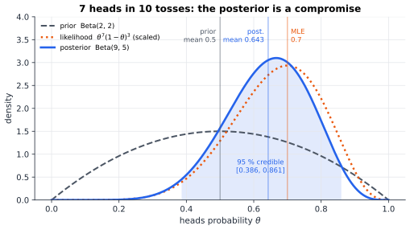
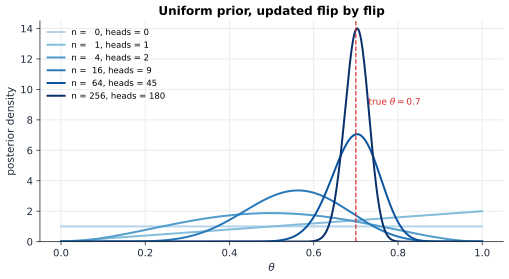
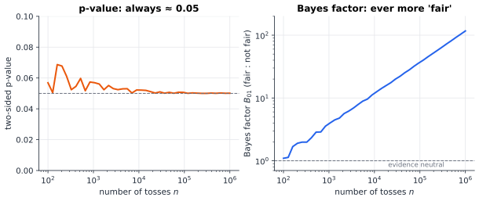

# Chapter 35 — Bayesian Thinking and Statistical Inference

[← Previous](34-random-walks-and-markov-chains.md) · [Track B](README.md) · [Table of Contents](../../00-front/table-of-contents.md) · [Next →](36-stochastic-processes.md)

> **Level 2 · Track B — Probability, Uncertainty, and Information**
> **Builds on:** [Ch. 19](../../part-6-probability-statistics/19-probability.md), [Ch. 20](../../part-6-probability-statistics/20-statistical-analysis.md) · **Leads to:** [Ch. 37](37-causal-inference.md), [Ch. 38](38-monte-carlo.md), [Ch. 91](../j-frontier/91-inverse-problems.md) · **Related:** [Ch. 33](33-information-theory.md), [Ch. 41](../c-game-theory/41-incomplete-information-games.md)
> **Reading time:** ~30 min

## 35.1 The hook

**The perfect fab line.** A new production line has made its first 20 chips, and all 20 pass the test. Your manager wants a number for the datasheet: the defect rate. The textbook estimator from [Ch. 20](../../part-6-probability-statistics/20-statistical-analysis.md#206-estimation), the maximum-likelihood estimate, is $0/20=0$. Zero defects. Would you print "defect rate: 0 %" and promise every customer a perfect part? Nobody would. But if not zero, then what, and on what grounds?

**The sunrise.** Pierre-Simon Laplace asked a version of the same question in 1814. Suppose all you know is that the sun has risen every day for 5000 years, about 1,826,213 days. What is the probability that it rises tomorrow? He gave an exact number, and the method behind it is the one that rescues the fab line.

**The almost-significant coin.** A colleague tosses a coin 100 times and gets 60 heads. The two-sided p-value for "the coin is fair" is $0.057$: just short of the conventional $0.05$, "nearly significant", the sort of result that gets written up as "a trend toward bias". A second analyst looks at the same 100 tosses and reports that the data favour the coin being fair, by a small margin. Same data, opposite leaning. One of them must have made a mistake?

Neither did. They answered different questions. This chapter is about the difference: what it means to *learn* a parameter from data, how prior knowledge enters (it always does, openly or not), and why the most common number in science, the p-value, is not the probability that a hypothesis is true. By the end you will compute the fab line's defect rate, Laplace's sunrise, and the Bayes factor for the coin, and you will see the coin dispute become a full-blown paradox as the sample grows.

## 35.2 The big idea

**Treat the unknown as random.** In [Ch. 19 §19.3](../../part-6-probability-statistics/19-probability.md#193-bayes-theorem), Bayes' theorem updated the probability of an *event*: is the patient ill, is the bit a 1? Bayesian inference applies the same rule to a *parameter*: the heads probability $\theta$ of a coin, the defect rate of a line, the resistance of a sensor. Before data, your knowledge of $\theta$ is a distribution, the **prior**. Data arrive. The rule

$$
\text{posterior}\ \propto\ \text{likelihood}\times\text{prior}
$$

turns the prior into the **posterior**: everything you now know about $\theta$, as a full distribution rather than a single number.

The analogy is a **detective's suspect board**. Before evidence, each suspect has some plausibility. Each clue raises the plausibility of the suspects it fits and lowers the others, in proportion to how well it fits (the likelihood). The detective never jumps to "the butler did it, probability 1" on one clue, and never refuses to update. With enough clues, detectives with different initial hunches end up agreeing.


*Seven heads in ten tosses. A mild prior centred at 0.5 (grey) meets the likelihood (orange, peaking at the MLE 0.7). The posterior (blue) sits between them, narrower than either, with its central 95 % shaded.*

Three consequences make the method worth learning.

1. **Uncertainty comes for free.** The posterior's width says how much you know. Twenty perfect chips do not prove a zero defect rate; they rule out large rates and leave small ones plausible.
2. **Learning is sequential.** Today's posterior is tomorrow's prior. You can update after every chip, every toss, every radar return, and the result is the same as updating once with all the data.
3. **Data eventually win.** As the sample grows, the likelihood becomes sharp and the prior's influence fades.


*A flat prior updated by tosses of a coin with true $\theta=0.7$. After 256 tosses the posterior is a narrow spike near the truth.*

The price is that you must say what you believed before seeing data. Critics call that subjective. Bayesians reply that every method makes such assumptions; this one writes them down where they can be argued with.

## 35.3 The mathematics

### Posterior, likelihood and evidence

Let data $D$ have probability (or density) $p(D\mid\theta)$ given a parameter $\theta$. Read as a function of $\theta$ with $D$ fixed, this is the **likelihood** $L(\theta)=p(D\mid\theta)$ of [Ch. 20 §20.6](../../part-6-probability-statistics/20-statistical-analysis.md#206-estimation). With a prior density $p(\theta)$, Bayes' theorem for densities gives

$$
p(\theta\mid D)=\frac{p(D\mid\theta)\,p(\theta)}{p(D)},\qquad p(D)=\int p(D\mid\theta)\,p(\theta)\,d\theta .
$$

The denominator $p(D)$, the **evidence** or **marginal likelihood**, does not depend on $\theta$: it only normalises the posterior. It will matter enormously when we compare models.

### The coin: conjugacy

Model $n$ tosses as independent Bernoulli$(\theta)$ trials with $k$ heads. The likelihood is $L(\theta)=\binom nk\theta^k(1-\theta)^{n-k}$. For the prior choose the **Beta distribution**

$$
p(\theta)=\frac{\theta^{a-1}(1-\theta)^{b-1}}{B(a,b)},\quad 0<\theta<1,\qquad B(a,b)=\int_0^1t^{a-1}(1-t)^{b-1}dt=\frac{\Gamma(a)\Gamma(b)}{\Gamma(a+b)} .
$$

Its mean is $a/(a+b)$. The parameters behave like pseudo-counts: $a-1$ imagined heads and $b-1$ imagined tails. $\text{Beta}(1,1)$ is uniform, $\text{Beta}(2,2)$ is a gentle hump at $0.5$, $\text{Beta}(50,50)$ is a confident belief that the coin is nearly fair.

> [!theorem] Beta–binomial conjugacy
> With prior $\theta\sim\text{Beta}(a,b)$ and $k$ heads in $n$ tosses,
> $$
> \theta\mid D\ \sim\ \text{Beta}(a+k,\ b+n-k),
> $$
> and the posterior mean is a weighted average of the prior mean and the MLE $\hat\theta=k/n$:
> $$
> E[\theta\mid D]=\frac{a+k}{a+b+n}=\underbrace{\frac{a+b}{a+b+n}}_{\text{weight on prior}}\cdot\frac{a}{a+b}+\underbrace{\frac{n}{a+b+n}}_{\text{weight on data}}\cdot\frac kn .
> $$

*Proof.* Multiply likelihood and prior and drop every factor free of $\theta$:
$$
p(\theta\mid D)\propto\theta^k(1-\theta)^{n-k}\cdot\theta^{a-1}(1-\theta)^{b-1}=\theta^{(a+k)-1}(1-\theta)^{(b+n-k)-1}.
$$
This is the kernel of $\text{Beta}(a+k,b+n-k)$, and a density is determined by its kernel, since the constant is fixed by integrating to 1. The mean of a Beta$(\alpha,\beta)$ is $\alpha/(\alpha+\beta)$; the weighted-average form follows by writing $a+k=(a+b)\frac{a}{a+b}+n\frac kn$. ∎

A prior is **conjugate** to a likelihood when the posterior stays in the prior's family. Updating then reduces to bookkeeping: add heads to $a$, tails to $b$. The weight on the data, $n/(a+b+n)$, tends to 1: the prior counts as $a+b$ observations' worth of opinion, and real observations outnumber it eventually.

For the figure, $\text{Beta}(2,2)$ and 7 heads in 10 give $\text{Beta}(9,5)$: posterior mean $9/14\approx0.643$, between the prior mean $0.5$ and the MLE $0.7$. The central 95 % **credible interval** is $[0.386,\ 0.861]$, and $P(\theta>0.5\mid D)\approx0.867$.

### Prediction and the rule of succession

The question you usually care about is not "what is $\theta$" but "what happens next". The **posterior predictive** probability averages over everything $\theta$ could be.

> [!theorem] Predictive probability and the rule of succession
> Under the model above, the probability that toss $n+1$ is a head is the posterior mean:
> $$
> P(\text{head on toss } n+1\mid D)=\int_0^1\theta\,p(\theta\mid D)\,d\theta=\frac{a+k}{a+b+n}.
> $$
> With a uniform prior ($a=b=1$) this is **Laplace's rule of succession**, $\dfrac{k+1}{n+2}$.

*Proof.* Condition on $\theta$: given $\theta$, the next toss is a head with probability $\theta$, independently of the past. By the law of total probability over the posterior, $P(\text{head}\mid D)=E[\theta\mid D]$, and conjugacy gives the value. ∎

Now the hook's first two puzzles fall.

- **Sunrise.** $k=n=1{,}826{,}213$: $P(\text{sunrise})=\frac{n+1}{n+2}\approx1-5.5\times10^{-7}$. Laplace himself added that anyone who understands the physics of the solar system would be far more confident: the uniform prior encodes ignorance, and he was not ignorant.
- **Fab line.** $k=0$ defects in $n=20$ with a uniform prior on the defect rate: the posterior is $\text{Beta}(1,21)$, the chance that the next chip is defective is $1/22\approx4.5\,\%$, and the 95 % upper credible bound on the rate is $1-0.05^{1/21}\approx13.3\,\%$. That is an honest datasheet line: "no failures in 20; rate below about 13 % with 95 % credibility." Engineers know its frequentist cousin as the **rule of three**: with zero failures in $n$ trials, the 95 % upper confidence bound is about $3/n$ (exactly $1-0.05^{1/20}\approx13.9\,\%$ here).

### Three estimators, three losses

If you must report one number, which one? The posterior offers several.

- **MLE**, $\arg\max_\theta L(\theta)$: ignores the prior. For the coin, $k/n$.
- **MAP** (maximum a posteriori), $\arg\max_\theta p(\theta\mid D)$: the posterior's peak. For $\text{Beta}(\alpha,\beta)$ with $\alpha,\beta>1$ it is $(\alpha-1)/(\alpha+\beta-2)$; for $\text{Beta}(9,5)$, $8/12\approx0.667$. With a uniform prior MAP equals MLE.
- **Posterior mean**, $E[\theta\mid D]$: $0.643$ for $\text{Beta}(9,5)$.

Which is "best" depends on what an error costs you, and decision theory makes this precise.

> [!theorem] The posterior mean minimises expected squared error
> For any estimate $c$ computed from the data,
> $$
> E\big[(\theta-c)^2\mid D\big]=\operatorname{Var}(\theta\mid D)+\big(E[\theta\mid D]-c\big)^2,
> $$
> so the posterior expected squared loss is minimised exactly by $c=E[\theta\mid D]$.

*Proof.* Write $m=E[\theta\mid D]$ and expand $(\theta-c)^2=(\theta-m)^2+2(\theta-m)(m-c)+(m-c)^2$. Take the posterior expectation: the first term gives the posterior variance, the middle term vanishes because $E[\theta-m\mid D]=0$ and $m-c$ is a constant given $D$, and the last term is constant. ∎

The same argument applied to absolute error $\lvert\theta-c\rvert$ picks out the posterior **median**, and a 0–1 loss on small intervals picks out the MAP. There is no loss-free notion of the best estimate. Notice also what the theorem says about the MLE: it is not the minimum-MSE answer once you believe anything about $\theta$. Estimators that pull the MLE toward a prior value are called **shrinkage** estimators, and they can beat the MLE on mean squared error even under frequentist rules, a fact that shocked statisticians when Stein proved a version of it in 1956.

### Credible intervals versus confidence intervals

A 95 % **credible interval** contains $\theta$ with posterior probability $0.95$: a statement about $\theta$, given the data you saw. A 95 % **confidence interval** ([Ch. 20 §20.7](../../part-6-probability-statistics/20-statistical-analysis.md#207-confidence-intervals)) is produced by a procedure that captures the true $\theta$ in 95 % of repeated experiments: a statement about the procedure, not about this particular interval. In large samples with mild priors the two nearly coincide numerically, which is why they are so often confused. In small samples, and especially at boundaries like zero defects, they can differ substantially.

### Testing hypotheses: the Bayes factor

To compare two hypotheses $H_0$ and $H_1$, apply Bayes' theorem to the hypotheses themselves:

$$
\underbrace{\frac{P(H_0\mid D)}{P(H_1\mid D)}}_{\text{posterior odds}}=\underbrace{\frac{p(D\mid H_0)}{p(D\mid H_1)}}_{\text{Bayes factor }B_{01}}\times\underbrace{\frac{P(H_0)}{P(H_1)}}_{\text{prior odds}} .
$$

The **Bayes factor** is the part supplied by the data. Each $p(D\mid H)$ is a marginal likelihood: the probability of the data averaged over that hypothesis's prior on its parameters.

For the 60-heads coin, take $H_0:\theta=\tfrac12$ and $H_1:\theta\sim\text{Uniform}(0,1)$, "the coin is biased, by an amount I cannot predict". Then

$$
p(D\mid H_0)=\binom{100}{60}2^{-100}\approx0.01084,
$$

and under $H_1$, integrating the binomial against the uniform prior with the Beta integral,

$$
p(D\mid H_1)=\int_0^1\binom nk\theta^k(1-\theta)^{n-k}d\theta=\binom nk\frac{k!\,(n-k)!}{(n+1)!}=\frac1{n+1}=\frac1{101}\approx0.00990 .
$$

So $B_{01}\approx0.01084\times101\approx1.10$. The data favour "fair" by about 10 %: essentially no evidence either way. Meanwhile the exact two-sided p-value is $0.057$. The second analyst of the hook was right, and so was the first. The p-value asks "how surprising are data this extreme *if* $H_0$ is true?" The Bayes factor asks "how much better does $H_0$ predict the data than $H_1$ does?" Sixty heads is mildly surprising under a fair coin, but it is *also* unimpressive under a vague $H_1$, which spreads its bets over every $\theta$ from $0$ to $1$ and so predicts any particular count poorly.

Now hold the p-value fixed near $0.05$ and let the sample grow, by choosing $k\approx n/2+0.98\sqrt n$ heads (a $z$-score of $1.96$). The p-value stays at $0.05$ forever. The Bayes factor does not.


*Every experiment on the left is "just significant at 5 %". On the right, the same data favour the fair coin more and more strongly: $B_{01}\approx1.1$ at $n=100$, $3.7$ at $n=1000$, $117$ at $n=10^6$.*

This is **Lindley's paradox** (1957). The reason is the $\sqrt n$ in the $z$-score: an excess of $0.98\sqrt n$ heads is a *shrinking fraction* $0.98/\sqrt n$ of the tosses, so the observed frequency closes in on $\tfrac12$, which is exactly what $H_0$ predicts and what a uniform $H_1$ finds unremarkable. A small p-value in a huge sample can signal a tiny real effect, a tiny bias in the experiment, or nothing, and the Bayes factor rate of growth, roughly $\sqrt n$, measures how differently the two philosophies weigh that.

> [!warning] Common Pitfall — the p-value is not $P(H_0\mid D)$
> "$p=0.04$, so there is a 4 % chance the null hypothesis is true" is wrong. A p-value is computed assuming $H_0$ is true; it cannot also be the probability that $H_0$ is true. Converting it into $P(H_0\mid D)$ needs a prior and an alternative, as above. The Neyman–Pearson framework of [Ch. 20 §20.8](../../part-6-probability-statistics/20-statistical-analysis.md#208-hypothesis-testing) controls error *rates* over repeated tests; it never claims to say how likely a single hypothesis is.

### Model selection and the automatic Occam's razor

The same machinery compares whole models. Given models $M_1,M_2,\dots$ with their own parameters, the evidence $p(D\mid M)=\int p(D\mid\theta,M)p(\theta\mid M)d\theta$ rewards fit but punishes flexibility. A model with many parameters spreads its prior probability over a huge space of possible datasets, so it assigns relatively little probability to the one you observed, unless it needed that flexibility. Simple models that predict sharply and are right win. This is Occam's razor, derived rather than assumed.

For large $n$ and $d$ parameters, a Laplace approximation of the evidence integral gives the **Bayesian information criterion**

$$
\ln p(D\mid M)\approx\ln L(\hat\theta)-\frac d2\ln n,
$$

stated here without proof: log-likelihood at the best fit, minus a penalty of $\tfrac12\ln n$ per parameter. Compare polynomial fits of degree $1$ and $5$ to 50 noisy points and BIC will usually prefer degree 1 unless the curvature is real, exactly the overfitting guard that [Ch. 20 §20.9](../../part-6-probability-statistics/20-statistical-analysis.md#209-regression) achieves with residual analysis.

> [!mystery] Where should the prior come from?
> Everything here assumed a prior, and the Bayes factor is notoriously sensitive to it: replace the uniform $H_1$ by $\text{Beta}(50,50)$ ("biased, but only slightly") and $B_{01}$ for 60 heads drops from $1.10$ to $0.52$, so the same data now favour "biased" by two to one. Is there an "objective" prior that represents ignorance? The uniform prior is not it: uniform in $\theta$ is not uniform in $\theta^2$ or in the log-odds, so "ignorance" depends on the parametrisation. Harold Jeffreys proposed $p(\theta)\propto\sqrt{I(\theta)}$, built from the Fisher information, which gives the same answer in every parametrisation. For the coin it is $\text{Beta}(\tfrac12,\tfrac12)$. Why the square root of Fisher information, and what geometry makes it invariant, is the doorway to information geometry ([Ch. 59](../e-abstract-math/59-differential-geometry.md), with Fisher information and KL divergence from [Ch. 33](33-information-theory.md)). Whether any prior can truly represent ignorance is still argued.

## 35.4 The algorithm

Conjugate priors are a gift that the real world rarely gives. Change the coin to a logistic-regression model of chip failure versus temperature, and the posterior has no closed form. The universal fallback in one or two dimensions is the **grid posterior**: evaluate prior times likelihood on a grid of $\theta$ values and normalise numerically.

```text
GRID-POSTERIOR(data, log_prior, log_lik, grid θ_1..θ_G with spacing Δ)
  for g = 1..G:
      s_g ← log_prior(θ_g) + log_lik(data | θ_g)      # work in logs
  s_max ← max_g s_g
  for g = 1..G:
      w_g ← exp(s_g − s_max)                           # largest weight is exactly 1
  Z ← Δ · Σ_g w_g
  return posterior density w_g / Z,  log-evidence  s_max + ln Z
```

**Numerical stability.** The likelihood of 10 000 tosses is a product of 10 000 numbers below one, around $10^{-3000}$, which underflows to zero in double precision (smallest positive double about $10^{-308}$). Two rules fix this: add log-likelihoods instead of multiplying likelihoods, and subtract the maximum before exponentiating (the **log-sum-exp** trick). The returned log-evidence is exact up to the grid's quadrature error, which is what Bayes factors need.

**Cost.** One likelihood evaluation per grid point: $O(Gn)$ for $n$ data points. That is trivial in one dimension. In $d$ dimensions a grid with $G$ points per axis has $G^d$ points: $100$ points per axis and $d=10$ parameters is $10^{20}$ evaluations. This **curse of dimensionality** is why grids die beyond three or four parameters and why the rest of modern Bayesian computation exists.

**Streaming updates.** When a conjugate prior is available, the opposite extreme holds: the update is $O(1)$ per observation. A monitoring system tracking a defect rate keeps two counters $(a,b)$ and increments one per chip, never storing the data.

**Failure cases.**

- *Improper priors in Bayes factors.* A "flat prior on the whole real line" is fine for estimation (the posterior is usually proper) but makes the evidence $p(D\mid H_1)$ defined only up to an arbitrary constant. Bayes factors computed with improper priors are meaningless.
- *Grids that miss the mass.* With lots of data the posterior is a spike of width about $1/\sqrt n$. A grid too coarse to resolve it, or one placed where the spike is not, returns confident nonsense. Always check the posterior visibly fits inside the grid.
- *Prior–data conflict.* If a confident prior and the data disagree sharply, the posterior can land between them, where neither has support. That is a symptom worth reporting, not hiding.

## 35.5 The experiment

### Part 1: drag the posterior

The posterior $\text{Beta}(9,5)$ for 7 heads in 10 tosses under a $\text{Beta}(2,2)$ prior, with the prior in grey:

```desmos-graph
left=0; right=1; bottom=0; top=4
---
y=\frac{(9+5-1)!}{(9-1)!(5-1)!}x^{9-1}(1-x)^{5-1}|blue|0<x<1
y=\frac{(2+2-1)!}{(2-1)!(2-1)!}x^{2-1}(1-x)^{2-1}|grey|dashed|0<x<1
x=0.7|orange|dotted
```

*Posterior (blue), prior (grey) and the MLE $0.7$ (orange). The blue curve is $\text{Beta}(a+k,\,b+n-k)$ with $a=b=2$, $k=7$, $n=10$.*

Edit the numbers. The two blue parameters are $a+k$ and $b+n-k$; the grey ones are $a$ and $b$. Try:

1. **More data, same frequency.** Replace $9,5$ by $72,32$ (70 heads in 100) and change `top` to $10$. The posterior narrows like $1/\sqrt n$ and the prior stops mattering.
2. **A stubborn prior.** Set the prior to $\text{Beta}(30,30)$ (grey $30,30$) and the posterior to $\text{Beta}(37,33)$. Seven heads in ten barely move it. How many tosses at 70 % does it take before the posterior mean passes $0.65$?
3. **Zero defects.** Set the posterior to $\text{Beta}(1,21)$ and the prior to $\text{Beta}(1,1)$. This is the fab line. Most of the mass sits below $0.1$, none of it at exactly zero.

### Part 2: a grid posterior you can break

```python
import numpy as np
import matplotlib.pyplot as plt

# ---- knobs ---------------------------------------------------------------
true_theta = 0.7      # the coin's real heads probability (hidden from the analyst)
n_flips    = 30       # how many tosses we observe
a, b       = 2, 2     # Beta(a, b) prior; try (1,1), (20,20), (1,10)
seed       = 0
# --------------------------------------------------------------------------

rng = np.random.default_rng(seed)
data = rng.random(n_flips) < true_theta
k = int(data.sum())

theta = np.linspace(0.0005, 0.9995, 2000)           # grid over the parameter
dth = theta[1] - theta[0]
log_prior = (a - 1) * np.log(theta) + (b - 1) * np.log(1 - theta)
log_lik = k * np.log(theta) + (n_flips - k) * np.log(1 - theta)
log_post = log_prior + log_lik
post = np.exp(log_post - log_post.max())             # subtract max: no underflow
post /= post.sum() * dth                             # normalise numerically

mean = (theta * post).sum() * dth
cdf = np.cumsum(post) * dth
lo, hi = theta[np.searchsorted(cdf, 0.025)], theta[np.searchsorted(cdf, 0.975)]
print(f"heads {k}/{n_flips}   MLE {k/n_flips:.3f}   MAP {theta[post.argmax()]:.3f}")
print(f"posterior mean {mean:.3f}  (exact {(a+k)/(a+b+n_flips):.3f})")
print(f"95% credible interval [{lo:.3f}, {hi:.3f}]")
print(f"P(theta > 0.5 | data) = {post[theta > 0.5].sum()*dth:.3f}")

prior = np.exp(log_prior - log_prior.max()); prior /= prior.sum() * dth
plt.plot(theta, prior, "--", label="prior")
plt.plot(theta, post, label="posterior")
plt.axvline(true_theta, color="k", ls=":", label="true theta")
plt.xlabel("theta"); plt.ylabel("density"); plt.legend(); plt.show()
```

With the default knobs it reports 20 heads in 30, posterior mean $0.647$ (matching the exact conjugate answer), a 95 % credible interval of about $[0.48,\ 0.80]$, and $P(\theta>0.5\mid D)\approx0.96$. Things to try:

1. Set `n_flips = 100000` and remove the `- log_post.max()`. Watch the posterior turn into `nan`: that is underflow, live.
2. Replace the Beta prior by a *bimodal* one, say `log_prior = np.log(np.exp(-((theta-0.2)/0.05)**2) + np.exp(-((theta-0.8)/0.05)**2))`. No conjugate formula exists now, but the grid does not care. How much data does it take for one hump to win?
3. Run 1000 seeds and count how often the 95 % credible interval contains `true_theta`. Is it 95 %? Does the answer depend on the prior?

## 35.6 The challenge

1. **Intuition.** Two engineers estimate the same defect rate. One updates after every chip; the other waits for the whole batch of 500 and updates once. Explain without algebra why they must end with the same posterior, and name a situation in which a real analysis could break this equivalence.
2. **Derivation.** Show that the Gamma distribution is a conjugate prior for the rate $\lambda$ of a Poisson count: with prior $\text{Gamma}(\alpha,\beta)$ (density $\propto\lambda^{\alpha-1}e^{-\beta\lambda}$) and counts $x_1,\dots,x_n$, find the posterior and write its mean as a weighted average of the prior mean and the sample mean. Interpret $\alpha$ and $\beta$ as pseudo-data.
3. **Implementation.** Extend the grid code to two parameters: a Gaussian with unknown mean $\mu$ and standard deviation $\sigma$, observed through 20 noisy voltage readings. Plot the joint posterior as a contour map, then the marginal posterior of $\mu$. Measure how runtime grows when you go from $100\times100$ to $400\times400$ grid points, and predict what three parameters would cost.
4. **Open investigation.** Lindley's paradox used a uniform alternative. For a fixed p-value of $0.05$, how does the growth of $B_{01}$ with $n$ depend on the prior under $H_1$? Try $\text{Beta}(c,c)$ for several $c$, and a prior that shrinks with $n$. Is there a prior that makes the Bayes factor and the p-value agree at every sample size, and would you be willing to use it? (Statisticians still disagree about what the right reconciliation is.)

## 35.7 Loose threads

The chapter stayed with one or two parameters and friendly priors on purpose. The frontier starts exactly where it stopped.

> [!mystery] The integral you cannot do
> Every posterior here was either conjugate or small enough for a grid. A model with 50 parameters has a posterior whose normalising integral $p(D)=\int p(D\mid\theta)p(\theta)\,d\theta$ is a 50-dimensional integral that no grid and no formula can touch. Yet modern science computes such posteriors routinely. The trick is to stop computing the posterior and start *sampling* from it, using a Markov chain built so that its stationary distribution is the posterior ([Ch. 34](34-random-walks-and-markov-chains.md) supplies the convergence theorem). The normalising constant cancels out of every step. How to build that chain, and why the evidence $p(D)$ remains hard even after the posterior becomes easy, is [Ch. 38](38-monte-carlo.md).

> [!mystery] What if the model is wrong?
> As $n\to\infty$ the posterior concentrates at the true parameter and becomes Gaussian with width $1/\sqrt{nI(\theta)}$, so Bayesian and frequentist intervals agree. This is the Bernstein–von Mises theorem, and it needs conditions, including that the true distribution is in the model family. If the coin's tosses are secretly correlated, the posterior still concentrates, confidently, on the parameter that makes the wrong model least wrong in the KL sense of [Ch. 33](33-information-theory.md). The precise statement, its failures in infinite-dimensional models, and the measure-theoretic machinery needed even to state it are in [Ch. 97](../j-frontier/97-measure-theory.md).

Other threads:

- **Inference is not intervention.** A posterior that says "chips made on Tuesday fail more" tells you nothing about what would happen if you moved production off Tuesdays. Learning causes from data needs extra structure: [Ch. 37](37-causal-inference.md).
- **Inverse problems.** Deblurring an image or reconstructing a CT scan is Bayesian inference with millions of parameters, where the prior is what makes the problem solvable at all: [Ch. 91](../j-frontier/91-inverse-problems.md).
- **Beliefs about other people's beliefs.** When the parameter you are inferring is another player's private information and they know you are inferring it, Bayes' rule becomes a strategic tool: [Ch. 41](../c-game-theory/41-incomplete-information-games.md).
- **Filtering.** Updating the belief about a *moving* state, one measurement at a time, with the posterior as the next prior, is the Kalman filter when everything is Gaussian. It is Bayes' rule running on a Markov chain.

## Further reading

- A. Gelman, J. B. Carlin, H. S. Stern, D. B. Dunson, A. Vehtari and D. B. Rubin, *Bayesian Data Analysis*, 3rd ed., CRC Press, 2013. The standard applied reference.
- E. T. Jaynes, *Probability Theory: The Logic of Science*, Cambridge University Press, 2003. A passionate argument that probability is extended logic.
- D. J. C. MacKay, *Information Theory, Inference, and Learning Algorithms*, Cambridge University Press, 2003 (free online). Chapter 28 on Occam's razor and model comparison is a classic.
- R. McElreath, *Statistical Rethinking*, 2nd ed., CRC Press, 2020. Gentle, code-first, and honest about priors.
