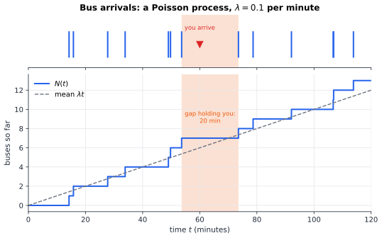
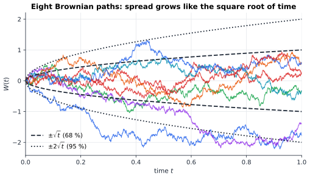
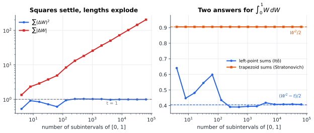

# Chapter 36 — Stochastic Processes: When Randomness Evolves

[← Previous](35-bayesian-inference.md) · [Track B](README.md) · [Table of Contents](../../00-front/table-of-contents.md) · [Next →](37-causal-inference.md)

> **Level 2 · Track B — Probability, Uncertainty, and Information**
> **Builds on:** [Ch. 19](../../part-6-probability-statistics/19-probability.md), [Ch. 21](../../part-6-probability-statistics/21-random-processes.md), [Ch. 34](34-random-walks-and-markov-chains.md) · **Leads to:** [Ch. 38](38-monte-carlo.md), [Ch. 89](../j-frontier/89-pde-beyond-the-basics.md), [Ch. 97](../j-frontier/97-measure-theory.md) · **Related:** [Ch. 13](../../part-4-differential-equations/13-partial-differential-equations.md), [Ch. 54](../d-optimization/54-robust-stochastic-optimization.md), [Ch. 92](../j-frontier/92-mathematical-physics.md)
> **Reading time:** ~30 min

## 36.1 The hook

**The bus that is always late.** The timetable says buses come "every 10 minutes on average". They are not scheduled; they arrive at random, independently of each other, at an average rate of one per 10 minutes. You walk to the stop at a random moment. How long do you expect to wait?

The obvious answer is 5 minutes: on average you land halfway through a 10-minute gap. The correct answer is 10 minutes. And if you ask how long the gap you landed in lasts, from the bus before you to the bus after you, the answer is 20 minutes, twice the average gap. Every passenger, every day, experiences gaps twice as long as the timetable's average. No one is lying, and no buses are behaving strangely.

**The integral that will not behave.** Let $W(t)$ be a random signal that wanders like the pen of a seismograph, the Brownian motion of [Ch. 21 §21.5](../../part-6-probability-statistics/21-random-processes.md#215-gaussian-processes). Ordinary calculus says $\int_0^tW\,dW=\tfrac12W(t)^2$, by the same rule that gives $\int x\,dx=\tfrac12x^2$. Compute the integral numerically, as a limit of Riemann sums, the way engineers compute every integral. You get

$$
\int_0^tW\,dW=\tfrac12W(t)^2-\tfrac12t .
$$

An extra term, $-t/2$, appears out of nowhere, and it does not shrink as the grid gets finer. Worse, if you evaluate the Riemann sum at the midpoint of each interval instead of the left end, you get the classical answer back. For ordinary functions the evaluation point never matters in the limit. Here it changes the answer.

**The investment that grows and shrinks.** A stock model widely used in finance says the expected value of an investment grows by 65 % over ten years. In the same model, about 59 % of investors lose money over those ten years. Both statements are correct.

All three surprises come from one fact: when randomness accumulates in time, its *fluctuations* have rules of their own, and those rules are not the rules of smooth functions. This chapter builds the two fundamental random processes, the Poisson process (random events) and Brownian motion (random wandering), introduces the martingale (the mathematical fair game), and opens the door to stochastic calculus. It resolves the bus, the integral and the investment. It leaves some deeper doors shut.

## 36.2 The big idea

**Randomness that adds up.** A random variable is one roll of a die. A stochastic process is a whole history of rolls, indexed by time, where what happens later can build on what happened earlier. Core [Ch. 21](../../part-6-probability-statistics/21-random-processes.md) studied processes through their averages: means, autocorrelations, spectra. This chapter studies their *paths*: what does one realisation actually look like, when does it first cross a line, how do you integrate against it?

Two building blocks cover a surprising amount of the world.

- **Counting random events: the Poisson process.** Photons hitting a detector, packets arriving at a router, decays of radioactive atoms, buses. Each tiny time slot has a tiny independent chance of an event. Paths are staircases that jump by one at random times.
- **Accumulating random nudges: Brownian motion.** A pollen grain kicked by water molecules, the phase of a free-running oscillator, the integrated error of a gyroscope. Each instant adds an independent, tiny, symmetric nudge. Paths are continuous but jagged at every scale.


*Top: arrival times of a Poisson process with rate $0.1$ per minute. Bottom: the count $N(t)$ against its mean $\lambda t$. A passenger arriving at $t=60$ falls into the longest gap in sight: long gaps are easier to land in.*

The analogy for both is **a drunk with a stopwatch**. In [Ch. 34](34-random-walks-and-markov-chains.md) the drunk took one step per tick. Now let the ticks get faster and the steps smaller. If each step is a rare "jump" that happens with small probability, you get the Poisson process. If every tick produces a step of size $\sqrt{\Delta t}$, you get Brownian motion. That square root is the whole secret: in a time $\Delta t$ a Brownian path moves about $\sqrt{\Delta t}$, which is *much larger* than $\Delta t$ when $\Delta t$ is small. The path's velocity, displacement over time, is about $1/\sqrt{\Delta t}$ and blows up. The path has no velocity anywhere. That is why calculus has to be rebuilt.


*Eight sample paths of standard Brownian motion. The dashed and dotted curves are $\pm\sqrt t$ and $\pm2\sqrt t$: at each time about 68 % and 95 % of paths lie inside them.*

The third idea is a lens rather than a process. A **martingale** is a fair game: a process whose expected future value, given everything you know now, is its present value. Martingales are the reason gambling systems cannot beat a fair casino, and they turn hard questions about random paths (when, where, how likely) into one line of algebra.

## 36.3 The mathematics

### The Poisson process

> [!definition] Poisson process
> A counting process $N(t)$, $t\ge0$, with $N(0)=0$, is a **Poisson process of rate $\lambda$** if
> 1. it has independent increments: counts in disjoint time intervals are independent;
> 2. it has stationary increments: the distribution of $N(t+s)-N(t)$ depends only on $s$;
> 3. in a short interval of length $h$, $P(\text{one event})=\lambda h+o(h)$ and $P(\text{two or more})=o(h)$.

Condition 3 says events are rare and arrive one at a time. From these three local rules a global formula follows.

> [!theorem] Poisson counts
> $$
> P\big(N(t)=k\big)=\frac{(\lambda t)^k}{k!}e^{-\lambda t},\qquad k=0,1,2,\dots
> $$

*Proof.* Let $p_k(t)=P(N(t)=k)$. To have $k$ events at time $t+h$, either there were $k$ at time $t$ and none in $(t,t+h]$, or $k-1$ and exactly one, or fewer and at least two. By independent increments and rule 3,
$$
p_k(t+h)=p_k(t)(1-\lambda h)+p_{k-1}(t)\,\lambda h+o(h).
$$
Subtract $p_k(t)$, divide by $h$ and let $h\to0$:
$$
p_0'(t)=-\lambda p_0(t),\qquad p_k'(t)=-\lambda p_k(t)+\lambda p_{k-1}(t)\quad(k\ge1),
$$
with $p_0(0)=1$, $p_k(0)=0$. The first equation gives $p_0(t)=e^{-\lambda t}$. For the rest, substitute $p_k(t)=q_k(t)e^{-\lambda t}$: the system becomes $q_k'=\lambda q_{k-1}$ with $q_0=1$, $q_k(0)=0$, so $q_1=\lambda t$, $q_2=(\lambda t)^2/2$, and by induction $q_k=(\lambda t)^k/k!$. ∎

This is a system of linear ODEs of the type solved in [Ch. 11](../../part-4-differential-equations/11-ordinary-differential-equations.md), and the answer is the Poisson distribution of [Ch. 19 §19.6](../../part-6-probability-statistics/19-probability.md#196-probability-distributions). Two consequences follow at once.

- **Gaps are exponential.** The time $T_1$ to the first event satisfies $P(T_1>t)=P(N(t)=0)=e^{-\lambda t}$: exponential with mean $1/\lambda$. By independent, stationary increments, every later gap is the same and independent ([Ch. 20 §20.4](../../part-6-probability-statistics/20-statistical-analysis.md#204-common-distributions)).
- **No memory.** $P(T>s+t\mid T>s)=e^{-\lambda(s+t)}/e^{-\lambda s}=e^{-\lambda t}$. Having already waited $s$ minutes tells you nothing about the remaining wait.

### The bus paradox, resolved

Memorylessness answers the first half of the hook immediately. You arrive at a random time. Whatever happened before, the time until the next bus is exponential with mean $1/\lambda=10$ minutes. Looking backwards, the time since the last bus is (for large $t$) also exponential with mean 10 minutes, by the same argument run in reverse. The gap you are in averages $10+10=20$ minutes.

Why is that not a contradiction with an average gap of 10 minutes? Because you do not pick a gap at random; you pick a *moment* at random, and a gap twice as long contains twice as many moments. This is **length-biased sampling**. If gaps have density $f(x)$, the gap containing a random moment has density proportional to $x f(x)$:

$$
f_{\text{seen}}(x)=\frac{x f(x)}{E[X]},\qquad E[X_{\text{seen}}]=\frac{E[X^2]}{E[X]}=E[X]+\frac{\operatorname{Var}(X)}{E[X]} .
$$

For exponential gaps $E[X^2]=2/\lambda^2$, so $E[X_{\text{seen}}]=2/\lambda=20$ minutes. The formula shows the paradox is general: the gap you experience exceeds the average gap by $\operatorname{Var}(X)/E[X]$. Only perfectly regular buses ($\operatorname{Var}=0$) give the naive answer. The same effect is why your friends have more friends than you on average, and why sampled classes look more crowded than the average class size.

Two more facts, stated without proof, make Poisson processes easy to work with. **Superposition:** merging independent Poisson streams of rates $\lambda_1$ and $\lambda_2$ gives a Poisson stream of rate $\lambda_1+\lambda_2$. **Thinning:** keeping each event independently with probability $p$ gives a Poisson stream of rate $p\lambda$. Together they explain why aggregated traffic from many independent sources looks Poisson even when no single source is.

### Brownian motion: the square-root law

[Ch. 21 §21.5](../../part-6-probability-statistics/21-random-processes.md#215-gaussian-processes) defined the Wiener process. We use the standard version, $\sigma=1$: $W(0)=0$, independent increments, $W(t+s)-W(t)\sim\mathcal N(0,s)$, continuous paths. Two properties drive everything.

**Scaling.** For any $c>0$, the process $\frac1{\sqrt c}W(ct)$ is again a standard Brownian motion (its increments are Gaussian with variance $cs/c=s$). Zoom in on a Brownian path by a factor $c$ in time and $\sqrt c$ in space and it looks statistically identical. The path is a random fractal, and $\operatorname{Var}W(t)=t$ means it typically sits within $\pm\sqrt t$ of zero, the envelope in the figure above. This is the continuum version of the gambler's-ruin observation in [Ch. 34](34-random-walks-and-markov-chains.md) that a walk needs $N^2$ steps to travel $N$.

**Quadratic variation.** Chop $[0,t]$ into $n$ intervals of length $\Delta t=t/n$ with increments $\Delta W_k$.

> [!theorem] Quadratic variation of Brownian motion
> $$
> Q_n=\sum_{k=1}^{n}(\Delta W_k)^2\ \longrightarrow\ t\qquad\text{in mean square as } n\to\infty .
> $$

*Proof.* Each $\Delta W_k\sim\mathcal N(0,\Delta t)$, so $E[(\Delta W_k)^2]=\Delta t$ and, using $E[Z^4]=3$ for a standard Gaussian $Z$, $\operatorname{Var}\big((\Delta W_k)^2\big)=3\Delta t^2-\Delta t^2=2\Delta t^2$. The increments are independent, so
$$
E[Q_n]=n\,\Delta t=t,\qquad \operatorname{Var}(Q_n)=n\cdot2\Delta t^2=\frac{2t^2}{n}\to0 .
$$
Hence $E[(Q_n-t)^2]=\operatorname{Var}(Q_n)\to0$. ∎

For any differentiable function $f$, the same sum $\sum(\Delta f_k)^2\approx\sum f'(t_k)^2\Delta t^2\le\max\lvert f'\rvert^2\,t\,\Delta t\to0$. Smooth functions have zero quadratic variation; Brownian motion has quadratic variation exactly $t$, *deterministically*, even though every increment is random. The squares of the random kicks add up to a clock.

There is a sting in the tail. Since $Q_n\le\max_k\lvert\Delta W_k\rvert\cdot\sum_k\lvert\Delta W_k\rvert$, and $\max_k\lvert\Delta W_k\rvert\to0$ by continuity while $Q_n\to t>0$, the total length $\sum_k\lvert\Delta W_k\rvert$ must go to infinity. A Brownian path has **infinite length** on every interval. In fact (Paley, Wiener and Zygmund, 1933) it is differentiable at no point at all.


*Left: on one path over $[0,1]$, the sum of squared increments settles at $t=1$ while the sum of absolute increments grows without bound. Right: left-point Riemann sums of $\int_0^1W\,dW$ converge to $\tfrac12(W^2-t)$; trapezoid sums give $\tfrac12W^2$.*

### Martingales: the mathematics of fair games

> [!definition] Martingale
> A process $M(t)$ with $E\lvert M(t)\rvert<\infty$ is a **martingale** with respect to the information $\mathcal F_s$ available at time $s$ (the history of the process up to $s$) if
> $$
> E\big[M(t)\mid\mathcal F_s\big]=M(s)\qquad\text{for all } s\le t .
> $$

The best prediction of the future value is the present value. Examples:

- $W(t)$: given the past, $W(t)=W(s)+[W(t)-W(s)]$ and the bracket is independent with mean zero.
- $N(t)-\lambda t$: the Poisson count minus its expected growth, the "surprise" part of the arrivals.
- $W(t)^2-t$, which deserves a proof because it is the engine of what follows.

> [!theorem] $W(t)^2-t$ is a martingale
> For $s\le t$, $E\big[W(t)^2-t\mid\mathcal F_s\big]=W(s)^2-s$.

*Proof.* Write $W(t)=W(s)+D$ with $D=W(t)-W(s)\sim\mathcal N(0,t-s)$ independent of $\mathcal F_s$. Then $W(t)^2=W(s)^2+2W(s)D+D^2$. Conditionally on $\mathcal F_s$, $W(s)$ is known, $E[D]=0$ and $E[D^2]=t-s$, so $E[W(t)^2\mid\mathcal F_s]=W(s)^2+t-s$. Subtract $t$. ∎

The power of martingales comes from a theorem we state without proof.

> [!theorem] Optional stopping (one version)
> If $M$ is a martingale, $\tau$ is a stopping time (a random time whose occurrence by time $t$ is decided by the history up to $t$), and $M(t\wedge\tau)$ stays bounded, then $E[M(\tau)]=E[M(0)]$.

Now watch it redo [Ch. 34](34-random-walks-and-markov-chains.md)'s gambler's ruin, in continuous time and in two lines. Let Brownian motion start at $0$ and stop at the first time $\tau$ it hits $-a$ or $+b$. Let $p=P(\text{hit }b\text{ first})$. Since $W$ is a martingale,
$$
0=E[W(\tau)]=p\,b-(1-p)\,a\quad\Longrightarrow\quad p=\frac{a}{a+b}.
$$
Since $W^2-t$ is a martingale (with a limiting argument for the unbounded $t$),
$$
0=E[W(\tau)^2-\tau]=p\,b^2+(1-p)\,a^2-E[\tau]\quad\Longrightarrow\quad E[\tau]=ab .
$$
These are exactly $k/N$ and $k(N-k)$ from the discrete game with $a=k$, $b=N-k$, now with no recurrences at all.

> [!mystery] The gambler who always wins
> Bet 1 on a fair coin. If you lose, double the bet; keep doubling until you win once, then stop. You are certain to stop, and when you do you are up exactly 1. Your fortune is a martingale, it started at 0, and at the stopping time it equals 1, so $E[M(\tau)]=1\ne0$. Optional stopping fails. The boundedness condition was violated (your losses before the win are unbounded, and you need infinite credit). Exactly which conditions make "you cannot beat a fair game" true, and the measure-theoretic notion of conditional expectation needed to state them precisely, are the business of [Ch. 97](../j-frontier/97-measure-theory.md).

### Stochastic integrals: where the extra term comes from

We want to make sense of $\int_0^tH(s)\,dW(s)$: the accumulated effect of random kicks $dW$ scaled by a time-varying gain $H$. A Brownian path has infinite length, so the classical Riemann–Stieltjes integral does not exist. Itô's idea was to *choose* the left endpoint and define

$$
\int_0^tH\,dW=\lim_{n\to\infty}\sum_{k=0}^{n-1}H(t_k)\big(W(t_{k+1})-W(t_k)\big),
$$

the limit taken in mean square. The left endpoint is not arbitrary: it means the gain is decided *before* the kick arrives, which is how any causal system, a controller, a trader, a filter, actually operates.

> [!theorem] The Itô integral of $W$
> $$
> \int_0^tW\,dW=\tfrac12W(t)^2-\tfrac12t .
> $$

*Proof.* Write $W_k=W(t_k)$ and $\Delta W_k=W_{k+1}-W_k$. The algebraic identity $b^2-a^2=2a(b-a)+(b-a)^2$ with $a=W_k$, $b=W_{k+1}$ gives
$$
W_k\,\Delta W_k=\tfrac12\big(W_{k+1}^2-W_k^2\big)-\tfrac12(\Delta W_k)^2 .
$$
Sum over $k$. The first part telescopes to $\tfrac12\big(W(t)^2-W(0)^2\big)=\tfrac12W(t)^2$. The second part is $-\tfrac12Q_n$, and $Q_n\to t$ in mean square by the quadratic-variation theorem. ∎

The proof shows exactly where ordinary calculus breaks. For a smooth function the $(\Delta)^2$ terms add up to zero and you get $\tfrac12W^2$. For Brownian motion they add up to $t$. Evaluate at the midpoint (or average the endpoints, the trapezoid rule) and the cross term is gone: $\tfrac12(W_k+W_{k+1})\Delta W_k=\tfrac12(W_{k+1}^2-W_k^2)$ exactly, which telescopes to $\tfrac12W^2$. That is the **Stratonovich** integral. The two differ by half the quadratic variation, and the right-hand panel of the figure above shows the two Riemann sums converging to the two answers on one simulated path.

The Itô choice buys one beautiful property: an Itô integral is a martingale with mean zero. Indeed $E[\tfrac12W(t)^2-\tfrac12t]=\tfrac12t-\tfrac12t=0$. The classical answer $\tfrac12W^2$ has mean $t/2$, so it would have the system gaining on average from kicks it could not anticipate.

### Itô's lemma: the new chain rule

The same bookkeeping, applied to any smooth function $f(W)$, gives the fundamental theorem of stochastic calculus. Taylor-expand one step:

$$
\Delta f=f'(W)\,\Delta W+\tfrac12f''(W)(\Delta W)^2+\cdots .
$$

In ordinary calculus the second term is negligible. Here $(\Delta W)^2$ sums to $\Delta t$, so it survives, while higher terms ($\lvert\Delta W\rvert^3\sim\Delta t^{3/2}$) vanish. The mnemonic is $(dW)^2=dt$, $dt\,dW=0$, $(dt)^2=0$.

> [!theorem] Itô's lemma (stated)
> If $X$ satisfies $dX=a\,dt+b\,dW$ and $f(t,x)$ is twice continuously differentiable, then
> $$
> df(t,X)=\Big(\frac{\partial f}{\partial t}+a\frac{\partial f}{\partial x}+\frac12b^2\frac{\partial^2f}{\partial x^2}\Big)dt+b\frac{\partial f}{\partial x}\,dW .
> $$

The extra $\tfrac12b^2f''$ is the Itô correction. With $f=x^2$ and $X=W$ ($a=0$, $b=1$) it reproduces $d(W^2)=2W\,dW+dt$, the theorem above in differential form.

### The investment paradox, resolved

The standard model for a price, a population, or any quantity whose random fluctuations are proportional to its size is **geometric Brownian motion**:

$$
dS=\mu S\,dt+\sigma S\,dW,\qquad S(0)=S_0 .
$$

Naively, divide by $S$ and integrate: $\ln S$ should grow like $\mu t+\sigma W$. Itô's lemma with $f=\ln x$ ($f'=1/x$, $f''=-1/x^2$, $a=\mu S$, $b=\sigma S$) says otherwise:

$$
d(\ln S)=\Big(\mu-\tfrac12\sigma^2\Big)dt+\sigma\,dW
\quad\Longrightarrow\quad
S(t)=S_0\exp\Big(\big(\mu-\tfrac12\sigma^2\big)t+\sigma W(t)\Big).
$$

Two different growth rates now coexist. The **mean** grows at rate $\mu$: $E[S(t)]=S_0e^{\mu t}$, using $E[e^{\sigma W}]=e^{\sigma^2t/2}$. The **typical path** (the median, and the long-run growth of almost every path) grows at the smaller rate $\mu-\tfrac12\sigma^2$.

With the hook's numbers, $\mu=0.05$ per year and $\sigma=0.4$, over $t=10$ years: $E[S]/S_0=e^{0.5}\approx1.65$, a 65 % expected gain. But $\mu-\tfrac12\sigma^2=-0.03$, so the median is $e^{-0.3}\approx0.74$ and

$$
P\big(S(10)<S_0\big)=P\Big(W(10)<\frac{0.3}{0.4}\Big)=\Phi\Big(\frac{0.3}{0.4\sqrt{10}}\Big)\approx0.594,
$$

so about 59 % to 60 % of paths lose money. The mean is dragged up by a few enormous winners. Volatility is not just risk around a trend: it *lowers* the trend that a typical path follows, by exactly the Itô correction $\tfrac12\sigma^2$. Engineers meet the same effect as the gap between average power and the power of the average in log-normal fading channels.

## 36.4 The algorithm

### Simulating a Poisson process

The exponential-gap property gives an exact $O(\text{number of events})$ algorithm: draw $E_1,E_2,\dots\sim\text{Exponential}(\lambda)$ and set $T_k=E_1+\dots+E_k$ until $T_k>T$. An exponential sample is $-\ln(U)/\lambda$ with $U$ uniform on $(0,1]$.

When the rate varies in time, $\lambda(t)\le\lambda_{\max}$, use **thinning** (Lewis–Shedler, 1979):

```text
THINNING(λ(·), λ_max, T)
  t ← 0, events ← []
  loop:
      t ← t − ln(U₁)/λ_max            # next candidate of a rate-λ_max process
      if t > T: return events
      if U₂ ≤ λ(t)/λ_max: append t    # keep it with probability λ(t)/λ_max
```

It is exact, by the thinning property of §36.3. Its efficiency is the average of $\lambda(t)/\lambda_{\max}$: a sharply peaked rate wastes most candidates.

### Simulating Brownian motion and SDEs

On a grid $t_k=k\,\Delta t$, Brownian motion is exact at the grid points: $W_{k+1}=W_k+\sqrt{\Delta t}\,Z_k$ with $Z_k\sim\mathcal N(0,1)$ independent. For a stochastic differential equation $dX=a(X)\,dt+b(X)\,dW$, the analogue of Euler's method ([Ch. 22](../../part-7-numerical-computational/22-numerical-methods.md)) is **Euler–Maruyama**:

$$
X_{k+1}=X_k+a(X_k)\,\Delta t+b(X_k)\sqrt{\Delta t}\,Z_k .
$$

Note the left-point evaluation of $b$: this scheme converges to the *Itô* solution. Its accuracy has two different orders.

- **Strong order $\tfrac12$**: the error on each individual path, $E\lvert X_N-X(T)\rvert$, shrinks like $\Delta t^{1/2}$. Halving the error needs four times the steps.
- **Weak order 1**: the error in expectations, $\lvert E[g(X_N)]-E[g(X(T))]\rvert$, shrinks like $\Delta t$.

If you only need averages (a price, a mean error), the cheaper weak order is what counts, and Monte Carlo sampling error, which falls like $1/\sqrt{\text{paths}}$, usually dominates.

**Failure cases.**

- *Wrong calculus.* Evaluate $b$ at the midpoint, or use a deterministic ODE solver with the noise treated as an ordinary input signal, and you silently solve the Stratonovich equation instead. For geometric Brownian motion that shifts the growth rate by $\tfrac12\sigma^2$.
- *Positivity.* A geometric Brownian motion is always positive, but an Euler–Maruyama step $S(1+\mu\Delta t+\sigma\sqrt{\Delta t}Z)$ goes negative whenever $Z<-(1+\mu\Delta t)/(\sigma\sqrt{\Delta t})$. With coarse steps and high volatility this happens. Simulate $\ln S$ instead, where the scheme is exact.
- *Shared randomness.* To compare two step sizes on the same path, the coarse increments must be sums of the fine ones. Drawing fresh random numbers for each resolution compares different paths and hides the convergence.

## 36.5 The experiment

### Part 1: waiting for the bus

The probability of exactly $k$ buses in the first $t$ minutes, for $k=0,1,2,3$ and rate $\lambda=0.1$ per minute:

```desmos-graph
left=0; right=60; bottom=0; top=1
---
y=e^{-0.1x}|blue|0<x<60
y=(0.1x)e^{-0.1x}|red|0<x<60
y=\frac{(0.1x)^{2}}{2}e^{-0.1x}|green|0<x<60
y=\frac{(0.1x)^{3}}{6}e^{-0.1x}|purple|0<x<60
(10,0.368)|label:no bus in 10 min
```

*$P(N(t)=k)$ for $k=0$ (blue) to $3$ (red, green, purple). Each curve for $k\ge1$ peaks at $t=k/\lambda$, where the expected count equals $k$.*

At $t=10$ the blue curve reads $e^{-1}\approx0.368$: more than a third of the time you see *no* bus in a full average gap. Change every $0.1$ to $0.2$ (a bus every 5 minutes on average) and confirm the peaks move to half the times. Then add the curve for $k=4$, `y=\frac{(0.1x)^{4}}{24}e^{-0.1x}`, and check where it peaks.

### Part 2: the investment paradox in 20 000 paths

The script simulates geometric Brownian motion by Euler–Maruyama and by the exact Itô solution, and checks the Itô integral of the hook along the way.

```python
import numpy as np
import matplotlib.pyplot as plt

# ---- knobs ---------------------------------------------------------------
mu, sigma = 0.05, 0.4     # drift and volatility of dS = mu S dt + sigma S dW
T, steps  = 10.0, 250     # horizon (years) and Euler-Maruyama steps
paths     = 20000         # number of simulated paths
seed      = 36
# --------------------------------------------------------------------------

rng = np.random.default_rng(seed)
dt = T / steps
dW = rng.normal(0.0, np.sqrt(dt), (paths, steps))

S = np.ones(paths)                       # Euler-Maruyama, S(0) = 1
for k in range(steps):
    S = S + mu * S * dt + sigma * S * dW[:, k]
W_T = dW.sum(axis=1)
S_exact = np.exp((mu - 0.5 * sigma**2) * T + sigma * W_T)   # Ito's formula

print(f"mean   S(T): EM {S.mean():.3f}  exact {S_exact.mean():.3f}  theory {np.exp(mu*T):.3f}")
print(f"median S(T): EM {np.median(S):.3f}  exact {np.median(S_exact):.3f}"
      f"  theory {np.exp((mu-0.5*sigma**2)*T):.3f}")
print(f"fraction of paths that lost money: {(S_exact < 1).mean():.3f}")
print(f"EM paths below zero: {(S < 0).sum()}")

W = np.concatenate([np.zeros((paths, 1)), dW.cumsum(axis=1)], axis=1)
ito = (W[:, :-1] * dW).sum(axis=1)       # left-point sums for int W dW
print(f"mean Ito sum {ito.mean():+.3f}   mean (W^2 - T)/2 {((W_T**2 - T)/2).mean():+.3f}")

plt.hist(np.log(S_exact), bins=80, density=True, alpha=0.6, label="log S(T) exact")
plt.axvline(mu * T, color="r", label="log of mean")
plt.axvline((mu - 0.5 * sigma**2) * T, color="k", ls="--", label="mean of log")
plt.xlabel("log S(T)"); plt.legend(); plt.show()
```

With the default knobs it prints a mean near $1.63$ (theory $1.65$), a median near $0.73$ (theory $0.74$), and a loss fraction near $0.60$. The mean of the Itô sums is close to zero, as a martingale's must be. Things to try:

1. **Crank the volatility.** Set `sigma = 1.0` and `steps = 10`. Count the Euler–Maruyama paths that go negative. Then raise `steps` and watch them disappear.
2. **Find the break-even volatility.** For $\mu=0.05$, what $\sigma$ makes exactly half the paths lose money? Predict it from $\mu-\tfrac12\sigma^2=0$ first.
3. **Switch calculus.** Replace the left-point sum by the trapezoid sum `0.5*(W[:, :-1] + W[:, 1:]) * dW`. What is its mean now, and why is it $T/2$?
4. **Watch the mean misbehave.** Increase `T` to 50 with `sigma = 0.4`. The sample mean of `S_exact` starts to undershoot the theory badly. Why does estimating $E[S]$ from samples get harder as the distribution becomes more skewed?

## 36.6 The challenge

1. **Intuition.** Buses on a real route tend to bunch: a late bus picks up more passengers, slows down, and the next bus catches it up. Does bunching make the passenger's experienced gap longer or shorter than the Poisson value of $2/\lambda$? Argue from the formula $E[X]+\operatorname{Var}(X)/E[X]$ without computing anything.
2. **Derivation.** Let $N(t)$ be a Poisson process of rate $\lambda$. Show that $(N(t)-\lambda t)^2-\lambda t$ is a martingale. Then use Itô's lemma to find $d\big(e^{\theta W(t)-\theta^2t/2}\big)$ and show that this exponential is a martingale for every real $\theta$.
3. **Implementation.** Implement Euler–Maruyama for the Ornstein–Uhlenbeck process $dX=-\alpha X\,dt+\sigma\,dW$ of [Ch. 21](../../part-6-probability-statistics/21-random-processes.md#215-gaussian-processes). Measure the strong error at $T=1$ against the exact solution driven by the same Brownian increments, for $\Delta t=2^{-4},\dots,2^{-12}$, and confirm the order $\tfrac12$ on a log-log plot. Do you actually see order $\tfrac12$, or something better, and why might this particular equation be special?
4. **Open investigation.** Brownian motion started at the centre of a square first hits the boundary at a random point. Simulate that exit point and estimate its distribution along the edges. Then put a "temperature" $g$ on the boundary (say 1 on one edge, 0 on the others), and estimate $E[g(\text{exit point})]$ for many starting points. Compare the resulting map with the steady-state heat distribution from [Ch. 13 §13.6](../../part-4-differential-equations/13-partial-differential-equations.md#136-laplace-equation). How does the Monte Carlo error scale with the number of paths, and how badly does the time-step bias near the boundary spoil it?

## 36.7 Loose threads

The last challenge hints at the deepest connection this chapter has kept off the page.

> [!mystery] Brownian motion knows the heat equation
> Run Brownian paths from a point $x$ and average a function of where they are at time $t$: $u(t,x)=E[f(x+W(t))]$. This average satisfies the heat equation $\partial u/\partial t=\tfrac12\,\partial^2u/\partial x^2$ of [Ch. 13](../../part-4-differential-equations/13-partial-differential-equations.md#134-heat-equation), exactly. With killing, drift and boundaries added, every linear parabolic PDE and every Laplace boundary-value problem has a "random walker" solution, the Feynman–Kac formula. Why should a diffusing particle and a diffusing temperature obey the same law, and what does that mean for solving PDEs in a thousand dimensions where grids are hopeless? The answer starts in [Ch. 89](../j-frontier/89-pde-beyond-the-basics.md).

> [!mystery] Itô or Stratonovich?
> Mathematics gave two consistent calculi that disagree by $\tfrac12$ of the quadratic variation. Which one does nature use? A physical noise source is never truly white: it has a tiny correlation time. Smooth the noise, solve the ordinary differential equation, then let the correlation time go to zero, and the answer converges to the *Stratonovich* solution (the Wong–Zakai theorem). Yet finance, filtering and biology routinely use Itô. When is each correct, and what goes wrong when a model is built with the wrong one? The physics of noise-driven systems is taken up in [Ch. 92](../j-frontier/92-mathematical-physics.md).

Other threads:

- **Why the paths exist at all.** Defining a process with continuous but nowhere-differentiable paths, and making "conditional expectation given the past" precise, needs measure theory. The construction of Brownian motion, filtrations and the full martingale theory are in [Ch. 97](../j-frontier/97-measure-theory.md).
- **Simulation as a tool.** Every expectation in this chapter can be estimated by simulating paths. Doing that efficiently, with variance reduction and multilevel tricks that exploit the strong and weak orders, is [Ch. 38](38-monte-carlo.md).
- **Deciding under evolving randomness.** Choosing when to stop, invest or switch while a stochastic process unfolds is optimal stopping and stochastic control: [Ch. 51](../d-optimization/51-optimal-control.md) and [Ch. 54](../d-optimization/54-robust-stochastic-optimization.md).
- **Back to the walk.** Poisson jumps plus Brownian wandering, plus Markov chains in continuous time, cover nearly every stochastic model used in engineering. The discrete-time roots are in [Ch. 34](34-random-walks-and-markov-chains.md).

## Further reading

- S. M. Ross, *Introduction to Probability Models*, 12th ed., Academic Press, 2019. Poisson processes, renewal theory and the inspection paradox at an engineering level.
- B. Øksendal, *Stochastic Differential Equations*, 6th ed., Springer, 2003. The standard first text on Itô calculus.
- D. J. Higham, "An algorithmic introduction to numerical simulation of stochastic differential equations," *SIAM Review* 43 (2001), 525–546. Short, practical, with code.
- P. Mörters and Y. Peres, *Brownian Motion*, Cambridge University Press, 2010. The paths themselves, in depth.
