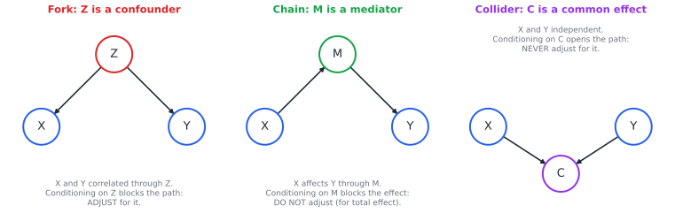
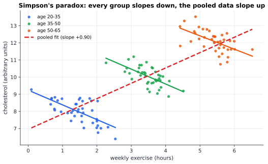
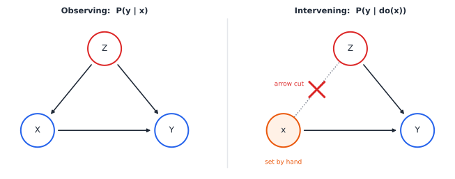

# Chapter 37 — Causal Inference: Correlation Is Not Destiny

[← Previous](36-stochastic-processes.md) · [Track B](README.md) · [Table of Contents](../../00-front/table-of-contents.md) · [Next →](38-monte-carlo.md)

> **Level 2 · Track B — Probability, Uncertainty, and Information**
> **Builds on:** [Ch. 19](../../part-6-probability-statistics/19-probability.md) (conditional probability, independence), [Ch. 20](../../part-6-probability-statistics/20-statistical-analysis.md) (correlation, two-sample statistics) · **Leads to:** [Ch. 38](38-monte-carlo.md), [Ch. 53](../d-optimization/53-reinforcement-learning.md) · **Related:** [Ch. 35](35-bayesian-inference.md), [Ch. 27](../a-algorithms/27-graph-theory.md), [Ch. 48](../d-optimization/48-duality.md)
> **Reading time:** ~30 min

## 37.1 The hook

In 1986 a group of urologists in London compared two ways of removing kidney stones: open surgery (call it treatment A) and a newer keyhole procedure (treatment B). They had 700 patients, 350 on each treatment. The headline numbers were these:

| | Treatment A (open) | Treatment B (keyhole) |
|---|---|---|
| All patients | 273/350 = **78%** success | 289/350 = **83%** success |

Keyhole surgery wins, clearly. It is also cheaper and less painful. Case closed?

Now split the same 700 patients by the size of their stone:

| | Treatment A (open) | Treatment B (keyhole) |
|---|---|---|
| Small stones | 81/87 = **93%** | 234/270 = **87%** |
| Large stones | 192/263 = **73%** | 55/80 = **69%** |
| All patients | 273/350 = **78%** | 289/350 = **83%** |

Treatment A is better for small stones. Treatment A is better for large stones. Treatment B is better overall. No arithmetic error is hiding anywhere; you can check every fraction. This is **Simpson's paradox**, and it is not a curiosity. It turns up in admissions data, drug trials and A/B tests every week.

So which treatment should *you* choose if you walk in with a kidney stone of unknown size? Most people say A, because it wins in every group. Now consider a second story with *exactly the same numbers*. Replace "stone size" by "blood pressure measured one week after the treatment": low versus high. Treatment A is better among patients who ended up with low blood pressure, and better among those who ended up with high blood pressure, and worse overall. Which do you choose now?

This time the right answer is B, and the aggregate table is the one to trust. Same numbers, opposite answers.

That should be disturbing. It means that **no amount of staring at the data can tell you whether to aggregate or split**. The answer depends on something that is not in the table: *how the variables cause one another*. Stone size influences which treatment a doctor picks and also how well any treatment works. Post-treatment blood pressure is something the treatment itself changes. One is a confounder, the other is a mediator, and the difference lives entirely in the arrows.

This chapter is about those arrows: how to draw them, how to compute with them, and how to answer the question every engineer, doctor and policymaker actually cares about. Not "what do I see when $X$ is large?" but "what *happens* if I *make* $X$ large?"

## 37.2 The big idea

### Seeing versus doing

A barometer's needle falls before a storm. The correlation is excellent, and you can use it to predict rain. But if you grab the needle and push it down, no storm arrives. Observing a low reading and *forcing* a low reading are different operations, and probability theory as taught in [Ch. 19](../../part-6-probability-statistics/19-probability.md) has symbols only for the first.

Conditional probability $P(\text{storm}\mid\text{needle low})$ answers: *among the days on which the needle happened to be low, how often did a storm follow?* Those days were selected by nature, and nature lowered the needle *because* the air pressure was dropping. The question we want, $P(\text{storm}\mid do(\text{needle low}))$, asks: *if I reach into the world and set the needle, overriding whatever normally sets it, how often does a storm follow?* The new symbol $do(\cdot)$ is the whole subject in four letters.

### Draw the arrows

The tool that makes $do$ precise is a **causal graph**: a directed acyclic graph (DAG) with one node per variable and an arrow $A\to B$ whenever $A$ is one of the things that directly determines $B$.

Three tiny graphs, built from three variables, explain almost everything.



*The three junctions. In a fork the middle node is a common cause; in a chain it passes an effect along; in a collider it is a common effect. Conditioning on the middle node closes the first two paths and opens the third.*

- **Fork** ($X\leftarrow Z\to Y$). Stone size $Z$ pushes doctors toward open surgery $X$ and independently lowers success $Y$. $X$ and $Y$ become correlated even if $X$ did nothing. Compare like with like, within each level of $Z$, and the spurious part disappears. $Z$ is a **confounder**: adjust for it.
- **Chain** ($X\to M\to Y$). Treatment $X$ changes blood pressure $M$, which changes recovery $Y$. If you compare only patients with the same $M$ you have frozen the very channel through which $X$ works, and you will under-count its effect. $M$ is a **mediator**: for the total effect, leave it alone.
- **Collider** ($X\to C\leftarrow Y$). Talent $X$ and good looks $Y$ are independent in the population, but Hollywood casts people who have enough of one or the other, $C$. Among actors, the talented ones seem less attractive. Nothing about talent affects looks; you created the correlation by looking only at $C=1$. This is **Berkson's paradox**, and colliders are the reason that "control for everything" is terrible advice.

### Simpson's paradox, drawn

Here is the same phenomenon with continuous variables. Within each age group, more exercise goes with lower cholesterol. But older people both exercise more (in this invented population, retirees with time on their hands) and have higher cholesterol. Pool the groups and the slope flips sign.



*Simpson's paradox in a scatter plot: the within-group slopes are about $-0.8$, the pooled slope is about $+0.9$. Age is a fork, so the within-group lines tell the causal story.*

Whether the coloured lines or the red dashed line is "right" is not a statistical question. If age causes both exercise and cholesterol, the coloured lines are right. If (absurdly) exercise caused aging, age would be a mediator and the dashed line would be the total effect. The data are identical in both worlds.

### The surgery

How do we compute $P(y\mid do(x))$? The answer is beautifully mechanical. *Intervening on $X$ means cutting every arrow that points into $X$*, because whatever used to determine $X$ no longer does: you do. Everything else in the world keeps working as before.



*Graph surgery. Observing $X$ keeps the arrow $Z\to X$, so seeing $X$ tells you something about $Z$. Setting $X$ cuts that arrow; $Z$ keeps its natural distribution.*

In the mutilated graph, $X$ carries no information about $Z$. So the only route by which $x$ can change $Y$ is the direct arrow. That is what we want to measure, and it is what a randomized trial measures, because a coin flip is a way of performing the surgery in the real world.

## 37.3 The mathematics

### Structural causal models

> [!definition] Structural causal model (SCM)
> An SCM consists of exogenous "noise" variables $U_1,\dots,U_n$, mutually independent with distribution $P(\mathbf{u})$, and endogenous variables $V_1,\dots,V_n$ each determined by a **structural equation**
> $$
> V_i = f_i\big(\operatorname{pa}(V_i),\,U_i\big),
> $$
> where $\operatorname{pa}(V_i)$ are the **parents** of $V_i$ in a directed acyclic graph $G$.

Each structural equation is an *assignment*, not an algebraic identity: $Y := 2X + U_Y$ says "nature computes $Y$ from $X$", and you may not rearrange it into an equation for $X$. Because the graph is acyclic and the noises are independent, the joint distribution factorizes along the graph:

$$
P(v_1,\dots,v_n) = \prod_{i=1}^n P\big(v_i \mid \operatorname{pa}(v_i)\big).
$$

This is the chain rule of [Ch. 19](../../part-6-probability-statistics/19-probability.md) with most conditioning variables dropped, which is what the graph's missing arrows promise.

> [!definition] Intervention
> The intervention $do(X=x)$ replaces the structural equation for $X$ by the constant assignment $X:=x$ and leaves every other equation unchanged. The **interventional distribution** $P(\mathbf{v}\mid do(x))$ is the distribution of the modified model. Graphically: delete all arrows into $X$.

Since only one factor changes, the modified model factorizes as the original one with $X$'s factor removed. This is the **truncated factorization**:

$$
P(\mathbf{v}\mid do(x)) = \prod_{i:\,V_i\neq X} P\big(v_i\mid \operatorname{pa}(v_i)\big)\Big|_{X=x}.
$$

### Result 1: the adjustment formula

Take the kidney-stone graph: $Z\to X$, $Z\to Y$, $X\to Y$. The observational joint is $P(z)P(x\mid z)P(y\mid x,z)$.

> [!theorem] Adjustment for a confounder
> If $Z$ is the only common cause of $X$ and $Y$ (graph $Z\to X\to Y$, $Z\to Y$), then
> $$
> P(y\mid do(x)) = \sum_z P(y\mid x,z)\,P(z).
> $$

*Proof.* By truncated factorization, the post-intervention joint of $(Z,Y)$ is $P(z)\,P(y\mid x,z)$: the factor $P(x\mid z)$ is gone and $x$ is fixed. Summing over $z$ gives the result. ∎

Compare it with plain conditioning, which by the law of total probability is

$$
P(y\mid x) = \sum_z P(y\mid x,z)\,P(z\mid x).
$$

The two formulas differ in one symbol: $P(z)$ versus $P(z\mid x)$. Conditioning weights each stratum by how common it is *among the people who got $x$*; intervention weights it by how common it is *in the population*. When $X$ and $Z$ are dependent, which is what makes $Z$ a confounder, the weights differ.

> [!example] The kidney stones, settled
> Small stones are $357/700 = 0.51$ of patients, large ones $0.49$. Adjusting:
> $$
> \begin{aligned}
> P(\text{success}\mid do(A)) &= 0.931\times 0.51 + 0.730\times 0.49 = 0.833,\\
> P(\text{success}\mid do(B)) &= 0.867\times 0.51 + 0.688\times 0.49 = 0.779.
> \end{aligned}
> $$
> Treatment A is better by about 5 percentage points. The raw comparison went the other way because doctors gave A to 77% of the large-stone (hard) cases but only 24% of the small-stone (easy) cases. A was handed the difficult patients.

For the blood-pressure story the graph is $X\to M\to Y$ (possibly with $X\to Y$ too). There are no arrows into $X$, so surgery changes nothing and $P(y\mid do(x)) = P(y\mid x)$: the aggregate table is the causal answer. Splitting by $M$ would compute something else, a "controlled direct effect", which is a legitimate quantity but not the one a patient choosing a treatment needs.

### Result 2: why randomization works

> [!theorem] Randomization identifies the causal effect
> If $X$ is assigned by an independent random device $R$ (so its structural equation is $X := f_X(R)$ with $R$ independent of everything else, and $X$ has no other parents), then
> $$
> P(y\mid do(x)) = P(y\mid x).
> $$

*Proof.* Write $\mathbf{V}'$ for all variables other than $X$ and $R$. Because $R$ is a parent of $X$ only, the factorization of the joint is
$$
P(r,x,\mathbf{v}') = P(r)\,P(x\mid r)\prod_{V_i\in\mathbf{V}'} P\big(v_i\mid\operatorname{pa}(v_i)\big),
$$
and no factor in the product mentions $r$. Summing over $r$ gives $P(x)\prod_i P(v_i\mid\operatorname{pa}(v_i))$, and dividing by $P(x)$,
$$
P(\mathbf{v}'\mid x) = \prod_{V_i\in\mathbf{V}'} P\big(v_i\mid\operatorname{pa}(v_i)\big)\Big|_{X=x}.
$$
That is exactly the truncated factorization for $P(\mathbf{v}'\mid do(x))$. Summing both sides over everything except $Y$ gives the claim. ∎

The proof is short, but the idea is one of the great inventions of the twentieth century. R. A. Fisher's randomized field trials in the 1920s did not need to know what the confounders were. The coin cuts *all* incoming arrows at once, including the ones nobody thought of. That is why randomized controlled trials (RCTs) are the gold standard, and why "we controlled for age, sex and income" is always weaker: it cuts only the arrows you remembered.

### Result 3: conditioning on a collider manufactures correlation

> [!theorem] Collider bias, Gaussian case
> Let $X,Y\sim\mathcal{N}(0,1)$ be independent and $C = X + Y + U$ with $U\sim\mathcal{N}(0,1)$ independent. Then, conditional on $C$,
> $$
> \operatorname{Corr}(X,Y\mid C) = -\tfrac12.
> $$

*Proof.* The vector $(X,Y,C)$ is jointly Gaussian with covariance matrix
$$
\boldsymbol{\Sigma} = \begin{pmatrix} 1 & 0 & 1\\ 0 & 1 & 1\\ 1 & 1 & 3\end{pmatrix}.
$$
For jointly Gaussian vectors, the conditional covariance of $(X,Y)$ given $C$ is the Schur complement $\boldsymbol{\Sigma}_{11}-\boldsymbol{\Sigma}_{12}\Sigma_{22}^{-1}\boldsymbol{\Sigma}_{21}$ (the same formula that drives the Kalman filter mentioned in [Ch. 21](../../part-6-probability-statistics/21-random-processes.md)):
$$
\begin{pmatrix}1&0\\0&1\end{pmatrix} - \frac{1}{3}\begin{pmatrix}1\\1\end{pmatrix}\begin{pmatrix}1&1\end{pmatrix} = \begin{pmatrix}2/3 & -1/3\\ -1/3 & 2/3\end{pmatrix}.
$$
The conditional correlation is $(-1/3)/(2/3) = -1/2$, and it does not depend on the value of $C$. ∎

Two independent causes become *strongly* anticorrelated once you look within a slice of their common effect. If you knew $C$ exactly with no noise ($U=0$), the correlation would be $-1$: knowing $X$ would pin down $Y$.

### The back-door criterion

The three junctions combine into one rule for general graphs. A **path** between $X$ and $Y$ is any sequence of edges, ignoring direction. It is **blocked** by a set $\mathbf{Z}$ if it contains a fork or chain whose middle node is in $\mathbf{Z}$, or a collider whose middle node is *not* in $\mathbf{Z}$ (and has no descendant in $\mathbf{Z}$). A **back-door path** is a path from $X$ to $Y$ that starts with an arrow *into* $X$.

> [!theorem] Back-door adjustment (Pearl, 1993)
> If a set $\mathbf{Z}$ contains no descendant of $X$ and blocks every back-door path from $X$ to $Y$, then
> $$
> P(y\mid do(x)) = \sum_{\mathbf{z}} P(y\mid x,\mathbf{z})\,P(\mathbf{z}).
> $$

Result 1 is the special case of a single fork. The rule tells you, by inspecting the graph alone, which variables to put in your regression or stratification. It also tells you when *no* set of measured variables works, for instance when the confounder is unmeasured. Then other tricks are needed: the **front-door criterion** (adjust through a fully observed mediator), or an **instrumental variable** (something that nudges $X$ but touches $Y$ only through $X$, like a lottery for school places).

> [!mystery] Can the arrows be read off the data?
> Everything above assumed someone handed you the graph. With two variables, $X\to Y$ and $Y\to X$ produce the same family of joint distributions, so data alone cannot orient that edge. Yet with three or more variables, colliders leave a fingerprint (independent parents that become dependent when you condition on the child) and some arrows *can* be discovered from passive observation. How much of a causal graph is learnable, and with how much data, is an active research area built on conditional-independence tests; its information-theoretic core, conditional mutual information, is in [Ch. 33](33-information-theory.md).

### The ladder of causation

Judea Pearl organizes causal questions into three rungs.

1. **Association**, $P(y\mid x)$: *what does seeing $x$ tell me?* Statistics and machine learning live here.
2. **Intervention**, $P(y\mid do(x))$: *what if I do $x$?* Experiments, policies, control.
3. **Counterfactuals**, $P(y_{x'}\mid x, y)$: *I did $x$ and saw $y$; what would have happened had I done $x'$?* Regret, blame, explanation, legal liability.

Each rung needs strictly more knowledge than the one below. The adjustment formula climbs from rung 1 to rung 2 using only the graph. Rung 3 needs the structural equations themselves, because it reasons about *this particular individual*, whose noise terms have already been revealed.

> [!definition] Counterfactual (abduction, action, prediction)
> To compute what $Y$ would have been had $X$ been $x'$, given evidence $\mathbf{e}$:
> 1. **Abduction.** Use $\mathbf{e}$ to infer the exogenous variables $\mathbf{U}$ (or their posterior $P(\mathbf{u}\mid\mathbf{e})$).
> 2. **Action.** Apply $do(X=x')$.
> 3. **Prediction.** Run the modified model with the inferred $\mathbf{U}$ and read off $Y$.

> [!example] A linear counterfactual
> Let $Z := U_Z$, $X := Z + U_X$, $Y := 2X + 3Z + U_Y$. We observe one unit with $(Z,X,Y) = (1,2,9)$. Abduction: $U_Z = 1$, $U_X = 1$, $U_Y = 9 - 4 - 3 = 2$. Action: set $X:=0$. Prediction: $Y = 0 + 3\cdot1 + 2 = 5$. Had this unit received $X=0$, its outcome would have been 5, not 9.

In a linear model, the counterfactual difference $9-5=4 = 2\times 2$ is the same for every unit. In nonlinear models it is not, and the population distribution of counterfactuals is usually *not* identifiable even from perfect experimental data.

> [!mystery] The questions no experiment can answer
> "Did the drug *cause* this patient's recovery?" is a rung-3 question: the probability that she would not have recovered without it. Even an infinitely large RCT gives only bounds on it. Remarkably, the sharpest bounds come from a *linear program* over the unknown response types, and the bounds' tightness is governed by LP duality. That machinery is in [Ch. 48](../d-optimization/48-duality.md).

### Experimental design in one page

If you *can* intervene, do. A randomized experiment estimates the **average treatment effect**

$$
\operatorname{ATE} = E[Y\mid do(X=1)] - E[Y\mid do(X=0)]
$$

by the difference of sample means $\bar Y_1 - \bar Y_0$, an unbiased estimator by Result 2. Its variance, from the two-sample results of [Ch. 20](../../part-6-probability-statistics/20-statistical-analysis.md), is $\sigma_1^2/n_1 + \sigma_0^2/n_0$. For a binary outcome near 50% success, $\sigma^2\approx 0.25$, and detecting a 10-point improvement with the usual 5% significance and 80% power needs about

$$
n = \frac{2\,(z_{0.975}+z_{0.8})^2\,\sigma^2}{\Delta^2} = \frac{2\,(1.96+0.84)^2(0.25)}{0.1^2} \approx 392
$$

patients per arm. Two design ideas sharpen this:

- **Blocking** (stratified randomization): randomize *within* levels of a known prognostic variable such as stone size. The estimator stays unbiased and its variance drops, because between-block variation no longer enters, exactly the stratification trick from Monte Carlo in [Ch. 24](../../part-7-numerical-computational/24-computational-mathematics.md).
- **Blinding**: neither patient nor assessor knows the arm, so expectations cannot open a new path $X\to\text{belief}\to Y$.

## 37.4 The algorithm

Suppose the graph is drawn and the back-door criterion has given you an adjustment set $\mathbf{Z}$. Two classical estimators turn observational records $(x_i,\mathbf{z}_i,y_i)$, $i=1,\dots,N$, into an estimate of the ATE.

**Stratification (direct adjustment).** Estimate the adjustment formula term by term:

```python
def ate_stratified(x, z, y):
    """x: 0/1 treatment, z: hashable stratum label, y: outcome (numpy arrays)."""
    ate = 0.0
    for s in np.unique(z):
        m = (z == s)
        if x[m].all() or not x[m].any():
            raise ValueError(f"stratum {s} has only one arm: positivity fails")
        ate += (y[m & (x == 1)].mean() - y[m & (x == 0)].mean()) * m.mean()
    return ate
```

**Inverse propensity weighting (IPW).** Let $e(\mathbf{z}) = P(X=1\mid\mathbf{z})$ be the **propensity score**. Then

$$
E[Y\mid do(X=1)] = E\!\left[\frac{X\,Y}{e(\mathbf{Z})}\right],\qquad
E[Y\mid do(X=0)] = E\!\left[\frac{(1-X)\,Y}{1-e(\mathbf{Z})}\right].
$$

To see the first, condition on $\mathbf{Z}$: $E[XY\mid\mathbf{z}] = P(X=1\mid\mathbf{z})\,E[Y\mid X=1,\mathbf{z}] = e(\mathbf{z})\,E[Y\mid X=1,\mathbf{z}]$. Divide by $e(\mathbf{z})$ and average over $P(\mathbf{z})$, and you have the adjustment formula. IPW builds a *pseudo-population* in which every treated patient counts $1/e$ times: a patient who received treatment despite having only a 10% chance of it stands in for ten patients like her. In that pseudo-population treatment is independent of $\mathbf{Z}$, just as in a trial.


**Cost and scaling.** Stratification costs $O(N)$ after grouping, but the number of strata grows as $k^d$ for $d$ covariates with $k$ levels each. With ten binary covariates there are already 1024 cells, most of them nearly empty. Rosenbaum and Rubin's theorem (1983) rescues us: if $\mathbf{Z}$ is a valid adjustment set, so is the single number $e(\mathbf{Z})$. You can fit $e$ by logistic regression and then stratify on it, match on it, or weight by it. One dimension instead of $d$.

**Failure cases.** Each of these breaks the estimate silently, with no error message.

1. **Positivity violations.** If some stratum contains only treated (or only untreated) units, the adjustment formula needs a quantity the data never show. In IPW this appears as $e\approx 0$ or $1$ and enormous weights.
2. **Unmeasured confounding.** No estimator can adjust for a variable you did not record.
3. **Bad controls.** Adjusting for a mediator removes part of the effect; adjusting for a collider (or a descendant of one) *creates* bias. "Add every available covariate to the regression" can make the answer worse.

> [!mystery] Why do the weights explode?
> IPW is an importance-sampling estimator in disguise: you have samples from the world as it is (doctors choosing), and you reweight them by a likelihood ratio to estimate an average in a world that does not exist (a coin choosing). When a propensity approaches 0 the estimator remains unbiased, yet its variance can grow without bound and a single patient can dominate the answer. Why that happens, and how to diagnose it with an *effective sample size*, is the subject of importance sampling in [Ch. 38](38-monte-carlo.md). The same reweighting lets a reinforcement-learning agent evaluate a policy it has never run, in [Ch. 53](../d-optimization/53-reinforcement-learning.md).

## 37.5 The experiment

The script below builds a small world with a known answer. Severity $Z$ makes doctors more likely to treat ($Z\to X$) and makes recovery less likely ($Z\to Y$). The treatment truly raises recovery probability by 10 points. Run it, then try to break each estimator.

```python
import numpy as np
rng = np.random.default_rng(1)

N      = 100_000   # patients
EFFECT = 0.10      # true causal effect of treatment on recovery probability
CONF   = 0.60      # how strongly severity drives treatment choice (0 = none)
HARM   = 0.30      # how much severity lowers recovery

def world(randomize):
    Z = rng.random(N) < 0.5                        # severe case?
    if randomize:
        X = rng.random(N) < 0.5                    # coin flip: do(X)
    else:
        X = rng.random(N) < 0.5 + CONF * (Z - 0.5) # doctors treat the severe
    pY = 0.5 + EFFECT * X - HARM * Z
    Y = rng.random(N) < pY
    return Z, X, Y

Z, X, Y = world(randomize=False)
naive = Y[X].mean() - Y[~X].mean()

adj = 0.0                                          # back-door adjustment
for z in (False, True):
    s = Z == z
    adj += (Y[s & X].mean() - Y[s & ~X].mean()) * s.mean()

e = 0.5 + CONF * (Z - 0.5)                         # propensity score P(X=1|Z)
ipw = np.mean(X * Y / e) - np.mean((~X) * Y / (1 - e))

Zr, Xr, Yr = world(randomize=True)
rct = Yr[Xr].mean() - Yr[~Xr].mean()

print(f"true effect      {EFFECT:+.3f}")
print(f"naive difference {naive:+.3f}")
print(f"adjusted for Z   {adj:+.3f}")
print(f"IPW estimate     {ipw:+.3f}")
print(f"randomized trial {rct:+.3f}")
```

With the settings shown, one run prints a naive difference of about $-0.085$ (its expected value is exactly $-0.08$): a treatment that helps every patient *looks harmful*, because doctors aim it at the patients most likely to do badly. The adjusted and IPW estimates come out near $+0.09$ and the randomized trial near $+0.10$, each within sampling error of the truth.

Things to change:

- Set `CONF = 0`. Doctors now ignore severity, the arrow $Z\to X$ disappears, and the naive estimate becomes correct. Confounding needs *both* arrows of the fork.
- Set `CONF = 0.99`. Propensities become $0.005$ and $0.995$. Change the seed a few times and watch the IPW estimate wander far more than the stratified one. Then set `CONF = 1.0` and see the stratified estimator fail on an empty arm: positivity in action.
- Add a collider. Inside the randomized branch, compute `C = Xr | (Yr & (rng.random(N) < 0.3))` (a unit enters a follow-up study if treated, or sometimes if recovered) and recompute `rct` using only units with `C` true. A perfect experiment, ruined by whom you chose to look at.

## 37.6 The challenge

1. **Intuition.** A study finds that hospitalized patients with disease A rarely have disease B, and concludes that A protects against B. Draw a causal graph in which A and B are independent in the population yet negatively associated among hospital patients. Which junction is responsible, and what single change to the study design would remove the effect?

2. **Derivation.** For the front-door graph $X\to M\to Y$ with an unobserved confounder $U$ pointing into both $X$ and $Y$ (and no other arrows), use truncated factorization to show that
$$
P(y\mid do(x)) = \sum_m P(m\mid x)\sum_{x'} P(y\mid m,x')\,P(x').
$$
Explain in words why $M$ must be fully observed and must intercept every directed path from $X$ to $Y$.

3. **Implementation.** Extend the experiment to three binary confounders $Z_1,Z_2,Z_3$, each pushing both treatment and outcome. Implement (a) stratification over all eight cells and (b) IPW with a propensity fitted by logistic regression via a few iterations of Newton's method (using only numpy). Compare their errors over 200 repetitions at $N=500$ and $N=50\,000$. At what point does stratification begin to suffer from empty cells?

4. **Open investigation.** In a linear-Gaussian SCM, the arrow direction between two variables cannot be learned from data. It can be learned if the noise is *non-Gaussian*, because only in the causal direction is the residual independent of the input. Simulate $Y := X + U$ with $X$ and $U$ uniform, regress both ways, and measure how dependent the residual is on the regressor (for example by the correlation between their squares). How does your ability to tell the directions apart degrade as the noise becomes more Gaussian, say a sum of $k$ uniforms with growing $k$? There is no clean formula for the sample size you need; find out empirically.

## 37.7 Loose threads

This chapter gave you the grammar of causation and quietly skipped several hard parts.

- **Where do the graphs come from?** We assumed the arrows. In practice they come from domain knowledge, from experiments, and partly from data. How far data alone can go is the first mystery of 37.3; its toolkit of conditional-independence tests and conditional mutual information is in [Ch. 33](33-information-theory.md).
- **Is the back-door criterion the whole story?** No. Pearl's **do-calculus** is a set of three rewriting rules that turn a $do$-expression into an ordinary probability whenever that is possible at all, and it is known to be *complete*: if the rules fail, the effect is not identifiable from the graph. The completeness proof is well beyond this chapter.
- **What about rung 3?** Counterfactual quantities like the probability that a treatment was *necessary* are generally only partially identified. The second mystery of 37.3 points to the linear programs that compute their sharpest bounds, in [Ch. 48](../d-optimization/48-duality.md).
- **Why reweighting is fragile.** The mystery of 37.4: IPW is importance sampling, and it degrades badly when propensities approach 0 or 1. The diagnosis is in [Ch. 38](38-monte-carlo.md), and the reinforcement-learning version (off-policy evaluation) in [Ch. 53](../d-optimization/53-reinforcement-learning.md).

The kidney-stone table will never look the same again. Every pair of correlated numbers you meet now comes with a question attached: *which arrows made this?*

## Further reading

- Judea Pearl and Dana Mackenzie, *The Book of Why* (Basic Books, 2018). The ladder of causation and the history of the field, without equations.
- Judea Pearl, Madelyn Glymour and Nicholas P. Jewell, *Causal Inference in Statistics: A Primer* (Wiley, 2016). Short and exact; the best next step after this chapter.
- Miguel A. Hernán and James M. Robins, *Causal Inference: What If* (Chapman & Hall/CRC, 2020). Potential outcomes, IPW and the practice of observational studies.
- Jonas Peters, Dominik Janzing and Bernhard Schölkopf, *Elements of Causal Inference* (MIT Press, 2017). Causal discovery and the non-Gaussian ideas behind challenge 4.
