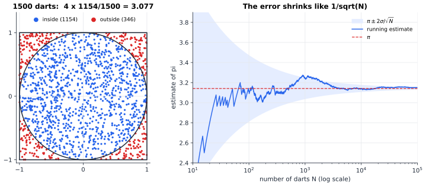
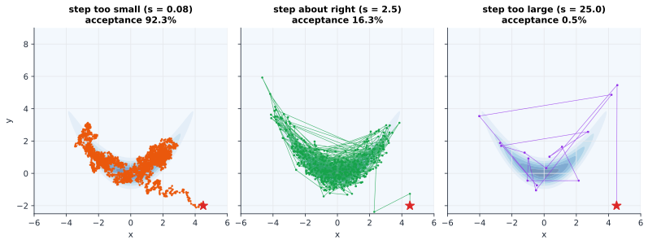

# Chapter 38 — Monte Carlo: Computing with Randomness

[← Previous](37-causal-inference.md) · [Track B](README.md) · [Table of Contents](../../00-front/table-of-contents.md) · [Next →](../c-game-theory/README.md)

> **Level 2 · Track B — Probability, Uncertainty, and Information**
> **Builds on:** [Ch. 24](../../part-7-numerical-computational/24-computational-mathematics.md) (§24.6 Monte Carlo methods), [Ch. 19](../../part-6-probability-statistics/19-probability.md), [Ch. 34](34-random-walks-and-markov-chains.md) (stationary distributions) · **Leads to:** [Ch. 35](35-bayesian-inference.md), [Ch. 71](../g-graphics-simulation/71-ray-tracing.md), [Ch. 90](../j-frontier/90-spectral-theory.md) · **Related:** [Ch. 37](37-causal-inference.md), [Ch. 81](../h-cryptography-coding/81-pseudorandomness.md), [Ch. 92](../j-frontier/92-mathematical-physics.md)
> **Reading time:** ~30 min

## 38.1 The hook

In 1946 the mathematician Stanisław Ulam was recovering from an illness and playing a lot of solitaire. He wanted to know the chance that a randomly shuffled deck could be played out to the end. He tried the combinatorics and got nowhere: too many cases. Then a lazier, better idea arrived. *Just play a hundred games and count the wins.* He mentioned it to John von Neumann, who saw at once that the same trick would answer questions about neutrons diffusing through the core of a bomb, questions nobody could solve on paper. They needed a code name for a secret method that ran on chance. Nicholas Metropolis suggested the casino where Ulam's uncle liked to gamble: **Monte Carlo**.

You have met the basic idea already in [Ch. 24, §24.6](../../part-7-numerical-computational/24-computational-mathematics.md): an expectation $\mu = E[f(\mathbf{X})]$ is estimated by an average of $f$ over random samples, the error falls as $\sigma/\sqrt N$ whatever the dimension, and variance-reduction tricks (antithetic pairs, control variates, stratification, importance sampling) shrink $\sigma$. That chapter treated Monte Carlo as an *integrator*. This one is about the hard part it took for granted.

Every Monte Carlo estimate begins with "draw $\mathbf{X}_1,\dots,\mathbf{X}_N$ from $p$". But what if you cannot draw from $p$?

Here is the situation that changed science. In 1953 Metropolis, the Rosenbluths and the Tellers wanted the average energy of a liquid: a few hundred hard disks in a box, in thermal equilibrium. Statistical mechanics says the probability of a configuration $\mathbf{x}$ (all the positions together, a point in a space of hundreds of dimensions) is

$$
p(\mathbf{x}) = \frac{e^{-E(\mathbf{x})/kT}}{Z}, \qquad Z = \int e^{-E(\mathbf{x})/kT}\,d\mathbf{x}.
$$

The energy $E(\mathbf{x})$ is easy to compute for any configuration. The normalizing constant $Z$ is an integral over hundreds of dimensions: computing it is *harder* than the problem you started with. And without $Z$ you do not even know $p$, only something proportional to it.

Modern Bayesian statistics lives in exactly this trap. A posterior ([Ch. 35](35-bayesian-inference.md)) is likelihood times prior divided by the evidence, and the evidence is an integral nobody can do. You can evaluate the shape of the distribution at any point you like, but you cannot normalize it, cannot invert its CDF, and in a hundred dimensions cannot even find where most of its mass lies.

So here is the question this chapter answers:

**How do you draw samples from a probability distribution that you can evaluate only up to an unknown constant, in a space with hundreds of dimensions?**

The answer, found on a 1950s computer called MANIAC, is a random walk with one carefully designed rule. It is one of the most cited algorithms of the twentieth century.

## 38.2 The big idea

### Darts first

Throw darts uniformly at the square $[-1,1]^2$. The fraction that land inside the unit circle estimates the area ratio $\pi/4$.



*Estimating $\pi$ with darts. Each dart is a Bernoulli trial with success probability $\pi/4$, so the estimate $4\times(\text{hits}/N)$ has standard deviation $1.64/\sqrt N$: two correct digits need about $10^4$ darts, three need about $10^6$.*

This works because we *can* sample the square uniformly, and the circle sits comfortably inside it, so most darts are useful. Two things go wrong when we try the same trick on a hard distribution.

**The target hides.** In a 100-dimensional space, the mass of a typical distribution is concentrated in a region that is an absurdly small fraction of any box you could draw around it. The volume of the unit ball in $d$ dimensions, as a fraction of its enclosing cube, is $\pi^{d/2}/\big(2^d\,\Gamma(d/2+1)\big)$: 79% for $d=2$, 0.25% for $d=10$, and about $2\times10^{-70}$ for $d=100$. Uniform darts almost never land anywhere interesting.

**The target is unnormalized.** We can compute $\tilde p(\mathbf{x}) = Z\,p(\mathbf{x})$ but not $Z$.

### The hiker in the fog

Imagine a hiker on a foggy mountain range who can read only an altimeter showing the local "height" $\tilde p(\mathbf{x})$. She wants to spend time at each place in proportion to its height, so that a log of where she has been is a sample from $p$. She cannot see the landscape. She follows one rule:

> Propose a random step. If it goes uphill, take it. If it goes downhill, take it only with probability (new height)/(old height); otherwise stay put and record the current position again.

She never needs the total volume of the mountain range, only *ratios* of heights, and in a ratio the unknown $Z$ cancels. She drifts uphill toward the mass, but keeps occasionally stepping down, so she does not just sit on the summit; she explores the slopes in exactly the right proportions. This is the **Metropolis algorithm**. Each recorded position depends on the previous one, so her log is a **Markov chain**, the object of [Ch. 34](34-random-walks-and-markov-chains.md), and we will design that chain so that its stationary distribution is $p$.



*Three Metropolis chains of 3000 steps on the same banana-shaped density, all starting at the red star. Tiny steps are almost always accepted but crawl; huge steps are almost always rejected, so the chain freezes for hundreds of steps at a time; a moderate step explores the whole density.*

Notice that the best-looking chain accepts only about one proposal in six. A high acceptance rate is not the goal; *exploration* is.

## 38.3 The mathematics

### Sampling when you can: inverse transform and rejection

If $X$ has a CDF $F$ you can invert, then $F^{-1}(U)$ with $U$ uniform has CDF $F$ (inverse-transform sampling, [Ch. 19](../../part-6-probability-statistics/19-probability.md)). That covers the exponential, the Rayleigh, the Cauchy. For everything else, the first general tool is rejection.

> [!theorem] Rejection sampling
> Let $\tilde p \ge 0$ be an unnormalized target with $\int\tilde p = Z$, and let $q$ be a density you can sample, with $\tilde p(\mathbf{x}) \le M\,q(\mathbf{x})$ for all $\mathbf{x}$. Repeat: draw $\mathbf{Y}\sim q$ and $U\sim\mathcal{U}(0,1)$; accept $\mathbf{Y}$ if $U\le \tilde p(\mathbf{Y})/\big(M q(\mathbf{Y})\big)$. Then accepted values have density exactly $p = \tilde p/Z$, and each trial is accepted with probability $Z/M$.

*Proof.* For any set $A$,
$$
P(\mathbf{Y}\in A,\ \text{accept}) = \int_A q(\mathbf{y})\,\frac{\tilde p(\mathbf{y})}{M q(\mathbf{y})}\,d\mathbf{y} = \frac{1}{M}\int_A \tilde p(\mathbf{y})\,d\mathbf{y}.
$$
Taking $A$ to be the whole space gives $P(\text{accept}) = Z/M$. Dividing, $P(\mathbf{Y}\in A\mid\text{accept}) = \frac1Z\int_A\tilde p$, which is $p$. ∎

Geometrically, you throw darts uniformly under the curve $Mq$ and keep those that fall under $\tilde p$: the $\pi$ experiment with a smarter box. For a standard half-normal target, $\tilde p(x)=e^{-x^2/2}$ on $x\ge0$, with an Exp(1) proposal the best envelope constant gives an acceptance rate of $\sqrt{\pi/(2e)} = 0.760$. Very good.

Now the bad news. Take the target $\mathcal{N}(\mathbf{0},\mathbf{I}_d)$ and a proposal only slightly wider, $\mathcal{N}(\mathbf{0},\sigma^2\mathbf{I}_d)$. The ratio $p/q$ is largest at the origin, where it equals $\sigma^d$, so the acceptance rate is $\sigma^{-d}$. With $\sigma = 1.2$ and $d = 100$: $1.2^{-100} \approx 1.2\times10^{-8}$. One accepted sample per hundred million tries, for a proposal that is "only" 20% too wide. **Rejection sampling dies exponentially with dimension.**

### Importance sampling, revisited

[Ch. 24](../../part-7-numerical-computational/24-computational-mathematics.md) introduced importance sampling: draw from $q$, weight by $w = p/q$. When $p$ is known only up to $Z$, use the **self-normalized** estimator

$$
\hat\mu = \frac{\sum_{i=1}^N \tilde w_i\, f(\mathbf{X}_i)}{\sum_{i=1}^N \tilde w_i}, \qquad \tilde w_i = \frac{\tilde p(\mathbf{X}_i)}{q(\mathbf{X}_i)},\quad \mathbf{X}_i\sim q.
$$

Both numerator and denominator are Monte Carlo averages: divided by $N$, the numerator tends to $Z\mu$ and the denominator to $Z$. So $Z$ cancels and $\hat\mu\to\mu$. The price is a small bias of order $1/N$ (a ratio of unbiased estimators is not unbiased), which is usually negligible.

The deeper problem is the one the effective sample size $\mathrm{ESS} = (\sum w_i)^2/\sum w_i^2$ from Ch. 24 diagnoses. For large $N$, $\mathrm{ESS}/N \approx (E_q[w])^2/E_q[w^2]$. In the same Gaussian example (target $\mathcal{N}(\mathbf{0},\mathbf{I}_d)$, proposal $\mathcal{N}(\mathbf{0},\sigma^2\mathbf{I}_d)$), a direct Gaussian integral gives $E_q[w^2] = \big(\sigma^2/\sqrt{2\sigma^2-1}\big)^d$. With $\sigma=1.2$:

| Dimension $d$ | 1 | 10 | 100 |
|---|---|---|---|
| $\mathrm{ESS}/N$ | 0.95 | 0.61 | 0.0074 |

At $d=100$, a million weighted samples are worth about 7400 independent ones, and the situation gets exponentially worse from there. A handful of samples carry nearly all the weight. This is the same degeneracy that makes inverse propensity weighting fragile in [Ch. 37](37-causal-inference.md): a patient with a tiny propensity is a sample with a huge weight.

Both independent-sampling methods fail for the same reason: they propose blindly, from a fixed $q$ that knows nothing about where the target's mass is. The fix is to let each proposal depend on where you are now.

### Markov chains that sample

A Markov chain on a continuous space is described by a **transition kernel** $K(\mathbf{x}\to\mathbf{y})$: the density of the next state $\mathbf{y}$ given the current state $\mathbf{x}$. A density $\pi$ is **stationary** for $K$ if a chain started in $\pi$ stays in $\pi$:

$$
\int \pi(\mathbf{x})\,K(\mathbf{x}\to\mathbf{y})\,d\mathbf{x} = \pi(\mathbf{y}) \quad\text{for all }\mathbf{y}.
$$

(We write $\pi$ for the target in this section, as is traditional in MCMC; it has nothing to do with $3.14159$.) Checking this integral equation directly is hard. A local condition is much easier.

> [!theorem] Detailed balance implies stationarity
> If $\pi(\mathbf{x})\,K(\mathbf{x}\to\mathbf{y}) = \pi(\mathbf{y})\,K(\mathbf{y}\to\mathbf{x})$ for all $\mathbf{x},\mathbf{y}$, then $\pi$ is stationary for $K$.

*Proof.* Integrate both sides over $\mathbf{x}$:
$$
\int\pi(\mathbf{x})K(\mathbf{x}\to\mathbf{y})\,d\mathbf{x} = \pi(\mathbf{y})\int K(\mathbf{y}\to\mathbf{x})\,d\mathbf{x} = \pi(\mathbf{y}),
$$
because $K(\mathbf{y}\to\cdot)$ is a probability density and integrates to 1. ∎

Detailed balance says the *flow* of probability from $\mathbf{x}$ to $\mathbf{y}$ equals the flow back. A chain in equilibrium, filmed and played backwards, looks statistically the same; such chains are called **reversible**. Stationarity only requires the net flow into each state to balance; detailed balance asks for balance across every single pair, which is stronger but checkable one pair at a time.

### Metropolis–Hastings

Now design a kernel with detailed balance for a target we know only as $\tilde\pi = Z\pi$. Start from any proposal density $q(\mathbf{y}\mid\mathbf{x})$, such as a Gaussian step around $\mathbf{x}$, and accept the proposal with probability

$$
\alpha(\mathbf{x},\mathbf{y}) = \min\!\left(1,\ \frac{\tilde\pi(\mathbf{y})\,q(\mathbf{x}\mid\mathbf{y})}{\tilde\pi(\mathbf{x})\,q(\mathbf{y}\mid\mathbf{x})}\right).
$$

If the proposal is rejected, the chain stays at $\mathbf{x}$ (and $\mathbf{x}$ is recorded again: this repetition is essential). Only the ratio $\tilde\pi(\mathbf{y})/\tilde\pi(\mathbf{x}) = \pi(\mathbf{y})/\pi(\mathbf{x})$ appears, so **the normalizing constant is never needed**. For a symmetric proposal, $q(\mathbf{x}\mid\mathbf{y}) = q(\mathbf{y}\mid\mathbf{x})$, the $q$'s cancel and we recover the hiker's rule: that is Metropolis's original 1953 algorithm, and Hastings generalized it to asymmetric proposals in 1970.

> [!theorem] Metropolis–Hastings satisfies detailed balance
> The Metropolis–Hastings kernel $K(\mathbf{x}\to\mathbf{y}) = q(\mathbf{y}\mid\mathbf{x})\,\alpha(\mathbf{x},\mathbf{y})$ for $\mathbf{y}\ne\mathbf{x}$, plus a point mass at $\mathbf{x}$ for rejections, satisfies detailed balance with respect to $\pi$. Hence $\pi$ is stationary.

*Proof.* The point mass at $\mathbf{x}$ only ever connects $\mathbf{x}$ to itself, and detailed balance is trivial when $\mathbf{y}=\mathbf{x}$. For $\mathbf{y}\ne\mathbf{x}$, write $a = \pi(\mathbf{x})q(\mathbf{y}\mid\mathbf{x})$ and $b = \pi(\mathbf{y})q(\mathbf{x}\mid\mathbf{y})$, so that $\alpha(\mathbf{x},\mathbf{y}) = \min(1, b/a)$ and $\alpha(\mathbf{y},\mathbf{x}) = \min(1,a/b)$. Then
$$
\begin{aligned}
\pi(\mathbf{x})K(\mathbf{x}\to\mathbf{y}) &= a\,\min(1, b/a) = \min(a,b),\\
\pi(\mathbf{y})K(\mathbf{y}\to\mathbf{x}) &= b\,\min(1, a/b) = \min(a,b).
\end{aligned}
$$
The two flows are equal. ∎

The proof is three lines, and it explains the strange-looking formula. The acceptance probability is the *largest* one that equalizes the two flows: whichever direction is "overused" by the proposal gets throttled down to match the other.

Stationarity is not yet enough; the chain must also *reach* $\pi$ from wherever it starts, and its time averages must converge. The relevant result, stated here without proof, extends the ergodic theorem for finite chains in [Ch. 34](34-random-walks-and-markov-chains.md):

> [!theorem] Ergodic theorem for MCMC (stated)
> If the chain is **irreducible** (from any start it can reach any set of positive $\pi$-probability) and **aperiodic**, and $\pi$ is stationary, then for any $f$ with $E_\pi\lvert f\rvert<\infty$ and almost any starting point,
> $$
> \frac1N\sum_{t=1}^N f(\mathbf{X}_t) \longrightarrow E_\pi[f(\mathbf{X})] \quad\text{as } N\to\infty.
> $$

A Gaussian random-walk proposal on a target that is positive everywhere satisfies both conditions. So the algorithm is *correct*. Whether it is *fast* is another matter entirely.

### The price of dependence

Successive MCMC samples are correlated, so $N$ of them carry less information than $N$ independent draws. Let $\rho_k$ be the lag-$k$ autocorrelation of the sequence $f(\mathbf{X}_t)$ in equilibrium. A calculation like the one for the variance of a sample mean of a stationary process ([Ch. 21](../../part-6-probability-statistics/21-random-processes.md)) gives, for large $N$,

$$
\operatorname{Var}\!\left(\frac1N\sum_{t=1}^N f(\mathbf{X}_t)\right) \approx \frac{\sigma_f^2}{N}\,\tau,\qquad \tau = 1 + 2\sum_{k=1}^\infty \rho_k.
$$

The **integrated autocorrelation time** $\tau$ is the number of chain steps that are worth one independent sample, and $N/\tau$ is the effective sample size of the chain. For a chain whose correlations decay geometrically, $\rho_k = \rho^k$, the sum is $\tau = (1+\rho)/(1-\rho)$: with $\rho = 0.9$, $\tau = 19$; with $\rho = 0.99$, $\tau = 199$.

This is where the step size bites. Tiny steps are accepted, but successive states are nearly identical, $\rho\approx1$, and $\tau$ is huge. Huge steps are rejected, the chain repeats itself, $\rho\approx1$ again. In between lies a sweet spot. For a random-walk Metropolis sampler on a $d$-dimensional Gaussian-like target, Roberts, Gelman and Gilks (1997) showed that as $d\to\infty$ the optimal proposal scale is about $2.38/\sqrt d$ times the target's standard deviation, which gives an acceptance rate of **0.234**. In low dimensions the optimum is higher (about 0.44 in one dimension). These are rules of thumb, not laws; the experiment below finds a different optimum for a curved target.

> [!mystery] How long is long enough?
> The ergodic theorem promises convergence but not a speed. How many steps until a chain started at the red star has "forgotten" its start? For a finite chain the answer is governed by the gap between the largest and second-largest eigenvalue of its transition matrix ([Ch. 34](34-random-walks-and-markov-chains.md)). For a sampler on a continuous space the transition kernel is an *operator*, its spectrum can be continuous, and bounding its gap is a genuinely hard problem in operator theory. The tools are in [Ch. 90](../j-frontier/90-spectral-theory.md); for most real posteriors, nobody knows the answer.

### Gibbs sampling in one paragraph

If you can sample each coordinate from its conditional distribution given all the others, $\pi(x_i\mid\mathbf{x}_{-i})$, then cycling through the coordinates and replacing each with a fresh conditional draw is a Metropolis–Hastings chain whose acceptance probability is exactly 1 (put $q = \pi(x_i\mid\mathbf{x}_{-i})$ into $\alpha$ and the ratio equals 1). That is **Gibbs sampling**, the workhorse behind early Bayesian software and image restoration. It shines when conditionals are simple and fails when coordinates are strongly correlated, because moving one axis at a time along a narrow diagonal ridge is like walking down a corridor sideways.

## 38.4 The algorithm

Random-walk Metropolis in its entirety:

```python
def metropolis(log_target, x0, step, n, rng):
    x = np.asarray(x0, float); lp = log_target(x)
    chain = np.empty((n, x.size)); accepted = 0
    for t in range(n):
        y = x + step * rng.normal(size=x.size)      # symmetric Gaussian proposal
        lp_y = log_target(y)
        if np.log(rng.random()) < lp_y - lp:        # accept with prob min(1, ratio)
            x, lp = y, lp_y; accepted += 1
        chain[t] = x                                # record x even after a rejection
    return chain, accepted / n
```

Four engineering details matter more than they look.

1. **Work in logarithms.** In a hundred dimensions, $\tilde\pi(\mathbf{x})$ can be $10^{-300}$ and underflow to zero, making every ratio $0/0$. Compare $\log U$ with $\log\tilde\pi(\mathbf{y})-\log\tilde\pi(\mathbf{x})$ instead. The `min(1, ·)` is implicit: if the difference is positive, the test always passes.
2. **Record rejections.** A common bug is to append only accepted states. That silently samples the wrong distribution, overweighting regions where moves are easy.
3. **Cost.** One target evaluation per step, $O(d)$ arithmetic for the proposal. The real cost is the number of steps, which is $N_{\text{eff}}\times\tau$, and $\tau$ for random-walk Metropolis typically grows like $d$ (the step must shrink like $1/\sqrt d$, and a diffusion needs (distance/step)$^2$ steps to cross the target).
4. **Burn-in and diagnostics.** Early samples remember the starting point; discard them. Then check convergence, imperfectly: run several chains from dispersed starting points and compare their within-chain and between-chain variances (the Gelman–Rubin statistic $\hat R$, which should be close to 1), and estimate $\tau$ from the autocorrelations.

**Failure cases.**

- **Multimodality.** If the target has two peaks separated by a valley of near-zero density, a random walk may never cross it. Every diagnostic computed from a single chain will look perfect, and the answer will be wrong by a factor of two. Several chains from different starts are the only cheap defence, and they are not a proof.
- **Bad scaling.** If the target is narrow in one direction and wide in another, an isotropic step that suits the narrow direction crawls along the wide one. The fix is to rescale the proposal by an estimate of the target's covariance (adaptive Metropolis).
- **Heavy tails and sharp ridges.** Curved, funnel-shaped posteriors (common in hierarchical Bayesian models) have regions where no single step size works.

> [!mystery] The trick of adding momentum
> Random-walk Metropolis diffuses, so it needs about $d$ steps to cross a $d$-dimensional target. **Hamiltonian Monte Carlo** gives each sample an imaginary momentum, lets it slide frictionlessly over the landscape $-\log\tilde\pi$ for a while, and then applies an accept/reject test. It can make long, nearly always accepted moves, and the number of steps it needs grows only about like $d^{1/4}$. Why does it work? Because Hamilton's equations preserve volume in phase space and conserve energy, so the Metropolis ratio is almost exactly 1; and the integrator that keeps those properties under discretization is not the obvious one. The physics, including symplectic structure, is in [Ch. 92](../j-frontier/92-mathematical-physics.md).

## 38.5 The experiment

### Rejection sampling: fit the envelope

The blue curve below is an unnormalized bimodal target $\tilde p(x)$, with area $Z\approx3.259$. The red curve is the envelope $M\,q(x)$ with $q = \mathcal{N}(0, 2^2)$ and $M=7.5$. Rejection sampling is valid only if red lies above blue everywhere, and its acceptance rate is $Z/M$, about 43% here.

```desmos-graph
left=-7; right=7; bottom=-0.1; top=1.6
---
y=e^{-(x-1.5)^{2}/2}+0.6e^{-2(x+1.5)^{2}}|blue
y=7.5\cdot\frac{e^{-x^{2}/8}}{2\sqrt{2\pi}}|red
y=\frac{e^{-(x-1.5)^{2}/2}+0.6e^{-2(x+1.5)^{2}}}{7.5\cdot\frac{e^{-x^{2}/8}}{2\sqrt{2\pi}}}|green|dashed
```

*Rejection sampling with a Gaussian envelope. The dashed green curve is the acceptance probability $\tilde p/(Mq)$; it must stay below 1.*

Change the `7.5` (in both the red and green lines) to `5` and find where the envelope dips below the target: there the sampler would produce too few samples, silently. The smallest valid $M$ is about $7.29$, set by the point $x=2$. Then change the proposal width: replace `/8` by `/2` and `2\sqrt{2\pi}` by `\sqrt{2\pi}` (standard deviation 1). Push $M$ as high as you like; the green curve still crosses 1 far out on the right, because the target's tail $e^{-(x-1.5)^2/2}$ eventually beats $e^{-x^2/2}$. A proposal with lighter tails than the target can never be fixed by a bigger constant.

### Metropolis on the banana

The script samples the banana density of the figure in 38.2, whose true means are $E[x^2]=4$ and $E[y]=1$. It reports the acceptance rate and an effective sample size computed from the autocorrelation of $y$.

```python
import numpy as np
rng = np.random.default_rng(0)

STEP   = 1.0       # proposal step size: try 0.1, 1.0, 3.0, 10.0
N      = 50_000    # chain length
BURN   = 1_000     # samples discarded at the start
START  = (4.5, -2.0)

def log_target(x, y):
    """Unnormalized log density of a curved 'banana'. True E[y] = 1."""
    return -x**2 / 8 - (y - 0.25 * x**2)**2 / (2 * 0.5**2)

def metropolis(n, step, start):
    chain = np.empty((n, 2))
    cur = np.array(start, float); lp = log_target(*cur); acc = 0
    for i in range(n):
        prop = cur + step * rng.normal(size=2)      # symmetric proposal
        lp_prop = log_target(*prop)
        if np.log(rng.random()) < lp_prop - lp:     # accept w.p. min(1, ratio)
            cur, lp = prop, lp_prop; acc += 1
        chain[i] = cur
    return chain, acc / n

def ess(v, max_lag=2000):
    """Effective sample size from the autocorrelation of one coordinate."""
    v = v - v.mean(); n = len(v); tau = 1.0
    for k in range(1, max_lag):
        rho = np.dot(v[:-k], v[k:]) / np.dot(v, v)
        if rho < 0.05: break
        tau += 2 * rho
    return n / tau

chain, acc = metropolis(N, STEP, START)
y = chain[BURN:, 1]
print(f"acceptance rate  {acc:.2f}")
print(f"estimate of E[y] {y.mean():.3f}   (true 1.000)")
print(f"estimate of E[x^2] {np.mean(chain[BURN:, 0]**2):.3f} (true 4.000)")
print(f"effective sample size for y: {ess(y):.0f} out of {len(y)}")
```

With `STEP = 1.0` one run accepts 40% of proposals and estimates $E[y]\approx1.05$ with an effective sample size of roughly 500 out of 49 000: each independent-equivalent sample costs about 100 steps. Things to try:

- Sweep `STEP` through 0.1, 1.0, 2.5, 5.0, 10.0 and tabulate acceptance against ESS. On this curved target the best ESS comes at steps between about 2.5 and 5, with acceptance rates of only 6–16%, well below the textbook 0.234. Why might a two-dimensional banana prefer bold steps?
- With `STEP = 0.1` the acceptance rate is above 90% and the ESS collapses to a few dozen. Plot `chain[:, 1]` against step number to *see* the slow wander.
- Set `BURN = 0` and `N = 2000`, and compare estimates from `START = (4.5, -2.0)` with `START = (0, 0)`. How many steps does the start keep influencing the answer?
- Replace the banana by two well-separated Gaussian bumps centred at $(\pm 4, 0)$ and run from one of them. Look at the fraction of time spent on each side. Then run five chains from different starts.

## 38.6 The challenge

1. **Intuition.** A colleague runs Metropolis, keeps only the accepted proposals ("the rejected ones were never real samples") and finds the histogram too spread out compared with the known answer. Explain, without equations, which regions of the target are over-represented by this mistake, and why.

2. **Derivation.** For the independence sampler, a Metropolis–Hastings chain whose proposal $q(\mathbf{y})$ ignores the current state, write down the acceptance probability in terms of the importance weights $w(\mathbf{x}) = \tilde\pi(\mathbf{x})/q(\mathbf{x})$. Then show that if $w \le M$ everywhere, every step accepts with probability at least $Z/M$, and relate this to the acceptance rate of rejection sampling with the same envelope.

3. **Implementation.** Write a Gibbs sampler for the bivariate Gaussian with unit variances and correlation $r$, using the conditionals $x\mid y\sim\mathcal{N}(ry,\,1-r^2)$ and $y\mid x\sim\mathcal{N}(rx,\,1-r^2)$. Measure the lag-1 autocorrelation of the $x$-chain for $r = 0.5, 0.9, 0.99$ and compare it with $r^2$. Then implement random-walk Metropolis on the same target and find, for $r=0.99$, the step size that maximizes ESS per target evaluation. Which method wins?

4. **Open investigation.** Take the bimodal target $\tilde\pi(x) = e^{-(x-a)^2/2} + e^{-(x+a)^2/2}$ and a Gaussian random-walk proposal with step 1. Measure, by simulation, the average number of steps before a chain started at $+a$ first crosses $x=0$, for $a = 1, 2, 3, 4, 5$. How does it grow with $a$? Try to explain the growth with a barrier-height argument, and then design a modification (tempering, larger occasional jumps, or anything you invent) that makes the crossing time grow polynomially instead. There is no universal recipe for multimodal targets in high dimension.

## 38.7 Loose threads

The hook asked how to sample from a distribution known only up to a constant, in hundreds of dimensions. Metropolis–Hastings answers it: build a Markov chain whose only contact with the target is through ratios, prove detailed balance in three lines, and let the ergodic theorem turn the chain's time averages into expectations. What the chapter did not answer is how *well* this works.

- **Speed.** The first mystery: we proved the chain converges, but not how fast. Mixing-time bounds for continuous-space chains come from the spectral gap of an operator, in [Ch. 90](../j-frontier/90-spectral-theory.md). The finite-state version is in [Ch. 34](34-random-walks-and-markov-chains.md).
- **Better proposals.** The second mystery: Hamiltonian Monte Carlo replaces blind diffusion by physics, and why its energy-conserving, volume-preserving dynamics are exactly what the acceptance test needs is a story about symplectic geometry, in [Ch. 92](../j-frontier/92-mathematical-physics.md).
- **Where does the randomness come from?** Every line of code above calls `rng.random()`, which is a deterministic program. Why a deterministic sequence can stand in for true chance, and how to tell when it cannot, is the subject of [Ch. 81](../h-cryptography-coding/81-pseudorandomness.md).
- **The constant we threw away.** MCMC never computes $Z$, yet in Bayesian model comparison ([Ch. 35](35-bayesian-inference.md)) $Z$ *is* the answer: the evidence for a model. Estimating it requires further machinery (thermodynamic integration, nested sampling, annealed importance sampling).
- **Light transport.** Path tracing in computer graphics estimates an integral over all light paths in a scene. The same importance sampling, and even Metropolis itself (Metropolis light transport), turn up in [Ch. 71](../g-graphics-simulation/71-ray-tracing.md).

> [!mystery] Is randomness necessary at all?
> Quasi-Monte Carlo ([Ch. 24](../../part-7-numerical-computational/24-computational-mathematics.md)) replaced random points by carefully spread deterministic ones and gained almost a factor of $\sqrt N$ in accuracy. Can a Markov chain be "derandomized" the same way? Can every randomized algorithm be replaced by a deterministic one with only polynomial slowdown? The second question is the famous open problem whether $\mathsf{BPP} = \mathsf{P}$, and the evidence for and against it runs through [Ch. 81](../h-cryptography-coding/81-pseudorandomness.md).

## Further reading

- Christian P. Robert and George Casella, *Monte Carlo Statistical Methods*, 2nd ed. (Springer, 2004). The standard reference for rejection, importance sampling and MCMC with proofs.
- Art B. Owen, *Monte Carlo Theory, Methods and Examples* (online book, 2013). Clear on variance reduction, importance sampling and quasi-Monte Carlo.
- David J. C. MacKay, *Information Theory, Inference, and Learning Algorithms* (Cambridge University Press, 2003), Chapters 29–30. The most intuitive introduction to Metropolis, Gibbs and Hamiltonian Monte Carlo.
- Steve Brooks, Andrew Gelman, Galin Jones and Xiao-Li Meng (eds.), *Handbook of Markov Chain Monte Carlo* (Chapman & Hall/CRC, 2011). Includes Radford Neal's classic chapter on Hamiltonian dynamics.
