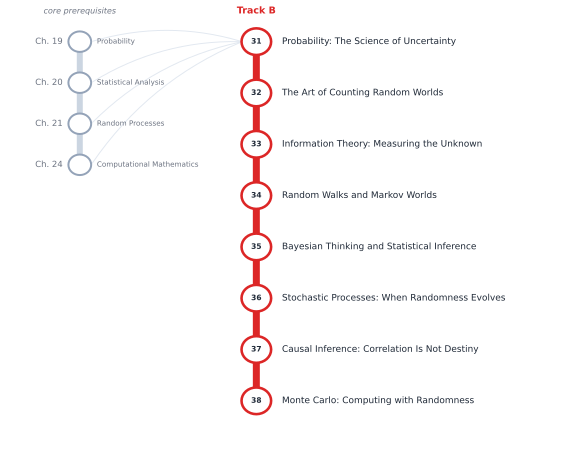

# Track B — Probability, Uncertainty, and Information

[← Table of Contents](../../00-front/table-of-contents.md) · [Start: Ch. 31 →](31-probability-science-of-uncertainty.md)

> **Level 2 — Specializations.** The mathematics of randomness, prediction, communication, and decision-making under uncertainty.

*Suggested reading order for Track B. The grey stations on the left are the core chapters it leans on.*

## Before you start

This track assumes you are comfortable with these core chapters:

- Ch. 19 — [Probability](../../part-6-probability-statistics/19-probability.md)
- Ch. 20 — [Statistical Analysis](../../part-6-probability-statistics/20-statistical-analysis.md)
- Ch. 21 — [Random Processes](../../part-6-probability-statistics/21-random-processes.md)
- Ch. 24 — [Computational Mathematics](../../part-7-numerical-computational/24-computational-mathematics.md)

## Chapters

| Ch. | Chapter | What it explores |
|---|---|---|
| 31 | [Probability: The Science of Uncertainty](31-probability-science-of-uncertainty.md) | Conditional probability, Bayes' theorem, independence, inequalities, limit theorems. |
| 32 | [The Art of Counting Random Worlds](32-counting-random-worlds.md) | Advanced combinatorics, random variables, distributions, tail bounds. |
| 33 | [Information Theory: Measuring the Unknown](33-information-theory.md) | Entropy, mutual information, KL divergence, coding, compression. |
| 34 | [Random Walks and Markov Worlds](34-random-walks-and-markov-chains.md) | Markov chains, stationary distributions, mixing times, hitting times. |
| 35 | [Bayesian Thinking and Statistical Inference](35-bayesian-inference.md) | Bayesian inference, likelihood, estimators, hypothesis testing, model selection. |
| 36 | [Stochastic Processes: When Randomness Evolves](36-stochastic-processes.md) | Poisson processes, Brownian motion, martingales, stochastic calculus. |
| 37 | [Causal Inference: Correlation Is Not Destiny](37-causal-inference.md) | Causal graphs, interventions, counterfactuals, confounding, experimental design. |
| 38 | [Monte Carlo: Computing with Randomness](38-monte-carlo.md) | Sampling, simulation, variance reduction, Markov chain Monte Carlo. |

Every chapter follows the same arc: **the hook** (a puzzle or a failure), **the big idea**, **the mathematics**, **the algorithm**, **the experiment** you can run, **the challenge**, and **loose threads**: the questions the chapter deliberately leaves open.
