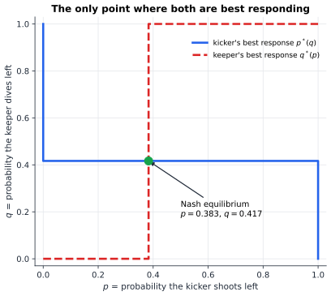

# Chapter 39 — Game Theory: When Rational People Clash

[← Previous](README.md) · [Track C](README.md) · [Table of Contents](../../00-front/table-of-contents.md) · [Next →](40-prisoners-dilemma.md)

> **Level 2 · Track C — Game Theory and Strategic Intelligence**
> **Builds on:** [Ch. 8](../../part-3-linear-algebra/08-matrices-and-linear-systems.md), [Ch. 19](../../part-6-probability-statistics/19-probability.md), [Ch. 23](../../part-7-numerical-computational/23-optimization.md) · **Leads to:** [Ch. 40](40-prisoners-dilemma.md), [Ch. 41](41-incomplete-information-games.md), [Ch. 46](46-adversarial-decision-making.md) · **Related:** [Ch. 30](../a-algorithms/30-limits-of-computation.md), [Ch. 48](../d-optimization/48-duality.md), [Ch. 58](../e-abstract-math/58-topology.md)
> **Reading time:** ~25 min

## 39.1 The hook

Here is a game you can play with a lecture hall, a mailing list, or a newspaper's readership. Everybody writes down a whole number from 0 to 100. The winner is whoever comes closest to **two thirds of the average** of all the numbers. That's the whole game.

Take a minute and pick your number before reading on.

Most people start like this: "If everyone picks at random, the average is about 50, so I should say 33." A sharper player thinks one step further: "But everyone else will reason the same way and say 33, so I should say 22." The next player says 15, then 10, and the staircase keeps going down. Where does it stop?

A cold argument says: at zero. Two thirds of any average of numbers between 0 and 100 can be at most $66.\overline{6}$, so a guess above 67 is never better than a guess of 67, whatever anyone else does. A player who knows nobody guesses above 67 knows the target is at most $\tfrac23\cdot 66.\overline 6 \approx 44.4$. Then $29.6$, $19.8$, $13.2$, and so on. Each round of "I know that you know that I know…" shrinks the upper bound by another factor of $\tfrac23$, and the only number that survives every round is $0$.

Now the twist. When this game is played with real people, the winner almost never picked 0. Averages land somewhere in the twenties or thirties, and the person who guessed 0, the "perfectly rational" one, loses badly. Being right about rationality is not the same as being right about people.

Keep that tension in mind, because it runs through this whole track. Once you start optimizing against something that can think back, the best move stops being a property of the problem and becomes a property of what everyone believes about everyone else. In [Ch. 23](../../part-7-numerical-computational/23-optimization.md) the objective function sat still while you climbed it. Here it moves, because the other players are climbing too.

A second example, which we will come back to: a penalty kick in football. The kicker shoots left or right, and the keeper has to dive left or right before seeing the ball. If the kicker always goes left, a keeper who has done any homework always dives left. If the keeper always dives left, the kicker shoots right. Neither of them can be predictable, and yet each has to *choose*. What does a rational choice even mean when being predictable is exactly what loses?

By the end of this chapter you will be able to compute the answer to that question, down to the percentage. You will also see why the answer is stranger than it first looks.

## 39.2 The big idea

The basic move of game theory is to stop asking "what is the best action?" and ask "what is the best action **given what the others do**?" That conditional best choice is a **best response**. The central idea of the subject is then almost too simple to state:

> A situation is stable when every player is already playing a best response to everyone else.

Nobody, looking back, wishes they had done something different, given what the others actually did. That's a **Nash equilibrium**: a profile of choices with no regrets.

An analogy helps. Picture a crowded beach on a hot afternoon. Everyone has spread a towel somewhere, and each person picked their spot given where the others already were: not too close to the loud group, not too far from the water. Once everyone is settled, nobody wants to get up and move. That doesn't make the arrangement *good* (maybe everyone would be happier if the loud group moved), but it is *stable*. Equilibrium is a statement about stability, not about how good the outcome is. Ch. 40 builds an entire chapter on how far apart those two ideas can be.

There are two ways to find stable outcomes, and they correspond to the two examples in the hook.

**Elimination.** Some choices are bad *no matter what* the others do. Throw them away. Once they're gone, other choices that used to be reasonable may become bad no matter what, so throw those away too. The 2/3 game is pure elimination: the staircase 100, 67, 44, 30, … is a chain of "nobody sensible would ever…" arguments.

**Mixing.** In the penalty kick, nothing can be eliminated. Every pure action is a best response to *something*, and every pure action is beaten by *something*. The way out is to choose at random, with probabilities tuned so precisely that the opponent gains nothing from knowing them. The kicker cannot hide the probabilities, only the outcome of the coin flip. That turns out to be enough.


*Best responses marked by circles: blue for the row player (largest in its column), red for the column player (largest in its row). A cell with both circles is a pure Nash equilibrium. In the penalty kick the circles never meet; the arrows show that from any cell, one of the players wants to switch.*

## 39.3 The mathematics

### Games in normal form

> [!definition] Normal-form game
> A **game in normal form** consists of
> - a finite set of **players** $N=\{1,\dots,n\}$;
> - for each player $i$ a set of **pure strategies** $S_i$;
> - for each player a **payoff function** $u_i : S_1\times\cdots\times S_n\to\mathbb R$.
>
> A **strategy profile** is $s=(s_1,\dots,s_n)$. We write $s_{-i}$ for everyone's choices except player $i$'s, so $s=(s_i,s_{-i})$.

With two players and finite strategy sets, the whole game fits into two matrices. Let player 1 (the **row player**) have strategies indexed by $i=1,\dots,m$ and player 2 (the **column player**) by $j=1,\dots,n$. The payoffs are $a_{ij}$ and $b_{ij}$, giving the **bimatrix** $(\mathbf A,\mathbf B)$ that you see in the figure: each cell lists "row payoff, column payoff". If $\mathbf A+\mathbf B=\mathbf 0$, what one player wins the other loses: a **zero-sum** game. The penalty kick, measured in scoring probability, is zero-sum after a shift (the keeper's payoff is $1-$ the kicker's), and that's all zero-sum requires.

Payoffs are utilities, not money. The only thing that matters about them is how a player ranks outcomes and lotteries over outcomes. That last part is a real assumption (von Neumann–Morgenstern expected utility), and we use it every time we average payoffs over randomness.

### Dominance

> [!definition] Strict dominance
> Strategy $s_i$ **strictly dominates** $s_i'$ if $u_i(s_i,s_{-i}) > u_i(s_i',s_{-i})$ for **every** $s_{-i}$. A strategy that is strictly dominated by some other strategy is never a best response, so a rational player never uses it.

In the left matrix of the figure, compare the column player's options C and R. Column C pays $(1,4,2)$ against rows $(T,M,B)$; column R pays $(0,2,1)$. C is better in every row, so R is strictly dominated and the column player will never play it. Once R is gone, look at the row player: row T now pays $(4,1)$ against $(L,C)$, and row B pays $(3,0)$. With R deleted, T strictly dominates B. Two rounds of elimination shrink the $3\times3$ game to a $2\times2$ core:

$$
\begin{array}{c|cc}
 & L & C \\ \hline
T & (4,3) & (1,1) \\
M & (2,1) & (2,4)
\end{array}
$$

This is **iterated elimination of strictly dominated strategies** (IESDS), the same procedure as the 2/3 staircase. It's not free, though. The first round only needs the column player to be rational. The second round needs the row player to *know* the column player is rational. A third round would need the column player to know that the row player knows it, and so on. IESDS to depth $k$ needs rationality to be "known" $k$ levels deep. The 2/3 game in a real lecture hall shows what happens when the hierarchy breaks off after one or two levels.

### Nash equilibrium

> [!definition] Best response and Nash equilibrium
> The **best-response set** of player $i$ to $s_{-i}$ is
> $$
> \operatorname{BR}_i(s_{-i}) = \arg\max_{s_i\in S_i} u_i(s_i,s_{-i}).
> $$
> A profile $s^*$ is a **(pure) Nash equilibrium** if $s_i^*\in\operatorname{BR}_i(s_{-i}^*)$ for every player $i$, that is,
> $$
> u_i(s_i^*,s_{-i}^*) \ \ge\ u_i(s_i,s_{-i}^*)\quad\text{for all } i \text{ and all } s_i\in S_i .
> $$

In a bimatrix game this is a finger exercise. Circle the largest $a_{ij}$ in each column (the row player's best response to column $j$) and the largest $b_{ij}$ in each row (the column player's best response to row $i$). Every cell with two circles is a pure equilibrium. The left game has two: $(T,L)$ with payoffs $(4,3)$ and $(M,C)$ with payoffs $(2,4)$. The players disagree about which one they prefer, and nothing in the definition says which one will happen. That *equilibrium selection* problem comes back again and again.

How do dominance and equilibrium fit together? The next result says elimination is safe: it never throws away a stable outcome.

> [!theorem] IESDS preserves Nash equilibria
> If $s^*$ is a Nash equilibrium of a finite game, then no strategy $s_i^*$ in it is ever deleted by iterated elimination of strictly dominated strategies.

*Proof.* Suppose the claim fails, and look at the **first** round in which some equilibrium strategy, say $s_i^*$, is deleted. It is deleted because some strategy $t_i$ that is still present strictly dominates it against every profile of opponents' strategies that is still present. Since this is the first round to delete any part of $s^*$, all of $s_{-i}^*$ is still present. Dominance then gives

$$
u_i(t_i,s_{-i}^*) > u_i(s_i^*,s_{-i}^*),
$$

which says $s_i^*$ is not a best response to $s_{-i}^*$. That contradicts $s^*$ being an equilibrium. ∎

So if IESDS leaves only one profile, that profile is the unique Nash equilibrium. (The argument shows every equilibrium survives, so at most one exists; the surviving profile is an equilibrium because every strategy that could beat it has been deleted for good reason. Checking that last step carefully is a nice exercise.) In the 2/3 game, IESDS (with weak dominance in the first round) leaves only "everyone says 0".

### When no pure equilibrium exists: mixed strategies

The penalty kick has no cell with two circles. Let's write it in scoring probabilities, with rows the kicker's choice and columns the keeper's dive:

$$
\mathbf S=\begin{pmatrix} 0.58 & 0.95\\ 0.93 & 0.70\end{pmatrix}.
$$

The numbers are illustrative, but they're in the range that studies of professional penalties report. Shooting to the side the keeper dives to still scores sometimes, and shooting to the open side almost always scores. The kicker maximizes $\mathbf S$, and the keeper minimizes it.

> [!definition] Mixed strategy
> A **mixed strategy** for player $i$ is a probability distribution $\sigma_i$ over $S_i$. For a two-player game, row mixes are vectors $\mathbf x\in\Delta_m=\{\mathbf x\ge 0,\ \sum_i x_i=1\}$ and column mixes are $\mathbf y\in\Delta_n$. The expected payoffs are
> $$
> u_1(\mathbf x,\mathbf y)=\mathbf x^\mathsf T\mathbf A\mathbf y,\qquad u_2(\mathbf x,\mathbf y)=\mathbf x^\mathsf T\mathbf B\mathbf y .
> $$
> A **mixed Nash equilibrium** is a pair $(\mathbf x^*,\mathbf y^*)$ in which each mix is a best response to the other.

Expected values here are the ordinary expectations of [Ch. 19](../../part-6-probability-statistics/19-probability.md#199-expectation-and-variance), with the players' coin flips independent. The bilinear form $\mathbf x^\mathsf T\mathbf A\mathbf y$ is all the linear algebra we need. The key structural fact about mixed equilibria is short to prove and it does all the work in practice.

> [!theorem] Indifference principle (support lemma)
> Let $(\mathbf x^*,\mathbf y^*)$ be a mixed Nash equilibrium, and let $v_1=u_1(\mathbf x^*,\mathbf y^*)$. Then every pure strategy $i$ with $x_i^*>0$ earns exactly $v_1$ against $\mathbf y^*$:
> $$
> (\mathbf A\mathbf y^*)_i = v_1 \quad\text{whenever } x^*_i>0,\qquad (\mathbf A\mathbf y^*)_k \le v_1 \ \text{for all } k .
> $$
> The same holds for player 2.

*Proof.* Write $w_k=(\mathbf A\mathbf y^*)_k$ for the payoff of pure row $k$ against $\mathbf y^*$, and $w_{\max}=\max_k w_k$. Playing the pure row with the largest $w_k$ is one of player 1's options, and since $\mathbf x^*$ is a best response, $v_1 \ge w_{\max}$. On the other hand,

$$
v_1=\sum_k x_k^* w_k \le \sum_k x_k^* w_{\max}=w_{\max}.
$$

So $v_1=w_{\max}$, and the inequality in the middle holds with equality. That means $\sum_k x_k^*(w_{\max}-w_k)=0$. Each term is a nonnegative weight times a nonnegative gap, so each term is zero: wherever $x_k^*>0$ we must have $w_k=w_{\max}=v_1$. ∎

Read that theorem backwards and it becomes a recipe, along with the surprising core of mixed play. **In a mixed equilibrium, you randomize so that the *other* player is indifferent.** The keeper's probabilities aren't chosen to make the keeper happy. They're chosen to leave the kicker with nothing to exploit.

> [!example] Solving the penalty kick
> Let the kicker shoot left with probability $p$ and the keeper dive left with probability $q$. Neither pure profile is stable, so both must mix, and by the indifference principle each must make the other indifferent.
>
> **Keeper's $q$ makes the kicker indifferent** between shooting left and right:
> $$
> 0.58q+0.95(1-q)=0.93q+0.70(1-q)\ \Longrightarrow\ 0.25=0.60q\ \Longrightarrow\ q=\tfrac{5}{12}\approx 0.417 .
> $$
> **Kicker's $p$ makes the keeper indifferent** between diving left and right:
> $$
> 0.58p+0.93(1-p)=0.95p+0.70(1-p)\ \Longrightarrow\ 0.23=0.60p\ \Longrightarrow\ p=\tfrac{23}{60}\approx 0.383 .
> $$
> The scoring probability at equilibrium is $0.95-0.37\cdot\tfrac{5}{12}\approx 0.796$, the same whichever way the kicker shoots, as the theorem promised.

For any $2\times2$ game with no pure equilibrium, the same two lines of algebra give a closed form. For the row player's payoffs $a_{ij}$, the column mix that makes rows indifferent is

$$
q^*=\frac{a_{22}-a_{12}}{a_{11}-a_{12}-a_{21}+a_{22}},
$$

and symmetrically for $p^*$ using $b_{ij}$. Notice something odd: **the keeper's equilibrium probability depends only on the kicker's payoffs.** If the kicker gets better at shooting left (raise $a_{11}$), the kicker's own mix doesn't change at all. The keeper's does. People find this hard to believe the first time, and the experiment section lets you test it.

The best-response curves make it visible. The kicker's best response is a step function of $q$: shoot left if $q<5/12$, right if $q>5/12$, anything at all if $q=5/12$. The keeper's best response is a step function of $p$. The two staircases cross at one point only.


*Each curve is one player's best response to the other's mix. The only point lying on both is the mixed Nash equilibrium $(p,q)=(23/60,\,5/12)$.*

The left game of the figure has a mixed equilibrium too, on top of its two pure ones. The same algebra on the $2\times2$ core gives $\mathbf x^*=(3/5,\,2/5)$ over $(T,M)$ and $\mathbf y^*=(1/3,\,2/3)$ over $(L,C)$, with payoffs $(2,\,2.2)$. That is *worse for both players* than either pure equilibrium. The players randomize to stay unexploitable, and they sometimes miscoordinate as a result.

### Does an equilibrium always exist?

The penalty kick had no pure equilibrium but did have a mixed one. Is that luck?

> [!theorem] Nash (1950)
> Every finite game, with finitely many players and finitely many pure strategies each, has at least one Nash equilibrium in mixed strategies.

We won't prove it here. The idea, though, is clean. Collect all players' mixes into one point $\sigma$ of a product of simplices, a compact convex set. Define a continuous map $f$ that nudges each player's mix toward strategies that do better than the current mix. A fixed point $f(\sigma)=\sigma$ is a profile where no nudge helps, which is exactly an equilibrium. Then a theorem from topology guarantees that the fixed point exists.

> [!mystery] A theorem that promises without delivering
> Nash's proof uses Brouwer's fixed-point theorem: every continuous map of a disc (or simplex, or ball) into itself fixes some point. The proof tells you an equilibrium *exists* but gives you no way to find it, and nobody knows how to make it constructive at a cost that stays polynomial.
> Why must a continuous map of a disc fix a point, while a map of an annulus need not? The answer is topological, and it's waiting in [Ch. 58](../e-abstract-math/58-topology.md).

For **zero-sum** games there is an older and sharper result. Von Neumann's minimax theorem (1928) says

$$
\max_{\mathbf x\in\Delta_m}\ \min_{\mathbf y\in\Delta_n}\ \mathbf x^\mathsf T\mathbf A\mathbf y=\min_{\mathbf y\in\Delta_n}\ \max_{\mathbf x\in\Delta_m}\ \mathbf x^\mathsf T\mathbf A\mathbf y .
$$

The number in the middle, $0.796$ for the penalty kick, is the **value** of the game. In zero-sum games, equilibrium is the same thing as security: each side guarantees itself the value, however clever the opponent is. The general-sum game on the left has no such guarantee.

Fix $\mathbf y$ and the inner maximum is a linear program, and so is the outer minimization. That's no accident: the minimax theorem and linear-programming duality are two views of the same fact, which is why a zero-sum game can be solved with the simplex method of [Ch. 23](../../part-7-numerical-computational/23-optimization.md#233-linear-programming). The duality side of the story is [Ch. 48](../d-optimization/48-duality.md), and the adversarial side is [Ch. 46](46-adversarial-decision-making.md).

## 39.4 The algorithm

**Pure equilibria.** For an $m\times n$ bimatrix, compute the column maxima of $\mathbf A$ and the row maxima of $\mathbf B$, then check each cell. That costs $O(mn)$, which is optimal, since you have to look at every payoff anyway.

**Mixed equilibria: support enumeration.** The indifference principle turns equilibrium-finding into linear algebra *once you guess the supports*. Fix a set $I$ of rows and a set $J$ of columns that will get positive probability. For a nondegenerate game, $\lvert I\rvert=\lvert J\rvert=k$. Then solve two square linear systems:

- find $\mathbf y$ on $J$ with $\sum_j y_j=1$ that makes every row in $I$ earn the same $v_1$;
- find $\mathbf x$ on $I$ with $\sum_i x_i=1$ that makes every column in $J$ earn the same $v_2$.

Accept the pair if both mixes are nonnegative and no pure strategy *outside* the support does better than $v_1$ (resp. $v_2$).

```python
import itertools
import numpy as np

def support_enumeration(A, B, tol=1e-9):
    """All Nash equilibria of a nondegenerate bimatrix game (A: row payoffs, B: column payoffs)."""
    m, n = A.shape
    found = []
    for k in range(1, min(m, n) + 1):
        for I in itertools.combinations(range(m), k):
            for J in itertools.combinations(range(n), k):
                # column mix y on J makes row indifferent on I; row mix x on I makes column indifferent on J
                My = np.block([[A[np.ix_(I, J)], -np.ones((k, 1))], [np.ones((1, k)), np.zeros((1, 1))]])
                Mx = np.block([[B[np.ix_(I, J)].T, -np.ones((k, 1))], [np.ones((1, k)), np.zeros((1, 1))]])
                rhs = np.r_[np.zeros(k), 1.0]
                try:
                    sy, sx = np.linalg.solve(My, rhs), np.linalg.solve(Mx, rhs)
                except np.linalg.LinAlgError:
                    continue
                x, y = np.zeros(m), np.zeros(n)
                x[list(I)], y[list(J)] = sx[:k], sy[:k]
                if x.min() < -tol or y.min() < -tol:
                    continue
                # no profitable deviation outside the support
                if (A @ y).max() <= sy[k] + tol and (x @ B).max() <= sx[k] + tol:
                    found.append((x.round(4), y.round(4)))
    return found

A = np.array([[4, 1, 3], [2, 2, 1], [3, 0, 5]])
B = np.array([[3, 1, 0], [1, 4, 2], [0, 2, 1]])
for x, y in support_enumeration(A, B):
    print(x, y)
```

On the $3\times3$ game of the figure it prints exactly three equilibria: $(T,L)$, $(M,C)$, and the mix $\mathbf x=(0.6,0.4,0)$, $\mathbf y=(0.333,0.667,0)$. No support involving $B$ or $R$ survives, which matches the dominance argument.

**Complexity.** For each $k$ there are $\binom{m}{k}\binom{n}{k}$ support pairs, and each costs a $k\times k$ solve. Summed over $k$, that's $\binom{m+n}{m}$ support pairs, exponential in the game's size. Ten strategies each already means about 185,000 pairs. Smarter pivoting methods (Lemke–Howson, a cousin of the simplex method of [Ch. 23](../../part-7-numerical-computational/23-optimization.md#233-linear-programming)) find *one* equilibrium much faster on typical games, but there are known games where they take exponentially many pivots.

**Failure cases.**
- *Degenerate games* (ties in payoffs, or a mixed strategy with $k$-element support whose best responses number more than $k$) can have a whole continuum of equilibria. The square systems then become singular, and the code above silently skips the continuum.
- *Numerical tolerance.* An equilibrium probability of $10^{-12}$ is either a rounding error or a real but tiny weight. The test `x.min() < -tol` has to decide which, and the choice of `tol` changes the answer on badly scaled payoffs.
- *Zero-sum games* don't need any of this: they reduce to a single linear program and are solvable in polynomial time.

> [!mystery] Hard to find, easy to check
> Checking a proposed equilibrium takes one matrix–vector product. Finding one in a general two-player game is **PPAD-complete** (Daskalakis–Goldberg–Papadimitriou, Chen–Deng, 2006): as hard as any problem whose answer is guaranteed by a "follow the path to its end" parity argument. Nobody believes it can be done in polynomial time, but nobody can prove that either.
> What PPAD is, and why "a solution is guaranteed to exist" doesn't make a problem easy, belongs to [Ch. 30](../a-algorithms/30-limits-of-computation.md).

## 39.5 The experiment

**Drag the indifference point.** The graph shows the kicker's scoring probability as a function of the keeper's mix $q$ (horizontal axis). The blue line is "shoot left", the red line is "shoot right", and the thick green curve is the kicker's best, the upper envelope. The keeper wants to sit where that envelope is lowest, which is the crossing point.

```desmos-graph
left=0; right=1; bottom=0.5; top=1
---
y=0.58x+0.95(1-x)|blue
y=0.93x+0.70(1-x)|red
y=\max(0.58x+0.95(1-x),0.93x+0.70(1-x))|green
x=0.4167|grey|dashed
(0.4167,0.7958)|label:equilibrium
```

*The kicker's scoring chance against a keeper who dives left with probability $x$; the keeper picks the lowest point of the green envelope, $x=5/12$.*

Change the **0.58** in both the blue and green lines to 0.70 (the kicker gets better at hitting a covered left corner). Where does the crossing move, and whose equilibrium mix just changed? Then change **0.95** to 0.85 and watch what happens when the crossing slides near $x=0$ or $x=1$. When the lines stop crossing inside $[0,1]$, one shot dominates the other and the mixed equilibrium disappears.

**Watch players learn.** Equilibrium is a static notion. Do players who don't know any game theory ever reach it? In **fictitious play** (Brown, 1951), each player best-responds to the *empirical frequency* of the opponent's past actions, as if the opponent were a fixed coin.

```python
import numpy as np
import matplotlib.pyplot as plt

# Scoring probability: rows = kicker (L, R), columns = keeper (L, R).
S = np.array([[0.58, 0.95],
              [0.93, 0.70]])          # KNOB: change these four numbers
rounds = 5000                          # KNOB: how long they learn
kick_counts = np.array([1.0, 0.0])     # KNOB: initial "memories"
dive_counts = np.array([0.0, 1.0])

p_hist, q_hist = [], []
for t in range(rounds):
    q = dive_counts / dive_counts.sum()       # kicker's belief about the keeper
    p = kick_counts / kick_counts.sum()       # keeper's belief about the kicker
    kick = np.argmax(S @ q)                   # kicker maximises scoring chance
    dive = np.argmin(p @ S)                   # keeper minimises it
    kick_counts[kick] += 1
    dive_counts[dive] += 1
    p_hist.append(kick_counts[0] / kick_counts.sum())
    q_hist.append(dive_counts[0] / dive_counts.sum())

print(f"long-run: kicker shoots left {p_hist[-1]:.3f}, keeper dives left {q_hist[-1]:.3f}")
fig, ax = plt.subplots(figsize=(7, 4))
ax.semilogx(p_hist, label="kicker: fraction left")
ax.semilogx(q_hist, label="keeper: fraction left")
ax.axhline(23/60, ls=":", c="grey"); ax.axhline(5/12, ls=":", c="grey")
ax.set_xlabel("round"); ax.set_ylabel("empirical frequency"); ax.legend()
plt.show()
```

After 5,000 rounds the frequencies come out at about $0.386$ and $0.425$, closing in on $23/60$ and $5/12$ slowly and with a sawtooth. Each player, round by round, is completely predictable (it's an `argmax`!), yet the *frequencies* approach the equilibrium mix. Things to try:

- Increase `rounds` to $10^5$. How fast does the error shrink?
- Replace `S` with a non-zero-sum game by giving the keeper its own payoff matrix (and `argmax` for both). Try the coordination core of the left figure.
- Try Shapley's $3\times3$ game, where the row player gets $\left(\begin{smallmatrix}0&1&0\\0&0&1\\1&0&0\end{smallmatrix}\right)$ and the column player gets $\left(\begin{smallmatrix}0&0&1\\1&0&0\\0&1&0\end{smallmatrix}\right)$. Watch whether the frequencies settle down.

## 39.6 The challenge

1. **Intuition.** In the penalty kick, the kicker practises and her accuracy into a covered right corner rises from $0.70$ to $0.80$. Without calculating, decide which player's equilibrium mix changes and in which direction. Then explain in one paragraph why a player's improvement shows up in the *opponent's* behaviour.

2. **Derivation.** For the 2/3 game with $n$ players choosing real numbers in $[0,100]$, show that "everyone chooses 0" is the unique Nash equilibrium. Then change the rule to "closest to $\tfrac23$ of the average **plus 10**", and find the new equilibrium and the number of elimination rounds it takes to get there to within $0.1$.

3. **Implementation.** Extend `support_enumeration` to detect degenerate cases: report when a square system is singular *and* the game has a pure strategy that ties with the support's payoff. Test it on the game $\mathbf A=\left(\begin{smallmatrix}1&1\\0&2\end{smallmatrix}\right)$, $\mathbf B=\left(\begin{smallmatrix}1&1\\2&0\end{smallmatrix}\right)$ and describe the full set of equilibria you find.

4. **Open investigation.** Generate random $n\times n$ bimatrix games with independent uniform payoffs and count their Nash equilibria (pure and mixed) for $n=2,\dots,8$. How does the average count grow with $n$? How often is it exactly one? Then compare with how often fictitious play converges on the same games. Is there a simple property of a random game that predicts when learning succeeds?

## 39.7 Loose threads

This chapter gave you the core vocabulary (strategies, payoffs, dominance, best responses, Nash equilibrium, mixing) and one genuinely useful tool, the indifference principle. Along the way it stepped around several holes.

- **Existence without construction.** Nash's theorem guarantees an equilibrium, but its proof is a fixed-point argument that doesn't tell you where the fixed point is. Why that argument works at all is topology ([Ch. 58](../e-abstract-math/58-topology.md)). Why turning it into an algorithm seems to need exponential time is complexity theory ([Ch. 30](../a-algorithms/30-limits-of-computation.md)).
- **Which equilibrium?** The left game has three equilibria. The theory as built here can't say which one players will reach. History, focal points, learning dynamics and evolution all have a say. [Ch. 40](40-prisoners-dilemma.md) and [Ch. 45](45-evolutionary-games.md) start to break the tie.
- **The 2/3 game was not "solved".** Real people stop after one or two levels of reasoning. The equilibrium predicts that *everyone* plays 0, and it fails as a forecast even though every individual step of the argument is valid. Models of bounded "level-$k$" reasoning take that failure seriously.
- **Everyone knew the payoffs.** The kicker knew the keeper's matrix and vice versa. Take that away, so that you don't know whether the other player is strong or weak, honest or bluffing, and you need beliefs about *types*. That's [Ch. 41](41-incomplete-information-games.md).
- **Mixed strategies are strange.** Does a professional kicker really flip a mental coin? One modern reading says the probabilities describe the *opponent's uncertainty* about you rather than your own randomness. That reading becomes precise once beliefs are on the table in [Ch. 41](41-incomplete-information-games.md).

> [!mystery] Why does learning sometimes fail?
> Fictitious play converges to the mixed equilibrium in every two-player zero-sum game (Robinson, 1951). In Shapley's $3\times3$ game from the experiment it cycles forever, with longer and longer runs, and the frequencies never settle.
> What separates games where simple learning finds equilibrium from games where it can't is a story about dynamics on the simplex, told in [Ch. 45](45-evolutionary-games.md) and [Ch. 46](46-adversarial-decision-making.md).

## Further reading

- M. J. Osborne, *An Introduction to Game Theory*, Oxford University Press, 2004. The gentlest rigorous start; Chapters 2–4 cover this chapter.
- R. B. Myerson, *Game Theory: Analysis of Conflict*, Harvard University Press, 1991. Deeper foundations, including utility theory and refinements.
- J. Nash, "Non-cooperative games", *Annals of Mathematics* 54 (1951). The original, and short.
- N. Nisan, T. Roughgarden, É. Tardos, V. Vazirani (eds.), *Algorithmic Game Theory*, Cambridge University Press, 2007. Chapters 2–3 on computing equilibria and PPAD.
