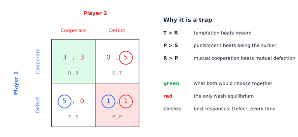

# Chapter 40 — The Prisoner's Dilemma and Other Traps

[← Previous](39-game-theory-basics.md) · [Track C](README.md) · [Table of Contents](../../00-front/table-of-contents.md) · [Next →](41-incomplete-information-games.md)

> **Level 2 · Track C — Game Theory and Strategic Intelligence**
> **Builds on:** [Ch. 39](39-game-theory-basics.md), [Ch. 10](../../part-3-linear-algebra/10-eigenvalues-and-eigenvectors.md), [Ch. 19](../../part-6-probability-statistics/19-probability.md) · **Leads to:** [Ch. 41](41-incomplete-information-games.md), [Ch. 45](45-evolutionary-games.md) · **Related:** [Ch. 34](../b-probability-information/34-random-walks-and-markov-chains.md), [Ch. 46](46-adversarial-decision-making.md), [Ch. 52](../d-optimization/52-dynamic-programming.md)
> **Reading time:** ~25 min

## 40.1 The hook

Your laptop and your neighbour's phone share one Wi-Fi channel. When both want to transmit, the 802.11 protocol tells each of them to wait a random number of slots first, drawn from a *contention window*, and to double that window after every collision. It's a polite protocol: everyone backs off, collisions stay rare, and the channel stays busy with useful traffic.

Now suppose you edit your driver so that it always uses the smallest possible window. Against polite neighbours you win nearly every race for the channel, and your throughput jumps. This isn't hypothetical; papers in the early 2000s measured exactly this kind of "greedy" MAC misbehaviour. So why doesn't everyone do it? If *everyone* does it, every slot is a collision, the doubling rule never gets a chance to work, and the whole channel collapses. Each of you is better off cheating whatever the others do, and all of you together are worse off when everyone cheats.

That structure has a name, and a famous story. Two suspects are held in separate cells. Each is offered a deal: testify against the other and walk free, unless the other also testifies, in which case both get a reduced sentence. If both stay silent, the police can only convict them of something minor. Whatever your partner does, testifying shortens *your* sentence. So both testify, and both serve far longer than if they had kept quiet.

Overfishing, arms races, price wars, antibiotic overuse, doping in sport, climate negotiations, and every group project where someone coasts: the same pattern appears again and again. Individual rationality, applied carefully and correctly, leads to collective disaster.

Yet the real world is full of cooperation. Wi-Fi mostly works. Neighbouring fishing villages sometimes manage their stocks for centuries. In 1980 the political scientist Robert Axelrod invited game theorists to submit computer programs to play the dilemma against each other, two hundred rounds a match. The winner was the shortest program submitted, four lines long, written by Anatol Rapoport: *cooperate first, then do whatever the other player did last time*. Axelrod ran the tournament again with 62 entrants who knew the result. Tit-for-tat won again.

How can a strategy that never beats any opponent head-to-head (it can at best tie) win the whole tournament? And how can cooperation survive when defection is always individually better? The answer lies in one variable the one-shot story hides: **the future**.

## 40.2 The big idea

The prisoner's dilemma is a trap because the game is played **once**. Defecting has no consequences beyond the current payoff. Repeat the game, so the same two players meet again and again, and today's choice becomes a message about tomorrow. A defection can be punished, and cooperation can be rewarded. Whether that's enough depends on how much the players care about what comes next.

Think of a restaurant on a highway versus one in your own neighbourhood. The highway diner can serve bad food to travellers it will never see again. The neighbourhood café can't, because its customers come back, or don't. Same incentives, same people. The only difference is the **shadow of the future**. Game theorists measure it with a single number, the discount factor $\delta\in[0,1)$: the weight of tomorrow's payoff relative to today's, or equivalently the probability that there will be a tomorrow at all.

The big idea of this chapter in one line:

> Cooperation is sustainable when the long-run gain from continued cooperation outweighs the one-time gain from betrayal, and that comparison has an exact threshold in $\delta$.

The second big idea is about *populations* rather than pairs. Instead of asking what a rational player should do, ask which behaviours **survive** when strategies reproduce in proportion to their payoffs. A strategy that can't be invaded by a small group of mutants is *evolutionarily stable*. Remarkably, the answers from rationality and from evolution often coincide, and the places where they don't are where the most interesting biology and engineering happen.


*The canonical numbers $T=5$, $R=3$, $P=1$, $S=0$. Every best-response circle falls on Defect, so mutual defection (red) is the only equilibrium, though both players prefer mutual cooperation (green).*

## 40.3 The mathematics

### The one-shot dilemma

> [!definition] Prisoner's dilemma
> A symmetric $2\times2$ game with actions Cooperate (C) and Defect (D) and row-player payoffs
> $$
> \begin{array}{c|cc} & C & D\\ \hline C & R & S\\ D & T & P \end{array}
> $$
> is a **prisoner's dilemma** if $T>R>P>S$ (Temptation, Reward, Punishment, Sucker). For repeated play one also asks $2R>T+S$, so that taking turns exploiting each other is worse than steady cooperation.

The analysis takes one line. Against C, defecting gives $T>R$; against D, defecting gives $P>S$. So **D strictly dominates C**, and by the result of [Ch. 39](39-game-theory-basics.md#393-the-mathematics) the unique Nash equilibrium is $(D,D)$ with payoffs $(P,P)$. But $(C,C)$ gives $(R,R)$ with $R>P$ for both. The equilibrium is **Pareto-dominated**: some other outcome is better for everybody.

That's the precise sense of "trap". Nash equilibrium is a statement about stability, and stability has nothing to do with efficiency.

### Other traps in the same family

Changing the order of $T,R,P,S$ gives a small zoo of social dilemmas, each with its own personality.

- **Stag hunt** ($R>T\ge P>S$): hunting the stag together pays most, but hunting a hare alone is safe. Both $(C,C)$ and $(D,D)$ are equilibria. The trap is *trust*: cooperation is stable, but risky if you doubt your partner.
- **Chicken / Hawk–Dove** ($T>R>S>P$): two drivers head at each other. Swerving is humiliating, but crashing is worst. The pure equilibria are "one swerves, one doesn't", and there's a mixed equilibrium in which crashes happen with positive probability.
- **Public goods** ($n$ players): each player can contribute $1$ to a pot that is multiplied by $r$ (with $1<r<n$) and shared equally. A unit you contribute returns only $r/n<1$ to you, so not contributing is strictly dominant, even though full contribution pays everyone $r>1$ instead of $0$. With $n=4$ and $r=1.6$, each contributed unit costs you $1$ and returns you $0.4$. This is the $n$-player prisoner's dilemma, and it's the mathematics behind "the tragedy of the commons".

### Finitely repeated: the future doesn't help

Repeat the dilemma a known, finite number of times $K$, adding up the payoffs. Surely the shadow of the future helps now?

> [!theorem] Unravelling
> In the prisoner's dilemma repeated a commonly known finite number of times $K$, every subgame-perfect equilibrium has both players defecting in every round.

*Proof.* We go by backward induction on the number of rounds left. A subgame-perfect equilibrium must be an equilibrium of every subgame, starting from any history.

*Last round.* Whatever happened before, round $K$ is a one-shot prisoner's dilemma, since no future follows to reward or punish anything. D strictly dominates C, so both defect, whatever the history.

*Inductive step.* Suppose that from round $k+1$ onward both players defect regardless of history. Then nothing a player does in round $k$ changes what happens later, so round $k$ is strategically a one-shot game plus a constant. Again D strictly dominates C, so both defect in round $k$, whatever the history. By induction, both defect in every round. ∎

The "known" in "known finite" is doing all the work. If the horizon is uncertain, so that after each round the game continues with probability $\delta$, there is no last round to start the unravelling from.

### Infinitely repeated: thresholds for cooperation

Now let the game continue forever, with discounted payoffs

$$
U_i=\sum_{t=0}^{\infty}\delta^t\,u_i(a^t),\qquad 0\le\delta<1 .
$$

It helps to compare **average** payoffs $(1-\delta)U_i$, which are on the same scale as one round: steady cooperation has average $R$.

A strategy in the repeated game is a rule mapping every history to an action, an enormous object. Two simple ones:

- **Grim trigger**: cooperate until the opponent defects once, then defect forever.
- **Tit-for-tat (TFT)**: cooperate in round $0$, then copy the opponent's previous move.

> [!theorem] When grim trigger sustains cooperation
> Both players using grim trigger is a Nash equilibrium of the infinitely repeated prisoner's dilemma if and only if
> $$
> \delta\ \ge\ \delta^*=\frac{T-R}{T-P}.
> $$

*Proof.* Against grim trigger, the opponent's behaviour depends only on whether you have ever defected. Before your first defection, cooperating forever gives

$$
U_{\text{coop}}=R+\delta R+\delta^2R+\cdots=\frac{R}{1-\delta}.
$$

Suppose instead you first defect in some round $t_0$. Discounting is time-consistent, so it is enough to compare from $t_0$ onward. In round $t_0$ you get $T$. From then on the opponent defects forever, and your best reply to permanent defection is to defect too, earning $P$ per round. So the best deviation gives

$$
U_{\text{dev}}=T+\delta P+\delta^2P+\cdots=T+\frac{\delta P}{1-\delta}.
$$

Cooperation is a best response if and only if $U_{\text{coop}}\ge U_{\text{dev}}$. Multiply by $1-\delta>0$:

$$
R\ \ge\ (1-\delta)T+\delta P\iff \delta(T-P)\ \ge\ T-R\iff \delta\ \ge\ \frac{T-R}{T-P}.
$$

By symmetry the same holds for the other player. ∎

With the canonical numbers, $\delta^*=(5-3)/(5-1)=\tfrac12$. If there's at least a 50% chance of meeting again, the threat of permanent punishment keeps both players honest.

Tit-for-tat is more forgiving, which makes it harder to check. Against TFT, any deviation that eventually returns to cooperation gets punished only once. Two deviations matter: defecting forever (average payoff $(1-\delta)T+\delta P$, same as above) and **alternating** D, C, D, C, …, which against TFT produces the outcome sequence $(D,C),(C,D),(D,C),\dots$ with payoffs $T,S,T,S,\dots$. Its value is $(T+\delta S)/(1-\delta^2)$, and comparing with $R/(1-\delta)$ gives $R(1+\delta)\ge T+\delta S$. Both together give the condition

$$
\delta\ \ge\ \max\left\{\frac{T-R}{T-P},\ \frac{T-R}{R-S}\right\}=\max\left\{\tfrac12,\ \tfrac23\right\}=\tfrac23
$$

for the canonical payoffs. This is Axelrod's condition for TFT to be "collectively stable". Forgiveness has a price: a slightly longer shadow of the future is needed.

> [!mystery] Why is it enough to check one deviation at a time?
> In both proofs we quietly compared cooperation against a *handful* of deviations, while a repeated-game strategy can deviate in infinitely many, history-dependent ways. The justification is the **one-shot deviation principle**: with discounting, a strategy profile is subgame perfect if and only if no player gains by deviating in a single period and then returning to the plan.
> It is Bellman's principle of optimality in disguise, and it is proved in [Ch. 52](../d-optimization/52-dynamic-programming.md).

### Too many equilibria

Here's the uncomfortable sequel. Once $\delta$ is large, grim trigger can sustain not only $(C,C)$ forever but almost *any* pattern: cooperate on even rounds only, or let one player exploit the other two rounds out of three. The **folk theorem** (so called because everyone knew it before anyone published it) says that, for $\delta$ close enough to $1$, every feasible average payoff pair that gives each player strictly more than their punishment payoff $P$ is a subgame-perfect equilibrium outcome.

Repetition fixes the problem of *no* good equilibria by creating *infinitely many* equilibria. The theory explains how cooperation is possible. It doesn't explain why it happens, or which form it takes.

### Evolutionary stability

Change the question. Suppose a large population plays the stage game in random pairs, and strategies that earn more spread (by imitation, learning, or reproduction). Write $u(\sigma,\tau)$ for the payoff of strategy $\sigma$ against $\tau$.

> [!definition] Evolutionarily stable strategy (Maynard Smith and Price, 1973)
> A strategy $\sigma$ is an **ESS** if, for every mutant strategy $\mu\neq\sigma$, either
> 1. $u(\sigma,\sigma)>u(\mu,\sigma)$, or
> 2. $u(\sigma,\sigma)=u(\mu,\sigma)$ and $u(\sigma,\mu)>u(\mu,\mu)$.

The intuition: a small fraction $\varepsilon$ of mutants appears. They mostly meet residents. Condition 1 says the residents do strictly better in those meetings. If there is a tie there, condition 2 says the residents do better in the rare meetings with mutants. Either way, the mutants shrink.

Every ESS is a symmetric Nash equilibrium (condition 1 or 2 implies $u(\sigma,\sigma)\ge u(\mu,\sigma)$), but not every equilibrium is an ESS. In the one-shot prisoner's dilemma, ALL-D is an ESS: $u(D,D)=P>S=u(C,D)$.

The **Hawk–Dove** game is the classic example where evolution predicts a mix. Two animals contest a resource worth $V$. Hawks fight; doves posture and retreat. A fight costs the loser $C$, and we assume $C>V$. The row player's payoffs are

$$
\begin{array}{c|cc} & H & D\\ \hline H & \tfrac{V-C}{2} & V\\ D & 0 & \tfrac{V}{2}\end{array}
$$

> [!theorem] The Hawk–Dove ESS
> If $C>V>0$, the strategy "play Hawk with probability $p^*=V/C$" is the unique ESS of the Hawk–Dove game.

*Proof.* Let $u(x,y)$ be the expected payoff of a player who plays Hawk with probability $x$ against one who plays Hawk with probability $y$:

$$
u(x,y)=xy\,\frac{V-C}{2}+x(1-y)V+(1-x)(1-y)\frac V2 .
$$

*Equilibrium.* Against $y=p^*$, Hawk earns $p^*\frac{V-C}{2}+(1-p^*)V$ and Dove earns $(1-p^*)\frac V2$. Their difference is $\tfrac12\bigl(p^*(V-C)+(1-p^*)V\bigr)=\tfrac12(V-p^*C)=0$. So every $x$ earns the same against $p^*$, and condition 1 holds with equality for every mutant.

*Stability.* So we need condition 2 for every mutant $m\ne p^*$. Because $u$ is linear in its first argument,

$$
u(p^*,m)-u(m,m)=(p^*-m)\,\frac{\partial u}{\partial x}(\cdot,m)=(p^*-m)\cdot\frac{V-mC}{2}=\frac{C}{2}\,(p^*-m)^2>0 ,
$$

using $V=p^*C$. Condition 2 holds, so $p^*$ is an ESS. Pure Hawk isn't an ESS (Dove does better against it, $0>\frac{V-C}2$), and pure Dove isn't either ($V>\frac V2$); a different mix $x\ne p^*$ isn't even a best reply to itself, so it can't be an ESS. ∎

With $V=2$ and $C=10$, a fifth of contests are played by hawks. Notice how the indifference principle from [Ch. 39](39-game-theory-basics.md#393-the-mathematics) reappears, now holding a *population* in balance rather than a single player's coin.

What about the *repeated* dilemma? Is tit-for-tat an ESS? Here is where the story gets slippery.

> [!mystery] Tit-for-tat can't hold the fort
> In a population of TFT players, a mutant that always cooperates (ALL-C) earns exactly the same against TFT, and exactly the same against itself. Neither ESS condition holds, so ALL-C can drift in unopposed. Once there are enough ALL-C players, ALL-D can invade by exploiting them. Cooperation then collapses, and TFT can return. Populations may cycle between cooperation and defection forever.
> Whether these cycles are real, and what they look like, needs dynamics, not just stability conditions: the **replicator equation** of [Ch. 45](45-evolutionary-games.md).

## 40.4 The algorithm

There are two computational questions, and they need different tools.

**Simulation: who wins a tournament?** A round-robin tournament of $k$ strategies, each match $L$ rounds long, costs $O(k^2L)$ moves. Every strategy is a function from the pair of histories (mine, theirs) to an action. Deterministic strategies make it exact; noisy ones need repeated runs and averages, with the usual $1/\sqrt{N}$ Monte Carlo error.


*A small Axelrod-style tournament (each strategy meets every other and its own twin, 200 rounds, averaged over 20 runs). Without noise the "nice" strategies (never defect first) take the top four places. With 5% of moves flipped by accident, every nice strategy loses ground, ALL-C is exploited, and ALL-D climbs to near the top.*

Two lessons in that chart deserve to be stated carefully, because they're not what people expect.

1. **The winner depends on the field.** In this field GRIM edges out TFT, mostly because GRIM punishes RANDOM forever while TFT keeps forgiving it. In Axelrod's fields TFT won. No strategy is best against every population, since the best reply depends on who else is there. That's [Ch. 39](39-game-theory-basics.md) all over again.
2. **Noise is brutal to reciprocity.** One accidental defection between two TFT players starts an echo: C/D, D/C, C/D, … until another error breaks it. Two GRIM players never recover at all.

**Exact analysis: memory-one strategies as Markov chains.** If a strategy looks only at the last round, it is four numbers: the probabilities $(p_{CC},p_{CD},p_{DC},p_{DD})$ of cooperating after each outcome (own move first). TFT is $(1,0,1,0)$. *Win-stay, lose-shift* (WSLS, also called Pavlov) repeats its move after a good outcome ($R$ or $T$) and switches after a bad one, giving $(1,0,0,1)$. Two memory-one players drive a **Markov chain** on the four outcomes CC, CD, DC, DD. With execution errors the chain is irreducible, and the long-run payoff is the stationary distribution $\boldsymbol\pi$ (the left eigenvector of the transition matrix for eigenvalue $1$, as in [Ch. 10](../../part-3-linear-algebra/10-eigenvalues-and-eigenvectors.md) and [Ch. 34](../b-probability-information/34-random-walks-and-markov-chains.md)) dotted with the payoff vector.

```python
import numpy as np

T, R, P, S = 5, 3, 1, 0

def long_run(p, q, eps=0.01):
    """Long-run payoffs of two memory-one strategies.
    p, q: probability of cooperating after the last outcome (CC, CD, DC, DD), seen from each player's side."""
    p = (1 - eps) * np.asarray(p) + eps * (1 - np.asarray(p))   # execution errors
    q = (1 - eps) * np.asarray(q) + eps * (1 - np.asarray(q))
    q = q[[0, 2, 1, 3]]                    # player 2 sees CD as DC and vice versa
    M = np.zeros((4, 4))
    for s in range(4):
        a, b = p[s], q[s]
        M[s] = [a * b, a * (1 - b), (1 - a) * b, (1 - a) * (1 - b)]
    w, V = np.linalg.eig(M.T)              # stationary distribution = left eigenvector for eigenvalue 1
    pi = np.real(V[:, np.argmin(abs(w - 1))]); pi /= pi.sum()
    return pi @ [R, S, T, P], pi @ [R, T, S, P]

TFT, WSLS, ALLD, GTFT = [1, 0, 1, 0], [1, 0, 0, 1], [0, 0, 0, 0], [1, 1/3, 1, 1/3]
for name, s in [("TFT", TFT), ("WSLS", WSLS), ("GTFT", GTFT), ("ALL-D", ALLD)]:
    print(f"{name:5s} vs itself: {long_run(s, s)[0]:.3f}   vs ALL-D: {long_run(s, ALLD)[0]:.3f}")
```

With a 1% error rate, two TFT players average only $2.250$, exactly $(R+S+T+P)/4$, because errors leave them wandering uniformly over all four outcomes. Two WSLS players average $2.951$, and two players of *generous* TFT (forgive a defection with probability $1/3$) average $2.970$. The price of being nice shows up against ALL-D: TFT keeps $1.020$, GTFT $0.693$, WSLS only $0.535$.

**Cost and stability.** The exact method costs one $4\times4$ eigenproblem per pair, independent of the match length, which is far cheaper than simulation. It does fail in one place. With `eps=0`, chains like TFT vs TFT are *reducible* (they get stuck in CC forever, or in an echo), the eigenvalue $1$ is repeated, and "the" stationary distribution depends on the starting state. `np.linalg.eig` then returns an arbitrary vector in that eigenspace. Keep a small positive error rate, or handle the starting state explicitly.

> [!mystery] A strategy that dictates your score
> In 2012, the physicist Freeman Dyson and computer scientist William Press found memory-one strategies that let one player **unilaterally** force a linear relation between the two long-run scores, for example "my surplus over $P$ is always three times yours", whatever the opponent does. These **zero-determinant** strategies came out of a determinant identity hiding in exactly the Markov chain above.
> Are extortioners a real threat to cooperation, or do they eat themselves in a population? The adversarial side is in [Ch. 46](46-adversarial-decision-making.md), and the evolutionary verdict in [Ch. 45](45-evolutionary-games.md).

## 40.5 The experiment

**Find the threshold.** The graph shows average payoffs (per round) as functions of the discount factor $x=\delta$. The green line is steady cooperation, $R=3$. The red curve is the best deviation against grim trigger, $(1-\delta)T+\delta P$. The blue curve is the alternating deviation against TFT, $T/(1+\delta)$ (with $S=0$). Cooperation is safe wherever green lies above the others.

```desmos-graph
left=0; right=1; bottom=0; top=5.5
---
y=3|green
y=5(1-x)+1x|red
y=\frac{5+0x}{1+x}|blue
x=0.5|red|dashed
x=0.6667|blue|dashed
```

*Grim trigger holds cooperation for $\delta\ge 1/2$ (red crossing); tit-for-tat needs $\delta\ge 2/3$ (blue crossing).*

Change **5** (the temptation $T$) to 8 in both curves: how much longer must the shadow of the future be? Change the **1** in $1x$ (the punishment $P$) to 2: does harsher or milder punishment help grim trigger? Finally change the **0** in $0x$ (the sucker's payoff $S$) to 1 and watch the blue crossing move while the red one stays put.

**Run your own tournament.** This is the engine behind the bar chart, trimmed to fit.

```python
import numpy as np

T, R, P, S = 5, 3, 1, 0                      # KNOB: payoffs (need T > R > P > S)
PAY = {('C', 'C'): (R, R), ('C', 'D'): (S, T), ('D', 'C'): (T, S), ('D', 'D'): (P, P)}
ROUNDS, NOISE = 200, 0.0                     # KNOB: game length, chance a move is flipped
rng = np.random.default_rng(1)

STRATS = {                                   # each sees (my history, their history)
    'ALL-C':  lambda me, op: 'C',
    'ALL-D':  lambda me, op: 'D',
    'TFT':    lambda me, op: op[-1] if op else 'C',
    'GRIM':   lambda me, op: 'D' if 'D' in op else 'C',
    'TF2T':   lambda me, op: 'D' if op[-2:] == ['D', 'D'] else 'C',
    'WSLS':   lambda me, op: 'C' if not me else (me[-1] if op[-1] == 'C' else ('D' if me[-1] == 'C' else 'C')),
    'RANDOM': lambda me, op: 'C' if rng.random() < 0.5 else 'D',
}

def play(f, g):
    a, b, sa, sb = [], [], 0, 0
    for _ in range(ROUNDS):
        x, y = f(a, b), g(b, a)
        if rng.random() < NOISE: x = 'D' if x == 'C' else 'C'
        if rng.random() < NOISE: y = 'D' if y == 'C' else 'C'
        pa, pb = PAY[(x, y)]
        a.append(x); b.append(y); sa += pa; sb += pb
    return sa / ROUNDS, sb / ROUNDS

names = list(STRATS)
score = {n: [] for n in names}
for i, n in enumerate(names):                # round robin, including a match against a twin
    for m in names[i:]:
        s1, s2 = play(STRATS[n], STRATS[m])
        score[n].append(s1)
        if m != n: score[m].append(s2)
for n in sorted(names, key=lambda n: -np.mean(score[n])):
    print(f"{n:7s} {np.mean(score[n]):.3f}")
```

Things to try:

- Set `NOISE = 0.05` and rerun with several seeds. How stable is the ranking?
- Remove `'RANDOM'`, or add three copies of `'ALL-D'`. Does TFT overtake GRIM?
- Write *generous TFT* (after the opponent defects, still cooperate with probability $1/3$) and *suspicious TFT* (defect first, then copy). Which of the two does noise hurt more?
- Make it **ecological**: after each tournament, give each strategy a population share proportional to its score and rerun with those shares. Which strategies go extinct first?

## 40.6 The challenge

1. **Intuition.** Two Wi-Fi stations repeatedly share a channel. One argues "I will always back off politely, whatever you do"; the other says "I will back off as long as you do, and jam you for ten seconds if you cheat". Which promise does more to keep the channel cooperative, and why does the *credibility* of the second promise matter?

2. **Derivation.** For the "$k$-period punishment" strategy (cooperate; after a defection, defect for exactly $k$ rounds, then return to cooperation), find the smallest $\delta$, as a function of $k$, $T$, $R$, $P$, at which mutual use of it is an equilibrium. Check that it tends to the grim-trigger threshold $\frac{T-R}{T-P}$ as $k\to\infty$.

3. **Implementation.** Using `long_run`, scan all memory-one strategies on a grid $p_{s}\in\{0,0.25,0.5,0.75,1\}$ (625 strategies). For each, find its payoff against itself and the best payoff any grid strategy can earn against it. Plot the strategies that are "nearly stable" (no invader gains more than $0.01$) and describe what they have in common.

4. **Open investigation.** Run the ecological version of the tournament (strategies reproduce in proportion to score) with a mutation process that occasionally introduces random memory-one strategies. Over long runs, does the population settle, cycle between cooperation and defection, or wander? How does the answer change with the error rate? There is no known closed-form description of the long-run behaviour for general mutation processes.

## 40.7 Loose threads

This chapter turned the prisoner's dilemma from a paradox into a calculation: cooperation is a self-enforcing equilibrium once $\delta$ passes an exact threshold. It also left several doors ajar.

- **Infinitely many equilibria.** The folk theorem says repetition can sustain almost anything, including exploitation. Which equilibrium a society lands in is a question for history, learning and evolution, not for the definition of equilibrium ([Ch. 45](45-evolutionary-games.md)).
- **The proofs checked only a few deviations.** That was legitimate, but only because of the one-shot deviation principle, which is dynamic programming in disguise ([Ch. 52](../d-optimization/52-dynamic-programming.md)).
- **We assumed everyone sees everything.** Every strategy here observed the opponent's actual move. Real Wi-Fi stations, firms and nations see only noisy signals: a collision might be bad luck or sabotage. With imperfect monitoring, punishment has to be triggered by *evidence*, and the analysis needs beliefs about what the other player is and did. That's the doorway into [Ch. 41](41-incomplete-information-games.md).
- **ESS is a static test.** It says which states resist invasion, not how a population moves between them, or whether it moves in circles. That's the replicator equation of [Ch. 45](45-evolutionary-games.md).
- **Designing the game itself.** If the dilemma is the problem, why not change the payoffs? Protocol designers do exactly that: they add fines, reputations and verifiable commitments so that cooperation becomes the dominant strategy. Engineering the incentives instead of the players is [Ch. 42](42-mechanism-design.md).

## Further reading

- R. Axelrod, *The Evolution of Cooperation*, Basic Books, 1984. The tournaments, told by the person who ran them.
- J. Maynard Smith, *Evolution and the Theory of Games*, Cambridge University Press, 1982. ESS from the source.
- G. J. Mailath and L. Samuelson, *Repeated Games and Reputations*, Oxford University Press, 2006. The folk theorems in full rigour.
- W. H. Press and F. J. Dyson, "Iterated Prisoner's Dilemma contains strategies that dominate any evolutionary opponent", *PNAS* 109 (2012).
