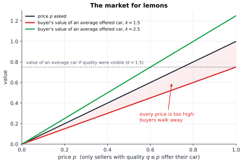

# Chapter 41 — Games with Incomplete Information

[← Previous](40-prisoners-dilemma.md) · [Track C](README.md) · [Table of Contents](../../00-front/table-of-contents.md) · [Next →](42-mechanism-design.md)

> **Level 2 · Track C — Game Theory and Strategic Intelligence**
> **Builds on:** [Ch. 39](39-game-theory-basics.md), [Ch. 19](../../part-6-probability-statistics/19-probability.md), [Ch. 40](40-prisoners-dilemma.md) · **Leads to:** [Ch. 42](42-mechanism-design.md), [Ch. 43](43-auctions-and-markets.md) · **Related:** [Ch. 35](../b-probability-information/35-bayesian-inference.md), [Ch. 33](../b-probability-information/33-information-theory.md), [Ch. 96](../j-frontier/96-mathematical-economics.md)
> **Reading time:** ~25 min

## 41.1 The hook

You want to buy a used car. There are good ones ("peaches") and bad ones ("lemons"), and on a test drive they look identical. The seller knows which one she has, because she has driven it for five years. You don't.

So you do the sensible thing and offer a price that reflects an *average* car. Now look at that offer from the sellers' side. The owner of a peach finds your average price insulting, because her car is worth more, and keeps it. The owner of a lemon is delighted to sell. The cars actually on offer at your price are therefore *worse than average*. Once you realize this, you lower your offer. More peach owners withdraw. The average falls again. In 1970, George Akerlof showed that this spiral can run all the way down: a market in which every buyer values every car more than its owner does, so that every trade would make both sides happier, can collapse to *no trade at all*. The paper was famously rejected by three journals as either trivial or wrong. It later earned a Nobel Prize.

The same spiral threatens health insurance (the sickest are keenest to buy), loans (the riskiest borrowers accept any rate), freelance marketplaces, and spectrum auctions. The problem isn't greed. It is **asymmetric information**: one side knows something the other doesn't, and everyone knows that.

Two escape routes suggest themselves, and they're opposites.

- The informed side can try to **signal**. A peach owner might offer a two-year warranty, something a lemon owner can't afford to promise. A job applicant may spend four years earning a degree that a weaker applicant would find too costly to get.
- The uninformed side can try to **screen**. The insurer offers a menu, a cheap policy with a big deductible and an expensive one with full cover, and lets customers sort *themselves* by what they choose.

Here's a puzzle to carry through the chapter. Why do so many scam emails announce, in the first line, that they come from a foreign prince with a fortune to share? Wouldn't a more plausible story catch more victims? Hold that thought. By the end you'll see the absurd opening line as a precisely tuned piece of strategy.

## 41.2 The big idea

In [Ch. 39](39-game-theory-basics.md) every player knew every payoff. Now some players have **private information**: their own cost, value, quality, or intention. The others can't see it, so they must form **beliefs** about it. And because beliefs drive choices, actions themselves become evidence. Whatever you do, others will read it.

The key move, due to John Harsanyi (1967), turns this mess into something we already know how to handle. Pretend that before the game starts, a neutral player called **Nature** rolls dice and deals each player a secret **type**: "peach" or "lemon", "able" or "weak", "high value" or "low value". The odds on the dice are common knowledge, even though each player sees only their own roll. Uncertainty about *who you're playing* becomes uncertainty about *what Nature did*, and probability theory ([Ch. 19](../../part-6-probability-statistics/19-probability.md)) knows how to deal with that.

From there, two ideas carry everything.

1. **A strategy is a plan for every type.** A seller's strategy isn't "sell" or "keep" but "if peach, keep; if lemon, sell". You must plan for all the types you could have been, because the *other* players' best responses depend on what you would have done in each case.
2. **Beliefs must be Bayesian where they can be.** When you see an action, update your beliefs about the actor's type by Bayes' rule. An analogy: a poker player who bets big is either strong or bluffing. A good opponent doesn't take the bet at face value; she asks how often a player of each type would make this bet, and updates.

Signaling is the art of choosing actions that are *too expensive to fake*. A signal works not because it is informative in itself (a degree in classics may teach nothing about software), but because it costs different types different amounts.


*A job-market signaling game. Nature deals the worker a type; the worker chooses whether to get a degree; the employer, seeing only the degree (dashed information sets), assigns a job. Payoffs are (worker, employer).*

## 41.3 The mathematics

### The lemons spiral, exactly

Let car quality $q$ be uniform on $[0,1]$. An owner values her car at $q$; a buyer values it at $kq$ with $k>1$, so every trade would create value. Quality is private to the owner. Buyers are competitive, so the market price equals buyers' expected value of the cars actually on offer.

> [!theorem] Market collapse (Akerlof)
> If $1<k<2$, the only equilibrium price is $p=0$: essentially no car is traded, even though every trade would benefit both sides.

*Proof.* At price $p\in(0,1]$, exactly the owners with $q\le p$ sell. Conditional on $q\le p$, quality is uniform on $[0,p]$, so the expected quality on offer is $p/2$ and buyers value a random offered car at $kp/2$. An equilibrium needs buyers' value to equal the price:

$$
\frac{kp}{2}=p\iff p\left(\frac{k}{2}-1\right)=0 .
$$

For $k<2$ the bracket is negative, so the only solution is $p=0$. At any positive price, $kp/2<p$ and buyers refuse to pay it. (At $p>1$ every car is offered, average quality is $1/2$, and $k/2<1<p$, so no price above $1$ works either.) ∎

Watch what makes the argument work: the price determines *who participates*, and who participates determines what the price should be. That feedback loop is the signature of **adverse selection**. For $k=1.5$, a buyer who could see quality would pay $0.75$ on average; without that information, the market pays nothing. Information is worth something to the market as a whole, a fact that [Ch. 33](../b-probability-information/33-information-theory.md) teaches you to measure in bits.


*At price $p$ only cars of quality at most $p$ are offered, so buyers value the offered pool at $kp/2$. For $k=1.5$ (red) that's always below the price and the market unravels; only $k\ge2$ (green) keeps it alive.*

### Bayesian games

> [!definition] Bayesian game
> A **Bayesian game** has
> - players $i=1,\dots,n$, each with an action set $A_i$;
> - for each player a set of **types** $\Theta_i$;
> - a **common prior** $\pi$ on $\Theta=\Theta_1\times\cdots\times\Theta_n$;
> - payoffs $u_i(a,\theta)$ that may depend on everyone's actions *and* types.
>
> Player $i$ learns only $\theta_i$, and forms the posterior belief $\pi(\theta_{-i}\mid\theta_i)$ by Bayes' rule. A **strategy** is a function $s_i:\Theta_i\to A_i$, one action for every possible type.

> [!definition] Bayesian Nash equilibrium (BNE)
> A strategy profile $s^*$ is a **Bayesian Nash equilibrium** if every type of every player maximizes expected payoff given its beliefs:
> $$
> s_i^*(\theta_i)\in\arg\max_{a_i\in A_i}\ \mathbb E_{\theta_{-i}\sim\pi(\cdot\mid\theta_i)}\Bigl[u_i\bigl(a_i,\,s_{-i}^*(\theta_{-i}),\,\theta\bigr)\Bigr]\quad\text{for all } i,\ \theta_i .
> $$

Harsanyi's insight is that a BNE is simply a Nash equilibrium of a bigger ordinary game in which the "players" are the type-contingent strategies, and Nature is just a chance move. Nash's existence theorem from [Ch. 39](39-game-theory-basics.md#393-the-mathematics) therefore applies, for finite type and action sets.

The cleanest worked example has a continuum of types.

> [!example] A first-price sealed-bid auction
> Two bidders each have a private value $v_i$, independent and uniform on $[0,1]$. Each submits a sealed bid; the higher bid wins and **pays its own bid**. A winner with value $v$ who bids $b$ gets $v-b$; a loser gets $0$.
>
> **Guess** a symmetric equilibrium in which each bids a fixed fraction of value, $b(v)=\beta v$. **Check** that it is a best response. Bidder 1 with value $v$ bidding $b$ wins when $\beta v_2<b$, which has probability $\min(b/\beta,\,1)$. For $b\le\beta$ the expected payoff is
> $$
> \Pi(b)=(v-b)\,\frac{b}{\beta}.
> $$
> Setting $\Pi'(b)=(v-2b)/\beta=0$ gives $b=v/2$, a maximum since $\Pi''<0$. (Bids above $\beta$ win for sure but pay more than necessary.) The best response to "the other bids $\beta v$" is to bid $v/2$, *whatever* $\beta$ is, as long as $\beta\ge 1/2$. Consistency requires $\beta=1/2$.
>
> So $b(v)=v/2$ is a BNE: **shade your bid to half your value.** The seller's expected revenue is the expected winning bid, $\mathbb E[\max(v_1,v_2)]/2=\tfrac23\cdot\tfrac12=\tfrac13$.

Bid shading is the defining feature of incomplete information. You'd never bid half your value if you knew the other bid; you'd bid a hair above it. Not knowing, you trade off the probability of winning against the profit when you win.

> [!mystery] The coincidence that isn't one
> Change the rule: highest bid wins but pays the **second**-highest bid. Now bidding your true value is a dominant strategy (prove it in one line!), and the seller's expected revenue is $\mathbb E[\min(v_1,v_2)]=\tfrac13$, *exactly* the same as in the first-price auction. Very different rules, very different bidding, identical revenue.
> That isn't luck. The **revenue equivalence theorem** in [Ch. 43](43-auctions-and-markets.md) says when and why it must happen.

### Signaling games and perfect Bayesian equilibrium

In the tree above, the worker moves first and the employer second, after watching. Plain BNE is too weak a concept here: it allows the employer to make threats at information sets that are never reached, like "if you educate, I'll make you a clerk anyway". We need beliefs at *every* information set, and actions that are optimal given those beliefs.

> [!definition] Perfect Bayesian equilibrium (PBE)
> In a signaling game, a **PBE** is a sender strategy $\sigma(\theta)$, a receiver strategy $\rho(m)$ for each message $m$, and beliefs $\mu(\theta\mid m)$, such that
> 1. each sender type's message maximizes its payoff given $\rho$;
> 2. after each message, $\rho(m)$ maximizes the receiver's expected payoff given $\mu(\cdot\mid m)$;
> 3. for messages sent with positive probability, $\mu$ is obtained by Bayes' rule ([Ch. 19.3](../../part-6-probability-statistics/19-probability.md#193-bayes-theorem)) from the prior and $\sigma$. For messages never sent, $\mu$ may be anything.

PBEs come in two broad kinds. In a **separating** equilibrium, different types send different messages, so the message reveals the type. In a **pooling** equilibrium, all types send the same message, and the receiver learns nothing.

Take the game in the figure: prior $P(H)=\tfrac13$, a manager job worth $10$ to the worker and a clerk job worth $4$, a degree costing $3$ for the high type and $7$ for the low type, and an employer who scores $1$ for putting each type in the right job.

> [!theorem] Two very different equilibria
> In the job-market game of the figure:
> 1. **Separating:** "High educates, Low doesn't; the employer makes graduates managers and the rest clerks" is a PBE.
> 2. **Pooling:** "Nobody educates; the employer makes everybody a clerk, and would also make a graduate a clerk" is a PBE, supported by the off-path belief $\mu(H\mid E)\le\tfrac12$.

*Proof.* **Separating.** Bayes' rule gives $\mu(H\mid E)=1$ and $\mu(H\mid N)=0$, so the employer's replies (manager after $E$, clerk after $N$) are optimal. High's payoffs: educate $10-3=7$, don't $4$, so High educates. Low's payoffs: educate $10-7=3$, don't $4$, so Low doesn't. No one wants to deviate.

**Pooling.** On path, everyone sends $N$, so Bayes gives $\mu(H\mid N)=\tfrac13$. The employer's expected score is $\tfrac13$ for "manager" and $\tfrac23$ for "clerk", so clerk is optimal. Message $E$ is never sent, so condition 3 allows any belief there. With $\mu(H\mid E)\le\tfrac12$, clerk is optimal after $E$ as well. Then educating gives High $4-3=1<4$ and Low $4-7<4$, so neither deviates. ∎

The two equilibria have exactly the same game, the same payoffs and the same rationality, and in one of them the able worker is recognized while in the other she is stuck as a clerk forever. The pooling equilibrium survives only because of an off-path belief: the employer "thinks" that a graduate is probably the low type, even though the low type would never want a degree. That belief is allowed but feels absurd.

The continuous version is Michael Spence's job-market model (1973). Let education level $e\ge0$ cost $e/\theta$ for a worker of productivity $\theta\in\{1,2\}$, with wage equal to expected productivity. Separation at a degree level $e^*$ requires that Low doesn't mimic, $2-e^*\le 1$, and that High is willing, $2-e^*/2\ge 1$. Together these give $1\le e^*\le 2$: **a whole interval of separating equilibria**, each needing a different amount of costly, socially useless schooling.

> [!mystery] Which beliefs are reasonable?
> PBE lets beliefs off the equilibrium path be anything, and so it supports pooling equilibria that rest on absurd suspicions, plus a continuum of separating ones. Game theorists responded with **refinements**, the most famous being the *Intuitive Criterion* of Cho and Kreps (1987), which says to ignore types that couldn't possibly gain from a deviation. Applied here, it kills the pooling equilibrium and selects the cheapest separating one, $e^*=1$.
> Why that criterion, and whether any refinement is the "right" one, is a live debate you'll meet in [Ch. 96](../j-frontier/96-mathematical-economics.md).

### Screening: let them sort themselves

In signaling the informed party moves first. In **screening**, the uninformed party moves first by designing a menu, and the informed party responds by choosing from it. An insurer can't see who is risky, so it offers two contracts: full cover at a high premium, and partial cover (a large deductible) at a low premium. Safe drivers, who expect few claims, find the deductible cheap and take the low premium. Risky drivers pay for full cover. The menu is built so that each type *prefers* the contract meant for it. That self-selection requirement is called **incentive compatibility**.

Two features of good screening menus are universal, and we'll only state them here.

- The "best" type (the one the designer most wants to identify) gets an efficient contract, but has to be left some surplus, an **information rent**, or it would pretend to be another type.
- The other types get *distorted* contracts (a deductible larger than efficient), deliberately made worse so that they're unattractive to mimic.

Now the scam email. The scammer's real cost isn't sending emails, which is nearly free. It's the time spent on each reply, the back-and-forth, before it turns out the target isn't going to pay. The absurd story is a **screen**. Anyone sceptical enough to eventually back out is filtered out by the first line, and the replies come mostly from people who will go all the way. As computer scientist Cormac Herley observed in 2012, a more believable email would generate more replies and *less* profit. The implausibility is the design.

> [!mystery] Is a menu always enough?
> Screening, auctions, voting rules, and tax schedules all ask the same question: what outcomes can a designer achieve when everyone else holds private information? It looks hopeless, since the set of possible mechanisms is enormous. Yet one theorem lets you restrict attention to mechanisms that simply *ask* each player for their type and make honesty optimal.
> That theorem, the **revelation principle**, opens [Ch. 42](42-mechanism-design.md).

## 41.4 The algorithm

**Finite Bayesian games → finite normal-form games.** If player $i$ has $\lvert\Theta_i\rvert$ types and $\lvert A_i\rvert$ actions, it has $\lvert A_i\rvert^{\lvert\Theta_i\rvert}$ pure strategies. List them, compute each profile's *ex ante* expected payoff by summing over the prior, and every tool from [Ch. 39](39-game-theory-basics.md#394-the-algorithm) applies. This is correct but expensive, since the strategy count is exponential in the number of types. In practice one checks best responses type by type instead, which costs only $\lvert\Theta_i\rvert\cdot\lvert A_i\rvert$ evaluations per player.

**Pure PBE of a signaling game.** The search has three nested loops:

1. Enumerate the sender's pure strategies $\sigma:\Theta\to M$ (here $2^2=4$ of them).
2. For each message, compute the receiver's belief: Bayes' rule if the message is used, otherwise scan a grid of off-path beliefs.
3. Compute the receiver's best reply to each belief, then check that no sender type wants to switch message.

```python
import itertools
import numpy as np

prior = {"H": 1/3, "L": 2/3}                 # Nature's odds of each worker type
cost = {"H": 3, "L": 7}                      # cost of education by type
wage = {"M": 10, "C": 4}                     # worker's value of each job
fit = {("H", "M"): 1, ("L", "C"): 1}         # employer gets 1 for a correct match, else 0

def worker(t, e, job): return wage[job] - (cost[t] if e == "E" else 0)
def best_job(mu_H):                          # employer's reply given belief P(H | signal)
    vM, vC = mu_H * fit.get(("H", "M"), 0), (1 - mu_H) * fit.get(("L", "C"), 0)
    return "M" if vM > vC else "C"

for sH, sL in itertools.product("EN", repeat=2):     # the sender's pure strategies
    sigma = {"H": sH, "L": sL}
    for off in np.linspace(0, 1, 11):                # belief at an unused signal
        beliefs, reply = {}, {}
        for e in "EN":
            senders = [t for t in "HL" if sigma[t] == e]
            if senders:                              # on path: Bayes' rule
                mass = sum(prior[t] for t in senders)
                beliefs[e] = prior["H"] / mass if "H" in senders else 0.0
            else:                                    # off path: any belief allowed
                beliefs[e] = off
            reply[e] = best_job(beliefs[e])
        ok = all(worker(t, sigma[t], reply[sigma[t]]) >= worker(t, d, reply[d])
                 for t in "HL" for d in "EN")
        if ok:
            print(f"H->{sH}, L->{sL}  beliefs P(H|E)={beliefs['E']:.1f}, P(H|N)={beliefs['N']:.1f}"
                  f"  employer: E->{reply['E']}, N->{reply['N']}")
        if sH != sL: break                           # separating: no off-path signal to scan
```

It prints the separating equilibrium once, and the pooling-on-$N$ equilibrium for every grid belief $\mu(H\mid E)\in\{0,0.1,\dots,0.5\}$ (at exactly $0.5$ the employer is indifferent, and the code's tie-break picks clerk). Pooling on $E$ and the "reverse" separation (Low educates, High doesn't) never appear.

**Cost and failure cases.**
- With $\lvert\Theta\rvert$ types and $\lvert M\rvert$ messages there are $\lvert M\rvert^{\lvert\Theta\rvert}$ sender strategies, each with a grid of off-path beliefs. That's fine for toy games and hopeless for realistic ones.
- *Mixed* (semi-separating) equilibria, where a type randomizes so that the receiver's posterior lands exactly on an indifference point, are invisible to a pure search. They need the indifference principle of [Ch. 39](39-game-theory-basics.md#393-the-mathematics) applied to posteriors.
- *Grids can lie.* The pooling equilibrium holds for $\mu(H\mid E)\le\tfrac12$, a closed interval. A grid that skipped $0.5$ would still find it, but a game whose equilibrium needs a belief in a tiny interval could slip between the grid points. Solve the receiver's indifference condition exactly when you can.
- *Ties.* Indifference is common at equilibrium, and the tie-breaking rule inside `best_job` silently selects among equilibria. Change `>` to `>=` and watch the output change.

## 41.5 The experiment

**Shade your bid.** In the first-price auction, a bidder with value $v=0.8$ who bids $x$ against an opponent bidding half her value wins with probability $\min(2x,1)$, so her expected profit is $(0.8-x)\min(2x,1)$.

```desmos-graph
left=0; right=1; bottom=0; top=0.5
---
y=(0.8-x)\min(2x,1)|blue
x=0.4|grey|dashed
(0.4,0.32)|label:best bid v/2
```

*Expected profit of a bidder with value $0.8$; the peak sits at exactly half her value.*

Change **0.8** to other values in both places and confirm the peak always sits at $v/2$. Then change the **2** in $\min(2x,1)$ to **3**: the opponent now bids a third of her value, so you win more easily. Does your best bid change? Try it with value 0.5 and with value 0.8, and explain why the two answers differ.

**Watch a market die.** This script runs the lemons spiral with real cars: each week, only owners whose car is worth less than the price sell, and buyers reset the price to what the offered cars are worth.

```python
import numpy as np
import matplotlib.pyplot as plt

rng = np.random.default_rng(0)
cars = 10_000
quality = rng.uniform(0, 1, cars)     # KNOB: try rng.beta(2, 5, cars) or rng.uniform(0.5, 1, cars)
k = 1.5                               # KNOB: buyers value a car at k * quality (k > 1: trade is efficient)
price = k * quality.mean()            # buyers start by paying for the average car
history = [price]

for week in range(25):
    offered = quality[quality <= price]          # only owners of worse-than-price cars sell
    if offered.size == 0:
        break
    price = k * offered.mean()                   # buyers pay what the offered pool is worth
    history.append(price)
    share = offered.size / cars
    print(f"week {week:2d}: price {price:.3f}, cars on sale {share:6.1%}")

plt.plot(history, "o-")
plt.xlabel("week"); plt.ylabel("market price")
plt.title(f"Lemons market, k = {k}")
plt.show()
```

With $k=1.5$ the price starts at $0.75$ and loses a quarter of its value every week: $0.56$, $0.42$, $0.31$, …, with only about 6% of cars still on sale by week 9. Things to try:

- Set `k = 2.5`. Does the market survive, and at what price?
- Keep `k = 1.5` but use `rng.uniform(0.5, 1, cars)`, so no car is truly terrible. Does a *floor* on quality rescue the market?
- Add a **warranty**: suppose owners of cars with `quality > 0.7` can certify them at a cost of `0.05`, and certified cars sell in a separate market. Which owners certify, and what happens to the uncertified market?

## 41.6 The challenge

1. **Intuition.** A hospital adopts a policy that every applicant for a nursing position must complete an unpaid two-week trial shift. Explain how this could function as a signal, a screen, or neither, depending on who bears the cost. What would have to be true about applicants' outside options for it to separate types?

2. **Derivation.** Generalize the first-price auction to $n$ bidders with independent values uniform on $[0,1]$. Guess $b(v)=\beta v$, derive $\beta=\frac{n-1}{n}$, and compute the seller's expected revenue. Then show that a second-price auction with the same bidders gives the same revenue.

3. **Implementation.** Extend the PBE search to **three** worker types (low, medium, high, with education costs $7$, $5$, $3$), three messages (no degree, bachelor's, master's), and three jobs. Report every pure PBE, classify each as separating, pooling, or partially pooling, and count how many depend on off-path beliefs.

4. **Open investigation.** In the lemons simulation, let a fraction $\phi$ of buyers be "experts" who can see quality and pay $kq$ for exactly the cars they want, while the rest trade blind. How large must $\phi$ be to stop the unravelling at $k=1.5$? Explore how the answer depends on the shape of the quality distribution. Is there a distribution for which no amount of expertise short of $\phi=1$ saves the market?

## 41.7 Loose threads

This chapter added one ingredient to game theory, private information, and the world got stranger: markets that should exist can vanish, useless degrees can be rational, and absurd emails can be optimal. Several threads were left hanging on purpose.

- **Revenue equivalence.** Two auctions with completely different bidding behaviour raised exactly $\tfrac13$. Whether that's a theorem or a coincidence, and what breaks it (risk aversion, correlated values, asymmetric bidders), is [Ch. 43](43-auctions-and-markets.md).
- **Too many equilibria, again.** Signaling games produce pooling and a continuum of separating equilibria, all of them PBE. The refinements that try to pick out the reasonable ones, and the arguments about whether they should, lead into [Ch. 96](../j-frontier/96-mathematical-economics.md).
- **Designing the menu.** We stated the shape of an optimal screening menu (rent at the top, distortion below) without deriving it. The derivation, and the revelation principle that makes it possible, is [Ch. 42](42-mechanism-design.md).
- **Where do common priors come from?** Harsanyi's trick assumes all players agree on Nature's dice. Drop that assumption and you face beliefs about beliefs about beliefs, an infinite hierarchy that ties into the Bayesian updating of [Ch. 35](../b-probability-information/35-bayesian-inference.md).
- **Learning the type over time.** In [Ch. 40](40-prisoners-dilemma.md) cooperation rested on repeated interaction. Combine repetition with private types and you get **reputation**: a player who might be a committed cooperator can sustain trust even in a finitely repeated dilemma, breaking the unravelling argument. How much a small doubt can achieve is one of the most surprising results in the theory of repeated games.

## Further reading

- G. A. Akerlof, "The Market for 'Lemons': Quality Uncertainty and the Market Mechanism", *Quarterly Journal of Economics* 84 (1970).
- M. Spence, "Job Market Signaling", *Quarterly Journal of Economics* 87 (1973).
- R. Gibbons, *Game Theory for Applied Economists*, Princeton University Press, 1992. Chapters 3–4 are the clearest short treatment of Bayesian and perfect Bayesian equilibrium.
- V. Krishna, *Auction Theory*, 2nd ed., Academic Press, 2010. First-price auctions and bid shading in depth.
