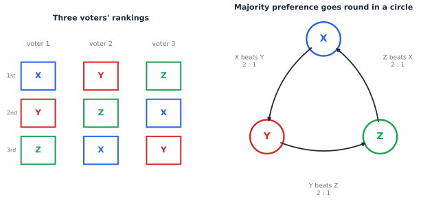
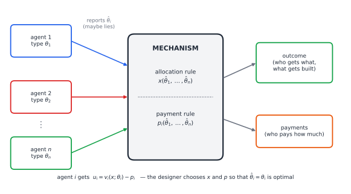

# Chapter 42 — Mechanism Design: Engineering Incentives

[← Previous](41-incomplete-information-games.md) · [Track C](README.md) · [Table of Contents](../../00-front/table-of-contents.md) · [Next →](43-auctions-and-markets.md)

> **Level 2 · Track C — Game Theory and Strategic Intelligence**
> **Builds on:** [Ch. 23](../../part-7-numerical-computational/23-optimization.md), [Ch. 19](../../part-6-probability-statistics/19-probability.md), [Ch. 39](39-game-theory-basics.md), [Ch. 41](41-incomplete-information-games.md) · **Leads to:** [Ch. 43](43-auctions-and-markets.md), [Ch. 44](44-coalitions-and-voting.md), [Ch. 96](../j-frontier/96-mathematical-economics.md) · **Related:** [Ch. 49](../d-optimization/49-integer-programming.md), [Ch. 30](../a-algorithms/30-limits-of-computation.md)
> **Reading time:** ~25 min

## 42.1 The hook

Two women stand before King Solomon. Each claims the same baby. Solomon cannot see into their hearts; he can only listen to what they say, and both say the same thing. So he announces a rule: the child will be cut in two and each woman given half. One woman says "do it". The other says "give her the child, only let it live". Solomon hands the baby to the second woman.

Strip away the drama and you have an engineering problem. The king holds **private information he does not have**: who the real mother is. The people who do have it will say whatever serves them. Solomon's trick was not to ask a better question but to design a **rule** under which the two women's *answers* would differ, because their *preferences* differ. That is the whole subject of this chapter in one story, and it is also a warning: Solomon's rule only works once. A second false mother who has heard the story simply says "let it live" too.

Here is a modern, less bloody version. Three households on a river want a footbridge. It costs 300. The town clerk proposes the obvious rule: "Tell me what the bridge is worth to you. If the total is at least 300, we build it and split the cost equally, 100 each." The true values are 250, 50 and 40. Honestly reported, the total is 340, the bridge goes up, and household 3, who values it at 40, pays 100 for the privilege. Household 3 is no fool. If negative reports are allowed, it reports $-1000$ and the bridge dies. If they are not, household 1 has the opposite temptation: in a slightly different world where the others valued it less, writing "1,000,000" costs nothing and guarantees the bridge. The clerk's rule asks for the truth and rewards lying.

And it gets worse before it gets better. Suppose the town abandons money and simply votes. Three council members rank three bridge designs X, Y, Z:



*Figure 42.1 — The Condorcet cycle. Every voter is perfectly rational, yet "the majority prefers" is not a ranking at all.*

Each member's ranking is perfectly sensible. Yet a majority prefers X to Y, a majority prefers Y to Z, and a majority prefers Z to X. Whoever controls the *order* of pairwise votes controls the winner: put Y against Z first, then the survivor against X, and X wins; reorder the agenda and Y or Z wins instead. The group has no "will" to discover.

So the question this chapter chases is simple to ask and surprisingly deep to answer:

> **Can we write down rules, for votes, for auctions, for bridges, under which telling the truth is every participant's selfish best move?**

We will find a remarkable "yes" when money can change hands, a precise reason why, and the first glimpse of a theorem that says "no" when it cannot.

## 42.2 The big idea

Ordinary game theory ([Ch. 39](39-game-theory-basics.md)) takes the game as given and asks what rational players will do. **Mechanism design runs game theory backwards.** You start from the outcome you *want*, say "build the bridge exactly when it is worth more than it costs", and you design the game whose equilibrium produces that outcome, even though every player is selfish and holds private information.

That is why it is sometimes called *reverse game theory*, and why engineers should feel at home in it. A control engineer designs a feedback law so that the closed loop does what she wants whatever the plant's internal state. A mechanism designer designs rules so that the "closed loop" of selfish agents does what she wants whatever their private preferences.

Picture a mechanism as a box:



*Figure 42.2 — A mechanism. Agents hold private types, send reports that may be lies, and the box turns reports into an outcome and a payment for each agent.*

Three ingredients matter.

1. **Types.** Each agent $i$ privately knows a type $\theta_i$: how much the bridge is worth to her, how she ranks the designs, what a radio licence would earn her. This is exactly the setting of Bayesian games in [Ch. 41](41-incomplete-information-games.md).
2. **Reports.** The agents send messages. In the simplest mechanisms, the message *is* a claimed type $\hat\theta_i$.
3. **Rules.** The box applies an **allocation rule** (what happens) and a **payment rule** (who pays what).

The magic word is **incentive compatibility**: the rules are built so that reporting $\hat\theta_i = \theta_i$ is optimal for each agent. The analogy to hold on to is a well-designed tax form. A bad form invites you to shade the numbers; a good one is constructed so that shading cannot help you, and you stop bothering to think strategically at all. That last point is the real prize. A mechanism with a dominant truthful strategy is *robust*: it works without the designer knowing anyone's beliefs, and without participants needing to out-think each other.

The other big idea is a disappointment that turns into a design principle. Without money, the Condorcet cycle is not a curiosity but a symptom: as we will state below, essentially every voting rule over three or more options can be manipulated. With money, a single clever trick fixes the bridge problem. The trick is to **charge each agent for the harm her report does to everyone else.** Once you are billed for your externality, your private interest and society's interest line up, and lying stops paying.

## 42.3 The mathematics

### Social choice functions

Let $N=\{1,\dots,n\}$ be agents and $O$ a set of possible outcomes (build or not; who gets which item). Agent $i$ has a type $\theta_i\in\Theta_i$, and $\boldsymbol\theta=(\theta_1,\dots,\theta_n)$.

> [!definition] Social choice function and mechanism
> A **social choice function** $f:\Theta_1\times\dots\times\Theta_n\to O$ says which outcome the designer *wants* for each profile of true types.
> A **mechanism** $(M_1,\dots,M_n, g)$ gives each agent a message space $M_i$ and an outcome rule $g: M_1\times\dots\times M_n\to O$. It is **direct** if $M_i=\Theta_i$: you simply announce a type.

The designer never observes $\boldsymbol\theta$. She observes messages, and the messages are chosen strategically.

When there is no money, agents only have preferences over $O$. Arrow's work in 1951 and the Gibbard–Satterthwaite theorem of the 1970s say how little you can then do:

> [!theorem] Arrow's impossibility theorem (statement)
> With at least three alternatives, no rule that turns every profile of individual rankings into a social ranking can satisfy all of: **unanimity** (if everyone prefers $a$ to $b$, so does society), **independence of irrelevant alternatives** (society's verdict on $a$ versus $b$ depends only on individual verdicts on $a$ versus $b$), and **non-dictatorship**.

> [!theorem] Gibbard–Satterthwaite (statement)
> With at least three possible winners and every ranking allowed, any voting rule that is **strategy-proof** (no voter ever gains by misreporting her ranking) and **onto** (every candidate can win) is a **dictatorship**.

The Condorcet cycle of Figure 42.1 is the smallest witness that majority rule breaks independence-plus-transitivity. The full proofs are combinatorial gems, and we are not going to give them here.

> [!mystery] Why must it be a dictator?
> Gibbard–Satterthwaite does not merely say "manipulation is possible". It says that the *only* escape is to hand all power to one voter. How can two innocent-looking axioms force something as specific as a dictator? The proof hunts down a "pivotal voter" whose ranking flips society's choice, and shows that voter controls everything.
> The full argument, and its kinship with Arrow's theorem, are in [Ch. 96](../j-frontier/96-mathematical-economics.md).

### Adding money: quasilinear utility

Now let money move. In the **quasilinear** model, an outcome is a pair (decision $x\in O$, payments $p_1,\dots,p_n$), and agent $i$'s utility is

$$
u_i = v_i(x;\theta_i) - p_i .
$$

Money enters linearly and is worth the same to everyone. That assumption is strong (rich and poor do not value a euro equally) but it is what makes the theory tick.

> [!definition] Dominant-strategy incentive compatibility (DSIC)
> A direct mechanism $(x(\cdot),p(\cdot))$ is **DSIC** (or **strategy-proof**) if for every agent $i$, every true type $\theta_i$, every false report $\hat\theta_i$, and every report profile $\hat{\boldsymbol\theta}_{-i}$ of the others,
>
> $$
> v_i\big(x(\theta_i,\hat{\boldsymbol\theta}_{-i});\theta_i\big) - p_i(\theta_i,\hat{\boldsymbol\theta}_{-i}) \;\ge\; v_i\big(x(\hat\theta_i,\hat{\boldsymbol\theta}_{-i});\theta_i\big) - p_i(\hat\theta_i,\hat{\boldsymbol\theta}_{-i}).
> $$
>
> Truth is a dominant strategy: it is optimal *whatever the others do*, truthful or not.

A weaker notion, **Bayesian incentive compatibility** (BIC), asks only that truth be optimal *in expectation*, assuming the others are truthful and types are drawn from known distributions, i.e. that truth-telling is a Bayes–Nash equilibrium in the sense of [Ch. 41](41-incomplete-information-games.md). The expectations are the ordinary ones of [Ch. 19](../../part-6-probability-statistics/19-probability.md#199-expectation-and-variance).

### Result 1: the revelation principle

Why study only direct mechanisms, where you just announce your type? Real mechanisms have rounds, clocks, bids and counter-bids. The first central result says you lose nothing.

> [!theorem] Revelation principle (dominant-strategy version)
> If some mechanism $(M,g)$ has a dominant-strategy equilibrium $s_i^*:\Theta_i\to M_i$ that implements $f$, meaning $g(s_1^*(\theta_1),\dots,s_n^*(\theta_n))=f(\boldsymbol\theta)$ for all $\boldsymbol\theta$, then the direct mechanism $g^{\mathrm{dir}}(\hat{\boldsymbol\theta}) = g(s_1^*(\hat\theta_1),\dots,s_n^*(\hat\theta_n))$ implements $f$ and is DSIC.

*Proof.* Build a "proxy box": agent $i$ tells the proxy her type $\hat\theta_i$, and the proxy plays $s_i^*(\hat\theta_i)$ on her behalf in the original mechanism. Suppose agent $i$ with true type $\theta_i$ considers lying, reporting $\hat\theta_i$, when the others report $\hat{\boldsymbol\theta}_{-i}$. Her outcome is then $g(s_i^*(\hat\theta_i), \mathbf{s}^*_{-i}(\hat{\boldsymbol\theta}_{-i}))$. But $s_i^*(\hat\theta_i)$ is just *some* message $m_i\in M_i$, and since $s_i^*(\theta_i)$ is dominant in the original mechanism, it does at least as well as any $m_i$ against *any* messages of the others, in particular against $\mathbf{s}^*_{-i}(\hat{\boldsymbol\theta}_{-i})$. So reporting $\theta_i$ is at least as good as reporting $\hat\theta_i$. Truth is dominant, and with truthful reports the outcome is $g(\mathbf{s}^*(\boldsymbol\theta))=f(\boldsymbol\theta)$. ∎

The proof is almost insultingly short, and that is the point: anything clever an agent could do, the proxy already does for her. The same argument with "Bayes–Nash" in place of "dominant" gives the Bayesian revelation principle. The practical moral is double-edged. The principle lets theorists search only over truthful direct mechanisms. It does *not* tell engineers to build direct mechanisms: asking a bidder to report a value for every one of $2^{50}$ bundles of licences is hopeless, which is why real designs are indirect ([Ch. 43](43-auctions-and-markets.md)).

### Result 2: VCG makes truth dominant

Now the trick promised in 42.2. Let the designer's goal be **efficiency**: choose the decision maximising total value,

$$
x^*(\hat{\boldsymbol\theta}) \in \arg\max_{x\in O}\ \sum_{j=1}^n v_j(x;\hat\theta_j).
$$

> [!definition] Vickrey–Clarke–Groves (VCG) mechanism with the Clarke pivot
> Given reports $\hat{\boldsymbol\theta}$: choose $x^*(\hat{\boldsymbol\theta})$ as above, and charge agent $i$
>
> $$
> p_i(\hat{\boldsymbol\theta}) \;=\; \underbrace{\max_{x\in O}\sum_{j\ne i} v_j(x;\hat\theta_j)}_{\text{others' best welfare without } i} \;-\; \underbrace{\sum_{j\ne i} v_j\big(x^*(\hat{\boldsymbol\theta});\hat\theta_j\big)}_{\text{others' welfare with } i}.
> $$
>
> Agent $i$ pays exactly the **externality** she imposes: how much worse off her presence makes everyone else.

> [!theorem] VCG is DSIC
> In the quasilinear model, the VCG mechanism is dominant-strategy incentive compatible.

*Proof.* Fix agent $i$, her true type $\theta_i$, and arbitrary reports $\hat{\boldsymbol\theta}_{-i}$ of the others. Write $h_i = \max_x\sum_{j\ne i}v_j(x;\hat\theta_j)$; it does not depend on anything agent $i$ says. If $i$ reports $\hat\theta_i$, leading to decision $\hat x = x^*(\hat\theta_i,\hat{\boldsymbol\theta}_{-i})$, her utility is

$$
u_i(\hat\theta_i) = v_i(\hat x;\theta_i) - h_i + \sum_{j\ne i}v_j(\hat x;\hat\theta_j) = \Big[v_i(\hat x;\theta_i) + \sum_{j\ne i}v_j(\hat x;\hat\theta_j)\Big] - h_i .
$$

The bracket is the total welfare *as measured with her true value and the others' reports*, evaluated at $\hat x$. Agent $i$ can influence only which $\hat x$ is chosen, and $h_i$ is a constant to her. The bracket is maximised over all of $O$ by choosing $\hat x = \arg\max_x [v_i(x;\theta_i)+\sum_{j\ne i}v_j(x;\hat\theta_j)]$, and that is precisely the decision the mechanism picks when she reports $\hat\theta_i=\theta_i$. So no report beats the truth, whatever the others report. ∎

Notice what the proof did: VCG aligned each agent's objective with the designer's objective, *up to a constant she cannot affect*. This is the same move as a well-chosen Lagrangian or penalty term in optimization ([Ch. 23](../../part-7-numerical-computational/23-optimization.md#232-constraints)): change the objective so that the local optimiser's best response is the global optimum.

Two side facts, easy to check. Payments are never negative, because the others' best welfare without $i$ is at least their welfare at $x^*$. And truthful agents never regret participating (**individual rationality**) when values are non-negative and "nothing happens to you" is always available, because $u_i = \max_x\sum_j v_j - \max_x\sum_{j\ne i}v_j\ge 0$.

> [!example] The footbridge, done right
> Cost 300, split 100 each if built. Net values (value minus share) are $150,\,-50,\,-60$, summing to $+40$, so VCG builds. Write $w_i$ for net value; "not build" gives everyone $0$.
> - Household 1: the others' net sum is $-110$. Without household 1 they would not build and get $0$; with her they get $-110$. She pays $0-(-110)=110$ on top of her 100 share, so 210 in all. Her utility is $250-210=40$.
> - Households 2 and 3: without household 2 the others' sum is $90>0$, so the bridge is built anyway and her presence changes nothing for them: she pays no extra. Same for household 3 (others' sum $100$).
>
> Now let household 2 exaggerate her dislike, reporting net $-200$. The total becomes $-110$, the bridge is cancelled, and she is now pivotal: the others lose $90$, which she pays. Her utility drops from $-50$ to $-90$. Lying cost her 40.

Household 1's extra 110 is called the **Clarke tax**. Only **pivotal** agents, those whose report flips the decision, pay it.

> [!mystery] Where does the money go?
> In the bridge example VCG collects 110 in Clarke tax that no one needs. If you hand it back to the households, you change their incentives and truth-telling can collapse. If you burn it, you waste welfare. Is there *any* rule that is efficient, truthful, voluntary, and exactly balances the budget?
> For two people trading a single good, the Myerson–Satterthwaite theorem says no, and the proof is a beautiful integration argument. It waits for you in [Ch. 96](../j-frontier/96-mathematical-economics.md).

### Result 3: one-dimensional types and monotonicity

VCG targets efficiency. What can a DSIC mechanism do in general? For the most common case, **single-parameter** agents, the answer is clean. Each agent has one number $v_i\ge 0$ (value per unit of "stuff"), the mechanism gives her an amount $x_i(\mathbf{b})\in[0,1]$ (a probability of winning, a share of bandwidth) based on bids $\mathbf b$, and her utility is $v_i x_i(\mathbf b) - p_i(\mathbf b)$. Fix the others' bids and drop the subscript: write $x(b)$ and $p(b)$ as functions of her own bid.

> [!theorem] Monotonicity is necessary
> If $(x,p)$ is DSIC, then $x(b)$ is non-decreasing in $b$, and for any $z<y$,
>
> $$
> z\,\big[x(y)-x(z)\big] \;\le\; p(y)-p(z) \;\le\; y\,\big[x(y)-x(z)\big].
> $$

*Proof.* Truth for an agent of value $z$ means she does not want to pretend to be $y$; truth for an agent of value $y$ means she does not want to pretend to be $z$:

$$
\begin{aligned}
z\,x(z) - p(z) &\ge z\,x(y) - p(y),\\
y\,x(y) - p(y) &\ge y\,x(z) - p(z).
\end{aligned}
$$

Rearranging the first gives the left inequality of the sandwich, the second gives the right one. The two ends of the sandwich can only be ordered if $(y-z)[x(y)-x(z)]\ge 0$, and since $y>z$ this forces $x(y)\ge x(z)$. ∎

Divide the sandwich by $y-z$ and let $y\to z$: wherever $x$ is differentiable, $p'(z) = z\,x'(z)$. Integrating, with $p(0)=0$,

$$
p(b) \;=\; b\,x(b) - \int_0^b x(z)\,dz .
$$

This is **Myerson's lemma**: in single-parameter settings, *every* monotone allocation rule can be made truthful, and the payment is then *forced* (the converse, that this payment makes any monotone rule DSIC, follows from the same picture). Geometrically, the payment is the area to the *left* of the allocation curve, between it and the vertical axis, up to height $x(b)$.

Try it on one item and a "highest bid wins" allocation. If the best rival bid is $B$, then $x(b)=0$ for $b<B$ and $x(b)=1$ for $b>B$. The formula gives $p(b) = b - (b-B) = B$. **The winner pays the second-highest bid.** We have just *derived* the Vickrey second-price auction, rather than guessed it. It is also VCG for a single item, as you can check from the definition.

## 42.4 The algorithm

VCG is a recipe you can code for any finite outcome set. It needs one welfare maximisation with everyone, and one more without each agent: $n+1$ optimisations in all.

```python
def vcg(outcomes, values):
    """outcomes: list of decisions; values[i](x) = agent i's reported value for x."""
    n = len(values)
    welfare = lambda x, skip=None: sum(v(x) for j, v in enumerate(values) if j != skip)
    x_star = max(outcomes, key=welfare)                         # efficient decision
    pay = []
    for i in range(n):
        best_without_i = max(welfare(x, skip=i) for x in outcomes)
        pay.append(best_without_i - welfare(x_star, skip=i))    # externality of i
    return x_star, pay

# footbridge: outcome 1 = build, 0 = don't; values are net of the 100 share
net = [150, -50, -60]
print(vcg([0, 1], [lambda x, w=w: w * x for w in net]))        # (1, [110, 0, 0])
```

**Complexity.** The cost is $(n+1)$ times the cost of maximising welfare. For a yes/no decision that is trivial. For allocating $m$ distinct items to bidders with values on *bundles*, the outcome set has up to $(n+1)^m$ elements, and welfare maximisation is the NP-hard **winner determination problem**, a weighted set-packing integer program ([Ch. 49](../d-optimization/49-integer-programming.md)). That is a deep tension: truthfulness was proved assuming the mechanism finds the *exact* optimum.

**Failure cases worth knowing:**

- **Approximation breaks truth.** Replace the argmax by a heuristic and the VCG proof collapses: an agent may now gain by lying to steer the heuristic toward an outcome it would not find on its own. Designing mechanisms that are both truthful and computationally efficient is the field of *algorithmic mechanism design*, which leans on the limits in [Ch. 30](../a-algorithms/30-limits-of-computation.md).
- **Collusion.** DSIC is about single agents. Two losing bidders can sometimes jointly lie and both win (you will meet a spectacular case in [Ch. 43](43-auctions-and-markets.md)).
- **Numerics.** Payments are *differences* of large optima. With floating-point values of similar size, a pivotal agent's tax can be swamped by rounding; use exact arithmetic (integers, fractions) for money. The same catastrophic-cancellation warning appears in [Ch. 22](../../part-7-numerical-computational/22-numerical-methods.md).
- **False-name bids.** VCG assumes each agent has one identity. On the internet, one person can bid as many, and VCG is not robust to that.

## 42.5 The experiment

**A. Feel the incentives.** The graph plots the utility of a bidder whose true value is $6$ against a rival whose bid is $4$, as a function of her own bid $x$. Blue is the second-price auction (win and pay $4$ if $x>4$). Red is a first-price auction (win and pay $x$ if $x>4$).

```desmos-graph
left=0; right=10; bottom=-4.5; top=4.5
---
y=0|blue|0<x<4
y=2|blue|4<x<10
y=0|red|0<x<4
y=6-x|red|4<x<10
x=6|grey|dashed
(6,2)|label:truthful bid, second price
(4,2)|label:best first-price bid hugs the rival
```

*Blue never rises above its value at the truthful bid $x=6$; red rewards shading down toward $4$ and punishes bids above $6$.*

Change the rival's bid from $4$ to $7$: in the four domain restrictions replace $4$ by $7$, and replace the blue line $y=2$ by $y=-1$ (value $6$ minus price $7$); the red line $y=6-x$ is unchanged. Now the truthful bid $6$ loses, and the blue line shows that bidding above $7$ would win at a loss. Truth is still optimal. Then try to find *any* rival bid for which a blue bid other than $6$ does strictly better. You can't, and the proof in 42.3 says why.

**B. Try to cheat VCG.** This script runs the Clarke-pivot footbridge and lets household `i` try every report on a grid. Change `true_net`, the cost share inside it, and `i`.

```python
import numpy as np

def clarke(reports):
    """Build iff total net report > 0. Returns (decision, Clarke taxes)."""
    reports = np.asarray(reports, dtype=float)
    build = reports.sum() > 0
    taxes = []
    for k in range(len(reports)):
        others = reports.sum() - reports[k]
        pivotal = (others > 0) != build
        taxes.append(abs(others) if pivotal else 0.0)
    return build, np.array(taxes)

true_net = np.array([150.0, -50.0, -60.0])   # value minus 100 cost share
i = 1                                        # the household trying to cheat

def utility(report):
    r = true_net.copy(); r[i] = report
    build, tax = clarke(r)
    return true_net[i] * build - tax[i]

grid = np.linspace(-500, 500, 2001)
u = np.array([utility(r) for r in grid])
print(f"truthful report {true_net[i]:+.0f}: utility {utility(true_net[i]):.1f}")
print(f"best report on grid: {grid[u.argmax()]:+.0f}, utility {u.max():.1f}")
print(f"best lie strictly better than truth? {u.max() > utility(true_net[i]) + 1e-9}")

# The naive clerk's rule: build iff sum > 0, no taxes. Lying pays here.
naive = lambda rep: true_net[i] * ((true_net.sum() - true_net[i] + rep) > 0) + 0.0
print("naive rule, truth:", naive(true_net[i]), " best lie:", max(naive(r) for r in grid))
```

With the numbers given, household 2 cannot beat its truthful utility of $-50$ under VCG, but under the naive rule a lie lifts it from $-50$ to $0$. Now set `true_net = [30, -20, -5]` and look at the total tax collected. Then randomise `true_net` a thousand times and plot the histogram of total Clarke tax: that money is the price of truth.

## 42.6 The challenge

1. **Intuition.** Solomon's mechanism stops working once the false mother knows it. Explain, in the language of 42.3, which incentive constraint fails. Then propose a version of Solomon's test that uses *money* (each woman may pay to claim the child) and argue informally which woman would pay more, and what could still go wrong.
2. **Derivation.** For a single item, show directly from the VCG definition that the winner's payment equals the second-highest reported value and losers pay nothing. Then take an allocation rule that gives one unit to the highest bidder *only if* her bid exceeds a reserve $r$, and use Myerson's formula $p(b)=b\,x(b)-\int_0^b x(z)\,dz$ to find what she pays.
3. **Implementation.** Extend the `vcg` function to $k$ identical items among $n$ bidders who each want at most one. Verify numerically that the winners all pay the same price, identify that price, and check with random lies that no bidder ever gains.
4. **Open investigation.** For three voters and three candidates there are $6^3=216$ ranking profiles. Write a program that, for plurality with alphabetical tie-breaking, Borda, and instant-runoff voting ([Ch. 44](44-coalitions-and-voting.md)), counts the fraction of profiles in which some single voter can profitably misreport. How does the fraction grow with the number of voters and candidates, and does any non-dictatorial rule come close to zero? (No one has a clean formula for most rules.)

## 42.7 Loose threads

This chapter promised truthfulness, and with money it delivered: VCG makes honesty a dominant strategy whenever the designer's goal is total welfare and utilities are quasilinear. But look at what we swept aside.

- **We only maximised welfare.** A seller does not want efficiency; she wants revenue. The Clarke tax in the bridge example was an accident, not an objective. What mechanism extracts the *most* money from bidders whose values she can only guess at?

> [!mystery] The seller's mechanism
> Myerson's lemma pins down payments for any monotone allocation. So the expected revenue of a truthful mechanism is a function of the allocation rule alone. Which allocation maximises it? The answer involves a strange quantity, the "virtual value" $v - \frac{1-F(v)}{f(v)}$, and sometimes tells the seller to refuse to sell to the only bidder present.
> That surprising rule, and why it beats every auction format you know, is the business of [Ch. 43](43-auctions-and-markets.md).

- **We never proved the impossibility theorems.** Arrow and Gibbard–Satterthwaite were stated, not proved; their proofs are in [Ch. 96](../j-frontier/96-mathematical-economics.md).
- **Budget balance** was left as a mystery above.
- **Groups were ignored.** DSIC protects against one liar, not coalitions; cooperative behaviour is the subject of [Ch. 44](44-coalitions-and-voting.md).
- **Computation was waved at.** When the welfare optimum is NP-hard, can a truthful mechanism get close to it? For some problems, provably not without losing truthfulness; for others, this is open.

And one deeper unease. Every result here assumed agents are perfectly rational expected-utility maximisers who understand the rules. Real people in a second-price auction sometimes overbid anyway. A "strategy-proof" mechanism that people do not *believe* is strategy-proof may behave like a manipulable one. Designing for real minds, rather than ideal ones, is where much of the current research lives.

## Further reading

- T. Börgers, *An Introduction to the Theory of Mechanism Design*, Oxford University Press, 2015. A compact, rigorous introduction covering both dominant-strategy and Bayesian design.
- N. Nisan, T. Roughgarden, É. Tardos, V. Vazirani (eds.), *Algorithmic Game Theory*, Cambridge University Press, 2007. Chapters 9–12 treat mechanism design with an eye on computation.
- T. Roughgarden, *Twenty Lectures on Algorithmic Game Theory*, Cambridge University Press, 2016. Lectures 2–4 derive Myerson's lemma and VCG in the single-parameter style used here.
- A. Mas-Colell, M. Whinston, J. Green, *Microeconomic Theory*, Oxford University Press, 1995. Chapters 21–23 for Arrow, Gibbard–Satterthwaite and the classical theory.
