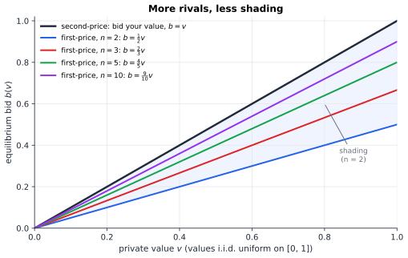
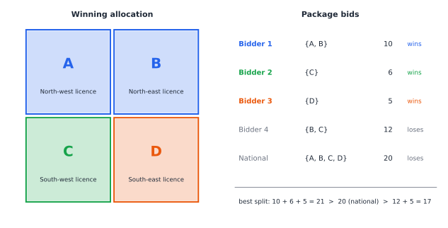

# Chapter 43 — Auctions, Markets, and Strategic Bidding

[← Previous](42-mechanism-design.md) · [Track C](README.md) · [Table of Contents](../../00-front/table-of-contents.md) · [Next →](44-coalitions-and-voting.md)

> **Level 2 · Track C — Game Theory and Strategic Intelligence**
> **Builds on:** [Ch. 19](../../part-6-probability-statistics/19-probability.md), [Ch. 5](../../part-2-calculus/05-integral-calculus.md), [Ch. 41](41-incomplete-information-games.md), [Ch. 42](42-mechanism-design.md) · **Leads to:** [Ch. 46](46-adversarial-decision-making.md), [Ch. 96](../j-frontier/96-mathematical-economics.md) · **Related:** [Ch. 48](../d-optimization/48-duality.md), [Ch. 49](../d-optimization/49-integer-programming.md), [Ch. 38](../b-probability-information/38-monte-carlo.md)
> **Reading time:** ~25 min

## 43.1 The hook

In the year 2000, several European governments sold licences for the third generation of mobile phone networks, the radio spectrum that every smartphone now lives on. The licences were broadly similar, the bidders were often the very same telecom giants, and the auctions happened within months of each other. The outcomes were not similar at all.

The United Kingdom raised about £22.5 billion, roughly 2.5% of national income, in an auction that ran for seven weeks and 150 rounds. The Netherlands, a few months later, raised about €2.7 billion, a small fraction of what had been forecast, with about the same number of licences as there were strong incumbent firms ready to bid. In Switzerland, bidders withdrew or merged before the auction began, four licences went to four bidders at close to the reserve price, and the government collected about CHF 205 million, a tiny fraction of the British take per head of population. The economist Paul Klemperer, who helped design the British auction, summed up the lesson: in auctions, *details matter*.

Go back ten years and the details bite harder. In 1990 New Zealand sold spectrum licences with a **second-price** sealed-bid auction: the highest bidder wins and pays the second-highest bid. Economists love this format; we derived it in [Ch. 42](42-mechanism-design.md#423-the-mathematics) as the unique truthful way to sell one item. The public did not love it. As John McMillan later reported, in one licence the winning bid was NZ$100,000 and the price paid was NZ$6, because the only other bid was NZ$6. Headlines asked why the government was giving away the airwaves.

So which is it? Is the second-price auction a mathematical triumph (truthful, efficient, simple) or a revenue disaster? Why did "the same" auction raise, per head of population, more than 25 times as much in one country as in another? And what is a seller supposed to do when she does not even know what the bidders think the item is worth?

By the end of this chapter you will be able to compute, for a clean model, exactly what each format earns. And you will meet a theorem so strong it feels like a trick: in that clean model, a whole family of very different-looking auctions earns *exactly the same* expected revenue. The real-world disasters are all stories about where that model breaks.

## 43.2 The big idea

There are four classic formats for selling one item.

| Format | How it runs | Winner pays |
|---|---|---|
| **English** (ascending) | Price rises; bidders drop out; last one standing wins | The price at which the second-to-last bidder quit |
| **Dutch** (descending) | Price falls from high; first to shout "mine" wins | The price at which she shouted |
| **First-price sealed** | Everyone submits one sealed bid; highest wins | Her own bid |
| **Second-price sealed** (Vickrey) | Same, but… | The second-highest bid |

Two pairs collapse at once. A Dutch auction is **strategically identical** to a first-price sealed auction: in both, your only decision is the price at which you commit, and you pay that price if it is the highest. And when bidders know their own values (the **private values** setting), an English auction works like a second-price auction: you stay in until the price reaches your value, and the winner pays roughly where the runner-up dropped out.

So really there are two worlds, and they push bidders in opposite directions.

- In the **second-price** world, your bid controls only *whether* you win, not *what you pay*. So you should bid exactly your value: bidding higher only adds wins at a loss, bidding lower only loses wins you wanted ([Ch. 42](42-mechanism-design.md#425-the-experiment) has the picture).
- In the **first-price** world, your bid is your price. Bid your value and you win nothing (zero profit); bid lower and you keep a margin, at the risk of losing. So everyone **shades**: they bid below their values, trading off a fatter margin against a thinner chance of winning.

The analogy is the difference between a fixed-price menu and haggling. In the first, you only need to know what you want. In the second, you need a theory of everybody else.

Here is the surprise to keep in mind. In the second-price auction the seller collects the *second*-highest value. In the first-price auction she collects the highest *bid*, which is shaded. One number is a lower value, the other a shaded higher value. They could be ordered either way. Section 43.3 shows they are equal on average, and not by coincidence.



*Figure 43.1 — Equilibrium bidding with values uniform on $[0,1]$. Second-price bidders bid their value; first-price bidders shade, and the shading shrinks as rivals multiply.*

## 43.3 The mathematics

### The model

There are $n$ bidders. Bidder $i$ has a private value $v_i$, and the values are **independent and identically distributed** with a continuous distribution function $F$ and density $f$ on $[0,\bar v]$ (the *independent private values*, or IPV, model). Each bidder knows her own value and only the distribution of the others', which makes this a Bayesian game in the sense of [Ch. 41](41-incomplete-information-games.md). Utility is quasilinear: win at price $p$ and get $v_i - p$; lose and get $0$. For concrete numbers we use the uniform case $F(v)=v$ on $[0,1]$.

One fact from probability ([Ch. 19](../../part-6-probability-statistics/19-probability.md#198-cumulative-distributions)) does most of the work. The maximum of $k$ independent uniforms has CDF $P(\max\le t)=t^k$, so its density is $k t^{k-1}$ and its mean is $\int_0^1 t\cdot k t^{k-1}\,dt = \frac{k}{k+1}$. For the second-highest of $n$ uniforms, the mean is $\frac{n-1}{n+1}$.

### Result 1: equilibrium shading in the first-price auction

> [!theorem] First-price equilibrium, uniform values
> With $n$ bidders and values i.i.d. uniform on $[0,1]$, the strategy $\beta(v)=\frac{n-1}{n}\,v$ played by everyone is a symmetric Bayes–Nash equilibrium of the first-price auction.

*Proof.* Guess that the other $n-1$ bidders use $\beta(v)=c\,v$ for some $c\in(0,1]$, and look for bidder $1$'s best bid $b$ when her value is $v$. She wins if every rival bids below $b$, i.e. if every rival value is below $b/c$. For $b\le c$, independence gives

$$
P(\text{win}) = \left(\frac{b}{c}\right)^{n-1}, \qquad \pi(b) = (v-b)\left(\frac{b}{c}\right)^{n-1}.
$$

Differentiate and set to zero (the constant $c^{-(n-1)}$ drops out):

$$
-b^{n-1} + (n-1)(v-b)\,b^{n-2} = 0 \quad\Longrightarrow\quad b = \frac{n-1}{n}\,v .
$$

The second derivative is negative at this point, so it is a maximum, and bids above $c$ win with certainty but cost more, so they are worse. Her best response is linear with slope $\frac{n-1}{n}$. For a *symmetric* equilibrium her best response must be the strategy we assumed for the others, so $c=\frac{n-1}{n}$. Since $\frac{n-1}{n}v\le c$ for every $v\le 1$, the condition $b\le c$ we used holds. ∎

With two bidders you bid half your value. With ten, you bid 90%. Competition squeezes out the shading, which is Figure 43.1.

There is a pretty interpretation. If $Y$ is the highest of the other $n-1$ values, then $E[Y\mid Y<v] = \frac{n-1}{n}v$ for uniforms. You bid what you expect the strongest rival's value to be, *given that you beat it*. That formula, $\beta(v)=E[Y\mid Y<v]$, is the general first-price equilibrium for any distribution $F$.

### Result 2: revenue equivalence

Expected revenue in the second-price auction is the expected second-highest value: $\frac{n-1}{n+1}$. In the first-price auction it is the expected highest bid, $\frac{n-1}{n}\cdot E[\max_i v_i] = \frac{n-1}{n}\cdot\frac{n}{n+1} = \frac{n-1}{n+1}$. **Identical.** For $n=2$, both give $\frac13$.

Coincidence? [Ch. 42](42-mechanism-design.md#423-the-mathematics) already has the reason. Apply Myerson's lemma to the *expected* allocation and payment. Let $x(v)$ be the probability that a bidder of value $v$ wins and $m(v)$ her expected payment, both in equilibrium. Truth-telling to the "direct" version of any equilibrium (the revelation principle) gives the same sandwich argument as in Ch. 42, now in expectation, and hence

$$
m(v) = v\,x(v) - \int_0^v x(z)\,dz + m(0).
$$

> [!theorem] Revenue equivalence
> In the IPV model, any two auctions in which, in equilibrium, (i) the bidder with the highest value always wins, and (ii) a bidder with value $0$ pays nothing in expectation, give every bidder the same expected payment $m(v)$, and hence give the seller the same expected revenue.

*Proof.* Under (i), a bidder of value $v$ wins exactly when all $n-1$ others have lower values, so $x(v)=F(v)^{n-1}$, the same in both auctions. Under (ii), $m(0)=0$. The formula above then determines $m(v)$ completely from $x$, so it is the same in both auctions. Expected revenue is $n\,E[m(v_i)]$, which is therefore the same too. ∎

Check it in the uniform case: $x(v)=v^{n-1}$, so $m(v)=v^n - \frac{v^n}{n} = \frac{n-1}{n}v^n$, and $n\,E[m] = (n-1)\int_0^1 v^n\,dv = \frac{n-1}{n+1}$. It also covers stranger formats: an **all-pay auction**, where every bidder pays her bid win or lose (a model of lobbying, patent races, or the effort spent on a job application), earns the same expected revenue too.

> [!warning] What revenue equivalence does not say
> It says *expected* revenue is equal. The distributions differ: the second-price price is more variable, which is exactly how New Zealand ended up selling a licence for NZ$6 when there was only one serious bidder. A risk-averse seller, or a government facing headlines, is not indifferent.

### Result 3: the optimal auction

The mystery in [Ch. 42](42-mechanism-design.md#427-loose-threads) asked which mechanism earns the seller the most. Revenue equivalence says all "efficient" formats tie, so to do better the seller must sometimes **not** give the item to the highest bidder. The cleanest lever is a **reserve price** $r$: no sale unless someone bids at least $r$.

Start with one bidder. With a posted price $r$, she buys if $v\ge r$, so revenue is $r\,(1-F(r)) = r(1-r)$ for uniform values. Maximising, $r^*=\frac12$ and revenue is $\frac14$. With no reserve, one bidder in a second-price auction pays $0$. So the seller *should* risk not selling at all.

For $n$ bidders the same calculation becomes a short identity. Take the expected payment $m(v)$ above, with $m(0)=0$, average it over $v\sim F$, and swap the order of integration in the double integral:

$$
\int_0^{\bar v}\!\!\int_0^v x(z)\,dz\,f(v)\,dv = \int_0^{\bar v} x(z)\,\big(1-F(z)\big)\,dz .
$$

That gives

$$
E\big[m(v)\big] = \int_0^{\bar v} x(v)\left[v - \frac{1-F(v)}{f(v)}\right] f(v)\,dv = E\big[\varphi(v)\,x(v)\big],
\qquad \varphi(v) = v - \frac{1-F(v)}{f(v)} .
$$

> [!theorem] Myerson's optimal auction (regular case)
> Expected revenue of any truthful mechanism equals the expected **virtual value** of the winner, $E\big[\sum_i \varphi(v_i)\,x_i\big]$. If $\varphi$ is increasing, revenue is maximised by giving the item to the bidder with the highest $\varphi(v_i)$, provided it is positive, and to no one otherwise. For i.i.d. bidders this is a second-price auction with reserve $r^*$ solving $\varphi(r^*)=0$.

*Proof.* Summing over bidders, expected revenue is $E[\sum_i \varphi(v_i)x_i(\mathbf v)]$. For each value profile, the expression $\sum_i \varphi(v_i)x_i$ with $\sum_i x_i\le 1$ is largest when all weight goes to the largest $\varphi(v_i)$ if that is positive, and nothing is sold if all are negative. If $\varphi$ is increasing, this allocation is monotone in each bid, so by Myerson's lemma it can be made truthful, and the payment it forces is "the larger of the reserve and the second-highest bid". Maximising pointwise maximises the expectation. ∎

For uniform values $\varphi(v) = v - (1-v) = 2v-1$, so $r^*=\frac12$, **whatever the number of bidders**. With two bidders, the reserve lifts expected revenue from $\frac13\approx0.333$ to $\frac{5}{12}\approx 0.417$, a 25% gain, at the cost of sometimes not selling to a bidder who valued the item. Optimal revenue and efficiency pull in different directions.

> [!mystery] When values are not private
> Everything above assumed you know what the item is worth *to you*. Spectrum, oil leases and takeover targets are worth roughly the same to everyone, and nobody knows how much. Then winning is bad news: you win exactly when you were the most optimistic, and the naive bidder systematically overpays. This **winner's curse** breaks revenue equivalence, and the English auction, which lets you watch rivals quit, now beats the sealed formats by "linking" your price to their information.
> The *linkage principle* and the affiliated-values model that makes it precise are in [Ch. 96](../j-frontier/96-mathematical-economics.md).

### Many items: packages and markets

The 3G auctions sold many licences at once, and values were **not additive**. A firm that wins one regional licence may need the neighbouring one to build a viable network: the pair is worth more than the sum of its parts (complements). Figure 43.2 shows a toy version.



*Figure 43.2 — A package auction. Bids are on bundles; the auctioneer picks the set of non-overlapping bids with the largest total.*

Picking the winners is the **winner determination problem**: choose a set of pairwise disjoint packages with maximum total bid. Here the three local bidders together (21) beat the national bidder (20). Now compute VCG payments as in [Ch. 42](42-mechanism-design.md#423-the-mathematics). Without bidder 1, the best allocation is the national bid, 20; with her, the others get $6+5=11$; so she pays $9$. Similarly bidder 2 pays $20-15=5$ and bidder 3 pays $20-16=4$. **Total revenue: 18**, although a single bidder was offering 20 for the lot. Worse, if bidders 2 and 3 were one firm, the incentives would change again. Truthful does not mean sensible.

Two design ideas tame this. **Simultaneous ascending (clock) auctions** raise prices on all licences together round by round, so bidders discover which packages are affordable; the UK 3G sale was of this family. And the theory of **markets** says that when goods are substitutes, a set of item prices exists at which every bidder demands exactly what she is allocated, a **Walrasian equilibrium**, which an ascending clock can find.

Not all markets have prices. Doctors and hospitals, students and schools, kidney donors and patients: here money cannot or should not clear the market. Gale and Shapley showed in 1962 that in a two-sided matching market, a **stable matching** (no doctor and hospital who would both rather be with each other than with their assigned partners) always exists, and the next section gives the algorithm that finds it.

## 43.4 The algorithm

**Deferred acceptance** (Gale–Shapley). One side proposes; the other side holds its best offer so far and rejects the rest, until no one is left to propose.

```python
def deferred_acceptance(prop_prefs, recv_prefs):
    """prop_prefs[p] = list of receivers, best first; recv_prefs[r] likewise.
    Returns dict receiver -> proposer for a proposer-optimal stable matching."""
    rank = {r: {p: k for k, p in enumerate(lst)} for r, lst in recv_prefs.items()}
    nxt = {p: 0 for p in prop_prefs}             # next receiver p will try
    held = {}                                    # receiver -> proposer held
    free = list(prop_prefs)
    while free:
        p = free.pop()
        if nxt[p] >= len(prop_prefs[p]):
            continue                             # p has been rejected everywhere
        r = prop_prefs[p][nxt[p]]; nxt[p] += 1
        if p not in rank[r]:
            free.append(p); continue             # r finds p unacceptable
        if r not in held:
            held[r] = p
        elif rank[r][p] < rank[r][held[r]]:
            free.append(held[r]); held[r] = p    # r trades up
        else:
            free.append(p)                       # r rejects p
    return held
```

**Why it stops, and why the result is stable.** Each proposer proposes to each receiver at most once, so with $n$ on each side there are at most $n^2$ proposals: $O(n^2)$ time. A receiver's held partner only ever improves. Now suppose $p$ and $r$ would both prefer each other to their final partners. Then $p$ proposed to $r$ before reaching her final partner (she ranks $r$ higher), and $r$ rejected her, at that time or later, for someone $r$ prefers. Since $r$ only trades up, $r$'s final partner beats $p$, contradicting the assumption. So no blocking pair exists.

**The auction side.** Monte Carlo ([Ch. 38](../b-probability-information/38-monte-carlo.md)) is the workhorse for comparing formats: draw values, apply the equilibrium strategies, average revenue. Its error falls like $1/\sqrt{\text{samples}}$, so to separate $\frac13$ from $\frac{5}{12}$ reliably you need thousands of draws, and to see a 1% revenue difference you need hundreds of thousands. For package auctions, winner determination is a weighted set-packing integer program ([Ch. 49](../d-optimization/49-integer-programming.md)); brute force over subsets of bids, as used to check the numbers of Figure 43.2, is exponential and fine only for toy cases.

**Failure cases.** Deferred acceptance is strategy-proof for the *proposing* side only; receivers can sometimes gain by misreporting. With couples who must be placed together (a real issue in medical residency matching), a stable matching may not exist at all. Clock auctions can suffer the **exposure problem**: a bidder who chases a complementary pair can end up holding only one licence at a price above its stand-alone value.

## 43.5 The experiment

**A. Find your best first-price bid.** Your value is $0.8$. Blue: one rival who bids half her (uniform) value, so you win with probability $2x$. Red: two such rivals bidding two-thirds of their values, so you win with probability $(1.5x)^2$. The curves are your expected profit at bid $x$.

```desmos-graph
left=0; right=0.9; bottom=-0.05; top=0.4
---
y=(0.8-x)\cdot 2x|blue|0<x<0.5
y=0.8-x|blue|0.5<x<0.8
y=(0.8-x)(1.5x)^{2}|red|0<x<0.6667
y=0.8-x|red|0.6667<x<0.8
(0.4,0.32)|label:best bid, 1 rival
(0.5333,0.1707)|label:best bid, 2 rivals
x=0.8|grey|dashed
```

*The peaks sit at $\frac12\cdot 0.8=0.4$ and $\frac23\cdot 0.8\approx0.533$: exactly the equilibrium bids of Result 1.*

Change the value $0.8$ to $0.5$ (in all four curves) and confirm that the peaks move to $0.25$ and $0.333$. Then make the one rival more aggressive: replace $2x$ by $1.25x$ (she bids 80% of her value, for $x<0.8$). Does your best bid rise or fall? Is it still a best response to bid half your value?

**B. Race the formats.** Draw values, play the equilibrium strategies, compare revenues. Change `n`, `reserve`, and the value distribution.

```python
import numpy as np
import matplotlib.pyplot as plt

rng = np.random.default_rng(0)
n, trials, reserve = 2, 200_000, 0.5
v = rng.random((trials, n))                 # i.i.d. uniform private values
s = np.sort(v, axis=1)
top, second = s[:, -1], s[:, -2]

first_price  = (n - 1) / n * top            # highest equilibrium bid
second_price = second                       # truthful bids: pay the runner-up
with_reserve = np.where(top < reserve, 0.0, np.maximum(second, reserve))

for name, rev in [("first-price", first_price), ("second-price", second_price),
                  (f"second-price, reserve {reserve}", with_reserve)]:
    se = rev.std() / np.sqrt(trials)
    print(f"{name:28s} mean {rev.mean():.4f} +/- {1.96*se:.4f}   std {rev.std():.3f}")
print("theory (no reserve):", (n - 1) / (n + 1))

plt.hist(first_price, bins=80, alpha=0.6, density=True, label="first-price revenue")
plt.hist(second_price, bins=80, alpha=0.6, density=True, label="second-price revenue")
plt.xlabel("seller revenue"); plt.legend(); plt.show()
```

Same mean, different spread: the histogram shows why a risk-averse seller cares about the format. Now replace `rng.random` with `rng.beta(2, 5, ...)` (values usually low) and note that the first-price line `(n-1)/n * top` is no longer the equilibrium. What breaks first, the code or the theorem?

## 43.6 The challenge

1. **Intuition.** Explain without equations why the optimal reserve price for uniform values is $\frac12$ *no matter how many bidders there are*, even though with 100 bidders the reserve almost never binds. Then explain why governments are often told to set reserves well above what this theory suggests.
2. **Derivation.** Let two bidders have values on $[0,1]$ with CDF $F(v)=v^2$ (strong bidders are common). Use revenue equivalence to find the first-price equilibrium bid $\beta(v)$, the seller's expected revenue, and the optimal reserve price from the virtual value $\varphi(v)$. Is $\varphi$ increasing here?
3. **Implementation.** Write a brute-force winner-determination solver for package bids and a VCG payment routine. Reproduce the payments $9,5,4$ for Figure 43.2. Then find a package bid that bidders 2 and 3, acting together, could *add* (a fake shill bid) to lower their total payment.
4. **Open investigation.** Simulate a repeated first-price auction in which each of several bidders adapts her shading factor by a simple learning rule (for example, nudge the factor toward whatever would have earned more last round). Do the factors converge to $\frac{n-1}{n}$? Does the answer change with the learning rate, with noise, or with asymmetric bidders? Online ad exchanges, which moved from second-price to first-price auctions around 2019, face exactly this question.

## 43.7 Loose threads

We answered the questions of the hook in a clean world: independent private values, risk-neutral bidders, one item. In that world the second-price auction is truthful and the first-price auction is not, yet they earn the same, and the best a seller can do is a second-price auction with a well-chosen reserve. The real failures came from where that world ends: too few serious bidders (Switzerland, the Netherlands, the NZ$6 licence), common values, packages, and collusion.

> [!mystery] Prices are shadows of a linear program
> In a market where buyers each want one item and sellers each have one, the efficient assignment is a linear program, and something odd happens: its **dual variables** are exactly a set of market-clearing prices, and the set of all such prices forms a lattice with a buyer-best and a seller-best corner. Why does the dual of an assignment problem know about competitive equilibrium?
> That bridge between optimisation and markets runs through LP duality in [Ch. 48](../d-optimization/48-duality.md).

> [!mystery] Bidding against a machine that learns
> A real bidder on an ad exchange does not know $F$, faces millions of auctions, and competes with algorithms that are themselves adapting. Is there a strategy whose total profit is guaranteed to be nearly as good as the best fixed shading factor in hindsight, whatever the opponents do?
> Strategies with vanishing **regret** do exactly that; how they work, and what equilibrium they converge to, is the subject of [Ch. 46](46-adversarial-decision-making.md).

We also left untouched:

- **Asymmetric bidders.** When one bidder is known to be strong, the first-price equilibrium has no closed form and revenue equivalence fails. Handicapping the strong bidder can *raise* revenue.
- **Many-to-one matching with couples** and the strategic behaviour of receiving sides.
- **Why the VCG revenue in Figure 43.2 was "too low"**: the set of payments that no coalition can object to is called the *core*, and modern spectrum auctions use core-selecting payment rules. The theory of the core belongs to cooperative games, which is where [Ch. 44](44-coalitions-and-voting.md) begins.

## Further reading

- V. Krishna, *Auction Theory*, 2nd ed., Academic Press, 2010. The standard graduate text; Chapters 2–5 cover everything in 43.3 for general distributions.
- P. Klemperer, *Auctions: Theory and Practice*, Princeton University Press, 2004. Includes the account of the European 3G auctions and why their designs mattered.
- P. Milgrom, *Putting Auction Theory to Work*, Cambridge University Press, 2004. Package auctions, clock auctions and the linkage principle from one of the designers of the US spectrum auctions.
- A. E. Roth, *Who Gets What — and Why*, Houghton Mifflin Harcourt, 2015. A readable account of matching markets, from medical residencies to kidney exchange.
- J. McMillan, "Selling spectrum rights", *Journal of Economic Perspectives* 8(3), 1994. The New Zealand story and early lessons in spectrum auction design.
