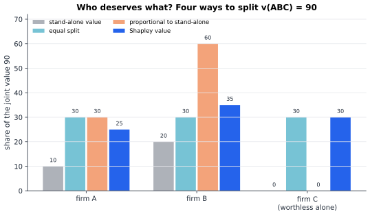
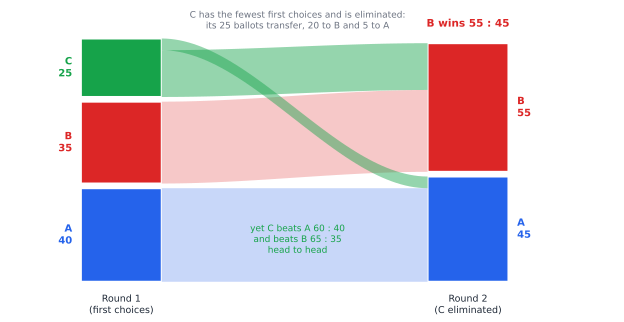

# Chapter 44 — Coalitions, Voting, and Collective Decisions

[← Previous](43-auctions-and-markets.md) · [Track C](README.md) · [Table of Contents](../../00-front/table-of-contents.md) · [Next →](45-evolutionary-games.md)

> **Level 2 · Track C — Game Theory and Strategic Intelligence**
> **Builds on:** [Ch. 23](../../part-7-numerical-computational/23-optimization.md), [Ch. 39](39-game-theory-basics.md), [Ch. 42](42-mechanism-design.md), [Ch. 43](43-auctions-and-markets.md) · **Leads to:** [Ch. 45](45-evolutionary-games.md), [Ch. 96](../j-frontier/96-mathematical-economics.md) · **Related:** [Ch. 28](../a-algorithms/28-combinatorics.md), [Ch. 38](../b-probability-information/38-monte-carlo.md), [Ch. 48](../d-optimization/48-duality.md)
> **Reading time:** ~25 min

## 44.1 The hook

When the European Economic Community was founded in 1958, its six members wrote a voting rule for the Council of Ministers. On many questions each country cast a weighted vote: France, West Germany and Italy 4 each, Belgium and the Netherlands 2 each, Luxembourg 1. There were 17 votes in all, and a proposal passed with 12. Luxembourg, the smallest member, had one vote out of seventeen, about 6% of the total. A fair-looking rule.

Here is the strange part. List every possible coalition of countries voting "yes", and ask in how many of them Luxembourg's vote *made the difference* between passing and failing. The answer is **none**. Not one. Luxembourg's vote could never change the outcome of a weighted vote, in any configuration of the other five. The country had a vote, but it had **no power**.

That puzzle is about *voting* power, but the same question hides in every joint venture. Three energy firms build a shared microgrid. Alone, firm A could earn 10 (in millions per year), firm B 20, and firm C nothing: it owns storage but no generation. Any two together earn more (A and B 40, A and C 50, B and C 60) and all three together earn 90. Firm C is worthless on its own and essential in partnership. How should they split the 90? Equally? In proportion to what each could earn alone (which gives C nothing)? Something else?

And the question hides in elections too. A hundred voters rank three candidates:

| Voters | 1st | 2nd | 3rd |
|---|---|---|---|
| 40 | A | C | B |
| 35 | B | C | A |
| 20 | C | B | A |
| 5 | C | A | B |

Under plurality (most first choices), A wins. Under ranked-choice instant runoff, B wins. Under the Borda count, and in every head-to-head contest, C wins. Same voters, same ballots, three different "winners".

So the chapter asks: **when a group acts together, who really holds power, who deserves what, and whose choice is "the group's choice"?** Mathematics cannot settle what is fair. What it can do, remarkably, is pin down exactly which fairness rules are even possible.

## 44.2 The big idea

The previous chapters were *non-cooperative*: each player chose a strategy alone, and we asked what equilibrium emerged. Now we zoom out. **Cooperative game theory** does not model how players negotiate. It assumes groups can sign binding agreements, and asks only: what can each coalition achieve, and how should the proceeds be split?

The central object is a single function. For each coalition $S$ of players, $v(S)$ is the total value that $S$ can guarantee on its own. Everything else, the alliances, the haggling, the threats to walk away, is compressed into those numbers.

The key intuition is **marginal contribution**. Imagine the players arrive at a room one at a time, in random order. Each, on arrival, adds something to the coalition already there. Firm C arriving first adds 0. Arriving after A, it adds $50-10=40$. Arriving last, it adds $90-40=50$. Your fair share, says Lloyd Shapley, is your **average marginal contribution over all arrival orders**. That turns out to be the only rule satisfying a handful of very mild fairness axioms.

The same idea measures **power**: in a voting game, a country's "contribution" is 1 if its arrival turns a losing coalition into a winning one, and 0 otherwise. Luxembourg's average contribution is zero because its single vote never tips any total across the line.

Voting rules are a different kind of aggregation: not dividing money but combining rankings. Here the big idea is negative, and you have already met it in [Ch. 42](42-mechanism-design.md#423-the-mathematics): Arrow's theorem says no ranking rule is perfect. So the practical question becomes "which imperfection do we prefer?", and the ranked-choice example shows the choice has teeth.



*Figure 44.1 — Four ways to split the microgrid's 90. The Shapley value (25, 35, 30) rewards C for what it enables, not for what it earns alone.*

## 44.3 The mathematics

### Coalitional games and the core

> [!definition] Transferable-utility (TU) game
> A set of players $N=\{1,\dots,n\}$ and a **characteristic function** $v:2^N\to\mathbb{R}$ with $v(\varnothing)=0$. The number $v(S)$ is the total payoff coalition $S$ can secure and divide freely among its members. The game is **superadditive** if $v(S\cup T)\ge v(S)+v(T)$ for disjoint $S,T$.

An **allocation** is a vector $\mathbf{x}=(x_1,\dots,x_n)$ with $\sum_i x_i = v(N)$: the grand coalition's value is shared out completely.

> [!definition] The core
> The **core** is the set of allocations that no coalition can object to:
>
> $$
> \sum_{i\in S} x_i \;\ge\; v(S)\quad\text{for every } S\subseteq N .
> $$
>
> If some $S$ received less than $v(S)$, its members could walk away together and do better.

For the microgrid, the Shapley allocation $(25,35,30)$ is in the core: each firm gets more than it earns alone, and the pairs get $60\ge40$, $55\ge50$, $65\ge60$. But the core can be empty, and the smallest example is worth proving.

> [!theorem] The three-player majority game has an empty core
> Let $v(S)=1$ if $\lvert S\rvert\ge 2$ and $v(S)=0$ otherwise (any two of three can take the whole prize). No allocation lies in the core.

*Proof.* Suppose $\mathbf{x}$ were in the core. The three two-player constraints say $x_1+x_2\ge 1$, $x_1+x_3\ge 1$, $x_2+x_3\ge1$. Adding them, $2(x_1+x_2+x_3)\ge 3$. But $x_1+x_2+x_3=v(N)=1$, so $2\ge 3$, a contradiction. ∎

The proof is a hint of something bigger: it multiplies the coalition constraints by weights ($\tfrac12$ each) that "cover" every player exactly once and finds them demanding more than exists.

> [!mystery] Exactly when is the core non-empty?
> The majority game failed because a balanced family of coalitions, each weighted by $\tfrac12$, together demanded $\tfrac32$ of a prize of size 1. Is that the *only* way a core can be empty? The Bondareva–Shapley theorem says yes: the core is non-empty precisely when no balanced weighting of coalitions demands more than $v(N)$. The proof is a two-line consequence of a deeper fact about linear programs and their duals.
> Find that fact, and the theorem, in [Ch. 48](../d-optimization/48-duality.md).

### The Shapley value

Let $\pi$ be an ordering of the players and $P_i^\pi$ the set of players who come before $i$ in $\pi$. Player $i$'s marginal contribution in that order is $v(P_i^\pi\cup\{i\}) - v(P_i^\pi)$.

> [!definition] Shapley value
>
> $$
> \phi_i(v) = \frac{1}{n!}\sum_{\pi}\Big[v\big(P_i^\pi\cup\{i\}\big)-v\big(P_i^\pi\big)\Big]
> \;=\; \sum_{S\subseteq N\setminus\{i\}} \frac{\lvert S\rvert!\,(n-\lvert S\rvert-1)!}{n!}\Big[v(S\cup\{i\})-v(S)\Big].
> $$

> [!theorem] The two formulas agree, and the Shapley value is efficient
> (a) The permutation average equals the subset sum above. (b) $\sum_i \phi_i(v) = v(N)$.

*Proof.* (a) Group the $n!$ orderings by the set $S$ of players who precede $i$. An ordering has predecessors exactly $S$ when it lists the $\lvert S\rvert$ members of $S$ in any order, then $i$, then the remaining $n-\lvert S\rvert-1$ players in any order. That is $\lvert S\rvert!\,(n-\lvert S\rvert-1)!$ orderings, each contributing the same marginal term $v(S\cup\{i\})-v(S)$. Dividing by $n!$ gives the subset formula. The counting is the standard one of [Ch. 28](../a-algorithms/28-combinatorics.md).

(b) Fix one ordering $\pi=(i_1,i_2,\dots,i_n)$. The marginal contributions along it telescope:

$$
\big[v(\{i_1\})-v(\varnothing)\big]+\big[v(\{i_1,i_2\})-v(\{i_1\})\big]+\dots+\big[v(N)-v(N\setminus\{i_n\})\big] = v(N)-v(\varnothing)=v(N).
$$

So the contributions of all players sum to $v(N)$ in *every* ordering. Averaging over orderings preserves this. ∎

Here is the microgrid in full. Each row is an arrival order; entries are marginal contributions.

| Order | A | B | C |
|---|---|---|---|
| A, B, C | 10 | 30 | 50 |
| A, C, B | 10 | 40 | 40 |
| B, A, C | 20 | 20 | 50 |
| B, C, A | 30 | 20 | 40 |
| C, A, B | 50 | 40 | 0 |
| C, B, A | 30 | 60 | 0 |
| **Average** | **25** | **35** | **30** |

Each row sums to 90, as the proof promised. Shapley characterised his value by four axioms: **efficiency** (shares add to $v(N)$), **symmetry** (interchangeable players get equal shares), **null player** (a player who never adds anything gets nothing), and **additivity** (the value of the sum of two games is the sum of the values). He proved that **exactly one** rule satisfies all four.

Four innocent axioms, and no freedom left at all. Yet additivity is the axiom economists argue about most: why should fairness in a *sum* of two unrelated games be the sum of the fair shares? The uniqueness proof, and the values you get by dropping additivity, are in [Ch. 96](../j-frontier/96-mathematical-economics.md).

### Power in weighted voting

A **weighted voting game** $[q;\,w_1,\dots,w_n]$ has $v(S)=1$ if $\sum_{i\in S}w_i\ge q$ and $0$ otherwise. The Shapley value of such a game is the **Shapley–Shubik power index**: the probability that player $i$ is **pivotal**, the one whose arrival first pushes the total to $q$. A cousin, the **Banzhaf index**, counts the coalitions in which $i$ is a **swing** (the coalition wins with $i$ and loses without), instead of orderings.

For the 1958 Council, $[12;\,4,4,4,2,2,1]$, enumeration of all $720$ orderings gives Shapley–Shubik indices $\frac{7}{30}$ for each large country, $\frac{3}{20}$ for Belgium and the Netherlands, and $0$ for Luxembourg. Banzhaf counts are $10,10,10,6,6,0$ swings. Luxembourg's zero has a one-line proof.

> [!example] Why Luxembourg never swings
> Luxembourg is a swing in coalition $S\ni$ Lu exactly when the others in $S$ have weight $W$ with $W<12$ but $W+1\ge12$, i.e. $W=11$. Every other country's weight is even ($4,4,4,2,2$), so $W$ is always even and never $11$. ∎

Notice that the weights are a terrible guide to power: Luxembourg had $\frac{1}{17}\approx 5.9\%$ of the votes and $0\%$ of the power, while Belgium had $\frac{2}{17}\approx 11.8\%$ of the votes and $15\%$ of the (Shapley–Shubik) power.

### Voting rules

With rankings instead of money, a **voting rule** maps a profile of rankings to a winner. Four common ones:

- **Plurality:** most first choices wins.
- **Borda count:** with $m$ candidates, a candidate gets $m-1$ points for each first place, $m-2$ for each second, and so on.
- **Instant-runoff (ranked-choice):** repeatedly eliminate the candidate with fewest first choices, moving each of its ballots to its next surviving choice, until someone has a majority.
- **Condorcet:** the candidate who beats every other head to head, if one exists (Figure 42.1 shows it need not).

The hook's profile separates them all. Plurality: A 40, B 35, C 25, so A. Borda (2, 1, 0 points): A $=2\cdot40+5=85$, B $=2\cdot35+20=90$, C $=40+35+2\cdot25=125$, so C. Head to head, C beats A by $60$ to $40$ and B by $65$ to $35$: C is the Condorcet winner. And instant runoff eliminates C first:



*Figure 44.2 — Instant runoff on the hook's ballots. The candidate everyone would accept as a compromise is the first one thrown out.*

This is the "squeezed centre" effect: a broadly acceptable candidate who is few voters' *first* choice can be eliminated before her broad support is ever counted. Arrow's theorem ([Ch. 42](42-mechanism-design.md#423-the-mathematics)) guarantees every rule has some such flaw. For **two** candidates, by contrast, May's theorem says simple majority is the only rule that treats voters equally, treats candidates equally, and responds positively to extra support. All the trouble starts at three.

### Bargaining

Two players can split a surplus if they agree; if they don't, they get disagreement payoffs $d_1,d_2$. Nash (1950) proposed four axioms (efficiency, symmetry, invariance to rescaling each player's utility, and independence of irrelevant alternatives) and proved they single out the allocation that maximises the **Nash product**

$$
(u_1-d_1)(u_2-d_2)\quad\text{over feasible agreements with } u_1\ge d_1,\ u_2\ge d_2 .
$$

> [!example] Splitting a unit surplus
> Feasible agreements are $u_1=x$, $u_2=1-x$. Maximise $g(x)=(x-d_1)(1-x-d_2)$. Then $g'(x) = (1-x-d_2)-(x-d_1) = 0$ gives
>
> $$
> x^* = \frac{1+d_1-d_2}{2}, \qquad 1-x^* = \frac{1-d_1+d_2}{2},
> $$
>
> and $g''=-2<0$ confirms a maximum. Each player gets her disagreement payoff plus **half the surplus** $1-d_1-d_2$. A better outside option is worth exactly half its value at the table.

Compare this with the two-player Shapley value: $\phi_1 = \frac12 v(\{1\}) + \frac12\big[v(N)-v(\{2\})\big] = v(\{1\})+\frac12\big[v(N)-v(\{1\})-v(\{2\})\big]$. With $d_i=v(\{i\})$ it is the *same* split. Two very different philosophies, averaging marginal contributions and maximising a product, agree whenever only two players are involved.

> [!mystery] Where does the Nash product come from?
> Nash's solution falls out of axioms, not out of any model of people actually haggling. Yet if two players alternate offers, and each round of delay shrinks the pie a little, the unique equilibrium of that very non-cooperative game converges to the Nash bargaining solution as the delay shrinks to zero. Why should an axiom about fairness and a game about impatience give the same answer?
> Rubinstein's alternating-offers model is worked out in [Ch. 96](../j-frontier/96-mathematical-economics.md).

## 44.4 The algorithm

**Exact Shapley values** cost $n!$ orderings or, with the subset formula, $2^{n-1}$ coalitions per player: $O(n\,2^n)$ evaluations of $v$. That is fine for $n\le 20$ and hopeless beyond. Two escapes:

1. **Monte Carlo over orderings** ([Ch. 38](../b-probability-information/38-monte-carlo.md)). Sample random permutations and average marginal contributions. Each sample is an unbiased estimate, so the error falls like $1/\sqrt{m}$ for $m$ samples. This is how "SHAP" explanations of machine-learning models approximate the Shapley value of each input feature, with "players" being features and $v(S)$ the model's prediction using only the features in $S$.
2. **Dynamic programming for weighted voting.** Player $i$ swings in $S$ when the other members' weight $W$ satisfies $q-w_i\le W\le q-1$. So count the subsets of the *other* players by total weight, a subset-sum count:

```python
def banzhaf_swings(weights, q):
    """Number of coalitions in which each player is a swing. O(n^2 * total weight)."""
    total = sum(weights)
    swings = []
    for i, wi in enumerate(weights):
        count = [1] + [0] * total            # count[W] = #subsets of others with weight W
        for j, wj in enumerate(weights):
            if j != i:
                for W in range(total, wj - 1, -1):
                    count[W] += count[W - wj]
        swings.append(sum(count[W] for W in range(max(q - wi, 0), q)))
    return swings

print(banzhaf_swings([4, 4, 4, 2, 2, 1], 12))   # [10, 10, 10, 6, 6, 0]
```

The running time is $O(n^2\,\sum w)$: polynomial in the weights' *size*, exponential in their number of digits, so "pseudo-polynomial". With large integer weights (populations, say), computing exact power indices is NP-hard, a fact that connects this chapter to [Ch. 30](../a-algorithms/30-limits-of-computation.md). A similar DP, also tracking coalition size, gives the Shapley–Shubik index.

**Instant runoff** is a loop: tally first surviving choices, stop if someone has a majority, else drop the lowest and repeat. It runs in $O(m\cdot B)$ for $m$ candidates and $B$ ballots, but it hides a numerical trap: **ties for last place**. Different tie-breaking rules can change the winner, and real election laws spend pages on them.

**Failure cases.** The core may be empty, so "find a core allocation" can have no answer; Shapley values always exist but may lie outside the core and then invite defection. Monte Carlo Shapley estimates for players with tiny values can be swamped by noise from large ones; stratify by position in the ordering to reduce variance.

## 44.5 The experiment

**A. Bargain with a risk-averse partner.** Blue is the Nash product for splitting 1 with disagreement points $d_1=0.1$, $d_2=0.3$. Red is player 1 bargaining with a *risk-averse* player 2 whose utility for money $y$ is $\sqrt{y}$, and disagreement points $0$.

```desmos-graph
left=0; right=1; bottom=-0.02; top=0.45
---
y=(x-0.1)(0.7-x)|blue|0.1<x<0.7
y=x\sqrt{1-x}|red|0<x<1
x=0.4|blue|dashed
x=0.6667|red|dashed
(0.4,0.09)|label:split 0.4 / 0.6
(0.6667,0.3849)|label:risk-neutral player takes 2/3
```

*Blue peaks at $x=\frac{1+0.1-0.3}{2}=0.4$. Red peaks at $x=\frac23$: the risk-averse partner, who fears disagreement more, concedes more.*

Change $d_1=0.1$ to $0.3$ in the blue curve (and its domain) and predict the new peak before you look. Then replace $\sqrt{1-x}$ by $(1-x)^{0.25}$ (even more risk-averse): how much more does player 1 get?

**B. Measure power, split value, count votes.** Change `v`, the voting weights and quota, and the ballots.

```python
import itertools
import numpy as np

def shapley(players, v):
    phi = dict.fromkeys(players, 0.0)
    orders = list(itertools.permutations(players))
    for order in orders:
        seen = frozenset()
        for p in order:
            phi[p] += (v(seen | {p}) - v(seen)) / len(orders)
            seen = seen | {p}
    return {p: round(x, 4) for p, x in phi.items()}

grid = {"": 0, "A": 10, "B": 20, "C": 0, "AB": 40, "AC": 50, "BC": 60, "ABC": 90}
print("microgrid:", shapley("ABC", lambda S: grid["".join(sorted(S))]))

w = {"Fr": 4, "De": 4, "It": 4, "Be": 2, "Nl": 2, "Lu": 1}; q = 12
print("1958 power:", shapley(list(w), lambda S: float(sum(w[p] for p in S) >= q)))

ballots = [(40, "ACB"), (35, "BCA"), (20, "CBA"), (5, "CAB")]
def irv(ballots, alive):
    while True:
        tally = {c: sum(n for n, r in ballots if [x for x in r if x in alive][0] == c) for c in alive}
        top = max(tally, key=tally.get)
        if 2 * tally[top] > sum(tally.values()): return top, tally
        alive = alive - {min(tally, key=tally.get)}
borda = {c: sum(n * (2 - r.index(c)) for n, r in ballots) for c in "ABC"}
print("IRV:", irv(ballots, set("ABC")), " Borda:", borda)
```

Now try to give Luxembourg power. What is the smallest change to one weight, or to the quota, that makes its index positive? Then replace the microgrid's $v(\{A,B\})=40$ by $70$ and check whether the Shapley value is still in the core.

## 44.6 The challenge

1. **Intuition.** In the "glove game", player L owns a left glove and players R1 and R2 each own a right glove; a pair is worth 1, a single glove nothing. Before computing anything, guess how the Shapley value splits the 1, and what the core contains. Explain why the two answers disagree so strongly, and which one you find fairer.
2. **Derivation.** Prove that for any weighted voting game, a player whose weight is $0$ has Shapley–Shubik index $0$, and that two players with equal weights have equal indices. Then find weights and a quota for three players in which the player with the *largest* weight has the *same* power as the smallest.
3. **Implementation.** Write a Monte Carlo Shapley estimator that samples $m$ random orderings. For a 15-player weighted voting game with random weights, plot the error against the exact (DP) index as a function of $m$ on log–log axes, and check the slope is $-\frac12$.
4. **Open investigation.** Draw 10,001 voters whose rankings of 3 candidates are independent and uniformly random over the 6 orders ("impartial culture"). Estimate by simulation how often there is no Condorcet winner, and how often plurality, Borda and instant runoff each fail to elect the Condorcet winner when one exists. How do these frequencies change with 4, 5, 6 candidates, and with voters whose preferences are correlated along a left–right axis? Which rule would you recommend, and on what evidence?

## 44.7 Loose threads

We found three ways a group can "decide": dividing value (the core, the Shapley value), measuring power (Shapley–Shubik and Banzhaf), and aggregating rankings (plurality, Borda, runoff, Condorcet). Each gave crisp mathematics and an uncomfortable surprise: an empty core, a member with no power, a compromise candidate eliminated first.

What we did not tell you:

- **Why the Shapley value is unique**, and what changes if you drop additivity, is in [Ch. 96](../j-frontier/96-mathematical-economics.md); so is **Rubinstein's bargaining game**, which turns Nash's axioms into a story about impatience.
- **When the core exists** is a linear-programming duality fact, held over for [Ch. 48](../d-optimization/48-duality.md).
- **How coalitions are actually formed**, who approaches whom and why some alliances are stable, was compressed into the single function $v$. Non-cooperative models of coalition formation are an active research area.

And one thread runs forward. Throughout this chapter we assumed players are *rational*: they calculate shares, compare outside options, and vote strategically or sincerely by choice. Yet in laboratory bargaining games, people reject "unfair" offers that would leave them better off, and they offer close to 50–50 when they could keep far more.

> [!mystery] Fairness from nowhere
> If a rational responder should accept any positive offer, why do human beings across many cultures reject offers below about a quarter of the pie, and why do proposers rarely make them? One answer is that fairness norms are *strategies that survived*: in a population that plays bargaining games over and over, the rules people follow are shaped by which ones prosper.
> How a population can evolve toward fair splits without anyone choosing them is the story of [Ch. 45](45-evolutionary-games.md).

## Further reading

- M. Maschler, E. Solan, S. Zamir, *Game Theory*, Cambridge University Press, 2013. Chapters 15–20 cover TU games, the core, the Shapley value and bargaining with full proofs.
- A. E. Roth (ed.), *The Shapley Value: Essays in Honor of Lloyd S. Shapley*, Cambridge University Press, 1988. Includes the original paper and the power-index literature.
- A. D. Taylor, A. M. Pacelli, *Mathematics and Politics*, 2nd ed., Springer, 2008. An accessible tour of voting rules, power indices and Arrow's theorem.
- M. J. Osborne, A. Rubinstein, *Bargaining and Markets*, Academic Press, 1990. Nash's axiomatic solution and its strategic foundations.
