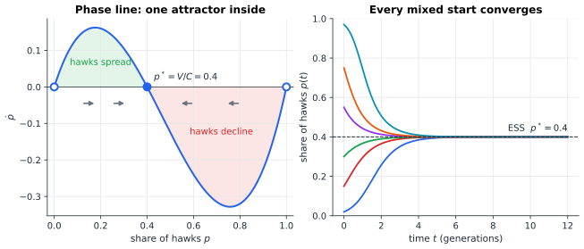
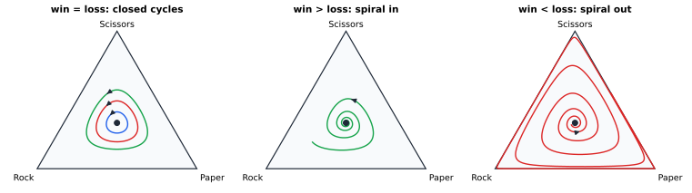

# Chapter 45 — Evolutionary Games and the Mathematics of Survival

[← Previous](44-coalitions-and-voting.md) · [Track C](README.md) · [Table of Contents](../../00-front/table-of-contents.md) · [Next →](46-adversarial-decision-making.md)

> **Level 2 · Track C — Game Theory and Strategic Intelligence**
> **Builds on:** [Ch. 11](../../part-4-differential-equations/11-ordinary-differential-equations.md), [Ch. 10](../../part-3-linear-algebra/10-eigenvalues-and-eigenvectors.md), [Ch. 39](39-game-theory-basics.md) · **Leads to:** [Ch. 46](46-adversarial-decision-making.md), [Ch. 83](../i-dynamical-systems/83-dynamical-systems.md), [Ch. 84](../i-dynamical-systems/84-chaos-theory.md) · **Related:** [Ch. 40](40-prisoners-dilemma.md), [Ch. 34](../b-probability-information/34-random-walks-and-markov-chains.md), [Ch. 53](../d-optimization/53-reinforcement-learning.md)
> **Reading time:** ~25 min

## 45.1 The hook

On the grassy hillsides of California's Coast Range lives a small lizard, *Uta stansburiana*, the side-blotched lizard. The males come in three throat colours, and each colour is a way of life.

- **Orange** males are big, aggressive and territorial. They hold large patches of ground with many females.
- **Blue** males are smaller. Each guards a single female closely and cooperates with blue neighbours.
- **Yellow** males look like females. They hold no territory at all; they sneak into other males' patches and mate on the sly.

Here is the trouble. Orange beats blue: a single blue mate-guarder cannot hold out against a bully with a large territory. Yellow beats orange: the bully's territory is too large to watch, and the sneakers slip in. Blue beats yellow: a male who never takes his eyes off his one female cannot be cuckolded.

That is rock, paper, scissors, played not by people but by genes. Field studies in the 1990s found that the three morphs do not settle down. The common colour of one breeding season becomes rarer later, its nemesis rises, and the cycle turns over the course of a few years. Nobody in this game is thinking. No lizard has a strategy in the sense of [Ch. 39](39-game-theory-basics.md); each simply *is* a strategy, fixed at birth. And yet the population behaves as if it were solving a game.

There is an older puzzle too. Why do so many animals fight by ritual? Stags roar and walk side by side before they ever lock antlers. Snakes wrestle without biting. If victory brings a female or a territory, why doesn't every individual fight all-out? A population of polite ritual fighters looks like an open invitation to one ruthless mutant.

Both puzzles have the same mathematical shape. We drop the idea of a rational player and replace it with a **population**: a crowd of individuals, each hard-wired to one strategy, meeting at random, with payoff measured as reproductive success. Strategies that score above the average spread. Strategies that score below it fade. The question is no longer "what should I do?" but "what survives?"

The answers are surprisingly sharp. Selection can find a Nash equilibrium without anyone computing one. It can also cycle forever, or shatter the population against the edges of the simplex, depending on one inequality between two numbers. By the end of this chapter you will know which inequality.

## 45.2 The big idea

Picture a large population as a bag of coloured marbles: a fraction $x_1$ play strategy 1, a fraction $x_2$ play strategy 2, and so on. The vector $\mathbf{x} = (x_1,\dots,x_n)$ has non-negative entries summing to 1. It lives on the **simplex**, a line segment for two strategies, a triangle for three.

Every generation, individuals pair off at random. An individual of type $i$ meets type $k$ with probability $x_k$, so its expected payoff is

$$
f_i(\mathbf{x}) = \sum_k a_{ik}\,x_k = (\mathbf{A}\mathbf{x})_i ,
$$

where $\mathbf{A}$ is the payoff matrix. The average payoff in the population is $\bar f = \mathbf{x}^\mathsf{T}\mathbf{A}\mathbf{x}$.

Now the one idea the chapter turns on. Payoff is fitness: the number of offspring. A type that does better than average grows *as a share of the population*. A type that does worse shrinks. Its growth rate is proportional to how far it is above the average:

$$
\frac{\dot x_i}{x_i} = f_i(\mathbf{x}) - \bar f(\mathbf{x}).
$$

That is the **replicator equation**. It is the "rich get richer, relative to the average" rule, and it has three features worth noticing before any algebra.

1. **Nobody optimises.** There is no argmax anywhere. Selection is a blind ratchet that only compares each type to the current average.
2. **The environment is the population.** Your fitness depends on who else is around, so the target moves as you climb towards it. That is what makes this a *game* and not ordinary optimisation.
3. **Extinct types stay extinct.** If $x_i = 0$ then $\dot x_i = 0$. Replicator dynamics cannot invent a strategy; only mutation can. So we will have to ask what happens when a rare mutant appears: can it invade?

That last question gives the second idea of the chapter, due to John Maynard Smith and George Price (1973). A strategy is **evolutionarily stable** if, once the whole population uses it, no small band of mutants playing anything else can invade. Think of an immune system rather than a chess player: the question is not whether the strategy is clever, but whether it can repel every intruder.

The analogy to hold on to is a thermostat. Hawks do well when hawks are rare (they bully the doves). Hawks do badly when hawks are common (they keep meeting each other and getting injured). So the hawk share is pushed up when it is low and down when it is high. Like a thermostat, the population settles at the share where the push is zero. That share turns out to be a mixed Nash equilibrium, discovered by a process that knows nothing about Nash.

## 45.3 The mathematics

### The replicator equation and the simplex

> [!definition] Replicator dynamics
> For a symmetric game with $n\times n$ payoff matrix $\mathbf{A}$, the replicator dynamics on the simplex $\Delta_n = \{\mathbf{x}\in\mathbb{R}^n : x_i\ge 0,\ \sum_i x_i = 1\}$ are
> $$
> \dot x_i = x_i\big[(\mathbf{A}\mathbf{x})_i - \mathbf{x}^\mathsf{T}\mathbf{A}\mathbf{x}\big],\qquad i=1,\dots,n.
> $$

Two quick checks show the definition makes sense. Summing over $i$ gives $\sum_i \dot x_i = \bar f - \bar f\sum_i x_i = 0$ on the simplex, so shares keep summing to 1. And each face $x_i = 0$ is invariant, so the simplex is never left. This is a system of nonlinear ODEs of the kind studied in [Section 11.9](../../part-4-differential-equations/11-ordinary-differential-equations.md#119-systems-of-differential-equations); we only need its rest points and their stability.

Adding a constant $c$ to a column of $\mathbf{A}$ adds $c\,x_k$ to every $f_i$ and to $\bar f$ alike, so it leaves the dynamics unchanged. Only payoff *differences* within a column matter. Keep this in mind: it will tell us which numbers in the rock–paper–scissors matrix actually drive the outcome.

### Rest points are (almost) Nash equilibria

> [!theorem] Folk theorem of evolutionary game theory (first part)
> If $\mathbf{p}$ is a symmetric Nash equilibrium of the game, then $\mathbf{p}$ is a rest point of the replicator dynamics. Conversely, an interior rest point is a Nash equilibrium, and any rest point that is the limit of an interior trajectory is a Nash equilibrium.

*Proof of the first two claims.* $\mathbf{p}$ is a Nash equilibrium when every strategy in its support earns the same payoff and no strategy earns more ([Ch. 39](39-game-theory-basics.md) gives this as the indifference principle). So for each $i$, either $p_i = 0$ or $(\mathbf{A}\mathbf{p})_i = \bar f$, and in both cases $\dot x_i = 0$. Conversely, at an interior rest point every $x_i > 0$, so $(\mathbf{A}\mathbf{x})_i = \bar f$ for all $i$. All pure strategies earn the same, so none is a profitable deviation. ∎

The word "almost" in the heading matters. Every pure strategy is a rest point (a population of all-hawks stays all-hawks, because nothing else exists to grow), even when it is a terrible strategy. Rest points are cheap. *Stable* rest points are what we want.

### Hawk and dove

Two animals contest a resource worth $V$. A hawk escalates until injured or the opponent retreats; an injury costs $C$. A dove displays and retreats if the other escalates. Two doves share. With $C > V > 0$:

$$
\mathbf{A} =
\begin{pmatrix}
\dfrac{V-C}{2} & V \\[2mm]
0 & \dfrac{V}{2}
\end{pmatrix}
\qquad
\begin{aligned}
&\text{row 1: hawk} \\
&\text{row 2: dove}
\end{aligned}
$$

Let $p$ be the hawk share. Then $f_H = p\frac{V-C}{2} + (1-p)V$ and $f_D = (1-p)\frac{V}{2}$, so $f_H - f_D = \frac{V - Cp}{2}$. With two strategies, $f_H - \bar f = (1-p)(f_H - f_D)$, and the replicator equation collapses to a single ODE:

$$
\dot p = \frac{p(1-p)(V - Cp)}{2}.
$$

The rest points are $p = 0$, $p = 1$ and $p^* = V/C$. The derivative of the right-hand side at $p^*$ is $-\tfrac{1}{2}p^*(1-p^*)C < 0$, so $p^*$ is a stable node; at $p=0$ the derivative is $V/2 > 0$ and at $p=1$ it is $(C-V)/2 > 0$, so both pure states are unstable. For $V = 4$, $C = 10$ the attractor is $p^* = 0.4$ and the local rate is $-1.2$ per generation: a disturbance decays like $e^{-1.2t}$.



*Left: the phase line $\dot p$ against the hawk share $p$ for $V=4$, $C=10$; hawks grow below $p^*=0.4$ and shrink above it. Right: six populations started anywhere strictly between 0 and 1 all converge to 40% hawks.*

This answers the ritual-fighting puzzle in one line. All-dove is not stable: a hawk among doves earns $V = 4$ against the doves' $V/2 = 2$. All-hawk is not stable either: when injuries are costly ($C > V$), a dove among hawks earns $0$ while hawks earn $(V-C)/2 = -3$. The population settles at a mixture, with the hawk share rising as the prize grows and falling as injuries get worse. Restraint is not kindness. It is what is left when escalation becomes too expensive.

Notice something unsettling. At $p^* = 0.4$ every individual earns $1.2$. In an all-dove population every individual would earn $2$. Selection drove the population to a state that is *worse for everyone* than one it cannot stay in. Evolution maximises nothing; this is the prisoner's dilemma of [Ch. 40](40-prisoners-dilemma.md) wearing fur.

### Evolutionary stability

> [!definition] Evolutionarily stable strategy (ESS)
> A (possibly mixed) strategy $\mathbf{p}$ is an ESS if for every other strategy $\mathbf{q}\neq\mathbf{p}$:
> 1. $\mathbf{q}^\mathsf{T}\mathbf{A}\mathbf{p} \le \mathbf{p}^\mathsf{T}\mathbf{A}\mathbf{p}$ (a Nash equilibrium: mutants do no better against the residents), and
> 2. if $\mathbf{q}^\mathsf{T}\mathbf{A}\mathbf{p} = \mathbf{p}^\mathsf{T}\mathbf{A}\mathbf{p}$, then $\mathbf{p}^\mathsf{T}\mathbf{A}\mathbf{q} > \mathbf{q}^\mathsf{T}\mathbf{A}\mathbf{q}$ (residents beat mutants in the rare mutant–mutant encounters).

Condition 2 is the tie-breaker: if a mutant is as good as the resident against residents, the resident must win against the mutant. An equivalent form (a standard result we quote rather than prove) is **local superiority**: $\mathbf{p}$ is an ESS if and only if

$$
\mathbf{p}^\mathsf{T}\mathbf{A}\mathbf{x} > \mathbf{x}^\mathsf{T}\mathbf{A}\mathbf{x}\quad\text{for all } \mathbf{x}\neq\mathbf{p} \text{ in a neighbourhood of } \mathbf{p} \text{ in } \Delta_n .
$$

In words: near $\mathbf{p}$, the strategy $\mathbf{p}$ does better against the current population than the population does against itself.

For hawk–dove with $\mathbf{p} = (p^*, 1-p^*)$ and $\mathbf{x} = (p, 1-p)$, a short computation gives $\mathbf{p}^\mathsf{T}\mathbf{A}\mathbf{x} - \mathbf{x}^\mathsf{T}\mathbf{A}\mathbf{x} = \tfrac{C}{2}(p - p^*)^2 > 0$, so $V/C$ hawks is an ESS. (Check it yourself: the difference is $(p^*-p)(f_H - f_D)$ evaluated at $\mathbf{x}$.)

### The central theorem: an ESS is an attractor

Why should a static "can't be invaded" condition say anything about the dynamics? Because of a clever Lyapunov function borrowed from information theory.

> [!theorem] ESS implies asymptotic stability (Taylor and Jonker; Hofbauer, Schuster and Sigmund)
> If $\mathbf{p}$ is an ESS, then $\mathbf{p}$ is an asymptotically stable rest point of the replicator dynamics.

*Proof.* Let $S$ be the support of $\mathbf{p}$ (the strategies it uses) and consider, for $\mathbf{x}$ with $x_i > 0$ on $S$, the relative entropy

$$
H(\mathbf{x}) = \sum_{i\in S} p_i \ln\frac{p_i}{x_i}.
$$

This is the Kullback–Leibler divergence of [Ch. 33](../b-probability-information/33-information-theory.md): $H \ge 0$ with equality only at $\mathbf{x} = \mathbf{p}$ (Gibbs' inequality), so $H$ is a candidate Lyapunov function. Differentiate along a trajectory, using $\dot x_i/x_i = (\mathbf{A}\mathbf{x})_i - \bar f$:

$$
\begin{aligned}
\dot H &= -\sum_{i\in S} p_i\,\frac{\dot x_i}{x_i}
       = -\sum_{i\in S} p_i\big[(\mathbf{A}\mathbf{x})_i - \mathbf{x}^\mathsf{T}\mathbf{A}\mathbf{x}\big] \\
       &= -\big[\mathbf{p}^\mathsf{T}\mathbf{A}\mathbf{x} - \mathbf{x}^\mathsf{T}\mathbf{A}\mathbf{x}\big].
\end{aligned}
$$

The last step uses $\sum_{i \in S} p_i = 1$. By local superiority, the bracket is strictly positive for $\mathbf{x}\neq\mathbf{p}$ near $\mathbf{p}$, so $\dot H < 0$ there. A function that is zero at $\mathbf{p}$, positive nearby, and strictly decreasing along trajectories forces nearby trajectories into $\mathbf{p}$: that is Lyapunov's theorem, the nonlinear cousin of the eigenvalue test in [Section 10.9](../../part-3-linear-algebra/10-eigenvalues-and-eigenvectors.md#109-applications-to-system-dynamics-and-stability). ∎

The proof is worth rereading for its meaning. Selection steadily reduces the information-theoretic "surprise" between the population and the ESS. The population is, in a precise sense, *learning* $\mathbf{p}$. The converse fails: there are asymptotically stable rest points that are not ESSs, so the static notion and the dynamic one are not the same thing.

> [!mystery] Selection as learning
> The relative entropy $H$ decreasing along selection looks exactly like a Bayesian posterior concentrating on the truth, and the replicator equation looks exactly like the multiplicative-weights update you will meet in [Ch. 46](46-adversarial-decision-making.md). Is natural selection literally an inference algorithm? The formal bridge between replicator dynamics and Bayesian updating, and its limits, is a thread picked up in [Ch. 35](../b-probability-information/35-bayesian-inference.md) and [Ch. 53](../d-optimization/53-reinforcement-learning.md).

### Rock, paper, scissors: one inequality decides everything

Back to the lizards. Use a generalised rock–paper–scissors matrix in which a win pays $a > 0$ and a loss costs $b > 0$:

$$
\mathbf{A} =
\begin{pmatrix}
0 & -b & a \\
a & 0 & -b \\
-b & a & 0
\end{pmatrix}
\qquad (\text{rows: Rock, Paper, Scissors}).
$$

By symmetry the unique interior rest point is the centre $\mathbf{p} = (\tfrac13,\tfrac13,\tfrac13)$. Every row and column sums to $a - b$. Write $\mathbf{x} = \mathbf{p} + \mathbf{d}$ with $\sum_i d_i = 0$. Then:

- $\mathbf{p}^\mathsf{T}\mathbf{A}\mathbf{x} = \tfrac13\sum_k x_k(\text{column sum}) = \tfrac{a-b}{3}$;
- $\mathbf{x}^\mathsf{T}\mathbf{A}\mathbf{x} = (a-b)(x_1x_2 + x_2x_3 + x_3x_1)$, because each pair $\{i,k\}$ contributes $a$ one way and $-b$ the other;
- $x_1x_2 + x_2x_3 + x_3x_1 = \tfrac12\big(1 - \lVert\mathbf{x}\rVert^2\big) = \tfrac13 - \tfrac12\lVert\mathbf{d}\rVert^2$.

Putting these together gives an exact identity, valid on the whole simplex, not only near the centre:

$$
\mathbf{p}^\mathsf{T}\mathbf{A}\mathbf{x} - \mathbf{x}^\mathsf{T}\mathbf{A}\mathbf{x} = \frac{a-b}{2}\,\lVert\mathbf{x}-\mathbf{p}\rVert^2 .
$$

Feed it into the Lyapunov computation, where now $H = -\ln 3 - \tfrac13\ln(x_1x_2x_3)$:

$$
\dot H = -\frac{a-b}{2}\,\lVert\mathbf{x}-\mathbf{p}\rVert^2 .
$$

Three regimes follow at once.

| Case | Sign of $\dot H$ | What happens | ESS? |
|---|---|---|---|
| $a > b$ (wins pay more than losses cost) | negative | every interior orbit spirals into the centre | yes |
| $a = b$ (zero-sum) | zero | $x_1x_2x_3$ is conserved; closed cycles forever | no |
| $a < b$ (losses hurt more) | positive | orbits spiral out towards the boundary | no |



*Replicator orbits on the strategy triangle. Left, $a=b=1$: each orbit is a level curve of $x_1x_2x_3$ and cycles forever. Centre, $a=1.5$, $b=1$: the centre is an ESS and attracts. Right, $a=1$, $b=1.5$: the orbit winds outwards and hugs the edges, so each strategy in turn nearly goes extinct.*

In the zero-sum case the cycle period near the centre follows from linearisation. The Jacobian at $\mathbf{p}$ restricted to the simplex has eigenvalues $\pm j/\sqrt3$ (check it with the eigenvalue tools of [Ch. 10](../../part-3-linear-algebra/10-eigenvalues-and-eigenvectors.md)), so small cycles have period $2\pi\sqrt3 \approx 10.9$ generations. Purely imaginary eigenvalues usually mean linearisation tells you nothing about stability; here the conserved quantity rescues us and proves the orbits really are closed.

The right-hand panel is the dramatic one. In a population where losing is worse than winning is good, the orbit approaches the boundary of the triangle: long stretches in which almost everyone plays one strategy, then a sudden takeover by its nemesis. In a finite population, one of those near-extinctions will eventually become a real one, and the cycle ends with a single survivor. Which survivor? That depends on luck, and luck is not in the replicator equation at all.

> [!mystery] When the deterministic model lies
> The replicator equation treats the population as infinite, so a share of $10^{-30}$ still counts as alive. Real populations have $N$ individuals, and a share below $1/N$ is extinction. How the deterministic cycles of the right-hand panel turn into a random walk that is absorbed at a corner, and how long that takes, is a question about Markov chains with absorbing states: see [Ch. 34](../b-probability-information/34-random-walks-and-markov-chains.md) and [Ch. 36](../b-probability-information/36-stochastic-processes.md).

### Population games beyond pairs

Nothing above required pairwise encounters. In a **population game** each strategy $i$ has a fitness $f_i(\mathbf{x})$ that is any smooth function of the population state: drivers choosing routes, where your travel time depends on how many others chose the same road, or packets choosing paths in a network. The replicator equation $\dot x_i = x_i(f_i - \bar f)$ still makes sense, and the folk theorem still holds. When the fitnesses come from a **potential**, $f_i = \partial\Phi/\partial x_i$, the dynamics climb $\Phi$ like a gradient flow ([Section 23.5](../../part-7-numerical-computational/23-optimization.md#235-gradient-based-methods)) and cannot cycle. Hawk–dove has a potential; rock–paper–scissors does not, which is exactly why it can cycle.

## 45.4 The algorithm

Simulating replicator dynamics takes a few lines of code, and it is easy to get wrong in a way that looks like biology.

```text
REPLICATOR(A, x0, h, steps):
    x ← x0                                # a point on the simplex
    for k = 1 .. steps:
        fit  ← A x                        # payoff of each pure strategy
        avg  ← xᵀ fit                     # population average
        x    ← x + h · x ⊙ (fit − avg)    # forward Euler step
        x    ← max(x, 0); x ← x / sum(x)  # guard against round-off
    return x
```

Each step costs one matrix–vector product, $O(n^2)$ for $n$ strategies. The simplex is preserved exactly in exact arithmetic (the update sums to zero), and the clipping line only cleans up floating-point dust.

**The failure case.** Run this on zero-sum rock–paper–scissors ($a=b$), where the true orbits are closed. Forward Euler spirals *outwards*. The reason is the stability analysis of ODE solvers from [Ch. 22](../../part-7-numerical-computational/22-numerical-methods.md) in miniature: near the centre the system behaves like $\dot{\mathbf{z}} = \mathbf{J}\mathbf{z}$ with eigenvalues $\pm j\omega$, $\omega = 1/\sqrt3$. One Euler step multiplies a mode by $1 + jh\omega$, whose magnitude is $\sqrt{1 + h^2\omega^2} > 1$. Over one unit of time the amplitude grows by roughly $e^{h\omega^2/2} = e^{h/6}$. With $h = 0.1$ and 200 generations that is a factor of about $e^{3.3}\approx 28$ in amplitude near the centre, and the orbit is flung against the edges of the triangle. A student who sees this plot and concludes "rock–paper–scissors populations are unstable" has discovered a property of Euler's method, not of lizards.

The fixes are standard:

- Use a higher-order integrator (RK4, or an adaptive solver). The drift does not vanish, but it drops from $O(h)$ to $O(h^4)$ per unit time.
- Monitor a conserved quantity. In the zero-sum case $x_1x_2x_3$ must stay constant; its drift is a free error meter.
- Beware the popular **discrete-time replicator** $x_i' = x_i\,\dfrac{c + f_i}{c + \bar f}$ with a background fitness $c > 0$. It is a perfectly good model of non-overlapping generations, but it is a *different* dynamical system. For zero-sum rock–paper–scissors it spirals outwards to the boundary, so its long-run behaviour disagrees with the continuous model.

**Finding ESSs.** For small games, enumerate supports. For each subset $S$ of strategies, solve the linear indifference system $(\mathbf{A}\mathbf{p})_i = (\mathbf{A}\mathbf{p})_k$ for $i,k\in S$ with $\sum_{i\in S}p_i = 1$ ([Ch. 8](../../part-3-linear-algebra/08-matrices-and-linear-systems.md)), keep solutions with $\mathbf{p}\ge 0$ that satisfy the Nash condition, then test the second ESS condition. That is $2^n$ subsets, fine for $n\le 15$ and hopeless beyond. Deciding whether a game has an ESS at all is known to be computationally hard in general, so there is no shortcut hiding in the background.

## 45.5 The experiment

First, the hawk–dove phase line. The curve is $\dot p = p(1-p)(V - Cp)/2$ with $V = 4$ and $C = 10$; the filled point is the ESS.

```desmos-graph
left=-0.05; right=1.05; bottom=-0.4; top=0.25
---
y=\frac{x(1-x)(4-10x)}{2}|blue|0<x<1
y=0|black|dashed
(0.4,0)|label:ESS p*=V/C
(0,0)|red
(1,0)|red
```

*The phase line for hawk–dove. Change the 4 (the prize $V$) and both 10s (the injury cost $C$) and watch the ESS slide to $V/C$; set $V$ above $C$ and the interior root leaves the interval, so all-hawk wins.*

Now the cycle. The script below integrates generalised rock–paper–scissors and plots the three shares and the product $x_1x_2x_3$ on a log scale.

```python
import numpy as np
import matplotlib.pyplot as plt

# --- knobs -------------------------------------------------------------
a, b = 1.0, 1.0             # win payoff and loss cost: try a=1.5 or b=1.5
h = 0.01                    # time step: try 0.1 and watch the cycle break
T = 200.0                   # total time in generations
x = np.array([0.5, 0.3, 0.2])   # starting shares of Rock, Paper, Scissors
method = "rk4"              # "euler" or "rk4"
# ------------------------------------------------------------------------

A = np.array([[0, -b, a], [a, 0, -b], [-b, a, 0]])

def f(x):
    fit = A @ x
    return x * (fit - x @ fit)

steps = int(T / h)
xs = np.empty((steps, 3))
for k in range(steps):
    xs[k] = x
    if method == "euler":
        x = x + h * f(x)
    else:
        k1 = f(x); k2 = f(x + h/2*k1); k3 = f(x + h/2*k2); k4 = f(x + h*k3)
        x = x + h/6 * (k1 + 2*k2 + 2*k3 + k4)

t = np.arange(steps) * h
fig, (ax1, ax2) = plt.subplots(1, 2, figsize=(10, 4))
for i, name in enumerate(["Rock", "Paper", "Scissors"]):
    ax1.plot(t, xs[:, i], label=name)
ax1.set_xlabel("generations"); ax1.set_ylabel("share"); ax1.legend()
ax2.semilogy(t, xs.prod(axis=1))
ax2.set_xlabel("generations"); ax2.set_ylabel("x1*x2*x3 (conserved if a=b)")
print("final shares:", xs[-1].round(4), " product:", xs[-1].prod())
plt.tight_layout(); plt.show()
```

Things to try, in order:

1. Run it as is. The product starts at $0.5\times0.3\times0.2 = 0.03$ and RK4 keeps it at $0.03$ to about ten decimal places. The shares cycle forever.
2. Switch `method = "euler"`. With `h = 0.01` the product drifts down to about $0.025$ in 200 generations; with `h = 0.1` it collapses to a few times $10^{-6}$ and Paper ends with over 99% of the population. Same model, different integrator, opposite conclusion.
3. Back on RK4, set `a = 1.5`. The product climbs towards its maximum $1/27\approx0.037$: the centre is an ESS. Then try `b = 1.5`: the product plunges towards zero and the population lives on the edges.
4. Starting share of `1e-12` for Scissors: how long until Scissors "comes back"? What would a real population of a million lizards do in that time?

## 45.6 The challenge

1. **Intuition.** In hawk–dove, the ESS hawk share $V/C$ does not depend on how many individuals there are or how often they meet. Explain in words why a larger prize leads to *more* fighting at equilibrium, and why everyone at the ESS earns less than in an all-dove world, yet all-dove cannot last.
2. **Derivation.** For the two-strategy coordination game $\mathbf{A} = \begin{pmatrix} 2 & 0 \\ 0 & 1\end{pmatrix}$ find all rest points of the replicator dynamics, classify their stability, and determine which are ESSs. Then show directly from the definition that the interior Nash equilibrium is *not* an ESS.
3. **Implementation.** Write the support-enumeration ESS finder sketched in 45.4 for $n\times n$ matrices. Test it on hawk–dove, on the three regimes of rock–paper–scissors, and on a $4\times4$ random matrix. Then compare: for 1,000 random $3\times 3$ games, what fraction have an ESS, and in what fraction does a random interior start converge to one under RK4?
4. **Open investigation.** Add a fourth strategy to rock–paper–scissors, for example a "Loner" who opts out of contests for a fixed payoff $\sigma$. Explore numerically how the long-run behaviour changes as $\sigma$ varies: do you see rest points, cycles, or something irregular? Is there a value of $\sigma$ at which the qualitative behaviour changes abruptly? (There is no single right answer; the shape of what you find is the point.)

## 45.7 Loose threads

This chapter took a deliberately narrow view: infinite populations, random pairing, payoffs that never change, and no mutation beyond the occasional invader. Every one of those assumptions hides a story.

We showed that the centre of rock–paper–scissors either attracts, repels, or is ringed by closed orbits. With three strategies that is the whole menu, because a flow on a two-dimensional triangle cannot do anything wilder than settle or cycle (the Poincaré–Bendixson theorem). With four strategies, the triangle becomes a tetrahedron, and that safety net disappears.

> [!mystery] Can selection be chaotic?
> With four or more strategies the replicator equation is a three-dimensional flow, and nothing forbids a strange attractor. There are explicit four-strategy games whose replicator orbits never settle and never repeat, with sensitive dependence on the initial mix of strategies. What makes a flow chaotic, and how you would recognise it in one of these population games, is the subject of [Ch. 84](../i-dynamical-systems/84-chaos-theory.md); the change of variables that turns any replicator system into a Lotka–Volterra predator–prey model, and lets you import its theory wholesale, waits in [Ch. 83](../i-dynamical-systems/83-dynamical-systems.md).

The second loose thread is the mystery of finite populations already raised in 45.3: drift, absorption and fixation probabilities. The third is the word "learning". The replicator update multiplies each share by a factor that grows with its payoff. Keep that picture in mind as you turn the page: in [Ch. 46](46-adversarial-decision-making.md) the same multiplicative rule reappears, run not by genes but by an algorithm facing an adversary, and there it comes with a guarantee that no amount of bad luck can break.

We have also said nothing about where the payoff matrix comes from. In the lizards, the matrix is not fixed: it depends on density, on the season, on the mix of females. Allowing the game itself to evolve in response to the population is one of the active frontiers where evolutionary game theory meets ecology.

## Further reading

- J. Maynard Smith, *Evolution and the Theory of Games*, Cambridge University Press, 1982. The founding text, readable and full of animal examples.
- J. Hofbauer and K. Sigmund, *Evolutionary Games and Population Dynamics*, Cambridge University Press, 1998. The standard mathematical treatment of replicator dynamics, ESS and Lotka–Volterra equivalence.
- M. A. Nowak, *Evolutionary Dynamics: Exploring the Equations of Life*, Harvard University Press, 2006. Finite populations, spatial games and cooperation, with a light touch.
- W. H. Sandholm, *Population Games and Evolutionary Dynamics*, MIT Press, 2010. Population games, potential games and the many dynamics beyond replicator.
