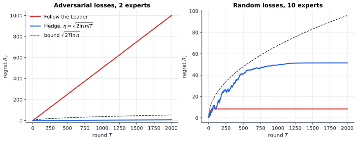
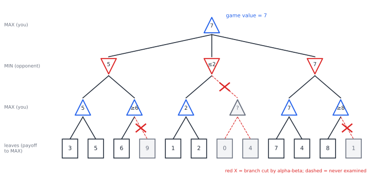

# Chapter 46 — Adversarial Decision-Making

[← Previous](45-evolutionary-games.md) · [Track C](README.md) · [Table of Contents](../../00-front/table-of-contents.md) · [Next: Track D →](../d-optimization/README.md)

> **Level 2 · Track C — Game Theory and Strategic Intelligence**
> **Builds on:** [Ch. 23](../../part-7-numerical-computational/23-optimization.md), [Ch. 19](../../part-6-probability-statistics/19-probability.md), [Ch. 39](39-game-theory-basics.md) · **Leads to:** [Ch. 48](../d-optimization/48-duality.md), [Ch. 52](../d-optimization/52-dynamic-programming.md), [Ch. 53](../d-optimization/53-reinforcement-learning.md), [Ch. 54](../d-optimization/54-robust-stochastic-optimization.md) · **Related:** [Ch. 45](45-evolutionary-games.md), [Ch. 77](../h-cryptography-coding/77-cryptography.md), [Ch. 30](../a-algorithms/30-limits-of-computation.md)
> **Reading time:** ~25 min

## 46.1 The hook

A penalty kick takes less time than the goalkeeper needs to react. The keeper must commit to a side before the ball is struck, and the kicker must choose a side knowing the keeper is guessing. Suppose a kicker scores with these probabilities:

| | keeper dives left | keeper dives right |
|---|---|---|
| **kick left** | 0.60 | 0.95 |
| **kick right** | 0.90 | 0.70 |

Shooting to the left is strong if the keeper goes the wrong way, but this keeper is very good at saving left-side kicks. What should the kicker do?

Here is a strange offer. The keeper's coach has hacked the kicker's phone and read the kicker's game plan. Before the kick, the keeper will know exactly how the kicker intends to decide. Should the kicker panic?

If the plan is "always kick right", yes: the keeper dives right and the scoring chance drops to $0.70$. If the plan is "always kick left", the chance drops to $0.60$. Any fixed choice can be punished. But suppose the plan is: *roll a die-like device and kick left with probability exactly $4/11$*. The keeper reads it, thinks hard, and discovers that it does not matter which way they dive. The scoring chance is $0.7909$ either way. The leak has cost the kicker nothing.

That is the miracle of this chapter, and it is not a trick of this particular table. In any two-player game where one side's gain is the other's loss, there is a randomised strategy you can publish to the world and still guarantee the best result you could ever have hoped for against a perfect opponent. John von Neumann proved it in 1928, and he later said that until it was proved he saw nothing worth publishing in game theory.

The same idea runs a long way past football. A chess program assumes the opponent always finds the best reply. A spam filter assumes the spammer adapts to every rule. A portfolio manager follows a panel of expert advisers, some of whom are wrong in ways designed to fool them. A robust controller is tuned for the worst disturbance, not the average one. In each case the question is the same:

**Can you make decisions that are guaranteed good, against an opponent who knows exactly how you make them?**

The answer is yes, in a precise and surprising sense. And the guarantee comes from an algorithm so simple it fits on two lines.

## 46.2 The big idea

Ordinary optimisation ([Ch. 23](../../part-7-numerical-computational/23-optimization.md)) treats the world as fixed: the objective function sits still while you climb it. Probability ([Ch. 19](../../part-6-probability-statistics/19-probability.md)) treats the world as random but indifferent: the dice do not care what you chose. Adversarial thinking takes the third view. Whatever you do, assume the world responds in the way that hurts you most.

That sounds paranoid, and sometimes it is. But it buys something priceless: a **guarantee**. If your plan is good against the worst case, it is good against every case. You never need a model of your opponent.

Three ideas make the guarantee useful rather than hopeless.

**Pessimism has a value.** For each plan, imagine the opponent's best reply and record what you get. Pick the plan whose worst case is best. That number, the **maxmin** value, is what you can secure no matter what. The opponent can do the same from their side, and secure the **minmax**. The gap between the two numbers is the territory the players are actually fighting over.

**Randomness is armour.** If you are predictable, an adversary who knows your plan exploits it. A coin flip the adversary can *read* but cannot *predict* closes the gap. The opponent knows the probabilities but not the outcome, and against the right probabilities every reply is equally bad for them.

**Regret replaces the impossible benchmark.** In repeated play you usually cannot beat an adaptive adversary in absolute terms, because they can make every round costly. But you can compare yourself to a humbler target: the best *single* fixed action you could have chosen with hindsight. The shortfall against that target is your **regret**. A remarkable family of algorithms guarantees that regret grows more slowly than the number of rounds, against *any* sequence of losses, chosen by *anyone*. Average regret per round goes to zero. Nobody can stop it.

The surprise at the end of 46.3 is that the third idea proves the first two. Two players who each just try to keep their regret small end up, on average, playing von Neumann's equilibrium. Learning finds the minimax solution without ever being told it exists.

## 46.3 The mathematics

### Zero-sum games and their two values

> [!definition] Two-player zero-sum game
> Player 1 (rows) chooses $i\in\{1,\dots,m\}$, player 2 (columns) chooses $k\in\{1,\dots,n\}$, and player 1 receives $a_{ik}$ while player 2 receives $-a_{ik}$. Mixed strategies are probability vectors $\mathbf{x}\in\Delta_m$, $\mathbf{y}\in\Delta_n$, and the expected payoff to player 1 is $\mathbf{x}^\mathsf{T}\mathbf{A}\mathbf{y}$.

Player 1 can guarantee

$$
\underline{v} = \max_{\mathbf{x}\in\Delta_m}\ \min_{\mathbf{y}\in\Delta_n}\ \mathbf{x}^\mathsf{T}\mathbf{A}\mathbf{y}
$$

(choose $\mathbf{x}$ first, then let the opponent react), and player 2 can hold player 1 down to

$$
\overline{v} = \min_{\mathbf{y}\in\Delta_n}\ \max_{\mathbf{x}\in\Delta_m}\ \mathbf{x}^\mathsf{T}\mathbf{A}\mathbf{y}.
$$

For fixed $\mathbf{x}$ the inner minimum of a linear function of $\mathbf{y}$ is attained at a pure strategy, so $\min_{\mathbf{y}} \mathbf{x}^\mathsf{T}\mathbf{A}\mathbf{y} = \min_k (\mathbf{x}^\mathsf{T}\mathbf{A})_k$. The opponent never needs to randomise in *reply*. Randomisation matters only for whoever moves first.

> [!theorem] Weak minimax inequality
> For every matrix, $\underline{v} \le \overline{v}$. Moving second never hurts.

*Proof.* Fix any $\mathbf{x}$ and $\mathbf{y}$. Then

$$
\min_{\mathbf{y}'}\ \mathbf{x}^\mathsf{T}\mathbf{A}\mathbf{y}' \ \le\ \mathbf{x}^\mathsf{T}\mathbf{A}\mathbf{y} \ \le\ \max_{\mathbf{x}'}\ \mathbf{x}'^\mathsf{T}\mathbf{A}\mathbf{y}.
$$

The left side depends only on $\mathbf{x}$ and the right side only on $\mathbf{y}$, and the inequality holds for every pair. So the largest possible left side is at most the smallest possible right side: $\max_{\mathbf{x}}\min_{\mathbf{y}'} \le \min_{\mathbf{y}}\max_{\mathbf{x}'}$. ∎

With **pure** strategies only, the inequality is often strict. In matching pennies ($a_{ik} = +1$ if the choices match, $-1$ otherwise) the pure maxmin is $-1$ and the pure minmax is $+1$: whoever must reveal a pure choice first loses. Mixing at $\tfrac12$ each brings both values to $0$.

### The penalty kick, solved

Let the kicker kick left with probability $q$. Against a keeper diving left the kicker scores $0.60q + 0.90(1-q) = 0.90 - 0.30q$; against a keeper diving right, $0.95q + 0.70(1-q) = 0.70 + 0.25q$. The keeper picks the smaller of the two, so the kicker maximises the lower envelope of two lines. One line falls and one rises, so the maximum sits where they cross:

$$
0.90 - 0.30q = 0.70 + 0.25q \quad\Longrightarrow\quad q^* = \frac{0.20}{0.55} = \frac{4}{11}\approx 0.364,
\qquad v = 0.90 - 0.30\cdot\tfrac{4}{11} \approx 0.7909 .
$$

The same calculation from the keeper's side, diving left with probability $r$, gives $0.95 - 0.35r = 0.70 + 0.20r$, so $r^* = 5/11 \approx 0.455$ and again $v\approx 0.7909$. Both pessimists arrive at the same number. The kicker can guarantee at least $0.7909$; the keeper can guarantee at most $0.7909$. Here $\underline{v} = \overline{v}$, and neither side benefits from knowing the other's plan.

Notice the counter-intuitive detail: the kicker's left side is the *weaker* option against a correct guess, yet the kicker still uses it about a third of the time. The point of kicking left is not to score on the left. It is to stop the keeper from leaning right.

### Von Neumann's theorem and its linear program

> [!theorem] Minimax theorem (von Neumann, 1928)
> For every finite matrix $\mathbf{A}$,
> $$
> \max_{\mathbf{x}\in\Delta_m}\ \min_{\mathbf{y}\in\Delta_n}\ \mathbf{x}^\mathsf{T}\mathbf{A}\mathbf{y} \;=\; \min_{\mathbf{y}\in\Delta_n}\ \max_{\mathbf{x}\in\Delta_m}\ \mathbf{x}^\mathsf{T}\mathbf{A}\mathbf{y} \;=\; v .
> $$
> The common value $v$ is the **value of the game**; any pair of optimisers $(\mathbf{x}^*,\mathbf{y}^*)$ is a Nash equilibrium, and every Nash equilibrium is such a pair.

The row player's problem is a linear program of the kind solved in [Section 23.3](../../part-7-numerical-computational/23-optimization.md#233-linear-programming):

$$
\begin{aligned}
\text{maximise}\quad & t \\
\text{subject to}\quad & (\mathbf{x}^\mathsf{T}\mathbf{A})_k \ge t \quad (k = 1,\dots,n), \\
& \textstyle\sum_i x_i = 1,\quad \mathbf{x}\ge \mathbf{0}.
\end{aligned}
$$

The column player's problem is another LP, and the two are *dual* to each other. Strong duality, the deep theorem of [Ch. 48](../d-optimization/48-duality.md), says their optimal values coincide, which is the minimax theorem. That route is short but leans on machinery we have not built. Instead we will prove the theorem with nothing more than an inequality about exponentials, and the proof will hand us an algorithm as a bonus.

### Regret and the Hedge algorithm

The setting is **online learning with experts**. There are $n$ actions ("experts"). In each round $t = 1,\dots,T$:

1. you choose a probability vector $\mathbf{p}_t\in\Delta_n$;
2. an adversary, who may know everything about your algorithm and the past, chooses a loss vector $\boldsymbol{\ell}_t\in[0,1]^n$;
3. you suffer expected loss $\mathbf{p}_t^\mathsf{T}\boldsymbol{\ell}_t$ and see the whole vector $\boldsymbol{\ell}_t$.

> [!definition] Regret
> $$
> R_T = \sum_{t=1}^T \mathbf{p}_t^\mathsf{T}\boldsymbol{\ell}_t \;-\; \min_{i}\ \sum_{t=1}^T \ell_{t,i}.
> $$
> Your total loss, minus the total loss of the best single action in hindsight.

The obvious algorithm, **Follow the Leader** (put all your weight on the action with the smallest loss so far), is a disaster. With two actions, let the first losses be $(\tfrac12, 0)$ and then alternate $(0,1), (1,0), (0,1),\dots$. The leader always switches to the action about to lose. FTL loses $1$ almost every round, while each fixed action loses only about half the time, so $R_T\approx T/2$: linear regret, the worst possible order. The flaw is that FTL is deterministic and jumps; the adversary reads it and punishes each jump.

**Hedge** (also called multiplicative weights or exponential weights) softens the jump. Keep a weight per action, start at $w_{1,i} = 1$, and after each round multiply:

$$
w_{t+1,i} = w_{t,i}\,e^{-\eta\,\ell_{t,i}},\qquad \mathbf{p}_t = \frac{\mathbf{w}_t}{\sum_i w_{t,i}} .
$$

Actions that lose are penalised exponentially but never killed. Compare the replicator equation of [Ch. 45](45-evolutionary-games.md): shares multiplied by a factor depending on payoff. The resemblance is not a coincidence.

> [!theorem] Regret bound for Hedge
> For any adversary and any $\eta > 0$,
> $$
> R_T \le \frac{\ln n}{\eta} + \frac{\eta T}{2}.
> $$
> With $\eta = \sqrt{2\ln n / T}$ this gives $R_T \le \sqrt{2T\ln n}$, so the average regret $R_T/T \le \sqrt{2\ln n/T}\to 0$.

*Proof.* Track the total weight $W_t = \sum_i w_{t,i}$, with $W_1 = n$. Two estimates squeeze $\ln W_{T+1}$.

*Upper bound.* For $z\ge0$, $e^{-z}\le 1 - z + z^2/2$. With $z = \eta\ell_{t,i}\in[0,\eta]$:

$$
\frac{W_{t+1}}{W_t} = \sum_i p_{t,i}\,e^{-\eta\ell_{t,i}} \le 1 - \eta\,\mathbf{p}_t^\mathsf{T}\boldsymbol{\ell}_t + \frac{\eta^2}{2}\sum_i p_{t,i}\ell_{t,i}^2 \le 1 - \eta\,\mathbf{p}_t^\mathsf{T}\boldsymbol{\ell}_t + \frac{\eta^2}{2}.
$$

Since $\ln(1+u)\le u$, taking logs and summing over $t$:

$$
\ln\frac{W_{T+1}}{W_1} \le -\eta\sum_{t=1}^T \mathbf{p}_t^\mathsf{T}\boldsymbol{\ell}_t + \frac{\eta^2 T}{2}.
$$

*Lower bound.* The total weight is at least the weight of the best action $i^*$: $W_{T+1}\ge w_{T+1,i^*} = e^{-\eta L^*}$, where $L^* = \min_i\sum_t\ell_{t,i}$. So $\ln(W_{T+1}/W_1) \ge -\eta L^* - \ln n$.

*Combine.* $-\eta L^* - \ln n \le -\eta\sum_t\mathbf{p}_t^\mathsf{T}\boldsymbol{\ell}_t + \eta^2T/2$. Divide by $\eta$ and rearrange: $\sum_t\mathbf{p}_t^\mathsf{T}\boldsymbol{\ell}_t - L^* \le \ln n/\eta + \eta T/2$. Minimising the right side over $\eta$ gives $\eta = \sqrt{2\ln n/T}$ and the bound $\sqrt{2T\ln n}$. ∎

Read the proof again and notice what it never assumed. Nothing about where the losses come from. Nothing about randomness, stationarity, or the adversary's computing power. The only facts used are that losses lie in $[0,1]$ and that the adversary must commit to $\boldsymbol{\ell}_t$ without seeing your coin flip. The number of actions enters only through $\ln n$: a million experts cost you about $\sqrt{2\cdot 13.8\,T}\approx 5.3\sqrt T$, against $2.1\sqrt T$ for ten. A hundred thousand times more advisers, two and a half times the regret.



*Left: on the adversarial sequence that alternates losses between two actions, Follow the Leader's regret grows linearly (about 1000 after 2000 rounds) while Hedge stays near 7, well under its guarantee $\sqrt{2T\ln 2}\approx 53$. Right: on random losses with ten actions, one slightly better, FTL actually beats Hedge (regret about 8 against about 51); Hedge pays an insurance premium for its worst-case guarantee.*

The right-hand panel is a warning against reading guarantees as predictions. When the world is benign, a greedy algorithm can win; Hedge, tuned for the worst case, explores more than it needs to. Insurance always costs something on a sunny day.

> [!mystery] Is $\sqrt{T\ln n}$ the end of the road?
> The bound grows like $\sqrt T$. Could a smarter algorithm guarantee regret growing like $\ln T$, or even a constant, against every adversary? The answer is no, and the proof is a probabilistic surprise: let the adversary choose losses by *fair coin flips*, so no algorithm can do better than $T/2$ on average, while the best of $n$ independent random walks beats $T/2$ by about $\sqrt{(T/2)\ln n}$. Why the maximum of $n$ random walks behaves like that is a question about fluctuations of random walks, answered in [Ch. 34](../b-probability-information/34-random-walks-and-markov-chains.md).

### The minimax theorem from regret

Now the payoff. Rescale $\mathbf{A}$ so its entries lie in $[0,1]$ (adding a constant and scaling changes nothing essential). Let both players run a no-regret algorithm such as Hedge against each other for $T$ rounds:

- the row player, who wants a large $\mathbf{x}^\mathsf{T}\mathbf{A}\mathbf{y}$, feeds Hedge the losses $\boldsymbol{\ell}_t = \mathbf{1} - \mathbf{A}\mathbf{y}_t$;
- the column player, who wants it small, feeds Hedge the losses $\boldsymbol{\ell}_t = \mathbf{A}^\mathsf{T}\mathbf{x}_t$.

Write $\varepsilon_T$ for the larger of the two average regrets, $\bar v = \frac1T\sum_t\mathbf{x}_t^\mathsf{T}\mathbf{A}\mathbf{y}_t$ for the average payoff, and $\bar{\mathbf{x}}, \bar{\mathbf{y}}$ for the average strategies.

> [!theorem] No regret implies minimax
> $\overline{v} \le \underline{v} + 2\varepsilon_T$. Since $\varepsilon_T\to0$ for Hedge, $\overline{v} = \underline{v}$, and $(\bar{\mathbf{x}},\bar{\mathbf{y}})$ is a $2\varepsilon_T$-approximate equilibrium.

*Proof.* The row player's regret bound says that no fixed row does much better than what was actually earned: $\max_i \frac1T\sum_t(\mathbf{A}\mathbf{y}_t)_i \le \bar v + \varepsilon_T$. The left side is $\max_{\mathbf{x}}\mathbf{x}^\mathsf{T}\mathbf{A}\bar{\mathbf{y}}$. Symmetrically, the column player's bound gives $\min_{\mathbf{y}}\bar{\mathbf{x}}^\mathsf{T}\mathbf{A}\mathbf{y} \ge \bar v - \varepsilon_T$. Chain them:

$$
\overline{v} = \min_{\mathbf{y}}\max_{\mathbf{x}}\mathbf{x}^\mathsf{T}\mathbf{A}\mathbf{y}
\le \max_{\mathbf{x}}\mathbf{x}^\mathsf{T}\mathbf{A}\bar{\mathbf{y}}
\le \bar v + \varepsilon_T
\le \min_{\mathbf{y}}\bar{\mathbf{x}}^\mathsf{T}\mathbf{A}\mathbf{y} + 2\varepsilon_T
\le \max_{\mathbf{x}}\min_{\mathbf{y}}\mathbf{x}^\mathsf{T}\mathbf{A}\mathbf{y} + 2\varepsilon_T
= \underline{v} + 2\varepsilon_T .
$$

Let $T\to\infty$ and combine with the weak inequality $\underline v\le\overline v$. ∎

Pause on how strange this is. Neither player knows the game is zero-sum, or that an equilibrium exists, or what the other is doing. Each merely refuses to have regrets. The theorem of the existence of a value falls out of an exponential inequality.

> [!mystery] What happens when the game is not zero-sum?
> Run the same two Hedge players on a general-sum game, the prisoner's dilemma of [Ch. 40](40-prisoners-dilemma.md) or a $3\times3$ coordination game, and the averages no longer need to approach a Nash equilibrium. They converge to a weaker object, a *coarse correlated equilibrium*. Is there any fast learning rule that finds a Nash equilibrium of a general game? The evidence says no: computing one is complete for a complexity class called PPAD, believed intractable. Where that hardness comes from is a story from [Ch. 30](../a-algorithms/30-limits-of-computation.md).

### Robust decisions: when the adversary is Nature

Sometimes the "opponent" is not a mind but uncertainty itself: an unknown demand, an unmodelled disturbance, a parameter you could not measure. Abraham Wald proposed in 1945 to treat Nature as an adversary and choose the action with the best worst case, the **maxmin** rule. Leonard Savage objected that this is too timid and proposed **minimax regret**: for each scenario compute how much you lose relative to the best action for that scenario, and minimise the largest such regret.

> [!example] Sizing a plant
> Profit (in millions) for three capacities under three demand scenarios:
>
> | capacity | low | medium | high | worst case | worst regret |
> |---|---|---|---|---|---|
> | small | 4 | 5 | 5 | **4** | 7 |
> | medium | 2 | 7 | 8 | 2 | **4** |
> | large | −2 | 5 | 12 | −2 | 6 |
>
> The best profits per scenario are $4, 7, 12$, so the regret of *medium* in the three scenarios is $2, 0, 4$. Wald's maxmin chooses *small*, guaranteeing 4. Savage's minimax regret chooses *medium*, never more than 4 below the best possible outcome. Two worst-case philosophies, two different plants.

Neither rule is "right". Maxmin protects the level of the outcome; minimax regret protects against looking foolish in hindsight, the same benchmark Hedge uses. Robust optimisation ([Ch. 54](../d-optimization/54-robust-stochastic-optimization.md)) turns these ideas into tractable programs where the scenarios form a continuous uncertainty set, and robust control does the same for a disturbance signal of bounded energy.

## 46.4 The algorithm

### Minimax search with alpha–beta pruning

In a game of perfect information such as chess or Go, there is no need to randomise: the players alternate, every move is visible, and the value of a position is defined by backing up values from the leaves of the game tree. MAX nodes take the maximum of their children, MIN nodes the minimum. This backward recursion is dynamic programming on a tree ([Ch. 52](../d-optimization/52-dynamic-programming.md)), and it proves a fact von Neumann and Zermelo knew early on: every finite two-player game of perfect information has a value achieved by pure strategies.

The trouble is size. A tree with branching factor $b$ and depth $d$ has $b^d$ leaves. **Alpha–beta pruning** computes exactly the same root value while skipping branches that provably cannot matter. It carries two numbers down the tree: $\alpha$, the best value MAX is already guaranteed somewhere above, and $\beta$, the best value MIN is already guaranteed.

```text
ALPHABETA(node, α, β, maximizing):
    if node is a leaf (or depth limit reached):
        return EVAL(node)
    if maximizing:
        v ← −∞
        for each child c:
            v ← max(v, ALPHABETA(c, α, β, false))
            α ← max(α, v)
            if α ≥ β: break          # MIN above will never let play reach here
        return v
    else:
        v ← +∞
        for each child c:
            v ← min(v, ALPHABETA(c, α, β, true))
            β ← min(β, v)
            if α ≥ β: break          # MAX above already has something better
        return v
```



*A three-ply game tree. Alpha–beta examines 8 of the 12 leaves and still returns the exact value 7. In the left subtree, once MAX sees a 6, the MIN node above (which already holds 5) will never allow it, so the 9 is never read. In the middle subtree, MIN finds a reply worth only 2, below the 5 MAX already has at the root, so the whole second branch is skipped. Values marked $\ge$ or $\le$ are bounds, not exact values.*

The correctness argument is a short induction: a pruned branch could only change a node's value in a direction that some ancestor would reject anyway. The efficiency depends entirely on **move ordering**. If the best move is always searched first, Knuth and Moore (1975) showed that alpha–beta examines about $b^{\lceil d/2\rceil} + b^{\lfloor d/2\rfloor} - 1$ leaves instead of $b^d$. For chess-like numbers, $b = 35$ and $d = 10$, that is roughly $1.05\times10^8$ positions instead of $2.76\times10^{15}$, a saving of a factor of about 26 million. In effect the search can go twice as deep for the same effort. With the worst ordering, alpha–beta prunes nothing.

**Failure cases.** Real programs cannot reach the leaves, so they stop at a depth limit and call a heuristic `EVAL`. Two famous pathologies follow.

- *The horizon effect.* A program facing an unavoidable loss can make delaying moves that push the loss just past its search depth, and so believe it has escaped.
- *Error amplification.* Minimax trusts its evaluation function absolutely. If `EVAL` is slightly wrong in a consistent direction, the search actively steers towards the positions where it is most wrong, because those look best.

### Hedge in practice

```python
def hedge(losses, eta):
    """losses: T x n array in [0, 1]. Returns the T x n array of strategies played."""
    T, n = losses.shape
    cum = np.zeros(n)
    P = np.empty((T, n))
    for t in range(T):
        w = np.exp(-eta * (cum - cum.min()))   # shift: avoids underflow
        P[t] = w / w.sum()
        cum += losses[t]
    return P
```

Each round costs $O(n)$. Two numerical details matter. Subtracting the minimum cumulative loss before exponentiating changes nothing mathematically (it cancels in the normalisation) but prevents every weight from underflowing to zero after a few thousand rounds. And the tuned rate $\eta = \sqrt{2\ln n/T}$ needs $T$ in advance; if you do not know the horizon, the *doubling trick* (restart with $T = 1, 2, 4, 8,\dots$) or a decreasing rate $\eta_t\propto\sqrt{\ln n/t}$ keeps the $O(\sqrt{T\ln n})$ guarantee at the price of a constant factor.

**Solving a matrix game.** For an exact answer, solve the LP of 46.3 with any LP solver: polynomial time in $m$ and $n$. For huge games where even writing down $\mathbf{A}$ is costly, self-play Hedge finds an $\varepsilon$-equilibrium in $O(\ln n/\varepsilon^2)$ rounds, and it only needs to evaluate $\mathbf{A}\mathbf{y}$ and $\mathbf{A}^\mathsf{T}\mathbf{x}$. This is the engine behind modern poker programs, which run regret-minimising algorithms on games far too large to tabulate.

## 46.5 The experiment

First, the kicker's view of the penalty. The two lines are the scoring probabilities against each dive, as functions of the probability $q$ (on the $x$-axis) of kicking left; the keeper always picks the lower line.

```desmos-graph
left=0; right=1; bottom=0.55; top=1
---
y=0.9-0.3x|red
y=0.7+0.25x|blue
y=\min(0.9-0.3x,0.7+0.25x)|black|dashed
(0.3636,0.7909)|label:q*=4/11, v=0.791
```

*The kicker maximises the lower envelope (dashed). Change the four scoring probabilities 0.9, 0.3, 0.7, 0.25 (they come from the table in 46.1) and watch the optimal mix move; make one line lie entirely above the other and the optimum jumps to a pure strategy.*

Next, let two Hedge learners play the penalty game against each other and watch them discover von Neumann's solution.

```python
import numpy as np
import matplotlib.pyplot as plt

# --- knobs -------------------------------------------------------------
A = np.array([[0.60, 0.95],     # P(goal): rows = kicker L/R,
              [0.90, 0.70]])    #          cols = keeper dives L/R
T = 5000                        # rounds of play
eta = np.sqrt(2 * np.log(2) / T)  # learning rate: try 10x larger or smaller
# ------------------------------------------------------------------------

Lk, Lg = np.zeros(2), np.zeros(2)   # cumulative losses: kicker, goalkeeper
avg_k, avg_g, gap = np.zeros(2), np.zeros(2), []
for t in range(1, T + 1):
    p = np.exp(-eta * (Lk - Lk.min())); p /= p.sum()   # kicker's mix
    q = np.exp(-eta * (Lg - Lg.min())); q /= q.sum()   # keeper's mix
    Lk += 1 - A @ q          # kicker loses when no goal
    Lg += A.T @ p            # keeper loses when goal
    avg_k += (p - avg_k) / t
    avg_g += (q - avg_g) / t
    # duality gap of the averages: best reply value minus worst case value
    gap.append((A @ avg_g).max() - (avg_k @ A).min())

print("kicker avg P(left) :", avg_k[0].round(4), " theory 4/11 =", round(4/11, 4))
print("keeper avg P(left) :", avg_g[0].round(4), " theory 5/11 =", round(5/11, 4))
print("value bracket      :", (avg_k @ A).min().round(4), (A @ avg_g).max().round(4))
plt.loglog(np.arange(1, T + 1), gap, label="duality gap of average play")
plt.loglog(np.arange(1, T + 1), 2*np.sqrt(2*np.log(2)*T)/np.arange(1, T + 1), "--",
           label="2 x regret bound / t (tuned for t = T)")
plt.xlabel("round t"); plt.legend(); plt.show()
```

With the default knobs the averages come out near $0.347$ and $0.467$ (theory: $0.364$ and $0.455$), and the value is bracketed between about $0.787$ and $0.793$, enclosing the true $0.7909$. The final duality gap, about $0.007$, sits well below the guaranteed $2\varepsilon_T\approx0.033$. Things to try:

1. Multiply `eta` by 10. The averages still converge, but look at the *current* strategies `p` and `q` (print them every 500 rounds): they swing around the equilibrium like the rock–paper–scissors orbits of [Ch. 45](45-evolutionary-games.md) and never settle. Only the averages converge.
2. Divide `eta` by 10. The learners are now too timid; after 5000 rounds they have barely left the uniform mix.
3. Replace `A` by rock–paper–scissors rescaled to $[0,1]$, for example $\tfrac12(\mathbf{A}_{\text{RPS}} + 1)$, and check the averages approach $(\tfrac13,\tfrac13,\tfrac13)$.
4. Make the keeper play Follow the Leader instead of Hedge. Who now exploits whom?

## 46.6 The challenge

1. **Intuition.** In the penalty table, suppose the kicker becomes *better* at scoring left when the keeper guesses wrong (raise 0.95 to 0.99). Does the kicker now kick left more often or less often at equilibrium? Predict before computing, and explain the answer in terms of what each player is trying to prevent.
2. **Derivation.** Prove that for any $2\times2$ zero-sum game without a pure saddle point, the row player's optimal probability on the first row is $q^* = \dfrac{a_{22}-a_{21}}{a_{11}-a_{12}-a_{21}+a_{22}}$, and derive the value. Then show that Follow the Leader has regret at least $T/2 - 1$ on the alternating sequence of 46.3.
3. **Implementation.** Implement tic-tac-toe with plain minimax and with alpha–beta. Count the leaves each examines from the empty board, then try three move orderings (fixed, random, centre-and-corners first) and compare the counts with the Knuth–Moore estimate.
4. **Open investigation.** Hedge with a fixed $\eta$ has $O(\sqrt T)$ regret against adversaries but, as the right panel of the regret figure shows, can be beaten by Follow the Leader when losses are random. Design an algorithm that does about as well as FTL on benign data and as well as Hedge on adversarial data, and test it on both sequences of the figure. How much must it give up on each side? (Algorithms of this "best of both worlds" type exist; how close you can get with a simple design is for you to find out.)

## 46.7 Loose threads

This chapter gave you a guarantee and an algorithm, and it hid how far both reach.

We solved perfect-information games by searching a tree with a hand-made evaluation function, and we solved matrix games by letting regret minimisers play each other. Modern game-playing systems merge the two ideas: they search a tree, but the evaluation and the move ordering are learned, and the learning happens by playing against copies of themselves.

> [!mystery] Learning to evaluate by playing yourself
> A Go board has more legal positions than there are atoms in the observable universe, so no evaluation function can be written by hand and no tree can be searched to the end. Programs trained purely by self-play nevertheless surpassed every human player. What exactly is being learned, why self-play does not simply cycle like the over-eager Hedge learners of 46.5, and what replaces alpha–beta in those systems are questions taken up in [Ch. 53](../d-optimization/53-reinforcement-learning.md), building on the Bellman recursion of [Ch. 52](../d-optimization/52-dynamic-programming.md).

We also leaned on one hidden assumption throughout: that you see the whole loss vector after each round. A slot machine, an advertising slot or a network route shows you only the loss of the action you took. That is the *bandit* problem, where you must pay to explore, and the regret guarantee changes shape in an interesting way.

Finally, minimax thinking has a cousin that is far older than game theory: the cryptographer's assumption that the enemy knows the system. Kerckhoffs' principle says a cipher must stay secure even when everything except the key is public, which is exactly the spirit of publishing your mixed strategy. In [Ch. 77](../h-cryptography-coding/77-cryptography.md) the adversary returns, with unlimited patience and bounded computing power, and the guarantees take yet another form.

## Further reading

- J. von Neumann and O. Morgenstern, *Theory of Games and Economic Behavior*, Princeton University Press, 1944. The founding book; the minimax theorem in its original setting.
- N. Cesa-Bianchi and G. Lugosi, *Prediction, Learning, and Games*, Cambridge University Press, 2006. The definitive treatment of regret, experts and the minimax theorem via learning.
- S. Russell and P. Norvig, *Artificial Intelligence: A Modern Approach*, 4th ed., Pearson, 2020. Clear chapters on adversarial search and alpha–beta.
- A. Ben-Tal, L. El Ghaoui and A. Nemirovski, *Robust Optimization*, Princeton University Press, 2009. Worst-case decision making as tractable optimisation.
