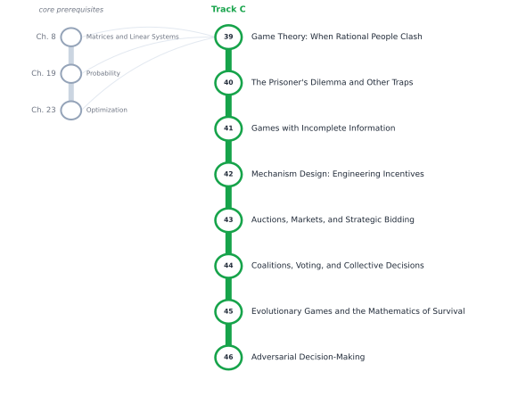

# Track C — Game Theory and Strategic Intelligence

[← Table of Contents](../../00-front/table-of-contents.md) · [Start: Ch. 39 →](39-game-theory-basics.md)

> **Level 2 — Specializations.** What happens when the thing you are optimizing against can think back.

*Suggested reading order for Track C. The grey stations on the left are the core chapters it leans on.*

## Before you start

This track assumes you are comfortable with these core chapters:

- Ch. 8 — [Matrices and Linear Systems](../../part-3-linear-algebra/08-matrices-and-linear-systems.md)
- Ch. 19 — [Probability](../../part-6-probability-statistics/19-probability.md)
- Ch. 23 — [Optimization](../../part-7-numerical-computational/23-optimization.md)

## Chapters

| Ch. | Chapter | What it explores |
|---|---|---|
| 39 | [Game Theory: When Rational People Clash](39-game-theory-basics.md) | Normal-form games, dominant strategies, Nash equilibrium. |
| 40 | [The Prisoner's Dilemma and Other Traps](40-prisoners-dilemma.md) | Cooperation, repeated games, social dilemmas, evolutionary stability. |
| 41 | [Games with Incomplete Information](41-incomplete-information-games.md) | Bayesian games, beliefs, signaling, screening. |
| 42 | [Mechanism Design: Engineering Incentives](42-mechanism-design.md) | Social choice, incentive compatibility, truthful mechanisms. |
| 43 | [Auctions, Markets, and Strategic Bidding](43-auctions-and-markets.md) | Auction formats, revenue, allocation, market design. |
| 44 | [Coalitions, Voting, and Collective Decisions](44-coalitions-and-voting.md) | Cooperative games, Shapley value, voting systems, bargaining. |
| 45 | [Evolutionary Games and the Mathematics of Survival](45-evolutionary-games.md) | Replicator dynamics, evolutionary stable strategies, population games. |
| 46 | [Adversarial Decision-Making](46-adversarial-decision-making.md) | Minimax, zero-sum games, regret, robust strategies. |

Every chapter follows the same arc: **the hook** (a puzzle or a failure), **the big idea**, **the mathematics**, **the algorithm**, **the experiment** you can run, **the challenge**, and **loose threads**: the questions the chapter deliberately leaves open.
