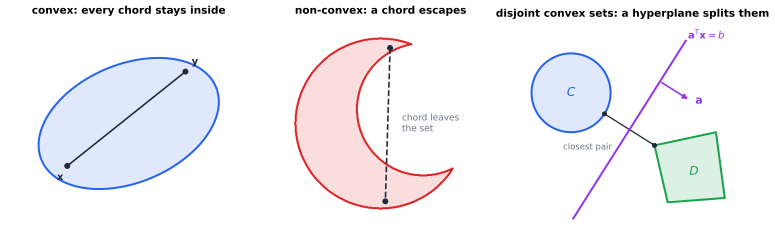
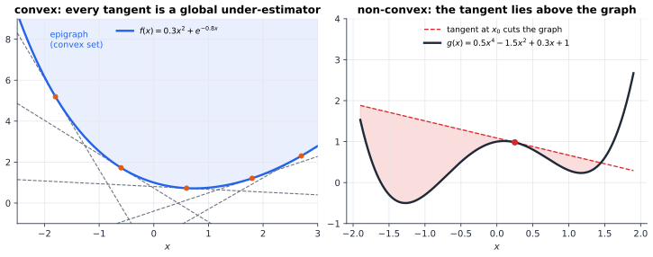

# Chapter 47 — Convexity: The Geometry of the Best Answer

[← Previous](README.md) · [Track D](README.md) · [Table of Contents](../../00-front/table-of-contents.md) · [Next →](48-duality.md)

> **Level 2 · Track D — Optimization and Operations Research**
> **Builds on:** [Ch. 6](../../part-2-calculus/06-multivariable-calculus.md), [Ch. 10](../../part-3-linear-algebra/10-eigenvalues-and-eigenvectors.md), [Ch. 23](../../part-7-numerical-computational/23-optimization.md) · **Leads to:** [Ch. 48](48-duality.md), [Ch. 49](49-integer-programming.md), [Ch. 54](54-robust-stochastic-optimization.md) · **Related:** [Ch. 39](../c-game-theory/39-game-theory-basics.md), [Ch. 61](../e-abstract-math/61-functional-analysis.md), [Ch. 75](../g-graphics-simulation/75-computational-geometry.md)
> **Reading time:** ~30 min

## 47.1 The hook

In 1958 Frank Rosenblatt built a machine that learned. The Mark I Perceptron looked at a grid of photocells, took a weighted sum of their outputs, and fired if the sum crossed a threshold. Each time it guessed wrong, it nudged its weights toward the right answer. Newspapers predicted thinking machines within a decade.

Eleven years later Marvin Minsky and Seymour Papert pointed out something the machine could never learn. Put four points on a square:

| point | $(0,0)$ | $(1,1)$ | $(1,0)$ | $(0,1)$ |
|---|---|---|---|---|
| label | A | A | B | B |

This is the exclusive-or pattern: label B when exactly one coordinate is 1. A perceptron draws one straight line and puts A on one side and B on the other. Try it. Every line you draw through that square leaves at least one point on the wrong side. Run the perceptron's learning rule on these four points and the weights never settle: they cycle forever.

That raises a question that matters well beyond 1969:

> **How do you *prove* that no line works?**

There are infinitely many lines, so you can't try them all. "I tried for an hour and failed" doesn't count as a proof. What you want is a **certificate**: a short piece of evidence that anyone can check in ten seconds and that settles the matter for good.

The same question turns up all over engineering. A filter specification asks for passband ripple under 0.1 dB, stopband attenuation over 80 dB and only 20 taps; is that achievable at all? A power network must carry a set of flows without overloading any line; is there any feasible dispatch? An optimizer reports a cost of 41.7; is that the best possible, or did it stop in a ditch? In every case "yes" is easy to certify: show the design. "No" and "this is optimal" are much harder. They are claims about *every* possible design.

This chapter shows that for one family of shapes, the **convex** ones, the hard claims have short proofs. A wall is the proof: a single hyperplane. By the end you will be able to write down the ten-second certificate for XOR. You will also see why the same geometry makes "local" answers into "global" ones.

## 47.2 The big idea

The core chapter defined convex sets and functions and proved the payoff: for a convex problem every local minimum is global ([§23.7](../../part-7-numerical-computational/23-optimization.md#237-convex-optimization-fundamentals)). Here is the intuition behind that result, and the idea this whole track grows from.

**A convex set has no hidden corners.** Stand anywhere inside it and you can see every other point along a straight line of sight that never leaves the set. A crescent moon fails this test: from one horn you can't see the other.



*Left: in a convex set every chord stays inside. Centre: in a crescent a chord escapes. Right: two disjoint convex sets can always be split by a hyperplane, and the shortest segment between them points along its normal $\mathbf{a}$.*

**A convex set has two descriptions.** You can describe it from the *inside*, as all the mixtures (convex combinations) of its points. Or you can describe it from the *outside*, as the intersection of all the half-spaces that contain it, like a gemstone defined by the flat cuts of its facets. For a closed convex set the two descriptions agree. Most of optimization theory is a conversation between them:

- an inside description lets you *exhibit* things: here is a feasible design, here is a point in both sets;
- an outside description lets you *rule things out*: here is a wall, and everything you want lies on the far side of it.

The certificate the hook asked for is an outside description. If two point clouds can't be separated, it's because their convex "shadows" overlap, and a single shared point proves it. If they can be separated, the line itself is the proof.

**An analogy: walking downhill in fog.** You are on a mountainside in thick fog and can only feel the slope under your feet. On a general mountain, reaching a spot where every direction goes up proves nothing. There may be a deeper valley over the ridge. On a convex bowl that spot *is* the bottom, because the ground under your feet already tells you about the whole bowl. The tangent plane you feel is a global floor ([Figure 47.2](#473-the-mathematics)). Local information is global information. That one sentence is why convex optimization is reliable and fast, and why so much of applied mathematics is spent turning problems into convex ones.

## 47.3 The mathematics

We work in $\mathbb{R}^n$ with the Euclidean inner product. Convex sets, convex functions, the first- and second-order tests, and "local implies global" are in [§23.7](../../part-7-numerical-computational/23-optimization.md#237-convex-optimization-fundamentals) and are not repeated here. We need one more definition.

> [!definition] Convex combination and convex hull
> A **convex combination** of points $\mathbf{x}_1,\dots,\mathbf{x}_k$ is $\sum_i\theta_i\mathbf{x}_i$ with $\theta_i\ge0$ and $\sum_i\theta_i=1$. The **convex hull** $\operatorname{conv}S$ of a set $S$ is the set of all convex combinations of points of $S$. It is the smallest convex set containing $S$.

For a finite set of points in the plane, the convex hull is the shape a rubber band makes when you stretch it around them (computing it fast is a classic of [Ch. 75](../g-graphics-simulation/75-computational-geometry.md)). **Carathéodory's theorem** says that in $\mathbb{R}^n$ every point of $\operatorname{conv}S$ is a convex combination of at most $n+1$ points of $S$: in the plane, every point of the hull lies in some triangle with corners in $S$.

### The closest point

Everything in this chapter flows from one elementary fact.

> [!theorem] Theorem 47.1 — Projection onto a closed convex set
> Let $C\subseteq\mathbb{R}^n$ be nonempty, closed and convex, and let $\mathbf{z}\in\mathbb{R}^n$. There is exactly one point $\mathbf{p}=P_C(\mathbf{z})\in C$ closest to $\mathbf{z}$. It is characterised by the **obtuse-angle condition**
> $$
> (\mathbf{z}-\mathbf{p})^\mathsf{T}(\mathbf{y}-\mathbf{p})\le 0\qquad\text{for all }\mathbf{y}\in C .
> $$

*Proof.* **Existence.** Pick any $\mathbf{y}_0\in C$ and let $r=\lVert\mathbf{z}-\mathbf{y}_0\rVert$. Any closer point lies in $C\cap\{\mathbf{y}:\lVert\mathbf{y}-\mathbf{z}\rVert\le r\}$, which is closed and bounded, hence compact. The continuous function $\mathbf{y}\mapsto\lVert\mathbf{y}-\mathbf{z}\rVert$ attains its minimum there.

**Characterisation.** Let $\mathbf{p}$ be a closest point and $\mathbf{y}\in C$. By convexity $\mathbf{p}+t(\mathbf{y}-\mathbf{p})\in C$ for $t\in[0,1]$, so

$$
\varphi(t)=\lVert\mathbf{z}-\mathbf{p}-t(\mathbf{y}-\mathbf{p})\rVert^2=\lVert\mathbf{z}-\mathbf{p}\rVert^2-2t(\mathbf{z}-\mathbf{p})^\mathsf{T}(\mathbf{y}-\mathbf{p})+t^2\lVert\mathbf{y}-\mathbf{p}\rVert^2
$$

has its minimum on $[0,1]$ at $t=0$. Then $\varphi'(0)=-2(\mathbf{z}-\mathbf{p})^\mathsf{T}(\mathbf{y}-\mathbf{p})\ge0$, which is the stated inequality. Conversely, if $\mathbf{p}\in C$ satisfies the inequality, then for any $\mathbf{y}\in C$, $\varphi(1)=\lVert\mathbf{z}-\mathbf{y}\rVert^2\ge\lVert\mathbf{z}-\mathbf{p}\rVert^2+\lVert\mathbf{y}-\mathbf{p}\rVert^2$, so $\mathbf{p}$ is closest.

**Uniqueness.** If $\mathbf{p}_1,\mathbf{p}_2$ are both closest, apply the inequality at $\mathbf{p}_1$ with $\mathbf{y}=\mathbf{p}_2$ and at $\mathbf{p}_2$ with $\mathbf{y}=\mathbf{p}_1$, then add: $(\mathbf{p}_2-\mathbf{p}_1)^\mathsf{T}(\mathbf{p}_2-\mathbf{p}_1)\le0$. Hence $\mathbf{p}_1=\mathbf{p}_2$. $\square$

In words: the line from $\mathbf{z}$ to its projection makes an obtuse (or right) angle with every direction that stays in $C$. For the unit disc and $\mathbf{z}=(2,2)$, $P_C(\mathbf{z})=(1/\sqrt2,1/\sqrt2)\approx(0.707,0.707)$. Every chord of the disc starting at that point heads away from $\mathbf{z}$. Convexity was essential. For the crescent of Figure 47.1, a point in the "bite" has *two* equally close points on the inner arc, and the obtuse-angle condition fails.

### Separation

> [!theorem] Theorem 47.2 — Separating a point from a convex set
> Let $C$ be nonempty, closed and convex, and $\mathbf{z}\notin C$. Then there are $\mathbf{a}\ne\mathbf{0}$ and $b$ with
> $$
> \mathbf{a}^\mathsf{T}\mathbf{y}\le b<\mathbf{a}^\mathsf{T}\mathbf{z}\qquad\text{for all }\mathbf{y}\in C .
> $$

*Proof.* Let $\mathbf{p}=P_C(\mathbf{z})$ and $\mathbf{a}=\mathbf{z}-\mathbf{p}\neq\mathbf{0}$ (since $\mathbf{z}\notin C$). The obtuse-angle condition reads $\mathbf{a}^\mathsf{T}\mathbf{y}\le\mathbf{a}^\mathsf{T}\mathbf{p}$ for all $\mathbf{y}\in C$. Put $b=\mathbf{a}^\mathsf{T}\mathbf{p}$. Then $\mathbf{a}^\mathsf{T}\mathbf{z}-b=\mathbf{a}^\mathsf{T}(\mathbf{z}-\mathbf{p})=\lVert\mathbf{a}\rVert^2>0$. $\square$

The proof is constructive: the normal of the wall is the vector from the closest point to the outsider. One immediate corollary is the "outside description" promised in §47.2. **A closed convex set equals the intersection of all closed half-spaces containing it**, because any point outside is cut off by one of them.

> [!theorem] Theorem 47.3 — Separating two convex sets
> Let $C$ and $D$ be disjoint nonempty convex sets with $C$ closed and $D$ compact. Then some hyperplane strictly separates them: there are $\mathbf{a}\ne\mathbf{0}$, $b$ with $\mathbf{a}^\mathsf{T}\mathbf{x}<b<\mathbf{a}^\mathsf{T}\mathbf{y}$ for all $\mathbf{x}\in C$, $\mathbf{y}\in D$.

*Proof.* The difference set $E=D-C=\{\mathbf{y}-\mathbf{x}\}$ is convex (it is the image of the convex set $D\times C$ under a linear map). It is closed because a compact set plus a closed set is closed, and it doesn't contain $\mathbf{0}$ because the sets are disjoint. Theorem 47.2 separates $\mathbf{0}$ from $E$. With $\mathbf{w}=-P_E(\mathbf{0})$ it gives $\mathbf{w}^\mathsf{T}(\mathbf{y}-\mathbf{x})\ge\lVert\mathbf{w}\rVert^2>0$ for all pairs. Hence $\inf_D\mathbf{w}^\mathsf{T}\mathbf{y}\ge\sup_C\mathbf{w}^\mathsf{T}\mathbf{x}+\lVert\mathbf{w}\rVert^2$, and any $b$ strictly between the two numbers works with $\mathbf{a}=\mathbf{w}$. $\square$

The vector $\mathbf{w}$ is exactly the shortest segment from $C$ to $D$, the one drawn in the right panel of Figure 47.1. Two relatives are worth stating without proof:

- **Separation without compactness.** Any two disjoint convex sets can be separated *weakly* ($\mathbf{a}^\mathsf{T}\mathbf{x}\le b\le\mathbf{a}^\mathsf{T}\mathbf{y}$). Strictness can fail: the region above $y=e^x$ and the region below $y=0$ are disjoint, but the gap between them shrinks to zero.
- **Supporting hyperplanes.** At every boundary point $\mathbf{x}_0$ of a convex set $C$ there is a hyperplane through $\mathbf{x}_0$ with all of $C$ on one side. A convex set can be "touched" from outside at every point of its surface. A crescent cannot: no line touches the inner arc while keeping the whole moon on one side.

### The certificate for XOR

Now we can answer the hook.

> [!theorem] Theorem 47.4 — Linear separability
> Two finite point sets $A,B\subset\mathbb{R}^n$ can be strictly separated by a hyperplane if and only if $\operatorname{conv}A\cap\operatorname{conv}B=\varnothing$.

*Proof.* ($\Leftarrow$) Convex hulls of finite sets are compact and convex, so Theorem 47.3 applies. ($\Rightarrow$) Suppose $\mathbf{a}^\mathsf{T}\mathbf{x}<b$ on $A$ and $\mathbf{a}^\mathsf{T}\mathbf{y}>b$ on $B$, and some point $\mathbf{m}$ lies in both hulls. Writing $\mathbf{m}=\sum\theta_i\mathbf{x}_i$ with $\mathbf{x}_i\in A$ gives $\mathbf{a}^\mathsf{T}\mathbf{m}=\sum\theta_i\mathbf{a}^\mathsf{T}\mathbf{x}_i<b$. Writing it as a combination of points of $B$ gives $\mathbf{a}^\mathsf{T}\mathbf{m}>b$. Contradiction. $\square$

For XOR the certificate is one point, $\mathbf{m}=(\tfrac12,\tfrac12)$:

$$
\tfrac12(0,0)+\tfrac12(1,1)=(\tfrac12,\tfrac12)=\tfrac12(1,0)+\tfrac12(0,1).
$$

The two diagonals of the square cross. Any line that put both A points strictly on one side would have to put their midpoint there too. The B points would force that same midpoint onto the other side. That is the ten-second proof, and it rules out all infinitely many lines at once. The "yes" answers have short proofs too: for $A=\{(0,0),(1,0)\}$ and $B=\{(0,1),(1,1)\}$ the line $y=\tfrac12$ is its own certificate.

> [!tip] Engineering Note: support vector machines
> When two classes are separable, there are many separating hyperplanes. The proof of Theorem 47.3 picks a special one: the perpendicular bisector of the shortest segment between the two hulls. That hyperplane has the widest possible margin, and finding it is exactly the **hard-margin support vector machine**, a convex quadratic program. The few points that touch the margin are the "support vectors".

### Farkas' lemma: infeasibility has a certificate

The same idea certifies that a system of linear equations has **no nonnegative solution**. This is the version that powers linear programming. The core chapter uses it to justify the KKT conditions ([§23.4](../../part-7-numerical-computational/23-optimization.md#234-nonlinear-optimization)) and the strong duality of LP ([§23.3](../../part-7-numerical-computational/23-optimization.md#233-linear-programming)) without proving it. Here is the proof.

> [!theorem] Theorem 47.5 — Farkas' lemma
> Let $\mathbf{A}\in\mathbb{R}^{m\times n}$ and $\mathbf{b}\in\mathbb{R}^m$. Exactly one of the following holds:
> 1. there is $\mathbf{x}\ge\mathbf{0}$ with $\mathbf{A}\mathbf{x}=\mathbf{b}$;
> 2. there is $\mathbf{y}$ with $\mathbf{A}^\mathsf{T}\mathbf{y}\ge\mathbf{0}$ and $\mathbf{b}^\mathsf{T}\mathbf{y}<0$.

*Proof.* Both cannot hold: otherwise $0\le(\mathbf{A}^\mathsf{T}\mathbf{y})^\mathsf{T}\mathbf{x}=\mathbf{y}^\mathsf{T}\mathbf{A}\mathbf{x}=\mathbf{y}^\mathsf{T}\mathbf{b}<0$. Now suppose (1) fails. The cone $K=\{\mathbf{A}\mathbf{x}:\mathbf{x}\ge\mathbf{0}\}$, all nonnegative combinations of the columns of $\mathbf{A}$, is convex, and as a finitely generated cone it is closed (a standard fact we take on trust). Since $\mathbf{b}\notin K$, Theorem 47.2 gives $\mathbf{a}$ and $\beta$ with $\mathbf{a}^\mathsf{T}\mathbf{k}\le\beta<\mathbf{a}^\mathsf{T}\mathbf{b}$ for all $\mathbf{k}\in K$. Because $\mathbf{0}\in K$, $\beta\ge0$. Because $K$ is a cone, $t\,\mathbf{k}\in K$ for every $t>0$, so $\mathbf{a}^\mathsf{T}\mathbf{k}\le0$ for all $\mathbf{k}\in K$; otherwise scaling would push it past $\beta$. Applying this to each column $\mathbf{A}\mathbf{e}_j$ gives $\mathbf{A}^\mathsf{T}\mathbf{a}\le\mathbf{0}$. Put $\mathbf{y}=-\mathbf{a}$: then $\mathbf{A}^\mathsf{T}\mathbf{y}\ge\mathbf{0}$ and $\mathbf{b}^\mathsf{T}\mathbf{y}=-\mathbf{a}^\mathsf{T}\mathbf{b}<-\beta\le0$. $\square$

> [!example] Worked Example 47.1: reading an infeasibility certificate
> Is there $\mathbf{x}\ge\mathbf{0}$ with
> $$
> x_1+x_2+x_3=1,\qquad x_1-x_2+3x_3=4\ ?
> $$
> *Geometry.* The columns $(1,1)$, $(1,-1)$, $(1,3)$ point at angles $45^\circ$, $-45^\circ$ and $71.6^\circ$. The target $\mathbf{b}=(1,4)$ points at $76.0^\circ$, just outside the cone the columns sweep out.
>
> *Certificate.* Take $\mathbf{y}=(3,-1)$. Then $\mathbf{A}^\mathsf{T}\mathbf{y}=(3-1,\ 3+1,\ 3-3)=(2,4,0)\ge\mathbf{0}$ and $\mathbf{b}^\mathsf{T}\mathbf{y}=3-4=-1<0$.
>
> *What it means.* Three times the first equation minus the second gives $2x_1+4x_2+0x_3=-1$. The left side is nonnegative for every $\mathbf{x}\ge\mathbf{0}$, and the right side is negative. No solution exists. You don't have to trust any solver: one subtraction settles it.

The hook's two questions now have one answer. **For convex problems, "no" always has a short certificate, and the certificate is a hyperplane.** In linear programming the hyperplane's coefficients $\mathbf{y}$ will turn out to be *prices*, but that story belongs to the next chapter.

### Convex functions from the outside

Separation also explains the geometry of convex functions. The core chapter proved that a differentiable convex $f$ lies above each of its tangents, $f(\mathbf{y})\ge f(\mathbf{x})+\nabla f(\mathbf{x})^\mathsf{T}(\mathbf{y}-\mathbf{x})$. Equality holds at $\mathbf{y}=\mathbf{x}$, so

$$
f(\mathbf{y})=\max_{\mathbf{x}}\Big[f(\mathbf{x})+\nabla f(\mathbf{x})^\mathsf{T}(\mathbf{y}-\mathbf{x})\Big].
$$

**A convex function is the upper envelope of its tangent planes.** This is the outside description of its epigraph: the region above the graph is cut out by the half-spaces above the tangents.



*Left: every tangent of $f(x)=0.3x^2+e^{-0.8x}$ is a global floor, and $f$ is their upper envelope. Right: for a non-convex function the tangent at a hump overestimates the function on both sides (shaded), so local slope information says nothing reliable about distant points.*

For non-smooth functions the tangent is replaced by any supporting line, which exists by the supporting-hyperplane theorem applied to the epigraph.

> [!definition] Subgradient
> $\mathbf{g}$ is a **subgradient** of a convex $f$ at $\mathbf{x}$ if $f(\mathbf{y})\ge f(\mathbf{x})+\mathbf{g}^\mathsf{T}(\mathbf{y}-\mathbf{x})$ for all $\mathbf{y}$. The set of all of them is the **subdifferential** $\partial f(\mathbf{x})$.

For $f(x)=\lvert x\rvert$, $\partial f(0)=[-1,1]$: every line through the origin with slope between $-1$ and $1$ stays under the V. The optimality condition becomes **$\mathbf{0}\in\partial f(\mathbf{x}^*)$**, and its proof is one line: if $\mathbf{0}$ is a subgradient, then $f(\mathbf{y})\ge f(\mathbf{x}^*)+\mathbf{0}$ for all $\mathbf{y}$. This is how one handles the $L^1$ penalties of sparse signal recovery, the hinge loss of SVMs and the max-functions of minimax design, none of which are differentiable at their optimum.

### Constraints: the normal cone

For a convex problem $\min_{\mathbf{x}\in C}f(\mathbf{x})$ the core chapter's optimality test ([§23.7](../../part-7-numerical-computational/23-optimization.md#237-convex-optimization-fundamentals), "local equals global", item 4) says that no feasible direction goes downhill. In the language of this chapter:

> [!definition] Normal cone
> $N_C(\mathbf{x})=\{\mathbf{g}:\mathbf{g}^\mathsf{T}(\mathbf{y}-\mathbf{x})\le0\text{ for all }\mathbf{y}\in C\}$, the outward normals of all supporting hyperplanes of $C$ at $\mathbf{x}$.

The optimality condition is then $-\nabla f(\mathbf{x}^*)\in N_C(\mathbf{x}^*)$: the downhill direction must point straight out through a supporting wall. Compare Theorem 47.1. The projection of $\mathbf{z}$ is the point $\mathbf{p}$ with $\mathbf{z}-\mathbf{p}\in N_C(\mathbf{p})$. In the interior the normal cone is $\{\mathbf{0}\}$ and we recover $\nabla f=\mathbf{0}$. At a corner of a polyhedron, Farkas' lemma says the normal cone is spanned by the normals of the active constraints, and the condition becomes the KKT equations of [§23.4](../../part-7-numerical-computational/23-optimization.md#234-nonlinear-optimization) with nonnegative multipliers. KKT is the normal-cone condition with the cone written out in coordinates.

> [!warning] Common Pitfall: convex objective, non-convex set
> All of this needs *both* a convex function and a convex feasible set. Minimising the convex $\lVert\mathbf{x}-\mathbf{z}\rVert$ over a non-convex set (integer points, a circle, "at most $k$ nonzero entries") can have many local minima, and the obtuse-angle condition no longer identifies the answer. [Ch. 49](49-integer-programming.md) is about exactly this kind of trouble.

> [!mystery] The wall is a price tag
> In Farkas' lemma the separating vector $\mathbf{y}$ combined the constraints into a contradiction. For a feasible LP, a similar vector combines them into a *bound* on the objective, and at the optimum the bound is tight. The coefficients of that wall turn out to be the marginal value of each resource, the shadow prices of [§23.3](../../part-7-numerical-computational/23-optimization.md#233-linear-programming). Why must the best bound equal the best design, with no gap? And why does this stop being true for non-convex problems? Separation is the hidden engine, and [Ch. 48](48-duality.md) shows how.

## 47.4 The algorithm

Separation theorems prove that certificates exist. Algorithms have to find them. Two simple algorithms do most of the work, and both are built from the projection of Theorem 47.1.

### Projected gradient descent

To minimise a smooth convex $f$ over a closed convex set $C$, take an ordinary gradient step ([§23.5](../../part-7-numerical-computational/23-optimization.md#235-gradient-based-methods)) and then snap back to the nearest feasible point:

```text
input: f, its gradient, projection P_C, start x0 in C, step alpha
for k = 0, 1, 2, ...
    y      = x_k - alpha * grad f(x_k)        # unconstrained step
    x_{k+1} = P_C(y)                          # back to the feasible set
    stop when ||x_{k+1} - x_k|| is tiny
```

The fixed points are exactly the optimal points. $\mathbf{x}=P_C(\mathbf{x}-\alpha\nabla f(\mathbf{x}))$ says, by Theorem 47.1, that $-\alpha\nabla f(\mathbf{x})\in N_C(\mathbf{x})$, which is the normal-cone condition. Two facts make the iteration trustworthy.

- **Projection never stretches distances:** $\lVert P_C(\mathbf{u})-P_C(\mathbf{v})\rVert\le\lVert\mathbf{u}-\mathbf{v}\rVert$. To see it, add the obtuse-angle inequalities at the two projections and apply Cauchy–Schwarz. The snap-back step can never undo the progress of the gradient step.
- **Rates.** If $\nabla f$ is $L$-Lipschitz and $\alpha=1/L$, then $f(\mathbf{x}_k)-f^*\le L\lVert\mathbf{x}_0-\mathbf{x}^*\rVert^2/(2k)$: error $O(1/k)$, the same as unconstrained gradient descent. If $f$ is also $m$-strongly convex, the distance to $\mathbf{x}^*$ shrinks by a factor of at least $1-m/L$ per step. That is linear convergence, with the condition number $\kappa=L/m$ of [§23.5](../../part-7-numerical-computational/23-optimization.md#235-gradient-based-methods) setting the speed.

**Cost per step** is one gradient plus one projection. Projections are cheap for boxes (clip each coordinate), balls (rescale), half-spaces (one formula) and the probability simplex (a sort, $O(n\log n)$). For a general polyhedron the projection is itself a quadratic program, and other methods (interior-point, [§23.2](../../part-7-numerical-computational/23-optimization.md#232-constraints)) take over.

### Alternating projections: finding a point, or a wall

To find a point in $C\cap D$, bounce between the two sets:

```text
x = any starting point
repeat:  p = P_C(x);  x = P_D(p)
```

This is von Neumann's method of **alternating projections** (called POCS, projection onto convex sets, in signal processing). If the sets intersect, the iterates converge to a point in the intersection. If they are disjoint and one is compact, they converge to a **closest pair** $(\mathbf{p},\mathbf{x})$. The vector $\mathbf{x}-\mathbf{p}$ is then the normal of a separating hyperplane through the midpoint (proof of Theorem 47.3). The same loop answers "feasible?" either way: it either exhibits a common point or hands you the certificate wall.

### The perceptron, revisited

Rosenblatt's rule is a cousin of these methods. With labels $s_i=\pm1$ and augmented points $\tilde{\mathbf{x}}_i=(\mathbf{x}_i,1)$:

```text
w = 0
repeat: pick any i with s_i * w.x_i <= 0  (a misclassified point)
        w = w + s_i * x_i
until no point is misclassified
```

**Novikoff's theorem (1962):** if some unit vector separates the data with margin $\gamma>0$ and every $\lVert\tilde{\mathbf{x}}_i\rVert\le R$, the rule stops after at most $(R/\gamma)^2$ updates. The margin $\gamma$ is a quantitative version of "the convex hulls are disjoint": the further apart the hulls, the faster the learning. On XOR the hulls meet at $(\tfrac12,\tfrac12)$, $\gamma=0$, and the loop never ends.

### Failure cases

- **Non-convex sets** (sparse vectors, integer points, rank constraints). Projection may not be unique, alternating projections can get stuck in cycles, and none of the guarantees above hold.
- **Sets that meet at a sliver.** If $C$ and $D$ touch at a very small angle, alternating projections creep toward the intersection, with each step shrinking the error only by about the cosine of that angle.
- **Expensive projections.** If $P_C$ costs as much as the original problem, these methods offer nothing. For that case, ellipsoid and cutting-plane methods need only a *separation oracle*: a routine that, given a point outside $C$, returns one wall that cuts it off.

## 47.5 The experiment

**Drag a tangent.** The first two lines are $f(x)=0.3x^2+e^{-0.8x}$ and its tangent at $x_0=0.6$. Replace every `0.6` in the second line with another value (try $-1.5$, $0$, $2.5$): the tangent always stays under the graph. Then do the same with the tangent to the double-well $g$ at $x_0=0.25$ (fourth line; try $1.2$ and $-1.3$). For some $x_0$ the tangent pokes above the graph.

```desmos-graph
left=-2.5; right=3; bottom=-1; top=6
---
y=0.3x^{2}+e^{-0.8x}|blue
y=0.3\cdot0.6^{2}+e^{-0.8\cdot0.6}+(0.6\cdot0.6-0.8e^{-0.8\cdot0.6})(x-0.6)|blue|dashed
y=0.5x^{4}-1.5x^{2}+0.3x+1|red
y=0.5\cdot0.25^{4}-1.5\cdot0.25^{2}+0.3\cdot0.25+1+(2\cdot0.25^{3}-3\cdot0.25+0.3)(x-0.25)|red|dashed
```

*Blue: a convex function and one tangent, always below. Red: a non-convex function whose tangents can cross the graph. Change the $x_0$ values and watch which family keeps its promise.*

**Find a point or a wall.** The script below runs alternating projections between the unit disc $C$ and the half-plane $D=\{x+2y\ge b\}$. With $b=3$ the sets are disjoint. It prints the distance $3/\sqrt5-1\approx0.341641$ and a separator, which after scaling is $x+2y\approx2.618$, halfway between the disc's tangent line $x+2y=\sqrt5$ and $D$'s edge $x+2y=3$. With $b=1.5$ the distance drops to $0$ and the last iterate is a common point.

```python
import numpy as np
import matplotlib.pyplot as plt

# --- knobs -------------------------------------------------------------
c, r = np.array([0.0, 0.0]), 1.0          # disc C: ||x - c|| <= r
a, b = np.array([1.0, 2.0]), 3.0          # half-plane D: a.x >= b  (try b = 1.5)
x = np.array([-2.0, 2.5])                 # starting point
iters = 30

def proj_disc(z):                         # closest point of C to z
    d = z - c; n = np.linalg.norm(d)
    return z if n <= r else c + r * d / n

def proj_half(z):                         # closest point of D to z
    s = a @ z - b
    return z if s >= 0 else z - s * a / (a @ a)

path = [x]
for k in range(iters):
    p = proj_disc(x); x = proj_half(p)
    path += [p, x]
path = np.array(path)
gap = np.linalg.norm(x - p)
print(f"distance between the sets ~ {gap:.6f}")
if gap > 1e-6:                            # build the separating hyperplane
    w = x - p; beta = w @ (x + p) / 2
    print(f"separator: {w[0]:.4f} x + {w[1]:.4f} y = {beta:.4f}")

t = np.linspace(0, 2 * np.pi, 200)
plt.fill(c[0] + r * np.cos(t), c[1] + r * np.sin(t), alpha=0.2)
xs = np.linspace(-3, 3, 2)
plt.plot(xs, (b - a[0] * xs) / a[1], "g", label="boundary of D")
plt.plot(path[:, 0], path[:, 1], "o-", ms=3, color="k", label="alternating projections")
plt.axis("equal"); plt.legend(); plt.show()
```

Things to try: move the disc centre `c` toward the line and watch the number of useful iterations grow as the sets begin to touch. Replace `proj_disc` with a projection onto a *ring* $\{0.5\le\lVert\mathbf{x}\rVert\le1\}$ (non-convex) and look for starting points where the method stalls far from the true closest pair.

## 47.6 The challenge

1. **Intuition.** Sketch two non-convex sets in the plane that are disjoint but cannot be separated by any line. Then explain in one sentence which step of the proof of Theorem 47.3 fails for them.
2. **Derivation.** Prove that projection onto a closed convex set is non-expansive, $\lVert P_C(\mathbf{u})-P_C(\mathbf{v})\rVert\le\lVert\mathbf{u}-\mathbf{v}\rVert$, using only the obtuse-angle condition of Theorem 47.1. Then derive the explicit projection onto the box $\{\mathbf{l}\le\mathbf{x}\le\mathbf{u}\}$ and check that it satisfies the condition.
3. **Implementation.** Write a function that takes two finite point sets in $\mathbb{R}^2$ and returns either a separating line or a *certificate of inseparability*: weights $\boldsymbol\theta\ge0$, $\boldsymbol\phi\ge0$, each summing to 1, with $\sum\theta_i\mathbf{a}_i=\sum\phi_j\mathbf{b}_j$. (Hint: Farkas' lemma tells you which linear feasibility problem to pose.) Test it on XOR and on two well-separated clusters.
4. **Open investigation.** Alternating projections between two convex sets that touch at a single point can converge very slowly. Build families of such pairs (two tangent discs, a disc and a tangent line, a parabola's epigraph and a line) and measure how the error after $k$ steps decays: $1/k$, $1/\sqrt k$, or something else? Is there a geometric quantity at the touching point that predicts the rate?

## 47.7 Loose threads

This chapter built the geometry and left three doors closed.

> [!mystery] A hyperplane in a space of signals
> Everything here lived in $\mathbb{R}^n$. Engineers constantly optimise over *functions*: pulse shapes, filter responses, control signals. Those live in infinite-dimensional spaces, where closed bounded sets need not be compact and the existence step of Theorem 47.1 can fail. Does every convex set of signals still have a separating wall? The answer is the Hahn–Banach theorem, one of the pillars of [Ch. 61](../e-abstract-math/61-functional-analysis.md), and it changes what "a hyperplane" means.

> [!mystery] Why do non-convex problems so often behave?
> Training a neural network is wildly non-convex: millions of variables, symmetries, saddle points everywhere. Yet plain gradient descent, with no certificate of anything, routinely finds solutions that generalise well. Nobody has a complete explanation of why these landscapes are so benign. It remains an open problem at the meeting point of optimization and learning theory, and [Ch. 53](53-reinforcement-learning.md) meets the same puzzle in policy optimization.

The third thread is the price-tag mystery of §47.3: the certificate vector $\mathbf{y}$ is about to become the dual variable, and the whole of [Ch. 48](48-duality.md) is about what it measures. Two further pointers: von Neumann's minimax theorem for zero-sum games ([Ch. 39](../c-game-theory/39-game-theory-basics.md)) is a separation theorem in disguise, and when the data of a convex problem are uncertain, the feasible set itself becomes an intersection of infinitely many half-spaces ([Ch. 54](54-robust-stochastic-optimization.md)).

## Further reading

- S. Boyd and L. Vandenberghe, *Convex Optimization*, Cambridge University Press, 2004. Chapters 2–3 on sets and functions, with the separation theorems in §2.5. Freely available from the authors.
- R. T. Rockafellar, *Convex Analysis*, Princeton University Press, 1970. The classical foundation, including subgradients and support functions.
- J.-B. Hiriart-Urruty and C. Lemaréchal, *Fundamentals of Convex Analysis*, Springer, 2001. A gentler and very geometric route through the same material.
- D. P. Bertsekas, *Convex Optimization Theory*, Athena Scientific, 2009. Proofs organised around separation, and a natural bridge to duality.
