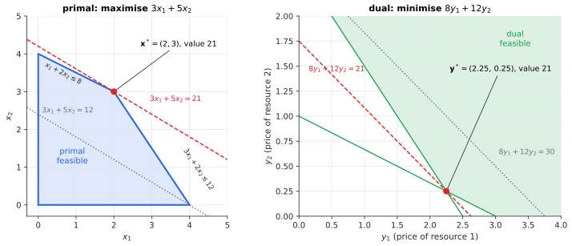

# Chapter 48 — Duality: Solving Problems from the Other Side

[← Previous](47-convexity.md) · [Track D](README.md) · [Table of Contents](../../00-front/table-of-contents.md) · [Next →](49-integer-programming.md)

> **Level 2 · Track D — Optimization and Operations Research**
> **Builds on:** [Ch. 6](../../part-2-calculus/06-multivariable-calculus.md), [Ch. 23](../../part-7-numerical-computational/23-optimization.md), [Ch. 47](47-convexity.md) · **Leads to:** [Ch. 49](49-integer-programming.md), [Ch. 51](51-optimal-control.md), [Ch. 55](55-optimal-transport.md) · **Related:** [Ch. 39](../c-game-theory/39-game-theory-basics.md), [Ch. 43](../c-game-theory/43-auctions-and-markets.md), [Ch. 50](50-operations-research.md)
> **Reading time:** ~30 min

## 48.1 The hook

Every five minutes, somewhere in a control room, an operator has to decide how much electricity each of several hundred power stations should generate. Demand must be met exactly. No transmission line may overheat. The total cost must be as low as possible. Each station has its own fuel curve, ramp limits and quirks, and most of those details are private. A coal plant does not want to publish its true costs. A wind farm doesn't know its output until the wind blows.

One way to run this is central planning: collect every detail, solve one enormous problem, and send each station an order. Modern electricity markets mostly do something stranger. They broadcast **a price**, one number per location. Each station looks at the price, decides on its own how much it wants to produce, and offers that. If the total is too low, the price goes up; if it's too high, the price goes down. When the market clears, the stations' selfish choices add up to the minimum-cost dispatch, exactly what the central planner would have ordered.

That should seem too good to be true. Why should prices, which carry so much less information than the full problem, be enough to coordinate the optimum? And there's a second, sharper puzzle hidden in it. In some markets, after the price is set, the operator has to make extra side payments called "uplift" to certain stations. Without those payments, the stations would lose money by following the "optimal" schedule. So prices sometimes *fail*. What is the mathematical difference between a world where prices work and one where they don't?

This chapter answers both questions with a single construction, the **Lagrangian dual**. It turns every minimisation problem into a maximisation over prices. The two problems look at the same truth from opposite sides. For convex problems they meet exactly. For non-convex ones a gap opens, and the uplift payment is that gap, measured in money.

## 48.2 The big idea

Picture two people working on the same problem.

The **designer** stands inside the feasible region. Every feasible design she tries has some cost, and that cost is an *upper bound* on the best possible cost: the optimum can't be worse than something she has already built. Her bounds come down as she finds better designs.

The **price-setter** never builds anything. She attaches a price to each constraint, which you can think of as a fine for each unit of violation. Then she asks: if constraints could be broken freely at these prices, what is the cheapest total of cost plus fines? Because any truly feasible design pays no fines, and at nonnegative prices can only collect credits for unused slack, that relaxed minimum is a *lower bound* on the true optimum. Her bounds go up as she tunes the prices.

The designer's numbers come down from above and the price-setter's come up from below. **Weak duality** says the floor can never pass through the ceiling. **Strong duality** says that, for convex problems, the two meet. When they meet you hold two numbers that agree, and the agreement is the certificate of optimality that [Ch. 47](47-convexity.md) promised. Nobody has to search further.

Here is the smallest example. A workshop makes two products with profits 3 and 5 per unit. It has 8 hours of machine time (product 1 needs 1 hour per unit, product 2 needs 2) and 12 kg of material (3 kg and 2 kg). The primal problem is

$$
\max\ 3x_1+5x_2\quad\text{s.t.}\quad x_1+2x_2\le8,\quad 3x_1+2x_2\le12,\quad x_1,x_2\ge0 .
$$

Suppose a buyer offers to rent the whole workshop, paying $y_1$ per machine hour and $y_2$ per kilogram. You'll accept only if the rent for the resources in each product is at least that product's profit: $y_1+3y_2\ge3$ and $2y_1+2y_2\ge5$. The buyer wants to pay as little as possible, $\min 8y_1+12y_2$. That is the **dual** problem, and it is the same "combine the constraints into a bound" trick as Farkas' lemma in [§47.3](47-convexity.md#473-the-mathematics), now aimed at the objective instead of at a contradiction.



*Two problems, one number. The best production plan $(2,3)$ earns 21 (left). The cheapest fair rent $(2.25,0.25)$ also costs 21 (right). Every other feasible plan earns less than 21 and every other fair rent costs more: the dotted lines show a plan worth 12 and a rent worth 30.*

The two answers are both 21. A machine hour is worth 2.25 at the margin and a kilogram 0.25. Those are the **shadow prices** of [§23.3](../../part-7-numerical-computational/23-optimization.md#233-linear-programming), now read as the price-setter's whole strategy. Give the workshop one more machine hour and its best profit rises to 23.25; one more kilogram, and it rises to 21.25. The prices tell you the value of resources you don't yet have.

## 48.3 The mathematics

The Lagrangian, dual function and the statements of weak and strong duality are in [§23.7](../../part-7-numerical-computational/23-optimization.md#237-convex-optimization-fundamentals), and the KKT conditions are in [§23.4](../../part-7-numerical-computational/23-optimization.md#234-nonlinear-optimization) (with their equality-only ancestor, Lagrange multipliers, in [§6.11](../../part-2-calculus/06-multivariable-calculus.md#611-lagrange-multipliers)). Here we prove the results and see *why* they hold.

### Setup

The primal problem is

$$
p^*=\min_{\mathbf{x}}\ f(\mathbf{x})\quad\text{s.t.}\quad g_i(\mathbf{x})\le0,\ i=1,\dots,m .
$$

(Equality constraints add free-sign multipliers and change nothing essential. We leave them out to keep the notation light.) The **Lagrangian** is $\mathcal{L}(\mathbf{x},\boldsymbol\lambda)=f(\mathbf{x})+\boldsymbol\lambda^\mathsf{T}\mathbf{g}(\mathbf{x})$, the **dual function** is $q(\boldsymbol\lambda)=\inf_{\mathbf{x}}\mathcal{L}(\mathbf{x},\boldsymbol\lambda)$, and the **dual problem** is $d^*=\max_{\boldsymbol\lambda\ge\mathbf{0}}q(\boldsymbol\lambda)$. Note that the infimum is over *all* $\mathbf{x}$, feasible or not. That freedom is what lets the dual decompose.

> [!theorem] Theorem 48.1 — Weak duality
> $q$ is concave, and $q(\boldsymbol\lambda)\le f(\mathbf{x})$ for every $\boldsymbol\lambda\ge\mathbf{0}$ and every feasible $\mathbf{x}$. Hence $d^*\le p^*$, whatever $f$ and $g_i$ are.

*Proof.* For fixed $\mathbf{x}$, $\boldsymbol\lambda\mapsto\mathcal{L}(\mathbf{x},\boldsymbol\lambda)$ is affine. An infimum of affine functions is concave, because its hypograph is an intersection of half-spaces, which is the outside description of [Ch. 47](47-convexity.md). For feasible $\mathbf{x}$ and $\boldsymbol\lambda\ge\mathbf{0}$ each term $\lambda_ig_i(\mathbf{x})\le0$, so $q(\boldsymbol\lambda)\le\mathcal{L}(\mathbf{x},\boldsymbol\lambda)\le f(\mathbf{x})$. $\square$

The dual is *always* a concave maximisation, even when the primal is a nightmare. That is the first reason duality is useful. You can always get a bound by solving an easy problem.

### The picture: supporting lines

Take a single constraint and collect every pair of (constraint value, cost) that any $\mathbf{x}$ can achieve:

$$
\mathcal{G}=\{(u,t):\ u=g(\mathbf{x}),\ t=f(\mathbf{x})\ \text{for some }\mathbf{x}\}\subset\mathbb{R}^2 .
$$

The primal optimum is the lowest point of $\mathcal{G}$ to the left of the vertical axis: $p^*=\inf\{t:(u,t)\in\mathcal{G},\ u\le0\}$. The dual function is

$$
q(\lambda)=\inf_{(u,t)\in\mathcal{G}}\,(t+\lambda u).
$$

The lines $t+\lambda u=c$ have slope $-\lambda$. Push such a line up from below until it touches $\mathcal{G}$: its intercept with the axis $u=0$ is exactly $q(\lambda)$. **The dual problem tilts a supporting line to make its intercept as high as possible.** Weak duality is now visible. A line lying under all of $\mathcal{G}$ with nonpositive slope must pass under the lowest feasible point too.


*The geometry of duality. Left: $\min x^2$ s.t. $1-x\le0$. The set $\mathcal{G}$ is convex from below, a tilted line touches it at $(0,1)$, and $p^*=d^*=1$. Right: $\min -x^2$ s.t. $x-1\le0$, $0\le x\le2$. The arc bends the wrong way, no line can reach $(0,-1)$ without cutting the arc, and the best intercept is $-2$. The vertical distance is the duality gap.*

> [!example] Worked Example 48.1: a duality gap, computed
> Primal: $\min_{0\le x\le2}\,-x^2$ subject to $x\le1$. Feasible $x\in[0,1]$, so $p^*=-1$ at $x=1$.
>
> *Dual function.* $q(\lambda)=\min_{0\le x\le2}\,\big(-x^2+\lambda(x-1)\big)$. For fixed $\lambda$ the bracket is concave in $x$, so its minimum over the interval is at an endpoint: $x=0$ gives $-\lambda$, and $x=2$ gives $\lambda-4$. Hence $q(\lambda)=\min(-\lambda,\ \lambda-4)$.
>
> *Dual problem.* The two pieces cross at $\lambda^*=2$, so $d^*=q(2)=-2$.
>
> *Gap.* $p^*-d^*=-1-(-2)=1>0$. The Lagrangian minimiser at $\lambda=2$ is $x=0$ or $x=2$, and neither is the primal optimum $x=1$. The price can't "talk" the problem into choosing the middle point, because the middle point is never the cheapest at any price.

This is the electricity-market puzzle in miniature. When a generator has a start-up cost or a minimum stable output, its cost curve is non-convex. The price that clears the market makes the planner's schedule unprofitable for that generator, which on its own would rather sit at an "endpoint" (off, or full). The uplift payment covers the gap.

> [!mystery] Where else does the gap open?
> Integer constraints such as "build the plant or don't" and "route the truck or don't" make $\mathcal{G}$ a scattered cloud of points, and the gap of Worked Example 48.1 becomes the normal state of affairs. Yet the dual bound is still the most valuable number an integer solver has, and clever relaxations can shrink the gap to zero. How the bound is used to prune billions of possibilities, and how cuts close the gap, is the story of [Ch. 49](49-integer-programming.md).

### Strong duality: separation does the work

> [!theorem] Theorem 48.2 — Strong duality under Slater's condition
> Suppose $f$ and every $g_i$ are convex, $p^*$ is finite, and there is a strictly feasible point $\mathbf{x}_0$ with $g_i(\mathbf{x}_0)<0$ for all $i$ (**Slater's condition**). Then $d^*=p^*$, and the dual optimum is attained.

*Proof.* Use the "upper-right shadow" of $\mathcal{G}$ instead of $\mathcal{G}$ itself:

$$
\mathcal{A}=\{(\mathbf{u},t)\in\mathbb{R}^m\times\mathbb{R}:\ \exists\,\mathbf{x}\ \text{with}\ \mathbf{g}(\mathbf{x})\le\mathbf{u},\ f(\mathbf{x})\le t\}.
$$

*Step 1: $\mathcal{A}$ is convex.* If $(\mathbf{u}_1,t_1)$ and $(\mathbf{u}_2,t_2)$ are witnessed by $\mathbf{x}_1$ and $\mathbf{x}_2$, then for $\theta\in[0,1]$ the point $\theta\mathbf{x}_1+(1-\theta)\mathbf{x}_2$ witnesses the mixture, because convexity gives $g_i(\theta\mathbf{x}_1+(1-\theta)\mathbf{x}_2)\le\theta g_i(\mathbf{x}_1)+(1-\theta)g_i(\mathbf{x}_2)\le\theta u_{1i}+(1-\theta)u_{2i}$, and the same for $f$. This is the one place convexity is used.

*Step 2: separate.* The set $\mathcal{B}=\{(\mathbf{0},t):t<p^*\}$ is convex and disjoint from $\mathcal{A}$, since a point in both would be a feasible $\mathbf{x}$ with $f(\mathbf{x})<p^*$. By the separation theorem for disjoint convex sets ([§47.3](47-convexity.md#473-the-mathematics), the non-strict version) there is $(\boldsymbol\lambda,\mu)\ne(\mathbf{0},0)$ with

$$
\boldsymbol\lambda^\mathsf{T}\mathbf{u}+\mu t\ \ge\ \mu s\qquad\text{for all }(\mathbf{u},t)\in\mathcal{A},\ s<p^* .
$$

*Step 3: signs.* $\mathcal{A}$ is closed under increasing any coordinate. If some $\lambda_i$ or $\mu$ were negative, sending that coordinate to $+\infty$ would push the left side to $-\infty$ and break the inequality. So $\boldsymbol\lambda\ge\mathbf{0}$ and $\mu\ge0$. Letting $s\uparrow p^*$ gives $\boldsymbol\lambda^\mathsf{T}\mathbf{u}+\mu t\ge\mu p^*$ on $\mathcal{A}$.

*Step 4: the line is not vertical.* If $\mu=0$, then $\boldsymbol\lambda\ne\mathbf{0}$, $\boldsymbol\lambda\ge\mathbf{0}$, and $\boldsymbol\lambda^\mathsf{T}\mathbf{u}\ge0$ on $\mathcal{A}$. But Slater's point gives $(\mathbf{g}(\mathbf{x}_0),f(\mathbf{x}_0))\in\mathcal{A}$ with $\boldsymbol\lambda^\mathsf{T}\mathbf{g}(\mathbf{x}_0)<0$. Contradiction. So $\mu>0$.

*Step 5: read off the bound.* Divide by $\mu$ and put $\boldsymbol\lambda^*=\boldsymbol\lambda/\mu\ge\mathbf{0}$. Each $\mathbf{x}$ gives the point $(\mathbf{g}(\mathbf{x}),f(\mathbf{x}))\in\mathcal{A}$, so $f(\mathbf{x})+\boldsymbol\lambda^{*\mathsf{T}}\mathbf{g}(\mathbf{x})\ge p^*$ for every $\mathbf{x}$, i.e. $q(\boldsymbol\lambda^*)\ge p^*$. With weak duality, $q(\boldsymbol\lambda^*)=d^*=p^*$. $\square$

The proof is a picture. Convexity makes $\mathcal{A}$ a convex blob, separation gives a supporting line at the optimum, and Slater's condition keeps that line from standing vertical, where it would have no slope to read a price from. The optimal multipliers *are* the slope of the separating hyperplane of [Ch. 47](47-convexity.md), as that chapter's first mystery promised.

> [!warning] Common Pitfall: Slater is sufficient, not necessary
> Without a strictly feasible point strong duality *can* fail even for convex problems. A classic is $\min e^{-x_2}$ subject to $x_1^2/x_2\le0$ with $x_2>0$: the feasible set is $x_1=0$, $p^*=1$, yet $d^*=0$. For linear constraints the condition relaxes to plain feasibility, which is why LP strong duality ([§23.3](../../part-7-numerical-computational/23-optimization.md#233-linear-programming)) needs no Slater point.

### KKT falls out

> [!theorem] Theorem 48.3 — Zero gap forces the KKT conditions
> If $\mathbf{x}^*$ is primal optimal, $\boldsymbol\lambda^*$ is dual optimal and $p^*=d^*$, then
> 1. $\mathbf{x}^*$ minimises $\mathcal{L}(\mathbf{x},\boldsymbol\lambda^*)$ over all $\mathbf{x}$ (so $\nabla f(\mathbf{x}^*)+\sum\lambda_i^*\nabla g_i(\mathbf{x}^*)=\mathbf{0}$ when everything is differentiable);
> 2. $\lambda_i^*g_i(\mathbf{x}^*)=0$ for every $i$ (**complementary slackness**).

*Proof.* Chain the definitions:

$$
f(\mathbf{x}^*)=q(\boldsymbol\lambda^*)=\inf_{\mathbf{x}}\mathcal{L}(\mathbf{x},\boldsymbol\lambda^*)\le\mathcal{L}(\mathbf{x}^*,\boldsymbol\lambda^*)=f(\mathbf{x}^*)+\sum_i\lambda_i^*g_i(\mathbf{x}^*)\le f(\mathbf{x}^*).
$$

The two ends are equal, so both inequalities are equalities. The first equality says $\mathbf{x}^*$ attains the infimum: claim 1, and stationarity follows because an unconstrained minimiser of a differentiable function has zero gradient. The second says $\sum_i\lambda_i^*g_i(\mathbf{x}^*)=0$. Every term is $\le0$, so every term is $0$: claim 2. $\square$

Read complementary slackness as an economist would. **A resource that isn't used up has price zero; a resource with a positive price is used up exactly.** In the workshop both resources are exhausted at $(2,3)$ ($2+6=8$, $6+6=12$), and both have positive prices.

The chain also shows that $(\mathbf{x}^*,\boldsymbol\lambda^*)$ is a **saddle point**: $\mathcal{L}(\mathbf{x}^*,\boldsymbol\lambda)\le\mathcal{L}(\mathbf{x}^*,\boldsymbol\lambda^*)\le\mathcal{L}(\mathbf{x},\boldsymbol\lambda^*)$. Strong duality says $\min_{\mathbf{x}}\max_{\boldsymbol\lambda\ge0}\mathcal{L}=\max_{\boldsymbol\lambda\ge0}\min_{\mathbf{x}}\mathcal{L}$. It's a two-player game between designer and price-setter, and it doesn't matter who moves first. That is the same exchange of min and max as von Neumann's minimax theorem for zero-sum games ([Ch. 39](../c-game-theory/39-game-theory-basics.md), [Ch. 46](../c-game-theory/46-adversarial-decision-making.md)).

### Sensitivity: what a price predicts

Perturb the constraints to $\mathbf{g}(\mathbf{x})\le\mathbf{u}$ and call the new optimal value $p(\mathbf{u})$. Then $p(\mathbf{0})=p^*$. Loosening ($\mathbf{u}>\mathbf{0}$) can only help, and tightening can only hurt.

> [!theorem] Theorem 48.4 — Global sensitivity inequality
> If strong duality holds with dual optimum $\boldsymbol\lambda^*$, then for **every** $\mathbf{u}$
> $$
> p(\mathbf{u})\ \ge\ p^*-\boldsymbol\lambda^{*\mathsf{T}}\mathbf{u}.
> $$
> If $p$ is differentiable at $\mathbf{0}$, then $\nabla p(\mathbf{0})=-\boldsymbol\lambda^*$.

*Proof.* Let $\mathbf{x}$ satisfy $\mathbf{g}(\mathbf{x})\le\mathbf{u}$. Since $\boldsymbol\lambda^*\ge\mathbf{0}$,

$$
f(\mathbf{x})=\mathcal{L}(\mathbf{x},\boldsymbol\lambda^*)-\boldsymbol\lambda^{*\mathsf{T}}\mathbf{g}(\mathbf{x})\ \ge\ q(\boldsymbol\lambda^*)-\boldsymbol\lambda^{*\mathsf{T}}\mathbf{u}=p^*-\boldsymbol\lambda^{*\mathsf{T}}\mathbf{u}.
$$

Take the infimum over such $\mathbf{x}$. For the derivative, the inequality says the affine function $p^*-\boldsymbol\lambda^{*\mathsf{T}}\mathbf{u}$ touches $p$ at $\mathbf{0}$ from below, so $-\boldsymbol\lambda^*$ is a subgradient of $p$ there. A differentiable function's only subgradient is its gradient. $\square$

The inequality is one-sided, and that is the practical lesson:

- **Large $\lambda_i^*$, tighten constraint $i$:** the optimal cost is *guaranteed* to rise steeply, at least by $\lambda_i^*$ per unit. Never tighten an expensive constraint casually.
- **Large $\lambda_i^*$, loosen constraint $i$:** the theorem promises nothing beyond a first-order estimate. The gain could be smaller than $\lambda_i^*$ per unit, because another constraint may become active.
- **$\lambda_i^*=0$:** small changes in either direction don't matter to first order. That doesn't make the constraint useless at large changes.

Check on the workshop, a *maximisation*, so the signs flip. One extra machine hour raises the profit from 21 to 23.25, exactly $y_1^*=2.25$. One extra kilogram raises it to 21.25, exactly $y_2^*=0.25$. LP values are piecewise linear in $\mathbf{u}$, so the prediction is exact until the optimal vertex changes. For the convex example $\min x^2$ s.t. $x\ge b$, the value $p(b)=b^2$ has slope $2b$, and the multiplier at $b=1$ is $\lambda^*=2$.

> [!tip] Engineering Note: locational marginal prices
> In a power-market dispatch problem, the multiplier of the power-balance constraint at bus $k$ is the cost of serving one more megawatt there, the **locational marginal price**. Theorem 48.4 is why it is a fair price, and complementary slackness is why prices differ across a congested line but agree across an uncongested one. Planners use these multipliers to decide where a new line or a battery is worth most.

## 48.4 The algorithm

The hook's market isn't just an analogy. It is an algorithm called **dual decomposition** (or **dual ascent**), and it is how very large problems that share a few constraints get solved in practice.

### Why prices decompose problems

Suppose $n$ agents each choose $\mathbf{x}_k$ with private cost $f_k$, and they share one resource: $\sum_k\mathbf{a}_k^\mathsf{T}\mathbf{x}_k\le c$. The Lagrangian

$$
\mathcal{L}=\sum_k f_k(\mathbf{x}_k)+\lambda\Big(\sum_k\mathbf{a}_k^\mathsf{T}\mathbf{x}_k-c\Big)=\sum_k\Big[f_k(\mathbf{x}_k)+\lambda\,\mathbf{a}_k^\mathsf{T}\mathbf{x}_k\Big]-\lambda c
$$

is a **sum of separate problems**: once $\lambda$ is fixed, agent $k$ minimises its own bracket and nobody needs to know anyone else's $f_k$. The only shared information is the price. That is why markets, network congestion control and distributed machine learning can all be organised around prices.

### The price update is a gradient step

How should the price move? There's a one-line answer.

> [!theorem] Proposition: the constraint violation is a supergradient of the dual
> If $\mathbf{x}(\boldsymbol\lambda)$ minimises $\mathcal{L}(\cdot,\boldsymbol\lambda)$, then for every $\boldsymbol\lambda'$, $q(\boldsymbol\lambda')\le q(\boldsymbol\lambda)+(\boldsymbol\lambda'-\boldsymbol\lambda)^\mathsf{T}\mathbf{g}(\mathbf{x}(\boldsymbol\lambda))$.

*Proof.* $q(\boldsymbol\lambda')\le\mathcal{L}(\mathbf{x}(\boldsymbol\lambda),\boldsymbol\lambda')=\mathcal{L}(\mathbf{x}(\boldsymbol\lambda),\boldsymbol\lambda)+(\boldsymbol\lambda'-\boldsymbol\lambda)^\mathsf{T}\mathbf{g}(\mathbf{x}(\boldsymbol\lambda))$, and the first term is $q(\boldsymbol\lambda)$. $\square$

So to climb the concave dual, move the price in the direction of the constraint violation, and never let it go negative:

```text
lambda = initial prices (>= 0)
repeat:
    each agent k:   x_k = argmin  f_k(x_k) + lambda . (a_k x_k)      # in parallel, privately
    violation       = sum_k a_k x_k - c
    lambda          = max(0, lambda + alpha * violation)               # raise price if over-demanded
until violation is small and the bounds agree
```

**Convergence.** If every $f_k$ is strictly convex, $q$ is differentiable and a small fixed step $\alpha$ converges. If the $f_k$ are merely convex (linear costs, for example), $q$ has kinks, and you need diminishing steps such as $\alpha_k\propto1/\sqrt k$. Even then the error falls only like $O(1/\sqrt k)$, which is slow. Each iteration hands you a certificate for free: the dual value $q(\boldsymbol\lambda_k)$ bounds the optimum from one side, and any feasible repair of $\mathbf{x}(\boldsymbol\lambda_k)$ bounds it from the other.

**Failure cases.**

- **Linear costs make agents jumpy.** If $f_k$ is linear, the minimiser $\mathbf{x}(\lambda)$ leaps from one extreme to the other as $\lambda$ crosses a threshold, and the total demand oscillates around $c$ without settling. The standard cure is to add a quadratic penalty $\tfrac\rho2\lVert\text{violation}\rVert^2$ to the Lagrangian (the **augmented Lagrangian**, and its distributed form **ADMM**). That buys smoothness at the price of coupling.
- **Primal infeasibility.** The dual can converge while $\mathbf{x}(\boldsymbol\lambda_k)$ remains slightly infeasible. Engineers report averaged iterates or project the final answer onto the feasible set.
- **Non-convexity.** Worked Example 48.1 shows the limit. With a gap, no price makes the agents' selfish choices add up to the optimum, and the loop can cycle between "endpoints" forever.

## 48.5 The experiment

**Tilt the dual.** The blue curve is the dual function $q(\lambda)=b\lambda-\lambda^2/4$ of $\min x^2$ s.t. $x\ge b$ with $b=1$. The blue dashed line is the primal value $p^*=b^2=1$. Change both `1`s in the first line and the dashed level to a new $b$ (try $b=1.5$: the peak moves to $\lambda^*=2b=3$ and the level to $2.25$). The peak always touches the primal value. That is strong duality, and its location is the sensitivity $dp^*/db=2b$. The red curve is the dual $\min(-\lambda,\lambda-4)$ of Worked Example 48.1, and the red dashed line is its primal value $-1$. The peak at $-2$ never reaches the line.

```desmos-graph
left=-0.5; right=5; bottom=-4; top=3
---
y=1\cdot x-\frac{x^{2}}{4}|blue|0<x<5
y=1|blue|dashed
y=\min(-x,x-4)|red|0<x<5
y=-1|red|dashed
(2,1)|label:no gap
(2,-2)|label:gap
```

*Dual functions plotted against the price $\lambda$ (horizontal axis). The convex problem's dual (blue) rises to meet its primal value; the non-convex one (red) stops a full unit short.*

**Run a market for power.** The script allocates a total power $P$ across channels with noise levels $N_k$ to maximise capacity $\sum_k\ln(1+p_k/N_k)$, the water-filling problem of [§23.4](../../part-7-numerical-computational/23-optimization.md#234-nonlinear-optimization). It never solves the problem directly. It announces a price $\lambda$, lets each channel buy $p_k=\max(0,1/\lambda-N_k)$, and adjusts the price. Each round it records two bounds: the dual value (an upper bound, since this is a maximisation) and the capacity of a rescaled feasible design (a lower bound).

```python
import numpy as np
import matplotlib.pyplot as plt

# --- knobs -------------------------------------------------------------
N = np.array([0.2, 0.5, 1.0, 1.6])   # noise level of each channel
P = 2.0                              # total power budget
lam, alpha, iters = 2.0, 0.3, 40     # starting price, price step, rounds

def best_response(lam):              # each channel maximises log(1+p/N) - lam*p
    return np.maximum(0.0, 1.0 / lam - N)

def utility(p):
    return np.sum(np.log(1 + p / N))

upper, lower, prices = [], [], []
for k in range(iters):
    p = best_response(lam)
    upper.append(utility(p) - lam * p.sum() + lam * P)    # dual value g(lam)
    feas = p * P / p.sum() if p.sum() > 0 else np.full_like(N, P / len(N))
    lower.append(utility(feas))                          # a feasible design
    prices.append(lam)
    lam = max(1e-6, lam + alpha * (p.sum() - P))         # raise price if over budget

print("final price  :", round(lam, 4), " water level 1/price:", round(1 / lam, 4))
print("final powers :", np.round(best_response(lam), 4))
print("bounds       :", round(lower[-1], 5), "<= optimum <=", round(upper[-1], 5))

fig, ax = plt.subplots(1, 2, figsize=(10, 3.5))
ax[0].plot(upper, label="dual bound g(lambda)"); ax[0].plot(lower, label="feasible design")
ax[0].set_xlabel("round"); ax[0].set_ylabel("capacity (nats)"); ax[0].legend()
ax[1].plot(prices); ax[1].set_xlabel("round"); ax[1].set_ylabel("price lambda")
plt.tight_layout(); plt.show()
```

With the default knobs the price settles at $\lambda^*\approx0.8108$ (water level $1/\lambda^*=1.2333$). The powers come out as $(1.0333,\,0.7333,\,0.2333,\,0)$: the noisiest channel gets nothing, its nonnegativity constraint is active. Both bounds agree at $2.93175$ nats. Things to try: raise `alpha` to $0.6$ and the price keeps oscillating without settling (at $1.5$ it runs away entirely); set `P = 0.2` so only one channel is worth buying; replace the utility with a non-concave one, say $\sqrt{p}$ capped at a threshold, and see whether the two bounds still meet.

## 48.6 The challenge

1. **Intuition.** A constraint in your design has multiplier $\lambda^*=0$. A colleague proposes deleting it "because it doesn't matter". Describe, with a sketch of $\mathcal{G}$ or of $p(u)$, a situation in which deleting it changes the optimum completely.
2. **Derivation.** Derive the dual of the minimum-norm problem $\min\tfrac12\lVert\mathbf{x}\rVert^2$ s.t. $\mathbf{A}\mathbf{x}=\mathbf{b}$, solve the dual in closed form, and show that strong duality recovers $\mathbf{x}^*=\mathbf{A}^\mathsf{T}(\mathbf{A}\mathbf{A}^\mathsf{T})^{-1}\mathbf{b}$. Then do the same with $\mathbf{x}\ge\mathbf{0}$ added, and explain why the closed form disappears.
3. **Implementation.** Extend the water-filling script to two shared budgets, a total power limit and a per-group limit on channels 1–2. Use two prices updated simultaneously. Plot both prices and verify complementary slackness numerically by printing each price next to the slack of its constraint.
4. **Open investigation.** Take a market with a few non-convex agents, each of which either produces nothing or at least a minimum output $m_k>0$, and run price adjustment. Measure the duality gap as you add more and more small agents. Does the gap per agent shrink? Find, by experiment, how the gap scales with the number of agents and with the size of the non-convexity (this is related to the Shapley–Folkman lemma, but the rate in your model is for you to discover).

## 48.7 Loose threads

Duality was presented here for a handful of variables. Each generalisation opens a new door.

> [!mystery] A price for every instant
> In optimal control the decision is a whole trajectory $\mathbf{u}(t)$ and the constraint is a differential equation $\dot{\mathbf{x}}=\mathbf{f}(\mathbf{x},\mathbf{u})$ that must hold at *every* instant. Attach a multiplier to each instant and you get a multiplier *function* $\mathbf{p}(t)$, which itself obeys a differential equation running backward in time. Why backward? And what does this "costate" price? Pontryagin's principle in [Ch. 51](51-optimal-control.md) answers both.

> [!mystery] The dual of moving dirt
> Moving a pile of sand into a hole of the same shape at least total cost is a linear program with infinitely many variables, one for each pair of source and destination points. Its dual looks for a *price field* $\varphi(\mathbf{x})$ that a hauling company could charge. The Kantorovich duality that links them, and the strange "conjugate" operation that turns one price field into another, wait in [Ch. 55](55-optimal-transport.md).

The third thread is §48.3's mystery: the gap of non-convex problems, and how integer programming exploits the dual bound anyway ([Ch. 49](49-integer-programming.md)). When the constraints themselves are uncertain, the dual of a worst-case problem becomes a problem about probability distributions ([Ch. 54](54-robust-stochastic-optimization.md)). For the economics of prices that fail, see auctions and markets in [Ch. 43](../c-game-theory/43-auctions-and-markets.md).

## Further reading

- S. Boyd and L. Vandenberghe, *Convex Optimization*, Cambridge University Press, 2004. Chapter 5: Lagrange duality, its geometric interpretation, and sensitivity analysis.
- D. P. Bertsekas, *Nonlinear Programming*, 3rd ed., Athena Scientific, 2016. Duality, dual methods and the augmented Lagrangian, with many distributed examples.
- D. G. Luenberger and Y. Ye, *Linear and Nonlinear Programming*, 4th ed., Springer, 2016. LP duality, shadow prices and sensitivity from the operations-research side.
- S. Boyd, N. Parikh, E. Chu, B. Peleato and J. Eckstein, "Distributed Optimization and Statistical Learning via the Alternating Direction Method of Multipliers", *Foundations and Trends in Machine Learning* 3(1), 2011. Dual decomposition and ADMM in practice.
