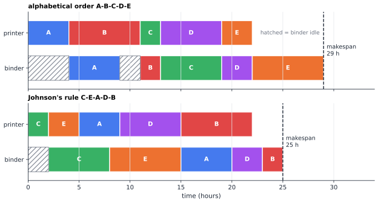

# Chapter 50 — Operations Research: Mathematics That Runs the World

[← Previous](49-integer-programming.md) · [Track D](README.md) · [Table of Contents](../../00-front/table-of-contents.md) · [Next →](51-optimal-control.md)

> **Level 2 · Track D — Optimization and Operations Research**
> **Builds on:** [Ch. 6](../../part-2-calculus/06-multivariable-calculus.md), [Ch. 23](../../part-7-numerical-computational/23-optimization.md), [Ch. 25](../../part-7-numerical-computational/25-mathematical-modeling.md) · **Leads to:** [Ch. 51](51-optimal-control.md), [Ch. 52](52-dynamic-programming.md), [Ch. 54](54-robust-stochastic-optimization.md) · **Related:** [Ch. 27](../a-algorithms/27-graph-theory.md), [Ch. 30](../a-algorithms/30-limits-of-computation.md), [Ch. 36](../b-probability-information/36-stochastic-processes.md), [Ch. 48](48-duality.md), [Ch. 49](49-integer-programming.md)
> **Reading time:** ~30 min

## 50.1 The hook

A small print shop takes five orders on a Monday morning. Every order goes through the same two machines: first the press prints it, then the binder folds, stitches and trims it. The binder cannot start a job until the press has finished that job, and each machine handles one job at a time. The times, in hours, are:

| job | A | B | C | D | E |
|---|---|---|---|---|---|
| press $a_j$ | 4 | 7 | 2 | 6 | 3 |
| binder $b_j$ | 5 | 2 | 6 | 3 | 7 |

The press has 22 hours of work and the binder 23. The only decision is the *order* in which the jobs go through. The manager does the obvious thing and runs them alphabetically. The last book leaves the binder at hour 29.

Is that good? There are $5! = 120$ possible orders. Try them all and the worst takes 35 hours and the best takes 25. The alphabetical order sits in between, and it wastes four hours of binder time. Over a year of Mondays that is a lot of overtime.

Now scale up. A real shop with 20 jobs has $20! \approx 2.4\times 10^{18}$ orders. A computer checking a billion orders a second would need about 77 years. Yet in 1954 Selmer Johnson, working at the RAND Corporation, published a rule that finds a best order for *any* number of jobs on two machines with nothing more than a sort. It takes milliseconds.

> **How can a rule beat a search over $10^{18}$ possibilities without looking at them?**

That question is the soul of operations research (OR). The field was born in the Second World War, when mathematicians were asked where to put radar stations, how big to make convoys, and how to pattern anti-submarine patrols. It now decides when your parcel leaves the depot, how many spare parts a power utility keeps, which aircraft flies which route, and how a mobile phone shares its transmit power across frequencies. This chapter shows you three of its classic results, each a small piece of mathematics with an enormous footprint: a scheduling rule, an inventory formula, and an allocation principle. Each one replaces a search with a *structural insight*.

## 50.2 The big idea

OR models have a common shape. You choose **decisions** (an order, a quantity, an allocation), subject to **constraints** (one job per machine, a budget, demand must be met), to minimise a **cost** or maximise a **benefit**. That is the optimization template of [§23.1](../../part-7-numerical-computational/23-optimization.md#231-objective-functions). What makes OR its own subject is the kind of structure the real world hands you:

- **Scheduling.** Decisions are orders or start times. The feasible set is a set of permutations: finite, huge, with no gradient. The trick is to find an *exchange argument*: show that swapping two neighbours in the wrong order never hurts. Then a sort is enough.
- **Inventory.** Decisions are how much and when to order. Two costs pull in opposite directions: ordering often is expensive in paperwork and trucks; ordering rarely means paying to store goods. The optimum sits where the two pulls balance, and the cost curve is surprisingly *flat* around it.
- **Logistics.** Decisions are flows on a network: so many tonnes from this factory to that warehouse. These are linear programs ([§23.3](../../part-7-numerical-computational/23-optimization.md#233-linear-programming)), and their dual variables are prices ([Ch. 48](48-duality.md)). When the decisions become yes/no (open this depot? send this truck along that road?), they turn into the integer programs of [Ch. 49](49-integer-programming.md).
- **Resource allocation.** Decisions are how much of a scarce resource each activity gets. If returns diminish, the rule is *equalise the marginal returns*: the last dollar (or milliwatt) should buy the same benefit everywhere it goes.

Here is the analogy to keep in mind. A good OR model is like a well-cut key. The lock (the real system) is messy, but if you cut the key to match only the few pins that matter, it turns. Johnson's rule ignores almost everything about the shop and keeps one fact: which machine is the bottleneck for each job. That single fact is enough.



*The same five jobs in two orders. Hatched blocks are hours the binder sits idle waiting for the press. Johnson's order starts with the job that frees the binder fastest and ends with the job that keeps it busy longest after the press stops.*

Look at the picture. The binder can never start before the press has finished its first job, and it can never stop before it has done all 23 hours of its own work. So no schedule can finish before $\min_j a_j + \sum_j b_j = 2 + 23 = 25$ hours. Johnson's order hits that bound exactly, so it is optimal, and we have a *certificate*: a short argument anyone can check. The alphabetical order loses because it opens with job A (four hours on the press while the binder waits) and then job B, which is slow on the press and quick on the binder, starving the binder again.

## 50.3 The mathematics

### Result 1: the makespan of a two-machine flow shop

Fix an order $\sigma = (\sigma_1,\dots,\sigma_n)$ of the jobs. Write $A_k = \sum_{i=1}^{k} a_{\sigma_i}$ for the time the press finishes the $k$-th job (the press never idles), and $C_k$ for the time the binder finishes it. The binder can start job $k$ only when both it is free and the press is done:

$$
C_k = \max\left(C_{k-1},\ A_k\right) + b_{\sigma_k}, \qquad C_0 = 0 .
$$

> [!theorem] Makespan formula
> For the order $\sigma$, the time the last job leaves the binder is
> $$
> C_{\max}(\sigma) = \max_{1\le k\le n}\left( \sum_{i=1}^{k} a_{\sigma_i} + \sum_{i=k}^{n} b_{\sigma_i} \right).
> $$

*Proof.* Unroll the recursion. Since $\max(x,y)+c = \max(x+c, y+c)$,

$$
\begin{aligned}
C_n &= \max\left(C_{n-1} + b_{\sigma_n},\ A_n + b_{\sigma_n}\right) \\
&= \max\left(C_{n-2} + b_{\sigma_{n-1}} + b_{\sigma_n},\ A_{n-1} + b_{\sigma_{n-1}} + b_{\sigma_n},\ A_n + b_{\sigma_n}\right) \\
&= \cdots = \max_{1\le k\le n}\left(A_k + \sum_{i=k}^{n} b_{\sigma_i}\right),
\end{aligned}
$$

where the final step uses $C_0 = 0$, so the last leftover term $C_0 + \sum_{i\ge 1} b_{\sigma_i}$ is dominated by the $k=1$ term. ∎

The formula has a vivid reading. Term $k$ is the length of a path through the Gantt chart: run along the press up to job $k$, drop down to the binder, then run along the binder to the end. The makespan is the longest such path, a **critical path**. Each job $k$ is a candidate "hand-over point".

### Result 2: the exchange argument and Johnson's rule

Now compare two orders that differ only by swapping neighbours: job $i$ immediately before job $j$, or $j$ before $i$. Every term of the makespan formula with the hand-over point elsewhere is unchanged, because it contains both jobs on the same machine or neither. Let $P$ be the press time before the pair and $S$ the binder time after it. The two terms that change are, for $i$ first,

$$
P + a_i + b_i + b_j + S \quad\text{and}\quad P + a_i + a_j + b_j + S,
$$

whose maximum is $P + S + a_i + b_j + \max(b_i, a_j)$. For $j$ first it is $P + S + a_j + b_i + \max(b_j, a_i)$. Subtract $P + S + a_i + a_j + b_i + b_j$ from both and use $\max(x,y) - x - y = -\min(x,y)$:

$$
i \text{ before } j \text{ is no worse} \iff -\min(a_j, b_i) \le -\min(a_i, b_j) \iff \min(a_i, b_j) \le \min(a_j, b_i).
$$

> [!theorem] Johnson's rule (1954)
> Put first the jobs with $a_j \le b_j$, in increasing order of $a_j$. Put after them the jobs with $a_j > b_j$, in decreasing order of $b_j$. The resulting order minimises the makespan on two machines.

Why does the rule satisfy the exchange condition for every neighbouring pair? Take two jobs from the first group with $a_i \le a_j$. Then $\min(a_i, b_j) \le a_i$, and $a_i \le \min(a_j, b_i)$ because $a_i \le a_j$ and $a_i \le b_i$. The second group is the mirror image, and for a first-group job $i$ before a second-group job $j$, $\min(a_i, b_j)$ is at most $a_i \le b_i$ and at most $b_j < a_j$, so it is at most $\min(a_j, b_i)$. Starting from any optimal order, you can bubble-sort it into Johnson's order one neighbour swap at a time, and no swap ever increases the makespan. Ties need a little care; the challenge asks you to supply it.

For the print shop, the first group is $\{C, E, A\}$ ($a = 2, 3, 4$) and the second is $\{D, B\}$ ($b = 3, 2$), giving C-E-A-D-B with makespan 25. Eight of the 120 orders achieve 25; Johnson's rule finds one with a single sort, $O(n\log n)$ work.

> [!mystery] Add a third machine
> Put a packing station after the binder and the exchange argument collapses: there are orders where no swap of neighbours helps, yet the order is far from optimal. In 1976 Garey, Johnson and Sethi proved that the three-machine flow shop is NP-hard, so no sort, and probably no polynomial algorithm of any kind, can solve it. What "NP-hard" really means, and why one extra machine crosses that line, is the subject of [Ch. 30](../a-algorithms/30-limits-of-computation.md).

### Result 3: the economic order quantity

A shop sells $D$ units per year at a steady rate. Each order costs a fixed $K$ (paperwork, delivery, set-up) no matter its size, and keeping one unit on the shelf for a year costs $h$ (capital, space, spoilage). If you order $Q$ units each time and the next delivery arrives just as the shelf empties, the stock follows a sawtooth from $Q$ down to $0$. The average stock is $Q/2$ and you place $D/Q$ orders per year, so the annual cost is

$$
C(Q) = \underbrace{\frac{KD}{Q}}_{\text{ordering}} + \underbrace{\frac{hQ}{2}}_{\text{holding}} .
$$

Dimensions check: $K$ is dollars per order, $D/Q$ is orders per year, $h$ is dollars per unit-year and $Q/2$ is units, so both terms are dollars per year.

> [!theorem] EOQ and its flatness (Harris, 1913)
> $C$ is minimised at
> $$
> Q^* = \sqrt{\frac{2KD}{h}}, \qquad C(Q^*) = \sqrt{2KDh},
> $$
> and for any other order size $Q = rQ^*$,
> $$
> \frac{C(rQ^*)}{C(Q^*)} = \frac{1}{2}\left(r + \frac{1}{r}\right).
> $$

*Proof.* $C'(Q) = -KD/Q^2 + h/2$ vanishes at $Q^* = \sqrt{2KD/h}$, and $C''(Q) = 2KD/Q^3 > 0$, so this is the global minimum on $Q > 0$. Substituting, each term equals $\tfrac12\sqrt{2KDh}$: at the optimum the two costs are *equal*. Writing $C^* = \sqrt{2KDh}$, we have $hQ^*/2 = KD/Q^* = C^*/2$, so

$$
C(rQ^*) = \frac{KD}{rQ^*} + \frac{h\,rQ^*}{2} = \frac{1}{r}\cdot\frac{C^*}{2} + r\cdot\frac{C^*}{2}.
$$

∎

The square root is a famous OR surprise. If demand doubles, you should *not* double the order size; it grows by only $\sqrt 2 \approx 1.41$. Big shops therefore carry relatively less stock than small ones, which is one quiet reason that scale pays.

The ratio formula is the real engineering gift. With $D = 10{,}000$ units/yr, $K = \$200$ and $h = \$4$/unit/yr, $Q^* = 1000$ units and $C^* = \$4000$/yr, ten orders a year. Order 1500 at a time instead ($r = 1.5$) and the cost rises to $\$4333$, only 8.3% more. Ordering double ($r = 2$) costs 25% more. A 50% mistake in $Q$ costs single-digit percent. Because the error enters as $r + 1/r$, which is flat at $r = 1$, rough estimates of $K$ and $h$ are good enough. Estimate $K$ as twice its true value and $Q^*$ rises by only $\sqrt{2}$, costing 6%.


*Left: stock on the shelf for two order sizes; doubling $Q$ doubles the average stock. Right: the total cost is a flat-bottomed valley. Anywhere in the shaded band ($667 \le Q \le 1500$) you pay at most 8.3% over the optimum.*

> [!mystery] What if customers don't behave?
> The EOQ assumes demand flows at a perfectly known rate. Real demand is random, deliveries take time, and running out has a price. Then you must also choose a **safety stock**, and in the one-shot version (a newspaper seller who must decide this morning how many papers to buy) the optimal order is a *quantile* of the demand distribution, not its mean. Which quantile, and why a cost ratio picks it, is worked out in [Ch. 54](54-robust-stochastic-optimization.md).

### Resource allocation: equalise the margins

Suppose a transmitter has total power $P$ to share among $n$ frequency channels with noise levels $N_1,\dots,N_n$. Channel $i$ given power $p_i$ carries $\log(1 + p_i/N_i)$ units of data (Shannon's formula, [Ch. 33](../b-probability-information/33-information-theory.md)). We want

$$
\max_{p_i \ge 0}\ \sum_{i=1}^{n} \log\left(1 + \frac{p_i}{N_i}\right) \quad\text{subject to}\quad \sum_{i=1}^{n} p_i = P .
$$

The returns are concave (each extra milliwatt buys less), so the KKT conditions of [§23.4](../../part-7-numerical-computational/23-optimization.md#234-nonlinear-optimization) are necessary and sufficient. Attach a multiplier $\nu$ to the budget ([§6.11](../../part-2-calculus/06-multivariable-calculus.md#611-lagrange-multipliers)). At the optimum, every channel that gets power has the same marginal return, and channels left off would return less:

$$
\frac{1}{N_i + p_i} = \nu \ \text{ if } p_i > 0, \qquad \frac{1}{N_i} \le \nu \ \text{ if } p_i = 0 .
$$

Writing $\mu = 1/\nu$, this is $p_i = \max(0,\ \mu - N_i)$: pour water of total volume $P$ into a vessel whose floor has height $N_i$ over channel $i$, and the water depth is the power. This is **water-filling**. With noise levels $1, 3, 6$ and $P = 6$, trying all three channels gives $\mu = 16/3 < 6$, so channel 3 is dry; the two others give $\mu = 5$ and powers $(4, 2, 0)$. Total rate: $\log_2 5 + \log_2(5/3) \approx 3.06$ bits per use, against $2.74$ for an equal split.

The same principle runs budgets, crews and computing time: give the next unit of a resource to whichever activity values it most, and stop when the margins are level. The multiplier $\nu$ is the **shadow price** of the resource, the benefit of one more unit. That reading of multipliers as prices is the theme of [Ch. 48](48-duality.md).

### Logistics and queues, in brief

Two more pillars deserve a sentence each. **Transportation problems** ship goods from supplies $s_i$ to demands $d_j$ at unit costs $c_{ij}$: minimise $\sum c_{ij}x_{ij}$ with $\sum_j x_{ij} \le s_i$, $\sum_i x_{ij} \ge d_j$, $x_{ij}\ge 0$. This is a linear program whose constraint matrix is so special that integer supplies and demands always admit an optimal flow in whole units, with no integer programming needed. **Queues** obey a law with almost no assumptions. If $\lambda$ is the arrival rate, $W$ the average time a customer spends in the system and $L$ the average number present, then

$$
L = \lambda W \qquad \text{(Little's law)}.
$$

A wafer fab that starts 50 wafers a day and holds 1500 in progress has an average cycle time of $1500/50 = 30$ days. To cut that time you must cut work in progress, which is the mathematical core of "lean" manufacturing.

## 50.4 The algorithm

Johnson's rule is four lines. The makespan recursion is a few more:

```python
def johnson(a, b):
    """Optimal two-machine flow-shop order. a, b: lists of times on machines 1, 2."""
    first = sorted([j for j in range(len(a)) if a[j] <= b[j]], key=lambda j: a[j])
    last  = sorted([j for j in range(len(a)) if a[j] >  b[j]], key=lambda j: -b[j])
    return first + last

def makespan2(seq, a, b):
    t1 = t2 = 0
    for j in seq:
        t1 += a[j]                  # press finishes job j
        t2 = max(t2, t1) + b[j]     # binder starts when free AND job is printed
    return t2
```

**Complexity.** Sorting costs $O(n\log n)$ and the makespan $O(n)$. The brute force it replaces costs $O(n\cdot n!)$.

**EOQ** is a closed form, but in practice you compute it with care. Real price lists give quantity discounts, so $C(Q)$ becomes piecewise; evaluate the EOQ on each price band, clip it to the band, and compare the few candidates. Production with a finite rate $R > D$ changes the average stock to $\tfrac{Q}{2}(1 - D/R)$, which replaces $h$ by $h(1 - D/R)$ in the formula.

**Water-filling** needs the level $\mu$. Sort the noise levels; for $m = n, n-1, \dots$ try using the $m$ quietest channels, set $\mu = (P + \sum_{i\le m} N_i)/m$, and stop at the first $m$ with $\mu > N_m$. That is $O(n\log n)$. Bisection on $\mu$ also works and generalises to returns that have no closed form.

**Failure cases.** Each of these algorithms is exact *only for its model*. Johnson's rule says nothing about set-up times that depend on the previous job, about due dates, or about a third machine. EOQ breaks when demand is lumpy or random. Water-filling assumes the channel states are known; if they are estimated, the "optimal" allocation can pour power into a channel that is actually bad. The professional skill in OR is knowing which assumption is about to fail.

> [!tip] Engineering note
> In practice, OR problems are rarely solved with a single elegant rule. They are written as integer or linear programs and handed to a solver. The elegant rules still matter. They give warm starts, lower bounds that certify a solver's answer, and a sanity check on its output.

## 50.5 The experiment

**Part 1: feel the flat bottom.** The graph shows the EOQ cost $C(Q) = KD/Q + hQ/2$ with $KD = 2{,}000{,}000$ and $h/2 = 2$. Change $h/2$ from $2$ to $8$ (storage becomes four times dearer). The minimum moves left, but by a factor of only 2, and the valley stays flat.

```desmos-graph
left=0; right=3000; bottom=0; top=12000
---
y=\frac{2000000}{x}+2x|black
y=2x|green|dashed
y=\frac{2000000}{x}|red|dashed
y=4000|blue|dotted
(1000,4000)|label:EOQ
```

*Total annual cost (black) as the sum of holding (green) and ordering (red). The minimum is where the two dashed curves cross.*

**Part 2: break Johnson's rule.** The script below draws random 6-job instances, schedules them with Johnson's rule, and compares the result with the best of all $720$ orders. Run it with `MACHINES = 2`: the rule is optimal every time. Then set `MACHINES = 3`. The script squashes the three machines into two virtual ones (machines 1+2 and 2+3) and applies Johnson's rule. With the seed given it is optimal in only 54% of trials, averages 2.6% above the best, and is 16.3% worse in the worst case. Try `N_JOBS = 8` (40,320 orders; slow but feasible) and other heuristics: sort by total time, or by the ratio $a_j/c_j$.

```python
import itertools
import numpy as np

rng = np.random.default_rng(1)
N_JOBS, MACHINES, TRIALS = 6, 2, 200        # try MACHINES = 3

def makespan(seq, P):
    """P[j, m] = processing time of job j on machine m; jobs visit machines in order."""
    done = np.zeros(P.shape[1])
    for j in seq:
        done[0] += P[j, 0]
        for m in range(1, P.shape[1]):
            done[m] = max(done[m], done[m - 1]) + P[j, m]
    return done[-1]

def johnson(a, b):
    first = sorted([j for j in range(len(a)) if a[j] <= b[j]], key=lambda j: a[j])
    last = sorted([j for j in range(len(a)) if a[j] > b[j]], key=lambda j: -b[j])
    return first + last

gaps = []
for _ in range(TRIALS):
    P = rng.integers(1, 10, size=(N_JOBS, MACHINES))
    if MACHINES == 2:
        seq = johnson(P[:, 0], P[:, 1])
    else:   # squash three machines into two "virtual" ones and hope
        seq = johnson(P[:, 0] + P[:, 1], P[:, 1] + P[:, 2])
    best = min(makespan(s, P) for s in itertools.permutations(range(N_JOBS)))
    gaps.append(makespan(seq, P) / best - 1)

gaps = np.array(gaps)
print(f"Johnson-style order optimal in {np.mean(gaps == 0):.0%} of {TRIALS} trials")
print(f"average gap {gaps.mean():.1%}, worst gap {gaps.max():.1%}")
```

Watch what the numbers say. On two machines, structure beats search completely. On three, structure gives a good guess but no guarantee, and the only way to be sure is to search, exactly what the 1954 rule let us avoid.

## 50.6 The challenge

1. **Intuition.** A job takes 1 hour on the press and 9 on the binder. Explain in words, without formulas, why Johnson's rule wants it *first*, and why a job with 9 hours on the press and 1 on the binder belongs *last*. Then explain why the lower bound $\min_j a_j + \sum_j b_j$ is not always achievable.
2. **Derivation.** Finish the proof of Johnson's rule. Show that when several jobs tie (for example $a_i = b_i$, or two jobs with equal $a$), every tie-break produces the same makespan, and turn the "bubble-sort an optimal order" sketch into a careful induction. Then derive the EOQ with a finite production rate $R > D$ and show the optimal batch is $\sqrt{2KD/(h(1 - D/R))}$.
3. **Implementation.** Write a water-filling routine for $n$ channels by bisection on $\mu$. Test it on noise levels $1, 3, 6$ and power $P = 6$, and then plot total rate against $P$ from $0$ to $30$. Mark the values of $P$ at which each new channel switches on. What shape does the curve have between switch-on points?
4. **Open investigation.** For the three-machine flow shop, design the best polynomial-time heuristic you can, and measure its worst gap on random instances of 8–10 jobs against brute force. Can you find a family of instances on which your heuristic's ratio to the optimum keeps growing? No clean answer is known for what the best achievable guarantee is in practice; the literature (NEH, Taillard's benchmarks) is a good place to compare yourself.

## 50.7 Loose threads

This chapter solved three problems by *structure*: an exchange argument, a square-root balance, and level margins. Each worked because the model was static and certain. The threads that pull hardest are the ones that relax those two words.

> [!mystery] Why does Little's law need no assumptions?
> $L = \lambda W$ holds for a supermarket queue, a router buffer, a hospital ward and a wafer fab, whatever the distributions of arrivals and service times, whatever the order in which customers are served. That universality looks too good to be true. The proof is a beautiful sample-path argument that compares two ways of measuring the same area under a curve, and it belongs to the theory of stochastic processes in [Ch. 36](../b-probability-information/36-stochastic-processes.md).

Two more pointers. First, *time*. The inventory problem here was a single static choice of $Q$. If demand changes month by month, the decision becomes a sequence where each choice shapes the next state: that is optimal control in continuous time ([Ch. 51](51-optimal-control.md)) and dynamic programming in discrete stages ([Ch. 52](52-dynamic-programming.md)). The Wagner–Whitin algorithm for lot sizing with time-varying demand is a dynamic program. Second, *feedback*. Supply chains in which each stage orders from the next amplify small swings in demand into wild oscillations upstream, the "bullwhip effect". It is a stability phenomenon of a feedback loop, and the tools for taming it come from control ([Ch. 51](51-optimal-control.md)). When routes and depots become yes/no decisions, return to the branch-and-bound machinery of [Ch. 49](49-integer-programming.md); and shortest-route ideas behind every parcel are in [Ch. 27](../a-algorithms/27-graph-theory.md).

## Further reading

- F. S. Hillier and G. J. Lieberman, *Introduction to Operations Research*, 11th ed., McGraw-Hill, 2021. The standard broad survey: LP, networks, inventory, queues.
- M. L. Pinedo, *Scheduling: Theory, Algorithms, and Systems*, 6th ed., Springer, 2022. Johnson's rule, flow shops, and the complexity map of scheduling.
- P. H. Zipkin, *Foundations of Inventory Management*, McGraw-Hill, 2000. EOQ and its stochastic descendants, carefully derived.
- S. Boyd and L. Vandenberghe, *Convex Optimization*, Cambridge University Press, 2004. §5.5 derives water-filling from the KKT conditions.
