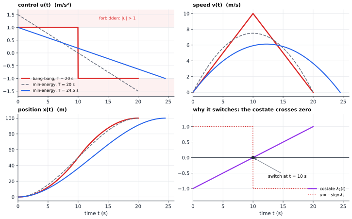
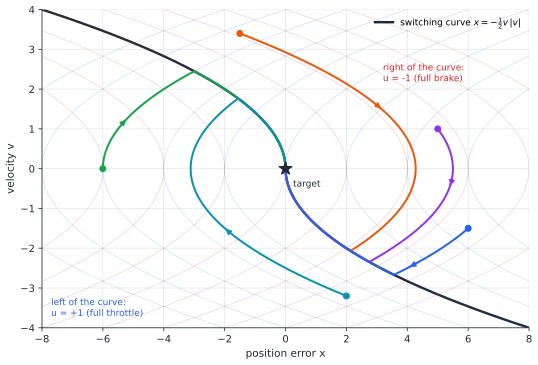

# Chapter 51 — Optimal Control: Choosing the Best Future

[← Previous](50-operations-research.md) · [Track D](README.md) · [Table of Contents](../../00-front/table-of-contents.md) · [Next →](52-dynamic-programming.md)

> **Level 2 · Track D — Optimization and Operations Research**
> **Builds on:** [Ch. 6](../../part-2-calculus/06-multivariable-calculus.md), [Ch. 11](../../part-4-differential-equations/11-ordinary-differential-equations.md), [Ch. 12](../../part-4-differential-equations/12-linear-differential-equations.md), [Ch. 23](../../part-7-numerical-computational/23-optimization.md) · **Leads to:** [Ch. 52](52-dynamic-programming.md), [Ch. 53](53-reinforcement-learning.md), [Ch. 54](54-robust-stochastic-optimization.md) · **Related:** [Ch. 50](50-operations-research.md), [Ch. 61](../e-abstract-math/61-functional-analysis.md), [Ch. 83](../i-dynamical-systems/83-dynamical-systems.md), [Ch. 92](../j-frontier/92-mathematical-physics.md)
> **Reading time:** ~30 min

## 51.1 The hook

A robotic cart sits at rest on a straight rail. It must stop, exactly, at a mark 100 m away, in the shortest possible time. Its motor can push it forward or backward with any acceleration up to $1\ \mathrm{m/s^2}$ in size, and you choose the acceleration at every instant. What should you do?

Ask a room of engineers and most will sketch something smooth: ease in, build speed, ease off, glide to a stop. It feels right. Sudden changes look crude, and smooth curves look like good engineering.

Here is the smoothest sensible plan. Let the acceleration fall linearly from $+a$ to $-a$ over the trip. Among all plans of a given duration, this is the one that uses the least control effort $\int u^2\,dt$ (you'll derive it in §51.3). To keep $\lvert u\rvert \le 1\ \mathrm{m/s^2}$, the trip must last $\sqrt{600} \approx 24.5$ s.

Now the crude plan: floor it for 10 s, then brake as hard as possible for 10 s. The cart reaches 10 m/s at the midpoint and stops at exactly 100 m after **20 s**. The smooth plan is 22% slower, and no amount of polishing fixes that, because the problem's best answer is not smooth at all.

Two questions follow, and they are much deeper than the cart:

> **How do you prove that nothing beats 20 seconds?** And when the system is a satellite, a chemical reactor or an epidemic, where intuition fails, **how do you find the best plan at all?**

The set of possible plans is a set of *functions*: an infinite-dimensional space. You cannot list them, and you cannot set a gradient to zero in the usual way, because the best plan sits on the boundary of the allowed set, with $\lvert u\rvert = 1$ almost all the time.

In the mid-1950s Lev Pontryagin, a topologist who had been blind since the age of fourteen, turned to problems of fastest manoeuvres posed by engineers. With his students Boltyanskii, Gamkrelidze and Mishchenko he found the answer: a **maximum principle** that turns the search over functions into a pointwise choice at each instant, guided by a hidden companion trajectory called the **costate**. This chapter builds that principle from the Lagrange multipliers you already know.

## 51.2 The big idea

An optimal-control problem has three ingredients.

1. A **state** $\mathbf{x}(t)$ that summarises the system now (position and velocity; charge and current; susceptible and infected).
2. **Dynamics** $\dot{\mathbf{x}} = \mathbf{f}(\mathbf{x}, \mathbf{u}, t)$, driven by a **control** $\mathbf{u}(t)$ that you choose from an allowed set $U$. This is the state-variable form of [§12.7](../../part-4-differential-equations/12-linear-differential-equations.md#127-state-variable-formulation).
3. A **cost** to minimise, such as total time, fuel used, or tracking error, usually $J = \varphi(\mathbf{x}(T)) + \int_0^T L(\mathbf{x}, \mathbf{u}, t)\,dt$.

The obstacle is that each choice of $\mathbf{u}$ at time $t$ affects every later state. A good move now must account for its whole future. Here is the trick. Attach to each state variable a **price**, $\lambda_i(t)$: the marginal value, at time $t$, of having a little more of $x_i$. If you knew those prices you could judge each instant on its own. You would pick the $\mathbf{u}$ that minimises "running cost now plus the value of the state change it causes", and the future would be taken care of by the prices.

That is the whole idea of Pontryagin's principle. The prices are the costate. They are found by running a second differential equation *backwards* from the final time, because the value of the state at time $t$ depends on what happens after $t$.

An economic analogy helps. A factory manager doesn't need to plan every future year to decide today's production; she needs today's price of the factory's stock of capital. Prices summarise the future. In the cart problem, the costate turns out to say "speed is valuable" early in the trip and "speed is a liability" late in the trip. The moment the price of speed crosses zero, the right action flips from full throttle to full brake.



*Top left: the bang-bang control (red) stays on the limits; the minimum-energy plan for the same 20 s (dashed) needs $1.5\ \mathrm{m/s^2}$, breaking the limit, and the feasible smooth plan (blue) takes 24.5 s. Bottom right: the costate $\lambda_2$ is a straight line, and the control is the negative of its sign.*

Look at the speed panel. Distance is the area under the speed curve, so every plan must enclose exactly 100 m of area. The speed can rise no faster than slope 1 and must fall back to zero at the same rate. The tallest triangle you can fit under those two constraints is the bang-bang one. Every other plan wastes area by rising or falling more slowly than it could.

## 51.3 The mathematics

### The necessary conditions, derived

Take the problem with a free final state and no constraint on $\mathbf{u}$:

$$
\min_{\mathbf{u}(\cdot)}\ J = \varphi(\mathbf{x}(T)) + \int_0^T L(\mathbf{x}, \mathbf{u}, t)\,dt \quad\text{subject to}\quad \dot{\mathbf{x}} = \mathbf{f}(\mathbf{x}, \mathbf{u}, t),\ \ \mathbf{x}(0) = \mathbf{x}_0 .
$$

Treat the dynamics as a constraint at every instant, and give it a Lagrange multiplier function $\boldsymbol{\lambda}(t)$, exactly as in [§6.11](../../part-2-calculus/06-multivariable-calculus.md#611-lagrange-multipliers) but with one multiplier per time. Define the **Hamiltonian**

$$
H(\mathbf{x}, \mathbf{u}, \boldsymbol{\lambda}, t) = L(\mathbf{x}, \mathbf{u}, t) + \boldsymbol{\lambda}^\mathsf{T}\mathbf{f}(\mathbf{x}, \mathbf{u}, t).
$$

Along any trajectory that obeys the dynamics, adding $\int \boldsymbol{\lambda}^\mathsf{T}(\mathbf{f} - \dot{\mathbf{x}})\,dt = 0$ changes nothing, so

$$
J = \varphi(\mathbf{x}(T)) + \int_0^T \left( H - \boldsymbol{\lambda}^\mathsf{T}\dot{\mathbf{x}} \right) dt .
$$

Integrate the last term by parts: $-\int_0^T \boldsymbol{\lambda}^\mathsf{T}\dot{\mathbf{x}}\,dt = -\boldsymbol{\lambda}(T)^\mathsf{T}\mathbf{x}(T) + \boldsymbol{\lambda}(0)^\mathsf{T}\mathbf{x}(0) + \int_0^T \dot{\boldsymbol{\lambda}}^\mathsf{T}\mathbf{x}\,dt$. Now perturb the control by $\delta\mathbf{u}(t)$. The state changes by $\delta\mathbf{x}(t)$, with $\delta\mathbf{x}(0) = \mathbf{0}$ because the start is fixed. To first order,

$$
\delta J = \left(\nabla\varphi - \boldsymbol{\lambda}(T)\right)^\mathsf{T}\delta\mathbf{x}(T) + \int_0^T \left[ \left(\frac{\partial H}{\partial \mathbf{x}} + \dot{\boldsymbol{\lambda}}\right)^\mathsf{T}\delta\mathbf{x} + \left(\frac{\partial H}{\partial \mathbf{u}}\right)^\mathsf{T}\delta\mathbf{u} \right] dt .
$$

The state perturbation $\delta\mathbf{x}$ depends on $\delta\mathbf{u}$ in a complicated way, through the whole history. The multiplier lets us avoid computing it: *choose* $\boldsymbol{\lambda}$ so that its coefficients vanish.

> [!theorem] First-order conditions for optimal control
> If $\mathbf{u}^*$ is optimal (and $L, \mathbf{f}, \varphi$ are smooth), there is a costate $\boldsymbol{\lambda}(t)$ with
> $$
> \dot{\mathbf{x}} = \frac{\partial H}{\partial \boldsymbol{\lambda}}, \qquad \dot{\boldsymbol{\lambda}} = -\frac{\partial H}{\partial \mathbf{x}}, \qquad \boldsymbol{\lambda}(T) = \nabla\varphi(\mathbf{x}(T)), \qquad \frac{\partial H}{\partial \mathbf{u}} = \mathbf{0}.
> $$

*Proof.* With $\boldsymbol{\lambda}$ defined by the backward equation $\dot{\boldsymbol{\lambda}} = -\partial H/\partial\mathbf{x}$ and the end condition $\boldsymbol{\lambda}(T) = \nabla\varphi$ (a linear ODE, so a solution exists), the first two pieces of $\delta J$ vanish, leaving $\delta J = \int_0^T (\partial H/\partial\mathbf{u})^\mathsf{T}\delta\mathbf{u}\,dt$. At a minimum this first variation must be zero for every perturbation $\delta\mathbf{u}$. Choosing $\delta\mathbf{u} = -\epsilon\,\partial H/\partial\mathbf{u}$ gives $\delta J = -\epsilon\int_0^T \lVert\partial H/\partial\mathbf{u}\rVert^2 dt$, which is negative unless $\partial H/\partial\mathbf{u} \equiv \mathbf{0}$. ∎

If the final state is fixed instead, $\delta\mathbf{x}(T) = \mathbf{0}$ and the end condition on $\boldsymbol{\lambda}$ disappears; the two boundary conditions on $\mathbf{x}$ take its place. Notice the structure: state forward from $t = 0$, costate backward from $t = T$, coupled through the control. This is a **two-point boundary-value problem** ([§11.8](../../part-4-differential-equations/11-ordinary-differential-equations.md#118-boundary-value-problems)), and that coupling is what makes optimal control hard to compute.

> [!example] The minimum-energy cart
> State $x$ (position) and $v$ (speed), dynamics $\dot x = v$, $\dot v = u$, cost $\int_0^T \tfrac12 u^2\,dt$, boundary conditions $x(0) = v(0) = v(T) = 0$, $x(T) = d$. The Hamiltonian is $H = \tfrac12 u^2 + \lambda_1 v + \lambda_2 u$, so
> $$
> \dot\lambda_1 = -\frac{\partial H}{\partial x} = 0, \qquad \dot\lambda_2 = -\frac{\partial H}{\partial v} = -\lambda_1, \qquad \frac{\partial H}{\partial u} = u + \lambda_2 = 0 .
> $$
> So $\lambda_1$ is constant, $\lambda_2$ is linear in $t$, and $u = -\lambda_2$ is linear. Fitting the four boundary conditions gives $u(t) = \dfrac{6d}{T^2}\left(1 - \dfrac{2t}{T}\right)$, a cubic position profile and peak acceleration $6d/T^2$. With $d = 100$ m and $T = 20$ s the peak is $1.5\ \mathrm{m/s^2}$, over the limit. Keeping the peak at $1$ needs $T = \sqrt{6d} \approx 24.5$ s.

### Constraints: Pontryagin's principle

When the control is limited, $\mathbf{u}(t) \in U$, the optimum usually sits on the boundary of $U$, where $\partial H/\partial\mathbf{u}$ need not vanish. The fix is to replace "stationary" with "best":

> [!theorem] Pontryagin's minimum principle (statement)
> If $\mathbf{u}^*$ is optimal, there exist a constant $\lambda_0 \in \{0, 1\}$ and a costate $\boldsymbol{\lambda}(t)$, not both zero, such that with $H = \lambda_0 L + \boldsymbol{\lambda}^\mathsf{T}\mathbf{f}$ the state and costate equations above hold, and at almost every time
> $$
> H\left(\mathbf{x}^*(t), \mathbf{u}^*(t), \boldsymbol{\lambda}(t), t\right) = \min_{\mathbf{u}\in U} H\left(\mathbf{x}^*(t), \mathbf{u}, \boldsymbol{\lambda}(t), t\right).
> $$
> If the final time is free and the problem does not depend explicitly on $t$, then $H \equiv 0$ along the optimal trajectory.

(Pontryagin's group wrote it with the opposite sign as a *maximum* principle; it is the same statement.) The proof uses "needle" variations: change $\mathbf{u}$ to some other value in $U$ on a tiny interval, and show that the cost cannot drop. It is not hard, but it is long; the first-order derivation above is the special case where the minimum over $U$ is an interior stationary point. The constant $\lambda_0$ handles rare "abnormal" problems where the constraints alone pin down the answer; for the problems here $\lambda_0 = 1$.

### Result: the minimum-time cart is bang-bang

Now minimise $T = \int_0^T 1\,dt$ with $\dot x = v$, $\dot v = u$, $\lvert u\rvert \le a$. The Hamiltonian is

$$
H = 1 + \lambda_1 v + \lambda_2 u .
$$

$H$ is *linear* in $u$, so its minimum over $[-a, a]$ is at an end: $u = -a\,\operatorname{sign}(\lambda_2)$. The costate equations are the same as before: $\lambda_1$ constant, $\lambda_2(t) = c - \lambda_1 t$, a straight line. A straight line changes sign at most once. If $\lambda_2$ were identically zero, $\lambda_1$ would be too, and $H = 1 \neq 0$, which contradicts $H \equiv 0$. So:

> [!theorem] Bang-bang structure
> Every time-optimal control for the double integrator takes only the values $\pm a$ and switches at most once.

For the trip from rest at $0$ to rest at $d$, the only such plan that works is "accelerate for $t_s$, brake for $t_s$", and $x(2t_s) = a t_s^2 = d$ gives $T = 2\sqrt{d/a}$. With $d = 100$ m and $a = 1\ \mathrm{m/s^2}$, $T = 20$ s. Using $H \equiv 0$ at $t = 0$, where $v = 0$ and $u = +a$, fixes $\lambda_2(0) = -1/a$, and the switch at $t_s = 10$ s makes $\lambda_2(t) = -1 + t/10$ for $a = 1$: the purple line in the figure.

Pontryagin's principle is only *necessary*. For the cart there is also a two-line proof of optimality that needs no costate, and it is worth seeing because it gives a certificate:

*Proof that no plan beats $2\sqrt{d/a}$.* Let any admissible plan reach rest at $d$ at time $T$. Since $\lvert\dot v\rvert \le a$ and $v(0) = 0$, we have $v(t) \le a t$. Since $v(T) = 0$, also $v(t) \le a(T - t)$. Then

$$
d = \int_0^T v(t)\,dt \le \int_0^T a\min(t,\ T - t)\,dt = \frac{aT^2}{4},
$$

so $T \ge 2\sqrt{d/a}$, with equality only when $v$ follows the tent $a\min(t, T - t)$, the bang-bang plan. ∎

That is the speed panel's triangle argument made exact.

> [!mystery] What *is* the costate, really?
> We introduced $\boldsymbol{\lambda}(t)$ as a bookkeeping device to make $\delta J$ simple, then called it a "price". Is it really one? Here is the claim: if $V(\mathbf{x}, t)$ is the best achievable cost starting from state $\mathbf{x}$ at time $t$, then along an optimal trajectory $\boldsymbol{\lambda}(t) = \nabla_{\mathbf{x}} V(\mathbf{x}^*(t), t)$, the sensitivity of the optimal future to the present state. Proving it requires a partial differential equation for $V$, the Hamilton–Jacobi–Bellman equation, which grows out of a completely different idea: [Ch. 52](52-dynamic-programming.md).

### From open loop to feedback: the switching curve

The plan above is **open loop**: a schedule $u(t)$ computed in advance. If a gust pushes the cart, the schedule is wrong. Better is a **feedback law** $u = k(x, v)$ that gives the optimal action from wherever you are. For the double integrator with target $(0, 0)$ we can find it by geometry.

Under $u = +a$, the trajectories in the $(x, v)$ plane are parabolas $x = v^2/(2a) + c$; under $u = -a$, they are $x = -v^2/(2a) + c$. Exactly one parabola of each family passes through the origin, and the halves that arrive there form the **switching curve**

$$
x = -\frac{v\lvert v\rvert}{2a}.
$$

From any point you ride a parabola to the curve, switch, and slide down the curve into the origin. With $s = x + v\lvert v\rvert/(2a)$, the optimal feedback is

$$
u = -a\,\operatorname{sign}(s),
$$

and the minimum time from $(x_0, v_0)$ is $T^* = \left(\sigma v_0 + 2\sqrt{\sigma a x_0 + v_0^2/2}\right)/a$ with $\sigma = \operatorname{sign}(s_0)$.



*Every optimal trajectory has at most one corner: a parabola of one family until it meets the black switching curve, then the curve itself into the origin. To the left of the curve the motor pushes forward at full power; to the right it brakes at full power.*

### Smooth costs, linear feedback

Bang-bang control comes from costs that are linear in $u$. When effort is penalised quadratically and the dynamics are linear, everything is smooth and the answer is a linear feedback. For $\dot{\mathbf{x}} = \mathbf{A}\mathbf{x} + \mathbf{B}\mathbf{u}$ and $J = \int_0^\infty (\mathbf{x}^\mathsf{T}\mathbf{Q}\mathbf{x} + \mathbf{u}^\mathsf{T}\mathbf{R}\mathbf{u})\,dt$, the **linear–quadratic regulator** (LQR) is

$$
\mathbf{u} = -\mathbf{R}^{-1}\mathbf{B}^\mathsf{T}\mathbf{P}\mathbf{x}, \qquad \mathbf{A}^\mathsf{T}\mathbf{P} + \mathbf{P}\mathbf{A} - \mathbf{P}\mathbf{B}\mathbf{R}^{-1}\mathbf{B}^\mathsf{T}\mathbf{P} + \mathbf{Q} = \mathbf{0},
$$

where the second equation, the **algebraic Riccati equation**, has a unique positive-definite solution under mild conditions. For the scalar system $\dot x = u$ with $J = \int (x^2 + u^2)\,dt$ it reads $P^2 = 1$, so $u = -x$. The costate is $\lambda = 2Px$: linear in the state, which is why the feedback is linear. The LQR is the workhorse of aerospace and process control, and its stability guarantees come from the eigenvalue analysis of [§10.9](../../part-3-linear-algebra/10-eigenvalues-and-eigenvectors.md#109-applications-to-system-dynamics-and-stability).

## 51.4 The algorithm

Real problems rarely have closed forms. There are three families of numerical methods.

**Indirect (shooting) methods** solve Pontryagin's two-point boundary-value problem. Guess the unknown initial costate $\boldsymbol{\lambda}(0)$, integrate state and costate forward with the control from the minimum condition, and measure the miss at time $T$. Then adjust the guess with Newton's method ([§22.4](../../part-7-numerical-computational/22-numerical-methods.md#224-bisection-and-newtonraphson-methods)):

```text
guess lam0
repeat
    integrate x' = H_lam, lam' = -H_x, with u = argmin_u H, from (x0, lam0) to T
    miss = boundary_conditions(x(T), lam(T))
    lam0 = lam0 - J_miss^{-1} * miss        # Jacobian by finite differences
until |miss| < tol
```

Shooting is very accurate when it converges. But it is fragile: the costate equations are often unstable forward in time, so small errors in $\boldsymbol{\lambda}(0)$ blow up, and bang-bang controls make the miss function discontinuous.

**Direct methods** ("discretise, then optimise") chop $[0, T]$ into $N$ steps, treat $\mathbf{u}_0, \dots, \mathbf{u}_{N-1}$ as ordinary variables, impose the discretised dynamics as constraints, and give the whole thing to a nonlinear-programming solver ([Ch. 23](../../part-7-numerical-computational/23-optimization.md)). Control bounds become simple box constraints. The solver's Lagrange multipliers for the dynamics constraints approximate the costate, which is the discrete echo of our derivation. This is what most practical software does, from rocket-landing guidance to robot motion planning.

**Dynamic programming** computes the feedback law over a grid of states. It is robust and global, but its cost grows exponentially with the state dimension. That is the next chapter.

**Failure cases.** Bang-bang feedback implemented with a finite sampling time **chatters**: near the switching curve the sign of $s$ flips back and forth every sample, wearing out relays and exciting unmodelled dynamics. Engineers soften it with a boundary layer, replacing $\operatorname{sign}(s)$ by a saturated linear function near $s = 0$. A second failure: *singular arcs*. If $\lambda_2 \equiv 0$ on an interval, the minimum condition says nothing about $u$, and you must differentiate the switching function repeatedly to recover it.

> [!tip] Engineering note
> Model predictive control (MPC), standard in chemical plants and increasingly in power electronics and cars, solves a direct-method optimal-control problem over a short horizon *at every sampling instant*, applies only the first control move, measures the state again, and repeats. It turns open-loop optimisation into feedback by brute repetition.

## 51.5 The experiment

**Part 1: the parabolas.** In the phase plane (horizontal $x$, vertical $y$ for velocity), the black curve is the switching curve for $a = 1$. The blue parabola is a full-throttle arc $x = y^2/2 + c$ with $c = -6$, starting from rest 6 m behind the target. Change $c$ (try $-2$ and $-10$) and find where each arc meets the switching curve. That intersection is the switching point.

```desmos-graph
left=-8; right=8; bottom=-4; top=4
---
x=-0.5y\operatorname{abs}(y)|black
x=0.5y^{2}-6|blue|dashed
x=-0.5y^{2}+3|red|dashed
(-6,0)|label:start
(-3,2.449)|label:switch
```

*The full-throttle arc from $(-6, 0)$ meets the switching curve at $x = -3$, $v = \sqrt 6$. The red dashed arc is a full-brake arc for comparison.*

**Part 2: fly the feedback.** The script runs the optimal feedback $u = -a\,\operatorname{sign}(s)$ with a simple Euler integrator and compares the arrival time with the formula $T^*$. Things to change:

- `X0, V0`: try `5.0, 1.0` (theory 5.69 s) and `2.0, -3.2` (theory 6.73 s). In the second case the simulation reports **3 switches**, though the theory says one. Plot $u$ against $t$ and find where the extra switches happen.
- `DT = 0.1`: arrival slips from about 4.9 s to 6.0 s, with an extra switch. The controller overshoots the curve between samples.
- `U_MAX = 0.5`: the minimum time scales as $1/\sqrt{a}$ (here $6.93$ s), not $1/a$.

```python
import numpy as np
import matplotlib.pyplot as plt

X0, V0 = -6.0, 0.0      # start: 6 m behind the target, at rest
DT = 0.01               # time step (s); try 0.1 and 0.001
U_MAX = 1.0             # thrust limit (m/s^2); try 0.5
TOL = 0.05              # "arrived" when |x| and |v| are both below this

def feedback(x, v):
    s = x + v * abs(v) / (2 * U_MAX)        # signed distance to the switching curve
    return -U_MAX * np.sign(s) if s != 0 else -U_MAX * np.sign(v)

x, v, t, switches, u_old = X0, V0, 0.0, 0, None
xs, vs, us = [x], [v], []
while not (abs(x) < TOL and abs(v) < TOL) and t < 30:
    u = feedback(x, v)
    switches += (u_old is not None and u != u_old)
    u_old = u
    v += u * DT; x += v * DT; t += DT
    xs.append(x); vs.append(v); us.append(u)

s0 = X0 + V0 * abs(V0) / (2 * U_MAX)
T_star = (np.sign(s0) * V0 + 2 * np.sqrt(np.sign(s0) * U_MAX * X0 + V0**2 / 2)) / U_MAX
print(f"arrived at t = {t:.2f} s (theory {T_star:.2f} s) after {switches} switches")

fig, ax = plt.subplots(1, 2, figsize=(10, 4))
ax[0].plot(xs, vs); vv = np.linspace(-4, 4, 200)
ax[0].plot(-vv * np.abs(vv) / (2 * U_MAX), vv, "k--", label="switching curve")
ax[0].set_xlabel("x"); ax[0].set_ylabel("v"); ax[0].legend()
ax[1].step(np.arange(len(us)) * DT, us); ax[1].set_xlabel("t (s)"); ax[1].set_ylabel("u")
plt.show()
```

The default run prints an arrival at 4.85 s against the theoretical 4.90 s; the difference is the tolerance `TOL`, since the simulation stops just before the exact target.

## 51.6 The challenge

1. **Intuition.** For a cost $\int_0^T \lvert u\rvert\,dt$ (fuel, for a thruster whose consumption is proportional to thrust) with $\lvert u\rvert \le 1$ and a *fixed* trip time longer than the minimum, guess the shape of the optimal control. Explain why it should contain a phase where the motor is off, and why neither bang-bang nor smooth is the answer.
2. **Derivation.** Use the first-order conditions to solve the minimum-energy cart in full: find $\lambda_1$, $\lambda_2(0)$, $u(t)$, $v(t)$ and $x(t)$, and verify the cost $\int_0^T u^2\,dt = 12d^2/T^3$. Then derive the minimum-time formula $T^*(x_0, v_0)$ from the switching-curve construction.
3. **Implementation.** Write a direct method for the cart: $N = 50$ time steps, variables $u_0, \dots, u_{49}$, bounds $\lvert u_k\rvert \le 1$, and the end conditions as equality constraints. Minimise the trip time by bisection on $T$ (is it feasible within $T$?). Feasibility for fixed $T$ is a linear program. Compare your discrete answer with $T = 20$ s, and see what the LP's dual variables look like next to $\lambda_2(t)$.
4. **Open investigation.** Fuller's problem: minimise $\int_0^\infty x^2\,dt$ for $\dot x = v$, $\dot v = u$, $\lvert u\rvert \le 1$, from $(x_0, v_0) = (1, 0)$. Simulate candidate bang-bang feedbacks $u = -\operatorname{sign}(x + k\,v\lvert v\rvert)$ for a range of $k$, find the best $k$ numerically, and count the switches. You should find something strange happening as the trajectory nears the origin. Which nonlinear systems show this behaviour, and why, is still an active research topic.

## 51.7 Loose threads

We found the best future by attaching a price to the state at every instant and then choosing greedily against those prices. Three things were left unsaid.

> [!mystery] Does a best plan even exist?
> Everything in this chapter assumed an optimal control exists and then described it. In infinite-dimensional spaces that is not automatic: a sequence of ever-better controls can oscillate faster and faster and converge to nothing that is itself a control. Guaranteeing existence needs compactness of the right kind, usually convexity of the set of achievable velocities plus a weak form of convergence. The tools are those of [Ch. 61](../e-abstract-math/61-functional-analysis.md), and Filippov's theorem is the classical answer.

> [!mystery] Steering through fog
> Our cart knew its exact position and the exact dynamics. Real controllers see noisy measurements and face random disturbances. Remarkably, for linear systems with Gaussian noise and quadratic cost, the best you can do splits cleanly into two separate problems: estimate the state as well as possible, then apply the LQR as if the estimate were the truth. Why this "separation" holds there and fails almost everywhere else is a question for stochastic and robust optimization in [Ch. 54](54-robust-stochastic-optimization.md), and for learning controllers that don't know the model at all in [Ch. 53](53-reinforcement-learning.md).

The costate mystery from §51.3 is resolved in the next chapter, which starts from a seemingly unrelated idea, that *the tail of an optimal path is optimal*, and arrives at the same Hamiltonian from the other side ([Ch. 52](52-dynamic-programming.md)). The pair of equations $\dot{\mathbf{x}} = \partial H/\partial\boldsymbol{\lambda}$, $\dot{\boldsymbol{\lambda}} = -\partial H/\partial\mathbf{x}$ is no accident either: they are Hamilton's equations of classical mechanics, and the principle of least action is an optimal-control problem posed by nature ([Ch. 92](../j-frontier/92-mathematical-physics.md)). For the phase-plane geometry of the switching curve, and what happens to feedback systems near their equilibria, see [Ch. 83](../i-dynamical-systems/83-dynamical-systems.md).

## Further reading

- D. E. Kirk, *Optimal Control Theory: An Introduction*, Dover, 2004 (reprint of the 1970 edition). The clearest first book: calculus of variations, Pontryagin, and dynamic programming side by side.
- D. Liberzon, *Calculus of Variations and Optimal Control Theory: A Concise Introduction*, Princeton University Press, 2012. A careful proof of the maximum principle with needle variations.
- A. E. Bryson and Y.-C. Ho, *Applied Optimal Control*, Hemisphere, 1975. The engineer's classic, rich in aerospace examples and numerical methods.
- J. T. Betts, *Practical Methods for Optimal Control Using Nonlinear Programming*, 3rd ed., SIAM, 2020. Direct methods as used in industry.
