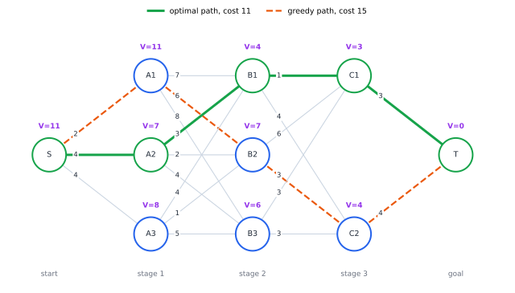
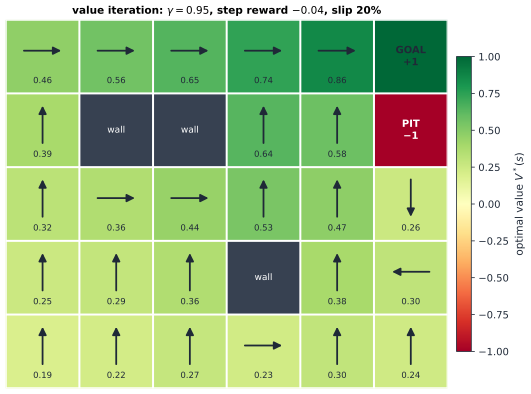

# Chapter 52 — Dynamic Programming and Bellman's Principle

[← Previous](51-optimal-control.md) · [Track D](README.md) · [Table of Contents](../../00-front/table-of-contents.md) · [Next →](53-reinforcement-learning.md)

> **Level 2 · Track D — Optimization and Operations Research**
> **Builds on:** [Ch. 19](../../part-6-probability-statistics/19-probability.md), [Ch. 23](../../part-7-numerical-computational/23-optimization.md), [Ch. 27](../a-algorithms/27-graph-theory.md), [Ch. 34](../b-probability-information/34-random-walks-and-markov-chains.md) · **Leads to:** [Ch. 53](53-reinforcement-learning.md), [Ch. 54](54-robust-stochastic-optimization.md) · **Related:** [Ch. 40](../c-game-theory/40-prisoners-dilemma.md), [Ch. 46](../c-game-theory/46-adversarial-decision-making.md), [Ch. 50](50-operations-research.md), [Ch. 51](51-optimal-control.md), [Ch. 89](../j-frontier/89-pde-beyond-the-basics.md)
> **Reading time:** ~30 min

## 52.1 The hook

In 1950 Richard Bellman arrived at the RAND Corporation to work on multistage decision problems: how to schedule, stock, steer and fight when each decision changes the situation for the next. RAND was funded by the Air Force, and the Secretary of Defense of the day was said to turn red at the word *research*. So Bellman, by his own account, chose a name for his method that no congressman could object to. "Programming" meant planning, as in a military programme. "Dynamic" sounded impressive and, he joked, was impossible to use in a bad sense. The name was camouflage. The idea underneath it has since become one of the most widely used in all of applied mathematics.

Here is a problem of the kind he had in mind. A courier must get from depot S to customer T through three stages of relay points, choosing one point at each stage. Each leg has a cost (minutes, litres, risk). The legs are drawn in the figure in §52.2. A tempting strategy is **greedy**: at each point, take the cheapest leg out. From S the cheapest leg costs 2, to A1, then 6 to B2, 3 to C2 and 4 to T, for 15 in total. Not bad?

The best route costs 11. Greedy lost 36% by grabbing a cheap first step that led into an expensive neighbourhood.

You could list every route: $3 \times 3 \times 2 = 18$ of them. But a real network might have 20 stages with 10 points each, and then there are $10^{20}$ routes. Bellman's method solves that larger network with under 2000 additions, and it never looks at a single complete route.

> **How can you find the best path without ever comparing paths?**

The same question, in disguise, sits under other chapters of this book. [Ch. 27](../a-algorithms/27-graph-theory.md) promised that the Bellman–Ford algorithm needs exactly $\lvert V\rvert - 1$ rounds to find shortest paths with negative edges. [Ch. 40](../c-game-theory/40-prisoners-dilemma.md) claimed that to check a strategy in an infinitely repeated game you only need to test deviations *one period at a time*. [Ch. 51](51-optimal-control.md) introduced a mysterious costate and called it a price. All three debts are paid in this chapter, by one principle.

## 52.2 The big idea

> [!definition] Bellman's principle of optimality
> An optimal policy has the property that, whatever the initial state and first decision, the remaining decisions form an optimal policy for the state that results from the first decision.

In plain words: **every tail of an optimal path is itself optimal.** If the best route from S to T passes through B1, then its part from B1 to T must be the best route from B1 to T. If there were a better way from B1, you could splice it in and beat the "best" route.

That sounds almost too obvious to be useful. Its power comes from turning it around. Instead of asking "what is the best route from here?" for one starting point, ask it for *every* point, and start at the end. Write $V(\text{point})$ for the cheapest cost from that point to T, the **value** or **cost-to-go**. Then:

- $V(T) = 0$.
- For each point one stage back, $V(\text{point}) = \min$ over legs of (leg cost $+$ $V$ of where the leg lands).
- Repeat, stage by stage, back to S.

Each point is processed once, and each leg is looked at once. The work grows with the number of *legs*, not the number of *routes*.



*Solving backwards. Each purple number is the cheapest cost from that node to T, computed from the numbers one stage to its right. Greedy grabs the cheap first leg into A1, whose cost-to-go is 11; the green route pays 4 to reach A2, whose cost-to-go is only 7.*

An analogy: imagine hiking in fog with signposts at every junction, each showing the distance to the valley along the best trail. At each junction, add each trail's length to the next signpost's number, and walk toward the smallest total. Dynamic programming is the art of writing those signposts. Once they exist, acting optimally is greedy, but greedy with respect to the *value*, not the immediate cost.

That last sentence is the deep lesson. Greedy failed because the immediate cost is a bad guide. Greedy with respect to $V$ is perfect, because $V$ has already folded the entire future into one number per state.

## 52.3 The mathematics

### Finite-horizon dynamic programming

A **finite-horizon decision problem** has stages $k = 0, 1, \dots, N$, a set of states, an action set $A(s)$ in each state, a transition $s' = g_k(s, a)$ and a stage cost $c_k(s, a)$, with a terminal cost $c_N(s)$. A policy picks an action in every state at every stage.

> [!theorem] Backward recursion
> Define $V_N(s) = c_N(s)$ and, for $k = N-1, \dots, 0$,
> $$
> V_k(s) = \min_{a \in A(s)} \left[ c_k(s, a) + V_{k+1}\left(g_k(s, a)\right) \right].
> $$
> Then $V_k(s)$ is the minimum total cost from state $s$ at stage $k$, and choosing at each stage an action that attains the minimum is optimal.

*Proof.* By backward induction on $k$. At $k = N$ it is the definition. Suppose $V_{k+1}$ is the true optimal cost-to-go. Any plan from $(s, k)$ takes some first action $a$, paying $c_k(s, a)$, and then follows some plan from $s' = g_k(s, a)$ whose cost is at least $V_{k+1}(s')$. So every plan costs at least $c_k(s, a) + V_{k+1}(s') \ge V_k(s)$. Conversely, taking the minimising $a$ and then an optimal plan from $s'$ costs exactly $V_k(s)$. Hence $V_k(s)$ is the optimum, and it is attained by the greedy-in-$V$ choice. ∎

With uncertainty, the next state is random with probabilities $P(s' \mid s, a)$, and the same proof goes through with an expectation ([§19.9](../../part-6-probability-statistics/19-probability.md#199-expectation-and-variance)):

$$
V_k(s) = \min_{a} \left[ c_k(s, a) + \sum_{s'} P(s' \mid s, a)\, V_{k+1}(s') \right].
$$

The key point is that **the state carries everything about the past that matters for the future**. That is the Markov property of [Ch. 34](../b-probability-information/34-random-walks-and-markov-chains.md). If the cost depended on the whole history, the recursion would fail unless you enlarged the state to hold that history.

**The cost.** With $S$ states, $A$ actions and $N$ stages, the recursion takes $O(NSA)$ work (deterministic) or $O(NS^2A)$ (stochastic), against $A^N$ plans for brute force. For the 20-stage, 10-point courier network that is $10 + 19 \times 100 + 10 = 1920$ leg evaluations instead of $10^{20}$ routes.

### Result 1: why Bellman–Ford needs $\lvert V\rvert - 1$ rounds

Shortest paths on a general directed graph have no stages, but you can manufacture them by counting edges. For a source $s$, let $d_k(v)$ be the minimum weight of a walk from $s$ to $v$ that uses *at most* $k$ edges ($d_0(s) = 0$, and $d_0(v) = \infty$ otherwise). The last edge of such a walk enters $v$ from some $u$, and by the principle of optimality the rest must be a best walk to $u$ with at most $k - 1$ edges. So

$$
d_k(v) = \min\left( d_{k-1}(v),\ \min_{(u, v) \in E} \left[ d_{k-1}(u) + w(u, v) \right] \right).
$$

One "round" of Bellman–Ford, relaxing every edge once, computes $d_k$ from $d_{k-1}$ in $O(\lvert E\rvert)$ time.

> [!theorem] Bellman–Ford
> If no cycle of negative total weight is reachable from $s$, then $d_{\lvert V\rvert - 1}(v)$ is the shortest-path distance from $s$ to every $v$. If $d_{\lvert V\rvert}(v) < d_{\lvert V\rvert - 1}(v)$ for some $v$, a negative cycle is reachable.

*Proof.* Take any shortest walk from $s$ to $v$. If it visits some vertex twice, it contains a cycle. That cycle has weight $\ge 0$ by assumption, so cutting it out gives a walk that is no heavier and has fewer edges. Repeat until no vertex repeats. The result is a simple path, which visits at most $\lvert V\rvert$ vertices and so uses at most $\lvert V\rvert - 1$ edges. Hence the minimum over walks with at most $\lvert V\rvert - 1$ edges already equals the true distance, and further rounds cannot change anything. Conversely, if round $\lvert V\rvert$ still improves some $d(v)$, there is a cheapest walk with exactly $\lvert V\rvert$ edges, which must repeat a vertex; the cycle it contains must be negative, or removing it would contradict the improvement. ∎

So the factor $\lvert V\rvert$ that [Ch. 27](../a-algorithms/27-graph-theory.md) warned about is the **horizon** of a dynamic program: the longest a useful path can be. Dijkstra's algorithm avoids it by exploiting non-negative weights to settle vertices in order, which a negative edge can wreck.

### The infinite horizon: Bellman's equation

Many problems have no natural end: a thermostat, an inventory system ([Ch. 50](50-operations-research.md)), a robot that keeps working. Then we use a **Markov decision process** (MDP): states $s$, actions $a$, rewards $r(s, a)$, transition probabilities $P(s' \mid s, a)$, and a **discount factor** $0 \le \gamma < 1$ that makes a reward $k$ steps away worth $\gamma^k$ of one now. (Rewards to be maximised are the same as costs to be minimised with a sign flip; this section uses rewards, as reinforcement learning does.) A stationary policy $\pi$ picks action $\pi(s)$ in state $s$, and its value is

$$
V^\pi(s) = E\left[ \sum_{t=0}^{\infty} \gamma^t\, r(s_t, \pi(s_t)) \,\middle|\, s_0 = s \right].
$$

The optimal value $V^*(s) = \sup_\pi V^\pi(s)$ satisfies **Bellman's optimality equation**, the stationary version of the backward recursion:

$$
V^*(s) = \max_{a} \left[ r(s, a) + \gamma \sum_{s'} P(s' \mid s, a)\, V^*(s') \right].
$$

Call the right-hand side $(\mathcal{T}V)(s)$. The **Bellman operator** $\mathcal{T}$ maps a value table $V$ to a new one. Bellman's equation says $V^*$ is a fixed point, $V^* = \mathcal{T}V^*$. Two questions arise immediately. Is the fixed point unique? And can we find it?

> [!theorem] The Bellman operator is a contraction
> For any two value tables $V, W$,
> $$
> \lVert \mathcal{T}V - \mathcal{T}W \rVert_\infty \le \gamma\, \lVert V - W \rVert_\infty ,
> $$
> where $\lVert V\rVert_\infty = \max_s \lvert V(s)\rvert$. Consequently $\mathcal{T}$ has exactly one fixed point $V^*$, and **value iteration** $V_{k+1} = \mathcal{T}V_k$ converges to it from any start, with $\lVert V_k - V^*\rVert_\infty \le \gamma^k \lVert V_0 - V^*\rVert_\infty$.

*Proof.* First a small fact: for any two functions $f, g$ of $a$, $\lvert \max_a f(a) - \max_a g(a)\rvert \le \max_a \lvert f(a) - g(a)\rvert$. (If $\max f \ge \max g$ and $a^*$ maximises $f$, then $\max f - \max g \le f(a^*) - g(a^*)$.) Apply it with $f(a) = r(s, a) + \gamma\sum_{s'} P(s' \mid s, a) V(s')$ and $g$ the same with $W$:

$$
\left\lvert (\mathcal{T}V)(s) - (\mathcal{T}W)(s) \right\rvert \le \max_a\ \gamma \sum_{s'} P(s' \mid s, a) \left\lvert V(s') - W(s') \right\rvert \le \gamma \lVert V - W\rVert_\infty ,
$$

because the probabilities sum to 1. Take the maximum over $s$. If $V^*$ and $W^*$ were two fixed points, $\lVert V^* - W^*\rVert_\infty \le \gamma\lVert V^* - W^*\rVert_\infty$ would force them equal. For convergence, $\lVert V_{k} - V^*\rVert_\infty = \lVert \mathcal{T}V_{k-1} - \mathcal{T}V^*\rVert_\infty \le \gamma\lVert V_{k-1} - V^*\rVert_\infty$, and induction finishes it. Existence follows because the iterates form a Cauchy sequence in a complete space, the Banach fixed-point theorem. ∎

The discount factor is the *rate* of convergence. With $\gamma = 0.9$ the error shrinks a thousandfold in about 66 sweeps; with $\gamma = 0.99$ it takes about 687. Far-sighted problems are slow to solve.

### Result 2: one-step deviations are enough

Here is the debt to [Ch. 40](../c-game-theory/40-prisoners-dilemma.md). A policy can be beaten, in principle, by an elaborate alternative that deviates differently at every step forever. Do you have to check all of those?

> [!theorem] One-step deviation principle (single decision-maker)
> Let $\pi$ be a stationary policy. If no **single** deviation improves it, that is, if for every state $s$ and action $a$
> $$
> V^\pi(s) \ \ge\ r(s, a) + \gamma \sum_{s'} P(s' \mid s, a)\, V^\pi(s'),
> $$
> (deviate once to $a$, then return to $\pi$), then $\pi$ is optimal: $V^\pi = V^*$.

*Proof.* The value of a policy satisfies its own Bellman equation, $V^\pi(s) = r(s, \pi(s)) + \gamma\sum_{s'} P(s' \mid s, \pi(s)) V^\pi(s')$: condition on the first step. So the right-hand side of the hypothesis *equals* $V^\pi(s)$ when $a = \pi(s)$, and it is at most $V^\pi(s)$ for every other $a$. The maximum over $a$ is therefore $V^\pi(s)$, which says $\mathcal{T}V^\pi = V^\pi$. By the contraction theorem, $\mathcal{T}$ has only one fixed point, $V^*$. Hence $V^\pi = V^*$. ∎

Discounting does the work. Any infinitely long, cunning deviation is worth only finitely many steps of deviation, up to an error of order $\gamma^n$, and a finite deviation can be undone one step at a time from its last step backwards, each step being a one-shot deviation that does not help. In a repeated game, each player faces exactly such an MDP once the other players' strategies are fixed, and this is the one-shot deviation principle that Ch. 40 used.

The same idea gives an algorithm. If $\pi$ *can* be improved by a one-step deviation, switch to the improving action everywhere at once. The **policy improvement theorem** says the new greedy policy $\pi'(s) = \arg\max_a [r(s, a) + \gamma\sum_{s'} P V^\pi(s')]$ satisfies $V^{\pi'} \ge V^\pi$ in every state, with strict improvement somewhere unless $\pi$ was already optimal. (Sketch: $\mathcal{T}_{\pi'}V^\pi = \mathcal{T}V^\pi \ge V^\pi$, and applying the monotone map $\mathcal{T}_{\pi'}$ repeatedly only increases the left side, which converges to $V^{\pi'}$.)

> [!mystery] How many improvements does it take?
> Policy iteration, alternating "evaluate $V^\pi$" and "improve greedily", stops after finitely many steps, since there are finitely many policies and each step strictly improves. In practice it almost always finishes in a handful of iterations, even for millions of states. For a fixed discount factor, Ye proved in 2011 that it is strongly polynomial. Without that restriction, cleverly built examples force related variants to take exponentially many steps. An MDP is also a linear program, and whether linear programs can be solved in *strongly* polynomial time is one of Smale's problems for the twenty-first century, still open. The LP view of MDPs and its dual are in the spirit of [Ch. 48](48-duality.md).

### Result 3 (sketch): where the costate came from

Return to continuous time, with dynamics $\dot{\mathbf{x}} = \mathbf{f}(\mathbf{x}, \mathbf{u})$ and cost $\int L\,dt$ as in [Ch. 51](51-optimal-control.md). Let $V(\mathbf{x}, t)$ be the optimal cost-to-go. Apply the principle of optimality over a tiny step $dt$: pay $L\,dt$, move to $\mathbf{x} + \mathbf{f}\,dt$, and continue optimally:

$$
V(\mathbf{x}, t) = \min_{\mathbf{u}} \left[ L(\mathbf{x}, \mathbf{u})\,dt + V(\mathbf{x} + \mathbf{f}\,dt,\ t + dt) \right].
$$

Expand $V$ to first order, cancel $V(\mathbf{x}, t)$ and divide by $dt$. This gives the **Hamilton–Jacobi–Bellman equation**

$$
-\frac{\partial V}{\partial t} = \min_{\mathbf{u}} \left[ L(\mathbf{x}, \mathbf{u}) + \nabla_{\mathbf{x}}V^\mathsf{T}\mathbf{f}(\mathbf{x}, \mathbf{u}) \right] = \min_{\mathbf{u}} H\left(\mathbf{x}, \mathbf{u}, \nabla_{\mathbf{x}}V\right).
$$

The bracket is exactly Pontryagin's Hamiltonian with $\boldsymbol{\lambda}$ replaced by $\nabla_{\mathbf{x}}V$. Differentiate the HJB equation with respect to $\mathbf{x}$ along the optimal trajectory (the minimising $\mathbf{u}$ drops out by the envelope theorem), and you find that $\boldsymbol{\lambda}(t) = \nabla_{\mathbf{x}}V(\mathbf{x}^*(t), t)$ obeys $\dot{\boldsymbol{\lambda}} = -\partial H/\partial\mathbf{x}$, Ch. 51's costate equation. So the costate *is* a price. It is the marginal cost-to-go, the amount the optimal future changes per unit nudge of the present state.

This derivation quietly assumed $V$ is differentiable. For the minimum-time cart of Ch. 51 it is not: $V$ has a crease along the switching curve.

> [!mystery] A PDE whose solutions have corners
> If the value function has kinks, in what sense does it "solve" the HJB equation? Classical derivatives don't exist on the crease, and many non-smooth functions satisfy the equation almost everywhere. Which one is the true value? The answer, found by Crandall and Lions in the 1980s, is the theory of **viscosity solutions**, one of the great ideas in modern PDE theory: [Ch. 89](../j-frontier/89-pde-beyond-the-basics.md).

### State-space methods: the linear–quadratic case

Usually $V$ must be stored as a table, one number per state. One famous exception is linear dynamics with quadratic costs, where $V$ stays quadratic forever and the "table" is a matrix. Take the scalar system $x_{k+1} = x_k + u_k$ with stage cost $x_k^2 + u_k^2$. Guess $V_{k+1}(x) = P_{k+1}x^2$. Then

$$
V_k(x) = \min_u \left[ x^2 + u^2 + P_{k+1}(x + u)^2 \right],
$$

minimised at $u = -\dfrac{P_{k+1}}{1 + P_{k+1}}\,x$, which gives $V_k(x) = P_k x^2$ with

$$
P_k = 1 + \frac{P_{k+1}}{1 + P_{k+1}} .
$$

This is a **Riccati recursion**, the discrete twin of the LQR equation in [Ch. 51](51-optimal-control.md). Starting from $P_N = 0$, it produces $1, \tfrac32, \tfrac85, \tfrac{21}{13}, \dots$, ratios of Fibonacci numbers, converging to the fixed point $P^2 - P - 1 = 0$, that is $P = \varphi = (1 + \sqrt5)/2 \approx 1.618$. The optimal long-run feedback is $u = -x/\varphi \approx -0.618\,x$. The golden ratio, hiding in a regulator. For vector states, $P_k$ becomes a matrix and the recursion costs $O(n^3)$ per step, even though the state space is a continuum.

Without such structure, a table over a $d$-dimensional state space with $m$ grid points per axis has $m^d$ entries. Bellman called this the **curse of dimensionality**. A modest robot arm with 12 state variables and 20 grid points each needs $20^{12} \approx 4\times10^{15}$ values.

## 52.4 The algorithm

**Value iteration** applies $\mathcal{T}$ until the table stops moving:

```text
V = 0 for every state
repeat
    for each state s:
        V_new(s) = max over a of [ r(s,a) + gamma * sum_{s'} P(s'|s,a) V(s') ]
    delta = max_s |V_new(s) - V(s)|;   V = V_new
until delta < eps * (1 - gamma) / gamma
policy(s) = argmax over a of the same bracket
```

The stopping rule is not arbitrary. The contraction property implies $\lVert V_{k+1} - V^*\rVert_\infty \le \frac{\gamma}{1-\gamma}\lVert V_{k+1} - V_k\rVert_\infty$, so the test guarantees the final table is within $\varepsilon$ of $V^*$. Each sweep costs $O(S^2A)$ in general, and $O(SA)$ when each action leads to only a few successor states.

**Policy iteration** alternates two steps: *evaluate* the current policy by solving the linear system $(\mathbf{I} - \gamma\mathbf{P}_\pi)\mathbf{v} = \mathbf{r}_\pi$ ([Ch. 8](../../part-3-linear-algebra/08-matrices-and-linear-systems.md)), then *improve* greedily. Each iteration is expensive, $O(S^3)$ for a dense solve, but there are few of them.

**Numerical notes.** $\mathbf{I} - \gamma\mathbf{P}_\pi$ is always invertible for $\gamma < 1$, because the eigenvalues of a stochastic matrix have magnitude at most 1 ([Ch. 34](../b-probability-information/34-random-walks-and-markov-chains.md)). As $\gamma \to 1$, however, it becomes ill-conditioned, and value iteration slows to a crawl.

**Failure cases.** Dynamic programming needs (1) a *known model*, the probabilities and rewards; (2) a *small state space*, or special structure like LQR; and (3) the *Markov property*, a state that summarises the past. Break (3) and the recursion gives wrong answers with full confidence. A common fix is to enlarge the state, for example by adding the last few observations, which feeds the curse of dimensionality in (2).

> [!tip] Engineering note
> Dynamic programming hides inside familiar engineering tools. The **Viterbi decoder** in every mobile phone and hard-disk read channel is a shortest-path DP over the states of a convolutional code ([Ch. 79](../h-cryptography-coding/79-error-correcting-codes.md)). Sequence alignment in genomics, speech recognition, and the dynamic time warping used to match signals are all DP over a grid.

## 52.5 The experiment

**Part 1: the price of patience.** Value iteration's error shrinks like $\gamma^k$. The three curves are $\gamma = 0.5$, $0.9$ and $0.99$; the dotted line is a factor of 1000. Read off where each curve crosses it (about 10, 66 and 687 sweeps). Then change $0.99$ to $0.999$ and see how far right the crossing moves.

```desmos-graph
left=0; right=800; bottom=0; top=1.05
---
y=0.5^{x}|red
y=0.9^{x}|orange
y=0.99^{x}|blue
y=0.001|black|dotted
```

*Error bound after $x$ sweeps of value iteration, as a fraction of the starting error.*

**Part 2: a grid world.** A robot lives on a small grid with walls (`#`), a goal worth $+1$ (`G`) and a pit worth $-1$ (`P`). Each move costs `STEP`. With probability `SLIP` the robot slides sideways instead of going where it intends. The script runs value iteration and prints the values and the greedy policy.

```python
import numpy as np

GAMMA, SLIP, STEP = 0.95, 0.2, -0.04      # knobs: try STEP = -0.5, SLIP = 0.0, GAMMA = 0.5
GRID = ["....G",
        ".#.#P",
        "....."]                          # G = goal (+1), P = pit (-1), # = wall
R, C = len(GRID), len(GRID[0])
MOVES = {"^": (-1, 0), "v": (1, 0), "<": (0, -1), ">": (0, 1)}
SIDE = {"^": "<>", "v": "<>", "<": "^v", ">": "^v"}

def go(r, c, a):
    r2, c2 = r + MOVES[a][0], c + MOVES[a][1]
    ok = 0 <= r2 < R and 0 <= c2 < C and GRID[r2][c2] != "#"
    return (r2, c2) if ok else (r, c)

def q(V, r, c, a):                        # expected return of action a, then acting optimally
    nxt = [(1 - SLIP, a)] + [(SLIP / 2, b) for b in SIDE[a]]
    return STEP + GAMMA * sum(p * V[go(r, c, b)] for p, b in nxt)

V = np.zeros((R, C))
for k in range(1000):
    V_new = V.copy()
    for r in range(R):
        for c in range(C):
            cell = GRID[r][c]
            if cell in "GP#":
                V_new[r, c] = {"G": 1.0, "P": -1.0, "#": 0.0}[cell]
            else:
                V_new[r, c] = max(q(V, r, c, a) for a in MOVES)
    change = np.abs(V_new - V).max()
    V = V_new
    if change < 1e-8:
        break

print(f"converged after {k + 1} sweeps\n", np.round(V, 2))
for r in range(R):
    print(" ".join(GRID[r][c] if GRID[r][c] in "GP#" else
                   max(MOVES, key=lambda a: q(V, r, c, a)) for c in range(C)))
```

With the defaults it converges in 33 sweeps. Look at the bottom-right cell, directly below the pit: its policy is `<`, walking *away* from the goal to avoid sliding into the pit. Now try the knobs:

- `SLIP = 0.0`: convergence drops to 8 sweeps (the world is deterministic, and values settle as soon as the goal's information has travelled across the grid).
- `STEP = -0.5`: life is so painful that the bottom-right cell now chooses `^`, straight into the pit. A quick $-1$ beats a long walk at $-0.5$ a step. The robot has rationally chosen to end it.
- `GAMMA = 0.5`: the robot is so short-sighted that the goal is barely visible; most values are near zero, and the bottom-right cell bumps into the wall (`v`) rather than risk anything.



*A larger grid world solved by value iteration with the default knobs. Values fall smoothly with distance from the goal. In the cell below the pit the arrow points away from the goal: with a 20% chance of slipping sideways, the safe detour is worth more than the short cut.*

## 52.6 The challenge

1. **Intuition.** In the staged network, the cost-to-go of A1 is 11 and that of A3 is 8. Without recomputing anything, explain how the optimal route from S would change if the leg S→A3 dropped from 4 to 2. Then explain why changing a leg in stage 3 can change the optimal *first* decision, but changing a leg leaving S cannot change the cost-to-go of any node other than S.
2. **Derivation.** Prove the stopping rule: if $\lVert V_{k+1} - V_k\rVert_\infty \le \delta$, then $\lVert V_{k+1} - V^*\rVert_\infty \le \frac{\gamma}{1-\gamma}\delta$. Then complete the proof of the policy improvement theorem, using that $\mathcal{T}_{\pi'}$ is monotone (if $V \le W$ everywhere, then $\mathcal{T}_{\pi'}V \le \mathcal{T}_{\pi'}W$).
3. **Implementation.** Add policy iteration to the grid-world script: evaluate $V^\pi$ by solving the linear system with `np.linalg.solve`, then improve greedily, until the policy stops changing. Count iterations for $\gamma = 0.5, 0.9, 0.99$ and compare with the number of value-iteration sweeps. Then implement Bellman–Ford with negative-cycle detection and test it on a graph with one negative edge.
4. **Open investigation.** Make the grid world big (say $50\times50$) with random walls and random pits. How does the number of policy-iteration steps grow with grid size and with $\gamma$? Can you construct a small MDP that forces policy iteration (with greedy switching in every state) to take many steps? Exponential lower bounds are known for some variants and not for others; see how close you can get.

## 52.7 Loose threads

Dynamic programming replaced a search over paths with a table of values, one number per state, filled in from the future backwards. It paid three debts: the $\lvert V\rvert - 1$ horizon of Bellman–Ford, the one-step deviation principle of repeated games, and the meaning of Ch. 51's costate. But everything rested on two quiet assumptions: we knew the model, and the table was small enough to write down.

> [!mystery] What if nobody tells you the probabilities?
> Every Bellman update above needed $P(s' \mid s, a)$ and $r(s, a)$. A robot in a new building, a trading agent in a market, or a program learning to play Go knows neither. It only experiences one transition at a time. Can you still converge to $V^*$ by averaging experience into the Bellman equation as you go? Remarkably, yes, under conditions on how you explore and how fast you average. That is Q-learning and the whole of [Ch. 53](53-reinforcement-learning.md).

The curse of dimensionality is the other loose thread, and it has no complete answer. Linear–quadratic structure defeats it exactly. Monte Carlo sampling ([Ch. 38](../b-probability-information/38-monte-carlo.md)) defeats it for some problems. Neural networks that approximate $V$ appear to defeat it in practice ([Ch. 53](53-reinforcement-learning.md)), with few guarantees. When the transition probabilities themselves are uncertain, a robust version of the Bellman equation takes a worst case over a set of models ([Ch. 54](54-robust-stochastic-optimization.md)). When an opponent picks some of the transitions, the max becomes a max–min, and you are back in the game trees of [Ch. 46](../c-game-theory/46-adversarial-decision-making.md).

## Further reading

- R. Bellman, *Dynamic Programming*, Princeton University Press, 1957 (Dover reprint 2003). The original, still readable, full of examples.
- D. P. Bertsekas, *Dynamic Programming and Optimal Control*, Vols. I–II, 4th ed., Athena Scientific, 2017. The standard reference, from finite-horizon problems to approximate DP.
- M. L. Puterman, *Markov Decision Processes: Discrete Stochastic Dynamic Programming*, Wiley, 1994. Rigorous treatment of value iteration, policy iteration and the LP formulation.
- T. H. Cormen, C. E. Leiserson, R. L. Rivest and C. Stein, *Introduction to Algorithms*, 4th ed., MIT Press, 2022. Chapter on dynamic programming and the Bellman–Ford algorithm.
