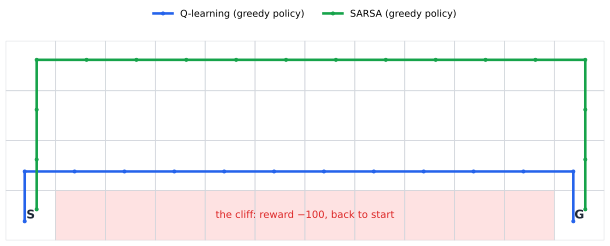
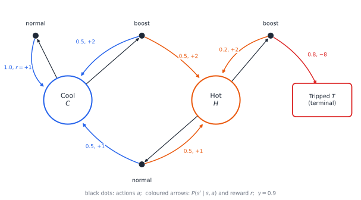

# Chapter 53 — Reinforcement Learning Through Mathematics

[← Previous](52-dynamic-programming.md) · [Track D](README.md) · [Table of Contents](../../00-front/table-of-contents.md) · [Next →](54-robust-stochastic-optimization.md)

> **Level 2 · Track D — Optimization and Operations Research**
> **Builds on:** [Ch. 19](../../part-6-probability-statistics/19-probability.md), [Ch. 23](../../part-7-numerical-computational/23-optimization.md), [Ch. 34](../b-probability-information/34-random-walks-and-markov-chains.md), [Ch. 52](52-dynamic-programming.md) · **Leads to:** [Ch. 54](54-robust-stochastic-optimization.md), [Ch. 61](../e-abstract-math/61-functional-analysis.md) · **Related:** [Ch. 37](../b-probability-information/37-causal-inference.md), [Ch. 38](../b-probability-information/38-monte-carlo.md), [Ch. 45](../c-game-theory/45-evolutionary-games.md), [Ch. 46](../c-game-theory/46-adversarial-decision-making.md)
> **Reading time:** ~30 min

## 53.1 The hook

Picture a grid four squares tall and twelve wide. A walker starts in the bottom-left corner and wants to reach the bottom-right corner. Every step costs one point. Between the two corners, along the whole bottom row, runs a cliff. Step onto it and you lose a hundred points and are carried back to the start.

The walker has no map. Nobody tells it where the cliff is, or that there is a cliff at all. All it sees is the square it stands on and, after each step, a number: $-1$, or occasionally a shocking $-100$. From those numbers alone it must learn how to walk.

Now let two learning programs loose on this grid. Both try a random direction one time in ten and otherwise take the move that currently looks best. Both get the same 500 attempts. The first, **Q-learning**, ends up knowing the truly optimal route, the 13-step path that hugs the cliff edge. The second, **SARSA**, learns a timid detour up to the top row and back down, 17 steps long.

Then you look at the scores they actually earned during the last hundred attempts. The program that knows the best path averaged about $-49$ points per attempt. The timid one averaged about $-26$. The student who learned the right answer did almost twice as badly as the one who learned the wrong answer.



*The same world, the same experience, two different conclusions. Q-learning's greedy policy (blue) takes the shortest route, one square from the edge. SARSA's (green) keeps three squares of safety margin. With 10% random moves, the shortest route sends the walker off the cliff about once every three attempts.*

Q-learning has learned the value of walking the edge *if you never stumble*. But it does stumble, one step in ten, and on the edge a stumble is a fall. SARSA learned the value of its own clumsy behaviour, stumbles included, and concluded the edge is not worth it. Each program answered a different question correctly.

So which question should a learner be answering? And how can anything learn the value of a path at all from a stream of $-1$s and $-100$s, without ever seeing the map? The answer is a small amount of probability, one fixed-point theorem, and an idea so simple it is almost embarrassing: *guess, then correct your guess using your next guess*.

## 53.2 The big idea

[Ch. 52](52-dynamic-programming.md) solved sequential decision problems when you know the rules: the transition probabilities and the rewards. Bellman's principle turned "plan the whole future" into "plan one step, then trust the value of where you land", and value iteration computed those values by sweeping over every state. Reinforcement learning asks what is left of that machinery when the rules are hidden and you can only *act and observe*.

Here is a small world we will use all chapter. An electric motor can run **cool** or **hot**. In each state the controller chooses **normal** or **boost**. Boost earns more (2 units of work per step against 1), but it heats the motor. A cool motor under boost becomes hot half the time. A hot motor under boost trips its thermal protection with probability 0.8, which costs a penalty and ends the run. Future rewards are discounted by $\gamma=0.9$ per step.



*The motor-drive decision process. Each black dot is a choice; the arrows leaving it are what Nature does next, with probability and reward. From Hot, boost pays $+2$ and then trips the motor 80% of the time, for a net reward of $-8$.*

If you know this diagram, [Ch. 52](52-dynamic-programming.md)'s value iteration gives the answer in a few lines: boost when cool, run normally when hot. The interesting case is when you don't know the diagram. You can only run the motor and watch.

Three ideas carry the whole subject.

**1. Value is an average of the future.** The value of "boost while cool" is the expected discounted sum of all rewards that follow. You cannot compute that expectation without the model, but you can *sample* it: try the action, see what happens. Averages of samples converge to expectations ([Ch. 19](../../part-6-probability-statistics/19-probability.md#199-expectation-and-variance)).

**2. Bootstrapping.** Waiting for the end of a run is slow. Instead, after a single step you already have a better guess than before: the reward you just got plus your current estimate of where you landed. Move your old guess a little toward that one-step target. This is **temporal-difference learning**, and it is Bellman's equation turned into a correction rule. You are learning a guess from a guess. That such a thing converges at all is the mathematical heart of this chapter.

**3. Exploration versus exploitation.** If the motor controller always takes the action that currently looks best, it may never try the action that is actually best. A controller that starts with all estimates at zero, runs normal once and sees $+1$, will prefer normal forever and never discover that boost is better. It has to spend some of its time doing things that look worse, *to find out*. That cost is the $-49$ of the cliff walker.

An analogy: you move to a new city and want the best restaurant. Each meal is a noisy sample of a restaurant's quality (idea 1). You judge a neighbourhood partly by the restaurants you have already rated nearby (idea 2). And every night you must decide between your current favourite and a place you have never tried (idea 3).

## 53.3 The mathematics

### Markov decision processes

> [!definition] Markov decision process (MDP)
> An MDP is a tuple $(\mathcal{S},\mathcal{A},P,r,\gamma)$: a set of states $\mathcal{S}$, a set of actions $\mathcal{A}$, transition probabilities $P(s'\mid s,a)$, an expected reward $r(s,a)$ for taking action $a$ in state $s$, and a discount factor $0\le\gamma<1$. A **policy** $\pi(a\mid s)$ is a probability distribution over actions in each state. The agent's **return** from time $t$ is
> $$
> G_t=R_{t+1}+\gamma R_{t+2}+\gamma^2R_{t+3}+\cdots=\sum_{k=0}^{\infty}\gamma^kR_{t+k+1}.
> $$

The next state depends on the past only through the current state and action, as in the chains of [Ch. 34](../b-probability-information/34-random-walks-and-markov-chains.md). Fix a policy and the MDP *becomes* a Markov chain with transition matrix $P_\pi(s'\mid s)=\sum_a\pi(a\mid s)P(s'\mid s,a)$. A policy is a way of choosing which Markov chain you live in.

The discount has two readings. Economically, a reward now is worth more than a reward later. Probabilistically, $\gamma$ is the chance the world continues for another step, so $1/(1-\gamma)$ is the **effective horizon**: 10 steps for $\gamma=0.9$, 100 for $\gamma=0.99$. Since $\lvert R\rvert\le R_{\max}$ implies $\lvert G_t\rvert\le R_{\max}/(1-\gamma)$, returns are always finite.

> [!definition] Value functions
> The **state value** and the **action value** of a policy $\pi$ are
> $$
> V^\pi(s)=E_\pi\left[G_t\mid S_t=s\right],\qquad Q^\pi(s,a)=E_\pi\left[G_t\mid S_t=s,\ A_t=a\right].
> $$
> The optimal action value is $Q^*(s,a)=\max_\pi Q^\pi(s,a)$.

[Ch. 52](52-dynamic-programming.md#523-the-mathematics) derives the Bellman equations and proves that the Bellman operator on state values is a contraction; the same argument, word for word, shows that the **Bellman optimality operator** on action values

$$
(\mathcal{T}Q)(s,a)=r(s,a)+\gamma\sum_{s'}P(s'\mid s,a)\max_{a'}Q(s',a')
$$

is a $\gamma$-contraction in the max-norm, $\lVert\mathcal{T}Q-\mathcal{T}Q'\rVert_\infty\le\gamma\lVert Q-Q'\rVert_\infty$. So $Q^*$ is its unique fixed point, value iteration $Q_{k+1}=\mathcal{T}Q_k$ converges to it geometrically, and any policy that is greedy with respect to $Q^*$ is optimal. The new problem is that $\mathcal{T}$ contains $P$, and $P$ is exactly what we don't have.

> [!example] The motor drive, solved with the model
> Write $C,H$ for cool and hot, $n,b$ for normal and boost. Running value iteration from $Q=0$ with $\gamma=0.9$ converges to
> $$
> Q^*=\begin{pmatrix}Q^*(C,n)&Q^*(C,b)\\Q^*(H,n)&Q^*(H,b)\end{pmatrix}=\begin{pmatrix}14.95&15.50\\14.50&-3.39\end{pmatrix}.
> $$
> Check one entry against the fixed-point equation: $Q^*(H,b)=0.2\,(2+0.9\times14.50)+0.8\times(-8)=0.4+2.61-6.4=-3.39$. The optimal policy boosts when cool and runs normally when hot, with $V^*(C)=15.5$. Always running normal gives only $V(C)=10$, and always boosting gives $V(C)=-2.35$. Notice how close the two actions in state $C$ are: $15.50$ against $14.95$. A learner estimating these from noisy samples has to resolve a gap of $0.55$ in numbers around 15.

### Learning a fixed point from samples

Look at $\mathcal{T}Q$ again. It is an expectation over the next state $s'$. If we take action $a$ in state $s$ and observe a reward $r$ and a next state $s'$, then the single number

$$
y=r+\gamma\max_{a'}Q(s',a')
$$

is an unbiased sample of $(\mathcal{T}Q)(s,a)$: its expected value, over the randomness of the environment, is exactly $(\mathcal{T}Q)(s,a)$. We cannot apply $\mathcal{T}$, but we can draw noisy samples of it, one transition at a time. **Q-learning** nudges the estimate toward each sample:

$$
Q(s,a)\leftarrow Q(s,a)+\alpha\big[\underbrace{r+\gamma\max_{a'}Q(s',a')-Q(s,a)}_{\text{temporal-difference error }\delta}\big].
$$

The bracket $\delta$ is the surprise: how much better or worse the step went than the current estimate predicted. When $Q=Q^*$ the surprise is zero *on average*, which is all Bellman's equation says.

Why should such a rule converge? Strip away the noise first and look at what the update does on average.

> [!theorem] Theorem 53.1 — The averaged Q-learning step is a contraction
> Let $\mathcal{T}$ be a $\gamma$-contraction in $\lVert\cdot\rVert_\infty$ with fixed point $Q^*$, and let $0<\alpha\le1$. The averaged update $\mathcal{U}Q=(1-\alpha)Q+\alpha\,\mathcal{T}Q$ satisfies
> $$
> \lVert\mathcal{U}Q-Q^*\rVert_\infty\le\big(1-\alpha(1-\gamma)\big)\lVert Q-Q^*\rVert_\infty .
> $$
> Hence iterating $\mathcal{U}$ converges to $Q^*$ geometrically, at rate $1-\alpha(1-\gamma)<1$.

*Proof.* Because $Q^*=\mathcal{T}Q^*$, we can write $Q^*=(1-\alpha)Q^*+\alpha\,\mathcal{T}Q^*$. Subtract this from $\mathcal{U}Q$:

$$
\mathcal{U}Q-Q^*=(1-\alpha)(Q-Q^*)+\alpha(\mathcal{T}Q-\mathcal{T}Q^*).
$$

Take max-norms, use the triangle inequality, and then the contraction property:

$$
\lVert\mathcal{U}Q-Q^*\rVert_\infty\le(1-\alpha)\lVert Q-Q^*\rVert_\infty+\alpha\gamma\lVert Q-Q^*\rVert_\infty=\big(1-\alpha(1-\gamma)\big)\lVert Q-Q^*\rVert_\infty .
$$

Since $\alpha>0$ and $\gamma<1$, the factor is strictly less than 1, and the Banach fixed-point argument of [Ch. 52](52-dynamic-programming.md) applies. $\square$

Two practical lessons follow. Small $\alpha$ slows convergence: with $\alpha=0.1$ and $\gamma=0.9$ the factor is $0.99$, so the error shrinks by only 1% per sweep. Long horizons hurt too: as $\gamma\to1$ the factor approaches 1 for any fixed $\alpha$.

Real Q-learning does not apply $\mathcal{U}$. It replaces $\mathcal{T}Q$ by one noisy sample and updates one entry at a time. The noise forces a compromise in the step size. A constant $\alpha$ keeps reacting to every new sample, so the estimate jitters forever around $Q^*$. A step size that shrinks too fast stops learning before it arrives. The classical result of stochastic approximation (Robbins and Monro, 1951), applied to Q-learning by Watkins and Dayan (1992) and Tsitsiklis (1994), says the right compromise is

$$
\sum_{t}\alpha_t(s,a)=\infty,\qquad\sum_t\alpha_t(s,a)^2<\infty
$$

for every pair $(s,a)$, for example $\alpha=1/N(s,a)$ or $1/N(s,a)^{0.7}$, where $N$ counts visits. The first sum lets the estimate travel any distance; the second makes the accumulated noise finite.

> [!theorem] Convergence of tabular Q-learning (stated)
> In a finite MDP, if every state–action pair is updated infinitely often and the step sizes satisfy the two conditions above, then $Q_t\to Q^*$ with probability 1, *whatever policy generated the data*.

The last clause is the cliff walker's secret. Because the target uses $\max_{a'}$, Q-learning learns the value of the *greedy* policy even while behaving with $\varepsilon$-random moves. It is **off-policy**: it learns about one policy while following another. SARSA replaces $\max_{a'}Q(s',a')$ by $Q(s',a')$ for the action $a'$ it actually takes next, so it learns $Q^\pi$ for its own exploring policy. It is **on-policy**.

Notice what the theorem assumes and nothing supplies: *every pair visited infinitely often*. Exploration is a separate decision.

### Optimizing the policy directly

Value-based methods learn $Q^*$ and act greedily. That breaks down when actions are continuous (what is $\max_{a'}$ over all motor voltages?) or when the best policy is genuinely random, as in the zero-sum games of [Ch. 39](../c-game-theory/39-game-theory-basics.md). The alternative is to write down a parametrized policy $\pi_\theta(a\mid s)$, say a softmax over action scores, and do gradient ascent ([§23.5](../../part-7-numerical-computational/23-optimization.md#235-gradient-based-methods)) on the expected return

$$
J(\theta)=E_{\tau\sim\pi_\theta}\left[R(\tau)\right],\qquad R(\tau)=\sum_{t=0}^{T-1}\gamma^tr_{t+1},
$$

where $\tau=(s_0,a_0,r_1,s_1,a_1,\dots)$ is a whole trajectory. The obstacle is that $\theta$ appears inside the *distribution* of $\tau$, not inside the thing being averaged, and that distribution involves the unknown dynamics $P$. It looks as if you would need to differentiate the environment.

> [!theorem] Theorem 53.2 — Policy gradient (REINFORCE form)
> For an episodic task of length $T$,
> $$
> \nabla_\theta J(\theta)=E_{\tau\sim\pi_\theta}\left[R(\tau)\sum_{t=0}^{T-1}\nabla_\theta\log\pi_\theta(a_t\mid s_t)\right].
> $$
> The right side contains no derivative of $P$, so it can be estimated from sampled trajectories alone.

*Proof.* The probability of a trajectory is a product of policy terms and environment terms:

$$
p_\theta(\tau)=\rho_0(s_0)\prod_{t=0}^{T-1}\pi_\theta(a_t\mid s_t)\,P(s_{t+1}\mid s_t,a_t).
$$

Differentiate under the sum (or integral) over trajectories and use the identity $\nabla p=p\,\nabla\log p$, valid wherever $p>0$:

$$
\nabla_\theta J=\sum_\tau R(\tau)\nabla_\theta p_\theta(\tau)=\sum_\tau p_\theta(\tau)R(\tau)\nabla_\theta\log p_\theta(\tau)=E_{\tau\sim\pi_\theta}\left[R(\tau)\nabla_\theta\log p_\theta(\tau)\right].
$$

Now take the logarithm of the product:

$$
\log p_\theta(\tau)=\log\rho_0(s_0)+\sum_{t}\log\pi_\theta(a_t\mid s_t)+\sum_t\log P(s_{t+1}\mid s_t,a_t).
$$

The first and last terms do not depend on $\theta$, so their gradients vanish. Only the policy terms survive. $\square$

The **log-derivative trick** in the middle step is worth remembering on its own: it turns the gradient of an expectation into the expectation of something you can sample. The resulting estimator has a clean meaning. $\nabla\log\pi_\theta(a_t\mid s_t)$ points in the direction that makes the action you actually took more likely. Weight that direction by how good the whole trajectory turned out, average, and step. Good trajectories get reinforced, hence the name.

It is also noisy. The estimate multiplies a sum of $T$ random vectors by a random total reward. Two standard repairs keep the expectation unchanged and shrink the variance: replace $R(\tau)$ in the term for time $t$ by the reward-to-go from $t$ (an action cannot influence rewards that came before it), and subtract a **baseline** $b(s_t)$, typically an estimate of $V^\pi(s_t)$. The subtraction is harmless because $E_{a\sim\pi_\theta}\left[\nabla\log\pi_\theta(a\mid s)\right]=\sum_a\nabla\pi_\theta(a\mid s)=\nabla1=0$. With the baseline $V^\pi$, what multiplies $\nabla\log\pi$ is an estimate of $Q^\pi(s,a)-V^\pi(s)$, the **advantage** of the action over the policy's average. Learn $V$ by temporal differences and the policy with this gradient, and you have an **actor–critic** method: the two halves of this section, working together.

> [!mystery] Climbing a mountain you cannot see
> $J(\theta)$ is not concave in $\theta$, not even for a softmax policy on a tiny MDP. Gradient ascent on a non-concave function should get stuck on local peaks. Yet for tabular softmax policies, with exact gradients, it provably reaches the *global* optimum, and in large neural-network policies it usually reaches something good. The tabular proof rests on a "gradient domination" inequality that has no analogue in general non-convex optimization. Why policy landscapes are so much kinder than they have any right to be is the same open puzzle [Ch. 47](47-convexity.md) raised for neural networks, and for deep policies it remains unsolved.

### Learning about one policy from another's data

Suppose you have a log of trajectories recorded under an old behaviour policy $\mu$ and want the value of a new policy $\pi$ without running it, because running it on a real motor, patient or power grid could be dangerous. This is **off-policy evaluation**, and its basic tool is importance sampling ([Ch. 38](../b-probability-information/38-monte-carlo.md)).

> [!theorem] Theorem 53.3 — Importance-sampled return
> If $\mu(a\mid s)>0$ whenever $\pi(a\mid s)>0$, then with $\rho(\tau)=\prod_{t=0}^{T-1}\pi(a_t\mid s_t)/\mu(a_t\mid s_t)$,
> $$
> E_{\tau\sim\mu}\left[\rho(\tau)R(\tau)\right]=E_{\tau\sim\pi}\left[R(\tau)\right].
> $$

*Proof.* Write $p_\pi$ and $p_\mu$ for the trajectory distributions. In their ratio, the initial-state and transition factors cancel, because both policies face the same environment, leaving $p_\pi(\tau)/p_\mu(\tau)=\rho(\tau)$. So $E_\mu[\rho R]=\sum_\tau p_\mu(\tau)\frac{p_\pi(\tau)}{p_\mu(\tau)}R(\tau)=E_\pi[R]$. (The support condition prevents division by zero.) $\square$

The price, again, is variance. If $\pi$ is deterministic and $\mu$ picks uniformly between two actions, each step contributes a factor $\pi/\mu$ that is 2 or 0, and $E_\mu[\rho^2]=2^T$. Over a 20-step horizon the weight has variance $2^{20}-1\approx1.05\times10^6$. This is the exploding inverse-propensity weight of [Ch. 37](../b-probability-information/37-causal-inference.md), compounded once per step: off-policy evaluation is causal inference with a horizon.

## 53.4 The algorithm

Tabular Q-learning with $\varepsilon$-greedy exploration fits in a dozen lines.

```text
initialise Q(s, a) = 0 for all s, a;  N(s, a) = 0
repeat for each episode:
    s ← start state
    while s is not terminal:
        with probability ε pick a at random, else a ← argmax_a Q(s, a)
        take a, observe reward r and next state s'
        N(s, a) ← N(s, a) + 1;   α ← 1 / N(s, a)^0.7
        y ← r                          if s' is terminal
            r + γ · max_a' Q(s', a')   otherwise
        Q(s, a) ← Q(s, a) + α (y − Q(s, a))
        s ← s'
```

For SARSA, choose the next action $a'$ *before* the update and use $y=r+\gamma Q(s',a')$; then take $a'$.

**Cost.** Each step costs $O(\lvert\mathcal{A}\rvert)$ and memory is one number per state–action pair. The price is samples: the best known bounds for accuracy $\epsilon$ grow like $\lvert\mathcal{S}\rvert\lvert\mathcal{A}\rvert/\big((1-\gamma)^3\epsilon^2\big)$, so going from $\gamma=0.9$ to $0.99$ can cost a factor of a thousand.

**Failure modes worth knowing before you trust a learning curve.**

- *No exploration, no learning.* With $\varepsilon=0$ and all estimates starting at zero, the motor controller of 53.5 runs normal, sees $+1$, and never tries boost again. The theorem's "every pair infinitely often" is silently violated. In the cliff world the same $\varepsilon=0$ learner explores anyway, because every reward is negative and so a zero initial estimate is *optimistic*: every untried action looks better than the disappointments already seen. Initial values are a hidden exploration policy.
- *Maximization bias.* The target $\max_{a'}Q(s',a')$ is the maximum of noisy estimates, and $E[\max]\ge\max E$. Early in learning Q-learning systematically overestimates. **Double Q-learning** keeps two tables, picks the maximizing action with one and evaluates it with the other, which removes the upward bias.
- *Function approximation.* Tables do not scale. Backgammon has about $10^{20}$ positions and Go about $10^{170}$, so practical systems replace the table by a parametrized function $Q_\mathbf{w}(s,a)$, from a linear combination of features up to a deep network, and apply the same temporal-difference correction to $\mathbf{w}$. Theorem 53.1 then stops applying, because the update is no longer $\mathcal{T}$ but "apply $\mathcal{T}$, then squeeze the result back into the family of representable functions".

> [!mystery] The deadly triad
> Combine three individually harmless ingredients: function approximation, bootstrapping (learning a guess from a guess) and off-policy data. The result can diverge to infinity, even with a *linear* $Q_\mathbf{w}$ and exact expected updates. A seven-state example due to Baird (1995) does it. Remove any one ingredient and the divergence disappears. The reason is that the projection onto representable functions is non-expansive only in a norm weighted by the *on-policy* state distribution, and the Bellman operator is a contraction only in the max-norm. When the two norms disagree, nothing forces their composition to contract. The geometry of projections in weighted function spaces is in [Ch. 61](../e-abstract-math/61-functional-analysis.md). A complete theory of when deep Q-learning is stable is an open problem.

## 53.5 The experiment

First, a picture of what $\gamma$ means. The weight a reward $k$ steps in the future receives is $\gamma^k$. The weights add up to the effective horizon $1/(1-\gamma)$.

```desmos-graph
left=-5; right=150; bottom=-0.1; top=1.1
---
y=0.9^{x}|blue|0<x<150
y=0.99^{x}|red|0<x<150
x=10|blue|dashed
x=100|red|dashed
(10,0.349)|label:γ = 0.9, horizon 10
(100,0.366)|label:γ = 0.99, horizon 100
```

*Discount weights $\gamma^k$ for $\gamma=0.9$ (blue) and $0.99$ (red). At the effective horizon $k=1/(1-\gamma)$ the weight has fallen to about $e^{-1}$. Change $0.99$ to $0.999$ and watch the horizon run off the screen; that is why long-horizon problems need so many more samples.*

Now learn the motor drive from experience. The script below runs Q-learning for 50,000 steps with no access to the transition probabilities, and tracks the largest error against the $Q^*$ computed in 53.3.

```python
import numpy as np
import matplotlib.pyplot as plt

# --- knobs -------------------------------------------------------------
eps, gamma, steps, seed = 0.1, 0.9, 50_000, 1
Q_star = np.array([[14.95, 15.5], [14.5, -3.39]])  # from value iteration
# ----------------------------------------------------------------------
rng = np.random.default_rng(seed)
C, H, T = 0, 1, 2                       # states; actions 0 = normal, 1 = boost
def env(s, a):
    if s == C and a == 0: return C, 1.0
    if s == C and a == 1: return (C if rng.random() < 0.5 else H), 2.0
    if s == H and a == 0: return (C if rng.random() < 0.5 else H), 1.0
    return (H, 2.0) if rng.random() < 0.2 else (T, -8.0)

Q, N = np.zeros((2, 2)), np.zeros((2, 2))
err, s = [], C
for t in range(steps):
    a = rng.integers(2) if rng.random() < eps else int(np.argmax(Q[s]))
    s2, r = env(s, a)
    N[s, a] += 1
    alpha = 1.0 / N[s, a] ** 0.7          # try 0.1 (constant) or 1/N
    target = r if s2 == T else r + gamma * Q[s2].max()
    Q[s, a] += alpha * (target - Q[s, a])
    s = C if s2 == T else s2              # a trip ends the episode
    err.append(np.abs(Q - Q_star).max())

print("learned Q:\n", Q.round(2), "\nvisits:\n", N.astype(int))
print("greedy policy (0=normal, 1=boost):", Q.argmax(1))
plt.semilogy(err); plt.xlabel("step"); plt.ylabel("max |Q - Q*|")
plt.show()
```

With the default knobs the learned policy is optimal (boost when cool, normal when hot) and the table is
$\begin{pmatrix}14.92&15.49\\14.48&-2.53\end{pmatrix}$: three entries within $0.03$ of $Q^*$, and one off by $0.86$. That one is $Q(H,b)$, the disastrous action, which the agent tried only 1,247 times in 50,000 steps because it already knew enough to avoid it. Q-learning is accurate where accuracy matters for the decision and sloppy elsewhere.

Things to change:

- `eps = 0.0`: the agent never boosts, ends with $Q(C,n)=10$ and the wrong policy, and its error stays at $15.5$ forever.
- `eps = 0.01`: the policy still comes out right, but $Q(C,n)$ stalls near $12.1$, because after the first few hundred steps the agent almost never runs normal while cool.
- `eps = 0.5`: every entry is within $0.08$ of $Q^*$, at the price of behaving badly half the time.
- `gamma = 0.99` (and recompute `Q_star` with value iteration from [Ch. 52](52-dynamic-programming.md)): the same number of steps leaves a much larger error.

Finally, back to the cliff. The next figure shows what $\varepsilon$ does there.


*Average of 20 runs, $\alpha=0.5$. Left: the reward actually collected while exploring. Over the last 100 episodes Q-learning earns about $-16$, $-49$ and $-195$ for $\varepsilon=0.01$, $0.1$ and $0.3$, and SARSA with $\varepsilon=0.1$ earns about $-26$. Right: the reward the current greedy policy would earn. Every Q-learning run has found the optimal $-13$ path within about 70 episodes; SARSA's greedy policy stays on its safer, longer detour.*

The right panel measures what you *know*; the left, what you *earn while finding out*. That is the hook's paradox as a trade-off with numbers on it.

## 53.6 The challenge

1. **Intuition.** In the cliff world, suppose $\varepsilon$ is slowly decreased to zero over many episodes. Explain why SARSA's learned path should then drift down towards the cliff edge and end up identical to Q-learning's. Then explain why, for any fixed $\varepsilon>0$, it never does. Which of the two programs would you rather have controlling a real machine *during* training, and which *after*?
2. **Derivation.** For a fixed $\varepsilon$-greedy policy $\pi$, define the SARSA operator $(\mathcal{T}^\pi Q)(s,a)=r(s,a)+\gamma\sum_{s'}P(s'\mid s,a)\sum_{a'}\pi(a'\mid s')Q(s',a')$. Prove that it is a $\gamma$-contraction in the max-norm. Then solve $Q=\mathcal{T}^\pi Q$ exactly for the motor drive with $\varepsilon=0.1$ around the optimal policy, as a $4\times4$ linear system, and compare the two entries of state $C$ with those of $Q^*$.
3. **Implementation.** Change the experiment script into Double Q-learning: keep two tables, on each step update one of them at random, using it to choose $\arg\max_{a'}$ and the *other* to evaluate that action. Over 200 seeds, plot the average of $Q(C,b)-Q^*(C,b)$ against the step number for both algorithms during the first 2,000 steps, and measure the maximization bias you have removed.
4. **Open investigation.** In the cliff world, vary the cliff penalty (from $-10$ to $-1000$) and $\varepsilon$ (from $0.01$ to $0.3$), and record which row SARSA's greedy path uses. Map the boundary in the (penalty, $\varepsilon$) plane where the safe detour takes over. Is there a simple formula for that boundary, perhaps in terms of the probability of surviving $n$ random steps next to the edge? Does it change with grid width?

## 53.7 Loose threads

> [!mystery] How much exploration is enough?
> $\varepsilon$-greedy explores blindly: it tries a known-terrible action as often as a promising untried one. Smarter schemes add an "optimism bonus" to rarely tried actions, or sample from a posterior over which action is best (Thompson sampling). For the simplest case, a single state with $k$ actions (the multi-armed bandit), the best possible regret grows like $\log T$, and the constant in front is a sum of reciprocal KL divergences between the arms' reward distributions. Why it is exactly KL divergence, and why no algorithm can beat it, comes from how fast an experiment can distinguish two distributions: the ingredients are in [Ch. 33](../b-probability-information/33-information-theory.md), and the Bayesian side of Thompson sampling in [Ch. 35](../b-probability-information/35-bayesian-inference.md).

Two promises from other chapters are partly kept here. [Ch. 46](../c-game-theory/46-adversarial-decision-making.md) asked what a self-play Go program learns. The answer is a pair of functions in the sense of this chapter: a value network approximating $V^*$ of the game from the current player's point of view, and a policy network trained to imitate the moves that the search itself ends up preferring. Tree search guided by both replaces alpha–beta. Why self-play does not simply cycle remains only partly understood, and is a live research question. [Ch. 45](../c-game-theory/45-evolutionary-games.md) asked whether selection is learning. Take a one-state problem with softmax probabilities $\pi_i\propto e^{\theta_i}$ and raise each score at the rate of its reward, $\dot\theta_i=r_i$, which is the natural policy gradient for this case. Then $\dot\pi_i=\pi_i\left(r_i-\sum_j\pi_jr_j\right)$, which is exactly the replicator equation. Natural selection and natural policy gradient are the same dynamics.

Untouched here: continuous time, where Bellman's equation becomes the Hamilton–Jacobi–Bellman PDE of [Ch. 51](51-optimal-control.md), and safety. A learner that explores a real system can damage it. Requiring that a learned policy keep its constraints *with high probability, whatever the true model turns out to be* is the subject of [Ch. 54](54-robust-stochastic-optimization.md).

## Further reading

- R. S. Sutton and A. G. Barto, *Reinforcement Learning: An Introduction*, 2nd ed., MIT Press, 2018. The standard introduction; temporal-difference learning, Q-learning versus SARSA, and policy gradients.
- D. P. Bertsekas and J. N. Tsitsiklis, *Neuro-Dynamic Programming*, Athena Scientific, 1996. The stochastic-approximation proofs of convergence, and the analysis of function approximation.
- Cs. Szepesvári, *Algorithms for Reinforcement Learning*, Morgan & Claypool, 2010. A short, mathematically careful survey.
- T. Lattimore and Cs. Szepesvári, *Bandit Algorithms*, Cambridge University Press, 2020. Exploration done properly, including the regret lower bounds.
