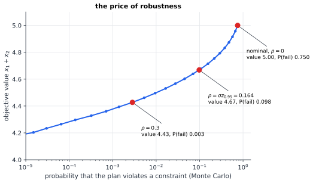

# Chapter 54 — Robust and Stochastic Optimization

[← Previous](53-reinforcement-learning.md) · [Track D](README.md) · [Table of Contents](../../00-front/table-of-contents.md) · [Next →](55-optimal-transport.md)

> **Level 2 · Track D — Optimization and Operations Research**
> **Builds on:** [Ch. 19](../../part-6-probability-statistics/19-probability.md), [Ch. 23](../../part-7-numerical-computational/23-optimization.md), [Ch. 47](47-convexity.md), [Ch. 48](48-duality.md) · **Leads to:** [Ch. 52](52-dynamic-programming.md), [Ch. 55](55-optimal-transport.md) · **Related:** [Ch. 38](../b-probability-information/38-monte-carlo.md), [Ch. 46](../c-game-theory/46-adversarial-decision-making.md), [Ch. 53](53-reinforcement-learning.md), [Ch. 75](../g-graphics-simulation/75-computational-geometry.md)
> **Reading time:** ~30 min

## 54.1 The hook

Here is a small production plan. Two products, $x_1$ and $x_2$ units, each worth one unit of profit. Machine A has 8 hours and needs 2 hours per unit of product 1 and 1 hour per unit of product 2. Machine B has 9 hours and needs 1 and 3. Maximize $x_1+x_2$. The linear program of [§23.3](../../part-7-numerical-computational/23-optimization.md#233-linear-programming) answers in a moment: $x_1=3$, $x_2=2$, profit 5, both machines fully booked.

Now admit what everyone on the factory floor knows: the "2 hours" was measured, and measurements wobble. Suppose each of the four time coefficients is really its nominal value plus a small random error, independent, with mean zero. How often does the optimal plan overrun a machine?

Think before reading on. The errors are small, so surely the plan works almost always?

It fails **75% of the time**. And the answer does not depend on how small the errors are. Make them 10% of the coefficients or 0.001%, and still three plans in four overrun. The reason takes one line. The optimum sits exactly on both constraint boundaries, $2x_1+x_2=8$ and $x_1+3x_2=9$. A symmetric error pushes each machine's actual load above or below its capacity with probability $\tfrac12$ each. The chance that *both* land on the safe side is $\tfrac12\times\tfrac12=\tfrac14$.

This is not a quirk of the example. The simplex method always returns a vertex, where as many constraints as there are variables hold with equality. Optimization by its nature drives you to the edge of the feasible set, and the edge is where any uncertainty hurts most. In 2000, Aharon Ben-Tal and Arkadi Nemirovski took the classical NETLIB collection of real-world linear programs, perturbed the uncertain coefficients by just 0.01%, and found that in a substantial fraction of the problems the nominal optimal solutions violated some constraints by far more than the perturbation, in several cases by more than the entire right-hand side. Solutions that were optimal to many decimal places were, in practice, nonsense.

So what should an optimizer do when it does not know the numbers? There are three classical answers, each with its own mathematics, and the surprise of this chapter is that for the simplest kind of uncertainty all three lead to *the same shape of constraint*, differing only in a single number.

## 54.2 The big idea

Imagine three engineers given the same uncertain plan.

The **gambler** says: the coefficients are random, so optimize the *expected* outcome, averaging over everything that might happen. This is **stochastic programming**. It is the right philosophy when you play the same game many times and the law of large numbers evens things out: a shop ordering stock every week, a grid operator committing generators every day.

The **actuary** says: I accept a small risk, but I want a guarantee on it. Each constraint must hold with probability at least $1-\varepsilon$, say 95%. This is a **chance constraint**. It is the language of reliability engineering, of "loss of load probability" in power systems, and of service levels in supply chains.

The **paranoid** says: I don't trust any probability model. Give me a set $\mathcal{U}$ of coefficient values I believe are possible, and I will make sure the plan works for *every one of them*. This is **robust optimization**. Nature is treated as an adversary, exactly as in Wald's maxmin rule of [Ch. 46](../c-game-theory/46-adversarial-decision-making.md), except that now the scenarios form a continuous set.

Geometrically, the paranoid's feasible set is an intersection: the plan must lie on the safe side of every constraint line that $\mathcal{U}$ allows. Each possible line is a half-plane, and the intersection of infinitely many half-planes is still convex ([Ch. 47](47-convexity.md)), but its boundary is no longer straight. Picture the feasible polygon shrinking and rounding its corners as the uncertainty set grows.


*Left: forty random versions of each machine constraint. The nominal optimum $(3,2)$ is outside roughly half of each bundle. Right: the robust feasible sets for ellipsoidal uncertainty of radius $\rho$. As $\rho$ grows the set shrinks, the corner rounds off, and the best plan retreats inward from the danger, paying for safety with profit.*

The cost of that retreat has a name, the **price of robustness**. Too little and the plan fails; too much and you leave money on the table for protection against things that will never happen. The whole craft is in choosing $\mathcal{U}$, or $\varepsilon$, so that the price is worth paying.

## 54.3 The mathematics

Write one uncertain linear constraint as $\mathbf{a}^\mathsf{T}\mathbf{x}\le b$, where $\mathbf{a}\in\mathbb{R}^n$ is not known exactly. Uncertainty in the objective can always be moved into a constraint (minimize $t$ subject to $\mathbf{c}^\mathsf{T}\mathbf{x}\le t$), and uncertainty in $b$ can be absorbed into $\mathbf{a}$ by appending a coordinate, so this one form covers everything. Different constraints are handled one at a time.

### Robust counterparts

> [!definition] Robust counterpart
> Given an uncertainty set $\mathcal{U}\subset\mathbb{R}^n$, the **robust counterpart** of $\mathbf{a}^\mathsf{T}\mathbf{x}\le b$ is the constraint
> $$
> \mathbf{a}^\mathsf{T}\mathbf{x}\le b\quad\text{for all }\mathbf{a}\in\mathcal{U},\qquad\text{equivalently}\qquad\max_{\mathbf{a}\in\mathcal{U}}\mathbf{a}^\mathsf{T}\mathbf{x}\le b .
> $$

As written this is infinitely many constraints. The trick that makes robust optimization practical is that, for well-chosen $\mathcal{U}$, the inner maximum has a closed form.

> [!theorem] Theorem 54.1 — Ellipsoidal uncertainty gives a second-order cone constraint
> Let $\mathcal{U}=\{\bar{\mathbf{a}}+\mathbf{P}\mathbf{u}:\lVert\mathbf{u}\rVert_2\le1\}$, an ellipsoid with centre $\bar{\mathbf{a}}$ and shape matrix $\mathbf{P}$. Then
> $$
> \mathbf{a}^\mathsf{T}\mathbf{x}\le b\ \ \forall\mathbf{a}\in\mathcal{U}\quad\Longleftrightarrow\quad\bar{\mathbf{a}}^\mathsf{T}\mathbf{x}+\lVert\mathbf{P}^\mathsf{T}\mathbf{x}\rVert_2\le b .
> $$

*Proof.* For any $\mathbf{a}=\bar{\mathbf{a}}+\mathbf{P}\mathbf{u}$ in $\mathcal{U}$,

$$
\mathbf{a}^\mathsf{T}\mathbf{x}=\bar{\mathbf{a}}^\mathsf{T}\mathbf{x}+\mathbf{u}^\mathsf{T}(\mathbf{P}^\mathsf{T}\mathbf{x})\le\bar{\mathbf{a}}^\mathsf{T}\mathbf{x}+\lVert\mathbf{u}\rVert_2\lVert\mathbf{P}^\mathsf{T}\mathbf{x}\rVert_2\le\bar{\mathbf{a}}^\mathsf{T}\mathbf{x}+\lVert\mathbf{P}^\mathsf{T}\mathbf{x}\rVert_2 ,
$$

by Cauchy–Schwarz and $\lVert\mathbf{u}\rVert_2\le1$. So the right-hand condition implies the robust one. Conversely, if $\mathbf{P}^\mathsf{T}\mathbf{x}\neq\mathbf{0}$, the choice $\mathbf{u}^*=\mathbf{P}^\mathsf{T}\mathbf{x}/\lVert\mathbf{P}^\mathsf{T}\mathbf{x}\rVert_2$ lies in the unit ball and makes both inequalities equalities. That $\mathbf{a}^*=\bar{\mathbf{a}}+\mathbf{P}\mathbf{u}^*$ is in $\mathcal{U}$, so the robust constraint at $\mathbf{a}^*$ is exactly the right-hand condition. (If $\mathbf{P}^\mathsf{T}\mathbf{x}=\mathbf{0}$ both sides read $\bar{\mathbf{a}}^\mathsf{T}\mathbf{x}\le b$.) $\square$

Read the result as a recipe: **take the nominal constraint and add a safety margin proportional to how strongly $\mathbf{x}$ is exposed to the uncertainty.** The margin $\lVert\mathbf{P}^\mathsf{T}\mathbf{x}\rVert_2$ is a convex function of $\mathbf{x}$, so the robust problem is still convex: a second-order cone program, solvable by interior-point methods almost as fast as an LP. The proof also hands you the adversary's best move, $\mathbf{a}^*$, which will matter in 54.4.

In the factory example with $\mathbf{P}=\rho\mathbf{I}$ (every coefficient may move by up to $\rho$ in Euclidean length), the robust constraints are $2x_1+x_2+\rho\lVert\mathbf{x}\rVert_2\le8$ and $x_1+3x_2+\rho\lVert\mathbf{x}\rVert_2\le9$. The margin grows with $\lVert\mathbf{x}\rVert$, so the boundary curves inward, which is the rounding you saw in the figure. For $\rho=0.15$ the robust optimum is $(2.80,1.90)$ with profit $4.70$; for $\rho=0.3$ it is $(2.62,1.81)$ with profit $4.43$.

Other shapes of $\mathcal{U}$ give other norms. If each coefficient may move independently within $\pm\delta_j$ (a box), the same argument with Hölder's inequality gives $\bar{\mathbf{a}}^\mathsf{T}\mathbf{x}+\sum_j\delta_j\lvert x_j\rvert\le b$, which is linear after introducing auxiliary variables. In general a ball in one norm produces the *dual* norm in the margin. And for a polyhedral $\mathcal{U}=\{\mathbf{a}:\mathbf{D}\mathbf{a}\le\mathbf{d}\}$, the inner maximum is itself an LP, and replacing it by its dual from [Ch. 48](48-duality.md) turns the robust constraint into a finite set of linear constraints with new variables. Robust LPs with polyhedral uncertainty stay LPs.

### Chance constraints

The actuary does not want *every* $\mathbf{a}$, only most of them. Suppose $\mathbf{a}$ is Gaussian, $\mathbf{a}\sim\mathcal{N}(\bar{\mathbf{a}},\boldsymbol\Sigma)$, and we demand

$$
P\left(\mathbf{a}^\mathsf{T}\mathbf{x}\le b\right)\ge1-\varepsilon .
$$

Write $\Phi$ for the standard normal CDF ([§19.8](../../part-6-probability-statistics/19-probability.md#198-cumulative-distributions)) and $z_{1-\varepsilon}=\Phi^{-1}(1-\varepsilon)$ for its quantile: $z_{0.95}=1.645$, $z_{0.99}=2.326$.

> [!theorem] Theorem 54.2 — Gaussian chance constraints are second-order cone constraints
> If $\mathbf{a}\sim\mathcal{N}(\bar{\mathbf{a}},\boldsymbol\Sigma)$ then
> $$
> P\left(\mathbf{a}^\mathsf{T}\mathbf{x}\le b\right)\ge1-\varepsilon\quad\Longleftrightarrow\quad\bar{\mathbf{a}}^\mathsf{T}\mathbf{x}+z_{1-\varepsilon}\,\lVert\boldsymbol\Sigma^{1/2}\mathbf{x}\rVert_2\le b ,
> $$
> and the set of such $\mathbf{x}$ is convex whenever $\varepsilon\le\tfrac12$.

*Proof.* For fixed $\mathbf{x}$, the load $L=\mathbf{a}^\mathsf{T}\mathbf{x}$ is a linear combination of jointly Gaussian variables, hence Gaussian, with mean $\bar{\mathbf{a}}^\mathsf{T}\mathbf{x}$ and variance $\mathbf{x}^\mathsf{T}\boldsymbol\Sigma\mathbf{x}=\lVert\boldsymbol\Sigma^{1/2}\mathbf{x}\rVert_2^2=s^2$. If $s>0$, standardize:

$$
P(L\le b)=\Phi\left(\frac{b-\bar{\mathbf{a}}^\mathsf{T}\mathbf{x}}{s}\right)\ge1-\varepsilon\quad\Longleftrightarrow\quad\frac{b-\bar{\mathbf{a}}^\mathsf{T}\mathbf{x}}{s}\ge z_{1-\varepsilon},
$$

because $\Phi$ is strictly increasing. Multiply by $s>0$ to get the stated form. (If $s=0$ the load is deterministic and both sides say $\bar{\mathbf{a}}^\mathsf{T}\mathbf{x}\le b$, assuming $\varepsilon<\tfrac12$.) For convexity: when $\varepsilon\le\tfrac12$, $z_{1-\varepsilon}\ge0$, so the left side is a linear function plus a nonnegative multiple of a norm, which is convex, and a sublevel set of a convex function is convex. $\square$

When $\varepsilon>\tfrac12$ the coefficient $z_{1-\varepsilon}$ is negative, the margin becomes a *bonus*, and the feasible set is generally not convex. Asking for less than a coin-flip's reliability breaks the geometry.

Put the two theorems side by side. The robust constraint with ellipsoid $\mathbf{P}=\rho\,\boldsymbol\Sigma^{1/2}$ and the Gaussian chance constraint are *the same inequality* when $\rho=z_{1-\varepsilon}$. A paranoid engineer who chooses an uncertainty set of radius $1.645$ standard deviations has, without saying so, bought a 95% guarantee for Gaussian data. Even the distribution-free version fits the pattern: if you know only the mean and covariance of $\mathbf{a}$ and demand the guarantee for *every* distribution with those moments, the constraint becomes the same cone with radius $\sqrt{(1-\varepsilon)/\varepsilon}$, a consequence of Cantelli's one-sided Chebyshev inequality, which is tight.

| guarantee | margin radius, $\varepsilon=0.05$ | $\varepsilon=0.01$ |
|---|---|---|
| robust over $\{\bar{\mathbf{a}}+\rho\boldsymbol\Sigma^{1/2}\mathbf{u}:\lVert\mathbf{u}\rVert\le1\}$ | $\rho$ (your choice) | $\rho$ |
| Gaussian chance constraint | $z_{0.95}=1.645$ | $z_{0.99}=2.326$ |
| any distribution with that mean and covariance | $\sqrt{19}=4.359$ | $\sqrt{99}=9.950$ |

Ignorance about the shape of the distribution costs a factor of about 2.6 in the margin at 95%, and over 4 at 99%. That is a precise answer to "how much is a probability model worth?"

> [!example] The factory, made 95% safe
> Take every coefficient to have independent noise with $\sigma=0.1$, so $\boldsymbol\Sigma^{1/2}=0.1\,\mathbf{I}$, and ask each machine to be safe with probability 95%: $\rho=0.1\times1.645=0.1645$. The robust optimum is $(2.779,\,1.889)$ with profit $4.668$, a price of $6.6\%$. A Monte Carlo check with 400,000 samples finds each constraint violated $5.0\%$ of the time, as promised, and *at least one* violated $9.8\%$ of the time, close to $1-0.95^2=0.0975$. Individual guarantees do not add up to a joint one; for that, split the risk budget, for example $\varepsilon/2$ per constraint.



*The price of robustness for the factory, $\sigma=0.1$. Each dot is the robust optimum for one $\rho$. Cutting the failure rate from 75% to 10% costs 6.6% of profit; from 10% to 0.3% costs another 5%. Each further factor of ten in reliability costs another 2–4%.*

### Stochastic programming: optimizing the average

The gambler's problem is $\min_\mathbf{x}E_\xi\left[F(\mathbf{x},\xi)\right]$, where $\xi$ is the random data. The classic example has one variable and teaches the central lesson.

A shop must order $q$ units of a perishable product before seeing demand $D$, a random variable with CDF $F$. Each unit costs $c$ and sells for $p>c$. Unsold units are worth nothing. Profit is $p\min(q,D)-cq$.

> [!theorem] Theorem 54.3 — The newsvendor's critical fractile
> If $D$ has a continuous CDF $F$, the expected profit $\pi(q)=pE[\min(q,D)]-cq$ is concave and is maximized at
> $$
> F(q^*)=\frac{p-c}{p}=\frac{c_u}{c_u+c_o},
> $$
> where $c_u=p-c$ is the cost of ordering one unit too few and $c_o=c$ the cost of one unit too many.

*Proof.* Write $\min(q,D)=\int_0^q\mathbf{1}\{D>t\}\,dt$ for $D\ge0$. Taking expectations, $E[\min(q,D)]=\int_0^q P(D>t)\,dt=\int_0^q\big(1-F(t)\big)\,dt$. Hence

$$
\pi'(q)=p\big(1-F(q)\big)-c .
$$

This is non-increasing in $q$ because $F$ is non-decreasing, so $\pi$ is concave. Its zero is where $1-F(q^*)=c/p$, that is $F(q^*)=(p-c)/p$. $\square$

The answer is a *quantile*, not an average. With $p=5$, $c=2$ and $D\sim\mathcal{N}(100,20^2)$, the fractile is $0.6$ and $q^*=100+20\times0.253=105.1$: order a little more than average demand, because running out costs more than leftovers. With a thin margin, $c=4.5$, the fractile drops to $0.1$ and $q^*=100-20\times1.282=74.4$. Ordering the mean demand of 100 then earns an expected profit of about $10.1$ instead of $32.4$. **Planning for the average scenario is not the same as planning for the average outcome**, and the difference can be most of your profit. The gap has a name in stochastic programming: the *value of the stochastic solution*.

Real problems rarely have a closed-form $F$. **Sample average approximation (SAA)** replaces the expectation with an average over $N$ observed or simulated scenarios $\xi_1,\dots,\xi_N$ and solves $\min_\mathbf{x}\frac1N\sum_kF(\mathbf{x},\xi_k)$. For the newsvendor, SAA's answer is simply the empirical 0.6-quantile of past demand. As $N\to\infty$ the SAA optimum converges to the true one, and its error shrinks like $1/\sqrt N$, the familiar Monte Carlo rate of [Ch. 38](../b-probability-information/38-monte-carlo.md).

### Hedging against the model itself

Each approach needs something the engineer may not have: a distribution (gambler, actuary) or a believable set (paranoid). **Distributionally robust optimization** blends them. Take a set $\mathcal{P}$ of plausible *distributions*, typically everything close to the empirical distribution of your data, and minimize the worst expected cost over $\mathcal{P}$:

$$
\min_\mathbf{x}\ \sup_{Q\in\mathcal{P}}E_{\xi\sim Q}\left[F(\mathbf{x},\xi)\right].
$$

The inner problem is an optimization over probability measures, an infinite-dimensional LP. Its dual, in the spirit of [Ch. 48](48-duality.md), is a problem over functions, and for the right $\mathcal{P}$ it collapses to something finite. Which $\mathcal{P}$? A ball defined by KL divergence ([Ch. 33](../b-probability-information/33-information-theory.md)) contains only distributions on the same support as your data, so it can never imagine a demand larger than any you have seen. A ball measured in the distance of the next chapter has no such blindness.

> [!mystery] How far is one distribution from another?
> For a Wasserstein ball of radius $r$ around the empirical distribution and a cost that is $L$-Lipschitz in $\xi$, the worst-case expected cost is at most the sample average plus $rL$: a simple regularization term falls out of an infinite-dimensional sup. Why the Lipschitz constant appears, and what "distance between distributions" means so that this works, is the Kantorovich–Rubinstein duality of [Ch. 55](55-optimal-transport.md).

## 54.4 The algorithm

Two practical routes lead to a robust or chance-constrained solution.

**Route 1: reformulate and call a cone solver.** Theorems 54.1 and 54.2 turn each uncertain constraint into a second-order cone constraint. Hand the result to any interior-point SOCP solver. Cost is polynomial, typically a few dozen Newton steps, each dominated by a linear solve. This is how almost all production robust optimization is done.

**Route 2: let the adversary propose cuts.** When no closed form exists, or you want to see the mechanism, alternate between a planner and an adversary. The planner solves the problem against a *finite* list of scenarios. The adversary looks at the plan and finds the scenario that hurts it most. Add that scenario to the list and repeat.

```text
scenarios ← { a_nominal }                      for each uncertain constraint
repeat:
    x ← solve LP: max cᵀx  s.t.  aᵀx ≤ b for every a in scenarios
    for each constraint:
        a* ← argmax over a in U of aᵀx         (ellipsoid: a* = ā + P Pᵀx / ‖Pᵀx‖)
        if a*ᵀx > b + tol: add a* to scenarios
until no constraint was violated
```

Each round adds one half-space that cuts off the current plan, so this is a **cutting-plane method**, the outside description of a convex set from [Ch. 47](47-convexity.md) built up one face at a time. It converges to the robust optimum, though only approximately in finitely many steps when $\mathcal{U}$ is curved: an ellipsoid has infinitely many faces to discover. Its real strength is generality. The adversary step can be any oracle, even a simulation, as long as it can find a violating scenario when one exists.

**A third route needs no model at all.** The **scenario approach** samples $N$ independent realizations of the uncertain data, imposes the constraint for every one of them, and solves the resulting ordinary LP. The theorem of Calafiore and Campi (2006), sharpened by Campi and Garatti (2008), says: for a convex problem with $d$ decision variables, the probability that the scenario solution violates the constraint on a fresh sample with probability more than $\varepsilon$ is at most

$$
\sum_{i=0}^{d-1}\binom{N}{i}\varepsilon^i(1-\varepsilon)^{N-i},
$$

*whatever the distribution of the data*. For the factory ($d=2$), $\varepsilon=0.05$ and a confidence level of $1-10^{-6}$, this needs $N=326$ samples. The simpler sufficient condition $N\ge\frac2\varepsilon\left(\ln\frac1\beta+d\right)$ gives 633.

**Failure modes.**

- *Over-conservatism.* A box uncertainty set lets *every* coefficient reach its worst value simultaneously, which with fifty uncertain coefficients is absurdly unlikely. Bertsimas and Sim's **budget of uncertainty** allows at most $\Gamma$ coefficients per constraint to deviate. Then the violation probability decays like $e^{-\Gamma^2/(2n)}$ for $n$ independent symmetric coefficients, so $\Gamma$ of order $\sqrt n$ buys high reliability at a fraction of the box's price.
- *Joint guarantees.* Separate 95% guarantees on two constraints give about 90% jointly, as the example showed. Bonferroni splitting is safe but conservative; exact joint chance constraints are usually non-convex.
- *Non-convex chance constraints.* For a general (say discrete) distribution, $\{\mathbf{x}:P(\mathbf{a}^\mathsf{T}\mathbf{x}\le b)\ge1-\varepsilon\}$ can be a union of disjoint pieces, and optimizing over it is NP-hard. The standard convex safe approximation replaces the probability by the **conditional value at risk**, the expected violation in the worst $\varepsilon$ fraction of cases.
- *Bad uncertainty sets.* Robust optimization is only as good as $\mathcal{U}$. Too small and the guarantee is fiction; too large and the solution is useless or the problem becomes infeasible.

> [!mystery] A guarantee that knows nothing about the distribution
> The scenario bound depends on the number of decision variables $d$ and on nothing else: not on the distribution, not on the number of constraints, not on the geometry. How can a result about random constraints be so indifferent to their randomness? The key is that a convex program in $d$ variables has at most $d$ **support constraints**, scenarios whose removal would change the solution, a cousin of Helly's theorem on intersecting convex sets. The combinatorics of support constraints, and the LP-type problems where they rule, are in [Ch. 75](../g-graphics-simulation/75-computational-geometry.md).

## 54.5 The experiment

First, see the robust feasible set shrink. The two shaded regions are the robust versions of the factory constraints with $\rho=0.3$; the dashed lines are the nominal ones, and the dotted line is the objective level $x_1+x_2=5$ through the nominal optimum.

```desmos-graph
left=0; right=4.6; bottom=0; top=4.2
---
2x+y+0.3\sqrt{x^{2}+y^{2}}\le8|blue
x+3y+0.3\sqrt{x^{2}+y^{2}}\le9|orange
2x+y=8|grey|dashed
x+3y=9|grey|dashed
x+y=5|black|dotted
(3,2)|label:nominal optimum
(2.618,1.809)|label:robust optimum, ρ = 0.3
```

*Robust factory constraints with $\rho=0.3$. The overlap of the two shadings is the robust feasible set; its best corner has moved from $(3,2)$ to $(2.618,1.809)$. Change both $0.3$s to $0.1645$ (95% per constraint for $\sigma=0.1$ Gaussian noise) or to $1$, and watch the set collapse towards the origin.*

Now the stochastic side. The script below plays the newsvendor many times. Each trial sees only $N$ past demands and orders either the SAA solution (the empirical quantile at the critical fractile) or the "plan for the average" quantity (the sample mean). A million fresh demands stand in for the true distribution to score each order.

```python
import numpy as np
import matplotlib.pyplot as plt

# --- knobs -------------------------------------------------------------
price, cost = 5.0, 2.0            # sell at 5, buy at 2, unsold stock is worth 0
N, trials, seed = 20, 2000, 0     # data points per trial, repeated trials
def demand(n):                    # try rng.lognormal(4.55, 0.4, n) for a skewed world
    return np.maximum(rng.normal(100, 20, n), 0)
# ----------------------------------------------------------------------
rng = np.random.default_rng(seed)
frac = (price - cost) / price                  # critical fractile c_u / (c_u + c_o)
big = demand(1_000_000)                        # stands in for "the true distribution"
profit = lambda q: (price * np.minimum(q, big) - cost * q).mean()
q_true = np.quantile(big, frac)

q_saa = np.array([np.quantile(demand(N), frac) for _ in range(trials)])
q_mean = np.array([demand(N).mean() for _ in range(trials)])   # "plan for the average"

print(f"critical fractile {frac:.2f}, true optimal order {q_true:.1f}, profit {profit(q_true):.2f}")
for name, q in [("SAA", q_saa), ("mean", q_mean)]:
    lost = profit(q_true) - np.array([profit(x) for x in q[:300]])
    print(f"{name:5s}: order {q.mean():6.1f} +- {q.std():4.1f}, expected profit lost {lost.mean():.2f}")

plt.hist(q_saa, 60, alpha=0.6, label="SAA order (empirical quantile)")
plt.hist(q_mean, 60, alpha=0.6, label="order = sample mean")
plt.axvline(q_true, color="k", ls="--", label="true optimum")
plt.xlabel("order quantity"); plt.legend(); plt.show()
```

With the default knobs the true optimum is to order $105.1$ for an expected profit of $261.4$. SAA with only 20 data points orders $104.8\pm5.5$ and loses $1.48$ of profit on average; ordering the sample mean loses $1.99$. Things to change:

- `N = 200` and `N = 2000`: SAA's loss falls to $0.14$ and then $0.02$, roughly by a factor of ten for each factor of ten in data, because the profit curve is flat at its peak and the loss goes like the *square* of an error that shrinks like $1/\sqrt N$. The mean-based order stays wrong, losing about $1.3$ however much data it has: more data cannot fix the wrong question.
- `cost = 4.5`: a thin margin, fractile $0.1$. The optimal order drops to $74.3$ with profit $32.4$. SAA with 20 points loses about $1.2$; ordering the mean loses about $24$, three quarters of the attainable profit.
- Switch `demand` to the lognormal line. Which estimator suffers more from the skew?
- Make the shop paranoid: order the *worst-case* optimal quantity over all demands between the smallest and largest of the $N$ observations. What does maxmin choose, and what does it cost on average?

## 54.6 The challenge

1. **Intuition.** In the hook, the nominal optimum failed 75% of the time because two constraints were active. A three-variable LP typically has three active constraints at its optimum. What failure probability do you predict, and why must it be at least $\tfrac12$ for *any* LP whose optimum lies on at least one uncertain constraint with symmetric noise? What property of the optimal solution would make it immune?
2. **Derivation.** Derive the robust counterpart of $\mathbf{a}^\mathsf{T}\mathbf{x}\le b$ for the box $\lvert a_j-\bar a_j\rvert\le\delta_j$, and rewrite it as a set of linear inequalities using auxiliary variables $t_j\ge\lvert x_j\rvert$. Then generalize: for $\mathcal{U}=\{\bar{\mathbf{a}}+\mathbf{u}:\lVert\mathbf{u}\rVert\le\rho\}$ in an arbitrary norm, show that the margin is $\rho\lVert\mathbf{x}\rVert_*$, where $\lVert\cdot\rVert_*$ is the dual norm.
3. **Implementation.** Implement the scenario approach for the factory with `scipy.optimize.linprog`: draw $N=326$ perturbed copies of each constraint, solve, then estimate the true violation probability of the solution with $10^5$ fresh samples. Repeat 1,000 times and plot the histogram of violation probabilities against $\varepsilon=0.05$. How conservative is the Campi–Garatti bound in this example?
4. **Open investigation.** For a *joint* chance constraint on both factory machines, $P(\text{both safe})\ge0.95$, compare three strategies: Bonferroni ($2.5\%$ per machine), an optimized split of the risk budget between the machines, and the scenario approach with the same reliability. Now correlate the noise between coefficients. How does the best split depend on the correlation? Is there a rule for allocating risk among $m$ constraints that is near-optimal in general?

## 54.7 Loose threads

The chapter treated decisions made once, here and now, before the uncertainty is revealed. Real plans unfold.

> [!mystery] Decisions that wait for information
> A grid operator commits generators today, but adjusts their output tomorrow after seeing the wind. The second decision is not a number but a *function* of what will be observed, and optimizing over functions makes robust problems intractable in general. A popular escape restricts the recourse to be an affine function of the uncertainty, which turns the problem back into a cone program, at an unknown cost in optimality. When is that loss small, and what is the exact answer? The exact answer is a dynamic program over information states, Bellman's recursion of [Ch. 52](52-dynamic-programming.md), with all the curse of dimensionality that implies. How much the affine shortcut gives up in general is still an open question.

The other threads lead outward. The Wasserstein ball of 54.3 is defined, and its duality proved, in [Ch. 55](55-optimal-transport.md). The reinforcement-learning agent of [Ch. 53](53-reinforcement-learning.md) that must explore without breaking anything faces a robust MDP, in which the transition probabilities themselves lie in an uncertainty set. Robust control, where the uncertainty is a disturbance signal of bounded energy, turns the worst case into an $H_\infty$ norm. And the stochastic processes of [Ch. 36](../b-probability-information/36-stochastic-processes.md) supply the scenario generators that SAA needs.

## Further reading

- A. Ben-Tal, L. El Ghaoui and A. Nemirovski, *Robust Optimization*, Princeton University Press, 2009. The theory of robust counterparts, including the NETLIB study.
- D. Bertsimas and M. Sim, "The Price of Robustness", *Operations Research* 52(1), 2004. Budgets of uncertainty and their probabilistic guarantees.
- J. R. Birge and F. Louveaux, *Introduction to Stochastic Programming*, 2nd ed., Springer, 2011. Two-stage problems, recourse, and the value of the stochastic solution.
- A. Shapiro, D. Dentcheva and A. Ruszczyński, *Lectures on Stochastic Programming*, 3rd ed., SIAM, 2021. Sample average approximation, chance constraints and risk measures, rigorously.
