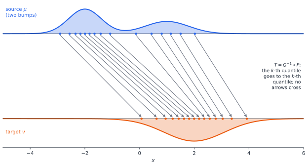
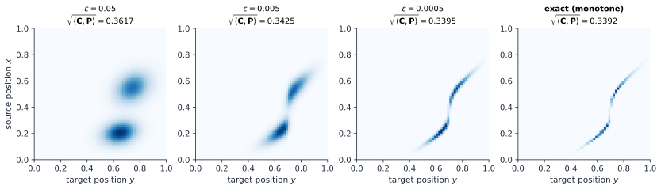

# Chapter 55 — Optimal Transport and Wasserstein Geometry

[← Previous](54-robust-stochastic-optimization.md) · [Track D](README.md) · [Table of Contents](../../00-front/table-of-contents.md) · [Next →](../e-abstract-math/README.md)

> **Level 2 · Track D — Optimization and Operations Research**
> **Builds on:** [Ch. 19](../../part-6-probability-statistics/19-probability.md), [Ch. 23](../../part-7-numerical-computational/23-optimization.md), [Ch. 33](../b-probability-information/33-information-theory.md), [Ch. 48](48-duality.md) · **Leads to:** [Ch. 59](../e-abstract-math/59-differential-geometry.md), [Ch. 89](../j-frontier/89-pde-beyond-the-basics.md), [Ch. 97](../j-frontier/97-measure-theory.md) · **Related:** [Ch. 54](54-robust-stochastic-optimization.md), [Ch. 61](../e-abstract-math/61-functional-analysis.md), [Ch. 76](../g-graphics-simulation/76-signal-processing-audio-visual.md)
> **Reading time:** ~30 min

## 55.1 The hook

Play a game of hot-and-cold. I hide a coin somewhere on a line, at position 0. You stand at position $\theta$ and want to find it, and after each step I tell you how far off you are. The game is easy because my answers change as you move: "warmer" tells you which way to go.

Now play it with a very strict referee. Instead of measuring distance, he compares *where you are* with *where the coin is* and reports how much the two pictures overlap. You are a single point at $\theta$; the coin is a single point at 0. Unless $\theta=0$ exactly, the overlap is zero. Move from $\theta=5$ to $\theta=0.01$ and his answer does not change at all. You are told you are wrong, but never *how* wrong, so you have no idea which way to step.

That strict referee is not a straw man. He is the Kullback–Leibler divergence of [Ch. 33](../b-probability-information/33-information-theory.md), and its symmetrized cousin, the Jensen–Shannon divergence, and the total-variation distance. All of them compare two probability distributions *point by point*, density against density. Put the coin's distribution $\delta_0$ against yours, $\delta_\theta$, and for every $\theta\neq0$ the KL divergence is $+\infty$, the Jensen–Shannon divergence is exactly $\ln2$, and the total variation is exactly 1. These numbers have no slope. A learning algorithm that adjusts $\theta$ by gradient descent on any of them stands still.

This happened in practice. Around 2014–2017, generative adversarial networks were trained to make realistic images by, in effect, minimizing a Jensen–Shannon divergence between generated and real images. Real images occupy a thin, low-dimensional sliver of the space of all pixel arrays, and so, early in training, do the generator's. Two thin slivers in a huge space almost never overlap. Training stalled, or oscillated, or collapsed onto a few outputs. In 2017 Arjovsky, Chintala and Bottou proposed replacing the strict referee with one who *measures distance*. Their fix was a quantity first studied by a French engineer in 1781 who wanted to move dirt.

How do you measure the distance between two probability distributions so that it knows how far apart they are, not merely whether they overlap? And why should the answer be an optimization problem?

## 55.2 The big idea

Think of each distribution as a pile of sand of total mass 1. The first pile is where the probability is now; the second is where you want it. Moving a grain from $x$ to $y$ costs $c(x,y)$, say the distance $\lvert x-y\rvert$ or its square. The **optimal transport cost** is the least total effort needed to reshape the first pile into the second.

Gaspard Monge posed this in 1781 for building fortifications: the *déblais* (earth dug out of a trench) had to be carried to the *remblais* (embankments) as cheaply as possible. In 1942 Leonid Kantorovich, working on Soviet production planning, recast it as a linear program, the kind of problem he had invented a few years earlier, complete with its dual prices. (He shared the 1975 economics Nobel prize for that work.)

The cost of transport is a distance that "knows geometry". Move a pile a distance $d$ without changing its shape and the transport cost is exactly $d$ (with $c=\lvert x-y\rvert$): every grain travels $d$. Back to the coin: transporting $\delta_\theta$ to $\delta_0$ costs $\lvert\theta\rvert$, which shrinks smoothly as you approach and has slope $\pm1$ pointing the right way. Hot-and-cold works again.

In one dimension the optimal plan is something you would guess: **never let paths cross.** Sort both piles from left to right. Send the leftmost grain of the first pile to the leftmost position of the second, the median to the median, the 90th percentile to the 90th percentile.



*The optimal transport map in one dimension sends each quantile of the source (blue, two bumps) to the same quantile of the target (orange, one bump). Grains from the left bump travel far; grains from the right bump travel little. No two arrows cross: crossing would always waste effort.*

Notice what this picture is *not*. The point-by-point comparison would say these two densities differ a lot on the left and a little on the right. Transport says something more useful: *how* to turn one into the other, and how much work that takes. Distances between distributions become distances between *places*.

Two further consequences make optimal transport more than a better ruler. First, it gives a way to *interpolate* between distributions: let each grain travel only halfway along its arrow. The halfway pile between two narrow bumps is a narrow bump in the middle. Averaging the densities would instead give two half-height bumps, a picture of no physical situation at all. Second, the set of all distributions with this distance has a geometry of its own, with straight lines (those half-way piles), angles and curvature. Physics turns out to live there.

## 55.3 The mathematics

### Two formulations

Let $\mu$ and $\nu$ be probability distributions on $\mathbb{R}^d$ and $c(x,y)\ge0$ a cost.

> [!definition] Monge and Kantorovich problems
> **Monge:** find a map $T$ that pushes $\mu$ to $\nu$ (if $X\sim\mu$ then $T(X)\sim\nu$) and minimizes $E_{X\sim\mu}\left[c(X,T(X))\right]$.
>
> **Kantorovich:** find a joint distribution $\pi$ of a pair $(X,Y)$, called a **coupling** or **transport plan**, whose marginals are $X\sim\mu$ and $Y\sim\nu$, and which minimizes $E_{(X,Y)\sim\pi}\left[c(X,Y)\right]$. The set of couplings is written $\Pi(\mu,\nu)$.

A map must send each grain to one place. A plan can split a grain. That matters: a point mass at 0 cannot be mapped onto two half-masses at $\pm1$ by any map, but a plan can split it. Kantorovich's relaxation always has a solution under mild conditions, and when an optimal map exists it is also an optimal plan.

For discrete distributions $\mu=\sum_ia_i\delta_{x_i}$ and $\nu=\sum_jb_j\delta_{y_j}$, a plan is a nonnegative matrix $\mathbf{P}$ with row sums $\mathbf{a}$ and column sums $\mathbf{b}$, and the problem is the linear program

$$
\min_{\mathbf{P}\ge\mathbf{0}}\ \sum_{i,j}C_{ij}P_{ij}\quad\text{s.t.}\quad\sum_jP_{ij}=a_i,\quad\sum_iP_{ij}=b_j,\qquad C_{ij}=c(x_i,y_j).
$$

This is the transportation problem of operations research ([§23.3](../../part-7-numerical-computational/23-optimization.md#233-linear-programming)), with $nm$ variables and $n+m$ constraints.

> [!definition] Wasserstein distance
> For $p\ge1$ and $c(x,y)=\lVert x-y\rVert^p$,
> $$
> W_p(\mu,\nu)=\left(\min_{\pi\in\Pi(\mu,\nu)}E_\pi\left[\lVert X-Y\rVert^p\right]\right)^{1/p}.
> $$

$W_p$ is a genuine metric on distributions with finite $p$-th moments: symmetric, zero only when $\mu=\nu$, and obeying the triangle inequality (glue an optimal plan from $\mu$ to $\nu$ to one from $\nu$ to $\rho$ along their common marginal). Unlike KL, it is finite even when the supports are disjoint.

### The one-dimensional solution

> [!theorem] Theorem 55.1 — Monotone matching is optimal on the line
> Let $x_1\le\cdots\le x_n$ and $y_1\le\cdots\le y_n$ be points on $\mathbb{R}$, each carrying mass $1/n$, and let $c(x,y)=h(x-y)$ with $h$ convex. Among all one-to-one assignments $\sigma$, the total cost $\sum_ih(x_i-y_{\sigma(i)})$ is minimized by the identity, $\sigma(i)=i$.

*Proof.* First the key inequality, for two points and two targets. Take $x_1\le x_2$ and $y_1\le y_2$, and compare the uncrossed pairing with the crossed one. Set

$$
\alpha=x_1-y_2,\qquad\beta=x_1-y_1,\qquad\gamma=x_2-y_2,\qquad\delta=x_2-y_1 .
$$

Then $\alpha\le\beta\le\delta$, $\alpha\le\gamma\le\delta$ and $\beta+\gamma=\alpha+\delta$. So $\beta=(1-t)\alpha+t\delta$ for some $t\in[0,1]$, and then $\gamma=\alpha+\delta-\beta=t\alpha+(1-t)\delta$. By convexity,

$$
h(\beta)+h(\gamma)\le\big[(1-t)h(\alpha)+th(\delta)\big]+\big[th(\alpha)+(1-t)h(\delta)\big]=h(\alpha)+h(\delta).
$$

The left side is the cost of the uncrossed pairing $(x_1\to y_1,\ x_2\to y_2)$, the right side that of the crossed one. Uncrossing never costs more.

Now take any assignment $\sigma$ other than the identity. It has an *inversion*: indices $i<k$ with $\sigma(i)>\sigma(k)$, a pair of crossing arrows. Swap their targets. By the inequality the total cost does not increase, and the number of inversions strictly decreases. After finitely many swaps we reach the identity, at a cost no greater than that of $\sigma$. $\square$

Two remarks extend this. The LP above, with uniform weights and $n=m$, always has an optimal solution that is a permutation matrix: its feasible set is the Birkhoff polytope, whose vertices are exactly the permutation matrices, and an LP attains its optimum at a vertex. So restricting to assignments lost nothing. And for general distributions on $\mathbb{R}$ with CDFs $F$ and $G$, the same sorting becomes "match quantiles": the optimal map is $T=G^{-1}\circ F$ and

$$
W_p^p(\mu,\nu)=\int_0^1\left\lvert F^{-1}(u)-G^{-1}(u)\right\rvert^p\,du .
$$

In one dimension, optimal transport costs a sort: $O(n\log n)$.

> [!theorem] Theorem 55.2 — Wasserstein distance between Gaussians on the line
> $$
> W_2^2\left(\mathcal{N}(m_1,\sigma_1^2),\ \mathcal{N}(m_2,\sigma_2^2)\right)=(m_1-m_2)^2+(\sigma_1-\sigma_2)^2 .
> $$

*Proof.* The quantile function of $\mathcal{N}(m,\sigma^2)$ is $m+\sigma\,\Phi^{-1}(u)$. If $U$ is uniform on $(0,1)$ then $Z=\Phi^{-1}(U)$ is standard normal, so by the quantile formula

$$
W_2^2=E\left[\big((m_1-m_2)+(\sigma_1-\sigma_2)Z\big)^2\right]=(m_1-m_2)^2+2(m_1-m_2)(\sigma_1-\sigma_2)E[Z]+(\sigma_1-\sigma_2)^2E[Z^2],
$$

and $E[Z]=0$, $E[Z^2]=1$. $\square$

Compare the Kullback–Leibler divergence between the same two Gaussians,

$$
D\left(\mathcal{N}(m_1,\sigma_1^2)\,\Vert\,\mathcal{N}(m_2,\sigma_2^2)\right)=\ln\frac{\sigma_2}{\sigma_1}+\frac{\sigma_1^2+(m_1-m_2)^2}{2\sigma_2^2}-\frac12 .
$$

Three differences jump out. $W_2$ is symmetric and KL is not. $W_2$ measures a shift in the units of $x$; KL measures it in units of the *width*, $(m_1-m_2)^2/(2\sigma^2)$ for equal widths, so as both bumps become narrow KL explodes while $W_2$ stays put. And as $\sigma\to0$, $W_2$ becomes the plain distance between the means: the coin game. For $\mathcal{N}(0,1)$ against $\mathcal{N}(1,4)$, $W_2=\sqrt2=1.414$ while the KL divergence is $0.443$ nats.

![Left: for Gaussians N(0,1) and N(d,1), Wasserstein distance grows linearly in d, KL quadratically, while total variation and Jensen-Shannon saturate. Right: for uniform boxes on [0,1] and [d,d+1], Wasserstein still grows linearly but TV and JS become flat once d exceeds 1, and KL is infinite for every positive d](../../images/ch55-divergences.svg)

*Four ways to compare a distribution with its shifted copy. With Gaussians (left) every measure increases with the shift, but TV and Jensen–Shannon flatten out quickly. With boxes (right) the supports stop overlapping at $d=1$; from then on TV and JS are constant, KL is infinite throughout, and only the Wasserstein distance still says how far there is to go.*

### Duality: the price of moving dirt

[Ch. 48](48-duality.md) promised a dual for this LP. Attach a price $\varphi_i$ to each source constraint and $\psi_j$ to each target constraint. Think of a haulage company that offers to take over the whole job. It charges $\varphi(x)$ per unit for picking sand up at $x$ and $\psi(y)$ per unit for dropping it off at $y$, so your bill is $\sum_ia_i\varphi_i+\sum_jb_j\psi_j$, and it wants that bill as large as possible. You accept only prices that are never dearer than doing the job yourself, on every possible route:

$$
\varphi(x)+\psi(y)\le c(x,y)\qquad\text{for all }x,y .
$$

> [!theorem] Theorem 55.3 — Kantorovich duality
> $$
> \min_{\pi\in\Pi(\mu,\nu)}E_\pi[c(X,Y)]=\max_{\varphi(x)+\psi(y)\le c(x,y)}\Big(E_\mu[\varphi(X)]+E_\nu[\psi(Y)]\Big).
> $$

*Proof of $\ge$ (weak duality).* For any coupling $\pi$ and any admissible prices, $(X,Y)\sim\pi$ has $X\sim\mu$ and $Y\sim\nu$, so

$$
E_\mu[\varphi(X)]+E_\nu[\psi(Y)]=E_\pi\left[\varphi(X)+\psi(Y)\right]\le E_\pi\left[c(X,Y)\right].
$$

Take the max over prices on the left and the min over plans on the right. $\square$

For discrete distributions equality is LP strong duality ([Ch. 48](48-duality.md)); for general ones it needs a compactness argument we do not give. The optimal prices are not arbitrary. Given $\varphi$, the best admissible $\psi$ is the largest one allowed,

$$
\psi(y)=\varphi^c(y)=\inf_x\big(c(x,y)-\varphi(x)\big),
$$

the **$c$-transform** of $\varphi$: the cheapest way to deliver to $y$, net of what you were paid at the pickup. For $c(x,y)=-x^\mathsf{T}y$ it is, up to signs, the convex conjugate of convex analysis. This is the "strange conjugate operation" [Ch. 48](48-duality.md) mentioned.

For the cost $c(x,y)=\lvert x-y\rvert$ the conjugation simplifies dramatically. Admissible prices can be taken to satisfy $\psi=-\varphi$ with $\varphi$ **1-Lipschitz**, $\lvert\varphi(x)-\varphi(y)\rvert\le\lvert x-y\rvert$, giving the **Kantorovich–Rubinstein formula**

$$
W_1(\mu,\nu)=\sup_{\operatorname{Lip}(f)\le1}\Big(E_\mu[f(X)]-E_\nu[f(Y)]\Big).
$$

The easy half is again one line: for any coupling and any 1-Lipschitz $f$, $E_\mu f-E_\nu f=E_\pi[f(X)-f(Y)]\le E_\pi\lvert X-Y\rvert$. This is the formula behind the Wasserstein GAN of 55.1. A second network, the "critic", searches over (approximately) 1-Lipschitz functions $f$ for the one that best tells real data from generated data. The value it achieves estimates $W_1$, and its gradient tells the generator which way to move.

The same easy half settles a promise of [Ch. 54](54-robust-stochastic-optimization.md). Let $\hat P$ be the empirical distribution of your data and $\ell$ an $L$-Lipschitz loss. If $W_1(Q,\hat P)\le r$, apply the formula to $f=\ell/L$:

$$
E_Q[\ell]\le E_{\hat P}[\ell]+L\,W_1(Q,\hat P)\le E_{\hat P}[\ell]+Lr .
$$

Robustness against every distribution in a Wasserstein ball costs at most a Lipschitz penalty, which is why "Wasserstein distributionally robust" learning so often reduces to ordinary learning with a regularizer. For many losses the bound is attained.

> [!mystery] Why is the optimal map a gradient?
> In $\mathbb{R}^d$ with cost $\lVert x-y\rVert^2$ there is no sorting, yet Brenier's theorem (1991) says that, if $\mu$ has a density, the optimal plan is a map, and that map is the *gradient of a convex function*, $T=\nabla u$. In one dimension a gradient of a convex function is just an increasing function, so this is the "no crossing" rule in disguise. Pushing a density $f$ forward to $g$ by $\nabla u$ then forces $g(\nabla u(x))\det\nabla^2u(x)=f(x)$, the **Monge–Ampère equation**, one of the most important fully nonlinear PDEs. Why it is so hard, and what regularity its solutions have, is a story for [Ch. 89](../j-frontier/89-pde-beyond-the-basics.md).

## 55.4 The algorithm

In one dimension, sort and match. In higher dimensions the transport LP has $nm$ variables; with $n=m=10^4$ points that is $10^8$ unknowns, and exact network-flow solvers cost roughly $O(n^3)$. For years this made optimal transport a beautiful theory with few applications. What changed it, around 2013, was a small perturbation.

**Entropic regularization.** Add a penalty that rewards spreading the plan out:

$$
\min_{\mathbf{P}\ge\mathbf{0}}\ \sum_{i,j}C_{ij}P_{ij}+\varepsilon\sum_{i,j}P_{ij}\left(\ln P_{ij}-1\right)\quad\text{s.t.}\quad\mathbf{P}\mathbf{1}=\mathbf{a},\quad\mathbf{P}^\mathsf{T}\mathbf{1}=\mathbf{b}.
$$

The penalty is strictly convex, so the solution is unique. Attach multipliers $f_i$ and $g_j$ to the two sets of constraints and set the derivative of the Lagrangian with respect to $P_{ij}$ to zero:

$$
C_{ij}+\varepsilon\ln P_{ij}-f_i-g_j=0\quad\Longrightarrow\quad P_{ij}=\underbrace{e^{f_i/\varepsilon}}_{u_i}\,\underbrace{e^{-C_{ij}/\varepsilon}}_{K_{ij}}\,\underbrace{e^{g_j/\varepsilon}}_{v_j}.
$$

So the optimal plan has the form $\mathbf{P}=\operatorname{diag}(\mathbf{u})\,\mathbf{K}\,\operatorname{diag}(\mathbf{v})$ for a fixed **Gibbs kernel** $\mathbf{K}=e^{-\mathbf{C}/\varepsilon}$ (elementwise), and only the $n+m$ scaling factors are unknown. The row-sum condition reads $\mathbf{u}\odot(\mathbf{K}\mathbf{v})=\mathbf{a}$, the column-sum condition $\mathbf{v}\odot(\mathbf{K}^\mathsf{T}\mathbf{u})=\mathbf{b}$. Solving each one for its own unknown, alternately, gives **Sinkhorn's algorithm**:

```text
K ← exp(−C / ε);   v ← 1
repeat until the marginals match:
    u ← a ./ (K v)          fix the row sums
    v ← b ./ (Kᵀ u)         fix the column sums
P ← diag(u) K diag(v)
```

Each sweep is two matrix–vector products, $O(nm)$ operations, perfectly suited to GPUs. The number of sweeps grows as $\varepsilon$ shrinks, roughly like $1/\varepsilon$.



*Entropic plans for the source and target of the first figure (now on $[0,1]$). With $\varepsilon=0.05$ the plan is a blur and its cost $\sqrt{\langle\mathbf{C},\mathbf{P}\rangle}=0.3617$ overestimates $W_2=0.3392$ by 7%. At $\varepsilon=0.0005$ it is within $0.1\%$ and has sharpened onto the monotone map: an increasing curve, steep where the source's gap between its two bumps is squeezed into a narrow stretch of the target.*

**Failure modes.**

- *Bias.* For $\varepsilon>0$ the plan is blurred and its cost overestimates the true one. A corrected quantity, the **Sinkhorn divergence** $S_\varepsilon(\mu,\nu)=\mathrm{OT}_\varepsilon(\mu,\nu)-\tfrac12\mathrm{OT}_\varepsilon(\mu,\mu)-\tfrac12\mathrm{OT}_\varepsilon(\nu,\nu)$, removes the self-blur and vanishes when $\mu=\nu$.
- *Underflow.* $e^{-C/\varepsilon}$ is below the smallest double ($\approx10^{-308}$) once $C/\varepsilon>708$. Then $\mathbf{K}\mathbf{v}$ has zeros, the division produces infinities, and the iteration returns `nan`. The cure is to iterate on $f=\varepsilon\ln u$ and $g=\varepsilon\ln v$ with a log-sum-exp, which costs a little speed and never overflows.
- *Slow convergence for small $\varepsilon$*, exactly when the answer is most accurate. Practical codes start with a large $\varepsilon$ and decrease it, warm-starting each stage.
- *High dimension.* Estimating $W_p$ from $n$ samples in $\mathbb{R}^d$ converges like $n^{-1/d}$, so in dimension 100 more data barely helps. Regularization partly escapes this; see the challenge.

## 55.5 The experiment

First the shape of the comparison. The graph shows, against the shift $d$ between two Gaussians of equal width $\sigma=1$, the Wasserstein distance (blue), the KL divergence $d^2/(2\sigma^2)$ (red) and the total variation $\operatorname{erf}\big(d/(2\sqrt2\,\sigma)\big)$ (green).

```desmos-graph
left=0; right=4; bottom=0; top=4
---
y=x|blue
y=\frac{x^{2}}{2\cdot1^{2}}|red
y=\operatorname{erf}\left(\frac{x}{2\sqrt{2}\cdot1}\right)|green
```

*Discrepancy between $\mathcal{N}(0,\sigma^2)$ and $\mathcal{N}(d,\sigma^2)$ as a function of $d$, with $\sigma=1$. Change both $1$s (the width) to $0.3$. The Wasserstein line does not move at all, the KL parabola shoots up eleven times faster, and the total variation jumps to 1 almost immediately: narrow distributions are "completely different" to point-by-point measures, but only $d$ apart to transport.*

Now Sinkhorn against the exact answer. The script builds a two-bump source histogram and a shifted, widened target on a grid, runs Sinkhorn, and compares the result with the exact quantile formula of 55.3.

```python
import numpy as np
import matplotlib.pyplot as plt

# --- knobs -------------------------------------------------------------
n, eps, iters = 200, 0.01, 2000       # grid size, entropic blur, Sinkhorn sweeps
shift, width = 0.3, 0.05              # target = source moved right and widened
# ----------------------------------------------------------------------
x = np.linspace(0, 1, n)
bump = lambda m, s: np.exp(-0.5 * ((x - m) / s) ** 2)
a = bump(0.25, 0.05) + 0.6 * bump(0.45, 0.04); a /= a.sum()   # source histogram
b = bump(0.25 + shift, 0.05 + width);           b /= b.sum()   # target histogram
C = (x[:, None] - x[None, :]) ** 2                             # squared-distance cost

K = np.exp(-C / eps)                  # Gibbs kernel; underflows when eps is tiny
v = np.ones(n)
for k in range(iters):
    u = a / (K @ v)                   # fix the row sums
    v = b / (K.T @ u)                 # fix the column sums
P = u[:, None] * K * v[None, :]       # the entropic transport plan

# exact 1-D answer: match quantiles, W2^2 = integral of (F^-1 - G^-1)^2
q = np.linspace(0.0005, 0.9995, 4000)
Finv = np.interp(q, np.cumsum(a), x)
Ginv = np.interp(q, np.cumsum(b), x)
print("Sinkhorn  sqrt(<C,P>) =", np.sqrt((C * P).sum()))
print("exact W2 (quantiles)  =", np.sqrt(np.mean((Finv - Ginv) ** 2)))
print("row-sum error =", np.abs(P.sum(1) - a).max())
print("L2 distance between histograms =", np.linalg.norm(a - b))

fig, ax = plt.subplots(1, 2, figsize=(10, 4))
ax[0].plot(x, a, label="source"); ax[0].plot(x, b, label="target"); ax[0].legend()
ax[1].imshow(P, origin="lower", extent=[0, 1, 0, 1], cmap="Blues")
ax[1].set_xlabel("to y"); ax[1].set_ylabel("from x")
plt.show()
```

With the default knobs Sinkhorn reports $0.2452$ against the exact $W_2=0.2367$, with the row sums matched to $10^{-17}$. Things to change:

- `eps = 0.001`: the estimate tightens to $0.2378$, and the plan in the right panel sharpens into a curve.
- `eps = 0.0001`: everything becomes `nan`. Look at `K`: most of its entries are exactly zero. This is the underflow of 55.4.
- `shift = 0.5`, then `0.7`: the exact $W_2$ grows from $0.237$ to $0.434$ to $0.588$, tracking the shift, while the $L^2$ distance between the histograms barely moves ($0.150$, $0.176$, $0.198$) once the bumps have separated.
- `width = 0.0`: a pure shift of the second bump only. How does the plan change?
- Replace `C` by `np.abs(x[:, None] - x[None, :])` to compute $W_1$ instead. Does the plan still look like a monotone curve? (In one dimension many plans can be optimal for $W_1$; Sinkhorn picks the most spread-out one.)

## 55.6 The challenge

1. **Intuition.** Two narrow bumps, one at 0 and one at 1. Describe the mixture $\tfrac12\mu+\tfrac12\nu$ and the Wasserstein midpoint (each grain travels half-way). If $\mu$ and $\nu$ are images of a moving object at two instants, which one looks like the object at the middle instant? Give one engineering situation where the mixture is the right answer instead.
2. **Derivation.** Show from the quantile formula that, in one dimension, $W_1(\mu,\nu)=\int_{-\infty}^{\infty}\lvert F(x)-G(x)\rvert\,dx$, the area between the two CDFs. (Hint: draw both CDFs and compute the same area by horizontal and by vertical strips.) Use it to find $W_1$ between the uniform distributions on $[0,1]$ and on $[0,2]$, then between $\delta_0$ and $\mathcal{N}(0,1)$.
3. **Implementation.** Rewrite the experiment's Sinkhorn loop in the log domain: iterate on $f=\varepsilon\ln u$ and $g=\varepsilon\ln v$ using a numerically stable log-sum-exp. Confirm that it works at $\varepsilon=10^{-4}$, where the plain version fails. Then plot the number of sweeps needed to reach a row-sum error of $10^{-9}$ against $\varepsilon$ on log–log axes. What power law do you see?
4. **Open investigation.** Draw two independent samples of size $n$ from the *same* standard Gaussian in $\mathbb{R}^d$ and compute the exact $W_2$ between them as an assignment problem (`scipy.optimize.linear_sum_assignment`). Measure how $W_2$ shrinks with $n$ for $d=1,2,3,5,10$ and estimate the exponent. Now repeat with the Sinkhorn divergence at fixed $\varepsilon$. Does it escape the curse of dimensionality, and at what price in what it actually measures?

## 55.7 Loose threads

The chapter used optimal transport as a ruler. Its deeper life is as a geometry.

> [!mystery] Heat flow is the steepest descent of entropy
> Equip the space of probability densities with the $W_2$ distance. Now ask: which way should a density move to *increase its entropy* as fast as possible, per unit of Wasserstein distance travelled? The answer, found by Jordan, Kinderlehrer and Otto in 1998, is the heat equation $\partial_t\rho=\nabla^2\rho$. Diffusion is gradient descent on entropy, in this geometry and in no other. Many other PDEs turn out to be gradient flows of the same kind. Making sense of "gradient" on a space of distributions requires a Riemannian structure on it, the subject of [Ch. 59](../e-abstract-math/59-differential-geometry.md).

> [!mystery] Why does Sinkhorn converge so reliably?
> Alternately rescaling rows and columns of a positive matrix looks naive, yet it converges linearly from any start, at a rate that depends only on $\mathbf{K}$. The reason is that each rescaling is a contraction in Hilbert's projective metric, a way of measuring distance between positive vectors that ignores their overall scale, by the Birkhoff–Hopf theorem on positive linear maps. The geometry of cones and positive operators that makes this work is part of [Ch. 61](../e-abstract-math/61-functional-analysis.md).

The first mystery of 55.3, Brenier's map and the Monge–Ampère equation, waits in [Ch. 89](../j-frontier/89-pde-beyond-the-basics.md). A rigorous account of couplings, of weak convergence and of why the duality holds beyond the discrete case needs measure theory ([Ch. 97](../j-frontier/97-measure-theory.md)). Other doors open from here: colour transfer and image registration in [Ch. 76](../g-graphics-simulation/76-signal-processing-audio-visual.md), matching markets in economics, and the Wasserstein balls of [Ch. 54](54-robust-stochastic-optimization.md), which this chapter has now made precise.

## Further reading

- C. Villani, *Topics in Optimal Transportation*, American Mathematical Society, 2003. A readable introduction by one of the field's architects; his *Optimal Transport: Old and New* (Springer, 2009) is the encyclopaedia.
- F. Santambrogio, *Optimal Transport for Applied Mathematicians*, Birkhäuser, 2015. Duality, one-dimensional problems and gradient flows, at a pace suited to engineers.
- G. Peyré and M. Cuturi, *Computational Optimal Transport*, Foundations and Trends in Machine Learning 11(5–6), 2019. Sinkhorn, its variants and applications, with code.
- M. Arjovsky, S. Chintala and L. Bottou, "Wasserstein Generative Adversarial Networks", *Proceedings of ICML*, 2017. The hot-and-cold argument for machine learning.
