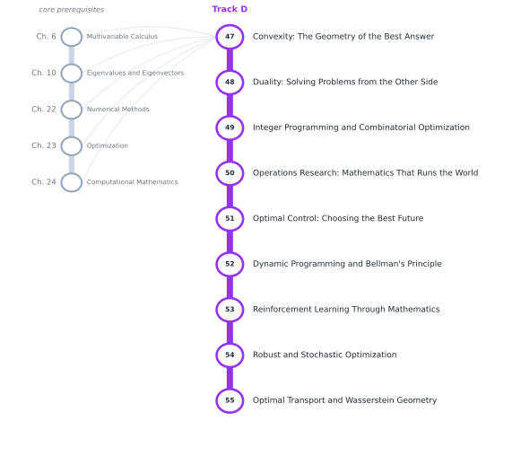

# Track D — Optimization and Operations Research

[← Table of Contents](../../00-front/table-of-contents.md) · [Start: Ch. 47 →](47-convexity.md)

> **Level 2 — Specializations.** From introductory engineering tools to the advanced frameworks that schedule, route and control the world.

*Suggested reading order for Track D. The grey stations on the left are the core chapters it leans on.*

## Before you start

This track assumes you are comfortable with these core chapters:

- Ch. 6 — [Multivariable Calculus](../../part-2-calculus/06-multivariable-calculus.md)
- Ch. 10 — [Eigenvalues and Eigenvectors](../../part-3-linear-algebra/10-eigenvalues-and-eigenvectors.md)
- Ch. 22 — [Numerical Methods](../../part-7-numerical-computational/22-numerical-methods.md)
- Ch. 23 — [Optimization](../../part-7-numerical-computational/23-optimization.md)
- Ch. 24 — [Computational Mathematics](../../part-7-numerical-computational/24-computational-mathematics.md)

## Chapters

| Ch. | Chapter | What it explores |
|---|---|---|
| 47 | [Convexity: The Geometry of the Best Answer](47-convexity.md) | Convex sets/functions, separation theorems, convex optimization. |
| 48 | [Duality: Solving Problems from the Other Side](48-duality.md) | Lagrangian duality, KKT conditions, sensitivity analysis. |
| 49 | [Integer Programming and Combinatorial Optimization](49-integer-programming.md) | Integer models, branch-and-bound, cutting planes, relaxations. |
| 50 | [Operations Research: Mathematics That Runs the World](50-operations-research.md) | Scheduling, inventory, logistics, resource allocation. |
| 51 | [Optimal Control: Choosing the Best Future](51-optimal-control.md) | Dynamic optimization, Pontryagin's principle, control constraints. |
| 52 | [Dynamic Programming and Bellman's Principle](52-dynamic-programming.md) | Bellman equations, optimal policies, state-space methods. |
| 53 | [Reinforcement Learning Through Mathematics](53-reinforcement-learning.md) | Markov decision processes, value functions, policy optimization. |
| 54 | [Robust and Stochastic Optimization](54-robust-stochastic-optimization.md) | Uncertain parameters, chance constraints, worst-case optimization. |
| 55 | [Optimal Transport and Wasserstein Geometry](55-optimal-transport.md) | Transport plans, Wasserstein distances, distribution matching. |

Every chapter follows the same arc: **the hook** (a puzzle or a failure), **the big idea**, **the mathematics**, **the algorithm**, **the experiment** you can run, **the challenge**, and **loose threads**: the questions the chapter deliberately leaves open.
