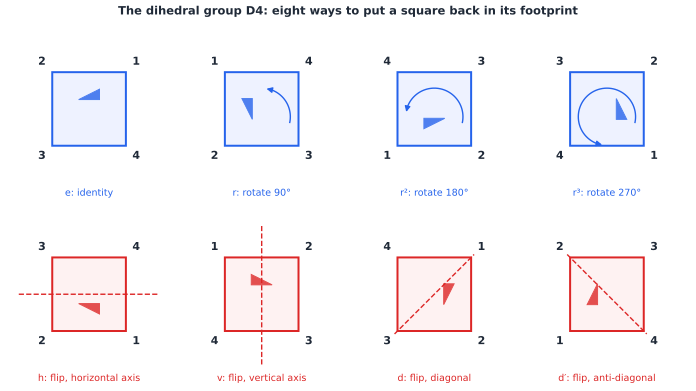
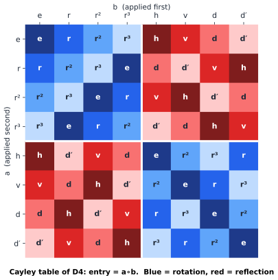

# Chapter 56 — Abstract Algebra: Symmetry as a Language

[← Previous](README.md) · [Track E](README.md) · [Table of Contents](../../00-front/table-of-contents.md) · [Next →](57-number-theory.md)

> **Level 2 · Track E — The Abstract Mathematics Behind Everything**
> **Builds on:** [Ch. 1](../../part-1-foundations/01-mathematical-language-and-algebra.md), [Ch. 2](../../part-1-foundations/02-complex-numbers.md), [Ch. 8](../../part-3-linear-algebra/08-matrices-and-linear-systems.md), [Ch. 9](../../part-3-linear-algebra/09-vector-spaces-and-linear-transformations.md) · **Leads to:** [Ch. 57](57-number-theory.md), [Ch. 62](62-category-theory.md), [Ch. 95](../j-frontier/95-representation-theory.md), [Ch. 99](99-abstract-linear-algebra.md) · **Related:** [Ch. 29](../a-algorithms/29-discrete-mathematics-and-logic.md), [Ch. 70](../g-graphics-simulation/70-quaternions.md), [Ch. 77](../h-cryptography-coding/77-cryptography.md), [Ch. 79](../h-cryptography-coding/79-error-correcting-codes.md)
> **Reading time:** ~25 min

## 56.1 The hook

In the 1880s a small wooden toy swept across America and Europe. Fifteen numbered tiles sat in a 4-by-4 frame with one empty slot, and you slid tiles into the gap to put them in order. Puzzle columnist Sam Loyd stirred up the craze by publicising a cruel variant: start with the tiles in order except that **14 and 15 are swapped**, and restore the natural order. Loyd claimed to offer \$1,000 for a solution. People missed work over it. Ship captains were said to have run aground.

Nobody ever collected, and nobody ever will. The 14–15 puzzle cannot be solved.

Think about what kind of claim that is. The frame can hold the 16 objects (15 tiles and a blank) in $16! = 20{,}922{,}789{,}888{,}000$ arrangements. You cannot try them all by hand, and "I tried for a month and failed" proves nothing. Yet there is a short, airtight argument that no sequence of slides, however long or clever, swaps two tiles and leaves everything else in place. Moreover, the same argument tells you that *exactly half* of all arrangements are reachable, $10{,}461{,}394{,}944{,}000$ of them, and the other half are forever cut off.

The Rubik's cube has the same flavour. Its reachable positions number

$$
43{,}252{,}003{,}274{,}489{,}856{,}000 = 2^{27}\,3^{14}\,5^{3}\,7^{2}\,11,
$$

and you can know that exact number, and know that twisting a single corner in place is impossible, without ever building a list.

> **How can you prove that a move is impossible, or count an astronomically large set of states exactly, without searching?**

The answer is that the moves of a puzzle are not just a list. They *compose*, they can be *undone*, and those two facts force a rigid structure on everything the puzzle can do. That structure is called a **group**, and once you can see it you will find it inside crystals, codes, ciphers, quantum particles and the rotations of a spacecraft.

## 56.2 The big idea

Pick up a square tile and ask: in how many ways can I put it back into its square hole? You can leave it alone. You can turn it by 90°, 180° or 270°. You can flip it over along a horizontal, vertical or diagonal axis. That is eight ways, and there are no others.



*The dihedral group $D_4$. Each panel shows where the corner labels 1–4 end up; the small flag shows orientation. Blue panels are rotations, red panels are reflections (dashed line = mirror).*

The eight motions are interesting not individually but as a system:

- **Doing one after another gives another one.** Rotate 90°, then flip horizontally: the result is one of the eight (a diagonal flip, as it turns out).
- **Doing nothing is one of them.**
- **Every one can be undone by one of them.** A 90° turn is undone by a 270° turn; every flip undoes itself.

Those three facts, plus the harmless observation that "first $a$, then $b$, then $c$" doesn't care how you bracket it, are the whole definition of a group. Notice what is *missing*: there is no mention of squares, angles or tiles. The same three facts hold for the twelve hours on a clock, for the invertible $3\times3$ matrices, for the rotations of a quantum spin, for the shuffles of a deck of cards. Abstract algebra is the decision to study the pattern and forget the costume.

Here is the payoff, stated as an analogy. A detective who knows that a suspect is 1.80 m tall can rule out everyone shorter without interviewing them. An algebraist who knows that some quantity is *preserved by every allowed move* (an **invariant**) can rule out every state where that quantity differs without exploring them. For the 15 puzzle the invariant is a single bit, the *parity* of a permutation, and it is enough to kill Loyd's challenge.

The whole Cayley table of $D_4$ fits in one picture:



*Row $a$, column $b$ holds $a\circ b$ (do $b$ first, then $a$). The four blocks tell a story: rotation∘rotation and reflection∘reflection are rotations; mixed products are reflections. That block pattern is a homomorphism onto $\{+1,-1\}$ in disguise. Also, the table is not symmetric: $r\circ h=d$ but $h\circ r=d'$.*

Look at the table for a moment. Every row and every column contains each element exactly once (a **Latin square**), which is the "undo" axiom in visual form. The four colour blocks say that "is it a reflection?" behaves like a sign: two reflections make a rotation, just as two minus signs make a plus. Remembering only that sign throws away information yet respects composition. That is the first example of the most important idea in the chapter: a structure-preserving map, or **homomorphism**.

## 56.3 The mathematics

### Groups

> [!definition] Group
> A **group** $(G,\ast)$ is a set $G$ with an operation $\ast: G\times G\to G$ such that
> 1. (associativity) $(a\ast b)\ast c=a\ast(b\ast c)$ for all $a,b,c$;
> 2. (identity) there is $e\in G$ with $e\ast a=a\ast e=a$ for all $a$;
> 3. (inverses) for every $a$ there is $a^{-1}$ with $a\ast a^{-1}=a^{-1}\ast a=e$.
>
> The group is **abelian** if also $a\ast b=b\ast a$ for all $a,b$. The number of elements $\lvert G\rvert$ is its **order**.

Closure is built into "$\ast: G\times G\to G$". Usually we write $ab$ for $a\ast b$. Some examples you already know:

| Group | Elements | Operation | Order | Abelian? |
|---|---|---|---|---|
| $\mathbb{Z}$ | integers | $+$ | infinite | yes |
| $\mathbb{Z}_n$ | $\{0,1,\dots,n-1\}$ | addition mod $n$ | $n$ | yes |
| $\mu_n$ | $n$-th roots of unity $e^{j2\pi k/n}$ | complex multiplication | $n$ | yes |
| $D_n$ | symmetries of a regular $n$-gon | composition | $2n$ | no, for $n\ge3$ |
| $S_n$ | permutations of $\{1,\dots,n\}$ | composition | $n!$ | no, for $n\ge3$ |
| $GL_n(\mathbb{R})$ | invertible $n\times n$ matrices | matrix product | infinite | no, for $n\ge2$ |
| $SO(3)$ | rotations of 3-D space | composition | infinite | no |

The roots of unity are covered in [Ch. 2 §2.6](../../part-1-foundations/02-complex-numbers.md#26-roots-and-powers-of-complex-numbers); non-commuting matrix products are in [Ch. 8 §8.2](../../part-3-linear-algebra/08-matrices-and-linear-systems.md#82-matrix-multiplication). Non-commutativity is the rule, not the exception: put on socks then shoes, versus shoes then socks.

Two small consequences of the axioms are used constantly. The identity is unique (if $e$ and $e'$ both work, $e=ee'=e'$), and so is each inverse. And $(ab)^{-1}=b^{-1}a^{-1}$, the socks-and-shoes rule: to undo "socks then shoes" you remove shoes first.

A **subgroup** $H\le G$ is a subset that is itself a group under the same operation. The rotations $\{e,r,r^2,r^3\}$ form a subgroup of $D_4$; so do $\{e,h\}$ and $\{e,r^2\}$. The **order of an element** $g$ is the smallest $k\ge1$ with $g^k=e$, and the powers $\langle g\rangle=\{e,g,g^2,\dots,g^{k-1}\}$ form the **cyclic subgroup** generated by $g$.

### Lagrange's theorem: sizes are not free

Here is the first sign that the axioms are stronger than they look.

> [!theorem] Lagrange's theorem
> If $G$ is finite and $H\le G$, then $\lvert H\rvert$ divides $\lvert G\rvert$. In particular the order of every element divides $\lvert G\rvert$.

*Proof.* For $g\in G$ define the **left coset** $gH=\{gh: h\in H\}$.

1. *Every coset has $\lvert H\rvert$ elements.* The map $h\mapsto gh$ is one-to-one, because $gh_1=gh_2$ implies $h_1=h_2$ after multiplying on the left by $g^{-1}$.
2. *Two cosets are equal or disjoint.* Suppose $x\in g_1H\cap g_2H$, so $x=g_1h_1=g_2h_2$. Then $g_1=g_2h_2h_1^{-1}$, and for any $h\in H$, $g_1h=g_2(h_2h_1^{-1}h)\in g_2H$ because $H$ is closed. So $g_1H\subseteq g_2H$, and by symmetry they are equal.
3. *The cosets cover $G$*, since $g=ge\in gH$.

So $G$ is cut into disjoint pieces of equal size $\lvert H\rvert$, and $\lvert G\rvert=[G:H]\,\lvert H\rvert$ where the **index** $[G:H]$ counts the pieces. For an element $g$, apply this to $H=\langle g\rangle$, whose size is the order of $g$. $\blacksquare$

Immediately, a group of prime order $p$ has no subgroups except $\{e\}$ and itself, so it is generated by any non-identity element and is cyclic. And $g^{\lvert G\rvert}=e$ for every $g$. Applied to the multiplicative group of non-zero residues mod $p$ (order $p-1$), this last fact is **Fermat's little theorem**, the engine of RSA. [Ch. 57](57-number-theory.md) takes it from there.

### Homomorphisms, and the death of the 14–15 puzzle

> [!definition] Homomorphism, kernel, isomorphism
> A map $\varphi:G\to H$ between groups is a **homomorphism** if $\varphi(ab)=\varphi(a)\varphi(b)$ for all $a,b$. Its **kernel** is $\ker\varphi=\{g:\varphi(g)=e_H\}$. A bijective homomorphism is an **isomorphism**, written $G\cong H$: the two groups are the same up to renaming.

Examples: $\det: GL_n(\mathbb{R})\to\mathbb{R}^{\times}$, because $\det(\mathbf{AB})=\det\mathbf{A}\det\mathbf{B}$. The exponential $x\mapsto e^x$ turns $(\mathbb{R},+)$ into $(\mathbb{R}_{>0},\times)$, which is why logarithm tables worked. The map $k\mapsto e^{j2\pi k/n}$ is an isomorphism $\mathbb{Z}_n\cong\mu_n$: adding hours on a clock *is* multiplying roots of unity.

The homomorphism that solves the hook is the **sign of a permutation**. A **transposition** swaps two items and fixes the rest; every permutation is a product of transpositions (sort a list by swaps). Count the **inversions** of a permutation $\sigma$, the pairs $i<j$ with $\sigma(i)>\sigma(j)$. One can check that composing with a single transposition changes the number of inversions by an odd amount, so the parity of "number of transpositions used" does not depend on how you write $\sigma$. That makes

$$
\operatorname{sgn}: S_n\to\{+1,-1\},\qquad \operatorname{sgn}(\sigma)=(-1)^{\#\text{transpositions}}
$$

well defined, and it is a homomorphism: write $\sigma$ with $a$ swaps and $\tau$ with $b$ swaps, and $\sigma\tau$ uses $a+b$. Its kernel, the **even** permutations, is the **alternating group** $A_n$, of order $n!/2$.

> [!theorem] The 14–15 puzzle is unsolvable
> No sequence of slides returns the blank to its corner with tiles 14 and 15 exchanged and all other tiles fixed.

*Proof.* Treat the blank as a 16th tile and colour the board like a chessboard. Each slide swaps the blank with a neighbouring tile, so it is a transposition of the 16 objects, and it moves the blank to a square of the opposite colour. If the blank ends where it started, it has made an even number of moves, so the overall permutation is a product of an even number of transpositions and has sign $+1$. The target configuration differs from the start by one transposition, $(14\ 15)$, of sign $-1$. Since $\operatorname{sgn}$ is well defined, no sequence of moves produces it. $\blacksquare$

The full story is that the reachable configurations are exactly those whose sign matches the colour parity of the blank, which is why exactly half of the $16!$ arrangements are reachable. Proving the "every even one is reachable" half takes a constructive argument; the impossibility half took four lines.

### Normal subgroups and quotients

The kernel of a homomorphism is not just any subgroup. If $k\in\ker\varphi$ then $\varphi(gkg^{-1})=\varphi(g)\varphi(g)^{-1}=e$, so $gkg^{-1}$ is in the kernel too. Subgroups with this property, $gNg^{-1}=N$ for every $g$, are called **normal**, written $N\trianglelefteq G$. For a normal subgroup the cosets themselves form a group, the **quotient** $G/N$, with $(aN)(bN)=(ab)N$.

The quotient is how algebra "forgets on purpose". $\mathbb{Z}/n\mathbb{Z}$ is the integers with multiples of $n$ forgotten, which is clock arithmetic. $D_4/\{\text{rotations}\}$ has two elements, "rotation" and "reflection", and is exactly the block pattern of the Cayley table. The general principle is:

> [!theorem] First isomorphism theorem
> If $\varphi: G\to H$ is a homomorphism, then $G/\ker\varphi\cong\varphi(G)$.

So $S_n/A_n\cong\{\pm1\}$, $GL_n(\mathbb{R})/SL_n(\mathbb{R})\cong\mathbb{R}^\times$ (where $SL_n$ is the determinant-one matrices), and $\mathbb{Z}/n\mathbb{Z}\cong\mu_n$. Every homomorphic image of a group is one of its quotients. We state this without proof; the proof checks that $g\ker\varphi\mapsto\varphi(g)$ is well defined and bijective.

> [!mystery] The atoms of symmetry
> Integers factor into primes. Groups "factor" too: if $N$ is normal in $G$, you can study $N$ and $G/N$ separately. Groups with no normal subgroups except $\{e\}$ and themselves are called **simple**, and they are the atoms. After about 10,000 journal pages written over half a century, mathematicians finished classifying every finite simple group: a few infinite families plus 26 "sporadic" exceptions, the largest being the Monster, with about $8\times10^{53}$ elements. Why the Monster's numbers turn up in the coefficients of a function from 19th-century complex analysis ("monstrous moonshine") is a story about representations of groups as matrices: see [Ch. 95](../j-frontier/95-representation-theory.md).

### Group actions and the orbit–stabilizer theorem

Groups are most useful when they *do* something. An **action** of $G$ on a set $X$ assigns to each $g$ a map $x\mapsto g\cdot x$ with $e\cdot x=x$ and $g\cdot(h\cdot x)=(gh)\cdot x$. $D_4$ acts on the corners of the square, on colourings of the square, on the cells of a chessboard. The **orbit** of $x$ is everything you can reach from it, $Gx=\{g\cdot x\}$. The **stabilizer** is what leaves it alone, $G_x=\{g: g\cdot x=x\}$, and it is a subgroup.

> [!theorem] Orbit–stabilizer
> For a finite group acting on a set, $\lvert Gx\rvert\cdot\lvert G_x\rvert=\lvert G\rvert$.

*Proof.* Send each coset $gG_x$ to the point $g\cdot x$. This is well defined and one-to-one, because
$g\cdot x=g'\cdot x\iff g^{-1}g'\cdot x=x\iff g^{-1}g'\in G_x\iff gG_x=g'G_x$.
It is onto the orbit by definition. So the orbit has as many points as there are cosets of $G_x$, namely $\lvert G\rvert/\lvert G_x\rvert$ by Lagrange. $\blacksquare$

This is a counting machine. The rotation group of a cube acts on its 6 faces; one face can be sent to any face (orbit size 6), and the rotations fixing it are the 4 turns about its axis. So the cube has $6\times4=24$ rotational symmetries, found without listing them. The same trick gives 12 rotations for a tetrahedron and 60 for an icosahedron.

Counting *orbits* rather than group elements needs one more step. Count the pairs $(g,x)$ with $g\cdot x=x$ in two ways: by $x$ it is $\sum_x\lvert G_x\rvert$, and by $g$ it is $\sum_g\lvert\operatorname{Fix}(g)\rvert$. Each orbit $O$ contributes $\sum_{x\in O}\lvert G\rvert/\lvert O\rvert=\lvert G\rvert$ to the first sum. Hence

$$
\#\text{orbits}=\frac{1}{\lvert G\rvert}\sum_{g\in G}\lvert\operatorname{Fix}(g)\rvert,
$$

**Burnside's lemma**. How many genuinely different ways are there to colour the corners of a square with 3 colours, counting two as the same if a symmetry carries one to the other? The identity fixes all $3^4=81$ colourings. The quarter turns $r,r^3$ fix only the 3 one-colour ones; $r^2$ fixes $3^2=9$. The diagonal flips $d,d'$ fix two corners and swap a pair, $3^3=27$ each; the edge flips $h,v$ swap two pairs, $3^2=9$ each. The average is $(81+3+9+3+27+27+9+9)/8=168/8=21$.

### Rings and fields: two operations at once

Groups have one operation. Numbers have two, and they interact through the distributive law.

> [!definition] Ring, field
> A **ring** $(R,+,\cdot)$ is an abelian group under $+$, with an associative multiplication that distributes over addition: $a(b+c)=ab+ac$ and $(a+b)c=ac+bc$. A **field** is a commutative ring with $1\neq0$ in which every non-zero element has a multiplicative inverse.

$\mathbb{Z}$ is a ring but not a field (no $1/2$). $\mathbb{Q},\mathbb{R},\mathbb{C}$ are fields. Polynomials with real coefficients form a ring, as do $n\times n$ matrices (a non-commutative one). The clock $\mathbb{Z}_n$ is a ring, and here algebra gets its first surprise: in $\mathbb{Z}_6$, $2\cdot3=0$. Non-zero things multiplying to zero are **zero divisors**, and a ring with them cannot be a field. $\mathbb{Z}_n$ is a field exactly when $n$ is prime, a fact [Ch. 57](57-number-theory.md) proves with the extended Euclidean algorithm.

The ring analogue of a normal subgroup is an **ideal**, a subset closed under addition and under multiplication by *anything* in the ring, and the analogue of a quotient group is a **quotient ring**. Take real polynomials, forget multiples of $x^2+1$, and what is left is $\mathbb{R}[x]/(x^2+1)$. In that ring $x^2=-1$. You have just built $\mathbb{C}$, with $x$ playing the role of $j$, and without ever saying "imagine a square root of $-1$". Do the same with polynomials over $\mathbb{Z}_2$ modulo $x^8+x^4+x^3+x+1$ and you build the 256-element field in which the AES cipher does its arithmetic.

### Where the structures live

| Structure | Where engineers meet it | Chapter |
|---|---|---|
| cyclic group $\mathbb{Z}_p^\times$ | Diffie–Hellman key exchange, discrete logs | [Ch. 57](57-number-theory.md), [Ch. 77](../h-cryptography-coding/77-cryptography.md) |
| elliptic-curve group | ECDSA signatures, TLS | [Ch. 78](../h-cryptography-coding/78-elliptic-curves.md) |
| finite field $\mathbb{F}_{2^m}$, ideals in $\mathbb{F}_2[x]$ | CRC checks, Reed–Solomon and cyclic codes | [Ch. 79](../h-cryptography-coding/79-error-correcting-codes.md) |
| $SO(3)$, unit quaternions | attitude control, 3-D graphics | [Ch. 70](../g-graphics-simulation/70-quaternions.md) |
| $\mu_n$ acting on sequences | the DFT is the "character table" of $\mathbb{Z}_n$ | [Ch. 16](../../part-5-transforms/16-fourier-transforms.md) |
| space groups (230 of them) | crystallography, band structure | [Ch. 92](../j-frontier/92-mathematical-physics.md) |

> [!mystery] Symmetry that you can't see but can conserve
> Every physical law you use is unchanged if you shift the clock by $\Delta t$, slide the lab by $\Delta\mathbf{x}$, or rotate it. Those are *continuous* groups, not finite tables. In 1918 Emmy Noether proved that each such continuous symmetry of a system's action forces a conserved quantity: time shifts give energy, space shifts give momentum, rotations give angular momentum. Why should a symmetry *produce* a number that never changes? The answer needs the calculus of variations and the infinitesimal version of a group: see [Ch. 92](../j-frontier/92-mathematical-physics.md).

## 56.4 The algorithm

A computer cannot hold "the set of all symmetries" as an idea, but it can hold a few **generators** and close them up. Represent each symmetry as a permutation, a tuple `p` where `p[i]` is where point `i` goes, and repeatedly multiply by the generators until nothing new appears.

```python
def compose(p, q):            # (p o q)(i) = p[q[i]]: do q first, then p
    return tuple(p[i] for i in q)

def generate(gens):
    """All elements of the group generated by permutations gens (breadth-first closure)."""
    n = len(gens[0])
    e = tuple(range(n))
    group, frontier = {e}, [e]
    while frontier:
        new = []
        for g in frontier:
            for s in gens:
                h = compose(s, g)
                if h not in group:
                    group.add(h)
                    new.append(h)
        frontier = new
    return group

def count_orbits(group, k):
    """Burnside: number of k-colourings of the points, up to the group."""
    def cycles(p):
        seen, c = set(), 0
        for i in range(len(p)):
            if i not in seen:
                c += 1
                while i not in seen:
                    seen.add(i); i = p[i]
        return c
    return sum(k ** cycles(g) for g in group) // len(group)

r = (1, 2, 3, 0)              # quarter turn of the square's corners
s = (0, 3, 2, 1)              # flip across the diagonal through corner 0
D4 = generate([r, s])
print(len(D4), count_orbits(D4, 3))          # 8 21
S5 = generate([(1, 2, 3, 4, 0), (1, 0, 2, 3, 4)])
print(len(S5))                              # 120
```

Two details deserve comment.

**Why closing under the generators is enough.** In a finite group the inverse of $s$ is a power of $s$ (Lagrange says $s^{\lvert G\rvert}=e$, so $s^{-1}=s^{\lvert G\rvert-1}$), so products of generators already reach every inverse. The breadth-first search is just a graph search on the **Cayley graph**, whose vertices are group elements and whose edges are "multiply by a generator". Its cost is $O(\lvert G\rvert\cdot m\cdot n)$ for $m$ generators acting on $n$ points, plus memory for every element.

**Why Burnside counts cycles.** A colouring is fixed by $g$ exactly when it is constant on each cycle of $g$, so $\lvert\operatorname{Fix}(g)\rvert=k^{c(g)}$ where $c(g)$ is the number of cycles. Running the code on the rotation group of a cube acting on its 6 faces gives 24 elements, 10 two-colourings and 57 three-colourings, numbers you can check against the orbit–stabilizer count above.

> [!warning] Common Pitfall: listing the group is the wrong plan for big groups
> Breadth-first closure stores every element. The Rubik's cube group has about $4.3\times10^{19}$ elements, far beyond any memory. Real computer-algebra systems use the **Schreier–Sims algorithm**, which stores a chain of stabilizers $G\ge G_{x_1}\ge G_{x_1x_2}\ge\cdots$ and uses orbit–stabilizer at each level, so that $\lvert G\rvert$ comes out as a product of orbit lengths. It handles the cube in milliseconds. The cube's exact order in §56.1 drops out of such a computation.

The 15 puzzle also shows a second failure mode: if you search *configurations* rather than the group, you need an invariant to know when to stop. A solver that does not check the sign first will search all $10^{13}$ reachable states before admitting that the 14–15 position is not among them.

## 56.5 The experiment

The script below builds the dihedral group $D_n$ of a regular $n$-gon from scratch, checks that its Cayley table is a Latin square, tests Lagrange on every element, and counts necklaces with Burnside's lemma.

```python
import numpy as np
import matplotlib.pyplot as plt

n = 6          # knob: symmetries of a regular n-gon (try 3, 4, 5, 12)
k = 2          # knob: number of bead colours for the necklace count

# D_n as permutations of the n corners: rotations r^a, reflections s r^a
rot = [tuple((i + a) % n for i in range(n)) for a in range(n)]
ref = [tuple((a - i) % n for i in range(n)) for a in range(n)]
G = rot + ref
index = {g: t for t, g in enumerate(G)}
comp = lambda p, q: tuple(p[i] for i in q)           # do q first, then p

T = np.array([[index[comp(a, b)] for b in G] for a in G])
assert all(sorted(row) == list(range(2 * n)) for row in T)   # Latin square

def order(g):
    e, h, m = tuple(range(n)), g, 1
    while h != e:
        h, m = comp(g, h), m + 1
    return m

orders = [order(g) for g in G]
print("element orders:", orders)
print("all divide |G| =", 2 * n, ":", all((2 * n) % o == 0 for o in orders))
print("abelian:", (T == T.T).all())

def cycles(p):
    seen, c = set(), 0
    for i in range(n):
        if i not in seen:
            c += 1
            while i not in seen:
                seen.add(i); i = p[i]
    return c

print("necklaces (rotations only):", sum(k ** cycles(g) for g in rot) // n)
print("bracelets (with flips):   ", sum(k ** cycles(g) for g in G) // (2 * n))
plt.imshow(T, cmap="tab20"); plt.title(f"Cayley table of D{n}"); plt.show()
```

With $n=6,k=2$ it reports element orders 1, 6, 3, 2, 3, 6 for the rotations and 2 for all six reflections, all dividing 12; the group is not abelian; and there are 14 two-colour necklaces of six beads but only 13 bracelets, because one pair of necklaces are mirror images. Things to try:

- Change `n` to 7, then 8. For a prime $n$ every non-trivial rotation has order $n$; for $n=8$ you see orders 2, 4 and 8. Why are there never orders like 3 when $n=8$?
- Set `k = 3` and increase `n`. How fast does the bracelet count grow compared with $k^n/(2n)$, the naive "divide by the group size" guess? When is the naive guess exactly right?
- Change `ref` so that reflections are omitted from `G` and rerun the Latin-square check on `rot` alone. Is the rotation subgroup normal? (Test $g h g^{-1}$.)

For a geometric view of the cyclic group $\mu_7$, the graph below joins the powers of $\omega^3$ where $\omega=e^{j2\pi/7}$. Because 3 and 7 share no factor, the star visits every seventh root of unity before closing.

```desmos-graph
left=-1.6; right=1.6; bottom=-1.3; top=1.3
---
x^2+y^2=1|grey|dashed
\operatorname{polygon}((\cos(\frac{2\pi\cdot3}{7}\cdot[0,1,2,3,4,5,6,7,8,9,10,11]),\sin(\frac{2\pi\cdot3}{7}\cdot[0,1,2,3,4,5,6,7,8,9,10,11])))|blue
(\cos(\frac{2\pi}{7}\cdot[0,1,2,3,4,5,6]),\sin(\frac{2\pi}{7}\cdot[0,1,2,3,4,5,6]))|red
```

*Powers of $\omega^3$ in $\mu_7$. In the blue line, change both 7s to 8 and both 3s to 2: the path now closes after 4 steps, tracing the subgroup of order $8/\gcd(8,2)=4$. Try 8 and 3 next, then 12 and 4. The red dots are the seventh roots for reference.*

## 56.6 The challenge

No answers are given.

1. **Intuition.** On a Rubik's cube, twisting a single corner cubie by 120° in place, leaving everything else solved, is impossible. Guess the invariant: assign each corner a twist of 0, 1 or 2, and ask what every face turn does to the *sum* of the eight twists. Why does a homomorphism to $\mathbb{Z}_3$ settle the question, and what is its kernel?
2. **Derivation.** Prove that every group of order 4 is isomorphic either to $\mathbb{Z}_4$ or to the Klein four-group $\mathbb{Z}_2\times\mathbb{Z}_2$. (Use Lagrange to list the possible element orders.) Then show $D_4$ has exactly 10 subgroups and decide which of them are normal.
3. **Implementation.** Extend `generate` to the 15 puzzle restricted to a $2\times3$ board (5 tiles and a blank). Generate all reachable configurations by breadth-first search, confirm that exactly half of the $6!=720$ arrangements are reached, and record the largest number of moves needed (the board's "God's number").
4. **Open investigation.** Burnside's lemma counts colourings up to symmetry. Choose a structure you care about (6-bit binary words up to cyclic shift, which is relevant to cyclic codes; chemical isomers of a ring molecule; seating plans at a round table) and compute counts for several sizes. Then look for a closed formula, and investigate what happens when you weight colours unequally (Pólya's enumeration theorem is the place to end up).

## 56.7 Loose threads

The hook asked how to prove impossibility without searching. The answer is an **invariant that is a homomorphism**: a map from the group of moves to a small group that respects composition. The sign $\operatorname{sgn}: S_{16}\to\{\pm1\}$, combined with the colour of the blank's square, kills the 14–15 puzzle in four lines and simultaneously shows that half of all arrangements are unreachable. Exact counting comes from the same structure: Lagrange's theorem forces sizes to divide, orbit–stabilizer turns "how many symmetries?" into a product, and Burnside's lemma turns "how many different-looking things?" into an average.

What we did not tell you:

- **Why the symmetries of a polynomial's roots decide whether it can be solved.** There is a formula for the roots of quadratics, cubics and quartics, but provably none, using only arithmetic and radicals, for the general quintic. The reason is that $S_5$, the group permuting five roots, contains the simple group $A_5$ (order 60, which you generated in §56.4), and it is not abelian. That is Galois theory, which deserves a book of its own; Stewart's in the reading list is the friendliest route.
- **How groups become matrices.** Every finite group can be realised as a group of matrices, and the traces of those matrices (its **characters**) carry almost everything about it. The DFT is the character table of the cyclic group $\mathbb{Z}_n$, which is why convolution diagonalises. The first mystery points to [Ch. 95](../j-frontier/95-representation-theory.md).
- **What the common shape of all these definitions is.** Groups, rings and vector spaces each have substructures, structure-preserving maps, quotients and an isomorphism theorem. That family resemblance is not a coincidence; it is the subject of [Ch. 62](62-category-theory.md).

> [!mystery] A group drawn on a curve
> Draw the curve $y^2=x^3-x+1$. Through two points on it, draw the straight line; it meets the curve in exactly one more point. Reflect that point in the $x$-axis and call it the "sum". Astonishingly, this rule is associative and makes the curve's points into an abelian group, and the hardness of undoing repeated addition in that group protects most of the world's secure web connections. Why is a rule made of lines associative? See [Ch. 57](57-number-theory.md) for the arithmetic, and [Ch. 78](../h-cryptography-coding/78-elliptic-curves.md) for the proof and the cryptography.

## Further reading

- I. Stewart, *Why Beauty Is Truth: A History of Symmetry*, Basic Books, 2007. A popular history from Babylonian equations to Galois and the Monster.
- J. A. Gallian, *Contemporary Abstract Algebra*, 10th ed., CRC Press, 2021. Gentle, example-rich undergraduate text with many applications.
- M. A. Armstrong, *Groups and Symmetry*, Springer, 1988. Short chapters, a geometric viewpoint, and Burnside counting done properly.
- I. Stewart, *Galois Theory*, 4th ed., CRC Press, 2015. Where the unsolvable quintic is finally explained.
- D. Joyner, *Adventures in Group Theory: Rubik's Cube, Merlin's Machine, and Other Mathematical Toys*, 2nd ed., Johns Hopkins University Press, 2008. Puzzles as a route into permutation groups.
