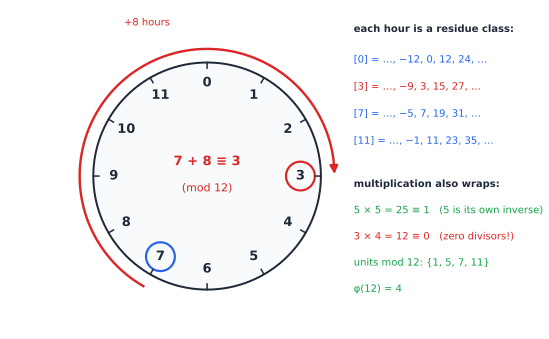
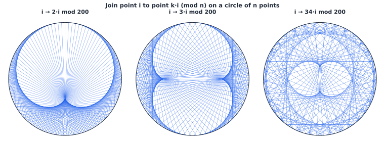
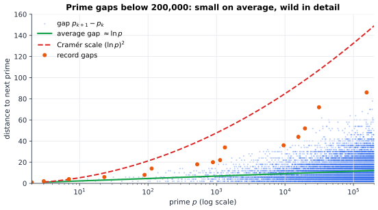

# Chapter 57 — Number Theory: The Hidden Arithmetic of the Digital World

[← Previous](56-abstract-algebra.md) · [Track E](README.md) · [Table of Contents](../../00-front/table-of-contents.md) · [Next →](58-topology.md)

> **Level 2 · Track E — The Abstract Mathematics Behind Everything**
> **Builds on:** [Ch. 56](56-abstract-algebra.md), [Ch. 1](../../part-1-foundations/01-mathematical-language-and-algebra.md), [Ch. 29](../a-algorithms/29-discrete-mathematics-and-logic.md) · **Leads to:** [Ch. 77](../h-cryptography-coding/77-cryptography.md), [Ch. 78](../h-cryptography-coding/78-elliptic-curves.md), [Ch. 79](../h-cryptography-coding/79-error-correcting-codes.md), [Ch. 81](../h-cryptography-coding/81-pseudorandomness.md) · **Related:** [Ch. 26](../a-algorithms/26-the-mathematics-of-algorithms.md), [Ch. 38](../b-probability-information/38-monte-carlo.md), [Ch. 18](../../part-5-transforms/18-complex-analysis.md), [Ch. 94](../j-frontier/94-algebraic-geometry.md)
> **Reading time:** ~25 min

## 57.1 The hook

The English mathematician G. H. Hardy wrote in 1940 that number theory was gloriously useless: nobody had found a warlike purpose for it, and he did not expect anyone to. Thirty-seven years later, three researchers at MIT turned the arithmetic of primes into the lock on the world's secrets.

Here is the puzzle they solved. You want to buy something from a website you have never visited. Every bit you send crosses networks owned by strangers, and an eavesdropper can copy all of it. You and the website have never met and share no secret password. Yet within a fraction of a second your browser and the server agree on a secret key that the eavesdropper, who saw *every message*, cannot work out.

That sounds impossible. If I tell you everything I tell my partner, how can my partner know something you don't?

The trick is an asymmetry of effort that lives entirely in whole numbers. Multiply two 300-digit primes and a laptop finishes in microseconds. Hand someone only the 600-digit product and ask for the two primes back, and every computer on Earth working together would not finish before the Sun burns out, as far as anyone knows. Similarly, raising 5 to the 6th power and keeping the remainder after dividing by 23 is easy ($5^6=15625\equiv 8$). Recovering the exponent 6 from the remainder 8 is, for large numbers, believed to be hopeless.

> **How can arithmetic on remainders make some calculations effortless one way and practically impossible the other way, and how do two strangers use that to share a secret in public?**

The answer needs four ideas that are each more than 200 years old: Euclid's algorithm, the clock arithmetic of Gauss, Fermat's little theorem and Euler's generalisation of it. You will see the full machine working by the end of §57.3, on numbers small enough to check by hand.

## 57.2 The big idea

Number theory studies the integers, but its modern power comes from looking at them through a keyhole: **remainders**. Fix a modulus $n$ and identify any two integers that differ by a multiple of $n$. On a 12-hour clock, 7 o'clock plus 8 hours is 3 o'clock, and 15, 27 and $-9$ all "are" 3.



*Arithmetic mod 12. Each hour stands for an entire class of integers. Addition wraps around; so does multiplication, which brings surprises: some numbers have inverses ($5\times5\equiv1$) and some multiply to zero ($3\times4\equiv0$).*

Wrapping around destroys size. In ordinary arithmetic, $5^{k}$ grows steadily and you can recover $k$ with a logarithm. Mod 23, the powers of 5 go

$$
5,\ 2,\ 10,\ 4,\ 20,\ 8,\ 17,\ 16,\ 11,\ 9,\ 22,\ 18,\ 21,\ 13,\ 19,\ 3,\ 15,\ 6,\ 7,\ 12,\ 14,\ 1,\ \dots
$$

visiting all 22 non-zero residues in an order that looks scrambled. Computing forward is easy; going backward (the **discrete logarithm**) has no landmarks. The second picture shows how strange modular multiplication looks when drawn. Put $n$ points on a circle and join point $i$ to point $ki \bmod n$:



*Multiplication mod 200 by 2, 3 and 34. Small multipliers trace smooth envelopes (a cardioid, a nephroid); larger ones give tangled, nearly structureless webs. The same operation can look orderly or chaotic depending on the numbers.*

Here is the one-paragraph version of the public-key idea, using a paint analogy. Alice and Bob agree in public on a common colour. Each mixes in a secret colour of their own and sends the mixture across. Each then adds their own secret to what they received. Both end up with "common + Alice's + Bob's", while the eavesdropper holds only the two half-mixtures and cannot un-mix paint. In number theory, "mixing" is exponentiation mod a prime, and un-mixing is the discrete logarithm.

Underneath all of this sit the **primes**, the numbers with no divisors but 1 and themselves. They are the atoms of multiplication, they make clock arithmetic into a field, and their distribution is the deepest unsolved mystery in mathematics.

## 57.3 The mathematics

### Primes and the fundamental theorem

Every integer $n\ge2$ factors into primes, and the factorisation is unique up to order: $3120=2^4\cdot3\cdot5\cdot13$. (Existence is a short induction; uniqueness needs Euclid's lemma below.) The first great theorem about primes is also the oldest.

> [!theorem] Euclid (c. 300 BC)
> There are infinitely many primes.

*Proof.* Suppose $p_1,\dots,p_k$ were all of them. Let $N=p_1p_2\cdots p_k+1$. Dividing $N$ by any $p_i$ leaves remainder 1, so no $p_i$ divides $N$. But $N\ge2$ has some prime factor, which is then a prime missing from the list. $\blacksquare$

How many are there? The **prime number theorem** (Hadamard and de la Vallée Poussin, 1896) says the number $\pi(x)$ of primes up to $x$ satisfies $\pi(x)\sim x/\ln x$. There are 78,498 primes below $10^6$, against $10^6/\ln10^6\approx72{,}382$. So near a large number $p$ the average gap between primes is about $\ln p$, and a random 300-digit number is prime with probability roughly $1/\ln(10^{300})\approx1/691$. That is why finding big primes for keys is cheap: test a few hundred random odd candidates.



*Gaps between consecutive primes below 200,000. The average gap tracks $\ln p$ (green), but individual gaps scatter wildly; record gaps (orange) stay below the $(\ln p)^2$ curve that a random model of the primes predicts. The longest here is 86, after 155,921.*

### Congruences and Euclid's algorithm

> [!definition] Congruence
> $a\equiv b\pmod n$ means $n$ divides $a-b$. The residue classes mod $n$ form the ring $\mathbb{Z}_n=\{0,1,\dots,n-1\}$ of [Ch. 56](56-abstract-algebra.md#563-the-mathematics), with addition and multiplication done mod $n$.

Congruences can be added and multiplied like equations, but **not divided** freely: $2\cdot3\equiv2\cdot9\pmod{12}$, yet $3\not\equiv9$. Division by $a$ is legal exactly when $a$ has a multiplicative inverse mod $n$, and the tool for finding inverses is the oldest non-trivial algorithm still in daily use. Euclid's algorithm computes $\gcd(a,b)$ by repeatedly replacing $(a,b)$ with $(b,\ a\bmod b)$; [Ch. 29 §29.4](../a-algorithms/29-discrete-mathematics-and-logic.md#294-the-algorithm) proves it correct with a loop invariant. Running it *backwards* gives more.

> [!theorem] Bézout's identity
> For integers $a,b$ not both zero there are integers $x,y$ with $ax+by=\gcd(a,b)$.

*Proof.* Let $S=\{ax+by>0: x,y\in\mathbb{Z}\}$ and let $d=ax_0+by_0$ be its smallest element. Divide $a$ by $d$: $a=qd+r$ with $0\le r<d$. Then $r=a-qd=a(1-qx_0)+b(-qy_0)$ is again a combination of $a$ and $b$, and it is smaller than $d$, so it cannot be in $S$; hence $r=0$ and $d$ divides $a$. Likewise $d$ divides $b$. Any common divisor of $a$ and $b$ divides $ax_0+by_0=d$. So $d$ is the greatest common divisor. $\blacksquare$

The **extended Euclidean algorithm** finds $x,y$ explicitly (§57.4). Two consequences matter everywhere:

1. *$a$ is invertible mod $n$ if and only if $\gcd(a,n)=1$.* If $ax+ny=1$ then $ax\equiv1\pmod n$, so $x$ is the inverse. Conversely, if $ax\equiv1$ then $ax-1=ny$ for some $y$, and any common divisor of $a,n$ divides 1.
2. *$\mathbb{Z}_p$ is a field when $p$ is prime*, since every $a\not\equiv0$ is coprime to $p$. For composite $n$ it is not: a factor $d$ of $n$ is a zero divisor. This also gives **Euclid's lemma** (if a prime divides $ab$ it divides $a$ or $b$), which proves uniqueness of factorisation.

The same identity solves the simplest **Diophantine equations**, equations where only integer solutions count. $ax+by=c$ has integer solutions exactly when $\gcd(a,b)$ divides $c$: with 6-litre and 10-litre jugs you can measure 4 litres, but never 5. Other Diophantine equations are wildly harder. $x^2+y^2=z^2$ has infinitely many solutions (3, 4, 5; 5, 12, 13; …), while $x^n+y^n=z^n$ has none in positive integers for $n\ge3$, as Fermat claimed in 1637 and Andrew Wiles proved in 1994 using elliptic curves. Hilbert asked in 1900 for an algorithm that decides whether any given Diophantine equation has a solution; in 1970 Matiyasevich showed none exists, which is the halting problem of [Ch. 30](../a-algorithms/30-limits-of-computation.md) wearing integer clothes.

The units, the invertible residues, form a group $\mathbb{Z}_n^\times$ under multiplication. Its size is **Euler's totient** $\varphi(n)$, the count of $1\le a\le n$ with $\gcd(a,n)=1$. For a prime, $\varphi(p)=p-1$; for distinct primes, $\varphi(pq)=(p-1)(q-1)$.

> [!theorem] Chinese remainder theorem
> If $\gcd(m,n)=1$, the map $x\mapsto(x\bmod m,\ x\bmod n)$ is a ring isomorphism $\mathbb{Z}_{mn}\cong\mathbb{Z}_m\times\mathbb{Z}_n$.

So a congruence mod 12 is the same information as one mod 3 plus one mod 4: "$x\equiv2\pmod3$, $x\equiv3\pmod4$" has the unique solution $x\equiv11\pmod{12}$. Engineers use this to split a big modular computation into small parallel ones (residue number systems, fast RSA decryption).

### Fermat, Euler and the trapdoor

> [!theorem] Euler's theorem
> If $\gcd(a,n)=1$, then $a^{\varphi(n)}\equiv1\pmod n$. For a prime $p$ not dividing $a$, this is **Fermat's little theorem**, $a^{p-1}\equiv1\pmod p$.

*Proof.* Let $u_1,\dots,u_k$ be the $k=\varphi(n)$ units mod $n$. Multiplying each by the unit $a$ gives $au_1,\dots,au_k$. These are again units, and they are distinct, because $au_i\equiv au_j$ implies $u_i\equiv u_j$ after multiplying by $a^{-1}$. So they are the same $k$ units in a different order, and their products agree:

$$
\prod_{i=1}^{k}(au_i)\equiv\prod_{i=1}^{k}u_i\pmod n
\quad\Longrightarrow\quad a^{k}\prod u_i\equiv\prod u_i .
$$

The product of units is a unit, so cancel it: $a^k\equiv1$. $\blacksquare$

(Equivalently: $\mathbb{Z}_n^\times$ is a group of order $\varphi(n)$, and by Lagrange's theorem in [Ch. 56](56-abstract-algebra.md) every element's order divides it.)

Now the machine. **RSA** (Rivest, Shamir, Adleman, 1977):

1. Choose primes $p,q$; publish $n=pq$. Compute $\varphi(n)=(p-1)(q-1)$ privately.
2. Choose a public exponent $e$ with $\gcd(e,\varphi(n))=1$; compute the private $d=e^{-1}\bmod\varphi(n)$ by extended Euclid.
3. Encrypt a message $m<n$ as $c=m^e\bmod n$. Decrypt as $c^d\bmod n$.

*Why it works.* $ed=1+t\varphi(n)$ for some integer $t$, so when $\gcd(m,n)=1$,

$$
c^{d}\equiv m^{ed}=m\cdot\left(m^{\varphi(n)}\right)^{t}\equiv m\cdot1^{t}=m\pmod n .
$$

(The rare case $\gcd(m,n)>1$ also works, by checking mod $p$ and mod $q$ separately and gluing with the CRT.)

> [!example] RSA with toy numbers
> Take $p=61$, $q=53$: $n=3233$, $\varphi(n)=3120$. With $e=17$, extended Euclid gives $17\cdot2753=46801=15\cdot3120+1$, so $d=2753$. The message $m=65$ encrypts to $65^{17}\bmod3233=2790$, and $2790^{2753}\bmod3233=65$. Anyone can encrypt with $(n,e)=(3233,17)$. To find $d$ you need $\varphi(n)$, which means factoring 3233, trivial here and believed infeasible when $n$ has 600 digits.

The secret-sharing trick of the hook is **Diffie–Hellman** (1976). Publish a prime $p$ and a base $g$. Alice picks secret $a$ and sends $A=g^a\bmod p$; Bob picks $b$ and sends $B=g^b\bmod p$. Alice computes $B^a$, Bob computes $A^b$, and both get $g^{ab}\bmod p$. With $p=23$, $g=5$, $a=6$, $b=15$: $A=8$, $B=19$, and $19^6\equiv8^{15}\equiv2\pmod{23}$. The eavesdropper sees 23, 5, 8 and 19, and must solve a discrete logarithm to get the shared 2.

That answers the hook. Modular exponentiation is fast (§57.4), but its inverses, factoring and discrete logarithms, have no known efficient classical algorithm. The best general factoring method, the number field sieve, runs in roughly $\exp\!\left(1.92\,(\ln n)^{1/3}(\ln\ln n)^{2/3}\right)$ steps: sub-exponential, but still astronomically slow for 2048-bit $n$.

> [!mystery] A machine that factors
> Every public key built on factoring or discrete logs shares one weakness: both problems reduce to *finding the period* of a function like $k\mapsto a^k\bmod n$. In 1994 Peter Shor showed that a quantum computer can find such periods efficiently, using a quantum version of the Fourier transform you met in [Ch. 16](../../part-5-transforms/16-fourier-transforms.md). Why does period-finding crack factoring, and what are cryptographers replacing RSA with before such machines exist? See [Ch. 77](../h-cryptography-coding/77-cryptography.md).

### Finite fields

$\mathbb{Z}_p$ is a field with $p$ elements. Are there others? Yes, exactly one (up to isomorphism) of each prime-power size $p^k$, and none of any other size. The field $\mathbb{F}_{p^k}$ is built like $\mathbb{C}$ in [Ch. 56](56-abstract-algebra.md): take polynomials with coefficients mod $p$ and reduce modulo an irreducible polynomial of degree $k$. Engineers live in $\mathbb{F}_{2^8}$, whose 256 elements are bytes: addition is XOR, and multiplication is polynomial multiplication reduced mod $x^8+x^4+x^3+x+1$. AES encryption, Reed–Solomon codes on QR codes and in deep-space links, and RAID-6 disk arrays all compute there. The multiplicative group of every finite field is **cyclic**, which is why a generator $g$ like the 5 mod 23 above always exists.

### Elliptic curves, in one paragraph

An **elliptic curve** over a field is the set of solutions of $y^2=x^3+ax+b$ (with $4a^3+27b^2\neq0$), plus one extra "point at infinity". Its points form an abelian group under a chord-and-tangent rule (the mystery at the end of [Ch. 56](56-abstract-algebra.md)). Over $\mathbb{F}_p$ the curve is a finite cloud of points: $y^2=x^3+2x+3$ over $\mathbb{F}_{97}$ has exactly 100 points. **Hasse's theorem** says the count $N$ always satisfies $\lvert N-(p+1)\rvert\le2\sqrt p$; here $\lvert100-98\rvert=2\le19.7$. The discrete logarithm in these groups appears to be much harder than in $\mathbb{Z}_p^\times$, which is why a 256-bit elliptic-curve key offers security comparable to a 3072-bit RSA key.

> [!mystery] The shortcut that elliptic curves seem to lack
> For $\mathbb{Z}_p^\times$ and for factoring there are sub-exponential "index calculus" attacks that exploit the fact that ordinary integers factor into small primes. For a well-chosen elliptic curve, the best known attack is generic and takes about $\sqrt{N}$ steps. Is there a hidden notion of "small" points on a curve that would let index calculus in? Nobody knows; if there were, much of the internet would need new locks. The current state of play is in [Ch. 78](../h-cryptography-coding/78-elliptic-curves.md).

### Pseudorandomness and codes

Number theory also manufactures *fake* randomness. A **linear congruential generator** iterates $x_{k+1}=(ax_k+c)\bmod m$. Its outputs look random but sit on a few lattice planes when plotted in pairs or triples, and the Hull–Dobell theorem says the period reaches its maximum $m$ exactly when $\gcd(c,m)=1$, $a-1$ is divisible by every prime factor of $m$, and $a-1$ is divisible by 4 if $m$ is. The Mersenne Twister, the default generator in NumPy's legacy interface and many languages, has period $2^{19937}-1$, a Mersenne prime. None of these generators is safe for cryptography: [Ch. 81](../h-cryptography-coding/81-pseudorandomness.md) explains what "unpredictable" must mean. The same finite fields carry **error-correcting codes**: a Reed–Solomon code treats a block of data as the coefficients of a polynomial over $\mathbb{F}_{2^8}$ and transmits its values at extra points, so that a few corrupted bytes can be located and repaired ([Ch. 79](../h-cryptography-coding/79-error-correcting-codes.md)).

## 57.4 The algorithm

Three short routines carry nearly all of computational number theory: fast exponentiation, the extended Euclidean algorithm, and a randomised primality test.

```python
import random

def power_mod(a, k, n):
    """a^k mod n by square-and-multiply: O(log k) multiplications."""
    result, a = 1, a % n
    while k > 0:
        if k & 1:                 # this binary digit of k is 1
            result = result * a % n
        a = a * a % n             # a, a^2, a^4, a^8, ...
        k >>= 1
    return result

def egcd(a, b):
    """Return (g, x, y) with a*x + b*y = g = gcd(a, b)."""
    x0, y0, x1, y1 = 1, 0, 0, 1
    while b:
        q, a, b = a // b, b, a % b
        x0, x1 = x1, x0 - q * x1
        y0, y1 = y1, y0 - q * y1
    return a, x0, y0

def inverse_mod(a, n):
    g, x, _ = egcd(a, n)
    if g != 1:
        raise ValueError("not invertible")
    return x % n

def is_probable_prime(n, rounds=20):
    """Miller-Rabin: a composite survives one round with probability <= 1/4."""
    if n < 4:
        return n in (2, 3)
    d, s = n - 1, 0
    while d % 2 == 0:
        d, s = d // 2, s + 1
    for _ in range(rounds):
        x = power_mod(random.randrange(2, n - 1), d, n)
        if x in (1, n - 1):
            continue
        for _ in range(s - 1):
            x = x * x % n
            if x == n - 1:
                break
        else:
            return False          # a is a witness: n is certainly composite
    return True

print(power_mod(65, 17, 3233), inverse_mod(17, 3120))       # 2790 2753
print(is_probable_prime(561), is_probable_prime(2**127 - 1))  # False True
```

**Cost.** Square-and-multiply reads the exponent bit by bit, so $a^k\bmod n$ costs at most $2\log_2 k$ modular multiplications. For a 2048-bit RSA exponent that is about 4,000 multiplications instead of $2^{2048}$. Euclid's algorithm takes $O(\log\min(a,b))$ division steps; its worst case is consecutive Fibonacci numbers (Lamé, 1844). These two facts are the "easy direction" of the hook.

**Why Miller–Rabin and not plain Fermat.** Fermat's theorem suggests testing whether $a^{n-1}\equiv1\pmod n$. Composites can pass: $341=11\cdot31$ fools base 2, and **Carmichael numbers** such as $561=3\cdot11\cdot17$ fool *every* base coprime to them. Miller–Rabin adds a second check. Since $n$ prime makes $\mathbb{Z}_n$ a field, the only square roots of 1 are $\pm1$; the inner loop watches the chain $a^d, a^{2d}, a^{4d},\dots$ for a square root of 1 that is not $\pm1$. For an odd composite, at least three quarters of the bases expose it, so 20 rounds leave an error chance below $4^{-20}\approx10^{-12}$. (A deterministic polynomial-time test exists, AKS from 2002, but it is far slower in practice.)

> [!warning] Common Pitfall: textbook RSA is not secure RSA
> The toy RSA above is deterministic: the same message always encrypts to the same ciphertext, so an attacker can test guesses. Encrypting $m^e$ with a tiny $m$ and $e=3$ may never wrap mod $n$, and an ordinary cube root recovers it. Real systems pad messages with structured randomness (OAEP), use $e=65537$, and use constant-time arithmetic so that the *timing* of square-and-multiply doesn't leak the bits of $d$. The number theory is the easy part; [Ch. 77](../h-cryptography-coding/77-cryptography.md) covers the rest.

## 57.5 The experiment

The script counts primes, hunts for composites that fool the Fermat test, and measures the period of a linear congruential generator, plotting successive outputs so you can see the lattice structure hidden inside "random" numbers.

```python
import numpy as np
import matplotlib.pyplot as plt

N = 100_000        # knob: search range for primes and pseudoprimes
BASES = [2]        # knob: Fermat-test bases, try [2, 3] or [2, 3, 5, 7]
a, c, m = 21, 7, 64  # knob: linear congruential generator x -> (a x + c) mod m

sieve = np.ones(N + 1, bool); sieve[:2] = False
for p in range(2, int(N ** 0.5) + 1):
    if sieve[p]:
        sieve[p * p::p] = False

def fermat(n):           # "probably prime" if b^(n-1) = 1 (mod n) for every base
    return all(pow(b, n - 1, n) == 1 for b in BASES if b % n)

liars = [n for n in range(3, N + 1, 2) if fermat(n) and not sieve[n]]
print("primes below N:", sieve.sum(), "   N/ln N =", round(N / np.log(N)))
print("composites that fool the test:", len(liars), liars[:8])

# period of the LCG from seed 0
x, seen = 0, {}
for step in range(m + 1):
    if x in seen:
        print("LCG period:", step - seen[x], "out of a possible", m)
        break
    seen[x] = step
    x = (a * x + c) % m

xs = [0]
for _ in range(2000):
    xs.append((a * xs[-1] + c) % m)
xs = np.array(xs) / m
plt.plot(xs[:-1], xs[1:], ".", ms=4)
plt.title(f"successive LCG outputs, a={a}, c={c}, m={m}")
plt.xlabel("$x_n/m$"); plt.ylabel("$x_{n+1}/m$"); plt.show()
```

With the settings shown it finds 9,592 primes below $10^5$ (against $N/\ln N\approx8{,}686$) and 78 odd composites that fool base 2, starting 341, 561, 645, 1105. With `BASES = [2, 3, 5, 7]` only three survive: 29341, 46657 and 75361, all Carmichael numbers. The LCG reaches its full period 64, and its 64 points fall on a handful of parallel lines.

Things to change:

- Set `a = 20`. The Hull–Dobell condition fails ($a-1=19$ shares no factor with 64), and the generator collapses into a fixed point. Try `c = 8` with `a = 21`: now $\gcd(c,m)\ne1$ and the period drops to 8.
- Set `a, c, m = 17, 1, 256`. Hull–Dobell holds, so the period is the full 256, yet the plotted pairs fall on just a few steep lines. A long period is not the same thing as randomness.
- Increase `N` to $10^6$ and compare `liars` for base 2 with the Carmichael numbers you find with many bases. Do the Carmichael numbers get rarer or more common relative to the primes?

The elliptic curves of §57.3 also have a real picture. The graph shows a smooth curve and a singular one:

```desmos-graph
left=-3; right=3; bottom=-3; top=3
---
y^2=x^3-x+1|blue
y^2=x^3-3x+2|red|dashed
y=1|grey|dotted
(0,1)|label:P
(1,1)|label:Q
(-1,-1)|label:P+Q
```

*$y^2=x^3-x+1$ (blue) with $P=(0,1)$ and $Q=(1,1)$. The line through them meets the curve again at $(-1,1)$; reflecting gives $P+Q=(-1,-1)$. The red curve has $4a^3+27b^2=0$ and crosses itself at $(1,0)$, where the group law breaks. Change $-3x+2$ to $-3x+3$ and the crossing opens into a smooth curve; change the blue curve's $+1$ to $+0.3$ and it splits into two pieces.*

## 57.6 The challenge

No answers are given.

1. **Intuition.** Explain without symbols why the times-table picture for $i\mapsto2i\bmod n$ approaches a cardioid as $n$ grows, while $i\mapsto(n/2+1)\,i\bmod n$ (for even $n$) looks completely different. Which pictures are permutations of the points, and how can you tell from $\gcd(k,n)$?
2. **Derivation.** Prove that if $2^k+1$ is prime then $k$ is a power of 2, and that if $2^k-1$ is prime then $k$ is prime. Then show that every Carmichael number is odd and has at least three prime factors.
3. **Implementation.** Write a function that counts points on $y^2=x^3+ax+b$ over $\mathbb{F}_p$ for all $a,b$ with $p=101$, and plot the histogram of $N-(p+1)$. Check Hasse's bound, then implement the chord-and-tangent addition and find a point whose multiples visit the whole group.
4. **Open investigation.** Twin primes are pairs $p,p+2$ both prime. Count them below $x$ for $x$ up to $10^7$ and compare with the Hardy–Littlewood prediction $2C_2\,x/(\ln x)^2$ with $C_2\approx0.6602$. Then look at the *last digits* of consecutive primes: is a prime ending in 1 more likely to be followed by one ending in 1, 3, 7 or 9? (This bias was only noticed in 2016.)

## 57.7 Loose threads

The hook asked how arithmetic can be easy one way and hard the other. Modular reduction throws away size, so the landmarks that make logarithms and factoring easy over the real numbers vanish. Euclid's algorithm and square-and-multiply keep the forward direction fast, Euler's theorem guarantees that the RSA exponents $e$ and $d$ undo each other, and Diffie–Hellman lets two strangers build $g^{ab}$ in public. The hard direction, factoring or taking discrete logarithms, has resisted every classical attack for almost fifty years. That is a belief, not a theorem; no one has proved that these problems are hard.

What we did not tell you:

- **Why the primes are where they are.** The prime number theorem gives the average density, but the error term, how far $\pi(x)$ strays from its smooth approximation, is controlled by the zeros of a single complex function.
- **What a quantum computer changes.** The first mystery points to [Ch. 77](../h-cryptography-coding/77-cryptography.md).
- **Whether elliptic curves really are harder.** The second mystery points to [Ch. 78](../h-cryptography-coding/78-elliptic-curves.md), and the geometry of such curves, which links them to Fermat's last theorem, is the territory of [Ch. 94](../j-frontier/94-algebraic-geometry.md).

> [!mystery] A million dollars for the zeros
> Euler noticed that $\sum_{n\ge1}n^{-s}=\prod_{p\text{ prime}}(1-p^{-s})^{-1}$, which ties all integers to all primes. Riemann extended this **zeta function** to complex $s$ using the analytic continuation of [Ch. 18](../../part-5-transforms/18-complex-analysis.md) and conjectured in 1859 that all its non-trivial zeros lie on the line $\operatorname{Re}\{s\}=\tfrac12$. If true, the primes are as evenly spread as a random model allows: $\pi(x)$ differs from its smooth approximation by roughly $\sqrt x\ln x$. More than ten trillion zeros have been checked. Nobody has a proof; it is one of the Clay Millennium Problems, and how mathematicians attack such problems is the subject of [Ch. 98](../j-frontier/98-mathematical-research.md).

## Further reading

- J. H. Silverman, *A Friendly Introduction to Number Theory*, 4th ed., Pearson, 2012. Exactly what the title says, from primes to RSA and elliptic curves.
- M. du Sautoy, *The Music of the Primes*, HarperCollins, 2003. A popular history of the Riemann hypothesis.
- J. Hoffstein, J. Pipher and J. H. Silverman, *An Introduction to Mathematical Cryptography*, 2nd ed., Springer, 2014. The number theory of public-key systems, done carefully.
- R. Crandall and C. Pomerance, *Prime Numbers: A Computational Perspective*, 2nd ed., Springer, 2005. Sieves, primality tests and factoring algorithms in depth.
- D. E. Knuth, *The Art of Computer Programming*, Vol. 2: *Seminumerical Algorithms*, 3rd ed., Addison-Wesley, 1997. The classic analysis of congruential generators and the spectral test.
