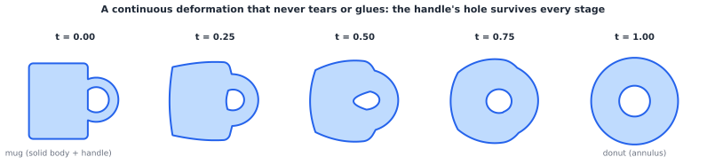
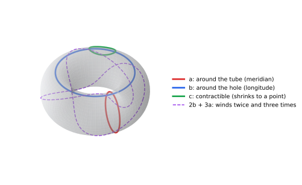
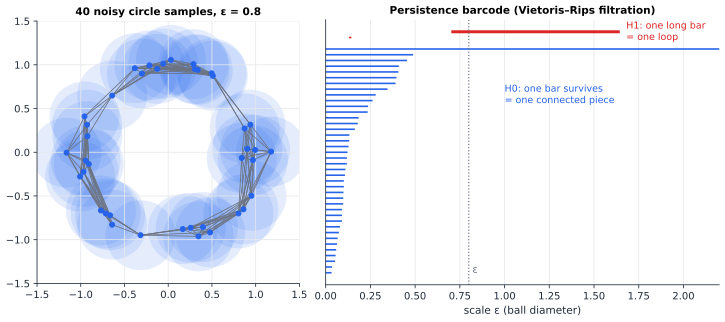

# Chapter 58 — Topology: What Survives When Shapes Bend?

[← Previous](57-number-theory.md) · [Track E](README.md) · [Table of Contents](../../00-front/table-of-contents.md) · [Next →](59-differential-geometry.md)

> **Level 2 · Track E — The Abstract Mathematics Behind Everything**
> **Builds on:** [Ch. 4](../../part-2-calculus/04-differential-calculus.md), [Ch. 18](../../part-5-transforms/18-complex-analysis.md), [Ch. 56](56-abstract-algebra.md), [Ch. 27](../a-algorithms/27-graph-theory.md) · **Leads to:** [Ch. 59](59-differential-geometry.md), [Ch. 60](60-real-analysis.md), [Ch. 62](62-category-theory.md) · **Related:** [Ch. 39](../c-game-theory/39-game-theory-basics.md), [Ch. 55](../d-optimization/55-optimal-transport.md), [Ch. 75](../g-graphics-simulation/75-computational-geometry.md), [Ch. 83](../i-dynamical-systems/83-dynamical-systems.md)
> **Reading time:** ~25 min

## 58.1 The hook

A factory robot has a single rotating joint: a shoulder that can spin all the way round. Its controller needs a **motion planner**, a rule that takes the current angle $a$ and a target angle $b$ and returns a path from one to the other. The engineers add one sensible requirement. The planner should be **continuous**: if you nudge the target slightly, the planned path should change only slightly. Nobody wants a robot that swings left for a target at 179.9° and right for one at 180.1°.

The obvious rule is "take the shorter way round". It is perfect, until the target is directly opposite the start. Then the two ways are equally short and the planner must pick one; just past that point it must suddenly switch to the other. Fine, say the engineers, always turn counter-clockwise. Now a target just *clockwise* of the start is reached by turning almost a full circle, while a target exactly at the start needs no motion at all. Again a jump.

Every rule the team tries breaks somewhere. Two joints, a shoulder and an elbow, make things worse, and a drone's orientation in 3-D space is worse still.

> **Is there any continuous motion planner for a rotating joint, or is a discontinuity unavoidable? And if it is unavoidable, what property of the space of poses forces it?**

The answer has nothing to do with angles, lengths, motors or the particular formula you write. It depends only on the *shape* of the space of poses, in a sense of "shape" so loose that a coffee mug and a doughnut count as the same. That sense of shape is topology.

## 58.2 The big idea

Geometry measures: lengths, angles, curvature. Topology asks what is left when you are allowed to **stretch, bend and squash, but never tear or glue**. A circle and a square are the same; so is a wobbly closed loop. A doughnut and a coffee mug are the same, because the mug's handle *is* the doughnut's hole and the cup part can be squashed into the handle's base.



*A continuous deformation from a mug's silhouette to a donut's. Each stage is a blend of the two shapes' distance functions; the hole through the handle is never created or destroyed, only moved and widened.*

So what *can't* be bent away? Holes. Pieces. Whether a loop can be shrunk to a point. Those are the **topological invariants**, and they are the whole point of the subject: if two spaces differ in an invariant, no amount of clever stretching turns one into the other.

Now think of the robot again. The set of all its poses is a space. One rotating joint gives a circle $S^1$: angles $0°$ and $360°$ are the same pose. Two joints give a pair of angles, each on a circle, which is a **torus**, the surface of a doughnut.



*Configuration space of a two-joint arm. Loop $a$ spins the elbow once, loop $b$ spins the shoulder once, loop $c$ wiggles a little and comes back. Only $c$ can be shrunk to a point while staying on the surface. Any loop is, up to deformation, "$m$ times $b$ plus $n$ times $a$".*

Here is the intuition for the hook. On a circle, a loop that goes once round can't be shrunk to a point without leaving the circle. A continuous motion planner would let you *build* such a shrinking, as §58.3 shows, so it can't exist. The obstacle is a hole in the configuration space, and topology turns "there is a hole" into a theorem.

The same thinking applies to data. A cloud of sensor readings has no edges or surfaces, only points. But if you thicken every point into a small ball and watch which holes appear and disappear as the balls grow, you can measure the shape of the data. That is **topological data analysis**, and it closes the chapter.

## 58.3 The mathematics

### Open sets and continuity

In [Ch. 4 §4.1](../../part-2-calculus/04-differential-calculus.md#41-limits-and-continuity), $f$ is continuous at $x_0$ if for every $\varepsilon>0$ there is a $\delta>0$ with $\lvert x-x_0\rvert<\delta\Rightarrow\lvert f(x)-f(x_0)\rvert<\varepsilon$. Topology rewrites that definition without distances. A set $U\subseteq\mathbb{R}^n$ is **open** if around each of its points there is a small ball still inside $U$. Then, as you can check by unpacking the definitions, $f$ is continuous everywhere exactly when **the preimage of every open set is open**.

That reformulation mentions only open sets, so it can be used on any set where we have *declared* which subsets are open.

> [!definition] Topological space, continuity, homeomorphism
> A **topology** on a set $X$ is a collection of subsets called open sets, containing $\varnothing$ and $X$, and closed under arbitrary unions and finite intersections. A map $f:X\to Y$ between topological spaces is **continuous** if $f^{-1}(V)$ is open for every open $V\subseteq Y$. A **homeomorphism** is a continuous bijection whose inverse is also continuous; $X$ and $Y$ are then **homeomorphic**, written $X\cong Y$.

The inverse must be continuous too. Wrapping the interval $[0,2\pi)$ onto the circle by $t\mapsto(\cos t,\sin t)$ is a continuous bijection, but it is not a homeomorphism: points near $(1,0)$ on the circle come from both ends of the interval, so the inverse tears the circle open. Indeed the two spaces are not homeomorphic, as we are about to prove.

### Connectedness and the intermediate value theorem

> [!definition] Connected
> A space $X$ is **connected** if it cannot be written as the union of two disjoint non-empty open sets.

The real interval $[a,b]$ is connected. (Sketch: if $[a,b]=U\cup V$ with $a\in U$, let $c$ be the supremum of the points $t$ for which all of $[a,t]$ lies in $U$; openness of $U$ and $V$ makes $c$ lie in neither, a contradiction. This is where completeness of $\mathbb{R}$ enters, the subject of [Ch. 60](60-real-analysis.md).)

> [!theorem] Continuous images of connected spaces are connected
> If $f:X\to Y$ is continuous and $X$ is connected, then $f(X)$ is connected.

*Proof.* Suppose $f(X)=U\cup V$ with $U,V$ disjoint, non-empty and open in $f(X)$. Then $f^{-1}(U)$ and $f^{-1}(V)$ are open (by continuity), disjoint, non-empty, and cover $X$. That separates $X$, which is impossible. $\blacksquare$

Apply this to a continuous $f:[a,b]\to\mathbb{R}$. The image is a connected subset of $\mathbb{R}$, and the connected subsets of $\mathbb{R}$ are exactly the intervals. So if $f(a)<0<f(b)$, the value 0 lies in the image: **the intermediate value theorem** is a statement about connectedness. It is the guarantee behind bisection root-finding in [Ch. 22 §22.4](../../part-7-numerical-computational/22-numerical-methods.md#224-bisection-and-newtonraphson-methods).

Connectedness is also a cheap invariant. Remove one point from an open interval and it falls into two pieces; remove any one point from a circle and it stays in one piece. A homeomorphism would carry "interval minus a point" to "circle minus a point", so **an interval and a circle are not homeomorphic**. Similarly, the letter X is not homeomorphic to the letter O (removing the centre of X leaves four pieces).

### Compactness

> [!definition] Compact
> A space is **compact** if every covering of it by open sets has a finite sub-covering. In $\mathbb{R}^n$ (Heine–Borel), the compact sets are exactly the closed and bounded ones.

Compactness is "finiteness in disguise". Its key property has the same one-line proof shape as connectedness: the continuous image of a compact space is compact (pull back an open cover, pick a finite sub-cover, push it forward). Since compact subsets of $\mathbb{R}$ are closed and bounded, a continuous real function on a compact space is bounded and **attains** its maximum and minimum. That is the extreme value theorem, the existence guarantee behind every "minimise the cost over a closed, bounded design region" problem in [Ch. 23](../../part-7-numerical-computational/23-optimization.md). Over the open interval $(0,1)$, $f(x)=1/x$ has no maximum: the open interval is not compact. So $[0,1]\not\cong(0,1)$, even though both are connected.

### Homotopy and the fundamental group

Connectedness counts pieces. To detect holes we need loops. Two continuous maps $f,g:X\to Y$ are **homotopic** if one can be deformed continuously into the other: there is a continuous $H:X\times[0,1]\to Y$ with $H(x,0)=f(x)$ and $H(x,1)=g(x)$. You have seen this idea before. Deforming a contour of integration without crossing a singularity, in [Ch. 18 §18.5](../../part-5-transforms/18-complex-analysis.md#185-cauchys-integral-theorem), is a homotopy, and Cauchy's theorem says the integral cannot tell the two contours apart.

> [!definition] Fundamental group
> Fix a base point $x_0\in X$. The **fundamental group** $\pi_1(X,x_0)$ is the set of loops starting and ending at $x_0$, with two loops identified if they are homotopic through loops based at $x_0$. The product of two loops is "do one, then the other". The identity is the constant loop, and the inverse runs a loop backwards.

The group axioms of [Ch. 56](56-abstract-algebra.md) hold *up to homotopy*: for example, running a loop and then its reverse is not literally the constant loop, but it shrinks to it. A space is **simply connected** if $\pi_1$ is trivial, meaning every loop shrinks to a point. Some answers, stated without proof:

| Space | $\pi_1$ | What a loop "remembers" |
|---|---|---|
| $\mathbb{R}^n$, a disk, a ball | trivial | nothing |
| circle $S^1$ | $\mathbb{Z}$ | how many times it winds round |
| torus $S^1\times S^1$ | $\mathbb{Z}\times\mathbb{Z}$ | windings $(m,n)$ round each circle |
| sphere $S^2$ | trivial | nothing: a rubber band slides off a ball |
| figure-eight | free group on two letters | the word in $a,b,a^{-1},b^{-1}$ it spells; $ab\neq ba$ |
| plane minus a point | $\mathbb{Z}$ | the winding number about the point |

The entry for the circle is the deep one. The integer attached to a loop is its **winding number**. In the complex plane, the winding number of a closed curve $\gamma$ about the origin is $\frac{1}{2\pi j}\oint_\gamma\frac{dz}{z}$, the integral behind the argument principle and the Nyquist stability criterion of [Ch. 18 §18.9](../../part-5-transforms/18-complex-analysis.md#189-applications-to-engineering-analysis). Proving that it is a *complete* invariant, that loops with equal winding numbers are homotopic and loops with different ones are not, uses the lifting of loops on the circle to paths on the real line; we take it as given.

> [!theorem] No continuous motion planner on a circle
> There is no continuous rule $s$ that assigns to each pair of angles $(a,b)\in S^1\times S^1$ a path $s(a,b):[0,1]\to S^1$ from $a$ to $b$, depending continuously on $(a,b)$.

*Proof.* Suppose $s$ existed. Fix a starting pose $a_0$ and define
$H(b,t)=s(a_0,b)(t)$ for $b\in S^1$, $t\in[0,1]$.
By assumption $H$ is continuous. At $t=0$, $H(b,0)=a_0$ for every $b$: the constant map. At $t=1$, $H(b,1)=b$: the identity map of the circle. So $H$ is a homotopy from the constant map to the identity. Now trace the identity map once round the circle: it is the loop of winding number 1. The homotopy $H$ deforms it continuously, through closed loops $b\mapsto H(b,t)$, into a constant loop, which has winding number 0. On the circle the winding number cannot change under such a deformation, even one that moves the base point, because it is an integer that varies continuously. So $1=0$, a contradiction. $\blacksquare$

That answers the hook. A discontinuity is unavoidable for any planner on a single rotating joint, and the reason is the hole in the circle, $\pi_1(S^1)\cong\mathbb{Z}\neq0$. The best you can do is split the configuration pairs into pieces and use a different continuous rule on each. For the circle two pieces suffice: on pairs that are not exactly opposite, take the shorter way round; on opposite pairs, always turn counter-clockwise. Each rule is continuous on its own piece. The minimum number of pieces is a topological invariant of the space, Farber's **topological complexity**, and it grows with the number of independent holes. A two-joint arm on a torus needs three pieces.

> [!mystery] The loop test for spheres
> In two dimensions the sphere is the only closed surface on which every loop shrinks to a point. In 1904 Henri Poincaré asked whether the same is true one dimension up: is every closed, simply connected 3-dimensional space homeomorphic to the 3-sphere? It took a century. Grigori Perelman proved it in 2003 by letting the *geometry* of the space flow like heat, smoothing curvature until the shape revealed itself, and then declined both the Fields Medal and a million-dollar prize. How can a curvature flow prove a purely topological fact? Curvature is the subject of [Ch. 59](59-differential-geometry.md).

### Homology: counting holes with linear algebra

The fundamental group is powerful but hard to compute, and non-abelian groups are awkward to compare. **Homology** trades some information for computability: it counts holes of each dimension with ranks of matrices.

Build a space out of simple pieces: vertices, edges, filled triangles (a **simplicial complex**). Write $C_k$ for the vector space, over $\mathbb{F}_2=\{0,1\}$ to keep signs out of it, spanned by the $k$-dimensional pieces. The **boundary map** $\partial_k:C_k\to C_{k-1}$ sends an edge to the sum of its two end vertices and a triangle to the sum of its three edges. The key identity is

$$
\partial_{k-1}\circ\partial_k=0,
$$

because the boundary of a boundary is empty: each vertex of a triangle appears in exactly two of its edges, and $1+1=0$ in $\mathbb{F}_2$. So every boundary is a **cycle** (an element of $\ker\partial$), and the $k$-th homology counts cycles that are *not* boundaries:

$$
H_k=\ker\partial_k/\operatorname{im}\partial_{k+1},\qquad
\beta_k=\dim H_k=\dim\ker\partial_k-\operatorname{rank}\partial_{k+1}.
$$

This is the quotient construction of [Ch. 56](56-abstract-algebra.md) applied to vector spaces, and the dimensions come from rank–nullity ([Ch. 8 §8.5](../../part-3-linear-algebra/08-matrices-and-linear-systems.md#85-rank)). The **Betti number** $\beta_0$ counts connected pieces, $\beta_1$ counts independent loops that bound nothing, and $\beta_2$ counts enclosed voids.

> [!example] A hollow triangle versus a filled one
> Take vertices $u,v,w$ and edges $uv,vw,wu$. The boundary map $\partial_1$ is a $3\times3$ matrix over $\mathbb{F}_2$ in which every column has two 1s; its columns sum to zero, so its rank is 2. Then $\beta_0=3-2=1$ (one piece), and $\dim\ker\partial_1=3-2=1$. With no triangle filled in, $\operatorname{rank}\partial_2=0$, so $\beta_1=1$: one loop, the hole. Fill in the triangle $uvw$: now $\partial_2$ sends it to $uv+vw+wu$, which is exactly the cycle, so $\operatorname{rank}\partial_2=1$ and $\beta_1=0$. The hole is gone.

For the surfaces we have met, the answers are: circle $(\beta_0,\beta_1)=(1,1)$; sphere $(\beta_0,\beta_1,\beta_2)=(1,0,1)$; torus $(1,2,1)$, one piece, two independent loops $a$ and $b$, and one enclosed void. The alternating sum $\chi=\beta_0-\beta_1+\beta_2$ is the **Euler characteristic**, and a short rank–nullity computation shows it also equals $V-E+F$, counted on *any* triangulation. A cube has $8-12+6=2$, like the sphere; a torus has $0$. That is why Euler's polyhedron formula $V-E+F=2$ holds for every convex polyhedron: they are all homeomorphic to a sphere.

> [!mystery] Why you can't comb a hairy ball
> Because $\chi(S^2)=2\neq0$, every continuous field of tangent arrows on a sphere must vanish somewhere: at any moment there is a point on Earth where the horizontal wind speed is zero, and a smooth "hairy ball" always has a cowlick. The torus, with $\chi=0$, can be combed flat. A cousin of this result, Brouwer's theorem that every continuous map of a disk to itself has a fixed point, is exactly what John Nash needed to prove that every finite game has an equilibrium. How does a statement about shapes guarantee a stable strategy? See [Ch. 39](../c-game-theory/39-game-theory-basics.md).

### From shapes to data: persistent homology

A point cloud has $\beta_0=$ number of points and $\beta_1=0$: on its own it has no interesting homology. The fix is to look at it **at every scale**. For each $\varepsilon\ge0$, the **Vietoris–Rips complex** $R_\varepsilon$ has a vertex per data point, an edge between any two points closer than $\varepsilon$, and a filled triangle on any three points that are pairwise closer than $\varepsilon$. As $\varepsilon$ grows, simplices are only ever added, so the complexes are nested: $R_{\varepsilon}\subseteq R_{\varepsilon'}$ for $\varepsilon<\varepsilon'$. A hole is **born** at the scale where its loop closes and **dies** when it gets filled in. Plotting every hole as a bar from birth to death gives a **persistence barcode**.



*Left: 40 noisy samples of the unit circle, with edges drawn at scale $\varepsilon=0.8$. Right: the barcode. Many short $H_0$ bars die quickly as nearby points merge; one infinite bar survives. In $H_1$ a single long bar, born near $\varepsilon\approx0.70$ when the ring closes and dying near $1.64$ when triangles fill the disk, says "this data has one loop". A tiny $H_1$ bar near 0.13 is noise.*

The principle is that **long bars are features and short bars are noise**. It is used on protein structures, on the activity of neurons that encode an animal's head direction (the data really does lie on a circle), on sensor networks checking for coverage holes, and on time series embedded with delays to detect periodic behaviour in a dynamical system ([Ch. 83](../i-dynamical-systems/83-dynamical-systems.md)).

## 58.4 The algorithm

Computing a barcode is linear algebra over $\mathbb{F}_2$, done in a clever order.

1. **Build the filtration.** List every simplex with the scale at which it appears: points at 0, an edge at its length, a triangle at its longest edge. Sort by scale, breaking ties so that every face comes before the simplices it bounds.
2. **Form the boundary matrix** $\mathbf{D}$, with one column per simplex in that order. Column $k$ holds the faces of simplex $k$ (two vertices for an edge, three edges for a triangle).
3. **Reduce the columns left to right.** Let $\operatorname{low}(k)$ be the row of the lowest 1 in column $k$. While some earlier column has the same $\operatorname{low}$, add it to column $k$ (mod 2). Adding *earlier* columns only is what keeps the answer faithful to the order of the filtration.
4. **Read off the bars.** If reduced column $k$ is non-zero with $\operatorname{low}(k)=i$, simplex $i$ created a hole that simplex $k$ killed: a bar from the scale of $i$ to the scale of $k$, in dimension $\dim(i)$. A simplex that creates a hole and is never paired gives an infinite bar.

```text
for k in 0 .. N-1:                       # columns in filtration order
    while column k is non-zero and low(k) == low(j) for some j < k:
        column k += column j  (mod 2)
    if column k is non-zero:
        record bar  [ scale(low(k)),  scale(k) )
```

Why does this work? Step 3 is Gaussian elimination restricted to adding columns from the left, so at every stage $\varepsilon$ the reduced matrix still has the same rank structure as the boundary maps of $R_\varepsilon$. A zero column means the new simplex closed a cycle, so it gives birth to a homology class. A non-zero column means it filled one in, and the lowest-1 rule pairs it with the *youngest* class it kills, the "elder rule" that makes barcodes well defined.

**Cost and failure cases.** The reduction is cubic in the number of simplices in the worst case, and the number of simplices explodes: $n$ points give up to $\binom{n}{3}$ triangles, about $1.7\times10^{8}$ for $n=1000$. Practical software (Ripser, GUDHI) caps the maximum scale, computes cohomology instead (which reduces far fewer columns), and never stores the full matrix. Rips complexes are also sensitive to **outliers**: a single stray point can split a long bar in two, which is why robust variants weight points by local density. And barcodes depend on the metric you choose; Euclidean distance on raw features with different units can create holes that are artefacts of scaling.

## 58.5 The experiment

The script samples a noisy circle, builds the full Rips filtration up to triangles, runs the column reduction above, and plots the bars longer than 0.02.

```python
import numpy as np
import matplotlib.pyplot as plt
from itertools import combinations

n, noise, seed = 40, 0.08, 7   # knobs: number of points, noise level, random seed
two_loops = False               # knob: True samples a figure-eight instead of a circle
rng = np.random.default_rng(seed)
t = rng.uniform(0, 2 * np.pi, n)
P = np.c_[np.cos(t), np.sin(t)]
if two_loops:
    P[n // 2:, 0] += 2.2                  # second circle, touching the first
P += rng.normal(0, noise, P.shape)
D = np.linalg.norm(P[:, None] - P[None], axis=2)

# Vietoris-Rips filtration up to triangles: each simplex enters at its longest edge
S = [(0.0, (i,)) for i in range(n)]
S += [(D[i, j], (i, j)) for i, j in combinations(range(n), 2)]
S += [(max(D[i, j], D[i, k], D[j, k]), (i, j, k)) for i, j, k in combinations(range(n), 3)]
S.sort(key=lambda s: (s[0], len(s[1])))
index = {s: k for k, (_, s) in enumerate(S)}

cols, pivot, bars = [], {}, []
for k, (val, s) in enumerate(S):            # column reduction over GF(2)
    col = {index[f] for f in combinations(s, len(s) - 1)} if len(s) > 1 else set()
    while col and max(col) in pivot:
        col ^= cols[pivot[max(col)]]
    cols.append(col)
    if col:
        pivot[max(col)] = k
        birth = S[max(col)][0]
        bars.append((len(s) - 2, birth, val))   # dimension, birth, death

for dim in (0, 1):
    life = sorted((d - b for k, b, d in bars if k == dim), reverse=True)
    print(f"H{dim}: longest finite bars", np.round(life[:4], 3))
for k, b, d in bars:
    if d - b > 0.02:
        plt.plot([b, d], [k + rng.uniform(-0.3, 0.3)] * 2, color="C%d" % k, lw=2)
plt.yticks([0, 1], ["H0", "H1"]); plt.xlabel("scale"); plt.show()
```

With the settings shown, the longest finite $H_1$ bar has length 0.942 and the next one 0.014: one loop, unmistakably. (The infinite $H_0$ bar is not listed, since it never dies.) Things to try:

- Set `two_loops = True`. Two $H_1$ bars appear, but the second is short (0.32) because each circle has only 20 points. Raise `n` to 80 and both bars are long (about 1.09 and 0.92). Sampling density, not just shape, controls what you can see.
- Raise `noise` to 0.3. The $H_1$ bar shrinks to about 0.67 and a second bar of 0.23 appears. Where would you draw the line between feature and noise? Try several seeds before you decide.
- Replace the circle with points on a line segment (`P = np.c_[t, 0 * t]`). Every $H_1$ bar should vanish. Then sample a filled disk; why does it look like the segment, not like the circle?

The winding number of §58.3 is easy to explore by eye. The limaçon below winds twice round points inside its small loop, once round points in the big loop only, and not at all round points outside.

```desmos-graph
left=-1.2; right=2; bottom=-1.3; top=1.3
---
r=0.5+\cos(\theta)|blue
(0.25,0)|label:winds 2
(1,0)|label:winds 1
(-0.6,0)|label:winds 0
```

*$r=0.5+\cos\theta$. Change 0.5 to 1.2 and the inner loop disappears (every inside point now has winding number 1); change it to 0 and the curve becomes a circle traced twice. Count the winding numbers in each case by tracing the curve with a finger.*

## 58.6 The challenge

No answers are given.

1. **Intuition.** Classify the capital letters A to Z (in a plain sans-serif font, drawn as curves of zero thickness) up to homeomorphism. Which invariant separates the classes you cannot tell apart by counting holes? (Hint: remove a point.)
2. **Derivation.** Prove that every continuous map $f:[0,1]\to[0,1]$ has a fixed point, using only the intermediate value theorem. Then explain why the same argument says nothing about continuous maps of a circle to itself, and give a fixed-point-free example.
3. **Implementation.** Triangulate a torus as an $m\times m$ grid of squares, each cut into two triangles, with opposite edges identified. Build $\partial_1$ and $\partial_2$ over $\mathbb{F}_2$, compute their ranks, and verify $(\beta_0,\beta_1,\beta_2)=(1,2,1)$ and $V-E+F=0$. Repeat with the identification that makes a Klein bottle; what changes, and what changes if you work over $\mathbb{R}$ instead of $\mathbb{F}_2$?
4. **Open investigation.** Record a periodic signal $x(t)$ (a sine wave, a heartbeat trace, a vowel sound) and embed it as points $(x(t),x(t+\tau))$ or in 3-D with a second delay. Compute barcodes as you vary $\tau$ and add noise. How well does the length of the longest $H_1$ bar work as a "periodicity score", and how does it compare with an autocorrelation peak ([Ch. 21](../../part-6-probability-statistics/21-random-processes.md))?

## 58.7 Loose threads

The hook asked whether a robot joint can have a continuous motion planner. It cannot. Any such planner would continuously deform the loop that goes once round the circle into a point, and the winding number, the generator of $\pi_1(S^1)\cong\mathbb{Z}$, forbids that. The discontinuity is not a defect of any formula; it is forced by the hole in the configuration space. The same tools that prove this (connectedness, compactness, loops and homology) also gave the intermediate and extreme value theorems their real meaning, and, turned towards data, let us read the shape of a point cloud from its barcode.

What we did not tell you:

- **Why topology needs geometry to finish its biggest proofs.** The first mystery points to [Ch. 59](59-differential-geometry.md).
- **Why fixed points guarantee equilibria.** The second mystery points to [Ch. 39](../c-game-theory/39-game-theory-basics.md).
- **What all these invariants have in common.** Every invariant in this chapter is a rule that turns spaces into algebraic objects (numbers, groups, vector spaces) and continuous maps into homomorphisms, compatibly with composition. That pattern is called a **functor**, and it is the founding example of [Ch. 62](62-category-theory.md).

> [!mystery] How far apart are two barcodes?
> If you jiggle the data a little, does the barcode only jiggle a little? It does: the **stability theorem** of Cohen-Steiner, Edelsbrunner and Harer (2007) bounds the distance between barcodes by the size of the perturbation. But "distance between barcodes" needs a definition: it is a matching problem, pairing bars of one barcode with bars of the other at least cost, with unmatched bars sent to zero length. That is optimal transport in disguise, and the Wasserstein distance it produces is the subject of [Ch. 55](../d-optimization/55-optimal-transport.md).

## Further reading

- J. Stillwell, *Classical Topology and Combinatorial Group Theory*, 2nd ed., Springer, 1993. Surfaces, the fundamental group and its computation, with history.
- J. R. Munkres, *Topology*, 2nd ed., Prentice Hall, 2000. The standard first course in point-set and algebraic topology.
- D. S. Richeson, *Euler's Gem: The Polyhedron Formula and the Birth of Topology*, Princeton University Press, 2008. A popular account from $V-E+F=2$ to the Poincaré conjecture.
- H. Edelsbrunner and J. Harer, *Computational Topology: An Introduction*, American Mathematical Society, 2010. Persistence and the reduction algorithm, from its inventors.
- M. Farber, *Invitation to Topological Robotics*, European Mathematical Society, 2008. Configuration spaces and topological complexity of motion planning.
