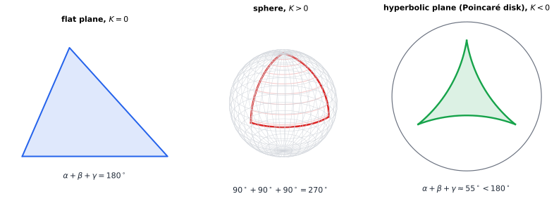

# Chapter 59 — Differential Geometry: Mathematics on Curved Worlds

[← Previous](58-topology.md) · [Track E](README.md) · [Table of Contents](../../00-front/table-of-contents.md) · [Next →](60-real-analysis.md)

> **Level 2 · Track E — The Abstract Mathematics Behind Everything**
> **Builds on:** [Ch. 6](../../part-2-calculus/06-multivariable-calculus.md), [Ch. 7](../../part-2-calculus/07-vector-calculus.md), [Ch. 10](../../part-3-linear-algebra/10-eigenvalues-and-eigenvectors.md) · **Leads to:** [Ch. 93](../j-frontier/93-tensor-mathematics.md), [Ch. 92](../j-frontier/92-mathematical-physics.md), [Ch. 70](../g-graphics-simulation/70-quaternions.md) · **Related:** [Ch. 58](58-topology.md), [Ch. 55](../d-optimization/55-optimal-transport.md), [Ch. 69](../g-graphics-simulation/69-mathematics-of-3d-worlds.md)
> **Reading time:** ~30 min

## 59.1 The hook

New York and Madrid sit at almost the same latitude: 40.7° N and 40.4° N. Draw them on a classroom wall map and the obvious route is a straight line due east across the Atlantic, about 5,940 km along the 40th parallel.

No airline flies it. A flight leaving JFK for Madrid sets off on a heading of about 66°, well north of east. It climbs to about 46° N, passes south of Newfoundland, and then curves back down into Spain. That route is 5,770 km, roughly 170 km shorter than "straight east". On the wall map it looks like a detour. On a globe it is the straightest path there is.

So which line is straight? Your eyes, trained on flat paper, say the parallel. The globe says the arc that bulges toward the pole. The disagreement is not a quirk of map projections. It is a fact about the surface itself, and it can be detected without ever leaving it.

In the 1820s Carl Friedrich Gauss ran a land survey of the Kingdom of Hanover. As part of it he measured the angles of a huge triangle whose corners were three mountain tops, the Hohenhagen, the Brocken and the Inselsberg, with sides of roughly 69, 85 and 107 km. In a flat world the angles of every triangle add up to 180°. Gauss's added up to 180° plus about 15 seconds of arc. That is exactly what a triangle of that size on a sphere the size of the Earth should give. (Gauss probably also wondered whether *space itself* might be curved. His triangle was too small to tell, and the question waited a century for Einstein.)

Now push the idea to its extreme. Start at the North Pole. Walk due south to the equator. Turn left 90° and walk a quarter of the way around the equator. Turn left 90° again and walk north. You arrive back at the pole, having walked a triangle with **three right angles**: an angle sum of 270°.

Here is the question this chapter is built around:

> **How can a creature that lives *inside* a surface, and can only measure lengths and angles on it, discover that its world is curved, and by how much?**

The answer leads to manifolds, tangent spaces, geodesics and curvature: the language in which robots plan motions on curved configuration spaces, graphics engines measure distance across a mesh, and GPS satellites correct their clocks for the curvature of spacetime.

## 59.2 The big idea

Two ideas carry the whole subject.

**Idea 1: curved worlds are flat up close.** The Earth looks flat from your garden. Any smooth surface, looked at under a strong enough magnifier, looks like a piece of plane. A **manifold** is anything with this property: a space that, near each point, looks like ordinary $\mathbb{R}^n$. The flat approximation at a point $p$ is the **tangent space** $T_p M$. Calculus happens there: velocities, gradients and linear approximations all live in tangent spaces, exactly as in [§4.8](../../part-2-calculus/04-differential-calculus.md#48-linearization).

The catch is that the flat pictures don't glue together into one flat picture. An atlas of the Earth needs many pages, and where two pages overlap they disagree about distances. That disagreement *is* the curvature.

**Idea 2: "straight" means "not turning, as seen from inside".** An ant walking on a globe can't see that its path bends in three-dimensional space. All it can tell is whether it is steering left or right. A path along which the ant never steers is a **geodesic**. On a sphere the geodesics are the great circles: the equator and every circle cut by a plane through the centre. A latitude line other than the equator is *not* a geodesic. An ant walking along the 40th parallel has to keep steering slightly toward the pole, as you would when driving around a large roundabout.


*Two routes from A to B on the same latitude. The great circle (blue) is the geodesic and is shorter. The latitude line (red) keeps a constant compass heading but is always turning, as seen from inside the surface. The green plane is the tangent space at A, where the geodesic's initial velocity lives.*

How does an insider measure curvature? Through **triangles and circles**. Draw a triangle whose sides are geodesics and add up its angles:

- on a flat plane the sum is exactly $180°$;
- on a sphere it is *more* than $180°$, and the excess grows with the triangle's area;
- on a saddle-shaped surface it is *less* than $180°$.



*Angle sums reveal curvature. Flat: exactly 180°. Sphere: the octant triangle has three right angles. Hyperbolic plane, drawn in the Poincaré disk where geodesics are circular arcs meeting the boundary at right angles: this triangle's angles add up to only about 55°.*

**An analogy: a pizza slice.** A flat slice of pizza can bend in one direction without stretching, which is why folding it lengthwise stiffens it: once it curves one way, it cannot also droop the other way without tearing. That rule, that the *product* of the two bendings is fixed by the dough's intrinsic geometry, is Gauss's great theorem in disguise. A flat sheet has curvature zero, so if it bends one way it must stay straight the other way. Curvature in this sense is something the dough itself knows, not something about how it is held in space.

## 59.3 The mathematics

### Manifolds, charts and tangent spaces

> [!definition] Smooth manifold (informal)
> An $n$-dimensional **manifold** $M$ is a space covered by **charts**: one-to-one maps $\varphi:U\to\mathbb{R}^n$ from open pieces $U\subset M$ onto open sets of $\mathbb{R}^n$. Wherever two charts overlap, the **transition map** $\psi\circ\varphi^{-1}$ must be smooth (infinitely differentiable). The collection of charts is an **atlas**.

Examples you already know:

- The sphere $S^2$, charted by latitude and longitude (which fail at the poles, so you need at least two charts).
- The torus $T^2$: the configuration space of a robot arm with two revolute joints, one angle per joint, each angle wrapping around.
- The rotation group $SO(3)$: every possible orientation of a drone or a camera. It is a 3-dimensional manifold, but not a sphere, and no single chart covers it without singularities. Gimbal lock is a chart failing. That story belongs to [Ch. 70](../g-graphics-simulation/70-quaternions.md).

The **tangent space** $T_pM$ is the set of velocities $\dot\gamma(0)$ of smooth curves $\gamma$ through $\gamma(0)=p$. For a surface sitting in $\mathbb{R}^3$ it is the familiar tangent plane. For the unit sphere it is $T_pS^2=\{\mathbf{v}:\mathbf{v}\cdot\mathbf{p}=0\}$, the vectors perpendicular to the radius. It is a vector space of dimension $n$ in the sense of [Ch. 9](../../part-3-linear-algebra/09-vector-spaces-and-linear-transformations.md). The derivative of a map between manifolds is a linear map between tangent spaces. In coordinates it is the Jacobian of [§6.6](../../part-2-calculus/06-multivariable-calculus.md#66-jacobian-matrices).

### The metric: measuring from inside

To measure lengths we need an inner product on every tangent space, varying smoothly from point to point. In a chart with coordinates $x^1,\dots,x^n$ it is a symmetric positive-definite matrix $g_{ij}(x)$, the **metric tensor**:

$$
ds^2=\sum_{i,j}g_{ij}(x)\,dx^i\,dx^j,
\qquad
L[\gamma]=\int_a^b\sqrt{\sum_{i,j}g_{ij}\big(x(t)\big)\,\dot x^i\dot x^j}\;dt .
$$

A manifold with a metric is a **Riemannian manifold**. On a sphere of radius $R$ in colatitude $\theta$ (measured from the north pole) and longitude $\phi$, which is the spherical system of [§6.9](../../part-2-calculus/06-multivariable-calculus.md#69-cylindrical-and-spherical-coordinates) with the radius frozen:

$$
ds^2=R^2\left(d\theta^2+\sin^2\theta\,d\phi^2\right),\qquad
g=\begin{pmatrix}R^2&0\\0&R^2\sin^2\theta\end{pmatrix}.
$$

The factor $\sin^2\theta$ says that a degree of longitude is long at the equator and shrinks to nothing at the poles. That is all the sphere's geometry, written in one matrix.

**Why "tensor"?** If you change coordinates $x\to y$ with Jacobian $J^i_{\ a}=\partial x^i/\partial y^a$, the metric must transform as $\tilde g_{ab}=\sum_{i,j}J^i_{\ a}J^j_{\ b}\,g_{ij}$, so that lengths come out the same in every chart. A **tensor** is any array of numbers that transforms by such a rule, one Jacobian factor per index. The rule guarantees that the geometric object, not its coordinate shadow, is what you are computing with. [Ch. 93](../j-frontier/93-tensor-mathematics.md) builds the full algebra.

### Geodesics

A geodesic is a curve that is locally the shortest path. Minimizing length directly is awkward because of the square root, and because length doesn't care how fast you traverse the curve. The standard trick is to minimize the **energy** $E[\gamma]=\tfrac12\int g_{ij}\dot x^i\dot x^j\,dt$ instead. Its minimizers are the shortest curves, traversed at constant speed.

> [!theorem] Geodesic equation
> A curve $x(t)$ is a critical point of the energy if and only if
> $$
> \ddot x^k+\sum_{i,j}\Gamma^k_{ij}\,\dot x^i\dot x^j=0,
> \qquad
> \Gamma^k_{ij}=\tfrac12\sum_{l}g^{kl}\left(\partial_i g_{jl}+\partial_j g_{il}-\partial_l g_{ij}\right),
> $$
> where $g^{kl}$ is the inverse matrix of $g_{kl}$. The $\Gamma^k_{ij}$ are the **Christoffel symbols**.

The equation says "acceleration, as seen from inside, is zero". The $\Gamma$ terms are the corrections needed because the coordinate grid itself bends and stretches. The general derivation is the Euler–Lagrange equation applied to $\tfrac12 g_{ij}\dot x^i\dot x^j$. Here it is done explicitly for the sphere, where it answers the hook.

**Derivation on the sphere.** The Lagrangian is $\mathcal{L}=\tfrac12R^2(\dot\theta^2+\sin^2\theta\,\dot\phi^2)$. The Euler–Lagrange equation $\frac{d}{dt}\frac{\partial\mathcal L}{\partial\dot q}=\frac{\partial\mathcal L}{\partial q}$ for each coordinate gives:

$$
\begin{aligned}
\theta:&\quad R^2\ddot\theta=R^2\sin\theta\cos\theta\,\dot\phi^2
&&\Longrightarrow\quad \ddot\theta-\sin\theta\cos\theta\,\dot\phi^2=0,\\
\phi:&\quad \frac{d}{dt}\left(R^2\sin^2\theta\,\dot\phi\right)=0
&&\Longrightarrow\quad \sin^2\theta\,\dot\phi=\text{const}.
\end{aligned}
$$

Reading off the Christoffel symbols: $\Gamma^\theta_{\phi\phi}=-\sin\theta\cos\theta$ and $\Gamma^\phi_{\theta\phi}=\Gamma^\phi_{\phi\theta}=\cot\theta$, all others zero.

> [!theorem] Which circles of latitude are geodesics
> The circle of colatitude $\theta_0$, traversed at constant speed, is a geodesic of the sphere if and only if $\theta_0=\pi/2$, the equator.

*Proof.* Put $\theta(t)=\theta_0$ and $\phi(t)=\omega t$ with $\omega\neq0$. The $\phi$ equation holds, since $\sin^2\theta_0\,\omega$ is constant. In the $\theta$ equation $\ddot\theta=0$, so it reduces to $\sin\theta_0\cos\theta_0\,\omega^2=0$. With $0<\theta_0<\pi$ we have $\sin\theta_0\neq0$, so the equation forces $\cos\theta_0=0$, which means $\theta_0=\pi/2$. ∎

The leftover term $\sin\theta_0\cos\theta_0\,\omega^2$ is exactly the steering an ant on the 40th parallel must apply. Rotations of the sphere carry geodesics to geodesics, and every great circle is a rotated equator. So every great circle is a geodesic, and since a geodesic is fixed by its starting point and direction, there are no others.

The conserved quantity $\sin^2\theta\,\dot\phi$ is **Clairaut's relation**. For a unit-speed path it says $\sin\theta\,\sin a=\text{const}$, where $a$ is the compass heading measured from north. Leaving New York (colatitude $49.29°$) on heading $65.66°$, the path is heading due east ($a=90°$) at the colatitude where $\sin\theta=\sin 49.29°\,\sin 65.66°=0.6905$, which is $\theta=43.68°$, or latitude $46.3°$ N. That is the northernmost point of the flight in the hook.

### Curvature from circles

Here is the cleanest way for an insider to measure curvature. Stand at a point, walk out a distance $r$ along geodesics in every direction, and measure the circumference $C(r)$ of the circle you trace out.

On a sphere of radius $R$, centre the circle at the north pole. Walking a geodesic distance $r$ takes you to colatitude $\theta=r/R$. That circle of latitude has Euclidean radius $R\sin(r/R)$, so

$$
C(r)=2\pi R\sin\frac{r}{R}=2\pi r\left(1-\frac{r^2}{6R^2}+O(r^4)\right).
$$

The circle is *short*: less than $2\pi r$. The relative shortfall, at leading order, is $r^2/(6R^2)$. Turn this into a definition:

> [!definition] Gaussian curvature (Bertrand–Diguet–Puiseux)
> $$
> K(p)=\lim_{r\to0}\frac{3}{\pi}\,\frac{2\pi r-C(r)}{r^3}.
> $$

For the sphere, $2\pi r-C(r)\approx \pi r^3/(3R^2)$, so $K=1/R^2$. A flat plane has $K=0$. On the hyperbolic plane circles are *long*: $C(r)=2\pi\sinh r$ for $K=-1$. For the Earth, a circle of geodesic radius 1,000 km has circumference about 25.8 km less than $2\pi\times1000$ km, and a careful enough surveyor could measure that.

Everything in this definition is measured from inside the surface. That gives the punchline of Gauss's career:

> [!theorem] Theorema Egregium (Gauss, 1827)
> For a surface in $\mathbb{R}^3$, the Gaussian curvature equals the product of the two principal curvatures, $K=\kappa_1\kappa_2$, which describe how the surface bends in space. Yet $K$ depends only on the metric $g_{ij}$ and its derivatives. It is unchanged by any bending of the surface that preserves lengths.

This is why no flat map of the Earth can preserve all distances: the sphere has $K=1/R^2$, paper has $K=0$, and a distance-preserving map would have to preserve $K$. It is also the pizza rule: a flat slice has $K=\kappa_1\kappa_2=0$, so if you force $\kappa_1\neq0$ by folding it, then $\kappa_2=0$ and the tip can't droop.

> [!mystery] How can the ant compute $\kappa_1\kappa_2$ without seeing the third dimension?
> Each principal curvature on its own depends on how the surface sits in space: a flat sheet and a rolled-up cylinder have different $\kappa_1$ but the same metric. Yet their product can be computed from $g_{ij}$ alone. Gauss called this "remarkable", and the proof he gave is a page of brute calculation that hides the reason. The reason is the **Riemann curvature tensor**, built from derivatives of the Christoffel symbols. It measures how a vector fails to come back to itself when carried around a tiny loop. That tensor, and why it only exists because of the transformation law above, is the subject of [Ch. 93](../j-frontier/93-tensor-mathematics.md).

### Triangles: Girard's theorem

Now for the angle sums. On the sphere the result can be proved with nothing more than areas.

> [!theorem] Girard's theorem
> A geodesic triangle on a sphere of radius $R$ with angles $\alpha,\beta,\gamma$ and area $T$ satisfies
> $$
> \alpha+\beta+\gamma=\pi+\frac{T}{R^2}=\pi+K\,T.
> $$

*Proof.* Two great circles meeting at angle $\alpha$ cut the sphere into four **lunes** (orange-segment shapes). The lune with angle $\alpha$ takes the fraction $\alpha/(2\pi)$ of the sphere's area, so its area is $\frac{\alpha}{2\pi}\cdot4\pi R^2=2\alpha R^2$.

Extend the three sides of the triangle to full great circles. At vertex $A$ they bound a lune containing the triangle, and its antipodal twin, which contains the antipodal triangle. Together the two have area $4\alpha R^2$. Do the same at $B$ and $C$. These six lunes cover the whole sphere. Every point is covered exactly once, except points of the triangle and of its antipodal copy, which are each covered three times. So the six lunes overcount the sphere by $2T+2T$:

$$
4\alpha R^2+4\beta R^2+4\gamma R^2=4\pi R^2+4T .
$$

Divide by $4R^2$. ∎

Check: the octant triangle of the hook has area $\tfrac18\cdot4\pi R^2=\tfrac{\pi}{2}R^2$, so its angle sum is $\pi+\pi/2=3\pi/2=270°$. Gauss's mountain triangle has area about 2,930 km². Dividing by $R^2=6371^2$ km² gives an excess of $7.2\times10^{-5}$ rad, which is 14.9″.

For a general surface where $K$ varies, the same statement holds with $KT$ replaced by $\iint_T K\,dA$. This is the local **Gauss–Bonnet theorem**. Triangles on saddles, where $K<0$, have angle deficits.

> [!mystery] Curvature that counts holes
> Apply Gauss–Bonnet to a whole closed surface, triangulated into geodesic triangles, and something strange falls out. The total curvature $\iint_M K\,dA$ of *any* surface shaped like a sphere (a potato, a pear, a dented ball) is exactly $4\pi$, and for any doughnut it is exactly $0$. A number built from local bending comes out as a topological invariant, $2\pi$ times the Euler characteristic from [Ch. 58](58-topology.md). Why should integrating geometry produce topology? The bookkeeping uses $V-E+F$, but the reason runs much deeper. Its higher-dimensional heir, the Chern–Gauss–Bonnet theorem, and its cousins the Chern numbers of gauge fields, are waiting in [Ch. 92](../j-frontier/92-mathematical-physics.md).

### Differential forms in one paragraph

Vector calculus has four "fundamental theorems": the ordinary one, Green's, Stokes' and the divergence theorem ([§7.9](../../part-2-calculus/07-vector-calculus.md#79-greens-theorem)–[§7.11](../../part-2-calculus/07-vector-calculus.md#711-divergence-theorem)). On a manifold they become one. A **$k$-form** is a machine that eats $k$ tangent vectors and returns a number, linearly and antisymmetrically. A 1-form such as $df$ eats a velocity and returns a rate of change. A 2-form such as $dx\wedge dy$ eats two vectors and returns the signed area of the parallelogram they span. The **exterior derivative** $d$ turns $k$-forms into $(k+1)$-forms, and $d(d\omega)=0$ packages both "curl of a gradient is zero" and "divergence of a curl is zero". Then, for any oriented $k$-manifold $M$ with boundary $\partial M$ and any $(k-1)$-form $\omega$:

$$
\int_M d\omega=\int_{\partial M}\omega .
$$

This single line is the generalized Stokes theorem. Forms need no metric at all, which is why physicists write Maxwell's equations as $dF=0$ and $d{\star}F=J$: the same equations in every coordinate system, flat or curved.

## 59.4 The algorithm

**Shooting a geodesic.** To fly a geodesic from a starting point in a given direction, integrate the geodesic equation as a first-order system in $(\theta,\phi,\dot\theta,\dot\phi)$. Fourth-order Runge–Kutta ([§22.9](../../part-7-numerical-computational/22-numerical-methods.md#229-numerical-solution-of-odes)) is ideal.

```python
import numpy as np
R = 6371.0                                   # Earth radius, km

def rhs(s):
    th, ph, dth, dph = s                     # colatitude, longitude, and their rates
    return np.array([dth, dph,
                     np.sin(th) * np.cos(th) * dph**2,           # -Gamma^th_phph dph^2
                     -2 * np.cos(th) / np.sin(th) * dth * dph])  # -2 Gamma^ph_thph

def rk4(s, h, n):
    for _ in range(n):
        k1 = rhs(s); k2 = rhs(s + h/2*k1); k3 = rhs(s + h/2*k2); k4 = rhs(s + h*k3)
        s = s + h/6*(k1 + 2*k2 + 2*k3 + k4)
    return s

lat0, lon0, heading = 40.71, -74.01, 65.66   # New York, compass heading (deg)
th0, ph0, a = np.radians(90 - lat0), np.radians(lon0), np.radians(heading)
s0 = np.array([th0, ph0, -np.cos(a), np.sin(a) / np.sin(th0)])   # unit speed
L = 5768.6 / R                               # arc length to fly, radians
s = rk4(s0, L / 2000, 2000)
print("arrive at lat %.2f, lon %.2f" % (90 - np.degrees(s[0]), np.degrees(s[1])))
print("speed^2 drift:", s[2]**2 + np.sin(s[0])**2 * s[3]**2 - 1)
```

It lands at 40.42° N, 3.70° W, which is Madrid. The squared speed $\dot\theta^2+\sin^2\theta\,\dot\phi^2$ stays equal to 1 to about $10^{-15}$. This is a free accuracy check: geodesics have constant speed, so any drift is integration error.

**Cost and accuracy.** Each step costs $O(n^2)$ Christoffel evaluations on an $n$-manifold ($O(n^3)$ terms in general, fewer when most vanish). RK4 has global error $O(h^4)$.

**Failure cases worth knowing.**

- *Chart singularities.* The term $\cot\theta$ blows up at the poles. That is a defect of the latitude–longitude chart, not of the sphere. A route over the pole needs a second chart, or an integration in the embedding $\mathbb{R}^3$ that projects back onto the sphere. Every serious geometric code switches charts or avoids them.
- *Boundary-value problems.* "Find the geodesic from A to B" is harder than "fly from A in direction $v$". The usual fix is shooting: adjust the initial heading with Newton's method or bisection until the endpoint hits B.
- *Non-uniqueness.* Between antipodal points there are infinitely many shortest geodesics. A geodesic that runs past such a **conjugate point** stops being the shortest path, even though it still satisfies the equation. Satisfying the geodesic equation means "critical", not "minimal".
- *Meshes.* On a triangle mesh in graphics, running Dijkstra's algorithm along edges overestimates geodesic distance by an error that does not shrink as the mesh is refined: up to about 8% on a square grid with diagonal links. Fast-marching and heat-method algorithms work on the faces instead.

## 59.5 The experiment

**Circles tell curvature.** The ratio $C(r)/(2\pi r)$ is plotted below for a unit sphere ($K=1$, blue), the plane (grey) and the hyperbolic plane ($K=-1$, red). Change the sphere's radius by replacing $\sin(x)/x$ with $2\sin(x/2)/x$ (radius 2), and watch the curve flatten. Larger spheres look flatter for longer.

```desmos-graph
left=0; right=3.2; bottom=0; top=2.2
---
y=\frac{\sin(x)}{x}|blue
y=1|grey|dashed
y=\frac{\sinh(x)}{x}|red
(3.14159,0)|label:sphere circle collapses at r = πR
```

*Circumference of a geodesic circle divided by $2\pi r$: below 1 on the sphere, exactly 1 on the plane, above 1 on the hyperbolic plane. The initial curvature of each graph is $-K/6$.*

**Angle sums grow with area.** Run this script, which builds right-angled isosceles triangles at the north pole with legs of geodesic length $d$ on the unit sphere, and compares the angle excess with the area:

```python
import numpy as np

def angle(P, Q, S):
    """Angle at P of the spherical triangle PQS (unit vectors)."""
    t1 = Q - (P @ Q) * P; t2 = S - (P @ S) * P      # tangent directions at P
    return np.arccos(t1 @ t2 / np.linalg.norm(t1) / np.linalg.norm(t2))

def area(A, B, C):                                   # Van Oosterom-Strackee formula
    num = abs(A @ np.cross(B, C))
    den = 1 + A @ B + B @ C + C @ A
    return 2 * np.arctan2(num, den)

for d in [0.01, 0.1, 0.3, 0.6, 1.0, 1.4]:            # leg length, radians
    A = np.array([0, 0, 1.0])
    B = np.array([np.sin(d), 0, np.cos(d)])
    C = np.array([0, np.sin(d), np.cos(d)])
    s = angle(A, B, C) + angle(B, C, A) + angle(C, A, B)
    print(f"d={d:4.2f}  angle sum={np.degrees(s):8.3f} deg   "
          f"excess={s-np.pi:.5f}   area={area(A,B,C):.5f}")
```

The excess column and the area column agree to every printed digit: $180.003°$ at $d=0.01$, $190.9°$ at $d=0.6$, $250.7°$ at $d=1.4$. Things to change:

- Set $d=\pi/2$ to recover the 270° triangle.
- Rotate `B` and `C` so the vertex angle at `A` is $60°$ rather than $90°$.
- Replace the area formula with $d^2/2$, the flat answer, and see when the flat world's prediction becomes visibly wrong.

## 59.6 The challenge

1. **Intuition.** Carry a spear around the 270° octant triangle, always keeping it pointed in the same direction as seen from inside the surface: never rotating it relative to the path's turns. Show by a sketch that it comes back rotated by $90°$. Then guess the rotation after a trip around a small triangle of area $T$ on a sphere of radius $R$.
2. **Derivation.** For the surface of revolution $ds^2=dr^2+f(r)^2\,d\phi^2$, find the Christoffel symbols and the geodesic equations, and show that $K=-f''/f$. Check that $f=\sin r$ gives $K=1$, $f=r$ gives $K=0$, and $f=\sinh r$ gives $K=-1$. Then verify the circle formula $C(r)=2\pi f(r)$ against the Bertrand–Diguet–Puiseux definition.
3. **Implementation.** Turn the RK4 geodesic code into a *boundary-value* solver. Given two airports, use Newton's method on the initial heading and arc length to hit the destination. Compare its answer with the closed-form great-circle distance $R\arccos(\sin\varphi_1\sin\varphi_2+\cos\varphi_1\cos\varphi_2\cos\Delta\lambda)$, where $\varphi$ is latitude and $\lambda$ longitude, and make it survive routes that pass over a pole.
4. **Open investigation.** The Earth is not a sphere but an oblate ellipsoid, with polar radius 21 km less than the equatorial radius. Write the metric of an ellipsoid of revolution and integrate its geodesics. Do they close up after one circuit, the way great circles do? Explore numerically how much a geodesic "precesses" per orbit as a function of its maximum latitude, and look for a pattern.

## 59.7 Loose threads

This chapter measured curvature on surfaces, where one number $K$ says everything. In three or more dimensions curvature depends on *which* 2-dimensional slice you look at, and a single number is no longer enough. That is why the Riemann tensor of the first mystery has $n^2(n^2-1)/12$ independent components: 1 on a surface, 6 in three dimensions, 20 in four.

> [!mystery] Matter tells spacetime how to curve
> A GPS satellite's clock runs fast by about 45 microseconds per day because it sits higher in Earth's gravity. It runs slow by about 7 microseconds per day because of its orbital speed. Uncorrected, the net 38 μs per day would put your position off by about 11 km after a single day. Einstein's explanation is that gravity is not a force at all. Spacetime is a 4-dimensional manifold whose metric is curved by mass, and falling objects simply follow its geodesics. Which curvature does matter control, and why that one? The Einstein field equations, and the Riemannian geometry they need, are waiting in [Ch. 92](../j-frontier/92-mathematical-physics.md).

The spear of challenge problem 1 is the start of **holonomy**: the rotation a vector picks up when it is carried around a loop. It explains the Foucault pendulum and the way a falling cat turns over with zero angular momentum. It is also why interpolating rotations for a robot or a game camera is a geodesic problem on the curved manifold $SO(3)$ ([Ch. 70](../g-graphics-simulation/70-quaternions.md)). Spaces of probability distributions carry geometries too, and moving mass optimally across a space has its own Riemannian structure ([Ch. 55](../d-optimization/55-optimal-transport.md)).

## Further reading

- M. P. do Carmo, *Differential Geometry of Curves and Surfaces*, 2nd ed., Dover, 2016. The classic route through the Theorema Egregium and Gauss–Bonnet, with superb exercises.
- T. Needham, *Visual Differential Geometry and Forms*, Princeton University Press, 2021. Geometry first and algebra second, with hundreds of figures. The best intuition-builder there is.
- J. M. Lee, *Introduction to Riemannian Manifolds*, 2nd ed., Springer, 2018. The modern, rigorous treatment of metrics, connections and curvature.
- K. Crane, *Discrete Differential Geometry: An Applied Introduction*, lecture notes, Carnegie Mellon University. Curvature, geodesics and forms on triangle meshes, as used in graphics. Freely available.
