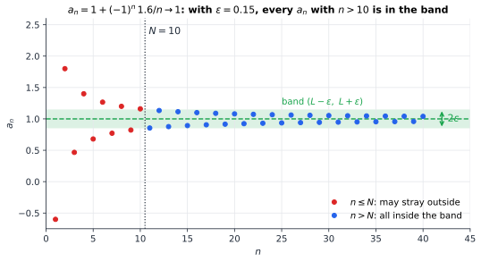
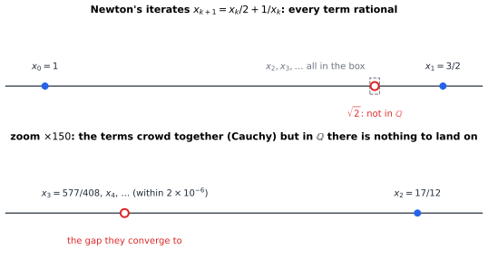

# Chapter 60 — Real Analysis: Making Calculus Rigorous

[← Previous](59-differential-geometry.md) · [Track E](README.md) · [Table of Contents](../../00-front/table-of-contents.md) · [Next →](61-functional-analysis.md)

> **Level 2 · Track E — The Abstract Mathematics Behind Everything**
> **Builds on:** [Ch. 4](../../part-2-calculus/04-differential-calculus.md), [Ch. 5](../../part-2-calculus/05-integral-calculus.md), [Ch. 15](../../part-5-transforms/15-fourier-series.md) · **Leads to:** [Ch. 61](61-functional-analysis.md), [Ch. 97](../j-frontier/97-measure-theory.md), [Ch. 64](../f-logic-foundations/64-set-theory-and-infinity.md) · **Related:** [Ch. 63](../f-logic-foundations/63-think-like-a-mathematician.md), [Ch. 31](../b-probability-information/31-probability-science-of-uncertainty.md), [Ch. 22](../../part-7-numerical-computational/22-numerical-methods.md)
> **Reading time:** ~30 min

## 60.1 The hook

Here is a proof that $1=\tfrac12$.

Start from a series every calculus student meets, the alternating harmonic series:

$$
S=1-\frac12+\frac13-\frac14+\frac15-\frac16+\frac17-\frac18+\cdots=\ln 2\approx0.6931 .
$$

Now write the same terms in a different order: one positive term, then two negative ones.

$$
S=\left(1-\frac12\right)-\frac14+\left(\frac13-\frac16\right)-\frac18+\left(\frac15-\frac1{10}\right)-\frac1{12}+\cdots
$$

Every term of the original series appears exactly once. Nothing has been added or removed. Now do the subtractions in brackets:

$$
S=\frac12-\frac14+\frac16-\frac18+\frac1{10}-\frac1{12}+\cdots=\frac12\left(1-\frac12+\frac13-\frac14+\cdots\right)=\frac12 S .
$$

So $S=\tfrac12S$, and since $S=\ln2\neq0$, dividing by $S$ gives $1=\tfrac12$.

Addition is commutative. Every schoolchild knows that $a+b=b+a$. So where did it go wrong?

This isn't an isolated trick. In the nineteenth century calculus was the most successful tool in science, and it kept producing nonsense whenever it was pushed:

- In 1821 Augustin-Louis Cauchy published a "theorem" that a convergent sum of continuous functions is continuous. Fourier's series had already shown sums of smooth sine waves converging to a square wave with jumps in it ([§15.6](../../part-5-transforms/15-fourier-series.md#156-convergence)). Abel spotted the contradiction in 1826.
- Everyone "knew" that a continuous curve must be smooth at most of its points, apart from a few corners. In 1872 Karl Weierstrass presented a function that is continuous everywhere and differentiable *nowhere*. Charles Hermite wrote that he turned away "with fright and horror from this lamentable plague".
- Engineers and physicists swapped limits, sums, integrals and derivatives freely: $\frac{d}{dt}\int=\int\frac{d}{dt}$, $\lim\int=\int\lim$, $\sum\int=\int\sum$. Usually it worked. Sometimes it gave nonsense, and nobody could say in advance which.

The central question of this chapter:

> **When can you trust the moves of calculus, such as reordering a sum, swapping a limit with an integral, or calling a limit "the answer", and how do you prove it?**

Real analysis is the answer the nineteenth century built. It is the reason the core chapters of this book can say "converges", "continuous" and "integrable" and mean something exact.

## 60.2 The big idea

**Idea 1: a limit is a game against an adversary.** "The sequence $a_n$ approaches $L$" sounds like motion, but there is nothing moving. Analysis turns it into a challenge-and-response game. Your opponent names a tolerance $\varepsilon>0$, as small as they like. You must reply with an index $N$ such that *every* term after $N$ lies within $\varepsilon$ of $L$. If you can always reply, whatever $\varepsilon$ they pick, then $a_n\to L$. The phrase "gets closer and closer" is gone, and so is the paradox.



*The ε–N game. For the tolerance $\varepsilon=0.15$ the reply $N=10$ works: every term after it lies in the band. A smaller ε needs a later N, but there is always one.*

**Idea 2: the real numbers have no holes, and that is an axiom.** The rationals $\mathbb{Q}$ are fine for arithmetic but useless for limits. You can write down a sequence of fractions whose terms crowd ever closer together, yet the point they crowd toward isn't a fraction. Calculus needs a number line where every such crowd has a landing spot. The reals $\mathbb{R}$ are, by definition, that number line. This property, **completeness**, is behind every existence theorem you have used: the intermediate value theorem, the maximum of a continuous function on $[a,b]$, the convergence of bisection ([§22.4](../../part-7-numerical-computational/22-numerical-methods.md#224-bisection-and-newtonraphson-methods)), and the existence of $\int_a^b f$.



*A Cauchy sequence in $\mathbb{Q}$. Newton's iterates for $\sqrt2$ are all fractions. They bunch together ever more tightly, but the point they bunch toward is missing from $\mathbb{Q}$. In $\mathbb{R}$ it is there.*

**Idea 3: "infinitely many" comes in different strengths.** The rearrangement paradox happens because the alternating harmonic series converges only through cancellation. Its positive terms alone add up to $+\infty$ and its negative terms alone to $-\infty$. Reordering lets you spend the two infinite budgets at different rates, and you can steer the total anywhere you like. Series whose absolute values add up to something finite are immune to this. Much of analysis is the art of telling the safe kind of infinity from the dangerous kind.

## 60.3 The mathematics

### Sequences and the completeness axiom

> [!definition] Limit of a sequence
> $a_n\to L$ means: for every $\varepsilon>0$ there is an $N$ such that $\lvert a_n-L\rvert<\varepsilon$ for all $n>N$.
>
> $(a_n)$ is a **Cauchy sequence** if for every $\varepsilon>0$ there is an $N$ such that $\lvert a_m-a_n\rvert<\varepsilon$ for all $m,n>N$.

A Cauchy sequence is one whose terms eventually crowd together. The definition doesn't mention any limit, which is the point: you can check it without knowing where the sequence is going. Every convergent sequence is Cauchy, by the triangle inequality with $\varepsilon/2$. The converse is what can fail.

> [!theorem] A Cauchy sequence in $\mathbb{Q}$ with no limit in $\mathbb{Q}$
> Let $x_0=1$ and $x_{k+1}=\dfrac{x_k}{2}+\dfrac1{x_k}$. Every $x_k$ is rational, the sequence is Cauchy, and it has no rational limit.

*Proof.* By induction each $x_k$ is a positive rational, since the recursion uses only field operations. A direct computation gives

$$
x_{k+1}^2-2=\left(\frac{x_k}{2}+\frac{1}{x_k}\right)^2-2=\left(\frac{x_k}{2}-\frac{1}{x_k}\right)^2=\left(\frac{x_k^2-2}{2x_k}\right)^2\ \ge 0 .
$$

So $x_k^2\ge2$ for $k\ge1$, and then $x_{k+1}-x_k=\dfrac{2-x_k^2}{2x_k}\le0$. From $k=1$ on, the sequence is decreasing and bounded below by $1$. The terms are $\tfrac32,\ \tfrac{17}{12},\ \tfrac{577}{408},\ \tfrac{665857}{470832},\dots$.

Next we show it is Cauchy, using only rational arithmetic. Write $e_k=x_k^2-2\ge0$. For $k\ge1$ we have $x_k\ge1$, so the identity gives $e_{k+1}=e_k^2/(4x_k^2)\le e_k^2/4$. Starting from $e_1=\tfrac14$ this gives $e_k\le 4^{1-2^{k}}$, which tends to zero extremely fast. Since $x_k-x_{k+1}=e_k/(2x_k)\le e_k/2$, the tails satisfy $\lvert x_m-x_n\rvert\le\sum_{k\ge n}e_k/2$ for $m>n$. That sum is as small as we like for large $n$, so the sequence is Cauchy.

Finally, suppose $x_k\to L\in\mathbb{Q}$. Then $L\ge1$, and passing to the limit in the recursion gives $L=L/2+1/L$, so $L^2=2$. But no rational number squares to 2: if $p/q$ in lowest terms did, then $p^2=2q^2$ would make $p$ even, then $q$ even, a contradiction. ∎

The errors are $8.6\times10^{-2}$, $2.5\times10^{-3}$, $2.1\times10^{-6}$ and $1.6\times10^{-12}$. The number of correct digits roughly doubles at each step. This is Newton's quadratic convergence, running in a number system where the answer doesn't exist.

> [!definition] Completeness axiom
> Every non-empty set of real numbers that is bounded above has a **least upper bound** (supremum) in $\mathbb{R}$.

This is the one axiom that separates $\mathbb{R}$ from $\mathbb{Q}$. The set $\{q\in\mathbb{Q}:q^2<2\}$ is bounded above in $\mathbb{Q}$ but has no least rational upper bound. In $\mathbb{R}$ its supremum is $\sqrt2$. Everything else follows from it, beginning with this.

> [!theorem] Monotone convergence theorem
> A sequence of reals that is increasing and bounded above converges, to its supremum.

*Proof.* Let $s=\sup_n a_n$, which exists by completeness. Given $\varepsilon>0$, the number $s-\varepsilon$ is not an upper bound, so some $a_N>s-\varepsilon$. Because the sequence is increasing, $s-\varepsilon<a_N\le a_n\le s$ for every $n>N$, and so $\lvert a_n-s\rvert<\varepsilon$. ∎

Two more consequences, stated without proof:

- **Bolzano–Weierstrass:** every bounded sequence of reals has a convergent subsequence.
- **Cauchy criterion:** in $\mathbb{R}$, a sequence converges if and only if it is Cauchy.

From these, the familiar theorems of calculus follow: the intermediate value theorem, the extreme value theorem, and the integrability of continuous functions. Each is an "existence" statement, and each one fails over $\mathbb{Q}$. For example, $f(x)=x^2-2$ changes sign on $[1,2]$ but has no rational root.

### Series: why the hook went wrong

A series $\sum a_n$ converges if its partial sums do. It converges **absolutely** if $\sum\lvert a_n\rvert<\infty$, and **conditionally** if it converges but not absolutely.

> [!theorem] Rearrangements (Dirichlet; Riemann)
> If $\sum a_n$ converges absolutely, every rearrangement converges to the same sum. If it converges only conditionally, then for any target $T\in\mathbb{R}$ (or $\pm\infty$) some rearrangement converges to $T$.

*Why Riemann's half is true.* In a conditionally convergent series the positive terms and the negative terms each add up to an infinite total, while the terms themselves shrink to zero. The greedy recipe goes like this. Add positive terms until the partial sum passes $T$. Then add negative terms until it drops below $T$. Repeat. You can never get stuck, because each budget is infinite. The overshoot is never more than the last term used, and the terms tend to zero, so the partial sums close in on $T$.

The hook used one positive term for every two negative ones. In general, taking $p$ positive terms for every $q$ negative terms of the alternating harmonic series gives the sum $\ln2+\tfrac12\ln(p/q)$. With $p=1$, $q=2$ that is $\ln2-\tfrac12\ln2=\tfrac12\ln 2$, the hook's result: about 0.3466 rather than 0.6931. So the error in the hook was never about arithmetic. It was the assumption that an infinite sum behaves like a finite one.

### Continuity and the two kinds of convergence

The ε–δ definition of continuity is in [§4.1](../../part-2-calculus/04-differential-calculus.md#41-limits-and-continuity). For sequences of *functions* there are two different notions of convergence, and Cauchy's 1821 mistake was to treat them as the same.

> [!definition] Pointwise and uniform convergence
> $f_n\to f$ **pointwise** on $D$ if $f_n(x)\to f(x)$ for each $x\in D$ separately: the $N$ may depend on $x$.
>
> $f_n\to f$ **uniformly** on $D$ if $\sup_{x\in D}\lvert f_n(x)-f(x)\rvert\to0$: one $N$ works for every $x$ at once.

The standard example is $f_n(x)=x^n$ on $[0,1]$. It converges pointwise to $0$ for $x<1$ and to $1$ at $x=1$. Every $f_n$ is continuous, but the limit has a jump. The convergence isn't uniform: for any $n$, the point $x=2^{-1/n}$ has $f_n(x)=\tfrac12$.

> [!theorem] Uniform limits of continuous functions are continuous
> If each $f_n$ is continuous at $x_0$ and $f_n\to f$ uniformly, then $f$ is continuous at $x_0$.

*Proof (the ε/3 argument).* Let $\varepsilon>0$. Choose $n$ with $\sup_x\lvert f_n(x)-f(x)\rvert<\varepsilon/3$. Since $f_n$ is continuous at $x_0$, choose $\delta>0$ with $\lvert f_n(x)-f_n(x_0)\rvert<\varepsilon/3$ whenever $\lvert x-x_0\rvert<\delta$. Then for such $x$:

$$
\lvert f(x)-f(x_0)\rvert\le\underbrace{\lvert f(x)-f_n(x)\rvert}_{<\varepsilon/3}+\underbrace{\lvert f_n(x)-f_n(x_0)\rvert}_{<\varepsilon/3}+\underbrace{\lvert f_n(x_0)-f(x_0)\rvert}_{<\varepsilon/3}<\varepsilon . \quad\blacksquare
$$

The proof needs one $n$ that works at $x$ and at $x_0$ at the same time, and that is exactly what uniformity provides. A practical test is the **Weierstrass M-test**: if $\lvert g_k(x)\rvert\le M_k$ for all $x$ and $\sum M_k<\infty$, then $\sum g_k$ converges uniformly.

Apply it to Weierstrass's monster:

$$
W(x)=\sum_{k=0}^{\infty}a^k\cos\!\left(b^k\pi x\right),\qquad 0<a<1 .
$$

The terms are bounded by $M_k=a^k$, a convergent geometric series, so $W$ is a uniform limit of continuous functions and is continuous. Yet when $ab\ge1$ (Hardy, 1916; Weierstrass needed a stronger condition), $W$ has no derivative at any point. Each new term adds wiggles that are $b$ times faster but only $a$ times smaller. Their slopes grow like $(ab)^k$, and no tangent line can survive.

![Three panels of the Weierstrass function W(x) = sum of 0.5^k cos(5^k pi x): the full graph on [-1,1], a zoom by 5 and a zoom by 25, each equally jagged, with rectangles marking the zoomed regions](../../images/ch60-weierstrass.svg)

*Weierstrass's function with $a=0.5$, $b=5$. A smooth curve flattens into a straight line under magnification. This one never does: every zoom shows new corners.*

> [!mystery] Monsters are the majority
> Weierstrass's function looks like a pathological exception, built by hand to embarrass calculus. The truth is stranger. In a precise sense, *most* continuous functions are differentiable nowhere, and the smooth functions of engineering are a thin and exceptional set. Making "most" precise needs a way of measuring the size of sets inside an infinite-dimensional space of functions. That is the Baire category theorem, and it is one of the tools of [Ch. 61](61-functional-analysis.md).

### Metric spaces: distance, abstracted

Every argument above used only one thing about numbers: the distance $\lvert x-y\rvert$ and its triangle inequality. Abstracting that one thing gives analysis a much bigger stage.

> [!definition] Metric space
> A set $X$ with a function $d:X\times X\to[0,\infty)$ such that $d(x,y)=0\iff x=y$, $d(x,y)=d(y,x)$, and $d(x,z)\le d(x,y)+d(y,z)$. It is **complete** if every Cauchy sequence converges to a point of $X$.

Examples:

- $\mathbb{R}^n$ with the Euclidean distance, or with the taxicab distance $\sum\lvert x_i-y_i\rvert$.
- Bit strings with the Hamming distance ([Ch. 79](../h-cryptography-coding/79-error-correcting-codes.md)).
- Continuous functions on $[0,1]$ with the uniform distance $d_\infty(f,g)=\max_x\lvert f(x)-g(x)\rvert$. The theorem above says exactly that this space, $C[0,1]$, is complete.
- The same functions with $d_1(f,g)=\int_0^1\lvert f-g\rvert\,dx$. This space is *not* complete: continuous ramps steepening toward a step function form a Cauchy sequence whose limit is not continuous.

The payoff of the abstraction is that one theorem serves everywhere:

> [!theorem] Banach fixed-point theorem (contraction mapping)
> Let $(X,d)$ be complete, and let $T:X\to X$ satisfy $d(Tx,Ty)\le q\,d(x,y)$ for some $q<1$. Then $T$ has exactly one fixed point $x^*$. The iteration $x_{n+1}=Tx_n$ converges to it from any start, with
> $$
> d(x_n,x^*)\le\frac{q^n}{1-q}\,d(x_1,x_0),\qquad d(x_n,x^*)\le\frac{q}{1-q}\,d(x_n,x_{n-1}).
> $$

The iterates form a Cauchy sequence, since their steps shrink geometrically. Completeness supplies the limit, and the contraction makes it unique. With $X$ a space of functions, this one theorem proves that solutions of $\dot y=f(t,y)$ exist and are unique (Picard's theorem, behind [Ch. 11](../../part-4-differential-equations/11-ordinary-differential-equations.md)). It also proves that value iteration in reinforcement learning converges ([Ch. 52](../d-optimization/52-dynamic-programming.md)).

### Measure and integration: Lebesgue's idea

The Riemann integral of [Ch. 5](../../part-2-calculus/05-integral-calculus.md) slices the *domain* into thin strips. It breaks down on functions that are too wild. The Dirichlet function, equal to $1$ on rationals and $0$ on irrationals, has every upper Riemann sum equal to $1$ and every lower sum equal to $0$ on $[0,1]$, so it has no Riemann integral. Worse, limits of Riemann-integrable functions can fail to be Riemann integrable, so the Riemann integral is "incomplete" in the same sense as $\mathbb{Q}$.

Lebesgue (1902) sliced the *range* instead. To integrate $f$, ask for each height $y$ how much of the domain has $f(x)>y$, and add up. This needs a way to measure the "length" of complicated sets.

> [!definition] Null set
> $A\subset\mathbb{R}$ has **measure zero** if for every $\varepsilon>0$ it can be covered by countably many intervals of total length less than $\varepsilon$.

> [!theorem] The rationals have measure zero
> $\mathbb{Q}$ is a null set, even though it is dense in $\mathbb{R}$.

*Proof.* List the rationals as $q_1,q_2,q_3,\dots$, which is possible because they are countable ([Ch. 64](../f-logic-foundations/64-set-theory-and-infinity.md)). Cover $q_k$ by an interval of length $\varepsilon/2^k$. The total length is $\sum_k\varepsilon/2^k=\varepsilon$. ∎

So the Dirichlet function equals $0$ except on a set of measure zero. Its Lebesgue integral is $0$, which is surely the right answer. Lebesgue measure extends "length" to an enormous family of sets, the measurable ones, and the Lebesgue integral comes with the swap theorems the nineteenth century lacked:

> [!theorem] Convergence theorems (stated)
> **Monotone convergence:** if $0\le f_1\le f_2\le\cdots$ and $f_n\to f$ pointwise, then $\int f_n\to\int f$.
>
> **Dominated convergence:** if $f_n\to f$ pointwise and $\lvert f_n\rvert\le g$ for a single $g$ with $\int g<\infty$, then $\int f_n\to\int f$.

The domination hypothesis is not decoration. Let $f_n=n$ on $(0,1/n)$ and $0$ elsewhere. Then $\int f_n=1$ for every $n$, while $f_n(x)\to0$ at every point. So $\lim\int f_n=1\neq0=\int\lim f_n$. The mass escapes into an ever-taller, ever-thinner spike, and no single integrable $g$ can lie above all of them.

These theorems are why probability theory works. An expectation is a Lebesgue integral ([§19.9](../../part-6-probability-statistics/19-probability.md#199-expectation-and-variance)). Swapping a derivative with an expectation, $\frac{d}{d\theta}E[f(X,\theta)]=E[\partial_\theta f]$, is the step behind every stochastic-gradient method ([Ch. 54](../d-optimization/54-robust-stochastic-optimization.md)), and it is valid exactly when a domination condition holds.

> [!mystery] A set too wild to measure
> Lebesgue measure assigns a length to a vast family of sets. Can it be extended to *every* subset of $\mathbb{R}$, keeping the two properties that make it "length": translating a set doesn't change its measure, and countable unions of disjoint pieces add up? In 1905 Giuseppe Vitali showed the answer is no, by building a set no consistent length can be assigned to. His construction uses the axiom of choice, and in some models of set theory *without* choice, every set of reals is measurable. Whether non-measurable sets "exist" turns out to depend on which axioms you accept. See [Ch. 64](../f-logic-foundations/64-set-theory-and-infinity.md) for choice and [Ch. 97](../j-frontier/97-measure-theory.md) for the measure theory.

## 60.4 The algorithm

Analysis is usually thought of as the opposite of computation, but its central proofs are algorithms with error certificates. The Banach theorem's bound turns fixed-point iteration into a method that tells you when to stop, and *guarantees* that its answer is correct to the stated tolerance.

```python
import math

def fixed_point(T, x0, q, tol=1e-6, max_iter=10_000):
    """Iterate x <- T(x) for a contraction with constant q < 1.
    Stops when the a-posteriori bound q/(1-q)*|x_n - x_{n-1}| <= tol."""
    x = x0
    for n in range(1, max_iter + 1):
        x_new = T(x)
        bound = q / (1 - q) * abs(x_new - x)   # guaranteed |x_new - x*| <= bound
        x = x_new
        if bound <= tol:
            return x, n, bound
    raise RuntimeError("no convergence: is T really a contraction?")

q = math.sin(1.0)                    # |T'(x)| = |sin x| <= sin 1 on [0, 1]
x, n, b = fixed_point(math.cos, 0.0, q)
print(f"x* ~ {x:.10f} after {n} steps, certified error <= {b:.1e}")
print("a-priori estimate of steps:", math.ceil(math.log(1e-6 * (1 - q)) / math.log(q)))
```

For $T(x)=\cos x$ on $[0,1]$, the mean value theorem gives $\lvert\cos x-\cos y\rvert\le\sin(1)\,\lvert x-y\rvert$ with $q=\sin 1\approx0.841$. The cosine maps $[0,1]$ into itself, and $[0,1]$ is complete. The run stops after 40 steps at $0.7390850787$, with a certified error of at most $7.2\times10^{-7}$. The true fixed point is $0.7390851332$, so the actual error is $5\times10^{-8}$. The a-priori bound predicted 91 steps. It is pessimistic because near the fixed point the true contraction factor is $\sin(0.739)\approx0.67$, not $0.84$.

**Cost and failure modes.**

- Each step costs one evaluation of $T$. The error falls like $q^n$, which is linear convergence: about $\log_{10}(1/q)$ digits per step, so 0.075 digits per step here. Compare Newton's digit-doubling in §60.3.
- If $q$ is close to 1, convergence is painfully slow. If $q\ge1$, the theorem is silent: the iteration may still converge, cycle, or diverge.
- Estimating $q$ wrongly, too small, voids the certificate. The bound is only as honest as the Lipschitz estimate behind it.
- Floating-point rounding means the computed iterates aren't exactly those of $T$. The certificate then holds only up to about $\epsilon_{\text{mach}}/(1-q)$ ([§22.1](../../part-7-numerical-computational/22-numerical-methods.md#221-floating-point-arithmetic)).

The same skeleton, a monotone or contracting sequence plus completeness, gives bisection's certified bracket $[a_n,b_n]$ of width $(b-a)/2^n$ and Picard iteration for ODEs.

## 60.5 The experiment

**Steer a series anywhere.** This script runs Riemann's greedy rearrangement of $1-\tfrac12+\tfrac13-\cdots$ toward any target you choose:

```python
import numpy as np

target = np.pi          # any real number you like: try -1, 0, 100
N = 200_000             # how many terms to use

pos = iter(1 / k for k in range(1, 10**9, 2))     # +1, +1/3, +1/5, ...
neg = iter(-1 / k for k in range(2, 10**9, 2))    # -1/2, -1/4, ...
s, partial, used_pos = 0.0, [], 0
for _ in range(N):
    if s <= target:
        s += next(pos); used_pos += 1
    else:
        s += next(neg)
    partial.append(s)

print(f"sum after {N} terms = {s:.6f}  (target {target:.6f})")
print(f"positive terms used: {used_pos}, negative: {N - used_pos}")
print(f"ratio pos/neg ~ {used_pos / (N - used_pos):.1f};  e^(2*target)/4 = {np.exp(2*target)/4:.1f}")
```

With target $\pi$ the sum after 200,000 terms is $3.14138$. The greedy rule spends about 134 positive terms for every negative one, matching $e^{2T}/4=e^{2\pi}/4\approx133.9$, which is what the formula $\ln2+\tfrac12\ln(p/q)=T$ predicts. Things to try:

- Set `target = 100`. How many terms would you need? (Hint: $e^{200}$.)
- Plot `partial` with matplotlib and watch it oscillate around the target.
- Replace the series with $\sum(-1)^{k+1}/k^2$, which converges absolutely, and show that no amount of greed can move its sum.

**Zoom into a monster.** Below are the first seven terms of Weierstrass's function with $a=0.5$ and $b=5$. Change the upper limit from 6 to 2, then back to 6, and watch the corners appear. Then change $b$ from 5 to 2, which makes $ab=1$, the borderline case. Then zoom in with Desmos's own controls.

```desmos-graph
left=-1; right=1; bottom=-2.2; top=2.2
---
y=\sum_{n=0}^{6}0.5^{n}\cos(5^{n}\pi x)|blue
y=\cos(\pi x)|grey|dashed
```

*Partial sums of Weierstrass's function. The dashed curve is the first term. Every extra term adds wiggles five times faster and only half as tall.*

## 60.6 The challenge

1. **Intuition.** Explain, without formulas, why reordering the terms of $\sum(-1)^{k+1}/k^2$ can never change its sum, while reordering $\sum(-1)^{k+1}/k$ can produce anything. What is the one property of the terms that decides it?
2. **Derivation.** Prove that $f_n(x)=nx\,e^{-nx^2}$ converges pointwise to $0$ on $[0,1]$. Compute $\int_0^1 f_n\,dx$ exactly and its limit. Is $\lim\int=\int\lim$? Find $\sup_x f_n(x)$, and explain which hypothesis of the dominated convergence theorem fails.
3. **Implementation.** Write a function that takes a contraction $T$ on $\mathbb{R}^2$, given as code, plus a Lipschitz constant $q$, and returns a certified fixed point. Use it on $T(x,y)=\big(\tfrac12\cos y,\ \tfrac12\sin x+0.1\big)$. Then estimate $q$ numerically by sampling $\lVert T(\mathbf{u})-T(\mathbf{v})\rVert/\lVert\mathbf{u}-\mathbf{v}\rVert$, and explain why a sampled estimate can never be trusted for the certificate.
4. **Open investigation.** For the Weierstrass function with $a=0.5$, estimate numerically how the oscillation $\max_{\lvert t\rvert\le h}\lvert W(x+t)-W(x)\rvert$ scales with $h$ as $h\to0$, for several values of $b$. You should find a power law $h^{\alpha}$. Guess a formula for $\alpha$ in terms of $a$ and $b$, then compare it with the box-counting dimension of the graph estimated from your plots. Does the relationship hold for every $x$, or only for most?

## 60.7 Loose threads

The ε–N game, completeness, and Lebesgue's integral are the foundations. This chapter showed you the ground floor and closed several doors without opening them.

> [!mystery] When does a Fourier series actually converge?
> [Ch. 15](../../part-5-transforms/15-fourier-series.md) promised that well-behaved periodic signals equal their Fourier series. In 1873 Paul du Bois-Reymond built a *continuous* function whose Fourier series diverges at a point. Later it was shown that for continuous functions divergence can even happen on a dense set. Then in 1966 Lennart Carleson proved that the Fourier series of every square-integrable function converges at *almost every* point, meaning everywhere except on a set of measure zero. The statement uses only this chapter's words, but the proof is among the hardest in twentieth-century analysis. The framework it lives in is [Ch. 97](../j-frontier/97-measure-theory.md).

Two more threads to follow. The space $C[0,1]$ with the distance $d_1$ was not complete. Completing it, the way $\mathbb{R}$ completes $\mathbb{Q}$, produces the Lebesgue space $L^1$, and that construction opens [Ch. 61](61-functional-analysis.md). The careful logic of ε–N proofs, with its nested "for every... there exists", is a subject in its own right in [Ch. 63](../f-logic-foundations/63-think-like-a-mathematician.md). And probability, rebuilt on measure by Kolmogorov in 1933, is the destination of [Ch. 31](../b-probability-information/31-probability-science-of-uncertainty.md) and [Ch. 97](../j-frontier/97-measure-theory.md).

## Further reading

- S. Abbott, *Understanding Analysis*, 2nd ed., Springer, 2015. The friendliest rigorous introduction, built around exactly the paradoxes of this chapter.
- W. Rudin, *Principles of Mathematical Analysis*, 3rd ed., McGraw-Hill, 1976. Terse, complete, and the standard reference for metric spaces and uniform convergence.
- T. Tao, *Analysis I* and *Analysis II*, 4th ed., Springer (Hindustan Book Agency), 2022. Builds $\mathbb{R}$ from scratch, then reaches Lebesgue integration.
- D. Bressoud, *A Radical Approach to Real Analysis*, 2nd ed., MAA, 2007. Follows the history: Fourier, Cauchy's error, Abel and Weierstrass, in the order they happened.
