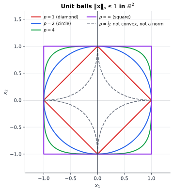
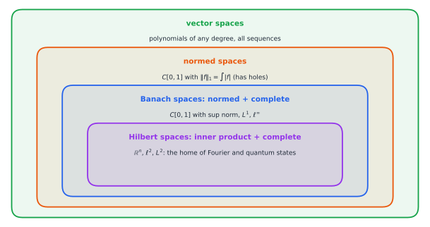

# Chapter 61 — Functional Analysis: Infinite-Dimensional Thinking

[← Previous](60-real-analysis.md) · [Track E](README.md) · [Table of Contents](../../00-front/table-of-contents.md) · [Next →](62-category-theory.md)

> **Level 2 · Track E — The Abstract Mathematics Behind Everything**
> **Builds on:** [Ch. 9](../../part-3-linear-algebra/09-vector-spaces-and-linear-transformations.md), [Ch. 10](../../part-3-linear-algebra/10-eigenvalues-and-eigenvectors.md), [Ch. 15](../../part-5-transforms/15-fourier-series.md) · **Leads to:** [Ch. 90](../j-frontier/90-spectral-theory.md), [Ch. 91](../j-frontier/91-inverse-problems.md), [Ch. 89](../j-frontier/89-pde-beyond-the-basics.md) · **Related:** [Ch. 60](60-real-analysis.md), [Ch. 47](../d-optimization/47-convexity.md), [Ch. 92](../j-frontier/92-mathematical-physics.md)
> **Reading time:** ~30 min

## 61.1 The hook

In the summer of 1925, a 23-year-old Werner Heisenberg, recovering from hay fever on the island of Heligoland, invented a new mechanics. In it, the position and momentum of an electron were no longer numbers but arrays. Max Born recognised the arrays as matrices, and with Pascual Jordan he found the rule at the centre of the theory: position $X$ and momentum $P$ don't commute. Instead,

$$
XP-PX=j\hbar\,\mathbf{I}.
$$

Everything quantum follows from this one line: the uncertainty principle, discrete energy levels, the stability of atoms.

Here is the strange part. The equation has **no solution in matrices**. Not $2\times2$, not $1000\times1000$, not any finite size. The proof takes one line, and you will see it in §61.3. Yet the theory worked, its predictions were confirmed to many decimal places, and transistors, lasers and MRI scanners are all built on it.

So what are $X$ and $P$, if they can't be matrices?

The same puzzle shows up wherever engineers work with signals rather than lists of numbers:

- A signal $x(t)$ is a vector with one coordinate for every instant. Fourier series write it in a basis of sines ([Ch. 15](../../part-5-transforms/15-fourier-series.md)), but there are infinitely many basis vectors. Is "orthogonal projection" still the best approximation? Does every Cauchy sequence of signals have a limit?
- Differentiation is a linear map on signals. So is integration. Integration smooths, so a small change in the input gives a small change in the output. Differentiation does the opposite: a tiny high-frequency wiggle in the data becomes a huge error in the derivative. Why are two inverse operations so different?
- Deblurring a photo, or reconstructing a CT image, means inverting a linear map. With exact data the inverse exists. With real data, however good the instrument, the naive inverse returns garbage. Why?

The question of this chapter:

> **What survives of linear algebra when the dimension becomes infinite, and what new phenomena appear that no matrix could ever show?**

The subject that answers it is functional analysis. It was built in the 1900s–1930s by Hilbert, Riesz, Banach and von Neumann, and von Neumann used it to put Heisenberg's matrices on solid ground.

## 61.2 The big idea

**Functions are vectors.** You can add two signals and scale a signal, so signals form a vector space ([§9.1](../../part-3-linear-algebra/09-vector-spaces-and-linear-transformations.md#91-vector-spaces)). Everything you know about linear maps, projections and eigenvectors has a candidate meaning for them. The catch is that no finite basis spans the space.

**In infinite dimensions, "how you measure" changes "what converges".** In $\mathbb{R}^n$ it doesn't matter whether you measure the size of a vector by the largest component, the sum of components, or the Euclidean length: a sequence that converges in one measure converges in all of them. The unit balls of these norms differ in shape (a square, a diamond, a disc), but each fits inside a scaled copy of the others.



*The unit balls of $\lVert\mathbf{x}\rVert_p=(\lvert x_1\rvert^p+\lvert x_2\rvert^p)^{1/p}$. As $p$ grows they swell from the diamond to the square. For $p<1$ the "ball" is not convex and the triangle inequality fails, so it isn't a norm.*

For functions that comfort disappears. Take $f_n(x)=x^n$ on $[0,1]$. Measured by *energy*, the $L^2$ norm $\big(\int_0^1\lvert f\rvert^2\big)^{1/2}$, the sequence shrinks to zero: $\lVert x^n\rVert_2=1/\sqrt{2n+1}$. Measured by *peak value*, the sup norm, it never shrinks at all, because $\max x^n=1$ for every $n$. One norm says "converges to zero" and the other says "stays at distance 1 forever". Both are right. You have to choose, and the choice is physics: energy-type questions call for $L^2$, and questions about peak voltage call for the sup norm.

![Left: the curves x^n on [0,1] for n = 1, 2, 5, 10, 30, 100, crowding toward zero except near x = 1, with the discontinuous pointwise limit dashed in red. Right: on log axes, the sup distance from zero stays at 1 while the L2 distance falls like 1 over the square root of 2n+1](../../images/ch61-l2-vs-uniform.svg)

*Same sequence, two verdicts. In $L^2$ the functions $x^n$ converge to the zero function. In the sup norm they never get closer than 1. Gibbs' overshoot in Fourier series ([§15.6](../../part-5-transforms/15-fourier-series.md#156-convergence)) is the same phenomenon.*

**An analogy: an infinite orchestra.** A finite-dimensional vector is a chord played by a fixed set of instruments. A signal is a chord played by infinitely many instruments, each a little higher in pitch. In finite dimensions you can't hide energy anywhere. In an infinite orchestra the energy can drift up to ever-higher instruments and *leak away* while the total stays constant. The sequence $\sin(nt)$ has fixed energy but moves to ever-higher pitch. Its overlap with any fixed signal fades to zero, yet it never converges to anything. Most of what is new in functional analysis is this escape to infinity: how to see it, how to forbid it, and how to use it.

## 61.3 The mathematics

### Normed and Banach spaces

> [!definition] Normed space, Banach space
> A **norm** on a vector space $V$ is a function $\lVert\cdot\rVert:V\to[0,\infty)$ with $\lVert v\rVert=0\iff v=0$, $\lVert\alpha v\rVert=\lvert\alpha\rvert\lVert v\rVert$, and $\lVert u+v\rVert\le\lVert u\rVert+\lVert v\rVert$. A normed space is a **Banach space** if it is complete for the metric $d(u,v)=\lVert u-v\rVert$, in the sense of [Ch. 60](60-real-analysis.md): every Cauchy sequence converges.

The main examples:

- $\ell^p$, the sequences with $\lVert x\rVert_p=(\sum_k\lvert x_k\rvert^p)^{1/p}<\infty$, for $1\le p<\infty$.
- $\ell^\infty$, the bounded sequences with the sup norm.
- $C[a,b]$ with the sup norm.
- $L^p[a,b]$, the functions with $\int\lvert f\rvert^p<\infty$. Strictly, these are classes of functions that agree almost everywhere, and the integral must be Lebesgue's ([§60.3](60-real-analysis.md#603-the-mathematics)).

Completeness is not automatic. $C[0,1]$ with the $L^1$ norm is not complete, and its completion is $L^1$, just as $\mathbb{R}$ completes $\mathbb{Q}$. The fact that the $L^p$ spaces *are* complete (the Riesz–Fischer theorem, in its general form) is the main reason for Lebesgue's integral. With Riemann's integral, limits of signals could fall out of the space.



*The family tree. Each level adds structure: a length, then completeness, then angles. Most of signal processing and quantum mechanics lives in the innermost box.*

In finite dimensions all norms are **equivalent**: for any two norms there are constants with $c\lVert v\rVert_a\le\lVert v\rVert_b\le C\lVert v\rVert_a$. In infinite dimensions they are not, as the $x^n$ example shows. There $\lVert f_n\rVert_2\to0$ while $\lVert f_n\rVert_\infty=1$, so no constant $C$ can make $\lVert f\rVert_\infty\le C\lVert f\rVert_2$ hold.

### Hilbert spaces: geometry with infinitely many axes

A **Hilbert space** is a Banach space whose norm comes from an inner product, $\lVert v\rVert^2=\langle v,v\rangle$. Inner products, orthogonality and Gram–Schmidt are covered in [§9.8](../../part-3-linear-algebra/09-vector-spaces-and-linear-transformations.md#98-inner-products)–[§9.10](../../part-3-linear-algebra/09-vector-spaces-and-linear-transformations.md#910-gramschmidt-orthogonalization). The examples that matter are $\ell^2$ and $L^2$, where $\langle f,g\rangle=\int f\,\overline{g}$. Among the $\ell^p$ spaces, only $p=2$ comes from an inner product. The test is the parallelogram law $\lVert u+v\rVert^2+\lVert u-v\rVert^2=2\lVert u\rVert^2+2\lVert v\rVert^2$, which the diamond and the square both fail.

Three facts carry over from finite dimensions, each needing completeness:

> [!theorem] The Hilbert-space toolkit (stated)
> **Projection theorem.** If $M$ is a closed subspace of a Hilbert space $H$, every $f\in H$ has a unique closest point $Pf\in M$, and $f-Pf\perp M$. This is the infinite-dimensional version of least squares ([§9.11](../../part-3-linear-algebra/09-vector-spaces-and-linear-transformations.md#911-least-squares-approximation)).
>
> **Orthonormal bases.** If $\{e_k\}$ is a complete orthonormal set, then $f=\sum_k\langle f,e_k\rangle e_k$, with convergence in norm, and **Parseval's identity** $\lVert f\rVert^2=\sum_k\lvert\langle f,e_k\rangle\rvert^2$ holds. Fourier series are this theorem for $e_k=e^{jk t}/\sqrt{2\pi}$ ([§15.8](../../part-5-transforms/15-fourier-series.md#158-power-and-energy-relationships)).
>
> **Riesz representation.** Every continuous linear functional $\phi:H\to\mathbb{C}$ has the form $\phi(f)=\langle f,g\rangle$ for exactly one $g\in H$.

Now the first genuinely new phenomenon.

> [!theorem] The unit ball of an infinite-dimensional Hilbert space is not compact
> Let $\{e_n\}$ be an infinite orthonormal sequence. Then:
> 1. $\lVert e_m-e_n\rVert=\sqrt2$ for $m\neq n$, so no subsequence converges in norm.
> 2. For every fixed $f\in H$, $\langle f,e_n\rangle\to0$.

*Proof.* (1) By Pythagoras, $\lVert e_m-e_n\rVert^2=\lVert e_m\rVert^2+\lVert e_n\rVert^2=2$, since $e_m\perp e_n$. A convergent subsequence would be Cauchy, but its terms all stay $\sqrt2$ apart.

(2) For any $N$, the projection of $f$ onto $\operatorname{span}\{e_1,\dots,e_N\}$ is $\sum_{n\le N}\langle f,e_n\rangle e_n$. Its norm is at most $\lVert f\rVert$, which gives **Bessel's inequality** $\sum_{n=1}^{N}\lvert\langle f,e_n\rangle\rvert^2\le\lVert f\rVert^2$. Since $N$ is arbitrary, the series $\sum_n\lvert\langle f,e_n\rangle\rvert^2$ converges, so its terms tend to zero. ∎

In $\mathbb{R}^n$, Bolzano–Weierstrass guarantees that every bounded sequence has a convergent subsequence. Part (1) says that in infinite dimensions this fails for the simplest bounded sequence there is. Part (2) says the sequence *does* go to zero in a weaker sense. This is the orchestra's leaking energy, made precise.

> [!definition] Weak convergence
> $f_n\rightharpoonup f$ (**weakly**) if $\langle f_n,g\rangle\to\langle f,g\rangle$ for every $g\in H$. Norm convergence implies weak convergence, but not conversely: $e_n\rightharpoonup0$ while $\lVert e_n\rVert=1$.

In $L^2[0,1]$ the functions $\sqrt2\sin(n\pi x)$ form such a sequence. Their weak convergence to zero is the Riemann–Lebesgue lemma. Weak convergence is what rescues compactness: every bounded sequence in a Hilbert space has a *weakly* convergent subsequence. Existence proofs for PDEs and optimal controls work this way. Find a minimizing sequence, extract a weakly convergent subsequence, and show the limit is a solution.

### Operators: bounded means continuous

A linear map between normed spaces is called an **operator**. Its size is the **operator norm** $\lVert T\rVert=\sup_{\lVert f\rVert\le1}\lVert Tf\rVert$. For a matrix with the Euclidean norm this is the largest singular value ([§10.7](../../part-3-linear-algebra/10-eigenvalues-and-eigenvectors.md#107-singular-value-decomposition)).

> [!theorem] Bounded ⇔ continuous
> A linear operator $T$ between normed spaces is continuous if and only if it is **bounded**, meaning $\lVert Tf\rVert\le C\lVert f\rVert$ for some constant $C$.

*Proof.* If $T$ is bounded, then $\lVert Tf-Tg\rVert=\lVert T(f-g)\rVert\le C\lVert f-g\rVert$, so $T$ is Lipschitz and in particular continuous.

Conversely, suppose $T$ is continuous at $0$. Take $\varepsilon=1$: there is a $\delta>0$ such that $\lVert h\rVert\le\delta$ implies $\lVert Th\rVert\le1$. For any $f\neq0$, put $h=\delta f/\lVert f\rVert$, which has norm $\delta$. By linearity,

$$
\lVert Tf\rVert=\frac{\lVert f\rVert}{\delta}\,\lVert Th\rVert\le\frac1\delta\lVert f\rVert ,
$$

so $C=1/\delta$ works. ∎

Every matrix is bounded. In infinite dimensions many natural operators are not. Differentiation $D=d/dx$ on smooth functions with the sup norm sends $f_n(x)=\sin(nx)$, which has $\lVert f_n\rVert_\infty=1$, to $n\cos(nx)$, which has norm $n$. No constant $C$ bounds it, so **differentiation is discontinuous**. That is the reason numerical differentiation amplifies noise ([§22.7](../../part-7-numerical-computational/22-numerical-methods.md#227-numerical-differentiation)): it isn't sloppy coding, it's a theorem.

Integration is the opposite. The **Volterra operator** $(Vf)(x)=\int_0^x f(t)\,dt$ on $L^2[0,1]$ is bounded, with $\lVert V\rVert=2/\pi\approx0.637$. More than that, it is **compact**: it maps bounded sets to sets whose closure is compact, so it squeezes the infinite-dimensional unit ball into something essentially finite-dimensional. Its singular values are

$$
\sigma_k=\frac{2}{(2k-1)\pi},\qquad k=1,2,3,\dots
$$

which decay to zero. A compact operator always has singular values tending to zero. Now the inverse problem of the hook makes sense. Inverting $V$ means dividing by the $\sigma_k$, and $1/\sigma_k\to\infty$. The inverse of a compact operator on an infinite-dimensional space is never bounded.

### Dual spaces and Hahn–Banach

The **dual** $V^*$ of a normed space is the space of its continuous linear functionals: the "measurements" you can make on its elements. Examples are evaluating a filter output at one instant, or taking an inner product with a template. Riesz says a Hilbert space is its own dual. For $1<p<\infty$, the dual of $\ell^p$ is $\ell^q$ with $1/p+1/q=1$. That is why Hölder's inequality $\lvert\sum x_ky_k\rvert\le\lVert x\rVert_p\lVert y\rVert_q$ is everywhere.

Does a general Banach space have *enough* functionals to tell its points apart? In $\mathbb{R}^n$, separating a point from a convex set by a hyperplane was the engine of [Ch. 47](../d-optimization/47-convexity.md). Its infinite-dimensional heir is this theorem.

> [!theorem] Hahn–Banach (stated)
> A continuous linear functional defined on a subspace of a normed space extends to the whole space with the same norm. Geometric form: a closed convex set and a point outside it can always be strictly separated by a continuous linear functional, a "hyperplane" $\{\phi=c\}$.

So the walls of convex optimization survive in spaces of signals. That is why duality theory works for optimal control and for infinite linear programs. The proof needs no geometry of $\mathbb{R}^n$ at all. It uses Zorn's lemma, a form of the axiom of choice ([Ch. 64](../f-logic-foundations/64-set-theory-and-infinity.md)).

### Baire's theorem: why monsters win

The last pillar answers a question from [Ch. 60](60-real-analysis.md).

> [!theorem] Baire category theorem and uniform boundedness (stated)
> A complete metric space is not a countable union of nowhere-dense sets. Consequence (Banach–Steinhaus): if a family of bounded operators on a Banach space is bounded at each point, $\sup_\alpha\lVert T_\alpha f\rVert<\infty$ for every $f$, then it is uniformly bounded, $\sup_\alpha\lVert T_\alpha\rVert<\infty$.

Banach applied this in 1931. In $C[0,1]$, the functions that have a derivative at even one point form a countable union of nowhere-dense sets, so "most" continuous functions are nowhere differentiable. Similarly, the Fourier partial-sum operators $f\mapsto S_Nf(0)$ on continuous functions have norms (the Lebesgue constants) that grow like $\tfrac{4}{\pi^2}\ln N$. They are not uniformly bounded, so by Banach–Steinhaus some continuous function has a Fourier series that diverges at $0$. In both cases the monster's existence is proved without ever building it.

### Spectral theory: eigenvalues and beyond

For a symmetric matrix the spectral theorem gives an orthonormal eigenbasis ([§10.5](../../part-3-linear-algebra/10-eigenvalues-and-eigenvectors.md#105-symmetric-matrices)). The closest infinite-dimensional analogue is this.

> [!theorem] Spectral theorem for compact self-adjoint operators (stated)
> If $T$ is compact and self-adjoint on a Hilbert space, then $Tf=\sum_k\lambda_k\langle f,e_k\rangle e_k$, where the $e_k$ are orthonormal eigenvectors and the real eigenvalues $\lambda_k\to0$.

Separation of variables for the heat and wave equations ([§13.3](../../part-4-differential-equations/13-partial-differential-equations.md#133-separation-of-variables)) is this theorem in action. The inverse of $-d^2/dx^2$ with zero boundary values is a compact self-adjoint integral operator on $L^2[0,1]$ with eigenfunctions $\sin(k\pi x)$ and eigenvalues $1/(k\pi)^2$.

Without compactness, eigenvectors can vanish entirely. Define the **spectrum** $\sigma(T)$ as the set of $\lambda$ for which $T-\lambda I$ has no bounded inverse. In finite dimensions that is exactly the set of eigenvalues. In infinite dimensions it can be much more:

- **Multiplication**, $(Mf)(x)=xf(x)$ on $L^2[0,1]$, is bounded and self-adjoint. It has *no eigenvalues at all*: $xf(x)=\lambda f(x)$ forces $f=0$ almost everywhere. Yet its spectrum is the whole interval $[0,1]$. This is the position operator of quantum mechanics, and it has a *continuous spectrum*.
- **The right shift** $S(x_1,x_2,\dots)=(0,x_1,x_2,\dots)$ on $\ell^2$ has no eigenvalues, preserves norms, and has spectrum equal to the closed unit disk.

Back to the hook:

> [!theorem] Heisenberg's relation has no finite-dimensional solution
> There are no $n\times n$ matrices $X,P$ (for any $n\ge1$) with $XP-PX=j\hbar\,\mathbf{I}$, $\hbar\neq0$.

*Proof.* The trace satisfies $\operatorname{tr}(AB)=\operatorname{tr}(BA)$. Taking traces of both sides gives $\operatorname{tr}(XP)-\operatorname{tr}(PX)=0$ on the left and $j\hbar\operatorname{tr}\mathbf{I}=j\hbar n\neq0$ on the right. ∎

On $L^2(\mathbb{R})$, by contrast, take $(X\psi)(x)=x\psi(x)$ and $(P\psi)(x)=-j\hbar\,\psi'(x)$. Then

$$
(XP-PX)\psi=-j\hbar\,x\psi'+j\hbar\,(x\psi)'=j\hbar\,\psi ,
$$

so the relation holds. The answer to the hook is that $X$ and $P$ are operators on an infinite-dimensional Hilbert space, and neither is a matrix. They pay a price for it: $P$ is a differentiation and is unbounded, and on $L^2(\mathbb{R})$ the operator $X$ is unbounded too.

> [!mystery] Could bounded operators have done the job?
> The trace trick only rules out matrices. Infinite-dimensional operators have no trace in general. Maybe some clever pair of *bounded* operators on $\ell^2$ satisfies $XP-PX=j\hbar I$, which would spare physics the problems of unbounded operators: domains, self-adjointness and convergence. The answer (Wintner 1947, Wielandt 1949) is no, and the proof is a short and beautiful spectral argument. It forces quantum theory into unbounded operators, and the Stone–von Neumann theorem then says the pair $(X,P)$ is essentially unique. Both stories are in [Ch. 92](../j-frontier/92-mathematical-physics.md).

> [!mystery] Eigenvectors that aren't there
> Physicists write position "eigenstates" $\lvert x_0\rangle$ with $X\lvert x_0\rangle=x_0\lvert x_0\rangle$ and expand every state in them, as if $M$ had a full set of eigenvectors. But $M$ has *no* eigenvectors in $L^2$, and the would-be eigenvector is a Dirac delta, which isn't a function. What exactly replaces "a basis of eigenvectors" for an operator with continuous spectrum? The answer is spectral measures and projection-valued integrals, $T=\int\lambda\,dE(\lambda)$. That is the full spectral theorem of [Ch. 90](../j-frontier/90-spectral-theory.md).

## 61.4 The algorithm

**Seeing an ill-posed problem.** Discretize the Volterra operator on $n$ grid points, measure its singular values against the formula, and try to undo it on slightly noisy data:

```python
import numpy as np

n = 200                                    # grid points on [0, 1]
h = 1.0 / n
x = (np.arange(n) + 0.5) * h               # midpoints
V = h * np.tril(np.ones((n, n)))           # (Vf)(x) = integral_0^x f(t) dt
V -= 0.5 * h * np.eye(n)                   # midpoint correction on the diagonal

U, s, Wt = np.linalg.svd(V)
k = np.arange(1, 6)
print("sigma_k  numeric:", np.round(s[:5], 4))
print("sigma_k  theory :", np.round(2 / ((2 * k - 1) * np.pi), 4))

f_true = np.cos(3 * np.pi * x)             # the signal we want to recover
rng = np.random.default_rng(0)
g = V @ f_true + 1e-3 * rng.standard_normal(n)   # measured, slightly noisy

f_naive = np.linalg.solve(V, g)            # exact inverse = differentiate the data
r = 20                                     # keep only r singular values
f_tsvd = Wt[:r].T @ ((U[:, :r].T @ g) / s[:r])
for name, f in [("naive", f_naive), ("TSVD r=20", f_tsvd)]:
    print(f"{name:10s} relative error = {np.linalg.norm(f - f_true) / np.linalg.norm(f_true):.3f}")
print("condition number of V:", round(s[0] / s[-1]))
```

The first five singular values match $2/((2k-1)\pi)=0.6366,\ 0.2122,\ 0.1273,\ 0.0909,\ 0.0707$ to four digits. The matrix's condition number is about $6.5\times10^4$, and it grows without bound as the grid is refined, because the matrix is approximating an operator whose inverse is unbounded. With noise of only $10^{-3}$, the naive solve returns a reconstruction with a relative error of 12, or 1,200%. **Truncated SVD**, which keeps only the 20 largest singular values, brings the error down to 14%.

**What the algorithm is doing.** The data component along the $k$-th singular vector gets divided by $\sigma_k$. For small $\sigma_k$ that component is almost pure noise, and dividing by a tiny number blows the noise up. Truncation trades a little bias (discarding fine detail) for a large cut in variance. **Tikhonov regularization** makes the same trade smoothly, replacing $1/\sigma_k$ by $\sigma_k/(\sigma_k^2+\alpha)$.

**Cost and failure modes.**

- A full SVD costs $O(n^3)$. For large problems one uses iterative Krylov methods. Their iteration count itself acts as a regularizer, which is called *semi-convergence*: stop too late and the noise floods back in.
- Refining the grid does *not* fix ill-posedness. It makes the condition number worse, because a finer grid samples more of the operator's decaying spectrum.
- The best truncation level depends on the noise level and on how smooth the true signal is. Pick it from the same noisy data and you can fool yourself.

## 61.5 The experiment

**Reshape the unit ball.** Change the exponent 4 to 20 and watch the ball approach the square, which is the $p=\infty$ ball. Change $0.5$ to $0.9$ and then $1$, and watch the star inflate to the diamond. It becomes convex exactly at $p=1$.

```desmos-graph
left=-1.6; right=1.6; bottom=-1.3; top=1.3
---
\operatorname{abs}(x)+\operatorname{abs}(y)=1|red
x^{2}+y^{2}=1|blue
x^{4}+y^{4}=1|green
\operatorname{abs}(x)^{0.5}+\operatorname{abs}(y)^{0.5}=1|grey|dashed
```

*Unit "balls" of $\lVert\cdot\rVert_p$ for $p=1$ (red), $2$ (blue), $4$ (green) and $\tfrac12$ (dashed grey, not a norm). Only $p=2$ comes from an inner product.*

**Converging in energy but not in peak.** This script measures the Fourier partial sums of a square wave in two norms:

```python
import numpy as np

x = np.linspace(-np.pi, np.pi, 20_001)
dx = x[1] - x[0]
f = np.sign(x)                                   # square wave on one period

def partial_sum(N):
    """Fourier partial sum of the square wave, odd harmonics up to N."""
    k = np.arange(1, N + 1, 2)
    return (4 / np.pi) * (np.sin(np.outer(x, k)) / k).sum(axis=1)

print("   N    L2 error   sup error   max of S_N")
for N in [1, 5, 25, 125, 625]:
    e = partial_sum(N) - f
    l2 = np.sqrt(np.sum(e**2) * dx / (2 * np.pi))  # RMS = L2 norm / sqrt(2 pi)
    print(f"{N:4d}   {l2:8.4f}   {np.abs(e).max():8.4f}   {partial_sum(N).max():8.4f}")
```

The RMS error falls from $0.435$ at $N=1$ to $0.026$ at $N=625$, roughly halving each time $N$ grows five-fold. The sup error stays pinned at $1.000$, because a continuous partial sum can't follow a jump. The overshoot settles at $1.179$, the Gibbs constant. Knobs to turn:

- Replace `np.sign(x)` by the continuous triangle wave `np.abs(x)`. Its partial sums use cosines, $\tfrac{\pi}{2}-\tfrac{4}{\pi}\sum_{k\text{ odd}}\cos(kx)/k^2$. Watch the sup error go to zero too.
- Measure the $L^1$ error. Does it decay faster or slower than $L^2$?
- Change the exponent of `k` and see how the smoothness of a signal controls the decay rates in different norms.

## 61.6 The challenge

1. **Intuition.** In $\ell^2$, explain without calculation why the sequence $e_1,e_2,e_3,\dots$ "goes to zero" when measured against any fixed vector, but never gets close to zero. Then decide: does $(e_1+\cdots+e_n)/n$ converge in norm? To what?
2. **Derivation.** Show that the Volterra operator's adjoint is $(V^*g)(x)=\int_x^1g(t)\,dt$. Then show that the eigenfunctions of $V^*V$ satisfy $-u''=\lambda^{-1}u$, with $u(1)=0$ and $u'(0)=0$. Deduce the singular values $\sigma_k=2/((2k-1)\pi)$, and so $\lVert V\rVert=2/\pi$.
3. **Implementation.** Add Tikhonov regularization to the inverse-problem script. For noise levels $10^{-2},10^{-3},10^{-4}$, plot the reconstruction error against $\alpha$ on a log scale and find the best $\alpha$ for each. Then implement one rule that chooses $\alpha$ *without* knowing `f_true`, such as the discrepancy principle or the L-curve, and compare it with the optimum.
4. **Open investigation.** For the right shift $S$ on $\ell^2$, compute the eigenvalues of its $n\times n$ truncation (a nilpotent Jordan block), and then of slightly perturbed versions: add $10^{-10}$ in the corner entry $(1,n)$. Where do the eigenvalues go as $n$ grows? Compare with the true spectrum, the closed unit disk, and look up "pseudospectra". Is there a rule that predicts which finite truncations of an infinite operator can be trusted?

## 61.7 Loose threads

Functional analysis turns "signal", "state" and "field" into points of a space, and "filter", "observable" and "PDE" into operators on it. This chapter set up the stage: norms, completeness, Hilbert geometry, bounded and compact operators, duality and the first spectral theorem. The plot is still to come.

> [!mystery] How much regularization is right?
> Truncated SVD worked once we chose $r$, and Tikhonov works once we choose $\alpha$, but the best choice depended on the unknown true signal. Is there a principled rule that is provably near-optimal with only the noisy data in hand? It depends on how fast the singular values decay compared with the signal's coefficients (the Picard condition). The Bayesian reading, where $\alpha$ is a ratio of noise variance to prior variance, gives a second answer that is in tension with the first. Both are in [Ch. 91](../j-frontier/91-inverse-problems.md).

Further pointers. Sobolev spaces, which are Hilbert spaces of functions with square-integrable derivatives, turn PDEs into problems of projection and duality ([Ch. 89](../j-frontier/89-pde-beyond-the-basics.md)). Compressed sensing exploits the pointed corners of the $\ell^1$ ball from the figure, and convex duality supplies its certificates ([Ch. 48](../d-optimization/48-duality.md)). Category theory, next in this track, asks what all these "spaces with structure-preserving maps" have in common ([Ch. 62](62-category-theory.md)).

## Further reading

- E. Kreyszig, *Introductory Functional Analysis with Applications*, Wiley, 1978. The gentlest full introduction, written for readers coming from engineering mathematics.
- B. D. MacCluer, *Elementary Functional Analysis*, Springer, 2009. Short, modern and readable, with good coverage of spectral theory.
- M. Reed and B. Simon, *Methods of Modern Mathematical Physics I: Functional Analysis*, Academic Press, 1980. The standard bridge from Hilbert spaces to quantum mechanics.
- P. C. Hansen, *Discrete Inverse Problems: Insight and Algorithms*, SIAM, 2010. SVD, truncation and Tikhonov regularization in practice, with code.
