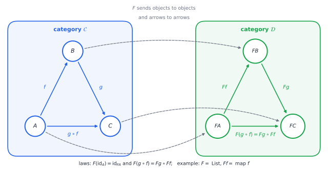

# Chapter 62 — Category Theory: Mathematics About Mathematics

[← Previous](61-functional-analysis.md) · [Track E](README.md) · [Table of Contents](../../00-front/table-of-contents.md) · [Next →](99-abstract-linear-algebra.md)

> **Level 2 · Track E — The Abstract Mathematics Behind Everything**
> **Builds on:** [Ch. 1](../../part-1-foundations/01-mathematical-language-and-algebra.md), [Ch. 9](../../part-3-linear-algebra/09-vector-spaces-and-linear-transformations.md), [Ch. 56](56-abstract-algebra.md) · **Leads to:** [Ch. 66](../f-logic-foundations/66-type-theory-curry-howard.md), [Ch. 99](99-abstract-linear-algebra.md), [Ch. 95](../j-frontier/95-representation-theory.md) · **Related:** [Ch. 58](58-topology.md), [Ch. 29](../a-algorithms/29-discrete-mathematics-and-logic.md), [Ch. 64](../f-logic-foundations/64-set-theory-and-infinity.md), [Ch. 93](../j-frontier/93-tensor-mathematics.md)
> **Reading time:** ~30 min

## 62.1 The hook

A colleague hands you a compiled library function. You can't read its source. All you know is its type signature:

```
mystery : List[A] -> List[A]      # for every type A
```

It works on lists of integers, strings or circuit netlists. You run it once, `mystery([1, 2, 4])`, and get `[4, 2, 1]`. Maybe it reverses. Maybe it does something stranger on longer lists. Now take any function `f`, say `even : Int -> Bool`. Is it true that

```
mystery(map(f, xs)) == map(f, mystery(xs))      # for every list xs?
```

In words: does the order of "transform the elements" and "apply `mystery`" matter? You are being asked about code you have never seen, and yet the type seems to know. A function that must work for *every* type `A` can't look inside the elements, so it can't compare, add or print them. Is that restriction enough to settle the question?

Here is a second puzzle that looks unrelated. Write down five constructions you know:

- the Cartesian product $A\times B$ of two sets,
- the greatest common divisor $\gcd(a,b)$ of two integers,
- the minimum $\min(a,b)$ of two real numbers,
- the logical conjunction "$p$ AND $q$",
- a tuple type `(A, B)` in a programming language.

They come from set theory, number theory, analysis, logic and software. Yet they are *the same construction*, done in five different worlds: not similar, the same, in a sense precise enough to prove theorems about all five at once.

Both puzzles have one answer: stop looking at what things *are*, and look at how they *connect*. That shift of attention is **category theory**. It began in 1945, when Eilenberg and Mac Lane wanted to say precisely what "natural" meant, and grew into a language that runs through algebra, logic, programming-language design and composable systems. By the end of this chapter you will have proved the `mystery` claim for a whole family of functions, and seen why gcd, min, AND, tuples and Cartesian products are one idea.

## 62.2 The big idea

Most of mathematics studies **objects**: numbers, sets, groups, vector spaces. Category theory studies the **arrows between them** and how arrows compose. It treats the inside of an object as off limits. Whatever you want to know about an object, you must learn by probing it with arrows.

An analogy: you could describe a person by height, address and blood type, or by their relationships, who they call and who calls them. The second description never opens the person up, and yet it largely determines them. Category theory pushes that view as far as it will go, which turns out to be very far.

Three layers build on each other.

1. A **category** is a world: objects, arrows between them, and a rule for composing arrows end to end. Sets with functions, vector spaces with linear maps ([Ch. 9, §9.5](../../part-3-linear-algebra/09-vector-spaces-and-linear-transformations.md#95-linear-transformations)), groups with homomorphisms ([Ch. 56](56-abstract-algebra.md)), and types with programs are all categories.
2. A **functor** is a map between worlds that respects composition. "Take the list of" is a functor: it sends a type `A` to the type `List[A]`, and a function `f` to the function `map f`.
3. A **natural transformation** is a map between functors that does the same thing "uniformly", without peeking inside. `reverse` is one: it converts lists into lists the same way for every element type.



*A functor $F$ copies the shape of one world into another: every object gets an image, every arrow gets an image, and composites go to composites. For $F=$ List, the image of an arrow $f$ is `map f`.*

Above all three sits the idea that answers the second puzzle: the **universal property**. Instead of defining $A\times B$ by what is inside it (ordered pairs), define it by its relationships: the object with arrows to $A$ and to $B$ through which every other such pair of arrows passes in exactly one way. That never mentions elements, so it makes sense in any category: pairs in sets, the gcd among divisors, the minimum among reals.

## 62.3 The mathematics

### Categories

> [!definition] Category
> A **category** $\mathcal{C}$ consists of
> - a collection of **objects** $A, B, C,\dots$;
> - for each pair of objects a set $\operatorname{Hom}(A,B)$ of **arrows** (morphisms) $f:A\to B$;
> - a **composition** $g\circ f:A\to C$ for every $f:A\to B$ and $g:B\to C$;
> - an **identity** arrow $\mathrm{id}_A:A\to A$ for every object,
>
> such that composition is associative, $h\circ(g\circ f)=(h\circ g)\circ f$, and identities are neutral, $f\circ\mathrm{id}_A=f=\mathrm{id}_B\circ f$.

That is all. Nothing says arrows must be functions or objects must be sets. Some examples, from the familiar to the strange:

| Category | Objects | Arrows $A\to B$ | Composition |
|---|---|---|---|
| $\mathbf{Set}$ | sets | functions | usual composition |
| $\mathbf{Vect}_K$ | vector spaces over a field $K$ | linear maps | composition (matrix product) |
| $\mathbf{Grp}$ | groups | homomorphisms | composition |
| a poset $(P,\le)$ | elements of $P$ | one arrow if $a\le b$, none otherwise | transitivity |
| a monoid $M$ | a single object $\star$ | the elements of $M$ | the monoid operation |
| $\mathbf{Type}$ | types of a language | (total) programs | piping one into the next |

The poset and monoid examples show how little a category needs. In the divisibility poset there is an arrow $4\to12$ because $4$ divides $12$, and composition is the transitivity of divisibility. In a monoid all the information sits in how arrows compose.

An arrow $f:A\to B$ is an **isomorphism** if it has a two-sided inverse $g$, with $g\circ f=\mathrm{id}_A$ and $f\circ g=\mathrm{id}_B$: a bijection in $\mathbf{Set}$, an invertible linear map in $\mathbf{Vect}_K$. Category theory never asks whether two objects are *equal*, only whether they are isomorphic, and *how*.

Every category has an **opposite** $\mathcal{C}^{\mathrm{op}}$ with every arrow reversed, so every theorem about all categories comes with a free dual theorem. Every definition below has a "co-" version for nothing.

### Functors

> [!definition] Functor
> A **functor** $F:\mathcal{C}\to\mathcal{D}$ assigns to each object $A$ of $\mathcal{C}$ an object $FA$ of $\mathcal{D}$, and to each arrow $f:A\to B$ an arrow $Ff:FA\to FB$, such that
> $$
> F(\mathrm{id}_A)=\mathrm{id}_{FA},\qquad F(g\circ f)=Fg\circ Ff .
> $$

The **List functor** sends a type $A$ to $\mathrm{List}(A)$ and $f:A\to B$ to $\operatorname{map}f$. The laws say that mapping the identity does nothing, and that mapping $f$ then mapping $g$ is the same as mapping $g\circ f$ once. Compilers use exactly this law to fuse two loops into one.

A **forgetful functor** $U:\mathbf{Vect}_K\to\mathbf{Set}$ forgets the linear structure. A **contravariant** functor reverses arrows: the dual space construction sends $T:V\to W$ to $T^*:W^*\to V^*$, the transpose in disguise, which is why $(\mathbf{A}\mathbf{B})^\mathsf{T}=\mathbf{B}^\mathsf{T}\mathbf{A}^\mathsf{T}$ reverses the order ([Ch. 99](99-abstract-linear-algebra.md)).

The engineer's favourite functor is in hiding. Lumped linear time-invariant systems compose by **cascading**, and the transfer function sends a cascade to a product, $H_{g\circ f}(s)=H_g(s)\,H_f(s)$, and a plain wire to $H=1$ ([Ch. 14](../../part-5-transforms/14-laplace-transforms.md)). That is the functor law: block diagrams can be "multiplied out" because the Laplace transform is functorial.

Functors **preserve isomorphisms**: if $f$ has inverse $g$, then $Fg\circ Ff=F(g\circ f)=F(\mathrm{id})=\mathrm{id}$. Read backwards, if $Ff$ is *not* an isomorphism, $f$ wasn't either, so a functor into a simpler world can prove something impossible in a harder one.

> [!mystery] A functor that proves a theorem
> Topologists attach a group to every shape and a group homomorphism to every continuous map, functorially. From that plus a one-line diagram chase it follows that every continuous map of a disc to itself has a fixed point (Brouwer's theorem), a statement with no visible algebra in it.
> Which functor does it, and why the diagram chase is unavoidable, is the business of the fundamental group in [Ch. 58](58-topology.md).

### Natural transformations

> [!definition] Natural transformation
> Given functors $F,G:\mathcal{C}\to\mathcal{D}$, a **natural transformation** $\eta:F\Rightarrow G$ is a family of arrows $\eta_A:FA\to GA$, one for each object $A$, such that for every arrow $f:A\to B$
> $$
> \eta_B\circ Ff = Gf\circ\eta_A .
> $$

The equation is the **naturality square**: going across and then down equals going down and then across.

![Left: the square FA to FB along Ff, down by eta_B, equals FA down by eta_A to GA then across by Gf to GB; right: the instance [1,2,4] mapped by even to [F,T,T] then reversed to [T,T,F], and reversed first to [4,2,1] then mapped to [T,T,F]](../../images/ch62-naturality.svg)

*The naturality square. On the right, the hook's claim for `mystery = reverse` and `f = even`: both routes through the square land on `[T, T, F]`.*

Natural transformations are what "uniform" or "canonical" means. The hook's claim is exactly that `mystery` is a natural transformation $\mathrm{List}\Rightarrow\mathrm{List}$. A function that can't look inside the elements can only shuffle, copy and drop them by *position*, and for that whole family we can prove it.

> [!theorem] Position-only list functions are natural
> Suppose that for each length $n$ there is a list of indices $\sigma_n=(i_1,\dots,i_m)$ with every $i_k\in\{1,\dots,n\}$ (the length $m$ may depend on $n$), and define, for every type $A$,
> $$
> \eta_A(x_1,\dots,x_n)=(x_{i_1},\dots,x_{i_m}) .
> $$
> Then $\eta$ is a natural transformation $\mathrm{List}\Rightarrow\mathrm{List}$: for every $f:A\to B$, $\eta_B\circ\operatorname{map}f=\operatorname{map}f\circ\eta_A$.

*Proof.* Take $xs=(x_1,\dots,x_n)$. Mapping first gives $(f(x_1),\dots,f(x_n))$, which still has length $n$, so $\eta_B$ uses the same index list $\sigma_n$ and returns $(f(x_{i_1}),\dots,f(x_{i_m}))$. Going the other way, $\eta_A(xs)=(x_{i_1},\dots,x_{i_m})$, and mapping $f$ over it gives $(f(x_{i_1}),\dots,f(x_{i_m}))$. The two lists agree entry by entry. The key step is that $\operatorname{map}f$ never changes the length, and $\eta$ looks at nothing but the length. ∎

Reverse ($\sigma_n=(n,\dots,1)$), "take the first two", "every other element" and "repeat each element twice" are all of this form, so all are natural. A sort is not: it chooses positions by *comparing contents*. With $f(x)=-x$, sorting $[1,2]$ and negating gives $[-1,-2]$, but negating then sorting gives $[-2,-1]$. That is why `sort` needs an ordering on `A` in its type and can't have the plain signature `List[A] -> List[A]`.

The converse, that *every* function with the polymorphic type must be position-based, is a deeper fact called **parametricity**; [§62.7](#627-loose-threads) says where it is proved.

Naturality also separates constructions that merely exist from constructions that are canonical. A finite-dimensional space $V$ is isomorphic both to its dual $V^*$ and to its double dual $V^{**}$, but only one of these isomorphisms is natural.

> [!mystery] Two isomorphisms, one of them fake
> The map $V\to V^{**}$ that sends $v$ to "evaluate at $v$" needs no choices and passes the naturality test for every linear map. Every isomorphism $V\to V^{*}$ requires picking a basis or an inner product, and *no* choice makes it natural. Why the double dual is canonical and the single dual is not, and why the double-dual map fails to be onto in infinite dimensions, is where [Ch. 99](99-abstract-linear-algebra.md) begins.

### Universal properties

Now the second puzzle. Here is a definition of "product" that never mentions elements.

> [!definition] Product
> A **product** of objects $A$ and $B$ is an object $A\times B$ with two arrows $\pi_1:A\times B\to A$ and $\pi_2:A\times B\to B$ such that for every object $X$ and every pair $f:X\to A$, $g:X\to B$ there is **exactly one** arrow $\langle f,g\rangle:X\to A\times B$ with $\pi_1\circ\langle f,g\rangle=f$ and $\pi_2\circ\langle f,g\rangle=g$.


*$A\times B$ is the "best" object with arrows to both $A$ and $B$: every rival $X$ factors through it uniquely. Read in six categories, one diagram gives six familiar constructions.*

Check it in a few worlds. In **sets**, the only function into the pairs that projects correctly is $x\mapsto(f(x),g(x))$. In a **poset** an arrow is a single fact "$x\le y$", so for **divisibility** the definition says: $p$ divides $a$ and $b$, and every common divisor divides $p$. That is $\gcd(a,b)$. For **reals with $\le$** it is $\min(a,b)$; for **propositions ordered by implication**, $p\wedge q$. For **vector spaces** it is the direct sum $V\oplus W$, and $\langle\mathbf{F},\mathbf{G}\rangle$ is the matrix $\mathbf{F}$ stacked on top of $\mathbf{G}$.

The definition does not promise that a product exists (the experiment in [§62.5](#625-the-experiment) builds a case where none does). But when one exists, it is essentially unique.
The definition does not claim a product exists; it says what one must do. Sometimes none exists, and the experiment in [§62.5](#625-the-experiment) builds such a case. But when one exists, it is essentially unique, and this is the theorem that makes universal properties worth having.

> [!theorem] Universal objects are unique up to unique isomorphism
> If $(P,\pi_1,\pi_2)$ and $(Q,\rho_1,\rho_2)$ are both products of $A$ and $B$, there is exactly one arrow $u:Q\to P$ compatible with the projections ($\pi_i\circ u=\rho_i$), and it is an isomorphism.

*Proof.* Because $P$ is a product, the pair $\rho_1,\rho_2$ from $Q$ factors through $P$ by a unique $u:Q\to P$ with $\pi_i\circ u=\rho_i$. Because $Q$ is a product, the pair $\pi_1,\pi_2$ factors through $Q$ by a unique $v:P\to Q$ with $\rho_i\circ v=\pi_i$. Now look at $u\circ v:P\to P$. It satisfies $\pi_i\circ(u\circ v)=\rho_i\circ v=\pi_i$. But the identity $\mathrm{id}_P$ satisfies $\pi_i\circ\mathrm{id}_P=\pi_i$ too, and the universal property (with $X=P$, $f=\pi_1$, $g=\pi_2$) says there is only *one* arrow $P\to P$ with that property. Hence $u\circ v=\mathrm{id}_P$. The same argument in $Q$ gives $v\circ u=\mathrm{id}_Q$. ∎

Notice what the proof never used: elements, pairs, numbers. It works in every category at once: one proof, infinitely many theorems. It is also why mathematicians say "*the* product" although, as sets, $A\times B$ and $B\times A$ differ: they are uniquely isomorphic.

Turn every arrow around and you get the **coproduct** $A+B$: disjoint union in sets, lcm among divisors, max among reals, OR in logic, a **sum type** such as `Either[A, B]` in programming. In vector spaces the coproduct is the direct sum *again*, so $V\oplus W$ is both product and coproduct, a coincidence special to linear algebra that lets matrices be cut into blocks in both directions.

### Limits, briefly

Products are the simplest **limits**: take a diagram of objects and arrows, and look for the best object with a compatible family of arrows into it.

- The limit of the empty diagram is a **terminal object**, with exactly one arrow into it from everywhere: a one-point set, the zero space, "true", the unit type.
- The limit of two parallel arrows $f,g:A\to B$ is the **equalizer**: $\{a: f(a)=g(a)\}$ in sets, the kernel $\ker(f-g)$ for linear maps ([Ch. 9, §9.6](../../part-3-linear-algebra/09-vector-spaces-and-linear-transformations.md#96-null-space-and-column-space)). Solving an equation is computing an equalizer.
- The limit of $A\xrightarrow{f}C\xleftarrow{g}B$ is the **pullback** $\{(a,b): f(a)=g(b)\}$, which database engineers call the **join** of two tables on a key.

Dually, **colimits** include initial objects, coequalizers (quotients, as in [Ch. 56](56-abstract-algebra.md)) and pushouts (gluing two shapes along an edge). "Solve", "intersect", "join" and "glue" are all limits or colimits.

### Adjunctions

The last notion is the most powerful. For a set $S$, let $F(S)$ be the vector space with basis $S$: formal linear combinations of elements of $S$. Let $U(W)$ be the underlying set of a vector space $W$. The most-used fact of linear algebra is that **a linear map is determined by what it does to a basis, and any values on the basis are allowed** ([Ch. 9, §9.5](../../part-3-linear-algebra/09-vector-spaces-and-linear-transformations.md#95-linear-transformations)). In categorical language:

> [!theorem] Free–forgetful adjunction
> For every set $S$ and vector space $W$ there is a bijection, natural in both $S$ and $W$,
> $$
> \operatorname{Hom}_{\mathbf{Vect}}\big(F(S),\,W\big)\ \cong\ \operatorname{Hom}_{\mathbf{Set}}\big(S,\,U(W)\big).
> $$

*Proof.* Send a linear map $T:F(S)\to W$ to its restriction $s\mapsto T(s)$, a function $S\to U(W)$. Conversely, send a function $\phi:S\to U(W)$ to the linear map $\hat\phi\big(\sum_k c_k s_k\big)=\sum_k c_k\,\phi(s_k)$; this is well defined because every element of $F(S)$ is a *unique* finite combination of basis elements. Restricting $\hat\phi$ recovers $\phi$, and a linear map that agrees with $T$ on a basis equals $T$ everywhere, so the two constructions are inverse. Naturality (compatibility with maps of $S$ and of $W$) is a one-line check. ∎

Whenever $\operatorname{Hom}_{\mathcal{D}}(FX,Y)\cong\operatorname{Hom}_{\mathcal{C}}(X,GY)$ naturally, $F$ is **left adjoint** to $G$, written $F\dashv G$. The pattern is everywhere.

- **Free constructions.** Free groups, polynomial rings and the free monoid on an alphabet (all strings) are left adjoints of forgetful functors.
- **Currying.** $\operatorname{Hom}(A\times B,C)\cong\operatorname{Hom}(A,C^B)$: a function of two arguments is a function returning a function, so "$-\times B$" is left adjoint to "$B\to-$". Categories where this works (*cartesian closed*) are the semantics of typed functional languages.
- **Rounding.** Order the integers and reals by $\le$ and let $i:\mathbb{Z}\to\mathbb{R}$ be the inclusion. For every real $x$ and integer $n$,
$$
\lceil x\rceil\le n\iff x\le i(n),
$$
so the ceiling function is the left adjoint of the inclusion (and the floor its right adjoint). Between posets, adjunctions are called **Galois connections**.

Adjoints obey general laws, the most useful being that **left adjoints preserve colimits and right adjoints preserve limits**. For the ceiling this predicts $\lceil\max(x,y)\rceil=\max(\lceil x\rceil,\lceil y\rceil)$, since max is a coproduct. For the free vector space it predicts $F(S\sqcup T)\cong F(S)\oplus F(T)$. Each "obvious" identity is one instance of a single theorem.

### Where it pays off

**Type theory and programming languages.** Tuples, tagged unions, function types and the unit type are products, coproducts, exponentials and the terminal object, so their typing and pattern-matching rules follow from universal properties. Generic containers are functors, and polymorphic functions are natural transformations, which is why the hook could be answered from a type signature.

**Abstract algebra.** The first isomorphism theorem ([Ch. 56](56-abstract-algebra.md)) says a quotient has a universal property: every homomorphism that kills a normal subgroup factors uniquely through it. Free groups, polynomial rings and tensor products are defined, and proved unique, the same way.

**Compositional systems.** Series wiring is composition; parallel wiring is a second operation $\otimes$, and categories with both are **monoidal categories**. Their arrows are drawn as *string diagrams*, block diagrams with rigorous semantics, and signal-flow graphs, quantum circuits and electrical networks have all been treated this way.

## 62.4 The algorithm

Category theory is a language, not a numerical method, but it gives algorithms for one task: **checking laws**. A functor must satisfy two equations, a natural transformation one square per arrow. For finite categories these are finite checks; for infinite ones, such as all types, you test random instances, which is how property-based testing tools (QuickCheck and its descendants) catch broken `map` implementations.

Here is a naturality tester for list functions, using random arrows $f:\{0,\dots,9\}\to\{0,\dots,9\}$.

```python
import random

def fmap(f, xs):                 # the List functor on arrows
    return [f(x) for x in xs]

candidates = {
    "reverse":   lambda xs: xs[::-1],
    "first_two": lambda xs: xs[:2],
    "evens_pos": lambda xs: xs[::2],
    "doubled":   lambda xs: [x for x in xs for _ in (0, 1)],
    "sort":      lambda xs: sorted(xs),
    "dedupe":    lambda xs: list(dict.fromkeys(xs)),
}

def is_natural(eta, trials=2000, seed=1):
    rng = random.Random(seed)
    for _ in range(trials):
        xs = [rng.randrange(10) for _ in range(rng.randrange(7))]
        table = [rng.randrange(10) for _ in range(10)]
        f = lambda x: table[x]   # a random arrow int -> int
        if eta(fmap(f, xs)) != fmap(f, eta(xs)):
            return False, (xs, table)
    return True, None

for name, eta in candidates.items():
    ok, witness = is_natural(eta)
    print(f"{name:10s} natural: {ok}" + ("" if ok else f"   counterexample xs={witness[0]}"))
```

The first four pass all 2,000 trials; `sort` and `dedupe` fail, on `xs=[7, 7, 8, 3, 5, 3]` and `xs=[5, 8, 6, 8, 3]`. Each test costs $O(n)$.

Three cautions.

- **A test is not a proof.** Passing 2,000 random squares makes naturality plausible, not certain; a function could misbehave only on lists of length 1,000. The proof in §62.3 settles the position-based case.
- **`dedupe` is the instructive failure.** It looks harmless, but a non-injective $f$ creates duplicates: deduplicating then mapping keeps them, mapping then deduplicating removes them. Equality testing is a peek inside the elements, and any peek breaks uniformity.
- **Finite categories can be checked exhaustively.** With a composition table, associativity costs $O(\lvert\mathrm{Arr}\rvert^3)$ checks. In a poset, testing whether a candidate is a product of two objects costs $O(\lvert\mathrm{Obj}\rvert)$ comparisons, as in the experiment below.

## 62.5 The experiment

Any poset is a category, and in a poset the universal property becomes a finite search: the product of $a$ and $b$ is a lower bound of both that sits above every other lower bound. The script searches for products among the divisors of $N$ ordered by divisibility, then checks the answer against `gcd`.

```python
import numpy as np

# A poset is a category: one arrow x -> y exactly when x <= y.
# KNOBS: the ground set and the order. Try N = 60, 360, or remove elements.
N = 60
removed = set()                # try {6}, or {1}
P = [d for d in range(1, N + 1) if N % d == 0 and d not in removed]
leq = lambda x, y: y % x == 0      # "x divides y"; try lambda x, y: x <= y

def product(a, b):
    """Universal property: p <= a, p <= b, and every such x satisfies x <= p."""
    cones = [x for x in P if leq(x, a) and leq(x, b)]
    best = [p for p in cones if all(leq(x, p) for x in cones)]
    return best[0] if best else None

def coproduct(a, b):
    cocones = [x for x in P if leq(a, x) and leq(b, x)]
    best = [c for c in cocones if all(leq(c, x) for x in cocones)]
    return best[0] if best else None

M = np.array([[product(a, b) or 0 for b in P] for a in P])
print("objects:", P)
print("product table (0 = no product exists):")
print(M)
missing = [(a, b) for a in P for b in P if product(a, b) is None]
print("pairs with no product:", missing[:8], "..." if len(missing) > 8 else "")
print("coproduct(4, 6) =", coproduct(4, 6) if 4 in P and 6 in P else "n/a")
print("gcd check:", all(product(a, b) == np.gcd(a, b) for a in P for b in P) if not removed else "skipped")
```

With $N=60$ the twelve divisors $1,2,3,4,5,6,10,12,15,20,30,60$ give a full $12\times12$ product table, every entry equals the gcd, and `coproduct(4, 6)` returns $12=\operatorname{lcm}(4,6)$. Nobody told the program what a gcd is. Things to change:

1. **Delete an object.** Set `removed = {6}`. Now $12$ and $30$ have common lower bounds $1,2,3$, none above the other two, so their product **does not exist**. The universal property is a demand, and the world can refuse it.
2. **Delete the bottom.** Set `removed = {1}`. Now $2$ and $3$ have no common lower bound at all. How many pairs lose their product?
3. **Change the order.** Replace `leq` by `lambda x, y: x <= y`. The product becomes `min` and the coproduct `max`. Same code, different category.
4. **Grow the world.** Try $N=360$ or $N=2^{10}$. For a power of a prime the divisors form a chain, and every product is just the smaller element.

## 62.6 The challenge

1. **Intuition.** In the category with one object whose arrows are the integers under addition, what is an isomorphism? In the poset of subsets of $\{1,2,3\}$ ordered by inclusion, what are the product and coproduct of $\{1,2\}$ and $\{2,3\}$, and what are the terminal and initial objects? Why does a poset have at most one isomorphism between any two objects?
2. **Derivation.** Using only the Galois connection $\lceil x\rceil\le n\iff x\le n$, prove that $\lceil\max(x,y)\rceil=\max(\lceil x\rceil,\lceil y\rceil)$ for all real $x,y$. Then prove the general statement it illustrates: if $F\dashv G$ between posets, then $F$ sends every join (least upper bound) that exists to a join.
3. **Implementation.** Store a finite category as Python dictionaries (arrows with sources and targets, plus a composition table). Write a checker for the identity and associativity laws, then a brute-force search for products of two objects, now checking uniqueness of the factorising arrow. Test it on two objects joined by two parallel non-identity arrows.
4. **Open investigation.** Principal component analysis ([Ch. 10, §10.7](../../part-3-linear-algebra/10-eigenvalues-and-eigenvectors.md#107-singular-value-decomposition)) picks a "best" basis for a data cloud. Is it natural? For which linear maps applied to every data point (rotations, uniform scalings, axis scalings, shears) does "PCA, then transform" agree with "transform, then PCA"? Explore numerically, and decide what a category of data sets would have to be for PCA to become natural.

## 62.7 Loose threads

This chapter built the vocabulary and stopped short of two theorems. The **Yoneda lemma** says an object is determined, up to unique isomorphism, by the functor $\operatorname{Hom}(-,A)$ recording all arrows into it: §62.2's "relationships determine the person", made exact. And the **converse of the hook**, that the type `List[A] -> List[A]` *forces* a function to be position-based, is Reynolds's parametricity theorem ("theorems for free", in Wadler's slogan), proved for typed languages in [Ch. 66](../f-logic-foundations/66-type-theory-curry-howard.md).

> [!mystery] Where do monads come from?
> Every adjunction $F\dashv G$ produces a functor $T=G\circ F$ with two extra natural transformations, $A\to TA$ and $TTA\to TA$. For the free vector space, $T$ sends a set to the set of formal linear combinations of its elements. Functional programmers use exactly this structure, called a **monad**, to model exceptions, state, randomness and input/output inside pure code, and probability distributions form one too.
> Why one structure captures all side effects, and how it relates to proofs, is taken up with type theory in [Ch. 66](../f-logic-foundations/66-type-theory-curry-howard.md).

Group representations are functors from a one-object category into $\mathbf{Vect}_K$, with natural transformations as intertwining maps ([Ch. 95](../j-frontier/95-representation-theory.md)). The tensor product is defined by a universal property for bilinear maps ([Ch. 93](../j-frontier/93-tensor-mathematics.md)). Whether categories can replace sets as a foundation (topos theory, univalent foundations) belongs with [Ch. 64](../f-logic-foundations/64-set-theory-and-infinity.md) and [Ch. 68](../f-logic-foundations/68-paradoxes-and-limits.md).

## Further reading

- Saunders Mac Lane, *Categories for the Working Mathematician*, 2nd ed., Springer, 1998. The classic, by one of the founders; dense but definitive.
- Tom Leinster, *Basic Category Theory*, Cambridge University Press, 2014 (free on arXiv). The best short first course: adjunctions, representables, limits.
- Emily Riehl, *Category Theory in Context*, Dover, 2016. Examples drawn from all of mathematics.
- Brendan Fong and David Spivak, *An Invitation to Applied Category Theory: Seven Sketches in Compositionality*, Cambridge University Press, 2019. Databases, circuits, signal-flow graphs and resource theories.
- Bartosz Milewski, *Category Theory for Programmers*, 2019. Functors, naturality and monads in code.
