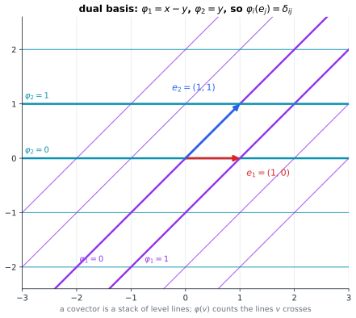
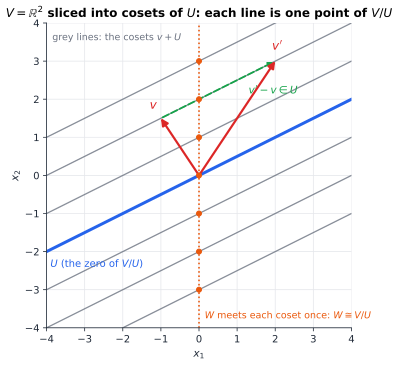

# Chapter 99 — Abstract Linear Algebra: Vectors Without Coordinates

[← Previous](62-category-theory.md) · [Track E](README.md) · [Table of Contents](../../00-front/table-of-contents.md) · [Next →](../f-logic-foundations/README.md)

> **Level 2 · Track E — The Abstract Mathematics Behind Everything**
> **Builds on:** [Ch. 8](../../part-3-linear-algebra/08-matrices-and-linear-systems.md), [Ch. 9](../../part-3-linear-algebra/09-vector-spaces-and-linear-transformations.md), [Ch. 10](../../part-3-linear-algebra/10-eigenvalues-and-eigenvectors.md) · **Leads to:** [Ch. 61](61-functional-analysis.md), [Ch. 93](../j-frontier/93-tensor-mathematics.md), [Ch. 95](../j-frontier/95-representation-theory.md) · **Related:** [Ch. 56](56-abstract-algebra.md), [Ch. 62](62-category-theory.md), [Ch. 79](../h-cryptography-coding/79-error-correcting-codes.md), [Ch. 90](../j-frontier/90-spectral-theory.md)
> **Reading time:** ~30 min

## 99.1 The hook

A temperature sensor sits on a metal bar. Along the bar the temperature rises steadily, and you record two things at the sensor: a small **displacement** $d$ (how far you moved it) and the **gradient** $g$ (how fast temperature changes with position). Working in metres, you write $d=2\ \text{m}$ and $g=3\ \text{K/m}$. The temperature change is $g\,d=6\ \text{K}$.

Your colleague works in centimetres. She writes $d=200\ \text{cm}$ and $g=0.03\ \text{K/cm}$. The temperature change is still $6\ \text{K}$, as it must be. But look at what happened to the numbers. When you shrank the unit by a factor of 100, the displacement's component got **100 times bigger** and the gradient's component got **100 times smaller**. Both are "vectors" with one component. They respond to a change of coordinates in *opposite* ways.

In three dimensions the same thing happens with full matrices: under a change of basis $\mathbf{P}$, displacements transform with $\mathbf{P}^{-1}$ and gradients with $\mathbf{P}^\mathsf{T}$. Store both as columns of three numbers and the same code works in an orthonormal frame and silently breaks in a skewed one; this is why graphics code must transform surface normals, which are gradients, by the inverse transpose.

So what *is* a vector, if a list of numbers can lie about it? And here is a second, sharper question. [Ch. 10](../../part-3-linear-algebra/10-eigenvalues-and-eigenvectors.md#103-diagonalization) showed how to diagonalize a matrix by choosing a basis of eigenvectors. But

$$
\mathbf{N}=\begin{bmatrix}0&1\\0&0\end{bmatrix}
\qquad\text{and}\qquad
\mathbf{R}=\begin{bmatrix}0&-1\\1&0\end{bmatrix}
$$

refuse. $\mathbf{N}$ has only one independent eigenvector, and $\mathbf{R}$, a quarter-turn of the plane, has no real eigenvectors at all. If diagonal is impossible, what is the *simplest* form to which every linear map can be brought, over any number system? The answer turns out to need almost no matrices. It needs the right way to think about vector spaces when nobody hands you coordinates.

## 99.2 The big idea

The core chapters taught linear algebra through matrices, which is how you compute. This chapter turns the picture round: the **linear map** is the real object, and a matrix is a *shadow* it casts once you pick a basis. Different bases cast different shadows ($\mathbf{P}^{-1}\mathbf{A}\mathbf{P}$, [Ch. 9](../../part-3-linear-algebra/09-vector-spaces-and-linear-transformations.md#95-linear-transformations)), and the questions worth asking are about what is the same in all of them.

An analogy: a sentence can be written in English, Bengali or French, and a grammar of its *meaning* must work in all of them. Coordinate-free linear algebra is that grammar, with four new tools.

1. **The dual space.** Gradients are not vectors at all. They are *machines that eat a vector and return a number* (the temperature change along it). Such machines form their own vector space, the dual $V^*$, and that is why they transform the other way.
2. **The quotient.** Sometimes you want to *ignore* a subspace: voltages up to a common ground offset, signals up to a DC component, states up to an unobservable mode. The quotient $V/U$ makes "equal up to something in $U$" into a new vector space.
3. **Invariant subspaces.** A map $T$ that cannot be diagonalized can still be *chopped*: find subspaces that $T$ maps into themselves, and study $T$ on each piece.
4. **Multilinear forms.** Determinants, inner products and the quadratic forms of [Ch. 10](../../part-3-linear-algebra/10-eigenvalues-and-eigenvectors.md#106-positive-definite-matrices) are functions of several vectors at once, linear in each. Seen without coordinates, the determinant becomes a single number attached to a map, the factor by which it scales oriented volume.

The payoff is the answer to the hook: every linear map on a finite-dimensional space, over any field, splits into a direct sum of a few standard pieces. Over $\mathbb{C}$ the pieces are **Jordan blocks**; over any field they are **companion matrices**. Both lists are complete invariants: two maps are similar exactly when their lists agree.

## 99.3 The mathematics

### Fields and spaces

Everything in [Ch. 9](../../part-3-linear-algebra/09-vector-spaces-and-linear-transformations.md#91-vector-spaces) works with scalars from any **field** $K$: a number system where you can add, subtract, multiply and divide by non-zero elements ([Ch. 56](56-abstract-algebra.md)). Besides $\mathbb{R}$ and $\mathbb{C}$, three fields matter in practice.

- $\mathbb{F}_2=\{0,1\}$ with $1+1=0$. The space $\mathbb{F}_2^3$ has just 8 vectors, and there are $(8-1)(8-2)(8-4)=168$ invertible $3\times3$ matrices over $\mathbb{F}_2$. Linear codes are subspaces of $\mathbb{F}_2^n$ ([Ch. 79](../h-cryptography-coding/79-error-correcting-codes.md)), and every theorem below applies to them.
- $\mathbb{Q}$, the rationals. $\mathbb{R}$ is a vector space over $\mathbb{Q}$ of *infinite* dimension, since $1,\sqrt2,\sqrt3,\pi,\dots$ are linearly independent over $\mathbb{Q}$.
- $\mathbb{C}$, whose key property is that every polynomial has a root. That single fact is why Jordan form exists over $\mathbb{C}$ and not over $\mathbb{R}$.

The linear maps $V\to W$ form a vector space $\operatorname{Hom}(V,W)$ of their own, of dimension $\dim V\cdot\dim W$.

### Dual spaces

> [!definition] Dual space
> The **dual** of $V$ is $V^*=\operatorname{Hom}(V,K)$, the space of linear functionals $\varphi:V\to K$, also called **covectors**. If $e_1,\dots,e_n$ is a basis of $V$, the **dual basis** $\varphi^1,\dots,\varphi^n$ of $V^*$ is defined by $\varphi^i(e_j)=\delta_{ij}$, so $\varphi^i$ reads off the $i$-th coordinate.

A covector on the plane is best pictured as a family of parallel, equally spaced **level lines**: $\varphi(v)$ counts how many lines $v$ crosses. The gradient of the hook is one: its value on a displacement is the temperature change. When the basis is not orthonormal, the dual basis does not point along the basis vectors at all.



*The dual basis of $e_1=(1,0)$, $e_2=(1,1)$ is $\varphi^1=x-y$, $\varphi^2=y$. Each $e_j$ crosses exactly one line of its own covector and lies along a level line of the other. Tilting $e_2$ would tilt the purple lines, not the teal ones.*

Linear maps act on covectors *backwards*. Given $T:V\to W$, the **dual map** $T^*:W^*\to V^*$ is $T^*(\psi)=\psi\circ T$: to measure a vector of $V$ with $\psi$, push it through $T$ first. No coordinates are involved. But choose coordinates and something familiar appears.

> [!theorem] The dual map is the transpose
> Let $T:V\to W$ have matrix $\mathbf{A}$ with respect to bases $(e_j)$ of $V$ and $(f_i)$ of $W$. Then $T^*$ has matrix $\mathbf{A}^\mathsf{T}$ with respect to the dual bases $(\psi^i)$ of $W^*$ and $(\varphi^j)$ of $V^*$.

*Proof.* The matrix of $T$ is defined by $Te_j=\sum_i a_{ij}f_i$. To find the matrix of $T^*$, expand $T^*\psi^i$ in the basis $\varphi^j$; the coefficient of $\varphi^j$ is $(T^*\psi^i)(e_j)$, because $\varphi^j$ is the only dual basis vector that is non-zero on $e_j$. Compute it:
$$
(T^*\psi^i)(e_j)=\psi^i(Te_j)=\psi^i\Big(\sum_k a_{kj}f_k\Big)=a_{ij}.
$$
So $T^*\psi^i=\sum_j a_{ij}\varphi^j$: the entry in row $j$, column $i$ of the matrix of $T^*$ is $a_{ij}$. That is $\mathbf{A}^\mathsf{T}$. ∎

The transpose was never "flip the array". It is the matrix of the map that pulls measurements back, and $(ST)^*=T^*S^*$ reverses order because pulling back reverses order. Now the hook is explained. Under a change of basis by $\mathbf{P}$, coordinates of vectors change by $\mathbf{P}^{-1}$, so coordinates of covectors must change by $\mathbf{P}^\mathsf{T}$ to keep every pairing $\varphi(v)$ unchanged. Displacements are vectors, gradients are covectors, and an inner product is exactly the extra structure that lets you convert one into the other ([Ch. 9, §9.8](../../part-3-linear-algebra/09-vector-spaces-and-linear-transformations.md#98-inner-products)). Without an inner product the two kinds stay apart.

**The double dual.** Every $v\in V$ defines a functional on $V^*$, "evaluate at $v$": $\operatorname{ev}_v(\varphi)=\varphi(v)$. This gives a map $\iota:V\to V^{**}$ that uses no basis, no inner product, nothing.

> [!theorem] Finite-dimensional spaces are their own double duals
> If $\dim V=n<\infty$, then $\iota:V\to V^{**}$, $v\mapsto\operatorname{ev}_v$, is a linear isomorphism, and it is natural: $T^{**}\circ\iota_V=\iota_W\circ T$ for every linear $T:V\to W$.

*Proof.* Linearity: $\operatorname{ev}_{av+bw}(\varphi)=a\varphi(v)+b\varphi(w)$. Injectivity: if $v\neq0$, extend $v$ to a basis and let $\varphi$ be the first dual basis vector; then $\operatorname{ev}_v(\varphi)=1\neq0$, so the kernel is zero. Dimensions: the dual basis shows $\dim V^*=n$, hence $\dim V^{**}=n$, and an injective linear map between spaces of equal finite dimension is onto (rank–nullity, [Ch. 9, §9.6](../../part-3-linear-algebra/09-vector-spaces-and-linear-transformations.md#96-null-space-and-column-space)). Naturality: for $\psi\in W^*$, $(T^{**}\operatorname{ev}_v)(\psi)=\operatorname{ev}_v(T^*\psi)=\psi(Tv)=\operatorname{ev}_{Tv}(\psi)$. ∎

Here is the point that [Ch. 62](62-category-theory.md) promised. $V$ and $V^*$ also have the same dimension, so they are isomorphic, but every isomorphism between them needs a choice (a basis, or an inner product), and none of them is natural. The double dual needs no choice. In the proof, the only place where finite dimension entered was the dimension count.

> [!mystery] When the double dual is bigger
> In infinite dimensions $\iota:V\to V^{**}$ is still injective, but it can fail to be onto: the dual of the space of absolutely summable sequences is the space of bounded sequences, and the dual of *that* is far larger than where we started. Worse, the "algebraic" dual of a function space is so big that analysts throw most of it away and keep only the continuous functionals, among them the Dirac delta.
> Which functionals survive, and why the Dirac delta turns out to be a covector, is the business of [Ch. 61](61-functional-analysis.md).

For a subspace $U\subseteq V$, the **annihilator** $U^0=\{\varphi\in V^*:\varphi(u)=0\ \text{for all}\ u\in U\}$ is the set of measurements blind to $U$, and $\dim U+\dim U^0=\dim V$. A subspace of dimension $k$ in $\mathbb{R}^n$ is cut out by exactly $n-k$ independent linear equations; the annihilator is the space of those equations.

### Quotients and direct sums

> [!definition] Quotient space
> For a subspace $U\subseteq V$, the **coset** of $v$ is $v+U=\{v+u:u\in U\}$. The **quotient** $V/U$ is the set of cosets, with $(v+U)+(w+U)=(v+w)+U$ and $c(v+U)=cv+U$. Its zero is $U$ itself, and $v+U=v'+U$ exactly when $v'-v\in U$.

The operations are well defined because changing representatives changes the answer only by something in $U$. Geometrically, $V/U$ collapses each translate of $U$ to a single point.



*$V/U$ for a line $U$ in $\mathbb{R}^2$: every grey line is one element. Any complement $W$ meets each coset exactly once, which is why $V/U\cong W$, but the quotient itself does not depend on which $W$ you pick.*

Engineers already work in quotients. Node potentials are defined only up to a common constant, so the physical object lives in $\mathbb{R}^n/\operatorname{span}(1,\dots,1)$, and "grounding a node" is choosing a complement ([Ch. 9, §9.6](../../part-3-linear-algebra/09-vector-spaces-and-linear-transformations.md#96-null-space-and-column-space)). An indefinite integral is an element of a quotient by the constants.

> [!theorem] First isomorphism theorem
> For linear $T:V\to W$, the map $\bar T:V/\ker T\to\operatorname{im}T$, $\bar T(v+\ker T)=Tv$, is a well-defined linear isomorphism. In particular, if $V$ is finite-dimensional, $\dim V=\dim\ker T+\dim\operatorname{im}T$.

*Proof.* Well defined: if $v+\ker T=v'+\ker T$ then $v'-v\in\ker T$, so $Tv'=Tv$. Linear: inherited from $T$. Onto $\operatorname{im}T$: by definition. One-to-one: $\bar T(v+\ker T)=0$ means $Tv=0$, so $v\in\ker T$, so $v+\ker T$ is the zero coset. For the dimension count, pick a basis $u_1,\dots,u_k$ of $U=\ker T$ and extend it to a basis $u_1,\dots,u_k,w_1,\dots,w_m$ of $V$. The cosets $w_1+U,\dots,w_m+U$ span $V/U$ (the $u$'s vanish modulo $U$) and are independent (a relation $\sum c_iw_i\in U$ forces all $c_i=0$ by independence of the full basis), so $\dim V/U=\dim V-\dim U$. Combine with $V/\ker T\cong\operatorname{im}T$. ∎

That is rank–nullity ([Ch. 9](../../part-3-linear-algebra/09-vector-spaces-and-linear-transformations.md#96-null-space-and-column-space)) with the matrices removed: a linear map is "collapse the kernel, then embed isomorphically". The same theorem, word for word, holds for groups and rings ([Ch. 56](56-abstract-algebra.md)).

**Direct sums.** $V=U\oplus W$ means every $v$ is *uniquely* $u+w$ with $u\in U$, $w\in W$; equivalently $U+W=V$ and $U\cap W=\{0\}$. Direct sums correspond exactly to **projections**: linear maps with $P^2=P$. Given $P$, take $U=\operatorname{im}P$ and $W=\ker P$; given the decomposition, let $P(u+w)=u$. In a basis adapted to $U\oplus W$, a projection is $\operatorname{diag}(\mathbf{I},\mathbf{0})$, and a map that preserves both pieces is **block diagonal**.

### Invariant subspaces

A subspace $U$ is **invariant** under $T:V\to V$ if $T(U)\subseteq U$. Eigenvector lines are the one-dimensional examples; $\ker T$, $\operatorname{im}T$ and $\ker p(T)$ for any polynomial $p$ are others. An invariant subspace gives two smaller maps: the **restriction** $T|_U:U\to U$ and the **induced map** $\bar T:V/U\to V/U$, $\bar T(v+U)=Tv+U$ (well defined precisely because $T(U)\subseteq U$). In a basis that starts with a basis of $U$,
$$
[T]=\begin{bmatrix}[T|_U]&\ast\\ \mathbf{0}&[\bar T]\end{bmatrix},
\qquad
\chi_T(x)=\chi_{T|_U}(x)\,\chi_{\bar T}(x),
$$
since the determinant of a block-triangular matrix is the product of the diagonal blocks' determinants ([Ch. 8, §8.3](../../part-3-linear-algebra/08-matrices-and-linear-systems.md#83-determinants)). This is the engine of every canonical form: find an invariant subspace, split off the restriction, and *recurse on the quotient*. Over $\mathbb{C}$ the engine never stalls, because every map has an eigenvalue and so a one-dimensional invariant subspace. Induction on dimension then gives **Schur's triangularization**: every operator on a finite-dimensional complex space has an upper-triangular matrix in a suitable basis. Over $\mathbb{R}$ the engine can stall: the quarter-turn $\mathbf{R}$ has no invariant line, so the smallest invariant pieces may be planes.

> [!mystery] Two maps at once
> The recursion above classifies one map up to change of basis completely. Try two maps $S,T$ on the same space, changed by the *same* basis $\mathbf{P}$ ($\mathbf{P}^{-1}\mathbf{S}\mathbf{P}$, $\mathbf{P}^{-1}\mathbf{T}\mathbf{P}$), and the problem changes character: there is no finite list of standard pieces, and a full classification of pairs would classify the modules of every finite-dimensional algebra at once. Mathematicians call such problems **wild**.
> Why pairs are wild while single maps are tame is one of the deep results of [Ch. 95](../j-frontier/95-representation-theory.md).

### Jordan and rational canonical forms

Over $\mathbb{C}$ the characteristic polynomial factors as $\chi_T(x)=\prod_i(x-\lambda_i)^{m_i}$. The **generalized eigenspace** $V_{\lambda}=\ker(T-\lambda I)^{m}$ is invariant, and $V$ is their direct sum (a consequence of Cayley–Hamilton, [Ch. 10, §10.1](../../part-3-linear-algebra/10-eigenvalues-and-eigenvectors.md#101-characteristic-equations), plus coprimality of the factors). On each $V_\lambda$, the map $N=T-\lambda I$ is **nilpotent**: some power is zero. So everything reduces to understanding nilpotent maps.

A nilpotent $N$ moves vectors along **chains**: $v\mapsto Nv\mapsto N^2v\mapsto\dots\mapsto0$. The main structure theorem, which we state, says that $V_\lambda$ has a basis consisting of disjoint chains. In the basis $N^{k-1}v,\dots,Nv,v$ of one chain, $N$ shifts each vector to the previous one, and its matrix is a **Jordan block**: zeros on the diagonal, ones just above it. Adding back $\lambda I$:

$$
J_k(\lambda)=\begin{bmatrix}\lambda&1&&\\&\lambda&\ddots&\\&&\ddots&1\\&&&\lambda\end{bmatrix}\quad(k\times k).
$$


*A nilpotent map on a 6-dimensional space with chains of lengths 3, 2, 1. The bottom row spans $\ker N$; the bottom two rows span $\ker N^2$; all three span $\ker N^3$. Counting dots row by row recovers the block sizes.*

The remarkable fact is that the chain lengths, and hence the Jordan form, are determined by numbers anyone can compute.

> [!theorem] Counting Jordan blocks
> Let $N$ be nilpotent on $V$ with a chain basis, and let $d_k=\dim\ker N^k$ ($d_0=0$). Then
> $$
> \#\{\text{blocks of size}\ \ge k\}=d_k-d_{k-1},\qquad \#\{\text{blocks of size exactly}\ k\}=2d_k-d_{k-1}-d_{k+1}.
> $$
> In particular the block sizes do not depend on which chain basis you found.

*Proof.* Number the vectors of a chain of length $\ell$ by their **height**: $N^{\ell-j}v$ has height $j$, so $v$ has height $\ell$ and the last non-zero vector $N^{\ell-1}v$ has height 1. A basis vector of height $j$ is sent to zero by $N^k$ exactly when $j\le k$, and $N^k$ maps the basis vectors of height $j>k$ to *distinct* basis vectors of height $j-k$, which are independent. So $\ker N^k$ is spanned by the basis vectors of height at most $k$, and $d_k$ counts them. Hence $d_k-d_{k-1}$ counts basis vectors of height exactly $k$. Each chain of length $\ge k$ has exactly one such vector, and shorter chains have none. That is the first formula; the second is the first at $k$ minus the first at $k+1$. The $d_k$ depend only on $N$, never on the basis, so neither do the block sizes. ∎

In the figure, $d_1,d_2,d_3=3,5,6$, so there are $3$ blocks of size $\ge1$, $2$ of size $\ge2$, $1$ of size $\ge3$: sizes $3,2,1$. The hook's $\mathbf{N}$ is $J_2(0)$, the smallest map that no basis can diagonalize. The **Jordan form theorem** puts the pieces together: over $\mathbb{C}$, every operator is similar to a block-diagonal matrix of Jordan blocks, unique up to the order of the blocks, and two matrices are similar exactly when they have the same blocks.

Over a field where polynomials don't split, such as $\mathbb{R}$ or $\mathbb{Q}$, use a different chain. Pick $v$ and follow $v,Tv,T^2v,\dots$ until the vectors become dependent. The span is invariant, and in the basis $v,Tv,\dots,T^{k-1}v$ the matrix of $T$ is the **companion matrix** of the polynomial $x^k+c_{k-1}x^{k-1}+\dots+c_0$ that expresses $T^kv$ in terms of the earlier vectors. The **rational canonical form** says every operator over every field is similar to a block-diagonal matrix of companion matrices $C(p_1),\dots,C(p_r)$ with $p_1\mid p_2\mid\dots\mid p_r$, uniquely. For the quarter-turn $\mathbf{R}$, $v=e_1$ gives $Tv=e_2$ and $T^2v=-e_1$, so the polynomial is $x^2+1$ and $\mathbf{R}$ is already its own companion matrix. That is the honest answer to the hook over $\mathbb{R}$: the irreducible polynomial $x^2+1$, not a pair of imaginary eigenvalues, is the real invariant.

### Multilinear forms

A **bilinear form** $B:V\times V\to K$ is linear in each slot. Inner products, the quadratic energy forms $\mathbf{x}^\mathsf{T}\mathbf{K}\mathbf{x}$ of [Ch. 10](../../part-3-linear-algebra/10-eigenvalues-and-eigenvectors.md#106-positive-definite-matrices), and the symplectic form of mechanics are examples. In a basis, $B(x,y)=\mathbf{x}^\mathsf{T}\mathbf{B}\mathbf{y}$, and under a change of basis $\mathbf{B}\mapsto\mathbf{P}^\mathsf{T}\mathbf{B}\mathbf{P}$, *not* $\mathbf{P}^{-1}\mathbf{B}\mathbf{P}$. Forms and operators are different objects that both happen to be stored as square arrays. A form eats two vectors; an operator eats one vector and returns a vector. They agree only when $\mathbf{P}^\mathsf{T}=\mathbf{P}^{-1}$, which is why the distinction is invisible in orthonormal coordinates. For real symmetric forms the invariant under congruence is not the eigenvalues but only their *signs*: the numbers of positive, negative and zero eigenvalues (**Sylvester's law of inertia**).

An $n$-linear form $\omega$ on an $n$-dimensional space is **alternating** if it vanishes whenever two arguments are equal (so it changes sign when two are swapped). Expanding each argument in a basis shows that $\omega$ is fixed by its single value $\omega(e_1,\dots,e_n)$, so the alternating $n$-forms form a **one-dimensional** space. Any operator $T$ acts on it by $\omega\mapsto\omega(T\cdot,\dots,T\cdot)$, and a linear map on a one-dimensional space is multiplication by a scalar. That scalar *is* the determinant:

$$
\omega(Tv_1,\dots,Tv_n)=(\det T)\,\omega(v_1,\dots,v_n)\quad\text{for all}\ \omega,v_1,\dots,v_n .
$$

No matrix, no cofactor expansion, no basis. Multiplicativity is now one line: applying $S$ after $T$ multiplies by $\det T$, then by $\det S$, so $\det(ST)=\det S\det T$. And $\det T$ is visibly the factor by which $T$ scales oriented volume, since $\omega$ measures oriented volume.

> [!mystery] One space for all bilinear maps
> Bilinear maps $V\times W\to X$ are not linear maps on $V\times W$. Yet there is a single space $V\otimes W$ such that bilinear maps out of $V\times W$ are *exactly* linear maps out of $V\otimes W$, and the alternating forms above live in a quotient of $V\otimes\dots\otimes V$.
> How that space is built, and why physicists' upper and lower indices are just vectors and covectors in disguise, is the subject of [Ch. 93](../j-frontier/93-tensor-mathematics.md).

## 99.4 The algorithm

The counting theorem is an algorithm: to find the Jordan blocks for an eigenvalue $\lambda$, compute $d_k=\dim\ker(\mathbf{A}-\lambda\mathbf{I})^k=n-\operatorname{rank}(\mathbf{A}-\lambda\mathbf{I})^k$ until it stops growing, and read off the sizes. No chain basis is needed.

```python
import numpy as np

def jordan_structure(A, lam, tol=1e-9):
    """Sizes of the Jordan blocks of A for eigenvalue lam, from kernel dimensions."""
    n = A.shape[0]
    N = A - lam * np.eye(n)
    d = [0]                                   # d[k] = dim ker N^k
    P = np.eye(n)
    while True:
        P = P @ N
        d.append(int(n - np.linalg.matrix_rank(P, tol=tol)))
        if d[-1] == d[-2]:
            break
    at_least = [d[k] - d[k - 1] for k in range(1, len(d))]   # blocks of size >= k
    sizes = []
    for k, m in enumerate(at_least, start=1):
        nxt = at_least[k] if k < len(at_least) else 0
        sizes += [k] * (m - nxt)                              # blocks of size exactly k
    return d[1:-1], sorted(sizes, reverse=True)

# A matrix with eigenvalue 2 only, disguised by a change of basis
J = np.diag([2.0] * 6) + np.diag([1, 1, 0, 1, 0], k=1)       # blocks 3, 2, 1
S = np.eye(6) + np.eye(6, k=1) + np.eye(6, k=-1)                # det S = 1
A = S @ J @ np.linalg.inv(S)
print(np.round(A, 3))
print("dim ker (A-2I)^k:", *jordan_structure(A, 2.0))
print("eigvals of A, distance from 2:", np.round(np.sort(abs(np.linalg.eigvals(A) - 2)), 8))

# the same computation after a tiny perturbation of size 1e-10
E = 1e-10 * np.random.default_rng(0).standard_normal((6, 6))
for tol in (1e-8, 1e-12):
    print(f"perturbed, tol={tol:g}:", jordan_structure(A + E, 2.0, tol))
```

The disguised matrix is an integer matrix with no visible structure, yet the script reports $d_k=3,5,6$ and blocks $[3,2,1]$, the figure's chains exactly. Each rank costs one SVD, $O(n^3)$, and there are at most $n$ powers, so the cost is $O(n^4)$ per eigenvalue.

Now the warning. The same script asks `numpy` for the eigenvalues of the *exact* integer matrix $\mathbf{A}$, whose only eigenvalue is $2$. It returns three of them about $3.3\times10^{-6}$ away from $2$. Rounding errors of size $10^{-16}$ have been amplified to $10^{-6}$, roughly $(10^{-16})^{1/3}$, because a Jordan block of size 3 spreads a perturbation $\varepsilon$ into eigenvalues at distance about $\varepsilon^{1/3}$. After a deliberate perturbation of size $10^{-10}$, the rank test with tolerance $10^{-8}$ still finds $[3,2,1]$; with tolerance $10^{-12}$ it finds *no* eigenvalue $2$ at all, which is the exact truth for the perturbed matrix.

Both answers are correct. The Jordan form is a **discontinuous** function of the matrix: every non-diagonalizable matrix is a limit of diagonalizable ones. So numerical libraries compute the stable Schur form instead, and the Jordan form is asked for only in exact arithmetic over $\mathbb{Q}$ or $\mathbb{F}_p$. The tolerance is your claim about how much of the matrix is real.

## 99.5 The experiment

How sensitive is a Jordan block? Take the $n\times n$ block $J_n(0)$, whose only eigenvalue is $0$, and put $\varepsilon$ in the bottom-left corner. The characteristic polynomial becomes $x^n-\varepsilon$, so every eigenvalue jumps to distance $\varepsilon^{1/n}$ from $0$. A diagonalizable matrix would move them by about $\varepsilon$.

```desmos-graph
left=0; right=0.01; bottom=0; top=1
---
y=x|grey
y=x^{\frac{1}{2}}|blue
y=x^{\frac{1}{8}}|red
(0.0001,0.3162)|label:0.32 at eps 0.0001
```

*Eigenvalue displacement against perturbation size $\varepsilon$: grey for a diagonalizable matrix, blue for a $2\times2$ Jordan block, red for an $8\times8$ block. Change the exponent $\frac18$ to $\frac{1}{20}$ and watch the curve become a wall.*

The script draws the eigenvalues in the complex plane. With the defaults it prints `max|lambda| = 1.000e-02` for $\varepsilon=10^{-16}$: a perturbation at the level of rounding error moves the eigenvalues of an $8\times8$ block by $0.01$, fourteen orders of magnitude more.

```python
import numpy as np
import matplotlib.pyplot as plt

# KNOBS: block size n, perturbation sizes, and where the perturbation goes
n = 8
epsilons = [1e-16, 1e-12, 1e-8, 1e-4]
corner_only = True        # False: perturb every entry at random

J = np.diag(np.ones(n - 1), k=1)          # nilpotent Jordan block: only eigenvalue 0
rng = np.random.default_rng(1)
fig, ax = plt.subplots(figsize=(6, 6))
for eps in epsilons:
    E = np.zeros((n, n))
    if corner_only:
        E[-1, 0] = eps                    # the single entry that closes the chain
    else:
        E = eps * rng.standard_normal((n, n))
    lam = np.linalg.eigvals(J + E)
    r = np.abs(lam).max()
    print(f"eps={eps:.0e}  max|lambda|={r:.3e}  eps^(1/n)={eps ** (1 / n):.3e}")
    ax.plot(lam.real, lam.imag, "o", label=f"eps = {eps:.0e}")
ax.set_aspect("equal"); ax.grid(True); ax.legend()
ax.set_title(f"eigenvalues of a perturbed {n}x{n} Jordan block (exact answer: all 0)")
plt.show()
```

Things to try: set `n = 20` and see $\varepsilon=10^{-16}$ produce eigenvalues of size about $0.16$; set `corner_only = False` and check that random perturbations obey the same $\varepsilon^{1/n}$ law; replace `J` by a diagonal matrix and watch the effect collapse to size $\varepsilon$.

## 99.6 The challenge

1. **Intuition.** In $\mathbb{R}^3$, describe $V/U$ when $U$ is a line, and when $U$ is a plane. Why is there a natural map $V\to V/U$ but no natural map $V/U\to V$? Which of the two covector families in the dual-basis figure moves if you replace $e_1$ by $(2,0)$?
2. **Derivation.** Prove $\dim U+\dim U^0=\dim V$, and show that $(\operatorname{im}T)^0=\ker T^*$. Deduce, without matrices, that row rank equals column rank.
3. **Implementation.** Write `rational_form(A)` for integer matrices using exact `fractions.Fraction` arithmetic: grow cyclic chains $v,Av,A^2v,\dots$ until they become dependent, record the polynomial, and split off the invariant subspace. Test it on $\mathbf{R}$ (expect $x^2+1$) and on a $4\times4$ matrix with characteristic polynomial $(x^2+1)^2$.
4. **Open investigation.** For random $n\times n$ matrices $\mathbf{E}$ with independent Gaussian entries, how does the *distribution* of eigenvalues of $J_n(0)+\varepsilon\mathbf{E}$ look as $n$ grows with $\varepsilon$ fixed? Does it concentrate on a circle of radius $\varepsilon^{1/n}$, fill a disc, or do something else? Explore numerically and form a conjecture.

## 99.7 Loose threads

This chapter stated, rather than proved, the existence of chain bases and the rational canonical form. Both are one theorem in disguise: a vector space with an operator $T$ is a module over the polynomial ring $K[x]$ (let $x$ act as $T$), and the **structure theorem for finitely generated modules over a principal ideal domain** decomposes it into cyclic pieces. The same theorem classifies finite abelian groups, with $\mathbb{Z}$ in place of $K[x]$; its home is the ring theory of [Ch. 56](56-abstract-algebra.md).

The numerical fragility of §99.4 also has a modern answer. Since eigenvalues of non-normal matrices are unreliable, analysts study **pseudospectra**, the sets where $\lVert(\mathbf{A}-z\mathbf{I})^{-1}\rVert$ is large, which are stable and explain transient growth in fluid flows and lasers ([Ch. 90](../j-frontier/90-spectral-theory.md)).

The three mysteries lead out of the track: continuous functionals in infinite dimensions ([Ch. 61](61-functional-analysis.md)), the wildness of pairs of matrices ([Ch. 95](../j-frontier/95-representation-theory.md)), and the tensor product ([Ch. 93](../j-frontier/93-tensor-mathematics.md)). Quotients by "functions that vanish almost everywhere", which turn functions into vectors of $L^2$, are waiting in measure theory ([Ch. 97](../j-frontier/97-measure-theory.md)).

## Further reading

- Sheldon Axler, *Linear Algebra Done Right*, 4th ed., Springer, 2024 (open access). Operators first, determinants last; the natural next book.
- Paul Halmos, *Finite-Dimensional Vector Spaces*, 2nd ed., Van Nostrand, 1958 (Springer reprint, 1974). The classic coordinate-free treatment, written as preparation for Hilbert space.
- Kenneth Hoffman and Ray Kunze, *Linear Algebra*, 2nd ed., Prentice Hall, 1971. Thorough on invariant subspaces and the rational and Jordan forms.
- Lloyd N. Trefethen and Mark Embree, *Spectra and Pseudospectra*, Princeton University Press, 2005. What happens to all of this on a computer.
