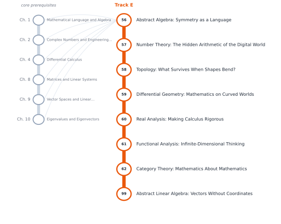

# Track E — The Abstract Mathematics Behind Everything

[← Table of Contents](../../00-front/table-of-contents.md) · [Start: Ch. 56 →](56-abstract-algebra.md)

> **Level 2 — Specializations.** The common structures hiding beneath seemingly unrelated problems.

*Suggested reading order for Track E. The grey stations on the left are the core chapters it leans on.*

## Before you start

This track assumes you are comfortable with these core chapters:

- Ch. 1 — [Mathematical Language and Algebra](../../part-1-foundations/01-mathematical-language-and-algebra.md)
- Ch. 2 — [Complex Numbers and Engineering Representation](../../part-1-foundations/02-complex-numbers.md)
- Ch. 4 — [Differential Calculus](../../part-2-calculus/04-differential-calculus.md)
- Ch. 8 — [Matrices and Linear Systems](../../part-3-linear-algebra/08-matrices-and-linear-systems.md)
- Ch. 9 — [Vector Spaces and Linear Transformations](../../part-3-linear-algebra/09-vector-spaces-and-linear-transformations.md)
- Ch. 10 — [Eigenvalues and Eigenvectors](../../part-3-linear-algebra/10-eigenvalues-and-eigenvectors.md)

## Chapters

| Ch. | Chapter | What it explores |
|---|---|---|
| 56 | [Abstract Algebra: Symmetry as a Language](56-abstract-algebra.md) | Groups, rings, fields, homomorphisms, quotient structures, group actions, and symmetry. Applications: cryptography, coding theory, geometry, physics. |
| 57 | [Number Theory: The Hidden Arithmetic of the Digital World](57-number-theory.md) | Primes, modular arithmetic, congruences, Diophantine equations, finite fields, elliptic curves, computational number theory. Applications: cryptography, pseudorandom generators, error-correcting codes. |
| 58 | [Topology: What Survives When Shapes Bend?](58-topology.md) | Continuity, compactness, connectedness, homeomorphisms, fundamental groups, homology, topological data analysis. Applications: geometry, robotics, data analysis, dynamical systems. |
| 59 | [Differential Geometry: Mathematics on Curved Worlds](59-differential-geometry.md) | Manifolds, tangent spaces, differential forms, curvature, geodesics, tensors, Riemannian geometry. Applications: robotics, computer graphics, mechanics, relativity. |
| 60 | [Real Analysis: Making Calculus Rigorous](60-real-analysis.md) | Limits, continuity, sequences, series, metric spaces, completeness, measure, integration, convergence theorems. Applications: probability theory, optimization, mathematical proof. |
| 61 | [Functional Analysis: Infinite-Dimensional Thinking](61-functional-analysis.md) | Normed and Banach spaces, Hilbert spaces, operators, dual spaces, spectral theory, weak convergence. Applications: quantum mechanics, PDEs, signal processing, inverse problems. |
| 62 | [Category Theory: Mathematics About Mathematics](62-category-theory.md) | Categories, functors, natural transformations, universal properties, limits, adjunctions. Applications: type theory, programming language design, abstract algebra, compositional systems. |
| 99 | [Abstract Linear Algebra: Vectors Without Coordinates](99-abstract-linear-algebra.md) | Vector spaces over arbitrary fields, linear maps as the primary objects, dual spaces, quotients, direct sums, invariant subspaces, Jordan and rational canonical forms, multilinear forms. An independent advanced module bridging the core linear algebra chapters to functional analysis, representation theory and tensors. |

Every chapter follows the same arc: **the hook** (a puzzle or a failure), **the big idea**, **the mathematics**, **the algorithm**, **the experiment** you can run, **the challenge**, and **loose threads**: the questions the chapter deliberately leaves open.
