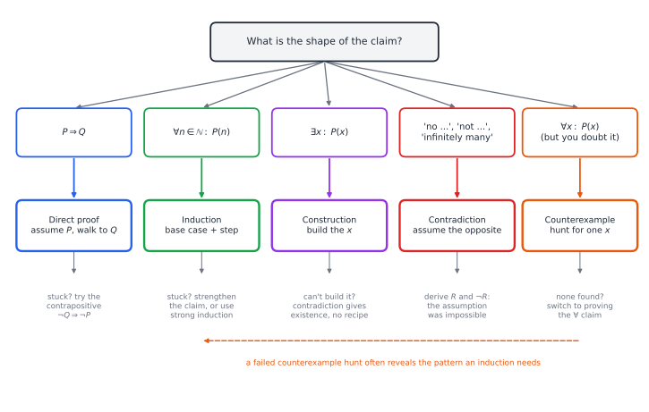
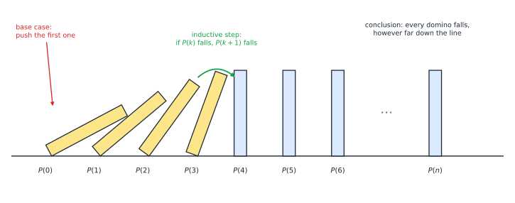
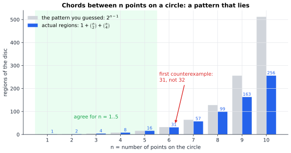

# Chapter 63 — How to Think Like a Mathematician

[← Previous](README.md) · [Track F](README.md) · [Table of Contents](../../00-front/table-of-contents.md) · [Next →](64-set-theory-and-infinity.md)

> **Level 2 · Track F — Logic, Proofs, and the Foundations of Truth**
> **Builds on:** [Ch. 1](../../part-1-foundations/01-mathematical-language-and-algebra.md), [Ch. 29](../a-algorithms/29-discrete-mathematics-and-logic.md) · **Leads to:** [Ch. 64](64-set-theory-and-infinity.md), [Ch. 65](65-mathematical-logic.md), [Ch. 67](67-formal-verification.md) · **Related:** [Ch. 28](../a-algorithms/28-combinatorics.md), [Ch. 57](../e-abstract-math/57-number-theory.md), [Ch. 66](66-type-theory-curry-howard.md)
> **Reading time:** ~25 min

## 63.1 The hook

Put two points on a circle and join them: the disc is cut into 2 regions. Three points, all chords drawn: 4 regions. Four points: 8. Five points: 16. Anyone who has seen the sequence $1, 2, 4, 8, 16$ knows what comes next. Draw six points (in general position, so that no three chords meet at one interior point), count carefully, and you get **31**.

Not 32. Thirty-one. The pattern was a liar, and it lied politely for five steps before it betrayed you.

It gets worse. The polynomial $n^2+n+41$, found by Euler, produces primes for $n=0,1,2,\dots,39$: $41, 43, 47, 53, 61, \dots, 1601$. Forty primes in a row. At $n=40$ it gives $1681=41^2$. Euler also guessed that you need at least $k$ $k$-th powers to add up to a $k$-th power. For two centuries nobody found an exception, until in 1966 a computer search turned up

$$
27^5+84^5+110^5+133^5=144^5,
$$

four fifth powers summing to a fifth power. And Fermat, perhaps the greatest pattern-spotter of all, claimed that every number $2^{2^m}+1$ is prime. It is for $m=0,1,2,3,4$ (giving $3, 5, 17, 257, 65537$). For $m=5$, Euler found $2^{32}+1 = 4294967297 = 641\times 6700417$.

Now a puzzle with the opposite flavour. Take a $2^n\times 2^n$ chessboard and delete any one square you like. Can the rest always be tiled by L-shaped trominoes (three squares forming an L)? For $n=1$ the board is $2\times2$ minus a square, which *is* an L. For $n=2$ you can find a tiling by hand in a minute. For $n=10$ the board has $1{,}048{,}576$ squares and over a million choices of missing square, and the number of ways to place trominoes is beyond any computer. Testing is hopeless. Yet the answer is yes, for every $n$ and every missing square, and by the end of §63.3 you will have seen why with your own eyes, in about ten lines.

So here is the question this chapter is about:

> **When a pattern has held a thousand times, how do you know it will hold the thousand-and-first time, and how do you decide which tool will tell you?**

## 63.2 The big idea

A **proof** is a finite argument that settles infinitely many cases at once. Testing checks cases one at a time and never finishes; a proof finds a reason that applies to all of them. The two activities are partners: testing suggests what might be true, and proof decides it. A single failed test kills a universal claim outright, while a million passed tests do not establish it.

A programmer's analogy works well. A theorem is a specification, a proof is an implementation that has been checked to meet it, and a counterexample is a failing test case. A failing test is decisive; a passing test suite is only evidence. ([Ch. 29](../a-algorithms/29-discrete-mathematics-and-logic.md) takes this analogy literally and proves programs correct; [Ch. 66](66-type-theory-curry-howard.md) will show it is more than an analogy.)

The second idea is that the *shape of the claim* usually tells you which tool to reach for. Mathematicians are not geniuses who pull proofs out of the air; they read the logical form of the statement and pick from a small toolkit, the way an engineer reads a circuit and decides between nodal and mesh analysis.



*Figure 63.1 — Read the claim's logical shape, pick the matching strategy, and know the fallback when you get stuck. Hunting for counterexamples is not a separate activity: it is how you find out which box you are in.*

The five boxes are the whole chapter:

- **Direct proof.** To prove $P\Rightarrow Q$, assume $P$ and walk, step by valid step, to $Q$.
- **Contradiction.** To prove $S$, assume $\neg S$ and derive something absurd. Best for negative claims: "there is no...", "is irrational", "there are infinitely many...".
- **Induction.** To prove $P(n)$ for every natural number $n$, prove $P(0)$ and prove that $P(k)$ forces $P(k+1)$.
- **Construction.** To prove $\exists x\,P(x)$, build an $x$ and check it.
- **Counterexample.** To refute $\forall x\,P(x)$, exhibit one $x$ with $\neg P(x)$.

Ch. 1 lists the first four in [§1.10](../../part-1-foundations/01-mathematical-language-and-algebra.md#110-mathematical-notation-and-dimensional-consistency), and Ch. 29 develops the variants of induction (strong induction, well-ordering, structural induction) in [§29.3](../a-algorithms/29-discrete-mathematics-and-logic.md#induction-three-ways). This chapter is about *using* them: what each one feels like from the inside, where each one breaks, and how to choose.

## 63.3 The mathematics

We need one piece of vocabulary from logic, covered in Ch. 29's [predicate-logic section](../a-algorithms/29-discrete-mathematics-and-logic.md#predicate-logic-saying-for-every-input): $P\Rightarrow Q$ is false only when $P$ is true and $Q$ false, and $\neg\forall x\,P(x)$ is equivalent to $\exists x\,\neg P(x)$. That last equivalence is the entire theory of counterexamples.

### Direct proof and the contrapositive

> [!definition] Even, odd, divides
> An integer $n$ is **even** if $n=2k$ for some integer $k$, and **odd** if $n=2k+1$. We write $a\mid b$ ("$a$ divides $b$") if $b=ak$ for some integer $k$.

A direct proof unpacks definitions, manipulates, and repacks. Claim: *if $a\mid b$ and $b\mid c$ then $a\mid c$.* Assume $b=ak$ and $c=bl$. Then $c=a(kl)$, and $kl$ is an integer, so $a\mid c$. $\square$ Three lines, and nothing clever: the definitions did the work. Most proofs you will ever write look like this, and the skill is mostly in writing down the definitions precisely before you start.

Sometimes the forward walk has nowhere to go. Claim: *if $n^2$ is even then $n$ is even.* Assume $n^2=2k$. Now what? Taking square roots leads nowhere. The **contrapositive** $\neg Q\Rightarrow\neg P$ is logically equivalent to $P\Rightarrow Q$ (check the four rows of a truth table), and here it is easy: if $n$ is odd, $n=2k+1$, then $n^2=4k^2+4k+1=2(2k^2+2k)+1$ is odd. $\square$ The lesson is general: when the hypothesis is weak and the conclusion is strong, flip the implication so that the strong statement becomes the hypothesis. This lemma is exactly the step used in the irrationality of $\sqrt2$ in [§1.1](../../part-1-foundations/01-mathematical-language-and-algebra.md#11-real-and-complex-number-systems).

### Proof by contradiction

Contradiction is the most powerful and the most dangerous tool. You assume the claim is false, reason until you reach a statement and its negation, and conclude that the assumption was impossible. Its power is that you get a free hypothesis to work with. Its danger is that if you make an ordinary mistake along the way, you also "reach a contradiction", and the proof looks just as convincing.

> [!theorem] Theorem 63.1 — Euclid: there are infinitely many primes
> For every finite list of primes, there is a prime not on the list.

*Proof.* Suppose, for contradiction, that $p_1,p_2,\dots,p_m$ is a complete list of all primes. Let $N=p_1p_2\cdots p_m+1$. Since $N\ge 3>1$, $N$ has at least one prime factor $q$ (the smallest divisor of $N$ greater than 1 must be prime, because any proper factor of it would be a smaller divisor). By assumption $q$ is one of the $p_i$. Then $q\mid p_1\cdots p_m$ and $q\mid N$, so $q$ divides their difference, $N-p_1\cdots p_m=1$. No prime divides 1. Contradiction, so no finite list contains all primes. $\square$

A common misreading: "$p_1\cdots p_m+1$ is always prime." It is not. With the first six primes, $2\cdot3\cdot5\cdot7\cdot11\cdot13+1=30031=59\times509$. The proof never claimed $N$ was prime, only that its prime factors were new. Read the proof again and notice that it can be rewritten *without* contradiction: given any list, $N$'s smallest prime factor is a new prime, and that is a construction. Many proofs by contradiction hide a direct proof inside; finding it usually gives you more information.

### Induction, and the art of strengthening

Ch. 29 states the principle and its variants. Figure 63.2 is the picture to keep in your head.



*Figure 63.2 — Induction as a line of dominoes. The base case knocks over the first one; the inductive step guarantees that every falling domino knocks over the next. Neither half alone is enough: a perfect step with no push does nothing, and a push with one gap in the line stops the cascade.*

The domino picture also explains the classic failure. "All horses are the same colour": in any set of $k+1$ horses, the first $k$ share a colour and the last $k$ share a colour, and these overlap, so all $k+1$ do. The step fails exactly from $k=1$ to $k=2$, where the "first one" and the "last one" do not overlap. One gap in the line of dominoes, and the whole cascade stops at the second domino.

Now the tromino puzzle from the hook. Here is the surprising lesson: the stronger claim is *easier* to prove.

> [!theorem] Theorem 63.2 — Tromino tiling
> For every $n\ge1$ and every choice of one square to remove, the remaining $4^n-1$ squares of a $2^n\times2^n$ board can be tiled by L-trominoes.

*Proof.* By induction on $n$. Let $P(n)$ be the full statement, "for **every** missing square".

*Base case $n=1$.* A $2\times2$ board minus any one square is itself an L-tromino.

*Inductive step.* Assume $P(k)$ and take a $2^{k+1}\times2^{k+1}$ board with one square removed. Cut it into four $2^k\times2^k$ quadrants. The missing square lies in one of them. Place a single tromino at the centre of the board so that it covers one square from each of the *other three* quadrants (the three central corners). Now each of the four quadrants is a $2^k\times2^k$ board with exactly one square unavailable: the original hole in one, a square covered by the central tromino in the other three. By $P(k)$, applied four times, each quadrant can be tiled. Together with the central tromino, that tiles the whole board. $\square$

Look at what made this work. If we had tried to prove only "the board minus a *corner* can be tiled", the inductive step would have failed: three of the four quadrants end up missing a *central* square, not a corner, and the weaker hypothesis would not apply to them. By asking for more (every missing square), we got a stronger hypothesis to use in the step. This is the single most useful trick in induction: **if the step does not go through, try proving something stronger.** It feels backwards, and it works constantly. The count also checks out: $4^n-1$ is always divisible by 3 (it equals $1, 5, 21, 85, 341$ trominoes for $n=1,\dots,5$), as it must be.

The proof is also an algorithm. Follow it recursively and it *places* the trominoes; §63.4 turns it into code.

### Construction: proving that something exists

To prove "there exist $n$ consecutive composite numbers, for every $n$", build them. The numbers

$$
(n+1)!+2,\ (n+1)!+3,\ \dots,\ (n+1)!+(n+1)
$$

are $n$ consecutive integers, and for each $2\le k\le n+1$, $k$ divides both $(n+1)!$ and $k$, so $k\mid (n+1)!+k$, which is therefore composite. For $n=5$: $722, 723, 724, 725, 726$, divisible by $2, 3, 4, 5, 6$ respectively. So primes have arbitrarily large gaps, even though Theorem 63.1 says they never run out. The construction is crude (the gap after $113$ already has length 13, far below $14!$) but crude is fine: an existence proof only needs *one* witness.

Now a stranger existence proof.

> [!theorem] Theorem 63.3 — An irrational power of an irrational can be rational
> There exist irrational numbers $a$ and $b$ such that $a^b$ is rational.

*Proof.* Consider $x=\sqrt2^{\sqrt2}$. Either $x$ is rational or it is not. If it is, take $a=b=\sqrt2$, which is irrational by [§1.1](../../part-1-foundations/01-mathematical-language-and-algebra.md#11-real-and-complex-number-systems). If it is not, take $a=x$ and $b=\sqrt2$: then

$$
a^b=\left(\sqrt2^{\sqrt2}\right)^{\sqrt2}=\sqrt2^{\sqrt2\cdot\sqrt2}=\sqrt2^{\,2}=2,
$$

which is rational. Either way the pair exists. $\square$

This proof is airtight and deeply unsatisfying. It proves that a pair exists, and at the end you *still do not know which pair it is*. (It happens that $\sqrt2^{\sqrt2}$ is irrational, by the Gelfond–Schneider theorem, but the proof above did not need to know that and cannot tell you.)

> [!mystery] A proof that refuses to show its witness
> Theorem 63.3 used the law of excluded middle, "$x$ is rational or it is not", to prove existence without producing an example. A school of mathematicians, the intuitionists, rejects such proofs, and for programmers there is a sharp reason to care: a proof of "there exists" that does not contain a recipe cannot be *run*. What kind of logic do you get if every existence proof must carry its witness, and why does that logic turn out to be a programming language? That is the subject of [Ch. 66](66-type-theory-curry-howard.md).

### Counterexamples: the cheapest proof there is

To refute "for all $x$, $P(x)$" you need exactly one $x$ that fails. Every example in the hook is a counterexample, and Figure 63.3 shows the first one in full.



*Figure 63.3 — The regions cut out by all chords between $n$ points on a circle (blue) against the doubling pattern (grey). They agree for five values and then separate for good: the true count grows like $n^4/24$, the guess like $2^n$.*

Why does the true formula $1+\binom n2+\binom n4$ fit five values of $2^{n-1}$? Because $2^{n-1}=\sum_{i}\binom{n-1}{i}$, and for $n\le5$ that sum and $1+\binom n2+\binom n4$ happen to coincide (both are $\binom{n-1}0+\dots+\binom{n-1}4$, the first five terms, by Pascal's rule). At $n=6$ the doubling sequence picks up a sixth term, $\binom55=1$, and the geometric count does not. The coincidence had a reason, and so did its end. Finding *that* reason, why each new chord crossing adds one region, is what a proof of the formula does; Ch. 28 has the counting tools ([Ch. 28](../a-algorithms/28-combinatorics.md)).

Three habits make counterexample hunting effective:

1. **Try the edge cases first**: $0$, $1$, the empty set, negative numbers, equal inputs, degenerate shapes. "Every continuous function is differentiable" dies at $\lvert x\rvert$; "every bounded sequence converges" dies at $(-1)^n$.
2. **Search systematically** when the space is enumerable, and let a computer do it. Euler's conjecture fell to a computer, not to cleverness.
3. **When the hunt keeps failing, ask why.** Each near-miss is information. The reason no counterexample appears is very often the proof.

> [!warning] Counterexamples can hide far out
> Pólya conjectured in 1919 that, below any $N\ge2$, at least half the numbers have an odd number of prime factors. It holds for every $N$ below $906{,}150{,}257$, where it first fails. The Mertens conjecture was disproved in 1985 without anyone ever finding an explicit counterexample; the best known bound on where the first one lies is around $e^{10^{33}}$. Testing up to a billion proves nothing.

## 63.4 The algorithm

Two of our five strategies are algorithms in disguise: induction (the proof of Theorem 63.2 is a recursive procedure) and counterexample search (an enumeration with a check). Here is the tromino proof, executed.

```python
import numpy as np

def tile(n, hole):
    """Tile a 2^n x 2^n board minus `hole` with L-trominoes (Theorem 63.2)."""
    N = 2 ** n
    board = np.zeros((N, N), dtype=int)
    board[hole] = -1
    count = [0]

    def solve(r, c, size, hr, hc):          # quadrant at (r,c), blocked cell (hr,hc)
        if size == 1:
            return
        count[0] += 1
        t, h = count[0], size // 2
        centre = [(r+h-1, c+h-1), (r+h-1, c+h), (r+h, c+h-1), (r+h, c+h)]
        corners = [(r, c), (r, c+h), (r+h, c), (r+h, c+h)]
        for (qr, qc), (cr, cc) in zip(corners, centre):
            if qr <= hr < qr+h and qc <= hc < qc+h:
                solve(qr, qc, h, hr, hc)      # quadrant with the real hole
            else:
                board[cr, cc] = t             # central tromino covers this cell
                solve(qr, qc, h, cr, cc)      # ...which is now this quadrant's hole
    solve(0, 0, N, *hole)
    return board

print(tile(3, (5, 2)))
```

Each call does constant work and makes four calls on boards a quarter of the size, so the running time satisfies $T(4^n)=4T(4^{n-1})+O(1)$, which is $O(4^n)$: linear in the number of squares, the best possible since every square must be covered. The recursion depth is $n=\log_2 N$, so there is no stack problem even for $N=2^{20}$.

The **counterexample hunter** is simpler still:

```text
for x in an enumeration of the domain, in order of "size":
    if not P(x): return x          # refuted
return "no counterexample up to the bound"
```

Its outputs are asymmetric. A returned $x$ is a proof (check it by hand, and you are done forever). The message "none up to the bound" proves nothing about larger $x$, as the warning above shows. Two engineering points matter:

- **Order of enumeration.** Enumerate by increasing size (sum of the entries, number of nodes, length of the list). Small counterexamples are the common case and the easiest to understand, an idea Ch. 29 calls the small-scope hypothesis.
- **Check $P$ exactly.** Floating point can manufacture a counterexample that is not there, or hide one that is. Here both sides are the 11-digit number $61{,}917{,}364{,}224$, comfortably exact in a double; push the search a little further and the sums pass $2^{53}\approx9\times10^{15}$, where doubles start rounding. Use exact integers.

Finally, proof by exhaustion is legitimate when the cases are finite: the four-colour theorem (1976) and the Kepler conjecture (1998) were proved by reducing an infinite problem to finitely many cases, then checking those by computer. The infinite-to-finite reduction is the human proof; the computer only does the bookkeeping.

## 63.5 The experiment

The script below is a counterexample hunter with three suspects. Run it, then change the knobs.

```python
import numpy as np
from math import comb, isqrt

def is_prime(n):
    return n >= 2 and all(n % p for p in range(2, isqrt(n) + 1))

# Suspect 1: a prime-generating polynomial  n^2 + A n + B
A, B = 1, 41          # knob: try (-79, 1601), (1, 17), (1, 11)
bad = next(n for n in range(10**4) if not is_prime(n*n + A*n + B))
print(f"n^2+{A}n+{B}: first composite at n={bad}, value {bad*bad + A*bad + B}")

# Suspect 2: circle regions double each time
for n in range(1, 9):
    real, guess = 1 + comb(n, 2) + comb(n, 4), 2 ** (n - 1)
    print(n, real, guess, "" if real == guess else "<-- counterexample")

# Suspect 3: Goldbach -- every even number >= 4 is a sum of two primes
LIMIT = 20_000        # knob: raise it and watch the time grow
sieve = np.ones(LIMIT + 1, bool); sieve[:2] = False
for p in range(2, isqrt(LIMIT) + 1):
    if sieve[p]:
        sieve[p*p::p] = False
primes = np.flatnonzero(sieve)
fails = [m for m in range(4, LIMIT + 1, 2)
         if not any(sieve[m - primes[primes <= m // 2]])]
print("Goldbach failures up to", LIMIT, ":", fails)
```

With the default knobs it reports the first composite at $n=40$ (value $1681$), prints `<-- counterexample` from $n=6$ on, and finds no Goldbach failure.

Things to try:

1. Set `(A, B) = (-79, 1601)`. This polynomial produces primes for 80 consecutive $n$ (with repeats). Why does *no* non-constant polynomial with integer coefficients produce only primes? Hint: evaluate $f(n+k\,f(n))$ modulo $f(n)$.
2. Raise `LIMIT` to $10^6$. Goldbach has been checked by computer up to $4\times10^{18}$ and is still unproved. Count, for each even $m$, the number of ways to write it as a sum of two primes, and plot that count against $m$. The cloud of points grows; why does that make a counterexample feel ever less likely, and why is "feels unlikely" not a proof?
3. Change suspect 2 to points placed at the vertices of a *regular* hexagon. Now three chords meet at the centre. Count the regions by drawing them. Which hypothesis of the formula did you violate?

You can also watch the circle-region formula and the doubling guess separate.

```desmos-graph
left=0; right=10; bottom=-10; top=300
---
y=2^{x-1}|grey|dashed
y=\frac{x^{4}-6x^{3}+23x^{2}-18x+24}{24}|blue
(5,16)|label:last agreement
(6,31)|red|label:31 not 32
```

*The quartic $1+\binom x2+\binom x4$ (blue) and the exponential guess (dashed) touch at $x=1,\dots,5$ and part ways. Change the $24$ in the constant term to $25$ and watch a single coefficient destroy the coincidence.*

## 63.6 The challenge

No answers are given.

1. **Intuition.** Remove two diagonally opposite corners from an ordinary $8\times8$ chessboard. Can the remaining 62 squares be tiled by $1\times2$ dominoes? Find a one-sentence argument. Then decide whether your argument is a direct proof, a contradiction, or an invariant, and say why the label matters less than the idea.
2. **Derivation.** Prove by induction that every integer $n\ge 2$ is a product of primes. You will find ordinary induction does not work and strong induction does ([§29.3](../a-algorithms/29-discrete-mathematics-and-logic.md#induction-three-ways)). Then prove *by contradiction, using well-ordering,* that the factorisation is unique up to order, assuming the lemma "if a prime divides $ab$, it divides $a$ or $b$".
3. **Implementation.** Extend the tromino code in §63.4 to draw the tiling with matplotlib, one colour per tromino. Then write a brute-force backtracking tiler and compare running times with the recursive one for $n=2,3,4$. Where does brute force give up, and why?
4. **Open investigation.** Take any claim of the form "for all $n$, $f(n)$ is prime", for polynomials $f$ of degree 2 with small coefficients. Search for the $f$ with the longest initial run of primes. Is there an upper bound on how long the run can be for degree 2? (This touches open questions about prime-producing quadratics, related to class numbers of quadratic fields; nobody has a complete answer.)

## 63.7 Loose threads

We answered the hook's question, as far as it can be answered. You know a pattern holds for the thousand-and-first case only when you have a finite argument that covers every case, and the logical shape of the claim points to the argument: implications to direct proof, negations to contradiction, statements about all $n$ to induction, existence claims to construction, and suspicious universals to a counterexample hunt. The tromino board of any size is tileable because the strengthened claim carries itself from one size to the next.

But every proof in this chapter rested on things we did not question.

- **What exactly is "valid"?** Each step was justified by "clearly" or "by definition". Could the rules of valid reasoning themselves be written down as a finite list, so precisely that a machine could check every proof? [Ch. 65](65-mathematical-logic.md) does exactly that, and [Ch. 67](67-formal-verification.md) shows engineers using such machines today.
- **What is a natural number?** Induction works on $\mathbb{N}$ because $\mathbb{N}$ has no infinite descending chain. On the integers, the rationals or the reals it fails. Why, and what is the right generalisation to infinite collections? [Ch. 64](64-set-theory-and-infinity.md) builds the infinite from sets and extends induction beyond the natural numbers.

> [!mystery] True but unprovable?
> Goldbach's conjecture has survived checking up to $4\times10^{18}$, and the Collatz loop of [Ch. 29](../a-algorithms/29-discrete-mathematics-and-logic.md#296-the-challenge) has survived up to about $3\times10^{20}$. Perhaps they are true but no proof exists at all: not hard to find, but *non-existent*, within the rules mathematicians accept. Can that happen to a perfectly ordinary statement about whole numbers? In 1931 Kurt Gödel showed that it can. How, and what it means, is the subject of [Ch. 65](65-mathematical-logic.md) and [Ch. 68](68-paradoxes-and-limits.md).

> [!mystery] Can a machine find the proof for you?
> Checking a written proof is mechanical. Finding one is creative, or is it? Given a statement, is there an algorithm that always finds a proof if one exists, and says "no" otherwise? The answer splits in a strange way: there is a procedure that finds every proof that exists, but it may run forever when none does. Why the "no" half is impossible connects to the halting problem of [Ch. 30](../a-algorithms/30-limits-of-computation.md) and is made precise in [Ch. 65](65-mathematical-logic.md).

So proofs are finite arguments about infinitely many cases. The next chapter asks what "infinitely many" means, and finds that there is more than one size of infinity.

## Further reading

- D. J. Velleman, *How to Prove It: A Structured Approach*, 3rd ed., Cambridge University Press, 2019. The standard guide to proof strategy, organised by the logical shape of the claim.
- G. Pólya, *How to Solve It*, Princeton University Press, 1945. The classic on heuristics: specialise, generalise, strengthen the hypothesis.
- R. Hammack, *Book of Proof*, 3rd ed., 2018 (free online). Gentle and thorough on direct proof, contrapositive, contradiction and induction.
- I. Lakatos, *Proofs and Refutations*, Cambridge University Press, 1976. A dialogue on how proofs and counterexamples shape each other.
