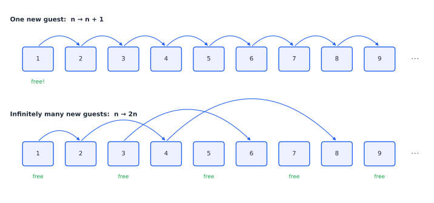
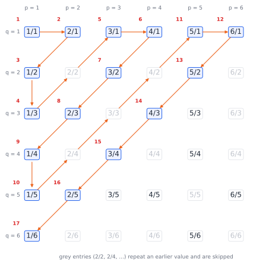
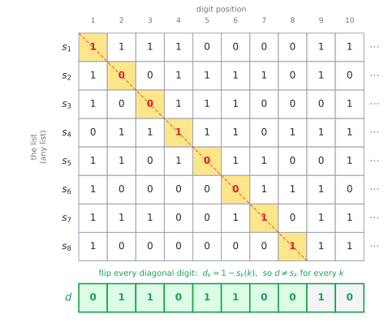

# Chapter 64 — Set Theory and the Infinite

[← Previous](63-think-like-a-mathematician.md) · [Track F](README.md) · [Table of Contents](../../00-front/table-of-contents.md) · [Next →](65-mathematical-logic.md)

> **Level 2 · Track F — Logic, Proofs, and the Foundations of Truth**
> **Builds on:** [Ch. 1](../../part-1-foundations/01-mathematical-language-and-algebra.md), [Ch. 29](../a-algorithms/29-discrete-mathematics-and-logic.md), [Ch. 63](63-think-like-a-mathematician.md) · **Leads to:** [Ch. 65](65-mathematical-logic.md), [Ch. 68](68-paradoxes-and-limits.md) · **Related:** [Ch. 30](../a-algorithms/30-limits-of-computation.md), [Ch. 60](../e-abstract-math/60-real-analysis.md), [Ch. 19](../../part-6-probability-statistics/19-probability.md)
> **Reading time:** ~25 min

## 64.1 The hook

Imagine a hotel with infinitely many rooms, numbered $1, 2, 3, \dots$, and every room is occupied. A traveller arrives late at night and asks for a room. In any ordinary hotel the answer is "sorry, we're full". This hotel's manager, David Hilbert in the usual telling, picks up the intercom: *"Would every guest please move from room $n$ to room $n+1$."* Everyone moves at once, nobody is left without a room, and room 1 is now empty. The traveller checks in.

Next night a coach arrives carrying infinitely many passengers, one per seat, seats numbered $1, 2, 3, \dots$. The hotel is full again. The manager announces: *"Guest in room $n$, please move to room $2n$."* All current guests now sit in the even-numbered rooms, and every odd-numbered room is free. The passenger in seat $k$ takes room $2k-1$. Everyone is housed.

The third night, infinitely many coaches arrive, each with infinitely many passengers. Seat $k$ on coach $c$ is a pair $(c,k)$. Surely this is too much? It is not, and by §64.3 you will be able to house them all yourself.

The fourth night is different. A coach arrives with one passenger for every infinite string of 0s and 1s: one for $0000\ldots$, one for $1010\ldots$, one for every pattern you can imagine. The manager tries every trick in the book, and fails. Not because she is not clever enough. She fails because it is impossible: **however she assigns rooms, some passenger is left in the car park.** This chapter is about why, and it answers a question that sounds as if it should have no answer:

> **Is every infinity the same size, and if not, how could you possibly tell two infinities apart?**



*Figure 64.1 — Two of the manager's moves. Top: shifting everyone up one room frees room 1. Bottom: doubling every room number frees all the odd rooms, enough for a whole new infinity of guests. A finite hotel can do neither.*

## 64.2 The big idea

How do you know that a room of chairs has as many chairs as people, without counting either? Ask everyone to sit down. If every person has a chair and every chair has a person, the numbers are equal. You never needed the number itself. **Matching comes before counting.**

Georg Cantor's insight in the 1870s was to take this as the *definition* of "same size", and to apply it fearlessly to infinite collections. Two sets have the same size, or **cardinality**, if their elements can be paired off perfectly, with nothing left over on either side. This one decision has two consequences that look contradictory and are not:

- An infinite set can have the same size as a part of itself. The hotel's first trick pairs $\{1,2,3,\dots\}$ with $\{2,3,4,\dots\}$. This is not a paradox; it is the defining feature of infinity. (Dedekind actually *defined* a set to be infinite if it can be matched with a proper part of itself.)
- Not every pair of infinite sets *can* be matched. Some infinities are strictly larger than others, and there is an infinite ladder of them.

The proof that some infinity is bigger is the **diagonal argument**, one of the most reused ideas in all of mathematics. It reappears in [Ch. 30](../a-algorithms/30-limits-of-computation.md) to show that some problems cannot be solved by any program, and in [Ch. 65](65-mathematical-logic.md) to show that some truths cannot be proved. Its form is always the same: *given any list, build something that differs from every entry on the list.*

## 64.3 The mathematics

We use sets naively for now: a set is a collection of objects, written $\{\dots\}$, with the operations $\cup$, $\cap$, $\setminus$, $\times$ from [Ch. 29](../a-algorithms/29-discrete-mathematics-and-logic.md#sets-relations-and-orders). §64.3's last part explains why "naively" will not do in the end.

### Comparing sizes

> [!definition] Injection, surjection, bijection, cardinality
> A function $f:A\to B$ is **injective** (one-to-one) if $f(a)=f(a')$ implies $a=a'$, **surjective** (onto) if every $b\in B$ equals some $f(a)$, and **bijective** if it is both. We write
> - $\lvert A\rvert=\lvert B\rvert$ if there is a bijection $A\to B$;
> - $\lvert A\rvert\le\lvert B\rvert$ if there is an injection $A\to B$;
> - $\lvert A\rvert<\lvert B\rvert$ if $\lvert A\rvert\le\lvert B\rvert$ but $\lvert A\rvert\ne\lvert B\rvert$.
>
> A set is **countable** if it is finite or has the same cardinality as $\mathbb{N}=\{0,1,2,\dots\}$. The cardinality of $\mathbb{N}$ is written $\aleph_0$ ("aleph-nought"). An infinite set that is not countable is **uncountable**.

Countable means *listable*: you can write the elements as $a_0,a_1,a_2,\dots$ so that every element appears at some finite position. Hilbert's hotel is a machine for building bijections. $n\mapsto n+1$ shows $\lvert\mathbb N\rvert=\lvert\mathbb N\setminus\{0\}\rvert$; $n\mapsto 2n$ shows that the even numbers are exactly as numerous as all the numbers; and the map $n\mapsto n/2$ for even $n$, $n\mapsto-(n+1)/2$ for odd $n$ lists the integers as $0,-1,1,-2,2,\dots$, so $\lvert\mathbb Z\rvert=\aleph_0$.

Is $\le$ really an ordering of sizes? If $A$ injects into $B$ and $B$ injects into $A$, are they the same size? For finite sets obviously. For infinite sets it is true but not obvious.

> [!theorem] Schröder–Bernstein theorem
> If there are injections $A\to B$ and $B\to A$, then there is a bijection $A\to B$.

We use it without proof; the idea is to follow chains $a\mapsto f(a)\mapsto g(f(a))\mapsto\cdots$ backwards and forwards and decide, chain by chain, which injection to use. It is a huge labour-saver: to show two sets have the same size, you only need an injection each way, which is usually much easier than a bijection.

### The rationals are countable

The rationals look far more numerous than the integers. Between any two of them lies another, so they are **dense**; between $0$ and $1$ alone there are infinitely many. Surely they cannot be listed?

> [!theorem] Theorem 64.1 — $\mathbb{N}\times\mathbb{N}$ and $\mathbb{Q}$ are countable
> The map $\pi(p,q)=\dfrac{(p+q)(p+q+1)}{2}+q$ is a bijection $\mathbb N\times\mathbb N\to\mathbb N$. Consequently $\lvert\mathbb Q\rvert=\aleph_0$.

*Proof.* Arrange the pairs $(p,q)$ in a grid and walk the anti-diagonals $p+q=s$ for $s=0,1,2,\dots$ in turn. Diagonal $s$ contains the $s+1$ pairs $(s,0),(s-1,1),\dots,(0,s)$. Before diagonal $s$ begins, we have used up $1+2+\dots+s=s(s+1)/2$ positions, and within diagonal $s$ the pair $(p,q)$ sits at offset $q$. So $(p,q)$ lands at position $s(s+1)/2+q$ with $s=p+q$, which is $\pi(p,q)$. Every position $z\in\mathbb N$ is reached exactly once: $z$ lies in exactly one interval $[s(s+1)/2,\ (s+1)(s+2)/2)$, which picks out $s$, and then $q=z-s(s+1)/2\in\{0,\dots,s\}$ and $p=s-q$ are forced. So $\pi$ is a bijection.

For $\mathbb Q$: write each positive rational in lowest terms $p/q$ and send it to $\pi(p,q)$. This is an injection from the positive rationals into $\mathbb N$, so they are countable; adding $0$ and the negatives, as for $\mathbb Z$, keeps the set countable. An injection $\mathbb N\to\mathbb Q$ is obvious ($n\mapsto n$), so by Schröder–Bernstein $\lvert\mathbb Q\rvert=\aleph_0$. $\square$



*Figure 64.2 — Cantor's zig-zag through the positive fractions, with $p$ across and $q$ down. Each reduced fraction gets a finite position (red numbers); grey fractions such as $2/4$ are skipped because their value already appeared. Every positive rational is reached after finitely many steps.*

The same proof houses the hotel's third night: call the guests already in the hotel "coach 0", number coaches and seats from 0, and put seat $k$ of coach $c$ in room $\pi(c,k)+1$. More generally, a countable union of countable sets is countable, and so are $\mathbb N^3$, $\mathbb N^{17}$, the set of all finite strings over a finite alphabet, the set of all polynomials with integer coefficients, and the set of all Python programs. That last one will matter.

### The diagonal argument

Now the fourth night. Let $\{0,1\}^{\mathbb N}$ be the set of infinite binary sequences $s=(s(0),s(1),s(2),\dots)$.

> [!theorem] Theorem 64.2 — Cantor (1891): binary sequences are uncountable
> No list $s_0,s_1,s_2,\dots$ of binary sequences contains every binary sequence.

*Proof.* Take any list. Define a new sequence $d$ by flipping the diagonal:

$$
d(k)=1-s_k(k)\qquad(k=0,1,2,\dots).
$$

For each $k$, $d$ differs from $s_k$ in position $k$, so $d\ne s_k$. Hence $d$ is not on the list. $\square$



*Figure 64.3 — The diagonal argument. Whatever the list, read down the diagonal and flip each digit. The result $d$ disagrees with row $k$ in column $k$, so it is not any row. The grey tail stands for the digits beyond the drawn part, also flipped from the diagonal of rows further down.*

The proof is so short it can feel like a trick. Probe it. "Just add $d$ to the front of the list." Fine: the new list has its own diagonal, and a new $d'$ escapes it. "Then the list was infinite, so perhaps $d$ is at position $\infty$." There is no such position: every entry of a list sits at a finite index $k$, and $d$ has been made to differ from the entry at index $k$, for every $k$. The argument does not say any particular list is bad; it says *every* list is.

Now transfer the result to the real numbers. Each $x\in(0,1)$ has a decimal expansion $0.x_1x_2x_3\ldots$, unique if we forbid expansions ending in an infinite run of 9s. Given any list $r_1,r_2,\dots$ of reals in $(0,1)$, define $x$ by its digits: $x_k=5$ if the $k$-th digit of $r_k$ is not 5, and $x_k=4$ if it is. Then $x$ differs from $r_k$ in the $k$-th digit, and because $x$ uses only the digits 4 and 5, it has no second expansion that could secretly coincide with $r_k$. So $x$ is not on the list, and:

> [!theorem] Corollary — the reals are uncountable
> $\lvert\mathbb N\rvert<\lvert\mathbb R\rvert$. In fact $\lvert\mathbb R\rvert=\lvert(0,1)\rvert=\lvert\{0,1\}^{\mathbb N}\rvert$, a cardinality written $2^{\aleph_0}$ or $\mathfrak c$ (the continuum).

The bijection $(0,1)\to\mathbb R$ is $x\mapsto\tan(\pi(x-\tfrac12))$, which you can drag around in §64.5; the equality with $\{0,1\}^{\mathbb N}$ follows from Schröder–Bernstein using binary and decimal expansions as the two injections. A startling consequence: the rationals are countable, so "almost all" real numbers are irrational. Algebraic numbers (roots of integer polynomials, like $\sqrt2$) are countable too, since there are countably many polynomials and each has finitely many roots, so almost all reals are **transcendental**, even though proving that one specific number like $\pi$ is transcendental is hard. Cantor's argument gives you infinitely many without naming a single one, the non-constructive style of Theorem 63.3 in [Ch. 63](63-think-like-a-mathematician.md#construction-proving-that-something-exists).

> [!mystery] Numbers nobody can ever name
> Every number you can describe, by a formula, a program that prints its digits, or a sentence in English, comes from a description, and descriptions are finite strings: there are only countably many. So all but countably many real numbers can never be specified, computed, or written down by anyone, ever. What does it mean to say such numbers *exist*? Which numbers can a machine compute, and is there a definable number that no machine can compute? [Ch. 30](../a-algorithms/30-limits-of-computation.md) meets the first uncomputable objects, and [Ch. 68](68-paradoxes-and-limits.md) asks what "definable" can even mean.

### A ladder of infinities

Cantor's argument generalises from $\mathbb N$ to any set whatsoever. Write $\mathcal P(A)$ for the **power set** of $A$, the set of all subsets of $A$. A binary sequence is just a subset of $\mathbb N$ in disguise ($s(k)=1$ means "$k$ is in"), so Theorem 64.2 says $\lvert\mathbb N\rvert<\lvert\mathcal P(\mathbb N)\rvert$.

> [!theorem] Theorem 64.3 — Cantor's theorem
> For every set $A$, $\lvert A\rvert<\lvert\mathcal P(A)\rvert$.

*Proof.* The map $a\mapsto\{a\}$ is an injection $A\to\mathcal P(A)$, so $\lvert A\rvert\le\lvert\mathcal P(A)\rvert$. Suppose for contradiction that some $f:A\to\mathcal P(A)$ is a bijection; we only need that it is surjective. Define the "diagonal" set

$$
D=\{a\in A:\ a\notin f(a)\}.
$$

$D$ is a subset of $A$, so by surjectivity $D=f(d)$ for some $d\in A$. Is $d\in D$? If $d\in D$, then by the definition of $D$, $d\notin f(d)=D$. If $d\notin D$, then $d\notin f(d)$, so by definition $d\in D$. Either way we contradict ourselves, so no surjection exists. $\square$

So there is no largest infinity:

$$
\aleph_0=\lvert\mathbb N\rvert<\lvert\mathcal P(\mathbb N)\rvert=\lvert\mathbb R\rvert<\lvert\mathcal P(\mathbb R)\rvert<\lvert\mathcal P(\mathcal P(\mathbb R))\rvert<\cdots
$$

The set of all real functions $\mathbb R\to\mathbb R$ already sits on the third rung: it has cardinality $\lvert\mathcal P(\mathbb R)\rvert$, strictly more than the continuum. The continuous functions, by contrast, are determined by their values on the rationals, so there are only $\mathfrak c$ of them. Most functions are wildly discontinuous, which is one reason analysis restricts which functions it talks about ([Ch. 60](../e-abstract-math/60-real-analysis.md)).

> [!mystery] The rung that might not exist
> $\aleph_0<\mathfrak c$. Is there any set strictly bigger than $\mathbb N$ but strictly smaller than $\mathbb R$? Cantor believed not (the **continuum hypothesis**) and spent years failing to prove it. Hilbert put it first on his famous 1900 list of problems. The eventual answer, from Gödel (1940) and Paul Cohen (1963), is one of the strangest in mathematics, and it is not "yes" and it is not "no". What else could it be? See [Ch. 68](68-paradoxes-and-limits.md).

### Ordinals: counting past infinity

Cardinals answer "how many?". **Ordinals** answer "in what position?". For finite sets the two coincide, but for infinite ones they split. List the natural numbers $0,1,2,\dots$ and then put one more element after all of them:

$$
0,\ 1,\ 2,\ 3,\ \dots\ ;\ \omega .
$$

The new element sits at position $\omega$, the first infinite ordinal. Keep going: $\omega+1,\ \omega+2,\ \dots,\ \omega\cdot2,\ \omega\cdot2+1,\ \dots,\ \omega\cdot3,\ \dots,\ \omega^2,\ \dots,\ \omega^\omega,\ \dots$. Each of these is the *order type* of a **well-ordering**: an ordering in which every non-empty subset has a least element. The order $0,1,2,\dots;\omega$ is a different shape from $0,1,2,\dots$ (it has a last element; $\mathbb N$ does not), yet as a set it is still countable: it has cardinality $\aleph_0$. So $\omega$ and $\omega+1$ are different ordinals with the same cardinal.

Ordinal arithmetic is arithmetic of arrangements, and it is not commutative. $1+\omega$ means "one element, then a copy of $\mathbb N$", which is just a copy of $\mathbb N$ again, so $1+\omega=\omega$. But $\omega+1$ means "a copy of $\mathbb N$, then one more", which has a last element, so $\omega+1\ne\omega$. Hilbert's hotel lives in cardinals, where $1+\aleph_0=\aleph_0+1=\aleph_0$; ordinals are what you get when the *queue order* matters.

Why care? Because well-orderings are exactly what induction needs. Ch. 29 proved termination of a loop by a variant that decreases in $\mathbb N$ ([§29.3](../a-algorithms/29-discrete-mathematics-and-logic.md#loop-invariants-induction-over-time)). Some programs need more: a process whose "remaining work" is a pair $(a,b)$ ordered lexicographically can make $b$ jump up arbitrarily far each time $a$ drops by one, so no single natural number bounds the number of steps, yet the process must stop because $\omega\cdot\omega=\omega^2$ is well-ordered. **Transfinite induction** extends proof by induction along any ordinal: if a property passes from all smaller ordinals to the next one, it holds for all of them.

### Why axioms?

So far a "set" has been any collection we can describe. That freedom is fatal. Consider $R=\{x: x\notin x\}$, the set of all sets that are not members of themselves. Is $R\in R$? The proof of Theorem 64.3 runs again, with $f$ the identity, and both answers contradict themselves. This is **Russell's paradox** (1901), and it showed that "any describable collection is a set" is inconsistent. Its full story, and its cousins, are in [Ch. 68](68-paradoxes-and-limits.md).

The repair, settled by Zermelo, Fraenkel and others by the 1920s, is to say precisely which sets exist. The standard list is **ZFC** (Zermelo–Fraenkel with Choice). Roughly:

| Axiom | It says |
|---|---|
| Extensionality | sets with the same elements are equal |
| Empty set, pairing, union | $\varnothing$, $\{a,b\}$ and $\bigcup A$ exist |
| Separation | for a set $A$ and a property $P$, $\{x\in A: P(x)\}$ exists (only *inside* an existing set) |
| Power set | $\mathcal P(A)$ exists |
| Infinity | an infinite set exists (one containing $\varnothing$ and closed under $x\mapsto x\cup\{x\}$) |
| Replacement | the image of a set under a definable function is a set |
| Foundation | no infinite descending chain $\cdots\in x_2\in x_1\in x_0$ |
| Choice | from any family of non-empty sets one can choose one element from each |

Separation is the key restriction: you may carve a subset out of a set you already have, but not conjure $\{x: P(x)\}$ from nothing. Russell's $R$ is never built. And from these axioms the whole of ordinary mathematics can be constructed: $0=\varnothing$, $1=\{0\}$, $2=\{0,1\}$, $n+1=n\cup\{n\}$, so each natural number is the set of the ones before it, and $\omega=\{0,1,2,\dots\}$ is the set the axiom of infinity provides. Integers are classes of pairs of naturals, rationals classes of pairs of integers, and reals are built from rationals by Dedekind cuts or Cauchy sequences ([Ch. 60](../e-abstract-math/60-real-analysis.md)). Every object in this book, from a phasor to a probability space ([Ch. 19](../../part-6-probability-statistics/19-probability.md)), is, at bottom, a set.

## 64.4 The algorithm

Countability *is* an algorithm: a set is countable exactly when you can write a procedure that, run forever, outputs every element at some finite time. Here are two enumerations of the positive rationals and a diagonaliser.

**Cantor pairing and its inverse.** The bijection of Theorem 64.1 can be inverted in constant time with an integer square root: given $z$, the diagonal is $s=\lfloor(\sqrt{8z+1}-1)/2\rfloor$, then $q=z-s(s+1)/2$, $p=s-q$. For example $\pi(3,4)=32$ and $\pi(4,3)=31$. Use `math.isqrt`, not floating `sqrt`: for $z$ above about $10^{15}$ a double cannot hold $8z+1$ exactly and the floor can land on the wrong diagonal.

**The Calkin–Wilf sequence.** Skipping non-reduced fractions, as in Figure 64.2, wastes work. A cleverer enumeration visits every positive rational *exactly once* with no gcd tests at all:

$$
x_0=1,\qquad x_{n+1}=\frac{1}{2\lfloor x_n\rfloor-x_n+1},
$$

giving $1,\ \tfrac12,\ 2,\ \tfrac13,\ \tfrac32,\ \tfrac23,\ 3,\ \tfrac14,\ \tfrac43,\ \tfrac35,\ \tfrac52,\ \tfrac25,\ \tfrac53,\ \tfrac34,\ 4,\dots$ (Newman's formula for the Calkin–Wilf tree). Each step costs $O(1)$ operations on exact fractions. Do it with floating point and the sequence drifts after a few dozen terms: the map is exact only on exact rationals.

**A diagonaliser.** Given *any* enumerator, a function `s(k, i)` returning digit $i$ of the $k$-th sequence, the procedure `d(i) = 1 - s(i, i)` computes a sequence missing from the enumeration. This is an algorithm that defeats every algorithm of a given kind, and that idea is the engine of [Ch. 30](../a-algorithms/30-limits-of-computation.md): feed it an enumeration of all programs and you get a function no program computes.

## 64.5 The experiment

The script enumerates rationals by Calkin–Wilf, checks that no value repeats and none is missed, and then diagonalises against a list of your choice.

```python
from fractions import Fraction
from math import floor, gcd

N = 4100                       # knob: how many Calkin-Wilf terms to generate
M = 12                         # knob: check every p/q with p, q <= M appears

x, seen = Fraction(1), []
for _ in range(N):
    seen.append(x)
    x = 1 / (2 * floor(x) - x + 1)

print("repeats:", len(seen) - len(set(seen)))
wanted = {Fraction(p, q) for p in range(1, M + 1) for q in range(1, M + 1)}
missing = wanted - set(seen)
print(f"p/q with p,q<={M}: {len(wanted)} values, missing from first {N}: {len(missing)}")
print("first 10:", [str(f) for f in seen[:10]])

# Diagonalise: the k-th row is the binary expansion of the k-th rational in (0,1)
ROWS = 16                      # knob: size of the list we defeat
rats = [f for f in seen if f < 1][:ROWS]
def digit(f, i):               # i-th binary digit of f after the point
    return floor(f * 2 ** (i + 1)) % 2
d = [1 - digit(rats[k], k) for k in range(ROWS)]
for k, f in enumerate(rats):
    row = "".join(str(digit(f, i)) for i in range(ROWS))
    print(f"{str(f):>6}  {row}   differs from d at digit {k}")
print("     d  " + "".join(map(str, d)))
```

With the defaults it reports 0 repeats and that all 91 distinct values with $p,q\le12$ appear among the first 4100 terms (the last to arrive is $12$ itself, at position 4094), then prints 16 rows and the escaping sequence $d$.

Things to try:

1. Lower `N` to 2000 and count what goes missing. Which fractions with $p,q\le 12$ arrive *last*? (Print the positions of $1/M$ and $M$ for several $M$.) How many terms does Calkin–Wilf need, as a function of $M$, to reach all of them, and what does that say about using it to enumerate "small" fractions?
2. Replace the Calkin–Wilf step with floating point, `x = 1 / (2*floor(x) - x + 1)` on a `float`. After how many terms does it produce a value that is not a fraction with small denominator, or repeat one?
3. Now the deep one: $d$ is the binary expansion of *some* real number in $[0,1]$. Increase `ROWS`. Is that number rational? (Is it on the full infinite list?) Explain why the answer must be no, no matter how large `ROWS` is.

The bijection between the interval $(0,1)$ and the whole real line is easy to see:

```desmos-graph
left=-0.2; right=1.2; bottom=-8; top=8
---
y=\tan(\pi(x-0.5))|blue|0<x<1
x=0|grey|dashed
x=1|grey|dashed
(0.5,0)|label:0.5 maps to 0
(0.9,3.078)|label:0.9 maps to 3.08
```

*The map $x\mapsto\tan(\pi(x-\tfrac12))$ sends the short interval $(0,1)$ onto all of $\mathbb R$, one-to-one. Replace $\tan(\pi(x-0.5))$ with $\frac{x-0.5}{x(1-x)}$, an algebraic bijection: as many points in a unit interval as on the entire line.*

## 64.6 The challenge

No answers are given.

1. **Intuition.** On the fourth night the manager tries this: "Order the passengers by how many 1s their string has, and give out rooms in that order." Find the exact point at which her plan breaks down, and explain why no repair of the same kind can work.
2. **Derivation.** Prove that $\lvert[0,1]\rvert=\lvert(0,1)\rvert$ by constructing an explicit bijection. (Hint: Hilbert's hotel. Pick the countable set $\{\tfrac12,\tfrac13,\tfrac14,\dots\}$ inside $(0,1)$ and shift it to make room for the two endpoints.) Then prove $\lvert\mathbb R^2\rvert=\lvert\mathbb R\rvert$ by interleaving digits, and deal carefully with the two-expansion problem.
3. **Implementation.** Write a generator that enumerates every finite list of natural numbers exactly once (for example, using Cantor pairing repeatedly, or by ordering lists by "length plus sum"). Check by brute force that your first 10,000 outputs have no repeats and include every list of length $\le3$ with entries $\le5$. Then explain why no generator can enumerate every *infinite* list.
4. **Open investigation.** In the Calkin–Wilf sequence, let $n(p/q)$ be the position of the reduced fraction $p/q$. Plot $\log_2 n(p/q)$ against $p+q$ for all $p,q\le 200$. The sequence is related to Stern's diatomic sequence and to continued fractions. Find empirically which fractions with a given $p+q$ appear earliest and latest, and try to explain the pattern in terms of the continued-fraction expansion of $p/q$.

## 64.7 Loose threads

We have answered the hook. Infinities are compared by matching, not counting. By that measure $\mathbb N$, $\mathbb Z$, $\mathbb Q$ and every set of finite descriptions all have the same size $\aleph_0$, while the reals, the binary sequences and the passengers of the fourth night form a strictly larger infinity, because the diagonal argument defeats every attempted list. Cantor's theorem then builds an endless ladder of larger infinities, and ordinals let us count past $\omega$ in a well-ordered queue that supports induction.

What we have not done:

- **We used the axioms without asking whether they are safe.** ZFC was built to stop Russell's paradox. Does it stop *every* paradox? Can ZFC prove its own consistency? The answer, which [Ch. 68](68-paradoxes-and-limits.md) reveals, is a theorem about all sufficiently strong systems, and it is not the answer anyone hoped for.
- **We used the axiom of choice silently.** "A countable union of countable sets is countable" needs it: you must *choose* an enumeration of each set. Choice also proves that a solid ball can be cut into finitely many pieces and reassembled into two balls of the same size (Banach–Tarski). Should we believe it? See [Ch. 68](68-paradoxes-and-limits.md), and [Ch. 60](../e-abstract-math/60-real-analysis.md) for why the pieces cannot have a volume.
- **We never said what "proof from axioms" means.** ZFC is a list of sentences, but what are the legal moves from them? Is every true statement about sets provable from them? That is what a formal system makes precise, and it is where we go next, in [Ch. 65](65-mathematical-logic.md).

**A puzzle to carry forward.** ZFC is written with countably many symbols and proves "$\mathbb R$ is uncountable". Yet logic, as the next chapter shows, guarantees that any consistent set of axioms like ZFC has a model, a mathematical world in which they are all true, whose underlying collection is *countable*. So there is a countable world in which "the reals are uncountable" is true. Is that a contradiction? It is called Skolem's paradox, and it is waiting for you in [Ch. 65](65-mathematical-logic.md).

## Further reading

- P. R. Halmos, *Naive Set Theory*, Van Nostrand, 1960 (Springer reprint). Short, elegant and still the best first book on sets.
- H. B. Enderton, *Elements of Set Theory*, Academic Press, 1977. Builds $\mathbb N$, $\mathbb R$, cardinals and ordinals from the ZFC axioms.
- N. Calkin and H. S. Wilf, "Recounting the rationals", *American Mathematical Monthly* 107 (2000), 360–363. The tree behind the enumeration in §64.4.
- R. Rucker, *Infinity and the Mind*, Princeton University Press, 1982. A lively tour of cardinals, ordinals and the philosophy of the infinite.
