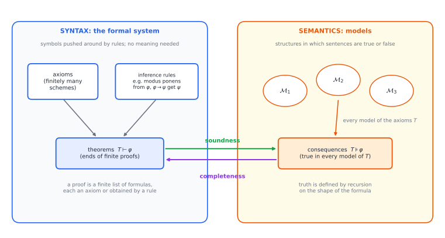
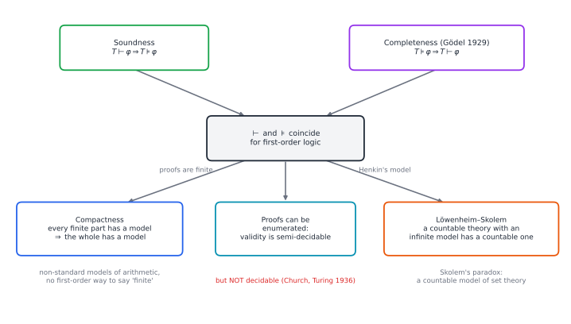
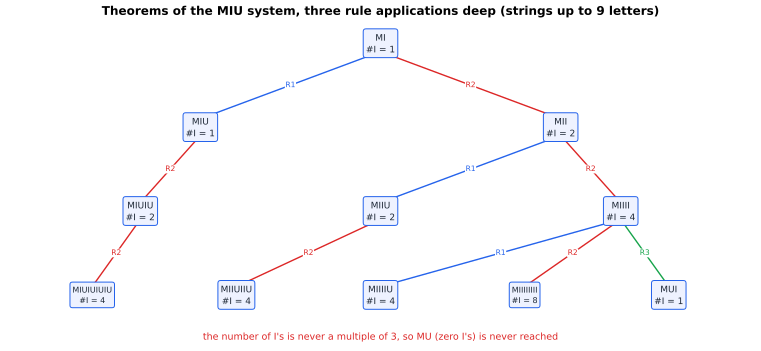

# Chapter 65 — Mathematical Logic and Formal Systems

[← Previous](64-set-theory-and-infinity.md) · [Track F](README.md) · [Table of Contents](../../00-front/table-of-contents.md) · [Next →](66-type-theory-curry-howard.md)

> **Level 2 · Track F — Logic, Proofs, and the Foundations of Truth**
> **Builds on:** [Ch. 29](../a-algorithms/29-discrete-mathematics-and-logic.md), [Ch. 63](63-think-like-a-mathematician.md), [Ch. 64](64-set-theory-and-infinity.md) · **Leads to:** [Ch. 66](66-type-theory-curry-howard.md), [Ch. 67](67-formal-verification.md), [Ch. 68](68-paradoxes-and-limits.md) · **Related:** [Ch. 30](../a-algorithms/30-limits-of-computation.md), [Ch. 56](../e-abstract-math/56-abstract-algebra.md), [Ch. 1](../../part-1-foundations/01-mathematical-language-and-algebra.md)
> **Reading time:** ~25 min

## 65.1 The hook

Here is a game with three letters, M, I and U. You start with the string **MI**. You may apply any of four rules, as often as you like, in any order (here $x$ and $y$ stand for any strings, possibly empty):

| Rule | From | You may write | Example |
|---|---|---|---|
| R1 | $x$I | $x$IU | MI $\to$ MIU |
| R2 | M$x$ | M$xx$ | MIU $\to$ MIUIU |
| R3 | $x$III$y$ | $x$U$y$ | MIIII $\to$ MUI |
| R4 | $x$UU$y$ | $xy$ | MUUI $\to$ MI |

Your goal: produce the string **MU**.

Try it for five minutes before reading on. You will double strings with R2 to pile up I's, chop III into U with R3, delete pairs of U's with R4. You will get close, MUI, MUIU, MUUU, and never quite there. (This is Douglas Hofstadter's MU puzzle, from *Gödel, Escher, Bach*.)

Now imagine handing the puzzle to a computer. It can search systematically: all strings one rule away, then two rules away, and so on. If MU is reachable, the search will find it eventually. If MU is *not* reachable, the search runs forever, producing longer and longer strings, and never tells you anything. To know that MU is impossible, you need something the rules themselves do not give you: you need to *step outside the game and reason about it*.

That is the whole of mathematical logic in miniature. Around 1920, David Hilbert proposed to turn all of mathematics into a game like this one: fixed starting strings (axioms), fixed rules (logic), and theorems as whatever strings you can reach. He hoped to show that the game could reach every true statement and never reach a false one. This chapter is about what happened to that hope, and it is a story with a twist:

> **Can a finite set of rules, applied mechanically, produce every truth of mathematics, and nothing else?**

## 65.2 The big idea

Every formal system lives on two levels at once, and the whole subject is about the bridge between them.

- **Syntax** is symbols and rules. A proof is a finite list of strings, each one an axiom or obtained from earlier ones by a rule. Checking a proof needs no understanding at all: a machine can do it. We write $T\vdash\varphi$ ("$T$ proves $\varphi$") when there is a proof of $\varphi$ from the axioms $T$.
- **Semantics** is meaning. A **model** of $T$ is a mathematical structure in which every axiom of $T$ is true. We write $T\models\varphi$ ("$\varphi$ is a consequence of $T$") when $\varphi$ is true in *every* model of $T$.



*Figure 65.1 — The two worlds of logic. On the left, theorems are produced by pushing symbols; on the right, consequences are determined by truth in models. Soundness says the left never outruns the right; completeness says it always keeps up.*

A programmer knows this split already. A type checker works on syntax: it inspects the program text and either accepts or rejects. What the program *does* when run is semantics. A type system is *sound* if every accepted program is safe when run (no false positives), and *complete* if every safe program is accepted (no misses). Real type checkers are sound and incomplete: they reject some perfectly good programs. Logic asks the same two questions of proof rules.

Here is the plot of the chapter in one paragraph. For **first-order logic**, the logic of "for all", "there exists", "and", "not" over any structure, the answer to both questions is yes: the rules are sound and complete, and $\vdash$ and $\models$ coincide exactly (Gödel, 1929). Strange consequences follow, including mathematical worlds with "infinitely large" natural numbers. But when you fix one specific structure, the natural numbers $\mathbb N$ with $+$ and $\times$, and ask for rules that prove exactly the sentences *true in $\mathbb N$*, the answer flips to no (Gödel again, 1931). Same logician, two years apart, opposite answers.

## 65.3 The mathematics

### First-order languages, briefly

Ch. 29 introduced predicates and quantifiers informally ([§29.3](../a-algorithms/29-discrete-mathematics-and-logic.md#predicate-logic-saying-for-every-input)). A first-order language fixes the vocabulary.

> [!definition] Language, structure, satisfaction
> A **language** $L$ is a set of constant symbols, function symbols and relation symbols, each with an arity. **Terms** are built from variables and constants by applying function symbols; **formulas** are built from atomic formulas ($t_1=t_2$, or $R(t_1,\dots,t_k)$) using $\neg$, $\to$ (and the other connectives) and $\forall x$, $\exists x$. A **sentence** is a formula with no free variables.
>
> An **$L$-structure** $\mathcal M$ is a non-empty set $M$ (the domain) together with an interpretation of each symbol: an element for each constant, a function $M^k\to M$ for each function symbol, a relation on $M^k$ for each relation symbol. **Truth** $\mathcal M\models\varphi$ is defined by recursion on $\varphi$: $\mathcal M\models\neg\varphi$ iff not $\mathcal M\models\varphi$; $\mathcal M\models\forall x\,\varphi(x)$ iff $\mathcal M\models\varphi(a)$ for every $a\in M$; and so on. $\mathcal M$ is a **model** of a set of sentences $T$ if it satisfies every sentence in $T$.

"First-order" means the quantifiers range over *elements* of the domain, never over subsets or functions. That restriction looks minor. It is the source of everything strange below.

**An example.** The language of groups has one binary function symbol $\cdot$ and one constant $e$. The group axioms $T_{\mathrm{grp}}$ say that $\cdot$ is associative, $e$ is an identity, and inverses exist ([Ch. 56](../e-abstract-math/56-abstract-algebra.md) develops them). Models of $T_{\mathrm{grp}}$ are exactly the groups: $(\mathbb Z,+,0)$, the rotations of a square, the permutations of three objects. Consider the sentence $\gamma=\forall x\,\forall y\ (x\cdot y=y\cdot x)$. It is true in $(\mathbb Z,+,0)$ and false among permutations of three objects. So $\gamma$ is neither a consequence of $T_{\mathrm{grp}}$ nor is $\neg\gamma$. Keep this example in mind: in a moment, soundness will turn it into a proof that $\gamma$ cannot be proved from the group axioms, without examining a single proof.

### A proof system

To prove anything we need rules. Many equivalent systems exist; here is the classical Hilbert system for the propositional part, with $\to$ and $\neg$ as the connectives. Its axioms are all instances (for arbitrary formulas $\varphi,\psi,\chi$) of

$$
\begin{aligned}
&\text{A1:}\quad \varphi\to(\psi\to\varphi)\\
&\text{A2:}\quad \big(\varphi\to(\psi\to\chi)\big)\to\big((\varphi\to\psi)\to(\varphi\to\chi)\big)\\
&\text{A3:}\quad (\neg\psi\to\neg\varphi)\to(\varphi\to\psi)
\end{aligned}
$$

and its only rule is **modus ponens** (MP): from $\varphi$ and $\varphi\to\psi$, infer $\psi$. For first-order logic one adds axioms for quantifiers and equality (for example $\forall x\,\varphi(x)\to\varphi(t)$) and the rule of generalisation; we will not need the details.

Proofs in this system are notoriously unnatural. Here is a proof of the obvious-looking $\varphi\to\varphi$:

| Line | Formula | Justification |
|---|---|---|
| 1 | $\varphi\to((\varphi\to\varphi)\to\varphi)$ | A1 with $\psi:=\varphi\to\varphi$ |
| 2 | $\big(\varphi\to((\varphi\to\varphi)\to\varphi)\big)\to\big((\varphi\to(\varphi\to\varphi))\to(\varphi\to\varphi)\big)$ | A2 with $\psi:=\varphi\to\varphi$, $\chi:=\varphi$ |
| 3 | $(\varphi\to(\varphi\to\varphi))\to(\varphi\to\varphi)$ | MP from 1, 2 |
| 4 | $\varphi\to(\varphi\to\varphi)$ | A1 with $\psi:=\varphi$ |
| 5 | $\varphi\to\varphi$ | MP from 4, 3 |

Five lines, and every line checkable by pattern-matching, with no idea what $\varphi$ means. That is the point. Humans write proofs in natural language; logic shows that every such proof *could* be expanded into a list like this one, and [Ch. 67](67-formal-verification.md) shows engineers doing exactly that with proof assistants.

### Soundness: the rules never lie

> [!theorem] Theorem 65.1 — Soundness (propositional case)
> If $\vdash\varphi$ in the Hilbert system, then $\varphi$ is a **tautology**: it is true under every assignment of truth values to its variables.

*Proof.* By strong induction on the length $n$ of a shortest proof of $\varphi$; the claim is that every line of every proof is a tautology.

*Axioms.* Each instance of A1–A3 is a tautology. For A1: if $\varphi\to(\psi\to\varphi)$ were false under some assignment, then $\varphi$ is true and $\psi\to\varphi$ is false, which needs $\varphi$ false; contradiction. A2 and A3 are checked the same way, or by an 8-row and a 4-row truth table (the script in §65.4 does it). Substituting formulas for $\varphi,\psi,\chi$ does not matter, because the truth value of the instance depends only on the truth values of the substituted formulas.

*Modus ponens.* Suppose line $k$ is $\psi$, obtained from earlier lines $\varphi$ and $\varphi\to\psi$, both tautologies by the induction hypothesis. Under any assignment, $\varphi$ is true and $\varphi\to\psi$ is true, so $\psi$ is true. Hence $\psi$ is a tautology.

Every line is an axiom or comes by MP, so every line, in particular the last, is a tautology. $\square$

The first-order version reads: **if $T\vdash\varphi$ then $T\models\varphi$**, and the proof is the same induction, with one extra case per quantifier rule. Soundness is a *tool for proving unprovability*. Back to the groups: $\gamma$ (commutativity) is false in a model of $T_{\mathrm{grp}}$, so $T_{\mathrm{grp}}\not\models\gamma$, so by soundness $T_{\mathrm{grp}}\not\vdash\gamma$. No proof of commutativity from the group axioms exists, and we know it without searching. The MU puzzle works the same way: an invariant (the number of I's is never divisible by 3) is a "model" in which every theorem has the property and MU does not.

### Completeness: the rules never miss

The converse is the deep one.

> [!theorem] Theorem 65.2 — Gödel's completeness theorem (1929)
> For every set of first-order sentences $T$ and every sentence $\varphi$: if $T\models\varphi$ then $T\vdash\varphi$. Equivalently, every **consistent** $T$ (one that does not prove a contradiction) has a model.

We state it without full proof. The idea, due to Leon Henkin (1949), is a construction worth knowing. Start with a consistent $T$. Add new constant symbols as "witnesses": for every sentence $\exists x\,\psi(x)$, add a constant $c_\psi$ and the axiom $\exists x\,\psi(x)\to\psi(c_\psi)$. Then extend $T$, one sentence at a time, to a maximal consistent set, deciding every sentence one way or the other. Finally build a model *out of the symbols themselves*: its elements are the closed terms (modulo provable equality), and a relation holds exactly when the set says it does. The model is made of syntax. And because the language had countably many symbols, the model is countable, which gives a theorem we will need:

> [!theorem] Löwenheim–Skolem theorem (downward)
> If a set of sentences in a countable language has a model, it has a countable model.

This settles the puzzle left at the end of [Ch. 64](64-set-theory-and-infinity.md#647-loose-threads). If ZFC is consistent, it has a countable model $\mathcal M$, and inside $\mathcal M$ the sentence "$\mathbb R$ is uncountable" is true. There is no contradiction, because "uncountable" means "there is no bijection with $\mathbb N$", and inside $\mathcal M$ that means "no bijection *that is an element of $\mathcal M$*". The bijection that we, outside, can see is simply not one of $\mathcal M$'s sets. "Countable" turns out to be relative to the world you are standing in.

### Compactness: infinity from finite pieces

Proofs are finite. That trivial fact, combined with completeness, has an astonishing consequence.

> [!theorem] Theorem 65.3 — Compactness
> A set of first-order sentences $T$ has a model if and only if every finite subset of $T$ has a model.

*Proof.* If $T$ has a model, so does every subset. Conversely, suppose every finite subset of $T$ has a model, but $T$ does not. Then $T$ is inconsistent by the completeness theorem (in its second form), so there is a proof of a contradiction, say $\chi\land\neg\chi$, from $T$. That proof is a finite list of formulas, so it uses only finitely many axioms of $T$; call them $T_0$. Then $T_0\vdash\chi\land\neg\chi$, and by soundness every model of $T_0$ satisfies $\chi\land\neg\chi$, which is impossible, so $T_0$ has no model. But $T_0$ is a finite subset of $T$. Contradiction. $\square$



*Figure 65.2 — How the big theorems of first-order logic hang together. Soundness and completeness together make provability and truth-in-all-models the same relation; compactness, Löwenheim–Skolem and the mechanical enumerability of theorems all follow, along with some very strange models.*

Now watch compactness do something unsettling.

> [!theorem] Theorem 65.4 — Non-standard models of arithmetic
> Let $\operatorname{Th}(\mathbb N)$ be the set of *all* first-order sentences in the language $\{0,S,+,\times,<\}$ that are true in the natural numbers. There is a model of $\operatorname{Th}(\mathbb N)$ containing an element larger than every natural number.

*Proof.* Add a new constant symbol $c$, and let $\underline n$ be the term $S(S(\cdots S(0)))$ with $n$ copies of $S$ (the numeral for $n$). Consider

$$
T=\operatorname{Th}(\mathbb N)\ \cup\ \{\,\underline n<c\ :\ n=0,1,2,\dots\,\}.
$$

Any finite subset of $T$ mentions only finitely many of the new axioms, say up to $\underline N<c$. Interpret $c$ as the number $N+1$ in the ordinary natural numbers: every sentence of $\operatorname{Th}(\mathbb N)$ is true there by definition, and so is $\underline n<c$ for every $n\le N$. So every finite subset has a model. By compactness, $T$ has a model $\mathcal M$. It satisfies every true sentence of arithmetic, and its element $c^{\mathcal M}$ is larger than $\underline n^{\mathcal M}$ for every $n$. $\square$

Sit with that. $\mathcal M$ agrees with $\mathbb N$ on *every* first-order sentence: every theorem of number theory you have ever met, every statement about primes, holds in $\mathcal M$. Yet $\mathcal M$ contains an "infinite" natural number $c$, and with it $c+1$, $c-1$, $2c$, $c^2$, a whole galaxy of non-standard numbers beyond the standard ones. No first-order sentence can tell $\mathcal M$ and $\mathbb N$ apart. In particular, "$x$ is a standard number" (equivalently, "the set of things below $x$ is finite") cannot be written in first-order arithmetic at all. Induction itself is the casualty: the first-order induction *scheme* cannot pin down $\mathbb N$, because it can only talk about definable properties, and "standard" is not one.

### Incompleteness: where the bridge breaks

Completeness says: anything true in *every* model of $T$ is provable from $T$. It does not say anything is provable that is true in *one particular* model. And for arithmetic, the one model we care about is $\mathbb N$.

**Peano arithmetic** (PA) is the first-order theory with axioms saying $0$ is not a successor, $S$ is injective, $+$ and $\times$ obey their recursive definitions ($x+0=x$, $x+S(y)=S(x+y)$, $x\cdot0=0$, $x\cdot S(y)=x\cdot y+x$), plus the induction scheme: for every formula $\psi(x)$,

$$
\big(\psi(0)\land\forall x\,(\psi(x)\to\psi(S(x)))\big)\to\forall x\,\psi(x).
$$

PA proves essentially all of elementary number theory. Hilbert hoped that it, or something like it, proves *every* true sentence about $\mathbb N$.

> [!theorem] Gödel's first incompleteness theorem (1931), stated
> Let $T$ be any consistent set of axioms that can be listed by an algorithm and that includes PA (or even a weak fragment of it). Then there is a sentence $G_T$ in the language of arithmetic such that $T\nvdash G_T$ and $T\nvdash\neg G_T$. Moreover $G_T$ is true in $\mathbb N$.

The idea, which we only sketch: code formulas and proofs as numbers (**Gödel numbering**), so that "$p$ is the code of a proof of the formula with code $q$" becomes an arithmetic relation between $p$ and $q$, checkable by an algorithm and hence expressible in the language of PA. Then build a sentence $G_T$ that says, in effect, "*there is no number that codes a $T$-proof of me*". If $T$ proved $G_T$, there would be such a number, and $T$ would prove that too, so $T$ would be inconsistent. So $T$ does not prove $G_T$, which is exactly what $G_T$ says: it is true.

How does that square with completeness? $G_T$ is true in $\mathbb N$ but not provable, so by completeness it must be *false in some other model of $T$*. That model is non-standard, and in it there is a non-standard number that the model "believes" codes a proof of $G_T$: an infinitely long proof that only a non-standard world could contain. Completeness and incompleteness are not in conflict. The gap between them is precisely the gap between $\mathbb N$ and the strange models of Theorem 65.4.

> [!mystery] The sentence that talks about itself
> The sketch above leaned on a sentence that says "I am not provable". But sentences of arithmetic talk about numbers: additions, multiplications, inequalities. How can a sentence about numbers refer to *itself*, without circularity, and without falling into the liar paradox "this sentence is false"? The tool is Gödel's **diagonal lemma**, a cousin of Cantor's diagonal argument and of Turing's halting proof in [Ch. 30](../a-algorithms/30-limits-of-computation.md). Its construction, and what it does to Hilbert's dream, are in [Ch. 68](68-paradoxes-and-limits.md).

## 65.4 The algorithm

Logic is full of algorithms, and the line between what can and cannot be automated is sharp.

**Checking a proof** is easy and fast: for each line, check that it matches an axiom scheme or follows by a rule from earlier lines. Time is polynomial (essentially linear) in the length of the proof. Here is a checker for the Hilbert system, which also verifies by truth tables that the axioms are tautologies, the base case of Theorem 65.1. Formulas are nested tuples: `('->', a, b)`, `('~', a)`, or a variable name.

```python
from itertools import product

def imp(a, b): return ('->', a, b)
def neg(a): return ('~', a)
A1 = lambda p, q: imp(p, imp(q, p))
A2 = lambda p, q, r: imp(imp(p, imp(q, r)), imp(imp(p, q), imp(p, r)))
A3 = lambda p, q: imp(imp(neg(q), neg(p)), imp(p, q))

def value(f, env):
    if isinstance(f, str): return env[f]
    if f[0] == '~': return not value(f[1], env)
    return (not value(f[1], env)) or value(f[2], env)

def atoms(f):
    return {f} if isinstance(f, str) else set().union(*map(atoms, f[1:]))

def tautology(f):
    vs = sorted(atoms(f))
    return all(value(f, dict(zip(vs, bits))) for bits in product([False, True], repeat=len(vs)))

print("A1..A3 tautologies:", tautology(A1('p', 'q')), tautology(A2('p', 'q', 'r')), tautology(A3('p', 'q')))

def check(proof):          # each line: (formula, 'AX') or (formula, ('MP', i, j))
    for k, (f, why) in enumerate(proof):
        if why == 'AX':
            assert tautology(f), f"line {k}: not an axiom instance we trust"
        else:
            _, i, j = why
            assert i < k and j < k and proof[j][0] == imp(proof[i][0], f), f"line {k}: bad MP"
    return proof[-1][0]

p = 'p'
proof = [(A1(p, imp(p, p)), 'AX'), (A2(p, imp(p, p), p), 'AX'), (imp(A1(p, p), imp(p, p)), ('MP', 0, 1)),
         (A1(p, p), 'AX'), (imp(p, p), ('MP', 3, 2))]
print("proved:", check(proof))
```

(For brevity the checker accepts any tautology as an axiom line; a strict one would pattern-match the three schemes, as challenge 3 asks.)

**Deciding truth** is another matter.

- *Propositional logic* is decidable: a formula with $n$ variables is a tautology iff all $2^n$ rows of its truth table say true, so `tautology` above always halts, in time $O(2^n\cdot\text{size})$. Whether one can do fundamentally better is the P versus NP question of [Ch. 30](../a-algorithms/30-limits-of-computation.md).
- *First-order logic* is **semi-decidable**. Completeness means that $\models\varphi$ iff some proof of $\varphi$ exists, and proofs are finite strings, so enumerate all strings in order of length and run the checker on each. If $\varphi$ is valid, this finds a proof eventually. If $\varphi$ is not valid, it runs forever, exactly like the search for MU. Church and Turing (1936) proved that nothing better is possible in general: validity of first-order sentences is **undecidable**, by reduction from the halting problem.
- *Truth in $\mathbb N$* is worse still: it is not even semi-decidable. If it were, we could list all true sentences of arithmetic and use that list as an axiom system, which incompleteness forbids.

In practice, automated theorem provers (resolution, superposition, SMT solvers) replace blind enumeration with clever search and succeed astonishingly often. They can never succeed always.

## 65.5 The experiment

The script runs breadth-first search over the MIU system, the "blind enumeration of theorems" of §65.4, with a cap on string length, and compares what it finds with the invariant.

```python
from collections import deque
from itertools import product

CAP = 10          # knob: longest string the search may visit (try 10, 14, 18)
TARGET = "MU"     # knob: try "MUI", "MIIU", "MUIIU", "MIIIIIIU"

def successors(s):
    if s.endswith("I"):
        yield s + "U"                                   # R1
    yield "M" + s[1:] * 2                               # R2
    for i in range(1, len(s) - 2):
        if s[i:i + 3] == "III":
            yield s[:i] + "U" + s[i + 3:]               # R3
    for i in range(1, len(s) - 1):
        if s[i:i + 2] == "UU":
            yield s[:i] + s[i + 2:]                     # R4

seen, queue = {"MI": 0}, deque(["MI"])
while queue:
    s = queue.popleft()
    for t in successors(s):
        if len(t) <= CAP and t not in seen:
            seen[t] = seen[s] + 1
            queue.append(t)

print(f"theorems found with length <= {CAP}: {len(seen)}")
print(f"{TARGET}:", f"derived in {seen[TARGET]} steps" if TARGET in seen else "not found")

# The invariant: number of I's is never divisible by 3
print("invariant holds on all found:", all(s.count("I") % 3 != 0 for s in seen))

# Every short string allowed by the invariant: did the search find it?
L = 6
allowed = {"M" + "".join(w) for n in range(L) for w in product("IU", repeat=n)
           if "".join(w).count("I") % 3 != 0}
found = {s for s in seen if len(s) <= L}
print(f"strings of length <= {L} allowed by invariant: {len(allowed)}, found: {len(found)}")
```

With `CAP = 10` it finds 87 theorems, does not find MU, confirms the invariant, and finds only 32 of the 42 short strings the invariant permits.

Things to try:

1. Raise `CAP` to 14. Now all 42 short strings appear (634 theorems in all). Why did some *short* theorems need *long* intermediate strings? Find one and trace its derivation.
2. Set `TARGET = "MIIU"`, then `"MUIIU"`. Record the number of steps. Then raise `CAP` to 18 and check whether the step counts change: the search might find shorter derivations through longer strings.
3. The experiment suggests a conjecture: *a string is a theorem if and only if it is M followed by I's and U's with the number of I's not divisible by 3.* The "only if" half is the invariant. Can you see how to prove the "if" half? (It is true. Think about how R2 doubles the I-count modulo 3, and how R3 and R4 tidy up.)

Notice the asymmetry: raising `CAP` can only *add* theorems, so no run of the search ever establishes that MU is missing. That proof came from outside, from arithmetic modulo 3.



*Figure 65.3 — The first three levels of the MIU search tree, coloured by rule, with the count of I's in each box. R2 doubles the count, R3 subtracts 3, R1 and R4 leave it unchanged. Modulo 3, doubling swaps 1 and 2 and subtracting 3 changes nothing, so a count that starts at 1 can never become a multiple of 3.*

## 65.6 The challenge

No answers are given.

1. **Intuition.** In the language with one binary relation $<$, write first-order axioms for a strict linear order (irreflexive, transitive, any two distinct elements comparable). Which of $(\mathbb N,<)$, $(\mathbb Z,<)$, $(\mathbb Q,<)$, $(\mathbb R,<)$ are models? Use soundness to show that neither "there is a least element" nor "between any two elements lies a third" can be proved from your axioms, and that neither of their negations can be proved either.
2. **Derivation.** Using compactness, prove that if a first-order theory has arbitrarily large finite models, then it has an infinite model. (Hint: add sentences $\lambda_n$ saying "there are at least $n$ distinct elements".) Deduce that no set of first-order sentences in the language of groups has exactly the finite groups as its models.
3. **Implementation.** Extend the checker in §65.4 so that axiom lines must match one of the schemes A1, A2, A3 exactly (write a pattern matcher that recovers $\varphi,\psi,\chi$). Then write out and machine-check a Hilbert-style proof of $\neg\neg p\to p$. Expect it to be long, and record how many lines you needed.
4. **Open investigation.** Let $d(s)$ be the length of the shortest derivation of the MIU theorem $s$. Using the experiment with a generous `CAP`, tabulate $d(s)$ for all theorems of length $\le 8$. How does the worst case grow with length? Is the cap you need to find the shortest derivation of a length-$n$ string bounded by a simple function of $n$? (There is no standard answer; you are mapping new ground.)

## 65.7 Loose threads

We can now answer the hook, and the answer has two halves. For first-order logic in general, **yes**: the Hilbert rules are sound (Theorem 65.1) and complete (Theorem 65.2), so a finite set of mechanical rules produces exactly the sentences true in every model, and nothing else. For the truths of one particular structure, the natural numbers, **no**: every consistent, algorithmically listable axiom system leaves some true sentence unproved (Gödel's first incompleteness theorem). Compactness explains why the two answers can coexist: first-order axioms never pin down $\mathbb N$ uniquely, and the unprovable truths are exactly those that fail in some non-standard twin of $\mathbb N$.

Three questions remain open, and each one leads onward.

> [!mystery] Can mathematics vouch for itself?
> Hilbert's second hope was a proof, inside a system like PA or ZFC, that the system never proves a contradiction. Gödel's *second* incompleteness theorem says what happens if you try, and it is not good news. If our foundations cannot certify their own consistency, what exactly is our confidence in mathematics based on? See [Ch. 68](68-paradoxes-and-limits.md), along with the independence of the continuum hypothesis promised in [Ch. 64](64-set-theory-and-infinity.md).

> [!mystery] What is a proof, computationally?
> Our proof system was classical: it proves $\neg\neg p\to p$ and, with it, existence claims that give no witness, like Theorem 63.3 in [Ch. 63](63-think-like-a-mathematician.md#construction-proving-that-something-exists). Drop that law, and something remarkable happens: proofs of $\varphi\to\psi$ become *functions* turning evidence for $\varphi$ into evidence for $\psi$, and the five-line proof of $\varphi\to\varphi$ in §65.3 becomes the identity function. Why, and how far does the correspondence go? [Ch. 66](66-type-theory-curry-howard.md) tells the story.

- **Proof checking is mechanical; can verification of real software be?** Proof assistants such as Lean, Coq and Isabelle are proof checkers like ours, scaled up by decades of engineering. [Ch. 67](67-formal-verification.md) shows how they are used to prove that compilers, operating-system kernels and cryptographic code meet their specifications.

The MU puzzle had an answer that the rules could not find but a mathematician could. Gödel showed that arithmetic has statements of the same kind, and that a mathematician who writes down new rules to capture them just produces a new system with new unreachable truths. No finite set of rules ever reaches all of them.

## Further reading

- H. B. Enderton, *A Mathematical Introduction to Logic*, 2nd ed., Academic Press, 2001. Clear and complete: soundness, completeness, compactness and incompleteness with full proofs.
- D. R. Hofstadter, *Gödel, Escher, Bach: An Eternal Golden Braid*, Basic Books, 1979. The MU puzzle and a playful, deep tour of formal systems and self-reference.
- P. Smith, *An Introduction to Gödel's Theorems*, 2nd ed., Cambridge University Press, 2013. The most readable rigorous account of incompleteness.
- E. Nagel and J. R. Newman, *Gödel's Proof*, NYU Press, 1958 (revised 2001). A short classic for the first encounter.
