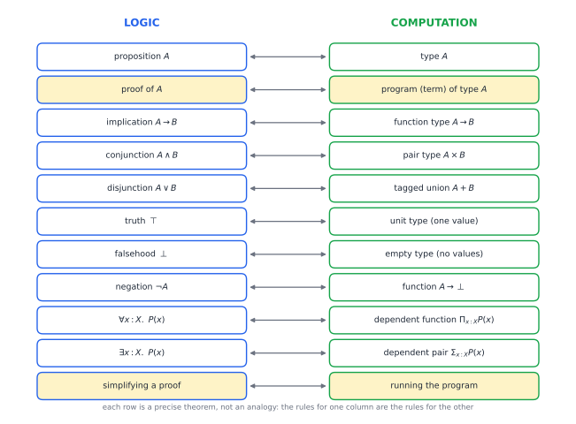
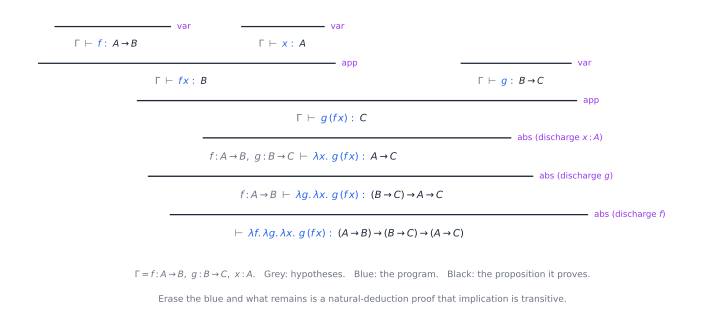

# Chapter 66 — Type Theory and the Curry–Howard Connection

[← Previous](65-mathematical-logic.md) · [Track F](README.md) · [Table of Contents](../../00-front/table-of-contents.md) · [Next →](67-formal-verification.md)

> **Level 2 · Track F — Logic, Proofs, and the Foundations of Truth**
> **Builds on:** [Ch. 1](../../part-1-foundations/01-mathematical-language-and-algebra.md), [Ch. 29](../a-algorithms/29-discrete-mathematics-and-logic.md), [Ch. 63](63-think-like-a-mathematician.md), [Ch. 65](65-mathematical-logic.md) · **Leads to:** [Ch. 67](67-formal-verification.md), [Ch. 68](68-paradoxes-and-limits.md) · **Related:** [Ch. 30](../a-algorithms/30-limits-of-computation.md), [Ch. 62](../e-abstract-math/62-category-theory.md), [Ch. 64](64-set-theory-and-infinity.md)
> **Reading time:** ~25 min

## 66.1 The hook

Here is a programming puzzle with an unusual rule. You may write only `lambda`, variables and function calls: no numbers, `if`, loops, exceptions or `None`. And `A`, `B`, `C` are unknown types: integers, images, bank accounts.

**Puzzle 1.** Write a function with the type

```text
(A -> B) -> (B -> C) -> (A -> C)
```

That is easy. Take `f`, take `g`, take `x`, and return `g(f(x))`. It is function composition ([Ch. 1, §1.9](../../part-1-foundations/01-mathematical-language-and-algebra.md#19-inverse-and-composite-functions)).

**Puzzle 2.** Write one of type `A -> (B -> A)`. Also easy: `lambda a: lambda b: a`.

**Puzzle 3.** Write a function with the type

```text
((A -> B) -> A) -> A
```

Try it before you read on. You are handed `h`, which turns "a way to get from `A` to `B`" into an `A`. To call `h` you must supply a function `A -> B`, but you have no `B` and no way to make one. You have no `A` either: getting one is the whole point. Every attempt goes round in a circle.

Now read the three types as statements of logic, with `->` meaning "implies". Puzzle 1 says that if $A$ implies $B$ and $B$ implies $C$, then $A$ implies $C$. Puzzle 2 says that if $A$ is true, then $B$ implies $A$. Puzzle 3 is **Peirce's law**, $((A\to B)\to A)\to A$. Check its truth table ([Ch. 29](../a-algorithms/29-discrete-mathematics-and-logic.md)): it is true for every assignment of true and false to $A$ and $B$. All three are tautologies.

So two tautologies have programs, and one does not, and this is no accident of Python: in any language whose functions always return, no program of type `((A -> B) -> A) -> A` exists for unknown `A` and `B`. This chapter explains why, by showing that "this type has a program" and "this statement has a proof" are the same thing. The missing program is a missing proof, in a logic slightly more demanding than the one you learned at school.

## 66.2 The big idea

Think of a type as a promise. A value of type `int` is evidence that an integer exists. A value of type `A -> B` is a machine that turns any evidence for `A` into evidence for `B`. That is exactly what a proof of "$A$ implies $B$" does in everyday mathematics: *assume* $A$, then reason your way to $B$.

Push the analogy row by row and nothing breaks. Evidence for "$A$ and $B$" is a **pair** `(a, b)`. Evidence for "$A$ or $B$" is one of them *plus a label saying which*, a **tagged union** such as `Left(a)`. "False" has no evidence at all: it is the **empty type**, and a function out of it exists vacuously, so from False anything follows. "Not $A$" is a function `A -> Empty`.



*Figure 66.1 — The Curry–Howard dictionary. Propositions are types; a proof is a program of that type; and simplifying a proof is running the program. The last two rows, for quantifiers, need the dependent types of §66.3.*

Haskell Curry noticed the first rows in 1934; William Howard wrote the full correspondence down in a manuscript of 1969, published in 1980.

Why does Peirce's law fail? Look at the "or" row. Evidence for $A\lor\neg A$ must say *which* side holds, and for an unknown $A$ you cannot. Truth tables quietly assume every statement already is true or false; evidence does not. The logic you get by insisting that every proof carry its evidence is called **intuitionistic** (or constructive) logic. It is the logic hinted at in [Ch. 63](63-think-like-a-mathematician.md), where an existence proof by excluded middle failed to produce its witness. Peirce's law is a disguised form of excluded middle, so it is a classical tautology with no constructive proof.

The analogy has a second half. A proof that proves a lemma $A\to B$, proves $A$, then applies the lemma, contains a detour: you could have plugged the proof of $A$ straight into the lemma's proof. In programming, that simplification is **running the code**, replacing a call by the function's body with the argument plugged in. Proof simplification and evaluation are one process.

## 66.3 The mathematics

### The simply typed lambda calculus

We need a tiny programming language, small enough to reason about completely. Its **types** are built from atomic types $A, B, C,\dots$ (unknowns) by

$$
T ::= A \;\mid\; T_1\to T_2 \;\mid\; T_1\times T_2 \;\mid\; T_1+T_2 \;\mid\; \mathbf{1} \;\mid\; \mathbf{0}.
$$

Its **terms** are variables $x$, functions $\lambda x{:}T.\,t$, applications $t\,u$, pairs $\langle t,u\rangle$ with projections $\pi_1 t$, $\pi_2 t$, injections $\operatorname{inl} t$, $\operatorname{inr} t$ with case analysis $\operatorname{case} t \operatorname{of} \operatorname{inl} x\Rightarrow u \mid \operatorname{inr} y \Rightarrow v$, the unit value $\star$, and $\operatorname{absurd} t$, which turns a value of the empty type into anything. We usually drop the annotation on $\lambda$.

A **context** $\Gamma = x_1{:}T_1,\dots,x_n{:}T_n$ lists the variables in scope and their types. A **typing judgement** $\Gamma\vdash t:T$ says that in context $\Gamma$, term $t$ has type $T$. Judgements are derived by rules: premises above a line, conclusion below. The rules for functions are

$$
\frac{x{:}T\in\Gamma}{\Gamma\vdash x:T}\ (\text{var})
\qquad
\frac{\Gamma,\,x{:}A\vdash t:B}{\Gamma\vdash \lambda x.\,t : A\to B}\ (\text{abs})
\qquad
\frac{\Gamma\vdash t:A\to B\qquad \Gamma\vdash u:A}{\Gamma\vdash t\,u:B}\ (\text{app})
$$

and for pairs, sums and the empty type

$$
\frac{\Gamma\vdash t:A\quad \Gamma\vdash u:B}{\Gamma\vdash\langle t,u\rangle:A\times B}
\qquad
\frac{\Gamma\vdash t:A\times B}{\Gamma\vdash \pi_1 t:A}
\qquad
\frac{\Gamma\vdash t:A}{\Gamma\vdash \operatorname{inl}t:A+B}
\qquad
\frac{\Gamma\vdash t:\mathbf{0}}{\Gamma\vdash \operatorname{absurd}t:C}
$$

with the obvious companions for $\pi_2$, $\operatorname{inr}$, $\star:\mathbf{1}$ and $\operatorname{case}$ (if $t:A+B$, and $u:C$ assuming $x{:}A$, and $v:C$ assuming $y{:}B$, then the case expression has type $C$).

Now delete every term and keep only the types. Var becomes "a hypothesis may be used". Abs becomes "if assuming $A$ you can derive $B$, conclude $A\to B$ and discharge the assumption". App becomes *modus ponens*. Pairing and projection are $\land$-introduction and elimination, the injections are $\lor$-introduction, case is proof by cases, and absurd is *ex falso quodlibet*. These are exactly Gentzen's rules of **natural deduction** for intuitionistic logic ([Ch. 65](65-mathematical-logic.md)), reading $\times,+,\mathbf{1},\mathbf{0}$ as $\land,\lor,\top,\bot$.



*Figure 66.2 — The derivation that gives composition its type. Read upward, it is a type checker's work. Read with the blue terms erased, it is a proof in natural deduction: from $A\to B$, $B\to C$ and $A$, two uses of modus ponens give $C$, and three discharges give the theorem.*

> [!theorem] Theorem 66.1 — Curry–Howard correspondence
> Let $\Gamma = x_1{:}A_1,\dots,x_n{:}A_n$. There is a term $t$ with $\Gamma\vdash t:B$ if and only if $B$ is provable from the hypotheses $A_1,\dots,A_n$ in intuitionistic natural deduction. Moreover, typing derivations of $t$ and natural-deduction proofs correspond one to one.

*Proof.* ($\Rightarrow$) Induction on the typing derivation. Each typing rule, with terms erased, is an instance of a natural-deduction rule with the same premises and conclusion. Erasing terms from a whole derivation therefore leaves a proof.

($\Leftarrow$) Induction on the natural-deduction proof, building $t$ as we go. A hypothesis $A_i$ becomes the variable $x_i$. If the last step is $\to$-introduction from a proof of $B$ under the extra hypothesis $A$, the induction hypothesis gives $\Gamma, x{:}A\vdash s:B$ for a fresh $x$, and abs gives $\lambda x.\,s:A\to B$. If the last step is modus ponens from proofs of $A\to B$ and $A$, the induction hypothesis gives terms $s$ and $u$ for them, and $s\,u:B$. The other connectives go the same way, one rule at a time. Each step is forced, so the two constructions are inverse to each other. $\square$

So the hook's third puzzle is a question about provability.

### Running a program simplifies a proof

Computation in this language is **β-reduction**: a function applied to an argument steps to the body with the argument substituted,

$$
(\lambda x.\,t)\,u \;\longrightarrow\; t[u/x],
$$

and likewise $\pi_1\langle t,u\rangle\longrightarrow t$, and a case on $\operatorname{inl}u$ steps to its left branch with $x:=u$. On the logic side each redex is a **detour**: an introduction rule immediately followed by the matching elimination. For this to make sense, reduction must not change what is being proved.

> [!theorem] Theorem 66.2 — Subject reduction (types are preserved by evaluation)
> If $\Gamma\vdash t:T$ and $t\longrightarrow t'$, then $\Gamma\vdash t':T$.

*Proof.* The heart of it is a **substitution lemma**: if $\Gamma,x{:}A\vdash t:B$ and $\Gamma\vdash u:A$, then $\Gamma\vdash t[u/x]:B$. We prove the lemma by induction on the derivation of $t$, showing only the function rules.

- $t$ is a variable. If $t=x$, then $B=A$ and $t[u/x]=u$, which has type $A$. If $t=y\neq x$, the substitution does nothing, and $y{:}B$ is already in $\Gamma$.
- $t=t_1\,t_2$ with $t_1:C\to B$ and $t_2:C$. By induction $t_1[u/x]:C\to B$ and $t_2[u/x]:C$, so app gives $(t_1t_2)[u/x]=t_1[u/x]\,t_2[u/x]:B$.
- $t=\lambda y.\,s$ with $B=C\to D$ and $\Gamma,x{:}A,y{:}C\vdash s:D$. Rename $y$ if needed so that it does not occur in $u$. Adding the unused hypothesis $y{:}C$ to $\Gamma\vdash u:A$ is harmless, so induction gives $\Gamma,y{:}C\vdash s[u/x]:D$, and abs gives $\lambda y.\,s[u/x]:C\to D$.

Now the theorem. If the step is at the top, $t=(\lambda x.\,s)\,u$ with $T$ its type. Its derivation must end with app, whose premises are $\Gamma\vdash\lambda x.s:A\to T$ and $\Gamma\vdash u:A$. The first must come from abs, so $\Gamma,x{:}A\vdash s:T$. The lemma gives $\Gamma\vdash s[u/x]:T$. If the step happens inside a subterm, induction on the derivation applies the same argument there. Pairs and cases are similar. $\square$

In logical terms: removing a detour leaves a proof of the same theorem. Prawitz proved this for natural deduction in 1965, and Gentzen's cut elimination of 1935 is its sequent-calculus cousin.

A term with no redex left is in **normal form**. The next fact is the deep one, and we state it without proof.

> [!theorem] Theorem 66.3 — Strong normalization (Tait's method, 1967)
> In the simply typed lambda calculus, every well-typed term reaches a normal form, whatever order the reductions are performed in. In particular, every program terminates.

The reason this needs a clever argument is that substitution can make a term *bigger*: $(\lambda x.\,f\,x\,x)\,u$ copies $u$ twice, and the copies may contain new redexes. Untyped, the term $(\lambda x.\,x\,x)(\lambda x.\,x\,x)$ reduces to itself forever. Types forbid $x\,x$, because $x$ would need a type $A$ equal to $A\to B$.

> [!mystery] Why does every typed program halt?
> Tait's proof does not count steps; it defines a set of "reducible" terms for each type and shows by induction on types that every well-typed term is reducible. For Girard's System F, where functions can take *types* as arguments, the idea still works, but the proof needs more strength than the system has: normalization of System F implies the consistency of second-order arithmetic. Why a system can never certify its own termination, or its own consistency, is Gödel's second incompleteness theorem, in [Ch. 68](68-paradoxes-and-limits.md).

### Why excluded middle has no program

Normal forms have a rigid shape, and that shape is what lets us prove a negative. A normal term is either an **introduction** ($\lambda x.\,t$, a pair, $\operatorname{inl}t$, $\operatorname{inr}t$, $\star$) or **neutral**: a variable with a chain of eliminations applied to it, such as $x\,u_1\,u_2$, $\pi_1(x\,u)$ or $\operatorname{case}x\dots$. (If an elimination were applied to an introduction, that would be a redex.) A neutral term has a free variable at its head, so a *closed* normal term, typed in the empty context, must be an introduction.

> [!theorem] Theorem 66.4 — Excluded middle is not constructively provable
> Let $A$ be an atomic type. There is no closed term of type $A+(A\to\mathbf{0})$. Equivalently, $A\lor\neg A$ has no proof in intuitionistic logic.

*Proof.* Suppose $\vdash t:A+(A\to\mathbf{0})$. By Theorems 66.2 and 66.3 we may replace $t$ by its normal form, which has the same type and is closed, hence an introduction. For a sum type the only introductions are $\operatorname{inl}$ and $\operatorname{inr}$.

*Case $t=\operatorname{inl}s$* with $\vdash s:A$. Then $s$ is a closed normal term of an atomic type. No introduction rule produces an atomic type, and closed normal terms are not neutral. So no such $s$ exists.

*Case $t=\operatorname{inr}s$* with $\vdash s:A\to\mathbf{0}$. Then $s$ is an introduction of a function type, $s=\lambda x.\,r$ with $x{:}A\vdash r:\mathbf{0}$ and $r$ normal. No introduction has type $\mathbf{0}$, so $r$ is neutral, and its head variable must be $x$, the only one in scope. But $x$ has atomic type $A$: it cannot be applied, projected, case-analysed or passed to absurd, because each of those needs a function, pair, sum or empty type. So $r=x$, whose type is $A$, not $\mathbf{0}$. Contradiction. $\square$

The proof reasons about what a program *could* look like once it has finished computing. Peirce's law fares the same, because any program for it that works at every type could be turned into a program for excluded middle (challenge problem 2 asks you to write the conversion).

This is the logic keeping a promise. A constructive proof of "$A$ or not $A$" would be a program that *decides* $A$, and for "this Turing machine halts" no such program exists ([Ch. 30](../a-algorithms/30-limits-of-computation.md#decidable-recognisable-and-the-halting-problem)).

Classical reasoning is not lost, only relocated. A program of type $\neg\neg(A\lor\neg A)$, that is $((A+(A\to\mathbf{0}))\to\mathbf{0})\to\mathbf{0}$, does exist:

$$
\lambda k.\ k\,\bigl(\operatorname{inr}\,(\lambda a.\ k\,(\operatorname{inl}a))\bigr).
$$

Read it as a con trick. Handed a refutation $k$ of the disjunction, it first claims "not $A$". If $k$ ever calls that bluff by producing an $a{:}A$, the program rewinds and offers $\operatorname{inl}a$ instead. Glivenko showed in 1929 that every classical propositional tautology becomes intuitionistically provable once you put $\neg\neg$ in front of it. In programming, $(A\to R)\to R$ is the **continuation monad**: instead of returning an $A$, a value takes a callback that consumes one. That answers the question [Ch. 62](../e-abstract-math/62-category-theory.md) left about monads and proofs: a monad is a *modality*, "$A$ holds, possibly after some effect", and the effect behind classical logic is the ability to jump back in time.

### Dependent types: quantifiers become functions

So far a type cannot mention a value, so we cannot say "for every $n$, $n+0=n$". **Dependent types** lift that restriction. A *type family* $P(x)$ is a type that depends on a value $x{:}X$: for example $\operatorname{Vec}(n)$, the type of lists of length exactly $n$, or $n+0=n$, the type of proofs that this particular equation holds.

- The **dependent function type** $\Pi_{x:X}P(x)$ contains functions sending each $x{:}X$ to something of type $P(x)$. It is $\forall x{:}X.\ P(x)$: a proof of a universal statement is a function from instances to proofs.
- The **dependent pair type** $\Sigma_{x:X}P(x)$ contains pairs $\langle x, p\rangle$ with $p:P(x)$. It is $\exists x{:}X.\ P(x)$: a proof of existence *is* a witness plus evidence that it works.

When $P$ does not depend on $x$, $\Pi$ collapses to $X\to P$ and $\Sigma$ to $X\times P$, recovering the simple types. Induction becomes recursion. Here is a proof assistant (Lean 4) proving that $0+n=n$ for every natural number, given that addition is defined by recursion on its second argument:

```lean
theorem zero_add' : ∀ n : Nat, 0 + n = n
  | 0     => rfl                               -- 0 + 0 reduces to 0
  | n + 1 => congrArg Nat.succ (zero_add' n)   -- use the proof for n
```

The second line is a recursive call: the proof for $n+1$ is built from the proof for $n$. That this recursion is legal, and that it terminates because $n$ shrinks, is induction on $\mathbb{N}$ ([Ch. 29](../a-algorithms/29-discrete-mathematics-and-logic.md#induction-three-ways)), seen as a program.

One consequence startles set theorists. In type theory the **axiom of choice**, in the form "if for every $x$ there is a $y$ with $R(x,y)$, then there is a function $f$ with $R(x,f(x))$ for every $x$", is a *theorem*. The proof is one line: given $h:\Pi_{x}\Sigma_{y}R(x,y)$, take $f(x)=\pi_1(h\,x)$, and the evidence is $\pi_2(h\,x)$. The existential already contained the choice. In set theory, where existence carries no witness, choice is an independent axiom ([Ch. 64](64-set-theory-and-infinity.md), [Ch. 68](68-paradoxes-and-limits.md)).

Dependent types power modern proof assistants. Coq checked the four colour theorem in 2005 and the Feit–Thompson theorem in 2012; there, "the proof is correct" means "the program type-checks".

## 66.4 The algorithm

### Checking a proof is type checking

Because proofs are programs, a proof checker is a type checker, and a type checker for the simple language of §66.3 fits on a screen. Types are atoms (strings) or tuples `('->', A, B)`; terms are tagged tuples, with λ carrying its argument's type.

```python
def typeof(t, ctx):
    tag = t[0]
    if tag == 'var':
        return ctx[t[1]]                                  # rule var
    if tag == 'lam':                                      # ('lam', x, A, body): rule abs
        _, x, A, body = t
        return ('->', A, typeof(body, {**ctx, x: A}))
    if tag == 'app':                                      # rule app
        f, a = typeof(t[1], ctx), typeof(t[2], ctx)
        if f[0] != '->' or f[1] != a:
            raise TypeError(f"cannot apply {f} to {a}")
        return f[2]
    raise ValueError(f"unknown term {tag}")               # pairs, sums: challenge 3
```

Feed it composition and it returns `('->', ('->', 'A', 'B'), ('->', ('->', 'B', 'C'), ('->', 'A', 'C')))`, the theorem of Figure 66.2. Feed it the self-application `lam x:A. x x` and it raises `cannot apply A to A`: the term that looped forever in §66.3 is rejected before it runs.

Each branch is one typing rule read upward, and each subterm is visited once, so checking costs about the term size times the size of the largest type. This is the heart of the **de Bruijn criterion** that proof assistants follow: however clever the tools that *find* a proof, the result is checked by a small kernel like this one, so trust rests on a few hundred lines of code rather than on the search.

### Finding a proof is finding a program

The reverse direction, **type inhabitation** ("given $T$, find a $t$ with $\vdash t:T$"), is proof search. It is harder, and how much harder depends on the logic.

| Problem | Logic | Status |
|---|---|---|
| check that $t$ has type $T$ | any of the systems here | decidable, roughly linear time |
| infer the type of an unannotated $t$ | ML-style polymorphism (Hindley–Milner) | decidable; worst case exponential, fast in practice |
| decide whether $T$ is inhabited | intuitionistic propositional logic | decidable, PSPACE-complete (Statman, 1979) |
| decide whether $T$ is inhabited | first-order or dependent types | undecidable, only semi-decidable |

The undecidable row is the theorem of [Ch. 65](65-mathematical-logic.md) and [Ch. 30](../a-algorithms/30-limits-of-computation.md) in new clothes: if we could always decide whether a proof exists, we could decide the halting problem. Proof assistants therefore make the human supply the hard steps and automate the rest. The propositional case is decidable because a goal-directed search only ever needs subformulas of the goal, and there are finitely many. The experiment below implements that search.

### Failure cases: how a type system stops being a logic

Every type in the correspondence must be honest: an inhabitant must be real evidence. Three features of everyday languages break this.

- **General recursion.** `def loop(): return loop()` can be annotated with any return type. Under Curry–Howard that proves every proposition, including $\bot$. Languages used as logics (Coq, Agda, Lean) accept only recursion they can see terminating, such as structural recursion in `zero_add'`. Since termination is undecidable, such a check must reject some programs that do terminate.
- **Exceptions and null.** `raise` and `None` inhabit every type, so they too "prove" anything.
- **Types of types.** Dependent types need a type of types, so that $\operatorname{Vec}$ can map $\mathbb{N}$ to types. The obvious choice, a $\mathsf{Type}$ that contains every type including itself, is fatal.

> [!mystery] The type of all types
> In 1972 Jean-Yves Girard showed that a type theory with $\mathsf{Type}:\mathsf{Type}$ is inconsistent: there is a closed term of the empty type, a program that claims to prove False and runs forever. Every proof assistant now uses an infinite tower of universes, $\mathsf{Type}_0:\mathsf{Type}_1:\mathsf{Type}_2:\cdots$, so that no universe contains itself. Why does a universe that contains itself collapse? It is the same trap that destroyed Frege's set theory in 1902, and it is sprung in [Ch. 68](68-paradoxes-and-limits.md).

## 66.5 The experiment

The script checks formulas of implicational logic twice, with `F` for falsehood: **classically** by truth table, and **constructively** by searching for a Python program of that type built from `lambda`, calls and `absurd`. For a goal $A\to B$ it writes a `lambda` and seeks $B$; for an atomic goal it tries each hypothesis ending in that atom (or in `F`). A loop check makes the search finite, and it finds a program whenever one exists.

```python
import itertools

def I(*ts):                      # I(A, B, C) means A -> B -> C (arrows associate right)
    return ts[0] if len(ts) == 1 else ('->', ts[0], I(*ts[1:]))

def show(t): return t if isinstance(t, str) else '(' + show(t[1]) + ' -> ' + show(t[2]) + ')'

def atoms(t): return {t} if isinstance(t, str) else atoms(t[1]) | atoms(t[2])

def tautology(t):                # classical check: a truth table
    def ev(t, v): return v.get(t, 0) if isinstance(t, str) else (not ev(t[1], v)) or ev(t[2], v)
    names = sorted(atoms(t) - {'F'})       # F is always false
    return all(ev(t, dict(zip(names, bits))) for bits in itertools.product([0, 1], repeat=len(names)))

def prove(ctx, goal, seen=frozenset()):   # constructive check: search for a Python program
    if not isinstance(goal, str):                       # goal A -> B: write a lambda
        v = 'x%d' % len(ctx)
        body = prove(ctx + [(v, goal[1])], goal[2], seen)
        return None if body is None else '(lambda %s: %s)' % (v, body)
    key = (frozenset(t for _, t in ctx), goal)
    if key in seen: return None                         # loop check keeps search finite
    for v, t in ctx:                                    # use a hypothesis A1 -> ... -> An -> goal
        args = []
        while not isinstance(t, str): args.append(t[1]); t = t[2]
        if t not in (goal, 'F'): continue               # ...or one ending in F (ex falso)
        subs = [prove(ctx, a, seen | {key}) for a in args]
        if all(s is not None for s in subs):
            r = v + ''.join('(%s)' % s for s in subs)
            return r if t == goal else 'absurd(%s)' % r
    return None

# KNOBS: add your own formulas. 'F' plays the role of falsehood.
tests = {'compose': I(I('A', 'B'), I('B', 'C'), 'A', 'C'),
         'K': I('A', 'B', 'A'),
         'Peirce': I(I(I('A', 'B'), 'A'), 'A'),
         'not-not-intro': I('A', I('A', 'F'), 'F'),
         'not-not-elim': I(I(I('A', 'F'), 'F'), 'A'),
         'not-not-Peirce': I(I(I(I(I('A', 'B'), 'A'), 'A'), 'F'), 'F')}
for name, t in tests.items():
    print(f"{name:14s} {show(t):34s} tautology={tautology(t)!s:5s} program={prove([], t)}")
```

All six are tautologies. Composition, `K` and $A\to\neg\neg A$ get programs; for composition the machine finds `lambda x0: lambda x1: lambda x2: x1(x0(x2))`, the hook's answer. Peirce's law and $\neg\neg A\to A$ get `None`. But put $\neg\neg$ in front of Peirce's law and a program appears, a little time machine of nested callbacks, as Glivenko promised.

Things to change:

1. Add the formula $(A\to B\to C)\to(B\to A\to C)$ (swap the arguments) and predict the program before running.
2. Add **contraposition** $(A\to B)\to(\neg B\to\neg A)$ and its converse $(\neg B\to\neg A)\to(A\to B)$. One of them has a program. Which, and why does the other need classical logic?
3. Delete the `'F'` in `if t not in (goal, 'F')`. You now have **minimal logic**, without *ex falso*. Watch what happens to the double-negated Peirce law.

## 66.6 The challenge

No answers are given.

1. **Intuition.** The empty type $\mathbf{0}$ has no values, so a function $\mathbf{0}\to C$ "exists" for every $C$. Explain in plain words why this matches *ex falso quodlibet*. Then explain why a language that lets you write `def f() -> Empty: return f()` cannot be used as a logic, and what that has to do with Theorem 66.3.
2. **Derivation.** Write closed terms for currying, $(A\times B\to C)\to(A\to B\to C)$ and its converse, and for $\neg(A\lor B)\to(\neg A\times\neg B)$. Then show that Peirce's law, assumed for *every* pair of types, yields excluded middle: write a term of type $\neg(A\lor\neg A)\to(A\lor\neg A)$, and use Peirce's law with $A$ replaced by $A\lor\neg A$ and $B$ by $\mathbf{0}$. Why does this, together with Theorem 66.4, show that no polymorphic program for Peirce's law exists?
3. **Implementation.** Extend `typeof` with sums (`inl`, `inr`, `case`) and `absurd`, then extend `prove` from the experiment to conjunction and disjunction. Confirm that $\neg\neg(A\lor\neg A)$ is inhabited and $A\lor\neg A$ is not. Then write a β-reducer and test Theorem 66.2 by re-checking the type after every step.
4. **Open investigation.** The type $(A\to A)\to A\to A$ has infinitely many normal inhabitants: $\lambda f.\lambda x.\,x$, $\lambda f.\lambda x.\,f\,x$, $\lambda f.\lambda x.\,f(f\,x)$, and so on, the **Church numerals**. Others have one, finitely many, or none. Write a program that counts normal inhabitants up to a given size, and explore. Can you predict finite versus infinite from the shape of the type alone?

## 66.7 Loose threads

The hook's third puzzle has no program because Peirce's law has no constructive proof, and Theorem 66.4 shows why from the shape of normal forms: a closed program must commit to an answer, and for an unknown proposition it has nothing to commit to. Proofs are programs, propositions are types, checking is type checking, and dependent types stretch the dictionary to quantifiers.

What we did not tell you:

- **Why typed programs terminate.** Theorem 66.3 was stated, not proved, and its stronger forms cannot be proved inside the systems they describe ([Ch. 68](68-paradoxes-and-limits.md)).
- **Why universes must be stacked.** Girard's paradox descends from Russell's, which opens [Ch. 68](68-paradoxes-and-limits.md).
- **How to use this on real code.** Most software is not written in Lean. How do engineers prove a C loop correct, or a protocol free of deadlock? That is [Ch. 67](67-formal-verification.md).

> [!mystery] When are two types the same?
> A proof of $x=y$ is itself a value, an element of an *identity type*. Can there be two *different* proofs that $x=y$? Around 2006–2009 Vladimir Voevodsky and others saw that identity types behave like paths in a space. His **univalence axiom** says that equivalent types are equal, turning "isomorphic structures are interchangeable" into a rule of logic. Cubical type theory (from 2015) gives univalence a computational meaning, but whether homotopy type theory can serve as a practical foundation for all of mathematics is an open research question.

## Further reading

- M. H. Sørensen and P. Urzyczyn, *Lectures on the Curry–Howard Isomorphism*, Elsevier, 2006. The full story, including normalization proofs and the complexity of inhabitation.
- B. C. Pierce, *Types and Programming Languages*, MIT Press, 2002. The standard programmer's introduction to type systems, with implementations.
- P. Wadler, "Propositions as Types", *Communications of the ACM* 58(12), 2015. A short, witty history of the correspondence.
- The Univalent Foundations Program, *Homotopy Type Theory: Univalent Foundations of Mathematics*, Institute for Advanced Study, 2013. Freely available; dependent types taken to their limit.
