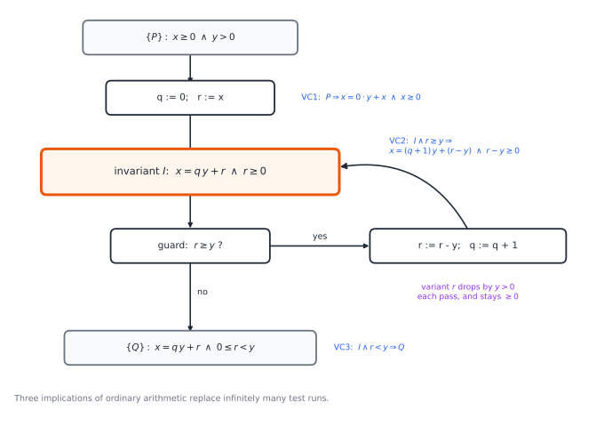
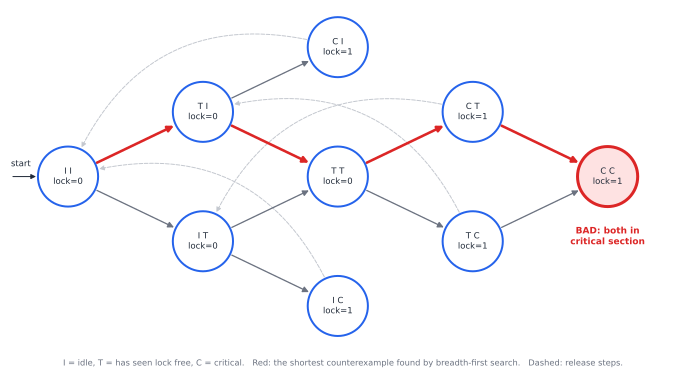

# Chapter 67 — Formal Verification: Proving Programs Correct

[← Previous](66-type-theory-curry-howard.md) · [Track F](README.md) · [Table of Contents](../../00-front/table-of-contents.md) · [Next →](68-paradoxes-and-limits.md)

> **Level 2 · Track F — Logic, Proofs, and the Foundations of Truth**
> **Builds on:** [Ch. 24](../../part-7-numerical-computational/24-computational-mathematics.md), [Ch. 29](../a-algorithms/29-discrete-mathematics-and-logic.md), [Ch. 30](../a-algorithms/30-limits-of-computation.md), [Ch. 65](65-mathematical-logic.md), [Ch. 66](66-type-theory-curry-howard.md) · **Leads to:** [Ch. 68](68-paradoxes-and-limits.md) · **Related:** [Ch. 27](../a-algorithms/27-graph-theory.md), [Ch. 34](../b-probability-information/34-random-walks-and-markov-chains.md), [Ch. 77](../h-cryptography-coding/77-cryptography.md)
> **Reading time:** ~25 min

## 67.1 The hook

In October 1994 a mathematics professor, Thomas Nicely, noticed that his new Pentium computer was getting some divisions wrong. The cleanest example became famous:

$$
\frac{4195835}{3145727} = 1.333820449\ldots \quad\text{but the chip said}\quad 1.333739068\ldots
$$

The error was in the fourth significant digit. The cause was five missing entries in a lookup table of 1,066 used by the division circuit. Intel had tested the chip intensively, but by its own estimate a random division hit the bad entries about once in nine billion tries. The replacement programme cost the company 475 million US dollars.

Count what exhaustive testing would have needed. A double-precision divider takes two 64-bit inputs, so there are $2^{128}\approx3.4\times10^{38}$ input pairs. At a billion tests a second, checking them all would take about $10^{22}$ years, a trillion times the age of the universe. Testing samples a vanishing fraction of the input space. It can find bugs, but it cannot show their absence.

Two years later, on 4 June 1996, the first Ariane 5 rocket veered off course about 37 seconds after lift-off and destroyed itself. A 64-bit floating-point velocity had been converted into a 16-bit integer. On the slower Ariane 4, where the code came from, the value always fitted. On Ariane 5 it did not, and the overflow shut down both inertial reference computers, which ran identical software.

Both failures were in components that had been tested and had worked. The question this chapter asks is the one an engineer asks after a disaster: **can we prove, once and for all inputs, that a program or a circuit does what it should?** After 1994 Intel began proving its floating-point units correct with theorem provers. Today Amazon checks its distributed protocols with model checkers, an operating-system kernel and a C compiler have been proved correct line by line, and avionics software is analysed for overflow before it flies. This chapter shows how.

## 67.2 The big idea

A proof of correctness needs two things that testing does not: a **specification** written as a logical formula, and a way of reasoning about *every* execution at once.

There are three main ways to get the second.

1. **Deductive verification.** Attach logical assertions to points in the program, and prove that each statement carries a true assertion before it to a true assertion after it. Loops are handled by an **invariant**, exactly as in [Ch. 29](../a-algorithms/29-discrete-mathematics-and-logic.md#loop-invariants-induction-over-time). The proof obligations are ordinary formulas of arithmetic that a solver or a human can discharge. This is **Hoare logic**.
2. **Model checking.** If the system has finitely many states, as a circuit or a protocol does, just explore all of them. A graph search visits every reachable state and either certifies that no bad state is reachable or returns the exact sequence of steps that reaches one.
3. **Interactive theorem proving.** Write the program, its specification and its proof in a proof assistant whose kernel checks every step, using the proofs-as-programs machinery of [Ch. 66](66-type-theory-curry-howard.md).

An analogy: testing is spot-checking a bridge by driving trucks over it. Deductive verification is the structural calculation that shows every beam carries its load. Model checking is a stress simulation of every possible load pattern, feasible only because the bridge has finitely many joints. Theorem proving is having the calculation audited by an inspector who accepts nothing on trust.

All three run into the same wall. By Rice's theorem ([Ch. 30](../a-algorithms/30-limits-of-computation.md#reductions-undecidability-spreads)), no algorithm decides whether an arbitrary program meets an arbitrary specification. Each method gives something up: deductive methods need a human or a heuristic to supply invariants, model checking needs a finite state space, and theorem proving needs human effort.

## 67.3 The mathematics

### Hoare triples

Fix a small imperative language: assignments `x := e`, sequencing `S1; S2`, conditionals `if b then S1 else S2` and loops `while b do S`. A **state** $\sigma$ gives every variable an integer value. Assertions are formulas of predicate logic about the variables ([Ch. 29](../a-algorithms/29-discrete-mathematics-and-logic.md#predicate-logic-saying-for-every-input)).

> [!definition] Hoare triple
> The triple $\{P\}\ S\ \{Q\}$ holds (in the sense of **partial correctness**) if, whenever $S$ starts in a state satisfying the **precondition** $P$ and terminates, the final state satisfies the **postcondition** $Q$. It holds in the sense of **total correctness** if, in addition, $S$ always terminates from such states.

Partial correctness says nothing about termination. $\{\top\}\ \texttt{while true do skip}\ \{\bot\}$ is a valid partial-correctness triple, because the loop never finishes and so never delivers a bad state. Termination is proved separately with a variant, as in [Ch. 29](../a-algorithms/29-discrete-mathematics-and-logic.md#loop-invariants-induction-over-time).

In 1969 Tony Hoare gave rules that derive valid triples, one per construct:

$$
\{Q[e/x]\}\ x:=e\ \{Q\}\ (\text{assign})
\qquad
\frac{\{P\}\,S_1\,\{R\}\qquad \{R\}\,S_2\,\{Q\}}{\{P\}\ S_1;S_2\ \{Q\}}\ (\text{seq})
$$

$$
\frac{\{P\wedge b\}\,S_1\,\{Q\}\qquad \{P\wedge\neg b\}\,S_2\,\{Q\}}{\{P\}\ \texttt{if}\ b\ \texttt{then}\ S_1\ \texttt{else}\ S_2\ \{Q\}}\ (\text{if})
\qquad
\frac{\{I\wedge b\}\,S\,\{I\}}{\{I\}\ \texttt{while}\ b\ \texttt{do}\ S\ \{I\wedge\neg b\}}\ (\text{while})
$$

$$
\frac{P\Rightarrow P'\qquad \{P'\}\,S\,\{Q'\}\qquad Q'\Rightarrow Q}{\{P\}\ S\ \{Q\}}\ (\text{consequence})
$$

Here $Q[e/x]$ means $Q$ with every free $x$ replaced by the expression $e$. The while rule is the loop-invariant principle in compact form: if one pass of the body preserves $I$, then $I$ survives any number of passes, and on exit the guard is false. The consequence rule is the only place where ordinary mathematics enters: it lets us strengthen a precondition or weaken a postcondition by proving an implication.

### The assignment rule runs backwards

The assignment rule looks back to front. To know what must be true *before* `x := x + 1` so that $x>5$ holds *after*, substitute: $(x>5)[x+1/x]$ is $x+1>5$, that is $x>4$. Reasoning flows from the goal backwards, and the next theorem says this backward step loses nothing.

> [!definition] Weakest precondition
> $\operatorname{wp}(S,Q)$ is the assertion satisfied by exactly those states from which $S$ terminates in a state satisfying $Q$. It is the weakest $P$ for which $\{P\}\,S\,\{Q\}$ holds totally: any valid precondition implies it.

> [!theorem] Theorem 67.1 — Assignment is exact
> For every assertion $Q$, $\operatorname{wp}(x:=e,\ Q) = Q[e/x]$. In particular the assignment rule is sound, and no weaker precondition would do.

*Proof.* Write $\sigma[x\mapsto v]$ for the state $\sigma$ with $x$ changed to $v$, and $\sigma(e)$ for the value of $e$ in $\sigma$. Running $x:=e$ from $\sigma$ always terminates, in $\sigma[x\mapsto\sigma(e)]$. So $\sigma$ is in $\operatorname{wp}(x:=e,Q)$ exactly when $\sigma[x\mapsto\sigma(e)]\models Q$.

It remains to show the **substitution lemma**: $\sigma\models Q[e/x]$ if and only if $\sigma[x\mapsto\sigma(e)]\models Q$. Argue by induction on the structure of $Q$. For a term $t$, evaluating $t[e/x]$ in $\sigma$ gives the same value as evaluating $t$ in $\sigma[x\mapsto\sigma(e)]$: every occurrence of $x$ is replaced by $e$, whose value in $\sigma$ is precisely what $x$ holds in the updated state, and the other variables are unchanged. So atomic formulas such as $t_1<t_2$ agree. The connectives $\neg,\wedge,\vee,\Rightarrow$ preserve agreement directly. For a quantifier $\forall y.\,R$, rename $y$ so that it is neither $x$ nor a variable of $e$; then substitution passes inside, and the induction hypothesis applies for each value of $y$. $\square$

Sequencing composes: $\operatorname{wp}(S_1;S_2,Q)=\operatorname{wp}(S_1,\operatorname{wp}(S_2,Q))$, and for conditionals $\operatorname{wp}=(b\Rightarrow\operatorname{wp}(S_1,Q))\wedge(\neg b\Rightarrow\operatorname{wp}(S_2,Q))$. Straight-line code can therefore be verified mechanically, by computing the weakest precondition and checking one implication. Loops are where this stops. The weakest precondition of a loop is a limit of infinitely many unrollings, and in general no algorithm can write it down. Instead, someone supplies an invariant, and the loop becomes three implications.

### A proof of division

Hoare's 1969 paper verified a program that divides $x$ by $y$ using only subtraction:

```text
q := 0; r := x;
while r >= y do
    r := r - y; q := q + 1
```

> [!theorem] Theorem 67.2 — Division by repeated subtraction is correct
> $\{x\ge0\wedge y>0\}$ the program above $\{x=q\,y+r\wedge 0\le r<y\}$ holds with total correctness.

*Proof.* Take the invariant $I:\ x=q\,y+r\wedge r\ge0$. Three verification conditions remain, each an implication about integers (Figure 67.1).

*VC1, initialisation.* By the assignment rule twice, the precondition of `q := 0; r := x` for $I$ is $I[x/r][0/q]$, which is $x=0\cdot y+x\wedge x\ge0$. This follows from $x\ge0$.

*VC2, maintenance.* The precondition of the body for $I$ is $I[q+1/q][r-y/r]$, that is $x=(q+1)\,y+(r-y)\wedge r-y\ge0$. Assume $I$ and the guard $r\ge y$. Then $(q+1)y+(r-y)=qy+r=x$, and $r-y\ge0$ is the guard. So $\{I\wedge r\ge y\}\ \text{body}\ \{I\}$, and the while rule gives $\{I\}\ \text{loop}\ \{I\wedge r<y\}$.

*VC3, exit.* $I\wedge r<y$ is $x=qy+r\wedge r\ge0\wedge r<y$, which is the postcondition word for word.

*Termination.* Use the variant $r$. While the guard holds, $r\ge y>0$, and each pass replaces $r$ by $r-y<r$ with $r-y\geq 0$. A non-negative integer cannot decrease forever (the argument of [Ch. 29](../a-algorithms/29-discrete-mathematics-and-logic.md#loop-invariants-induction-over-time)), so the loop stops. The consequence and sequencing rules stitch the pieces together. $\square$



*Figure 67.1 — Hoare logic on the division loop. Every path through the program begins and ends at an assertion; the invariant (orange) cuts the loop open so that each path is finite. The three blue verification conditions are all that must be proved. Note how $y>0$ is used: without it the variant would not decrease.*

Notice what has happened. A claim about infinitely many runs, one for each $(x,y)$, has become three facts of high-school algebra. A program called an **SMT solver** (satisfiability modulo theories) can check such facts automatically: it tries to find values making the negation true, and when the search space is exhausted, the implication is proved.

> [!mystery] Is Hoare logic complete?
> Every triple derived by Hoare's rules is valid. Is every *valid* triple derivable? Stephen Cook proved in 1978 that it is, *relative* to an oracle for the consequence rule, one that can tell which implications of arithmetic are true. But no proof system can play that oracle. Why there are true statements of integer arithmetic that no consistent, mechanically checkable set of axioms proves is Gödel's first incompleteness theorem, in [Ch. 68](68-paradoxes-and-limits.md).

### Model checking: search instead of proof

For a system with finitely many states, we can skip invariants and look everywhere.

> [!definition] Transition system and safety
> A **transition system** is a finite set of states $S$, a set of initial states $S_0\subseteq S$, and a transition relation $\to\ \subseteq S\times S$. A state is **reachable** if some path $s_0\to s_1\to\dots\to s_k$ leads to it from $S_0$. A **safety property** names a set of bad states $B$ and asserts that no reachable state is in $B$. In temporal-logic notation it is written $\mathbf{G}\,\neg\mathit{bad}$, "globally, never bad".

Safety says nothing bad ever happens. Its partner, **liveness**, says something good eventually happens, written $\mathbf{F}\,\mathit{good}$: every request is eventually served, or the system never deadlocks forever. Temporal logics such as LTL and CTL combine $\mathbf{G}$, $\mathbf{F}$ and "until" into a specification language, and Clarke, Emerson and Sifakis shared the 2007 Turing Award for the algorithms that check them.

> [!theorem] Theorem 67.3 — Safety checking is a graph search
> For a finite transition system, whether some bad state is reachable can be decided in time $O(\lvert S\rvert+\lvert\to\rvert)$. If one is reachable, breadth-first search returns a shortest path to it.

*Proof.* Breadth-first search from $S_0$ ([Ch. 27](../a-algorithms/27-graph-theory.md)) visits every reachable state exactly once and examines every transition out of a visited state once, which gives the time bound. It visits states in order of their distance from $S_0$: the queue always holds states of distance $d$ followed by states of distance $d+1$, by induction on the number of steps. So the first bad state dequeued is a closest one, and following the recorded parent pointers back to $S_0$ gives a shortest path. If the search ends without dequeuing a bad state, every reachable state has been visited and none is bad. $\square$

The shortest path is the most useful output of all: a **counterexample trace**, a step-by-step replay of the bug. For concurrent programs, which fail only under rare interleavings, it is the difference between a heisenbug and a fix. Figure 67.2 shows a lock that two processes implement by first *testing* a shared flag and then *setting* it. The search finds the four-step trace in which both test before either sets.



*Figure 67.2 — Model checking a test-then-set lock. Each node is a global state: the program counters of both processes and the shared lock bit. Breadth-first search reaches the bad state, both processes in the critical section, in four steps. Four further states beyond the bad one are not drawn.*

## 67.4 The algorithm

### Generating verification conditions

Deductive verifiers such as Dafny, Why3 and Frama-C turn an annotated program into formulas by running the weakest-precondition rules backwards, then hand the formulas to an SMT solver. The core fits in a few lines of pseudocode:

```text
vcgen(S, Q):                     # returns (precondition, side conditions)
  case S of
    x := e         : return (Q[e/x], [])
    S1; S2         : (P2, C2) = vcgen(S2, Q); (P1, C1) = vcgen(S1, P2)
                     return (P1, C1 + C2)
    if b S1 else S2: (P1, C1) = vcgen(S1, Q); (P2, C2) = vcgen(S2, Q)
                     return ((b => P1) and (not b => P2), C1 + C2)
    while b inv I S: (PB, CB) = vcgen(S, I)
                     return (I, CB + [I and b => PB, I and not b => Q])

verify(Pre, S, Post):
  (P, C) = vcgen(S, Post)
  for each formula F in [Pre => P] + C:  ask the solver whether F is valid
```

Run on the division program, it produces exactly VC1 to VC3 of Theorem 67.2. The cost is linear in the program for straight-line code with care, but naive substitution through a chain of $k$ conditionals can duplicate $Q$ at each branch, giving formulas of size $2^k$. Practical tools introduce fresh names for intermediate values to keep the formulas small. The solver's job, deciding whether a formula of arithmetic is valid, is decidable for linear integer arithmetic and undecidable once multiplication of variables is allowed, so the solver may answer "valid", "invalid, here is a counterexample", or "unknown".

### Where the invariants come from

The algorithm takes the invariant `I` as input. [Ch. 29](../a-algorithms/29-discrete-mathematics-and-logic.md) asked whether a program could find invariants on its own, and [Ch. 30](../a-algorithms/30-limits-of-computation.md) proved that no program can always succeed. Real tools succeed often anyway, in three ways.

- **The programmer writes them.** Languages like Dafny make `invariant` a keyword, and the verifier checks each one as it is typed. It feels like a type checker that understands arithmetic.
- **Abstract interpretation.** Run the program on *sets* of values instead of values, for example intervals $[a,b]$ for each variable. A loop is iterated until the intervals stop growing, with a "widening" step that jumps to infinity if they would grow forever. The result is an invariant guaranteed to hold, though it may be too weak to prove what you want. The analyser Astrée used this to prove the absence of run-time errors, including overflows of the Ariane kind, in the flight-control software of Airbus aircraft.
- **Learning from failure.** Guess a weak invariant, let the solver produce a counterexample, and refine the guess to exclude it. Techniques called CEGAR and IC3 automate this loop, and they power the hardware model checkers used at chip companies today.

### Explicit-state model checking and the state explosion

Theorem 67.3 is the whole algorithm for safety: breadth-first search with a visited set and parent pointers, linear in the size of the state graph. The trouble is that size. A system of $n$ processes, each with $k$ local states, can have up to $k^n$ global states before counting shared variables. Ten processes with ten states each give $10^{10}$, and one 32-bit variable multiplies that by four billion. This **state explosion** is the central enemy of model checking, and three ideas fight it.

- **Symbolic model checking** represents sets of states as compact Boolean formulas (binary decision diagrams) and computes the reachable set by manipulating formulas, never listing states. In 1992 this handled systems with more than $10^{20}$ states.
- **Bounded model checking** asks a SAT solver whether a bad state is reachable within $k$ steps, by unrolling the transition relation $k$ times into one big formula.
- **Partial-order reduction** notices that independent steps of different processes commute, so only one ordering of them needs exploring.

> [!mystery] Why does SAT solving work at all?
> Bounded model checking turns verification into Boolean satisfiability, which is NP-complete ([Ch. 30](../a-algorithms/30-limits-of-computation.md#efficient-computation-p-and-np)). In theory that should be hopeless. In practice, modern solvers routinely settle industrial formulas with millions of variables, and the whole hardware-verification industry rests on this. Why real-world formulas are so much easier than the worst case is not understood. Explaining the success of conflict-driven clause learning on structured instances is an open problem.

### Failure cases

A verified system can still fail, and the ways it fails are instructive.

- **The specification is wrong.** A proof shows that the code meets the specification, not that the specification says what you meant. Ariane 5's code met the Ariane 4 assumptions perfectly.
- **The model is not the machine.** Theorem 67.2 used exact integers. On a machine, `q + 1` can overflow. The binary search bug of [Ch. 29](../a-algorithms/29-discrete-mathematics-and-logic.md#loop-invariants-induction-over-time) and floating-point rounding ([Ch. 24](../../part-7-numerical-computational/24-computational-mathematics.md)) are the same mistake.
- **The trusted base is buggy.** The compiler, the operating system and the hardware are assumed correct. That is why verifying them matters. The seL4 microkernel (2009) is about 8,700 lines of C with roughly 200,000 lines of machine-checked proof. The CompCert C compiler is proved in Coq to preserve the meaning of programs; when researchers bombarded compilers with random programs in 2011, they found hundreds of bugs in GCC and LLVM and none in CompCert's verified core.

## 67.5 The experiment

The script below is a complete explicit-state model checker in under 40 lines. It explores every interleaving of two processes and either reports how many states it explored and that the property holds (`None`), or prints the shortest trace to a bad state. Two protocols are included: the naive test-then-set lock of Figure 67.2 and **Peterson's algorithm** (1981), which achieves mutual exclusion with two flags and a `turn` variable.

```python
from collections import deque

# A state is (pc0, pc1, shared...). Each protocol says what process i may do next.
def naive(s, i):                      # shared: lock. pc: 0 idle, 1 saw lock free, 2 critical
    pc, lock = list(s[:2]), s[2]
    if pc[i] == 0 and lock == 0: pc[i] = 1                  # test the lock...
    elif pc[i] == 1: pc[i], lock = 2, 1                     # ...then set it (not atomic!)
    elif pc[i] == 2: pc[i], lock = 0, 0                     # leave, release
    else: return None                                       # blocked
    return (*pc, lock)

def peterson(s, i):                   # shared: flag0, flag1, turn. pc 3 = critical
    pc, flag, turn, j = list(s[:2]), list(s[2:4]), s[4], 1 - i
    if pc[i] == 0: flag[i], pc[i] = 1, 1                    # I want to enter
    elif pc[i] == 1: turn, pc[i] = j, 2                     # but you go first
    elif pc[i] == 2:
        if flag[j] == 0 or turn == i: pc[i] = 3             # enter if you don't want to, or it's my turn
        else: return None                                   # busy-wait
    elif pc[i] == 3: flag[i], pc[i] = 0, 0                  # leave
    return (*pc, *flag, turn)

def check(step, start, bad):          # breadth-first search over every interleaving
    parent, queue = {start: None}, deque([start])
    while queue:
        s = queue.popleft()
        if bad(s):                                          # rebuild the shortest path to s
            trace = []
            while s is not None: trace.append(s); s = parent[s]
            return len(parent), trace[::-1]
        for i in (0, 1):
            t = step(s, i)
            if t is not None and t not in parent:
                parent[t] = s; queue.append(t)
    return len(parent), None

# KNOBS: switch protocol; try changing turn = j to turn = i in peterson.
print(check(naive, (0, 0, 0), lambda s: s[0] == 2 and s[1] == 2))
print(check(peterson, (0, 0, 0, 0, 0), lambda s: s[0] == 3 and s[1] == 3))
```

The naive lock fails with the trace `(0,0,0) → (1,0,0) → (1,1,0) → (2,1,1) → (2,2,1)`: process 0 sees the lock free, process 1 sees it free, both enter. Peterson's algorithm explores all 20 of its reachable states and reports `None`: mutual exclusion is *proved* for every interleaving, not tested on some.

Things to change:

1. In `peterson`, replace `turn, pc[i] = j, 2` by `turn, pc[i] = i, 2`, so that each process politely insists on its *own* turn. The checker finds a six-step counterexample among 26 states. Read the trace and explain it in words.
2. Swap the order of the first two steps of Peterson's algorithm (set `turn` before raising the flag). Is it still safe?
3. Add a check for **deadlock**: a reachable state in which neither process can move. Does either protocol have one?

## 67.6 The challenge

No answers are given.

1. **Intuition.** A bug strikes one random division in nine billion. A test campaign runs a billion random divisions. Estimate the chance that it finds the bug, and then explain why the triple $\{\top\}\ \texttt{while true do skip}\ \{\bot\}$ is valid. Which of these two facts is more worrying for an engineer, and why?
2. **Derivation.** Prove, with an invariant and a variant, that this program computes $a^n$ for integers $a$ and $n\ge0$: `p := 1; b := a; k := n; while k > 0 do (if k odd then p := p*b); b := b*b; k := k div 2`. Then compute $\operatorname{wp}$ of `x := x + y; y := x - y; x := x - y` for the postcondition $x=Y\wedge y=X$, and say what the result proves.
3. **Implementation.** Generalise `check` to $n$ processes and implement the **filter lock**, Peterson's algorithm for $n$ processes. Measure the number of reachable states for $n=2,3,4$ and fit the growth. How large an $n$ can your laptop verify?
4. **Open investigation.** Run the division program on many random inputs and record $(x,y,q,r)$ at the loop head. From these samples, guess candidate invariants of the form $c_1x+c_2q\,y+c_3r=0$ or simple inequalities, keeping those that no sample violates (the idea behind the tool Daikon). How often is a guessed invariant actually *inductive*, preserved by one pass of the body? Try other small loops. Is there a reliable way to tell, from samples alone, which guesses will survive a proof?

## 67.7 Loose threads

The hook asked whether we can prove a program correct for every input. For a large and growing class of programs, yes. Hoare logic turns a loop into three implications once someone supplies the invariant, the weakest-precondition calculus makes the rest mechanical, and model checking settles finite systems outright, with a counterexample when it fails. Proof assistants close the remaining gaps by hand, and kernels, compilers and flight software have been verified that way. What no method does is decide correctness for *all* programs: Rice's theorem forbids it, and every tool is a negotiated settlement with that fact.

What we did not tell you:

- **Where completeness breaks.** The first mystery said Hoare logic is only as complete as arithmetic. Why arithmetic itself cannot be completely axiomatised is [Ch. 68](68-paradoxes-and-limits.md).
- **Why the hard problem is easy.** SAT-based verification works far better than complexity theory predicts, an open problem.
- **What happens when the system flips coins.** Every transition in this chapter was certain.

> [!mystery] Verifying a coin-flipping protocol
> Ethernet's backoff, randomised consensus protocols and quantum key distribution all make random choices. For them, "a bad state is never reached" is the wrong question; the right one is "with what probability is a bad state reached?" Probabilistic model checkers such as PRISM answer it, and the answer comes from turning the state graph into a Markov chain and solving a linear system for that probability. Where the linear system comes from, and why it has a unique solution, is the first-step analysis of [Ch. 34](../b-probability-information/34-random-walks-and-markov-chains.md#hitting-times-and-the-gamblers-ruin).

Verification also has an adversarial cousin. A cryptographic protocol must be correct not against random inputs but against an attacker who chooses the worst ones, and proving such protocols secure is the work of [Ch. 77](../h-cryptography-coding/77-cryptography.md).

## Further reading

- C. A. R. Hoare, "An Axiomatic Basis for Computer Programming", *Communications of the ACM* 12(10), 1969. Six pages that started the field, including the division example.
- C. Baier and J.-P. Katoen, *Principles of Model Checking*, MIT Press, 2008. The standard text on transition systems, temporal logic and state-space methods.
- A. R. Bradley and Z. Manna, *The Calculus of Computation*, Springer, 2007. Decision procedures, SMT and verification conditions, at an introductory level.
- B. C. Pierce et al., *Software Foundations*, online textbook series. Hoare logic and program verification done inside the Coq proof assistant.
