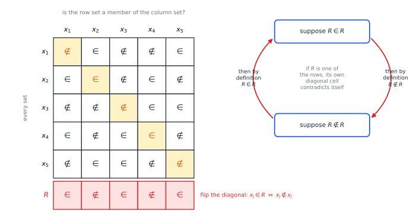
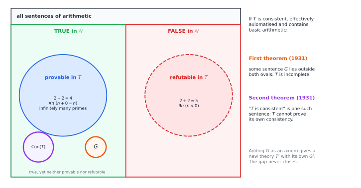
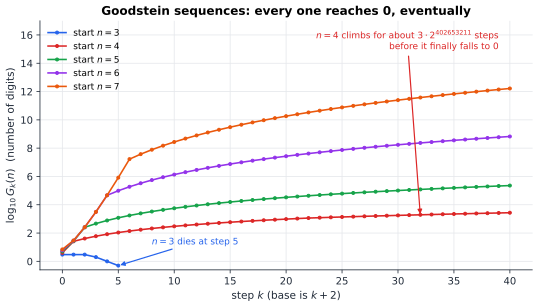

# Chapter 68 — Paradoxes, Independence, and Mathematical Limits

[← Previous](67-formal-verification.md) · [Track F](README.md) · [Table of Contents](../../00-front/table-of-contents.md) · [Next →](../g-graphics-simulation/README.md)

> **Level 2 · Track F — Logic, Proofs, and the Foundations of Truth**
> **Builds on:** [Ch. 30](../a-algorithms/30-limits-of-computation.md), [Ch. 64](64-set-theory-and-infinity.md), [Ch. 65](65-mathematical-logic.md), [Ch. 66](66-type-theory-curry-howard.md) · **Leads to:** [Ch. 98](../j-frontier/98-mathematical-research.md), [Ch. 62](../e-abstract-math/62-category-theory.md) · **Related:** [Ch. 29](../a-algorithms/29-discrete-mathematics-and-logic.md), [Ch. 63](63-think-like-a-mathematician.md), [Ch. 67](67-formal-verification.md)
> **Reading time:** ~25 min

## 68.1 The hook

On 16 June 1902 a young Bertrand Russell wrote a short, polite letter to the logician Gottlob Frege. Frege had spent two decades building arithmetic on pure logic, and the second volume of his masterpiece was at the printer. Russell's letter pointed out, in a few lines, that Frege's system could prove a contradiction. Frege added an appendix to the volume, admitting that the foundation of his building had given way.

The contradiction concerned a single set: the set of all sets that are not members of themselves. Ask whether it is a member of itself, and either answer forces the other.

Thirty years later Kurt Gödel found that the trouble was not confined to careless foundations. Here is a game that shows how strange things got. Take a number, say 4, and write it in "hereditary base 2", where even the exponents are written in base 2:

$$
4 = 2^{2}.
$$

Now replace every 2 by a 3, and subtract 1: $3^{3}-1=26$. Write 26 in hereditary base 3, $26=2\cdot3^2+2\cdot3+2$, replace every 3 by a 4, and subtract 1: $2\cdot4^2+2\cdot4+2-1=41$. Keep going, raising the base by one each time:

$$
4,\ 26,\ 41,\ 60,\ 83,\ 109,\ 139,\ 173,\ 211,\ 253,\ \dots
$$

The numbers climb. After 2,000 steps the sequence stands at about four million, and it is still climbing. Yet in 1944 Reuben Goodstein proved that **every such sequence, from every starting number, eventually reaches 0**. The one starting at 4 gets there after about $3\cdot2^{402653211}$ steps, a number with some 121 million digits.

Here is the twist. In 1982 Laurence Kirby and Jeff Paris proved that Goodstein's theorem, a statement purely about whole numbers, additions and powers, **cannot be proved** from the standard axioms of arithmetic. It is true, and the axioms that every number theorist uses are powerless to show it.

How can a statement about whole numbers be true but unprovable? Which "true" do we mean, if not "provable"? And if the standard axioms miss Goodstein's theorem, what else do they miss? This chapter is about those questions, and about why the answers all go back to Russell's letter.

## 68.2 The big idea

Every paradox in this chapter has the same skeleton: **an object that talks about itself, with a negation.** "This sentence is false." "The set of all sets not containing themselves." "The program that does the opposite of whatever the halting decider predicts it will do" ([Ch. 30](../a-algorithms/30-limits-of-computation.md#decidable-recognisable-and-the-halting-problem)). Cantor's proof that the reals are uncountable ([Ch. 64](64-set-theory-and-infinity.md)) is the same move. List the objects, look down the diagonal, and flip it.

In ordinary language, self-reference produces nonsense. In a precise system it produces a theorem: some object you thought existed cannot exist. Russell's set cannot exist. The halting decider cannot exist. And, in Gödel's version, **a formal system that is consistent, mechanically checkable and strong enough for arithmetic cannot prove every true arithmetic statement.**

Picture a formal system as a machine that prints theorems: it starts from axioms and applies inference rules, forever, printing everything it can derive. We want the machine to be

1. **consistent**: it never prints both a sentence and its negation;
2. **complete**: for every sentence, it eventually prints either the sentence or its negation;
3. **effective**: there is an algorithm to check whether a string is an axiom, so that the machine really is a machine.

For simple subjects all three are possible. For arithmetic of addition alone, Presburger found such a system in 1929. Gödel showed that once multiplication is in, you can have at most two. Since nobody wants an inconsistent or uncheckable system, completeness goes.

A sentence that the system can neither prove nor refute is **independent** of it. Independence is not a vague "too hard". It is a theorem about the system, as definite as any other.

## 68.3 The mathematics

### Russell's paradox and the end of naive sets

Frege's system, like the intuitive set theory most of us carry around, included the principle of **unrestricted comprehension**: for any property $\varphi(x)$, there is a set $\{x:\varphi(x)\}$ of all things with that property.

> [!theorem] Theorem 68.1 — Russell's paradox
> (a) Unrestricted comprehension is inconsistent.
> (b) In Zermelo–Fraenkel set theory, for every set $A$ the set $R_A=\{x\in A: x\notin x\}$ is not a member of $A$. Hence there is no set of all sets.

*Proof.* (a) Apply comprehension to $\varphi(x)= x\notin x$, giving a set $R$ with $x\in R\iff x\notin x$ for every $x$. Take $x=R$: then $R\in R\iff R\notin R$. A statement equivalent to its own negation yields a contradiction whichever truth value it has.

(b) Zermelo's **separation** axiom allows only $\{x\in A:\varphi(x)\}$, carving a subset out of a set $A$ that already exists. So $R_A$ exists, and $x\in R_A\iff (x\in A\wedge x\notin x)$. Suppose $R_A\in A$. Then for $x=R_A$ we get $R_A\in R_A\iff R_A\notin R_A$, the same contradiction. So $R_A\notin A$. If there were a set $V$ of all sets, $R_V$ would be a set not in $V$, which is absurd. $\square$

Part (b) is the repair that became modern set theory ([Ch. 64](64-set-theory-and-infinity.md)): sets are built in stages from sets already available, and no stage contains everything. The universe of type theory in [Ch. 66](66-type-theory-curry-howard.md) is stratified for the same reason, and Girard's paradox about $\mathsf{Type}:\mathsf{Type}$ is Russell's argument rebuilt with types.



*Figure 68.1 — Russell's set is a flipped diagonal. Row $x_i$, column $x_j$ records whether $x_i\in x_j$. Russell's $R$ contains $x_j$ exactly when the diagonal cell says $x_j\notin x_j$, so $R$ differs from every column on the diagonal. If $R$ were itself one of the sets, its own diagonal cell would have to equal its own negation.*

> [!mystery] One theorem behind every diagonal?
> Cantor's uncountability proof, Russell's paradox, Turing's halting problem and Gödel's theorem all flip a diagonal. Is that a family resemblance, or a single theorem? In 1969 William Lawvere showed it is one theorem, about functions $A\to(A\to B)$ in a cartesian closed category: if some map $B\to B$ has no fixed point, then no such function can hit every map $A\to B$. Every diagonal argument in this book is an instance, and the language that makes this precise is [Ch. 62](../e-abstract-math/62-category-theory.md).

### Formal systems, truth and provability

Let $T$ be a theory in the language of arithmetic (symbols $0$, $S$ for successor, $+$, $\times$, $<$ and the usual logic). Its standard example is **Peano arithmetic** (PA): basic axioms such as $x+0=x$ and $x+S(y)=S(x+y)$, plus the induction schema. $T$ is

- **effectively axiomatised** if an algorithm recognises its axioms. Then its theorems can be listed by a program that enumerates all finite strings and prints those that are correct proofs;
- **consistent** if it proves no sentence together with its negation;
- **sound** if every theorem is *true* in the standard model $\mathbb{N}=\{0,1,2,\dots\}$;
- **complete** (or negation-complete) if for every sentence $\sigma$ it proves $\sigma$ or $\neg\sigma$.

Do not confuse the last with Gödel's *completeness* theorem of [Ch. 65](65-mathematical-logic.md), which says that a sentence true in *every* model of $T$ is provable. Here we ask about truth in the one model we care about, $\mathbb{N}$.

We need one fact from the arithmetisation of computation, which we state without proof. Turing machines and their inputs can be coded by numbers, and "machine $M$ halts on input $w$" can be written as an arithmetic sentence $H_{M,w}$ of the form $\exists s\ \theta(s)$, where $\theta$ says "$s$ codes a halting computation of $M$ on $w$" and can be checked by bounded search. The sentence is true in $\mathbb{N}$ exactly when $M$ halts on $w$.

> [!theorem] Theorem 68.2 — Incompleteness from the halting problem
> Let $T$ be sound and effectively axiomatised. Then there are $M$ and $w$ such that $M$ does not halt on $w$, but $T$ proves neither $\neg H_{M,w}$ nor $H_{M,w}$. So $\neg H_{M,w}$ is a true sentence that $T$ cannot decide.

*Proof.* Suppose instead that $T$ proves $\neg H_{M,w}$ for *every* pair $(M,w)$ with $M$ not halting on $w$. Here is an algorithm for the halting problem. Given $(M,w)$, run two processes side by side, one step of each in turn:

1. simulate $M$ on $w$; if the simulation halts, answer **halts**;
2. enumerate the theorems of $T$; if $\neg H_{M,w}$ appears, answer **does not halt**.

The procedure always stops: if $M$ halts, process 1 stops; if not, $\neg H_{M,w}$ is true, so by our assumption $T$ proves it and process 2 finds it. The answer is always correct: process 1 is never wrong, and if process 2 answers, $T$ proved $\neg H_{M,w}$, which is then true by soundness, so $M$ really does not halt. That decides the halting problem, contradicting [Theorem 30.2](../a-algorithms/30-limits-of-computation.md#decidable-recognisable-and-the-halting-problem).

So some non-halting pair $(M,w)$ has $T\nvdash\neg H_{M,w}$. And $T\nvdash H_{M,w}$, because $H_{M,w}$ is false and $T$ is sound. $\square$

The proof never wrote the unprovable sentence down. It showed that a complete, sound, effective theory would be a halting decider, and no halting decider exists. Gödel did better: he built the sentence explicitly, and he needed only consistency, not soundness.

### Gödel's sentence

Gödel coded formulas as numbers, writing $\ulcorner\varphi\urcorner$ for the code of $\varphi$. Checking a proof is mechanical, so there is an arithmetic formula $\operatorname{Prov}_T(x)$ that says "$x$ is the code of a theorem of $T$". Two standard facts, stated without proof, do the heavy lifting.

- **Representability.** If $T\vdash\varphi$, then $T\vdash\operatorname{Prov}_T(\ulcorner\varphi\urcorner)$: when a proof exists, $T$ can verify it by checking it step by step.
- **The diagonal lemma.** For every formula $\psi(x)$ there is a sentence $G$ with $T\vdash G\leftrightarrow\psi(\ulcorner G\urcorner)$. It is the logical version of a program that prints its own source code (§68.4).

Apply the lemma to $\psi(x)=\neg\operatorname{Prov}_T(x)$. The result is a sentence $G$ that $T$ proves equivalent to "$G$ is not provable in $T$".

> [!theorem] Theorem 68.3 — Gödel's first incompleteness theorem (1931)
> Let $T$ be consistent, effectively axiomatised and strong enough for representability and the diagonal lemma (Peano arithmetic is more than enough). Then $T\nvdash G$. If $T$ is also sound, $G$ is true and $T\nvdash\neg G$.

*Proof.* Suppose $T\vdash G$. By representability, $T\vdash\operatorname{Prov}_T(\ulcorner G\urcorner)$. But $G$ is equivalent in $T$ to $\neg\operatorname{Prov}_T(\ulcorner G\urcorner)$, so $T\vdash\neg\operatorname{Prov}_T(\ulcorner G\urcorner)$ as well. That is a sentence and its negation, contradicting consistency. Hence $T\nvdash G$.

That is exactly what $G$ asserts, so $G$ is true. If $T$ is sound it proves only true sentences, so it cannot prove the false $\neg G$. $\square$

In 1936 Barkley Rosser modified the sentence ("if I am provable, then a shorter refutation of me exists") so that consistency alone shows that neither it nor its negation is provable. Either way, **adding $G$ as a new axiom does not help**: the stronger theory $T+G$ is still consistent and effective, so it has its own Gödel sentence $G'$.

### The second theorem: no system vouches for itself

Let $\operatorname{Con}_T$ be the arithmetic sentence $\neg\operatorname{Prov}_T(\ulcorner 0=1\urcorner)$, "$T$ does not prove $0=1$".

> [!theorem] Theorem 68.4 — Gödel's second incompleteness theorem (1931)
> If $T$ is consistent, effectively axiomatised and contains Peano arithmetic, then $T\nvdash\operatorname{Con}_T$.

*Sketch.* The proof of Theorem 68.3 showed, informally, "if $T$ is consistent then $G$ is not provable". Every step of that argument is elementary reasoning about proofs and codes, and with considerable effort one checks that $T$ itself can carry it out. So $T\vdash\operatorname{Con}_T\to\neg\operatorname{Prov}_T(\ulcorner G\urcorner)$, that is, $T\vdash\operatorname{Con}_T\to G$. If $T$ proved $\operatorname{Con}_T$, it would prove $G$, contradicting Theorem 68.3. $\square$



*Figure 68.2 — What Gödel's theorems say about a formal system $T$. Provable sentences (if $T$ is sound) are true, refutable ones are false, but the two ovals never cover everything. The first theorem puts $G$ in the gap; the second puts $\operatorname{Con}(T)$ there too.*

This ended Hilbert's programme of the 1920s, which hoped to prove the consistency of all of mathematics by finite, uncontroversial means. Any such proof, formalised in a system $T$, would be a proof of $\operatorname{Con}_T$ inside $T$. It also explains the first mystery of [Ch. 66](66-type-theory-curry-howard.md): proving that every program of System F halts implies the consistency of second-order arithmetic, so that proof can never be carried out *inside* second-order arithmetic.

### Independence in the wild

Gödel's $G$ is artificial, built only to say "I am unprovable". The shock of the following decades was that natural questions turned out to be independent too. The method is always the same, and it comes from soundness: if $T\vdash\varphi$, every model of $T$ satisfies $\varphi$. So to show $T\nvdash\varphi$, build a model of $T$ in which $\varphi$ is false. To show independence, build two models, one for each answer. Non-Euclidean geometry proved the parallel postulate independent of Euclid's other axioms in exactly this way, decades before Gödel.

- **Goodstein's theorem** is independent of Peano arithmetic (Kirby and Paris, 1982), though it is provable in set theory. The proof replaces each base by the infinite ordinal $\omega$, so that the sequence becomes a strictly *decreasing* sequence of ordinals below $\varepsilon_0=\omega^{\omega^{\omega^{\cdots}}}$, which must stop because ordinals are well-ordered ([Ch. 64](64-set-theory-and-infinity.md)). Peano arithmetic cannot prove that such ordinal descents terminate; in 1936 Gentzen showed that this very fact suffices to prove PA consistent, which by Theorem 68.4 PA cannot do itself.
- **The continuum hypothesis** (CH), Cantor's guess that no set has size strictly between $\mathbb{N}$ and $\mathbb{R}$, is independent of the standard axioms of set theory, ZFC. Gödel built a model of ZFC in which CH holds (1938–40); Paul Cohen invented *forcing* to build one in which it fails (1963), and won the Fields Medal for it.
- **Busy beavers.** The values $\mathrm{BB}(n)$ of [Ch. 30](../a-algorithms/30-limits-of-computation.md#306-the-challenge) are definite numbers. But in 2016 Adam Yedidia and Scott Aaronson built a 7,918-state Turing machine that halts if and only if ZFC is inconsistent, so ZFC cannot determine its behaviour. Later work cut the size to under 750 states. Somewhere below that, the value of $\mathrm{BB}(n)$ escapes the axioms of all of mathematics.

> [!mystery] Is the continuum hypothesis true?
> CH is independent of ZFC, so the axioms do not settle it. Is it then meaningless, or is there a fact of the matter that the axioms simply fail to capture? Set theorists split. Some search for new, natural axioms that decide it: W. Hugh Woodin argued for years that CH is false, then developed an "ultimate L" programme that would make it true. Others hold that there is a *multiverse* of equally good set-theoretic worlds. Which view is right, and whether any new axiom will win acceptance, is an open problem at the foundations of mathematics.

## 68.4 The algorithm

### Self-reference is a programming technique

The diagonal lemma sounds like a logician's trick. It is really an algorithm, and the cleanest way to see it is a program that prints its own source code, a **quine**:

```python
s = 's = %r\nprint(s %% s)'
print(s % s)
```

Run it and it prints exactly those two lines. The string `s` is a *template* with a hole; `%r` fills the hole with a quoted copy of the template itself. The diagonal lemma works the same way. Given $\psi(x)$, form the template "$\psi$(the code of the result of substituting this template into itself)", then substitute the template into itself. The result is a sentence that talks about its own code. Kleene's recursion theorem (1938) says every programming language can do this: any program can be given access to its own source. That is why the halting argument of [Ch. 30](../a-algorithms/30-limits-of-computation.md) works without hand-waving: the machine $D$ really can ask the decider about itself.

### Enumerating theorems

The "theorem-printing machine" of §68.2 is an honest algorithm:

```text
for n = 1, 2, 3, ...:
    for each string p of length at most n:
        if p is a correctly formed proof in T (check every step against axioms and rules):
            print the last line of p
```

Checking a proof is fast, roughly linear in its length for a well-designed system. The search is hopeless in practice, exponential in the length of the proof sought. But in principle it prints every theorem of $T$, and only theorems. Theorems of an effective theory are therefore **recursively enumerable**: a machine can list them. Theorem 68.2 used exactly this machine. Incompleteness then says: for arithmetic, the list of theorems can never coincide with the list of true sentences, because the second list cannot be produced by any machine at all.

### Computing Goodstein sequences

The bump step in the hook is a recursive algorithm, because exponents must themselves be written in the base:

```text
bump(n, b):                          # hereditary base b, then replace b by b+1
    result = 0; power = 0
    while n > 0:
        n, digit = divmod(n, b)
        result = result + digit * (b+1) ^ bump(power, b)
        power = power + 1
    return result
```

Each call handles one level of the hereditary representation, and exponents are tiny compared with $n$, so one step costs a few big-integer operations. The difficulty is not the cost per step but the number of steps. A program that runs the sequence until it reaches 0 is a program whose termination is Goodstein's theorem, so Peano arithmetic cannot prove that the program halts, even though it does. Such programs are where the independence phenomena of this chapter meet the verification problems of [Ch. 67](67-formal-verification.md): a verifier built on Peano arithmetic would be unable to certify this loop terminates, whatever invariant you handed it.

### Failure cases

- **Self-reference does not always paradox.** "This sentence has five words" is self-referential and simply true. The trouble needs negation, a diagonal that flips.
- **Incompleteness needs strength.** Presburger arithmetic (no multiplication), the theory of real closed fields (Tarski) and plane Euclidean geometry are complete and decidable. Gödel's theorem bites only once a system can encode its own proofs.
- **It is not "everything is unknowable".** Incompleteness says no single effective system captures all arithmetic truth. It does not say any particular open problem is independent, and most never turn out to be.

## 68.5 The experiment

The script computes a Goodstein sequence, prints the first terms and the term after `STEPS` steps, and plots the number of digits. Set `HEREDITARY = False` to get the **weak Goodstein sequence**, where only the base itself is bumped and the exponents stay as they were.

```python
import numpy as np
import matplotlib.pyplot as plt

START, STEPS = 4, 2000      # KNOBS: try START = 3, 5, 6; more STEPS
HEREDITARY = True           # False gives the "weak" Goodstein sequence (exponents not bumped)

def bump(n, b):
    """Write n in base b (hereditarily, if asked), replace every b by b+1, return the value."""
    result, power = 0, 0
    while n:
        n, digit = divmod(n, b)
        exponent = bump(power, b) if HEREDITARY else power
        result += digit * (b + 1) ** exponent
        power += 1
    return result

n, base, values = START, 2, [START]
while n > 0 and len(values) <= STEPS:
    n = bump(n, base) - 1          # bump the base, then subtract one
    base += 1
    values.append(n)

print("first terms:", values[:8])
print("after", len(values) - 1, "steps the value is", values[-1] if values[-1] < 10**12
      else f"a {len(str(values[-1]))}-digit number", "in base", base)
digits = [np.log10(v) if v > 0 else 0 for v in values]
plt.plot(digits)
plt.xlabel("step k"); plt.ylabel("log10 of the term")
plt.title(f"Goodstein sequence from {START} (hereditary={HEREDITARY})")
plt.show()
```

From 3, the sequence is `3, 3, 3, 2, 1, 0`. From 4 it climbs past four million in 2,000 steps, and the plot rises steadily with no sign of turning. Now set `HEREDITARY = False`: from 4, the weak sequence reaches 0 after only 21 steps. The difference between the two versions is exactly the difference between what Peano arithmetic can prove and what it cannot. Weak Goodstein sequences always terminate, and PA proves it.



*Figure 68.3 — Digits of $G_k(n)$ for the first 40 steps. Only $n=3$ visibly dies. The others climb, the steeper the larger the start, and every one of them will eventually come back to 0, a fact Peano arithmetic cannot prove.*

Things to change:

1. Run `START = 5` and `START = 6` for a few hundred steps. How fast do the digit counts grow? Do not try to run them to the end.
2. With `HEREDITARY = False`, record how many steps the weak sequence takes from $n=1,\dots,8$. Does the step count grow like a polynomial, an exponential, or something worse?
3. Change "subtract one" to "subtract two". Does every sequence still reach 0? Does your reason survive?

## 68.6 The challenge

No answers are given.

1. **Intuition.** Call an adjective *heterological* if it does not describe itself: "long" is heterological, "short" is not. Is "heterological" heterological? Compare this with the barber who shaves exactly those who do not shave themselves. Why does the barber puzzle merely show that no such barber exists, while Russell's paradox destroyed a whole theory?
2. **Derivation.** Using Theorem 68.4, show that if PA is consistent, then so is the theory $\mathrm{PA}+\neg\operatorname{Con}_{\mathrm{PA}}$, which "believes" itself inconsistent. Then explain why this strange theory is consistent but not sound, and what its models must contain that $\mathbb{N}$ does not.
3. **Implementation.** Write a quine in a language other than Python. Then write a Python program that takes a function `halts(src)` as a parameter, reads its own source code using the quine trick, and does the opposite of whatever `halts` predicts about it. Test it against three different (necessarily wrong) `halts` functions and record how each one fails.
4. **Open investigation.** In the **hydra game** of Kirby and Paris, Hercules cuts a head off a tree-shaped hydra, and the hydra regrows copies of the wounded branch, more copies at each step. Every strategy kills every hydra, and this too is unprovable in PA. Simulate it. Investigate how the number of steps depends on Hercules's strategy (always cut the leftmost head, the rightmost, a random one) and on the shape of the starting tree. Is there a strategy that is reliably fastest?

## 68.7 Loose threads

The hook asked how a statement about whole numbers can be true but unprovable. Now we know. Provability is relative to a formal system, a theorem-printing machine, and Gödel showed that any consistent, effective machine strong enough for arithmetic misses some truths, including the truth of its own consistency. Goodstein's theorem is one of them for Peano arithmetic. It is provable in a stronger system, which has its own blind spots in turn. Russell's paradox started this story by showing that naive self-reference destroys a theory. Gödel finished it by showing that careful self-reference, inside any sufficiently rich theory, reveals limits that cannot be engineered away.

What we did not tell you:

- **How the independence of CH is proved.** Forcing builds new models of set theory by adding a "generic" object to an old one, and it is among the most powerful techniques in logic. We stated Cohen's result without even a sketch.
- **Why the diagonal keeps appearing.** The first mystery points to Lawvere's fixed-point theorem in [Ch. 62](../e-abstract-math/62-category-theory.md).
- **What working mathematicians do about it.** Almost nothing, usually, and the reasons are part of how research proceeds: see [Ch. 98](../j-frontier/98-mathematical-research.md).

> [!mystery] Could P versus NP be independent?
> [Ch. 30](../a-algorithms/30-limits-of-computation.md) left P versus NP open. Could it be open because it is independent of ZFC, like the continuum hypothesis? Some researchers have taken the possibility seriously, and it is known that certain *weak* systems of arithmetic cannot prove some lower bounds of the kind needed. But no one knows how to prove that P versus NP is independent of ZFC, or even of Peano arithmetic, and most experts expect a proof one way or the other to exist. Whether the most famous problem in computer science lies beyond the reach of mathematics itself is an open problem.

## Further reading

- E. Nagel and J. R. Newman, *Gödel's Proof*, revised ed., New York University Press, 2001. The classic short account for non-specialists.
- P. Smith, *An Introduction to Gödel's Theorems*, 2nd ed., Cambridge University Press, 2013. Careful, complete proofs, including the second theorem.
- T. Franzén, *Gödel's Theorem: An Incomplete Guide to Its Use and Abuse*, A K Peters, 2005. What the theorems do and do not say, with many misreadings corrected.
- R. M. Smullyan, *Gödel's Incompleteness Theorems*, Oxford University Press, 1992. Elegant proofs built around self-reference and diagonalisation.
