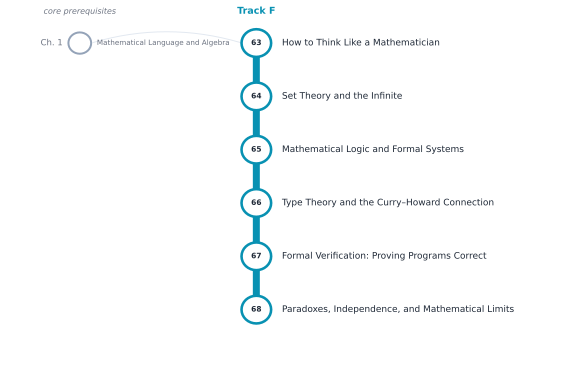

# Track F — Logic, Proofs, and the Foundations of Truth

[← Table of Contents](../../00-front/table-of-contents.md) · [Start: Ch. 63 →](63-think-like-a-mathematician.md)

> **Level 2 — Specializations.** For writing reliable algorithms, designing programming languages, and understanding why some truths cannot be proved.

*Suggested reading order for Track F. The grey stations on the left are the core chapters it leans on.*

## Before you start

This track assumes you are comfortable with these core chapters:

- Ch. 1 — [Mathematical Language and Algebra](../../part-1-foundations/01-mathematical-language-and-algebra.md)

## Chapters

| Ch. | Chapter | What it explores |
|---|---|---|
| 63 | [How to Think Like a Mathematician](63-think-like-a-mathematician.md) | Direct proof, contradiction, induction, construction, counterexamples. |
| 64 | [Set Theory and the Infinite](64-set-theory-and-infinity.md) | Cardinality, ordinals, countability, uncountability, axioms. |
| 65 | [Mathematical Logic and Formal Systems](65-mathematical-logic.md) | Predicate logic, completeness, soundness, compactness, incompleteness. |
| 66 | [Type Theory and the Curry–Howard Connection](66-type-theory-curry-howard.md) | Types as propositions, proofs as programs, dependent types. |
| 67 | [Formal Verification: Proving Programs Correct](67-formal-verification.md) | Hoare logic, invariants, model checking, theorem provers. |
| 68 | [Paradoxes, Independence, and Mathematical Limits](68-paradoxes-and-limits.md) | Russell's paradox, Gödel's incompleteness theorems, independence results. |

Every chapter follows the same arc: **the hook** (a puzzle or a failure), **the big idea**, **the mathematics**, **the algorithm**, **the experiment** you can run, **the challenge**, and **loose threads**: the questions the chapter deliberately leaves open.
